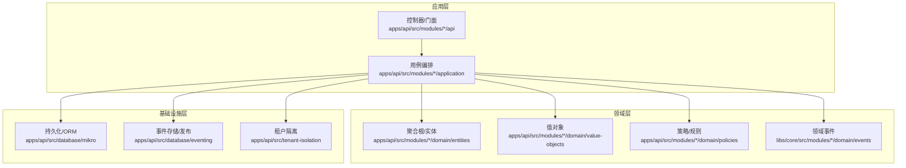
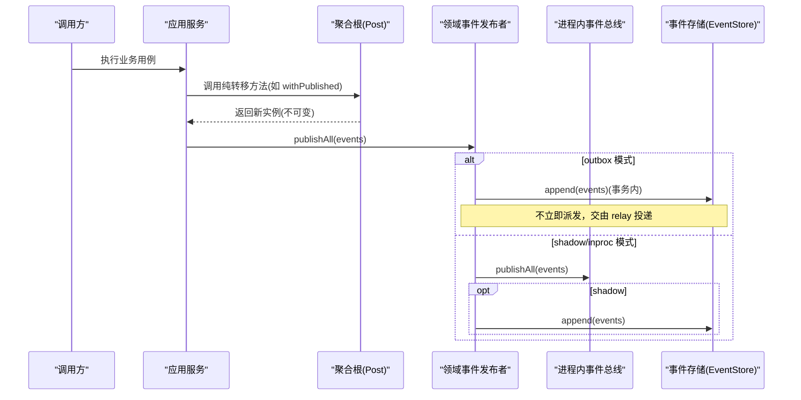
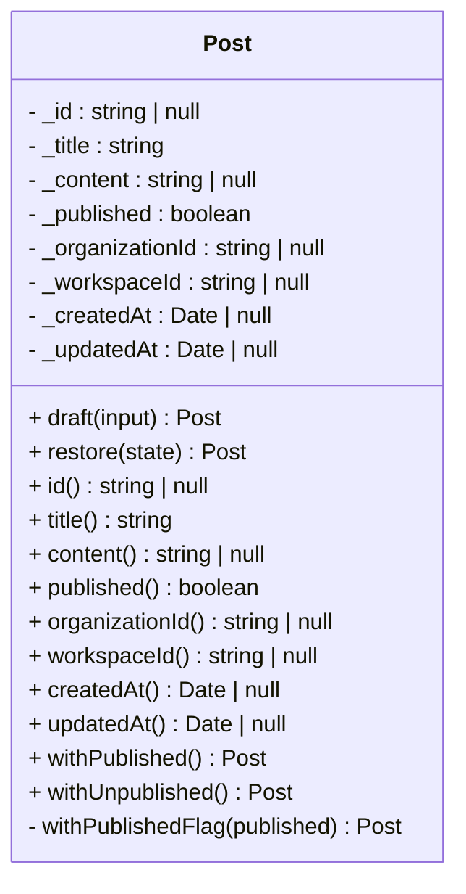
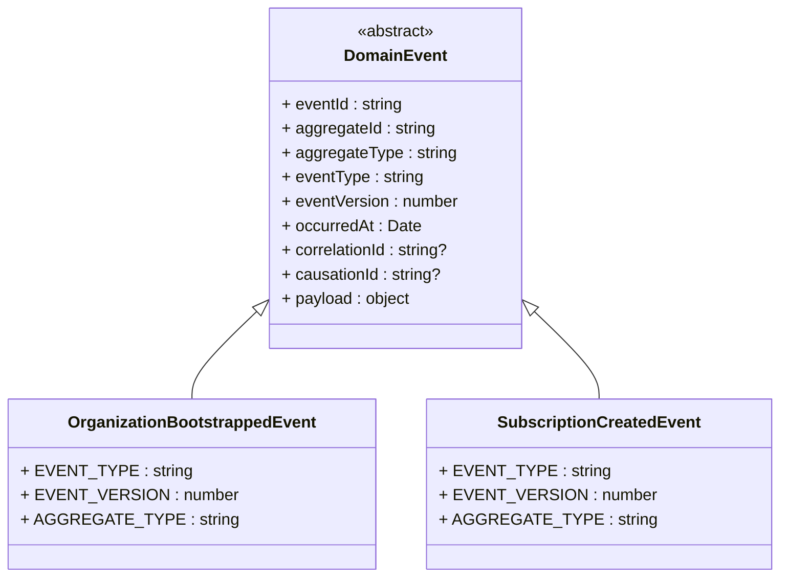
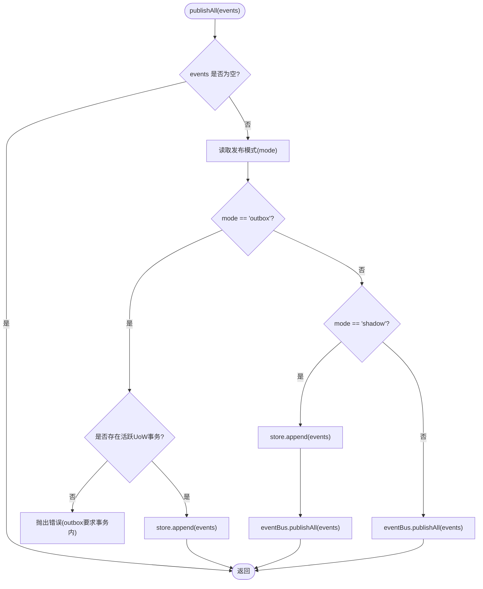
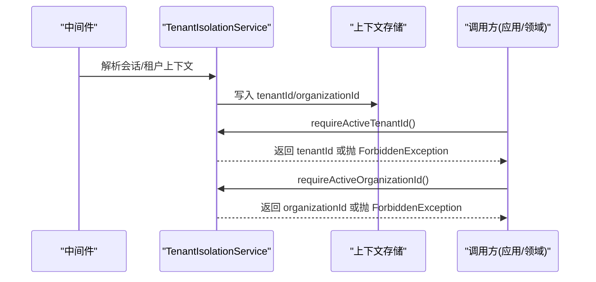
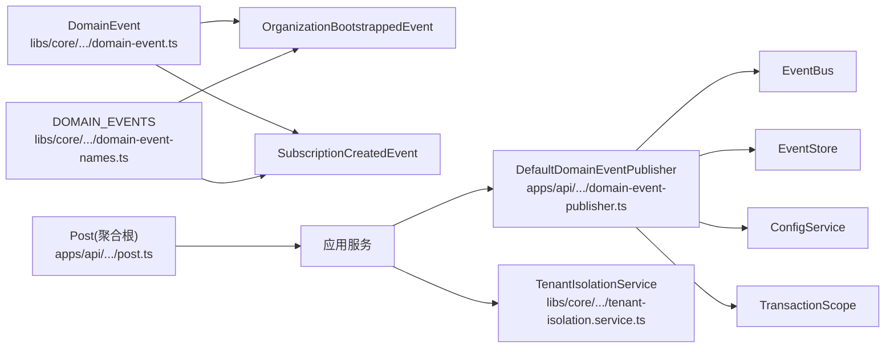

# 领域层设计

<cite>
**本文引用的文件**   
- [domain-event.ts](file://libs/core/src/shared-kernel/domain/domain-event.ts)
- [domain-event-names.ts](file://libs/core/src/shared-kernel/domain/domain-event-names.ts)
- [domain-event-publisher.ts](file://apps/api/src/database/eventing/domain-event-publisher.ts)
- [post.ts](file://apps/api/src/modules/posts/domain/entities/post.ts)
- [organization-bootstrapped.event.ts](file://libs/core/src/modules/organizations/lifecycle/events/organization-bootstrapped.event.ts)
- [subscription-created.event.ts](file://libs/core/src/modules/subscriptions/domain/events/subscription-created.event.ts)
- [tenant-isolation.service.ts](file://libs/core/src/tenant-isolation/tenant-isolation.service.ts)
- [tenant-isolation.module.ts](file://apps/api/src/tenant-isolation/tenant-isolation.module.ts)
</cite>

## 目录
1. [引言](#引言)
2. [项目结构](#项目结构)
3. [核心组件](#核心组件)
4. [架构总览](#架构总览)
5. [详细组件分析](#详细组件分析)
6. [依赖关系分析](#依赖关系分析)
7. [性能考量](#性能考量)
8. [故障排查指南](#故障排查指南)
9. [结论](#结论)

## 引言
本文件聚焦领域层（Domain Layer）的设计与实现，围绕“纯函数领域内核”展开：以不可变数据、不变量校验和纯转移函数表达核心业务；通过聚合根、值对象、领域事件与领域服务组织业务规则；借助事件发布机制与事件溯源能力支撑可审计、可回放的业务流；并通过租户隔离上下文保障多租户安全。文档同时给出典型模式与最佳实践，帮助读者在现有代码库中快速定位并复用领域建模范式。

## 项目结构
仓库采用按特性模块组织的分层结构，领域层位于各模块的 domain 子目录，基础设施与持久化位于 infrastructure，应用层编排命令/查询位于 application，API 暴露于 api。领域层保持框架无关，不直接依赖 NestJS、ORM 或 HTTP 层。

图表来源
- [post.ts:35-48](file://apps/api/src/modules/posts/domain/entities/post.ts#L35-L48)
- [domain-event.ts:36-76](file://libs/core/src/shared-kernel/domain/domain-event.ts#L36-L76)
- [domain-event-publisher.ts:9-22](file://apps/api/src/database/eventing/domain-event-publisher.ts#L9-L22)
- [tenant-isolation.module.ts:63-72](file://apps/api/src/tenant-isolation/tenant-isolation.module.ts#L63-L72)

章节来源
- [post.ts:35-48](file://apps/api/src/modules/posts/domain/entities/post.ts#L35-L48)
- [domain-event.ts:36-76](file://libs/core/src/shared-kernel/domain/domain-event.ts#L36-L76)
- [domain-event-publisher.ts:9-22](file://apps/api/src/database/eventing/domain-event-publisher.ts#L9-L22)
- [tenant-isolation.module.ts:63-72](file://apps/api/src/tenant-isolation/tenant-isolation.module.ts#L63-L72)

## 核心组件
- 领域事件基类与命名契约：提供框架无关的事件模型与集中式事件名常量，保证跨上下文稳定契约。
- 领域事件发布者：支持 inproc/shadow/outbox 三种发布模式，并与事务范围协作，确保事件与域行同生共死。
- 聚合根示例（Post）：展示不可变状态、两阶段构造、纯转移函数与幂等迁移。
- 具体领域事件：租户引导与订阅创建事件，体现事件载荷最小化与聚合类型约定。
- 租户隔离服务：提供活动租户/组织上下文读取与 fail-closed 检查。

章节来源
- [domain-event.ts:36-76](file://libs/core/src/shared-kernel/domain/domain-event.ts#L36-L76)
- [domain-event-names.ts:1-23](file://libs/core/src/shared-kernel/domain/domain-event-names.ts#L1-L23)
- [domain-event-publisher.ts:9-71](file://apps/api/src/database/eventing/domain-event-publisher.ts#L9-L71)
- [post.ts:35-158](file://apps/api/src/modules/posts/domain/entities/post.ts#L35-L158)
- [organization-bootstrapped.event.ts:1-53](file://libs/core/src/modules/organizations/lifecycle/events/organization-bootstrapped.event.ts#L1-L53)
- [subscription-created.event.ts:1-52](file://libs/core/src/modules/subscriptions/domain/events/subscription-created.event.ts#L1-L52)
- [tenant-isolation.service.ts:71-115](file://libs/core/src/tenant-isolation/tenant-isolation.service.ts#L71-L115)

## 架构总览
领域层通过“不可变模型 + 纯函数转移 + 领域事件”构建稳定的业务内核；事件由发布者根据配置选择进程内总线、影子写入或 Outbox 投递；租户隔离中间件在请求入口注入上下文，所有写路径需显式声明活动租户/组织。

图表来源
- [post.ts:129-157](file://apps/api/src/modules/posts/domain/entities/post.ts#L129-L157)
- [domain-event-publisher.ts:33-71](file://apps/api/src/database/eventing/domain-event-publisher.ts#L33-L71)

## 详细组件分析

### 纯函数领域内核与聚合根
- 不可变数据结构：聚合根内部字段私有且只读，对外仅暴露 getter 与返回新实例的转移方法，避免副作用。
- 两阶段构造：draft 用于新建写意图（业务字段校验），restore 用于从持久层复原（信任仓储数据）。
- 纯转移函数：withPublished/withUnpublished 返回新实例，幂等处理已变更状态，保证状态迁移可重复执行。
- 职责分离：领域实体与 ORM 实体严格分离，映射逻辑在基础设施层完成。

图表来源
- [post.ts:49-158](file://apps/api/src/modules/posts/domain/entities/post.ts#L49-L158)

章节来源
- [post.ts:35-158](file://apps/api/src/modules/posts/domain/entities/post.ts#L35-L158)

### 值对象与业务规则封装
- 值对象应表达不可变的业务概念（如金额、键名），通过工厂方法或构造函数进行不变量校验，对外只提供只读访问。
- 将业务规则内聚到值对象与聚合根中，避免在应用层散落判断逻辑。
- 值对象与聚合根共同构成“领域内核”，对上层仅暴露语义清晰的接口。

章节来源
- [post.ts:35-48](file://apps/api/src/modules/posts/domain/entities/post.ts#L35-L48)

### 领域事件与命名规范
- 事件基类 DomainEvent 定义统一元数据（eventId、aggregateId、aggregateType、eventType、eventVersion、occurredAt、correlationId、causationId、payload），为事件溯源预留列集与 upcaster 钩子。
- 事件名集中管理于 DOMAIN_EVENTS，作为跨上下文契约；具体事件类通过静态常量绑定 EVENT_TYPE、EVENT_VERSION、AGGREGATE_TYPE。
- 载荷最小化：仅携带必要信息，PII 最小化，避免泄露敏感数据。

图表来源
- [domain-event.ts:36-76](file://libs/core/src/shared-kernel/domain/domain-event.ts#L36-L76)
- [organization-bootstrapped.event.ts:34-51](file://libs/core/src/modules/organizations/lifecycle/events/organization-bootstrapped.event.ts#L34-L51)
- [subscription-created.event.ts:33-50](file://libs/core/src/modules/subscriptions/domain/events/subscription-created.event.ts#L33-L50)

章节来源
- [domain-event.ts:3-34](file://libs/core/src/shared-kernel/domain/domain-event.ts#L3-L34)
- [domain-event.ts:36-76](file://libs/core/src/shared-kernel/domain/domain-event.ts#L36-L76)
- [domain-event-names.ts:1-23](file://libs/core/src/shared-kernel/domain/domain-event-names.ts#L1-L23)
- [organization-bootstrapped.event.ts:1-53](file://libs/core/src/modules/organizations/lifecycle/events/organization-bootstrapped.event.ts#L1-L53)
- [subscription-created.event.ts:1-52](file://libs/core/src/modules/subscriptions/domain/events/subscription-created.event.ts#L1-L52)

### 领域事件发布机制与事件溯源
- DefaultDomainEventPublisher 支持三种模式：
  - inproc：仅进程内总线分发，不触库。
  - shadow：先耐久追加至事件存储，再进程内分发；append 失败则不进入总线。
  - outbox：仅在活跃 UoW 事务内追加至事件存储，不即时派发，交由 relay 异步投递（at-least-once）。
- publishDurable 用于“真相源写路径”，强制带乐观锁版本追加，再按 mode 决定派发通道。
- 与 TransactionScope 协作，确保 outbox 模式下事件与域行同事务提交。

图表来源
- [domain-event-publisher.ts:33-52](file://apps/api/src/database/eventing/domain-event-publisher.ts#L33-L52)

章节来源
- [domain-event-publisher.ts:9-71](file://apps/api/src/database/eventing/domain-event-publisher.ts#L9-L71)

### 领域服务与业务流程编排
- 领域服务通常位于应用层，负责协调多个聚合根、值对象与外部端口，但不承载核心业务规则。
- 业务规则应下沉到聚合根与值对象；领域服务只做用例编排、事务边界与异常转换。
- 通过仓储端口与领域模型交互，保持领域层无框架依赖。

章节来源
- [post.ts:35-48](file://apps/api/src/modules/posts/domain/entities/post.ts#L35-L48)

### 租户隔离与权限检查
- TenantIsolationService 提供 run 作用域执行与 requireActiveTenantId/requireActiveOrganizationId 的 fail-closed 检查。
- 中间件 TenantIsolationMiddleware 全局注册，解析会话/租户上下文并注入到存储，供后续服务与仓储使用。
- 领域层通过上下文获取当前租户/组织标识，确保数据访问与权限判定基于正确作用域。

图表来源
- [tenant-isolation.module.ts:63-72](file://apps/api/src/tenant-isolation/tenant-isolation.module.ts#L63-L72)
- [tenant-isolation.service.ts:71-115](file://libs/core/src/tenant-isolation/tenant-isolation.service.ts#L71-L115)

章节来源
- [tenant-isolation.service.ts:71-115](file://libs/core/src/tenant-isolation/tenant-isolation.service.ts#L71-L115)
- [tenant-isolation.module.ts:63-72](file://apps/api/src/tenant-isolation/tenant-isolation.module.ts#L63-L72)

## 依赖关系分析
- 领域事件基类与命名契约被各业务事件类继承与引用，形成稳定的事件契约层。
- 领域事件发布者依赖 EventBus、EventStore、ConfigService 与 TransactionScope，依据配置切换行为。
- 聚合根与值对象不依赖任何框架，仅表达业务语义；应用层通过仓储端口与基础设施适配。
- 租户隔离服务与中间件贯穿请求生命周期，为领域与应用层提供上下文。

图表来源
- [domain-event.ts:36-76](file://libs/core/src/shared-kernel/domain/domain-event.ts#L36-L76)
- [domain-event-names.ts:1-23](file://libs/core/src/shared-kernel/domain/domain-event-names.ts#L1-L23)
- [domain-event-publisher.ts:24-31](file://apps/api/src/database/eventing/domain-event-publisher.ts#L24-L31)
- [post.ts:49-158](file://apps/api/src/modules/posts/domain/entities/post.ts#L49-L158)
- [tenant-isolation.service.ts:71-115](file://libs/core/src/tenant-isolation/tenant-isolation.service.ts#L71-L115)

章节来源
- [domain-event.ts:36-76](file://libs/core/src/shared-kernel/domain/domain-event.ts#L36-L76)
- [domain-event-names.ts:1-23](file://libs/core/src/shared-kernel/domain/domain-event-names.ts#L1-L23)
- [domain-event-publisher.ts:24-71](file://apps/api/src/database/eventing/domain-event-publisher.ts#L24-L71)
- [post.ts:49-158](file://apps/api/src/modules/posts/domain/entities/post.ts#L49-L158)
- [tenant-isolation.service.ts:71-115](file://libs/core/src/tenant-isolation/tenant-isolation.service.ts#L71-L115)

## 性能考量
- 不可变对象与纯函数带来更高的内存分配成本，但显著提升并发安全性与可测试性；建议在热点路径谨慎使用，必要时结合对象池或批量操作优化。
- 事件发布在 outbox 模式下减少同步开销，适合高吞吐场景；shadow 模式兼顾可观测性与一致性，inproc 模式最轻量。
- 聚合根转移方法返回新实例，避免锁竞争；对于大对象，建议拆分聚合或使用增量更新策略。
- 租户隔离上下文读取为 O(1)，但需避免在热路径频繁调用；可在应用层缓存必要标识。

## 故障排查指南
- outbox 模式报错“需要活跃 UoW 事务”：确认调用 publishAll 时处于事务范围内，并确保数据库连接与事务传播一致。
- 事件未持久化或未派发：检查 EVENT_PUBLISH_MODE 配置；shadow 模式下若 append 失败不会进入总线；outbox 模式下需等待 relay 投递。
- 缺少租户/组织上下文：检查中间件是否生效、会话解析是否正确；在写路径优先调用 requireActiveTenantId/requireActiveOrganizationId 以 fail-closed 拦截。
- 事件契约不一致：核对事件类的 EVENT_TYPE、EVENT_VERSION、AGGREGATE_TYPE 与 DOMAIN_EVENTS 常量一致，避免投影路由失败。

章节来源
- [domain-event-publisher.ts:33-71](file://apps/api/src/database/eventing/domain-event-publisher.ts#L33-L71)
- [tenant-isolation.service.ts:90-115](file://libs/core/src/tenant-isolation/tenant-isolation.service.ts#L90-L115)
- [domain-event-names.ts:1-23](file://libs/core/src/shared-kernel/domain/domain-event-names.ts#L1-L23)

## 结论
该领域层以不可变数据与纯函数为核心，通过聚合根与值对象封装业务规则，以领域事件记录业务事实，并由发布者根据环境选择合适的一致性策略。租户隔离上下文贯穿请求链路，确保多租户数据安全。遵循本文的模式与规范，可在现有代码库中稳健扩展领域模型，提升可维护性与可演进性。