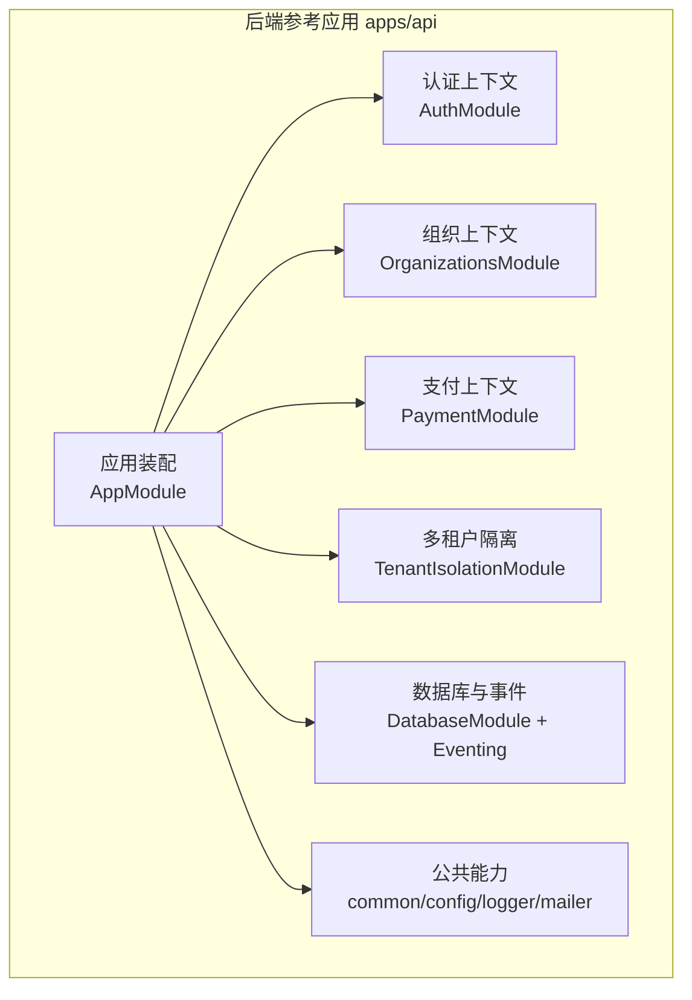
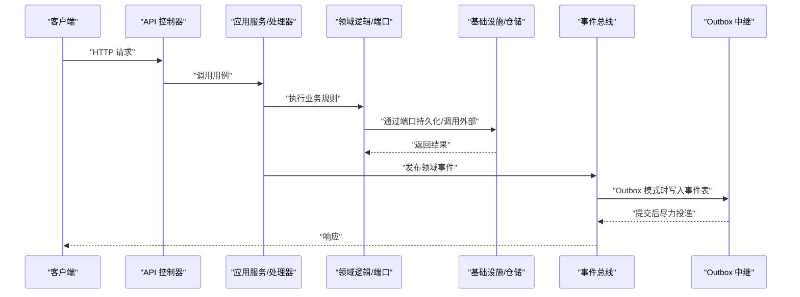
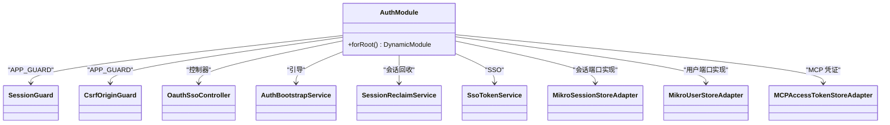
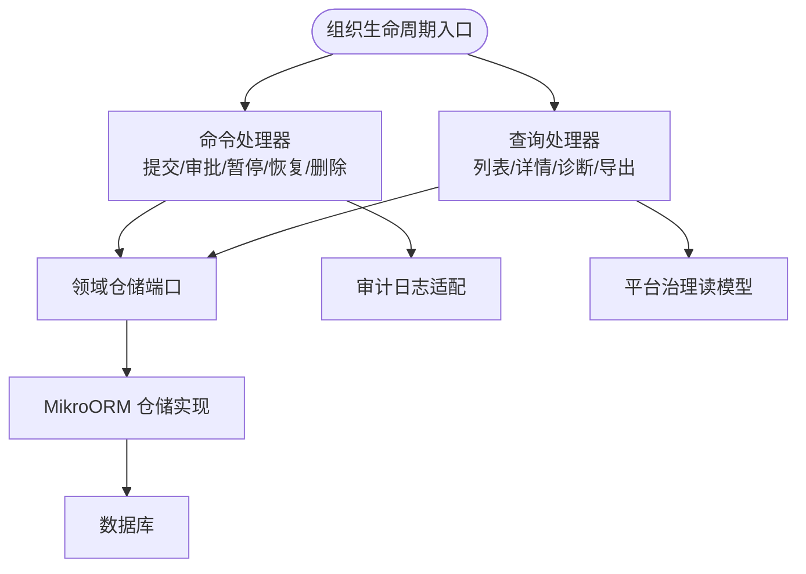
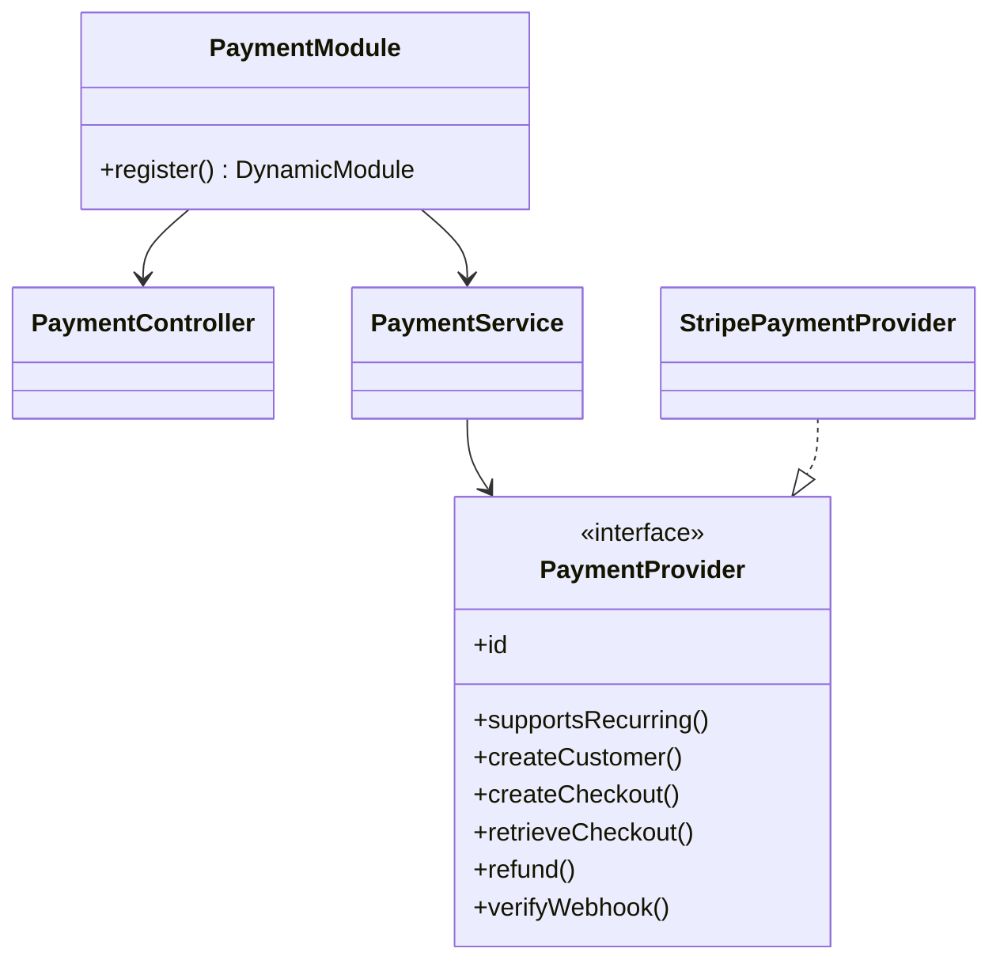
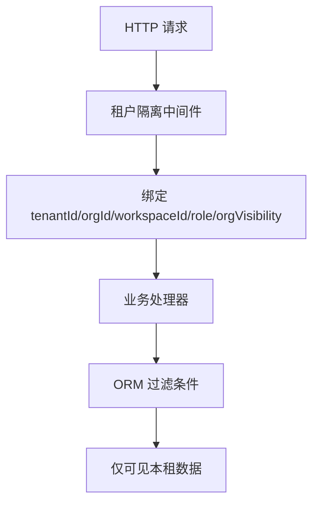
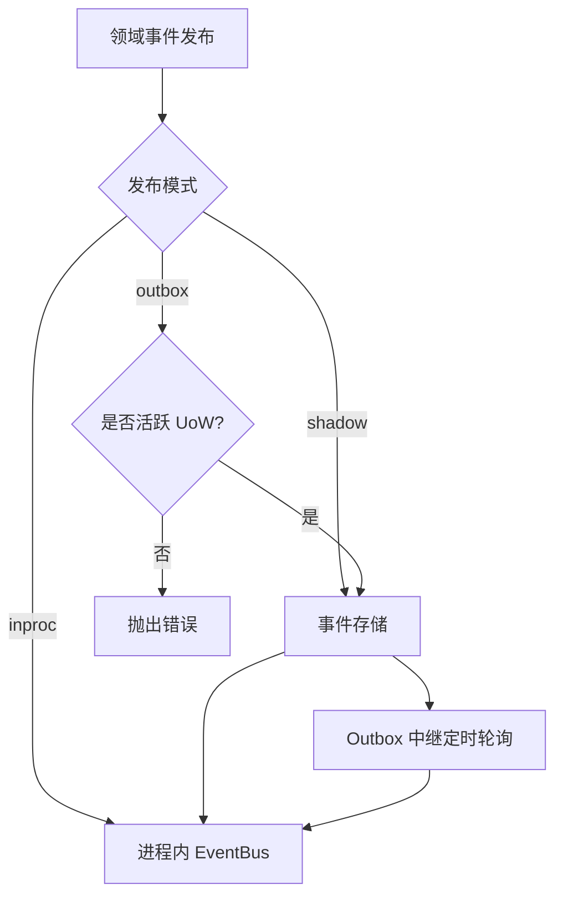
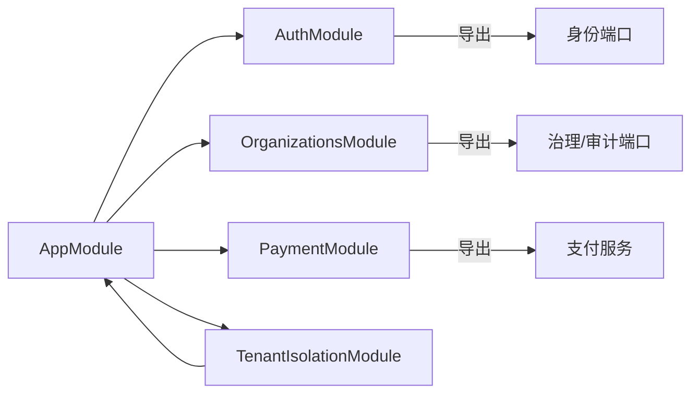

# 垂直切片组织模式

<cite>
**本文引用的文件**   
- [README.md](file://README.md)
- [app.module.ts](file://apps/api/src/app.module.ts)
- [auth.module.ts](file://apps/api/src/modules/auth/auth.module.ts)
- [organizations.module.ts](file://apps/api/src/modules/organizations/organizations.module.ts)
- [payment.module.ts](file://apps/api/src/modules/payment/payment.module.ts)
- [session-store.port.ts](file://apps/api/src/modules/auth/domain/ports/session-store.port.ts)
- [user-store.port.ts](file://apps/api/src/modules/auth/domain/ports/user-store.port.ts)
- [organization-governance.repository.ts](file://apps/api/src/modules/organizations/domain/repositories/organization-governance.repository.ts)
- [payment-provider.port.ts](file://apps/api/src/modules/payment/domain/ports/payment-provider.port.ts)
- [outbox-relay.ts](file://apps/api/src/database/eventing/outbox-relay.ts)
- [domain-event-publisher.ts](file://apps/api/src/database/eventing/domain-event-publisher.ts)
- [tenant-isolation.middleware.ts](file://libs/core/src/tenant-isolation/tenant-isolation.middleware.ts)
- [tenant-isolation.service.ts](file://libs/core/src/tenant-isolation/tenant-isolation.service.ts)
- [verify-domain-layout.ts](file://scripts/verify-domain-layout.ts)
</cite>

## 目录
1. [引言](#引言)
2. [项目结构](#项目结构)
3. [核心组件](#核心组件)
4. [架构总览](#架构总览)
5. [详细组件分析](#详细组件分析)
6. [依赖关系分析](#依赖关系分析)
7. [性能与可靠性考量](#性能与可靠性考量)
8. [故障排查指南](#故障排查指南)
9. [结论](#结论)

## 引言
本仓库采用“垂直切片”组织业务代码：每个限界上下文（如认证、组织、支付）内部自成 API 层、应用服务、领域逻辑和基础设施四层，跨上下文仅通过领域事件通信。相比传统分层架构把控制器、服务、仓储按横切层次平铺，垂直切片让一个业务域内所有职责就近聚合，降低跨模块耦合，提升可测试性与演进速度；同时借助端口倒置、CQRS、事件溯源与 Outbox 等机制，保证边界清晰、数据一致与可扩展性。

## 项目结构
仓库以 pnpm workspace 划分共享内核、后端参考应用、前端与契约客户端。后端参考应用位于 `apps/api`，业务以 `modules/<上下文>` 组织，每个上下文遵循 `api / application / domain / infrastructure` 四层；横切能力如多租户隔离、配置、数据库、日志、邮件等独立于业务上下文之外。

**图表来源**
- [app.module.ts:33-73](file://apps/api/src/app.module.ts#L33-L73)

**章节来源**
- [README.md:78-101](file://README.md#L78-L101)
- [app.module.ts:33-73](file://apps/api/src/app.module.ts#L33-L73)

## 核心组件
- 应用装配根：集中注册 oRPC、限流、配置、数据库、国际化、各业务模块与特性叠加层，并控制全局守卫执行顺序。
- 认证上下文：提供会话墙、CSRF 校验、SSO、用户与会话受控写入口，导出跨上下文消费的身份端口。
- 组织上下文：基于 CQRS 编排组织生命周期命令与查询，暴露平台治理读模型与审计日志适配，并通过端口对外发布 Odoo 绑定读写能力。
- 支付上下文：以统一端口抽象支付通道，按配置动态注册 Stripe 等实现，供订阅等上下文调用。
- 多租户隔离：在中间件注入租户/组织/工作区/角色等上下文，并在 ORM 层施加过滤条件，确保跨租不可见。
- 事件系统：支持进程内总线、影子事件存储与 Outbox 三种发布模式，Outbox 在事务提交后尽力投递，保障至少一次投递。

**章节来源**
- [app.module.ts:33-73](file://apps/api/src/app.module.ts#L33-L73)
- [auth.module.ts:22-83](file://apps/api/src/modules/auth/auth.module.ts#L22-L83)
- [organizations.module.ts:85-158](file://apps/api/src/modules/organizations/organizations.module.ts#L85-L158)
- [payment.module.ts:9-47](file://apps/api/src/modules/payment/payment.module.ts#L9-L47)
- [tenant-isolation.middleware.ts:84-103](file://libs/core/src/tenant-isolation/tenant-isolation.middleware.ts#L84-L103)
- [domain-event-publisher.ts:9-72](file://apps/api/src/database/eventing/domain-event-publisher.ts#L9-L72)
- [outbox-relay.ts:16-36](file://apps/api/src/database/eventing/outbox-relay.ts#L16-L36)

## 架构总览
下图展示垂直切片在请求处理中的典型路径：HTTP 进入控制器，应用服务编排用例，领域逻辑通过端口访问仓储或外部系统，基础设施完成持久化与外部集成；跨上下文变更通过领域事件经 Outbox 异步传播。

**图表来源**
- [app.module.ts:33-73](file://apps/api/src/app.module.ts#L33-L73)
- [domain-event-publisher.ts:33-71](file://apps/api/src/database/eventing/domain-event-publisher.ts#L33-L71)
- [outbox-relay.ts:77-129](file://apps/api/src/database/eventing/outbox-relay.ts#L77-L129)

## 详细组件分析

### 认证上下文（Auth）
认证上下文围绕身份与会话展开，包含：
- API 层：SSO 控制器、CSRF 与 Session 守卫。
- 应用层：引导初始化、会话回收、SSO Token 服务等。
- 领域层：定义用户与会话的受控写端口，约束跨上下文对身份表的写入口。
- 基础设施层：MikroORM 适配器、OAuth SSO 服务、会话恢复等。

**图表来源**
- [auth.module.ts:22-83](file://apps/api/src/modules/auth/auth.module.ts#L22-L83)

关键设计要点：
- 通过 `AUTH_SESSION_STORE` 与 `AUTH_USER_STORE` 两个符号 token 暴露受控写入口，避免其他上下文直接操作身份表。
- 全局守卫链：限流 → 会话墙 → CSRF Origin，失败快速拒绝。
- 将 user 表所有权归认证上下文，users 模块硬删需经此端口，消除越界写。

**章节来源**
- [auth.module.ts:22-83](file://apps/api/src/modules/auth/auth.module.ts#L22-L83)
- [session-store.port.ts:1-43](file://apps/api/src/modules/auth/domain/ports/session-store.port.ts#L1-L43)
- [user-store.port.ts:1-32](file://apps/api/src/modules/auth/domain/ports/user-store.port.ts#L1-L32)

### 组织上下文（Organizations）
组织上下文负责租户与组织的生命周期、成员与邀请、平台治理读模型与审计日志。其结构体现典型的 CQRS：
- API 层：组织、租户、平台租户等控制器。
- 应用层：命令处理器与查询处理器，以及组合门面服务。
- 领域层：仓储端口与治理读模型类型。
- 基础设施层：MikroORM 仓储实现、审计日志与状态存储适配。

**图表来源**
- [organizations.module.ts:85-158](file://apps/api/src/modules/organizations/organizations.module.ts#L85-L158)

关键设计要点：
- 平台治理读模型通过 `ORGANIZATION_GOVERNANCE_REPOSITORY` 暴露，专供平台级跨租户查询，刻意不做租户过滤。
- 通过 `TENANT_STATUS_STORE` 与 `USER_STATUS_STORE` 收敛状态机，避免散落的直写。
- 通过 `AUDIT_LOG_STORE` 统一审计落盘，供平台侧审计单点消费。

**章节来源**
- [organizations.module.ts:85-158](file://apps/api/src/modules/organizations/organizations.module.ts#L85-L158)
- [organization-governance.repository.ts:201-284](file://apps/api/src/modules/organizations/domain/repositories/organization-governance.repository.ts#L201-L284)

### 支付上下文（Payment）
支付上下文以统一端口抽象不同支付通道，按配置动态注册具体实现：
- API 层：支付控制器。
- 应用层：支付服务编排。
- 领域层：支付通道端口与值对象。
- 基础设施层：Stripe 等 Provider 实现。

**图表来源**
- [payment.module.ts:9-47](file://apps/api/src/modules/payment/payment.module.ts#L9-L47)
- [payment-provider.port.ts:124-157](file://apps/api/src/modules/payment/domain/ports/payment-provider.port.ts#L124-L157)

关键设计要点：
- 通过 `PAYMENT_PROVIDERS` 工厂按配置注入可用通道，未配置则不注册，调用方无可用通道时报错。
- 领域只依赖 `PaymentProvider` 接口，新增通道无需改动领域逻辑。

**章节来源**
- [payment.module.ts:9-47](file://apps/api/src/modules/payment/payment.module.ts#L9-L47)
- [payment-provider.port.ts:1-158](file://apps/api/src/modules/payment/domain/ports/payment-provider.port.ts#L1-L158)

### 多租户隔离与上下文边界
多租户隔离贯穿请求链路：
- 中间件解析并绑定租户、组织、工作区、角色与可见性策略。
- 服务层提供 fail-closed 的上下文断言方法。
- ORM 层根据上下文自动附加过滤条件，防止跨租读取。

**图表来源**
- [tenant-isolation.middleware.ts:84-103](file://libs/core/src/tenant-isolation/tenant-isolation.middleware.ts#L84-L103)
- [tenant-isolation.service.ts:71-115](file://libs/core/src/tenant-isolation/tenant-isolation.service.ts#L71-L115)

关键设计要点：
- 活动租户缺失时抛 403，强制 fail-closed。
- 活动组织缺失时同样抛 403，用于组织级消费点。
- 中间件绑定的可见性策略影响 ORM 过滤，确保跨组织不可见。

**章节来源**
- [tenant-isolation.middleware.ts:84-103](file://libs/core/src/tenant-isolation/tenant-isolation.middleware.ts#L84-L103)
- [tenant-isolation.service.ts:71-115](file://libs/core/src/tenant-isolation/tenant-isolation.service.ts#L71-L115)

### 事件驱动通信与 Outbox 模式
事件发布支持三种模式：
- inproc：纯进程内总线透传。
- shadow：先持久化事件再进程内派发。
- outbox：仅在活跃 UoW 内持久化事件，交由 Outbox 中继异步投递，保证至少一次投递。

**图表来源**
- [domain-event-publisher.ts:33-71](file://apps/api/src/database/eventing/domain-event-publisher.ts#L33-L71)
- [outbox-relay.ts:77-129](file://apps/api/src/database/eventing/outbox-relay.ts#L77-L129)

关键设计要点：
- Outbox 在事务内 claim 事件行并标记已投递，提交后再尽力投递到总线，避免回滚产生幻影事件。
- 对未知事件类型或版本不支持的行进行停重试（park），记录错误信息，避免中继阻塞。
- 去重窗口避免重复投递，消费者仍需幂等。

**章节来源**
- [domain-event-publisher.ts:9-72](file://apps/api/src/database/eventing/domain-event-publisher.ts#L9-L72)
- [outbox-relay.ts:16-36](file://apps/api/src/database/eventing/outbox-relay.ts#L16-L36)
- [outbox-relay.ts:77-129](file://apps/api/src/database/eventing/outbox-relay.ts#L77-L129)

## 依赖关系分析
- 应用装配根依赖所有业务模块与横切能力，并按序导入以保证守卫与中间件执行顺序。
- 认证上下文导出身份相关端口，被其他上下文消费。
- 组织上下文通过端口发布平台治理与审计能力，供平台与特性层消费。
- 支付上下文以端口抽象外部支付系统，按需装配。
- 多租户隔离为横切关注点，被各上下文共同依赖。

**图表来源**
- [app.module.ts:33-73](file://apps/api/src/app.module.ts#L33-L73)
- [auth.module.ts:75-83](file://apps/api/src/modules/auth/auth.module.ts#L75-L83)
- [organizations.module.ts:147-158](file://apps/api/src/modules/organizations/organizations.module.ts#L147-L158)
- [payment.module.ts:9-47](file://apps/api/src/modules/payment/payment.module.ts#L9-L47)

**章节来源**
- [app.module.ts:33-73](file://apps/api/src/app.module.ts#L33-L73)
- [auth.module.ts:75-83](file://apps/api/src/modules/auth/auth.module.ts#L75-L83)
- [organizations.module.ts:147-158](file://apps/api/src/modules/organizations/organizations.module.ts#L147-L158)
- [payment.module.ts:9-47](file://apps/api/src/modules/payment/payment.module.ts#L9-L47)

## 性能与可靠性考量
- 请求路径短：控制器直接委托应用服务，减少不必要的中间层。
- 快速失败：限流、会话墙、CSRF 在前端尽早拒绝非法请求。
- 事件投递可靠：Outbox 在事务提交后投递，避免回滚导致的事件丢失或幻影事件。
- 幂等与去重：Outbox 使用 eventId 去重窗口，消费者应实现幂等。
- 可观测性：审计日志与错误日志贯穿关键路径，便于定位问题。

[本节为通用指导，不直接分析具体文件]

## 故障排查指南
- 事件未投递：检查事件发布模式是否为 outbox，确认是否在活跃 UoW 内发布；查看 Outbox 中继日志与事件表状态。
- 跨租数据泄露：确认中间件是否正确绑定租户上下文，ORM 过滤条件是否生效。
- 身份写越界：确认是否通过 `AUTH_SESSION_STORE` 与 `AUTH_USER_STORE` 端口写入，避免直捅实体。
- 支付通道未注册：检查配置是否启用对应通道，确认 `PAYMENT_PROVIDERS` 工厂是否注入。

**章节来源**
- [domain-event-publisher.ts:33-71](file://apps/api/src/database/eventing/domain-event-publisher.ts#L33-L71)
- [outbox-relay.ts:77-129](file://apps/api/src/database/eventing/outbox-relay.ts#L77-L129)
- [tenant-isolation.service.ts:71-115](file://libs/core/src/tenant-isolation/tenant-isolation.service.ts#L71-L115)
- [session-store.port.ts:1-43](file://apps/api/src/modules/auth/domain/ports/session-store.port.ts#L1-L43)
- [user-store.port.ts:1-32](file://apps/api/src/modules/auth/domain/ports/user-store.port.ts#L1-L32)
- [payment.module.ts:20-47](file://apps/api/src/modules/payment/payment.module.ts#L20-L47)

## 结论
垂直切片组织模式在本仓库中通过明确的限界上下文、四层结构与端口倒置，实现了高内聚、低耦合与强边界。结合 CQRS、事件溯源与 Outbox，系统在保持灵活性的同时确保了数据一致性与可扩展性。多租户隔离作为横切关注点贯穿全链路，进一步保障了安全与合规。未来可在现有基础上继续扩展新的业务上下文，复用共享内核与横切能力，持续演进系统架构。

[本节为总结性内容，不直接分析具体文件]