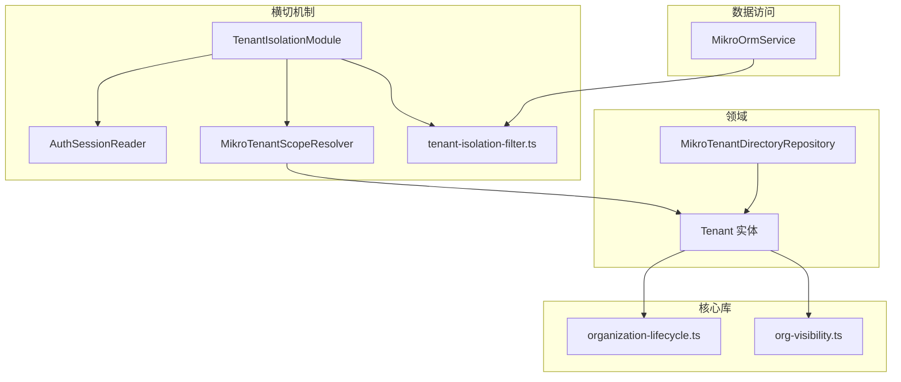
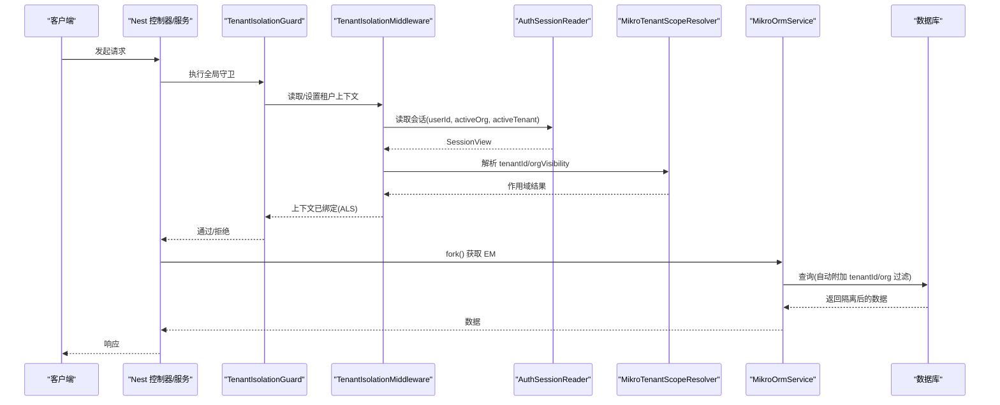
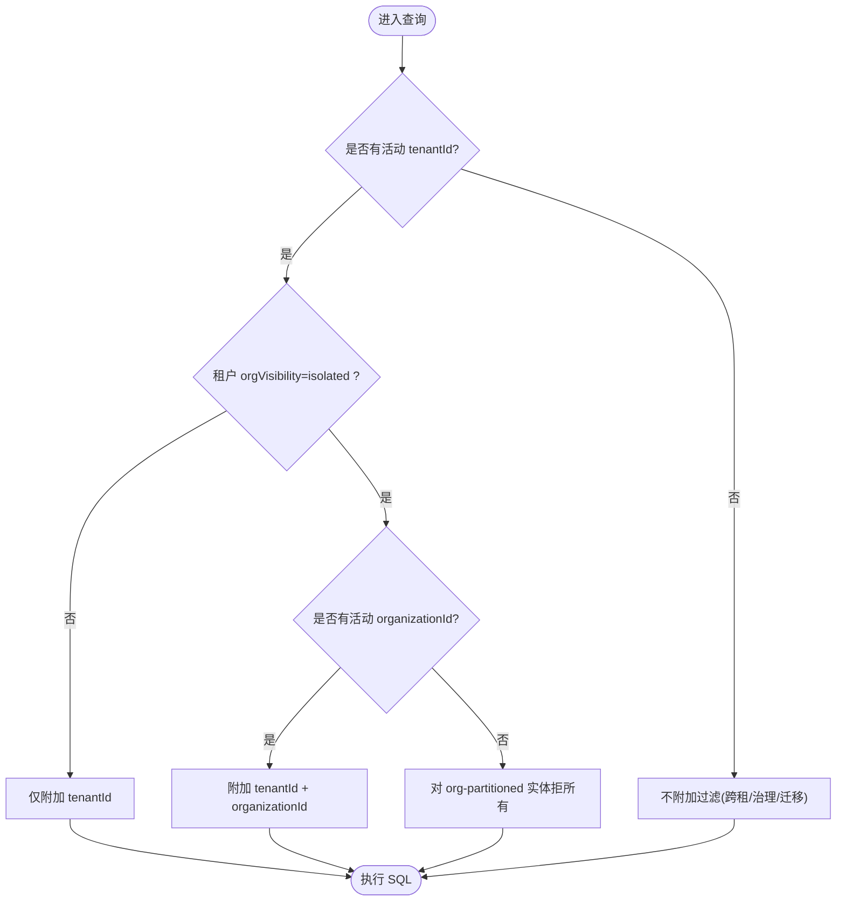
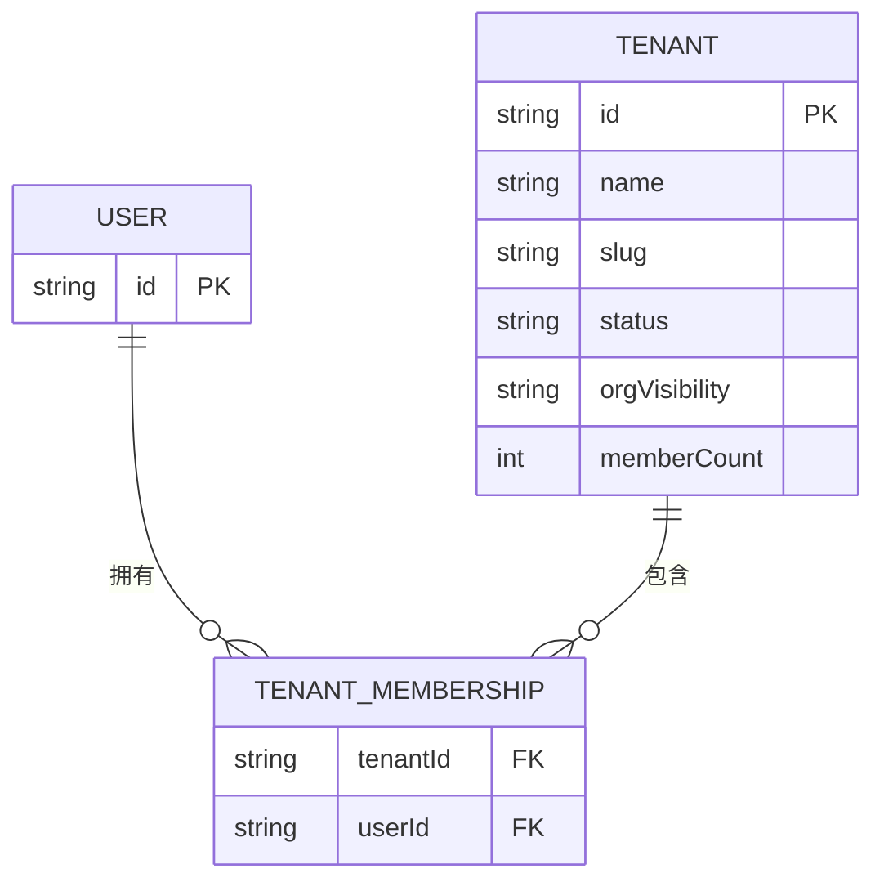
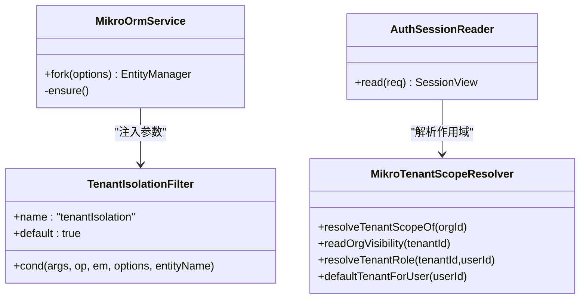
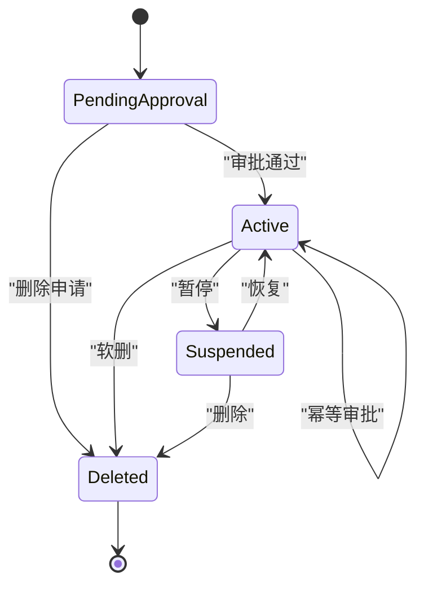
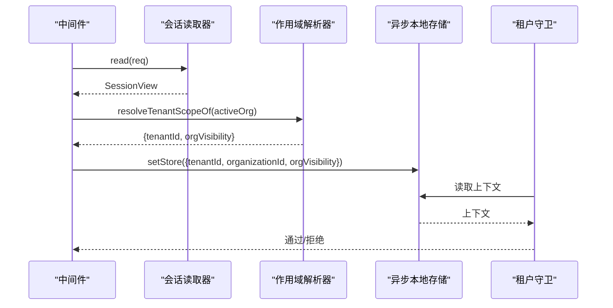
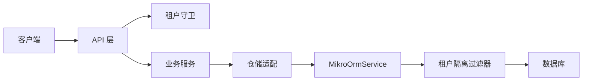
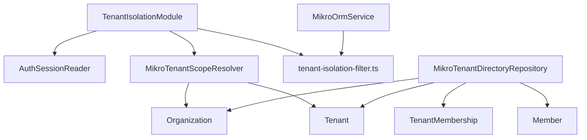
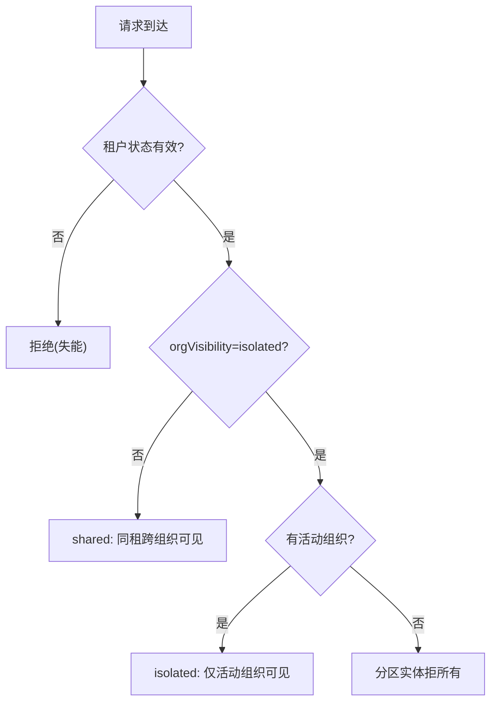

# 多租户架构设计

<cite>
**本文引用的文件**   
- [apps/api/src/tenant-isolation/tenant-isolation.module.ts](file://apps/api/src/tenant-isolation/tenant-isolation.module.ts)
- [apps/api/src/tenant-isolation/infrastructure/auth-session.reader.ts](file://apps/api/src/tenant-isolation/infrastructure/auth-session.reader.ts)
- [apps/api/src/tenant-isolation/infrastructure/mikro-tenant-scope.resolver.ts](file://apps/api/src/tenant-isolation/infrastructure/mikro-tenant-scope.resolver.ts)
- [apps/api/src/database/mikro/tenant-isolation-filter.ts](file://apps/api/src/database/mikro/tenant-isolation-filter.ts)
- [apps/api/src/database/mikro/mikro-orm.service.ts](file://apps/api/src/database/mikro/mikro-orm.service.ts)
- [apps/api/src/modules/organizations/infrastructure/entities/tenant.entity.ts](file://apps/api/src/modules/organizations/infrastructure/entities/tenant.entity.ts)
- [apps/api/src/modules/organizations/infrastructure/repositories/mikro-tenant-directory.repository.ts](file://apps/api/src/modules/organizations/infrastructure/repositories/mikro-tenant-directory.repository.ts)
- [libs/core/src/modules/organizations/lifecycle/organization-lifecycle.ts](file://libs/core/src/modules/organizations/lifecycle/organization-lifecycle.ts)
- [libs/core/src/modules/organizations/visibility/org-visibility.ts](file://libs/core/src/modules/organizations/visibility/org-visibility.ts)
- [apps/api/src/tenant-isolation/org-visibility-isolation.e2e.test.ts](file://apps/api/src/tenant-isolation/org-visibility-isolation.e2e.test.ts)
</cite>

## 目录
1. [引言](#引言)
2. [项目结构](#项目结构)
3. [核心组件](#核心组件)
4. [架构总览](#架构总览)
5. [详细组件分析](#详细组件分析)
6. [依赖关系分析](#依赖关系分析)
7. [性能考量](#性能考量)
8. [故障排查指南](#故障排查指南)
9. [结论](#结论)
10. [附录](#附录)

## 引言
本文件面向“两级边界（租户→工作区）”的多租户架构，系统性阐述：
- 设计原理与数据隔离策略；
- 全局用户模型与 membership 多对多关系的身份共享机制；
- 基于 MikroORM 过滤器的行级自动隔离；
- 租户激活状态管理与 P0/P1 权限控制；
- 请求生命周期中的租户上下文传播与安全保证；
- 多租户数据流图与权限矩阵。

## 项目结构
围绕多租户能力，代码组织遵循“横切机制 + 领域模块”的分层方式：
- 横切机制层：`tenant-isolation` 提供中间件、守卫、会话读取、作用域解析与 ORM 过滤器装配；
- 数据访问层：`database/mikro` 提供 ORM 服务、实体过滤器定义与参数注入；
- 领域层：`modules/organizations` 承载租户、组织与工作区的实体与仓储；
- 核心库：`libs/core` 暴露租户生命周期与可见性策略等纯函数与类型。

**图表来源**
- [apps/api/src/tenant-isolation/tenant-isolation.module.ts:44-71](file://apps/api/src/tenant-isolation/tenant-isolation.module.ts#L44-L71)
- [apps/api/src/database/mikro/tenant-isolation-filter.ts:1-21](file://apps/api/src/database/mikro/tenant-isolation-filter.ts#L1-L21)
- [apps/api/src/database/mikro/mikro-orm.service.ts:46-66](file://apps/api/src/database/mikro/mikro-orm.service.ts#L46-L66)
- [apps/api/src/modules/organizations/infrastructure/entities/tenant.entity.ts:34-61](file://apps/api/src/modules/organizations/infrastructure/entities/tenant.entity.ts#L34-L61)
- [libs/core/src/modules/organizations/lifecycle/organization-lifecycle.ts:15-43](file://libs/core/src/modules/organizations/lifecycle/organization-lifecycle.ts#L15-L43)
- [libs/core/src/modules/organizations/visibility/org-visibility.ts:19-38](file://libs/core/src/modules/organizations/visibility/org-visibility.ts#L19-L38)

**章节来源**
- [apps/api/src/tenant-isolation/tenant-isolation.module.ts:11-43](file://apps/api/src/tenant-isolation/tenant-isolation.module.ts#L11-L43)
- [apps/api/src/database/mikro/tenant-isolation-filter.ts:1-21](file://apps/api/src/database/mikro/tenant-isolation-filter.ts#L1-L21)

## 核心组件
- 租户隔离模块：注册全局守卫、中间件、会话读取与租户作用域解析端口，统一绑定租户墙与上下文传播。
- 会话读取器：从认证会话中抽取 userId、activeOrganizationId、activeTenantId，并做路径短路优化。
- 租户作用域解析器：根据活动组织派生 tenantId 与 orgVisibility；支持按租户解析角色与默认租户。
- 行级隔离过滤器：在 MikroORM 中为在册实体统一附加 tenantId 过滤，并在 isolated 策略下追加 organizationId 收窄。
- ORM 服务：每次 fork 时从 ALS 派生过滤参数并注入 EM，支持 scoped:false 显式跨租豁免。
- 租户实体：承载 status、orgVisibility、memberCount 等治理与可见性字段。
- 租户目录仓储：以 tenant_membership 为主键源聚合可切换租户集合，兼容 BA member 派生租户。
- 核心库：租户生命周期状态机与租内可见性策略枚举。

**章节来源**
- [apps/api/src/tenant-isolation/tenant-isolation.module.ts:44-71](file://apps/api/src/tenant-isolation/tenant-isolation.module.ts#L44-L71)
- [apps/api/src/tenant-isolation/infrastructure/auth-session.reader.ts:44-79](file://apps/api/src/tenant-isolation/infrastructure/auth-session.reader.ts#L44-L79)
- [apps/api/src/tenant-isolation/infrastructure/mikro-tenant-scope.resolver.ts:25-83](file://apps/api/src/tenant-isolation/infrastructure/mikro-tenant-scope.resolver.ts#L25-L83)
- [apps/api/src/database/mikro/tenant-isolation-filter.ts:23-137](file://apps/api/src/database/mikro/tenant-isolation-filter.ts#L23-L137)
- [apps/api/src/database/mikro/mikro-orm.service.ts:46-66](file://apps/api/src/database/mikro/mikro-orm.service.ts#L46-L66)
- [apps/api/src/modules/organizations/infrastructure/entities/tenant.entity.ts:34-61](file://apps/api/src/modules/organizations/infrastructure/entities/tenant.entity.ts#L34-L61)
- [apps/api/src/modules/organizations/infrastructure/repositories/mikro-tenant-directory.repository.ts:36-116](file://apps/api/src/modules/organizations/infrastructure/repositories/mikro-tenant-directory.repository.ts#L36-L116)
- [libs/core/src/modules/organizations/lifecycle/organization-lifecycle.ts:15-69](file://libs/core/src/modules/organizations/lifecycle/organization-lifecycle.ts#L15-L69)
- [libs/core/src/modules/organizations/visibility/org-visibility.ts:19-38](file://libs/core/src/modules/organizations/visibility/org-visibility.ts#L19-L38)

## 架构总览
下图展示一次受保护请求的完整流程：会话读取 → 中间件绑定租户上下文 → 守卫校验 → 业务处理 → ORM 查询自动附加租户/组织过滤。

**图表来源**
- [apps/api/src/tenant-isolation/tenant-isolation.module.ts:44-71](file://apps/api/src/tenant-isolation/tenant-isolation.module.ts#L44-L71)
- [apps/api/src/tenant-isolation/infrastructure/auth-session.reader.ts:44-79](file://apps/api/src/tenant-isolation/infrastructure/auth-session.reader.ts#L44-L79)
- [apps/api/src/tenant-isolation/infrastructure/mikro-tenant-scope.resolver.ts:29-41](file://apps/api/src/tenant-isolation/infrastructure/mikro-tenant-scope.resolver.ts#L29-L41)
- [apps/api/src/database/mikro/mikro-orm.service.ts:54-66](file://apps/api/src/database/mikro/mikro-orm.service.ts#L54-L66)
- [apps/api/src/database/mikro/tenant-isolation-filter.ts:108-137](file://apps/api/src/database/mikro/tenant-isolation-filter.ts#L108-L137)

## 详细组件分析

### 两级边界与数据隔离策略
- 两级边界：租户(Tenant) ⊃ 组织(Organization) ⊃ 工作区(Workspace)。跨租户硬隔离由 `tenantId` 保障；租内可见性由 `orgVisibility` 控制。
- 行级隔离：通过 MikroORM 全局 filter 为所有在册实体附加 `tenantId` 条件；当租户启用 `isolated` 且有活动组织时，追加 `organizationId` 收窄。
- 安全底线：filter 在无活动租户上下文时恒真不筛，用于平台治理/迁移/种子任务等跨租场景；有上下文时 fail-closed。

**图表来源**
- [apps/api/src/database/mikro/tenant-isolation-filter.ts:43-87](file://apps/api/src/database/mikro/tenant-isolation-filter.ts#L43-L87)
- [apps/api/src/database/mikro/tenant-isolation-filter.ts:108-137](file://apps/api/src/database/mikro/tenant-isolation-filter.ts#L108-L137)

**章节来源**
- [apps/api/src/database/mikro/tenant-isolation-filter.ts:1-21](file://apps/api/src/database/mikro/tenant-isolation-filter.ts#L1-L21)
- [apps/api/src/database/mikro/tenant-isolation-filter.ts:43-87](file://apps/api/src/database/mikro/tenant-isolation-filter.ts#L43-L87)
- [apps/api/src/database/mikro/tenant-isolation-filter.ts:108-137](file://apps/api/src/database/mikro/tenant-isolation-filter.ts#L108-L137)

### 全局用户模型与 membership 多对多关系
- 用户身份全局唯一，成员关系通过 `tenant_membership` 实现“用户↔租户”多对多，作为可切换租户集的主数据源(SSOT)。
- 目录聚合逻辑：以 `tenant_membership` 为准，合并 BA `member` 派生的租户（兼容历史未盖章组织），形成用户可切换租户列表。
- 该设计确保不同租户间共享同一用户身份，同时明确用户在每个租户内的归属。

**图表来源**
- [apps/api/src/modules/organizations/infrastructure/repositories/mikro-tenant-directory.repository.ts:36-116](file://apps/api/src/modules/organizations/infrastructure/repositories/mikro-tenant-directory.repository.ts#L36-L116)
- [apps/api/src/modules/authorization/infrastructure/entities/rbac.entities.ts](file://apps/api/src/modules/authorization/infrastructure/entities/rbac.entities.ts)

**章节来源**
- [apps/api/src/modules/organizations/infrastructure/repositories/mikro-tenant-directory.repository.ts:18-35](file://apps/api/src/modules/organizations/infrastructure/repositories/mikro-tenant-directory.repository.ts#L18-L35)
- [apps/api/src/modules/organizations/infrastructure/repositories/mikro-tenant-directory.repository.ts:40-116](file://apps/api/src/modules/organizations/infrastructure/repositories/mikro-tenant-directory.repository.ts#L40-L116)

### 行级数据隔离机制（MikroORM 过滤器）
- 过滤器名与参数：`TENANT_ISOLATION_FILTER`，参数含 `tenantId`、`organizationId`、`orgIsolated`。
- 条件工厂：无 `tenantId` 则不筛；有 `tenantId` 必加；若 `orgIsolated=true` 且存在 `organizationId`，追加组织维；若无活动组织且目标实体带 `organizationId` 列，则对分区实体拒所有。
- 实体检测：通过 EM 元数据判断实体是否携带 `organizationId` 列，避免手维护登记表。
- 参数注入：`MikroOrmService.fork()` 从 ALS 派生参数并调用 `applyTenantFilterParams` 注入 EM。

**图表来源**
- [apps/api/src/database/mikro/tenant-isolation-filter.ts:23-137](file://apps/api/src/database/mikro/tenant-isolation-filter.ts#L23-L137)
- [apps/api/src/database/mikro/mikro-orm.service.ts:54-66](file://apps/api/src/database/mikro/mikro-orm.service.ts#L54-L66)
- [apps/api/src/tenant-isolation/infrastructure/auth-session.reader.ts:44-79](file://apps/api/src/tenant-isolation/infrastructure/auth-session.reader.ts#L44-L79)
- [apps/api/src/tenant-isolation/infrastructure/mikro-tenant-scope.resolver.ts:29-83](file://apps/api/src/tenant-isolation/infrastructure/mikro-tenant-scope.resolver.ts#L29-L83)

**章节来源**
- [apps/api/src/database/mikro/tenant-isolation-filter.ts:23-137](file://apps/api/src/database/mikro/tenant-isolation-filter.ts#L23-L137)
- [apps/api/src/database/mikro/mikro-orm.service.ts:54-66](file://apps/api/src/database/mikro/mikro-orm.service.ts#L54-L66)

### 租户激活状态管理（P0/P1 权限）
- 状态词汇：`pending_approval`、`active`、`suspended`、`deleted`，主真相位于 `tenant.status`。
- 拦截判定：处于 `pending_approval`、`suspended`、`deleted` 时视为失能态，走 deny-list 拦截。
- 迁移规则：仅允许合法状态迁移，`deleted` 为终态。
- 权限层级：
  - P0：租户准入/失能闸（deny-list），决定租户是否可用。
  - P1：会话/角色维度（如 `tenant_role_assignment`），决定用户在当前租户的角色与能力。

**图表来源**
- [libs/core/src/modules/organizations/lifecycle/organization-lifecycle.ts:15-69](file://libs/core/src/modules/organizations/lifecycle/organization-lifecycle.ts#L15-L69)
- [apps/api/src/modules/organizations/infrastructure/entities/tenant.entity.ts:41-46](file://apps/api/src/modules/organizations/infrastructure/entities/tenant.entity.ts#L41-L46)

**章节来源**
- [libs/core/src/modules/organizations/lifecycle/organization-lifecycle.ts:15-69](file://libs/core/src/modules/organizations/lifecycle/organization-lifecycle.ts#L15-L69)
- [apps/api/src/modules/organizations/infrastructure/entities/tenant.entity.ts:41-46](file://apps/api/src/modules/organizations/infrastructure/entities/tenant.entity.ts#L41-L46)

### 租户上下文在请求生命周期中的传播
- 会话读取：`AuthSessionReader` 从 Better Auth 会话中读取 `userId`、`activeOrganizationId`、`activeTenantId`，并对免认证路由与旁路路径短路。
- 作用域解析：`MikroTenantScopeResolver` 根据活动组织读取 `tenantId` 与 `orgVisibility`；支持按租户解析角色与默认租户。
- 中间件绑定：`TenantIsolationMiddleware` 将作用域写入异步本地存储（ALS），供后续守卫与仓储使用。
- 守卫拦截：`TenantIsolationGuard` 作为全局守卫，fail-closed 要求有效租户上下文；可通过 `@Public`/`@TenantIsolationExempt` 旁路。

**图表来源**
- [apps/api/src/tenant-isolation/infrastructure/auth-session.reader.ts:44-79](file://apps/api/src/tenant-isolation/infrastructure/auth-session.reader.ts#L44-L79)
- [apps/api/src/tenant-isolation/infrastructure/mikro-tenant-scope.resolver.ts:29-83](file://apps/api/src/tenant-isolation/infrastructure/mikro-tenant-scope.resolver.ts#L29-L83)
- [apps/api/src/tenant-isolation/tenant-isolation.module.ts:44-71](file://apps/api/src/tenant-isolation/tenant-isolation.module.ts#L44-L71)

**章节来源**
- [apps/api/src/tenant-isolation/infrastructure/auth-session.reader.ts:44-79](file://apps/api/src/tenant-isolation/infrastructure/auth-session.reader.ts#L44-L79)
- [apps/api/src/tenant-isolation/infrastructure/mikro-tenant-scope.resolver.ts:29-83](file://apps/api/src/tenant-isolation/infrastructure/mikro-tenant-scope.resolver.ts#L29-L83)
- [apps/api/src/tenant-isolation/tenant-isolation.module.ts:44-71](file://apps/api/src/tenant-isolation/tenant-isolation.module.ts#L44-L71)

### 多租户数据流图

**图表来源**
- [apps/api/src/tenant-isolation/tenant-isolation.module.ts:44-71](file://apps/api/src/tenant-isolation/tenant-isolation.module.ts#L44-L71)
- [apps/api/src/database/mikro/mikro-orm.service.ts:54-66](file://apps/api/src/database/mikro/mikro-orm.service.ts#L54-L66)
- [apps/api/src/database/mikro/tenant-isolation-filter.ts:108-137](file://apps/api/src/database/mikro/tenant-isolation-filter.ts#L108-L137)

## 依赖关系分析
- 模块耦合：
  - `TenantIsolationModule` 依赖 `AuthSessionReader` 与 `MikroTenantScopeResolver`，并通过端口导出给其他模块消费。
  - `MikroOrmService` 依赖 `tenant-isolation-filter` 注入过滤参数。
  - `MikroTenantScopeResolver` 依赖 `Organization`、`Tenant` 与 RBAC 实体。
  - `MikroTenantDirectoryRepository` 依赖 `TenantMembership`、`Member`、`Organization`、`Tenant`。
- 外部依赖：
  - Better Auth 会话接口；
  - MikroORM v7 的 EM/fork/filter 机制；
  - 核心库的状态与可见性枚举。

**图表来源**
- [apps/api/src/tenant-isolation/tenant-isolation.module.ts:44-71](file://apps/api/src/tenant-isolation/tenant-isolation.module.ts#L44-L71)
- [apps/api/src/database/mikro/mikro-orm.service.ts:54-66](file://apps/api/src/database/mikro/mikro-orm.service.ts#L54-L66)
- [apps/api/src/tenant-isolation/infrastructure/mikro-tenant-scope.resolver.ts:29-83](file://apps/api/src/tenant-isolation/infrastructure/mikro-tenant-scope.resolver.ts#L29-L83)
- [apps/api/src/modules/organizations/infrastructure/repositories/mikro-tenant-directory.repository.ts:36-116](file://apps/api/src/modules/organizations/infrastructure/repositories/mikro-tenant-directory.repository.ts#L36-L116)

**章节来源**
- [apps/api/src/tenant-isolation/tenant-isolation.module.ts:44-71](file://apps/api/src/tenant-isolation/tenant-isolation.module.ts#L44-L71)
- [apps/api/src/database/mikro/mikro-orm.service.ts:54-66](file://apps/api/src/database/mikro/mikro-orm.service.ts#L54-L66)
- [apps/api/src/tenant-isolation/infrastructure/mikro-tenant-scope.resolver.ts:29-83](file://apps/api/src/tenant-isolation/infrastructure/mikro-tenant-scope.resolver.ts#L29-L83)
- [apps/api/src/modules/organizations/infrastructure/repositories/mikro-tenant-directory.repository.ts:36-116](file://apps/api/src/modules/organizations/infrastructure/repositories/mikro-tenant-directory.repository.ts#L36-L116)

## 性能考量
- 懒建连接：ORM 首次真正使用时才建立连接，保持 DB-free 冒烟测试与启动速度。
- 每操作 fork：读写各取独立 EM，避免跨请求/事务污染。
- 过滤参数注入：仅在 fork 时计算并注入一次，减少重复开销。
- 目录聚合：先聚合并去重，再批量拉取租户信息，降低 N+1 查询风险。

[本节为通用指导，不直接分析具体文件]

## 故障排查指南
- 跨租数据泄露或不可见：
  - 检查是否误用 `scoped:false` 导致绕过全局过滤；
  - 确认 ALS 中是否存在正确的 `tenantId`/`organizationId`。
- 隔离模式下读不到任何数据：
  - 确认是否设置了 `orgVisibility=isolated` 且缺少活动组织；
  - 检查目标实体是否为 org-partitioned（带 `organizationId`）。
- 租户被拦截：
  - 检查 `tenant.status` 是否为 `pending_approval`/`suspended`/`deleted`；
  - 确认状态迁移是否符合合法边。
- 会话读取失败：
  - 检查 cookie 与路径旁路配置；
  - 确认 Better Auth 实例可用与会话字段正确回写。

**章节来源**
- [apps/api/src/database/mikro/tenant-isolation-filter.ts:43-87](file://apps/api/src/database/mikro/tenant-isolation-filter.ts#L43-L87)
- [apps/api/src/database/mikro/mikro-orm.service.ts:54-66](file://apps/api/src/database/mikro/mikro-orm.service.ts#L54-L66)
- [libs/core/src/modules/organizations/lifecycle/organization-lifecycle.ts:37-43](file://libs/core/src/modules/organizations/lifecycle/organization-lifecycle.ts#L37-L43)
- [apps/api/src/tenant-isolation/infrastructure/auth-session.reader.ts:44-79](file://apps/api/src/tenant-isolation/infrastructure/auth-session.reader.ts#L44-L79)

## 结论
本多租户架构通过“租户→工作区”的两级边界与“租户→组织→工作区”的三层语义，结合：
- 全局会话读取与作用域解析；
- 基于 ALS 的上下文传播；
- MikroORM 全局过滤器实现的行级自动隔离；
- 租户状态机与可见性策略；
- membership 多对多关系支撑的全局用户身份共享；
实现了强隔离、可扩展、易审计的 SaaS 多租户体系。建议在新增实体时统一接入全局过滤器，并在跨租/治理场景中谨慎使用 `scoped:false`。

[本节为总结性内容，不直接分析具体文件]

## 附录

### 权限矩阵（访问控制场景）
- 跨租户访问：始终拒绝（fail-closed），除非显式平台治理面（`scoped:false`）。
- 租内 shared：同租户内跨组织互见。
- 租内 isolated：仅当存在活动组织时可见对应组织数据；无活动组织时对分区实体拒所有。
- 租户失能：处于 pending_approval/suspended/deleted 时拒绝访问。
- 角色维度：基于 `tenant_role_assignment` 的租户级角色决定能力范围。

**图表来源**
- [libs/core/src/modules/organizations/lifecycle/organization-lifecycle.ts:37-43](file://libs/core/src/modules/organizations/lifecycle/organization-lifecycle.ts#L37-L43)
- [libs/core/src/modules/organizations/visibility/org-visibility.ts:19-38](file://libs/core/src/modules/organizations/visibility/org-visibility.ts#L19-L38)
- [apps/api/src/database/mikro/tenant-isolation-filter.ts:73-87](file://apps/api/src/database/mikro/tenant-isolation-filter.ts#L73-L87)

**章节来源**
- [apps/api/src/tenant-isolation/org-visibility-isolation.e2e.test.ts:169-237](file://apps/api/src/tenant-isolation/org-visibility-isolation.e2e.test.ts#L169-L237)