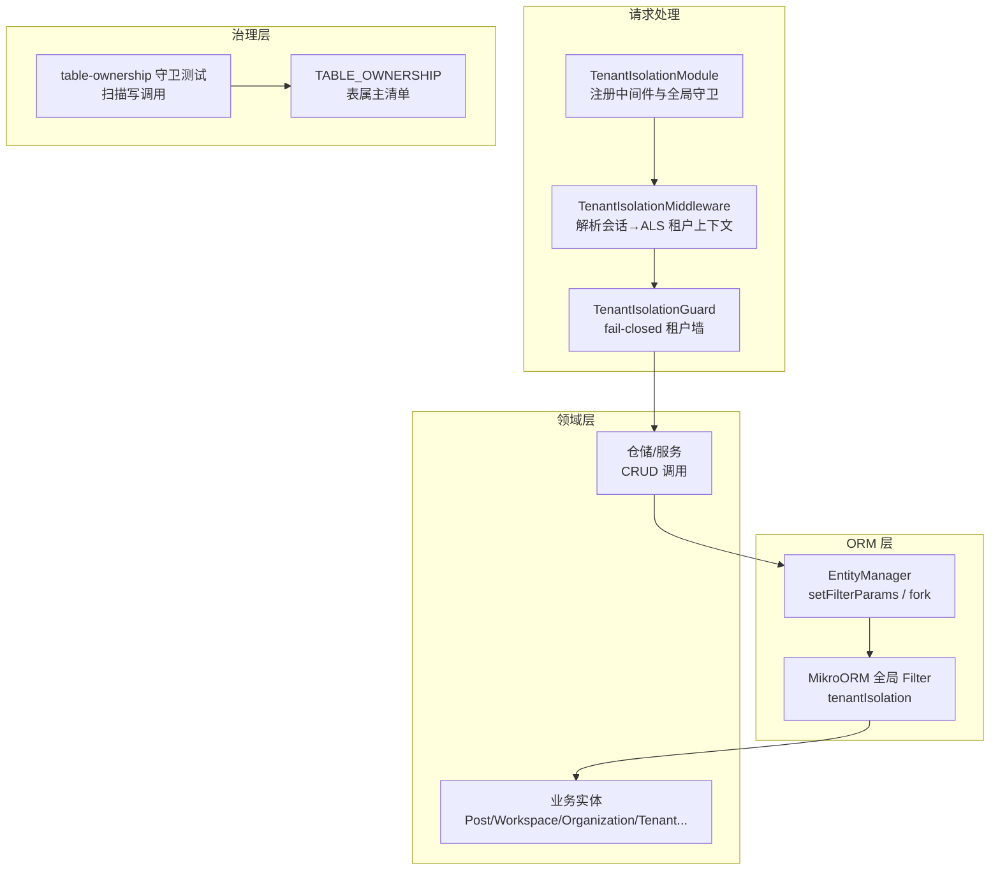
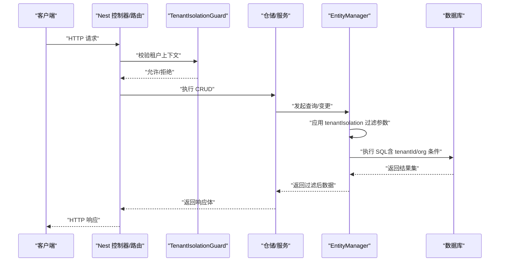
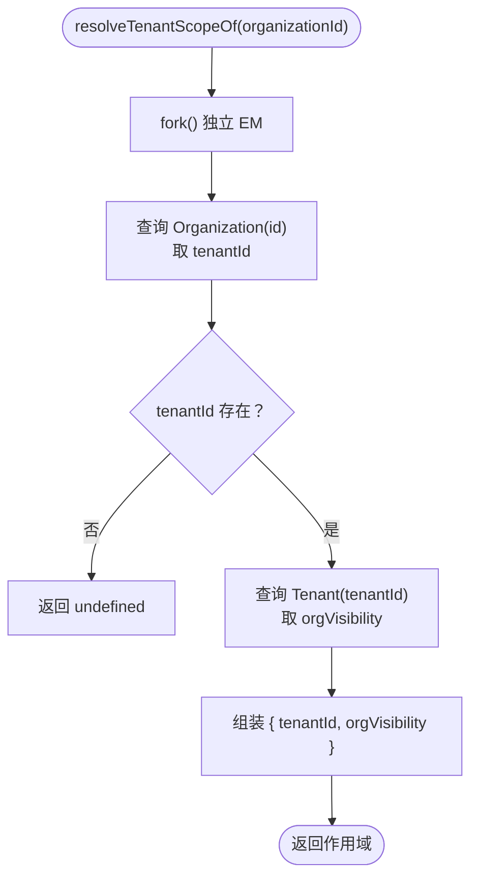
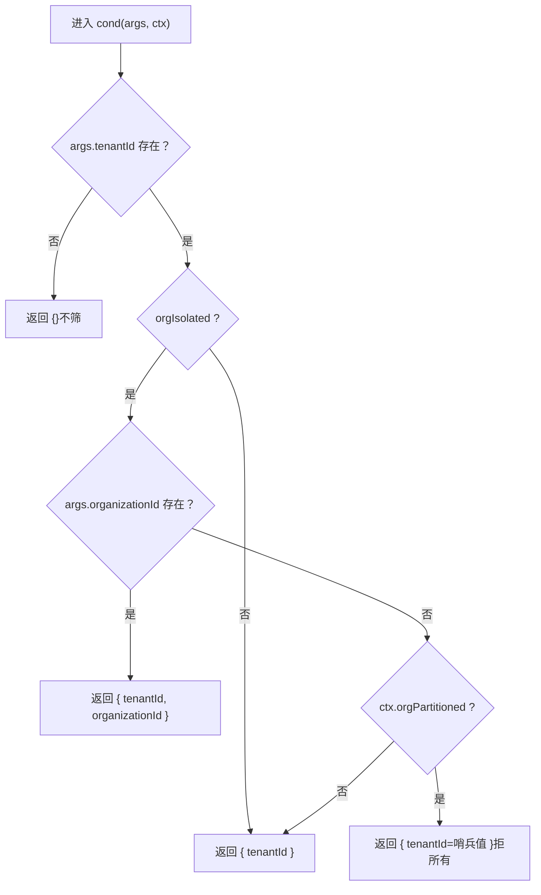
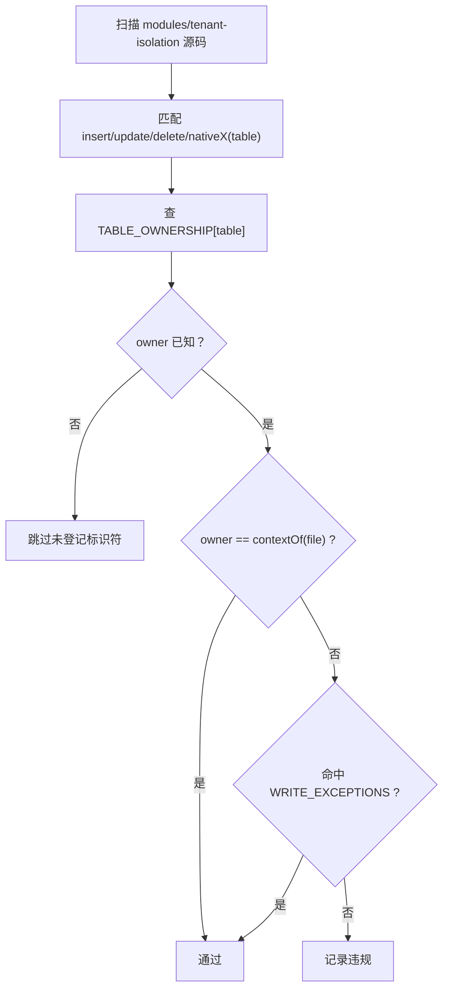
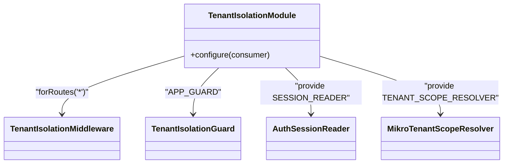
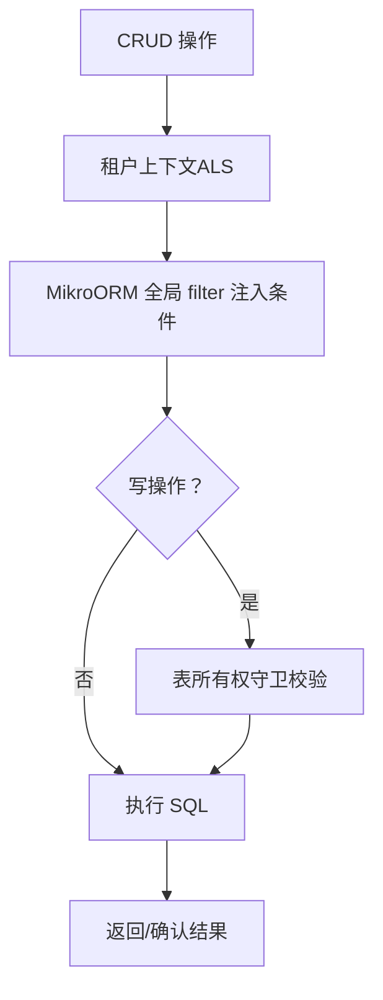
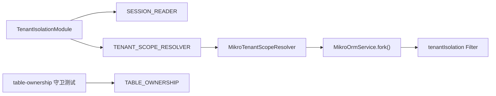

# 数据隔离机制

<cite>
**本文引用的文件**   
- [apps/api/src/database/mikro/tenant-isolation-filter.ts](file://apps/api/src/database/mikro/tenant-isolation-filter.ts)
- [apps/api/src/database/mikro/tenant-isolation-filter.test.ts](file://apps/api/src/database/mikro/tenant-isolation-filter.test.ts)
- [apps/api/src/database/table-ownership.ts](file://apps/api/src/database/table-ownership.ts)
- [apps/api/src/database/table-ownership.guard.test.ts](file://apps/api/src/database/table-ownership.guard.test.ts)
- [apps/api/src/tenant-isolation/infrastructure/mikro-tenant-scope.resolver.ts](file://apps/api/src/tenant-isolation/infrastructure/mikro-tenant-scope.resolver.ts)
- [apps/api/src/tenant-isolation/tenant-isolation.module.ts](file://apps/api/src/tenant-isolation/tenant-isolation.module.ts)
- [apps/api/src/tenant-isolation/tenant-isolation.e2e.test.ts](file://apps/api/src/tenant-isolation/tenant-isolation.e2e.test.ts)
</cite>

## 目录
1. [引言](#引言)
2. [项目结构](#项目结构)
3. [核心组件](#核心组件)
4. [架构总览](#架构总览)
5. [详细组件分析](#详细组件分析)
6. [依赖关系分析](#依赖关系分析)
7. [性能与安全性权衡](#性能与安全性权衡)
8. [故障排查指南](#故障排查指南)
9. [结论](#结论)

## 引言
本文件聚焦 SaaS 多租户系统中的“数据隔离”能力，围绕以下目标展开：
- 解释 MikroORM 全局过滤器如何实现自动化的行级数据过滤，确保每个租户只能访问自己的数据。
- 阐述租户作用域解析器如何将当前请求的租户上下文注入数据库查询。
- 描述表所有权守卫如何防止跨限界上下文的写侧越界访问。
- 说明数据隔离在 CRUD 各操作类型中的具体表现。
- 提供数据流图与隔离策略对比，帮助读者理解不同隔离级别对性能与安全性的影响。

## 项目结构
与数据隔离直接相关的代码集中在三个层次：
- 中间件与模块装配层：负责从会话中解析租户、组织等上下文，并注册全局守卫与中间件。
- ORM 过滤层：通过 MikroORM 全局 filter 将 `tenantId`（必要时追加 `organizationId`）注入所有受保护实体的查询。
- 表所有权守卫层：以静态清单 + 扫描测试的方式约束写侧目标表归属，避免跨上下文写。

图示来源
- [apps/api/src/tenant-isolation/tenant-isolation.module.ts:44-70](file://apps/api/src/tenant-isolation/tenant-isolation.module.ts#L44-L70)
- [apps/api/src/database/mikro/tenant-isolation-filter.ts:113-137](file://apps/api/src/database/mikro/tenant-isolation-filter.ts#L113-L137)
- [apps/api/src/database/table-ownership.ts:17-60](file://apps/api/src/database/table-ownership.ts#L17-L60)
- [apps/api/src/database/table-ownership.guard.test.ts:47-98](file://apps/api/src/database/table-ownership.guard.test.ts#L47-L98)

章节来源
- [apps/api/src/tenant-isolation/tenant-isolation.module.ts:11-70](file://apps/api/src/tenant-isolation/tenant-isolation.module.ts#L11-L70)

## 核心组件
本节概述实现数据隔离的关键构件及其职责。

- 租户作用域解析器（MikroTenantScopeResolver）
  - 根据活动组织读取其所属租户，并顺带读取租户的可见性策略（shared/isolated）。
  - 提供按租户读角色、默认租户等辅助能力；为避免自身被隔离过滤拦截，使用 `fork({ scoped: false })`。

- MikroORM 租户隔离过滤器（tenant-isolation-filter）
  - 定义全局 filter 名称、参数结构与条件工厂。
  - 有 `tenantId` 时恒挂 `tenantId` 过滤；当租户为 isolated 且存在活动组织时追加 `organizationId`。
  - 针对 P0 X3：isolated 且无活动组织时，若实体携带 `organizationId` 列则拒所有（哨兵值），否则仅保留租户地板。
  - 通过 `applyTenantFilterParams` 把 ALS 派生的参数写入 EntityManager。

- 表所有权守卫（table-ownership）
  - 维护“表名 → 限界上下文”的单源映射，作为写侧纪律的机读依据。
  - 配套测试扫描源码中的写调用，断言目标表必须属于调用方所在上下文或命中显式例外。

- 租户隔离模块（TenantIsolationModule）
  - 全局模块，注册中间件、守卫、会话读取端口与租户作用域解析端口。
  - 将 `TenantIsolationGuard` 注册为全局守卫，形成 deny-by-default 的租户墙。

章节来源
- [apps/api/src/tenant-isolation/infrastructure/mikro-tenant-scope.resolver.ts:15-83](file://apps/api/src/tenant-isolation/infrastructure/mikro-tenant-scope.resolver.ts#L15-L83)
- [apps/api/src/database/mikro/tenant-isolation-filter.ts:4-137](file://apps/api/src/database/mikro/tenant-isolation-filter.ts#L4-L137)
- [apps/api/src/database/table-ownership.ts:1-80](file://apps/api/src/database/table-ownership.ts#L1-L80)
- [apps/api/src/tenant-isolation/tenant-isolation.module.ts:11-70](file://apps/api/src/tenant-isolation/tenant-isolation.module.ts#L11-L70)

## 架构总览
下图展示一次典型请求的数据隔离路径：会话解析 → 租户上下文注入 → ORM 过滤 → 数据返回。

图示来源
- [apps/api/src/tenant-isolation/tenant-isolation.module.ts:44-70](file://apps/api/src/tenant-isolation/tenant-isolation.module.ts#L44-L70)
- [apps/api/src/database/mikro/tenant-isolation-filter.ts:113-137](file://apps/api/src/database/mikro/tenant-isolation-filter.ts#L113-L137)

## 详细组件分析

### 租户作用域解析器：从活动组织到租户上下文
- 输入：活动组织 ID。
- 行为：
  - 查询组织获取 `tenantId`。
  - 顺带读取租户的 `orgVisibility`（shared/isolated）。
  - 返回租户作用域信息供中间件/守卫消费。
- 安全要点：
  - 解析器是隔离机制锚点，运行于 ALS 绑定之前，因此对 RBAC/成员相关表的读取使用 `fork({ scoped: false })` 绕过过滤，并以显式 where 条件锚定目标租户。

图示来源
- [apps/api/src/tenant-isolation/infrastructure/mikro-tenant-scope.resolver.ts:29-41](file://apps/api/src/tenant-isolation/infrastructure/mikro-tenant-scope.resolver.ts#L29-L41)

章节来源
- [apps/api/src/tenant-isolation/infrastructure/mikro-tenant-scope.resolver.ts:15-83](file://apps/api/src/tenant-isolation/infrastructure/mikro-tenant-scope.resolver.ts#L15-L83)

### MikroORM 全局过滤器：自动化行级过滤
- 过滤参数来源：
  - 从 ALS 作用域派生 `tenantId`、`organizationId`、`orgIsolated`。
  - 通过 `applyTenantFilterParams(em, args)` 写入 EM。
- 过滤条件逻辑：
  - 无 `tenantId`：返回空谓词（fail-open 豁免，平台/迁移/种子任务不受限）。
  - 有 `tenantId`：恒加 `tenantId` 过滤。
  - 若 `orgIsolated=true`：
    - 有活动组织：追加 `organizationId`（AND 叠加，越界即空）。
    - 无活动组织：若实体为 org-partitioned（携带 `organizationId` 列），则使用哨兵值令查询结果为空（fail-closed）。
- 元数据自持判定：
  - 通过 EM 元数据判断实体是否包含 `organizationId` 属性，无需手工维护登记表。

图示来源
- [apps/api/src/database/mikro/tenant-isolation-filter.ts:73-87](file://apps/api/src/database/mikro/tenant-isolation-filter.ts#L73-L87)
- [apps/api/src/database/mikro/tenant-isolation-filter.ts:93-106](file://apps/api/src/database/mikro/tenant-isolation-filter.ts#L93-L106)

章节来源
- [apps/api/src/database/mikro/tenant-isolation-filter.ts:4-137](file://apps/api/src/database/mikro/tenant-isolation-filter.ts#L4-L137)
- [apps/api/src/database/mikro/tenant-isolation-filter.test.ts:16-182](file://apps/api/src/database/mikro/tenant-isolation-filter.test.ts#L16-L182)

### 表所有权守卫：防止跨上下文写
- 单源清单：`TABLE_OWNERSHIP` 将 schema 导出名映射到限界上下文。
- 写侧严格：任何写调用（insert/update/delete/nativeX）的目标表必须属于调用方上下文，或命中 `WRITE_EXCEPTIONS`。
- 读侧宽松：select/join 不受约束，满足 CQRS 读模型跨上下文聚合需求。
- 守护方式：测试扫描源码中的写调用模式，断言无违规，同时校验例外清单被实际使用且覆盖迁移实体全部业务表。

图示来源
- [apps/api/src/database/table-ownership.ts:17-80](file://apps/api/src/database/table-ownership.ts#L17-L80)
- [apps/api/src/database/table-ownership.guard.test.ts:47-98](file://apps/api/src/database/table-ownership.guard.test.ts#L47-L98)

章节来源
- [apps/api/src/database/table-ownership.ts:1-80](file://apps/api/src/database/table-ownership.ts#L1-L80)
- [apps/api/src/database/table-ownership.guard.test.ts:7-99](file://apps/api/src/database/table-ownership.guard.test.ts#L7-L99)

### 租户隔离模块：中间件与全局守卫装配
- 全局模块暴露：
  - `TenantIsolationService`、`TenantIsolationGuard`。
  - 会话读取端口 `SESSION_READER` 与租户作用域解析端口 `TENANT_SCOPE_RESOLVER`。
- 中间件：
  - 对所有路由应用 `TenantIsolationMiddleware`，将会话中的租户上下文注入 ALS。
- 全局守卫：
  - 将 `TenantIsolationGuard` 注册为 `APP_GUARD`，实现 deny-by-default 的租户墙。

图示来源
- [apps/api/src/tenant-isolation/tenant-isolation.module.ts:44-70](file://apps/api/src/tenant-isolation/tenant-isolation.module.ts#L44-L70)

章节来源
- [apps/api/src/tenant-isolation/tenant-isolation.module.ts:11-70](file://apps/api/src/tenant-isolation/tenant-isolation.module.ts#L11-L70)

### CRUD 中的数据隔离表现
- 查询（Read）
  - 由全局 filter 自动附加 `tenantId`，在 isolated 且有活动组织时追加 `organizationId`。
  - 无租户上下文（平台/迁移/种子）走 fail-open 豁免，不被过滤。
- 插入（Create）
  - 写侧需遵循表所有权纪律；写入目标表必须属于调用方上下文。
  - 数据落库后，后续查询仍受 filter 约束。
- 更新（Update）
  - 同查询：filter 限制可更新的行范围。
  - 写侧同样受表所有权守卫约束。
- 删除（Delete）
  - 同查询：filter 限制可删除的行范围。
  - 写侧同样受表所有权守卫约束。

图示来源
- [apps/api/src/database/mikro/tenant-isolation-filter.ts:73-87](file://apps/api/src/database/mikro/tenant-isolation-filter.ts#L73-L87)
- [apps/api/src/database/table-ownership.ts:17-80](file://apps/api/src/database/table-ownership.ts#L17-L80)

章节来源
- [apps/api/src/database/mikro/tenant-isolation-filter.ts:4-137](file://apps/api/src/database/mikro/tenant-isolation-filter.ts#L4-L137)
- [apps/api/src/database/table-ownership.ts:1-80](file://apps/api/src/database/table-ownership.ts#L1-L80)

## 依赖关系分析
- 模块依赖：
  - `TenantIsolationModule` 依赖会话读取与租户作用域解析端口，分别由 `AuthSessionReader` 与 `MikroTenantScopeResolver` 实现。
- ORM 依赖：
  - 过滤器依赖 EM 元数据来判断实体是否 org-partitioned。
  - 作用域解析器依赖 EM 进行只读查询，并在需要时绕过过滤（scoped:false）。
- 治理依赖：
  - 表所有权守卫依赖 `TABLE_OWNERSHIP` 清单与测试扫描逻辑。

图示来源
- [apps/api/src/tenant-isolation/tenant-isolation.module.ts:44-70](file://apps/api/src/tenant-isolation/tenant-isolation.module.ts#L44-L70)
- [apps/api/src/tenant-isolation/infrastructure/mikro-tenant-scope.resolver.ts:29-83](file://apps/api/src/tenant-isolation/infrastructure/mikro-tenant-scope.resolver.ts#L29-L83)
- [apps/api/src/database/mikro/tenant-isolation-filter.ts:93-137](file://apps/api/src/database/mikro/tenant-isolation-filter.ts#L93-L137)
- [apps/api/src/database/table-ownership.guard.test.ts:47-98](file://apps/api/src/database/table-ownership.guard.test.ts#L47-L98)

章节来源
- [apps/api/src/tenant-isolation/tenant-isolation.module.ts:44-70](file://apps/api/src/tenant-isolation/tenant-isolation.module.ts#L44-L70)
- [apps/api/src/tenant-isolation/infrastructure/mikro-tenant-scope.resolver.ts:29-83](file://apps/api/src/tenant-isolation/infrastructure/mikro-tenant-scope.resolver.ts#L29-L83)
- [apps/api/src/database/mikro/tenant-isolation-filter.ts:93-137](file://apps/api/src/database/mikro/tenant-isolation-filter.ts#L93-L137)
- [apps/api/src/database/table-ownership.guard.test.ts:47-98](file://apps/api/src/database/table-ownership.guard.test.ts#L47-L98)

## 性能与安全性权衡
- 隔离级别
  - shared（默认）：仅强制 `tenantId`，同租内跨组织互见。开销最小，适合历史兼容。
  - isolated：在 shared 基础上，若有活动组织则追加 `organizationId`；若无活动组织且实体为 org-partitioned，则拒所有。安全性更高，但可能带来更严格的查询条件。
- 性能影响
  - shared：过滤条件简单，索引友好，查询成本低。
  - isolated：追加 `organizationId` 条件，可能增加索引选择成本；但在大多数场景下仍可通过复合索引优化。
- 安全性保证
  - 跨租户硬边界：`tenantId` 永不放松。
  - 租内机密维度：isolated 模式下对 org-partitioned 实体在无活动组织时 fail-closed。
  - 写侧防线：表所有权守卫阻止跨上下文写，减少越权写入风险。

[本节为通用指导，不直接分析具体文件]

## 故障排查指南
- 现象：某租户查询返回空集
  - 检查租户是否为 isolated 且当前无活动组织，而目标实体为 org-partitioned。
  - 参考：P0 X3 拒所有哨兵值逻辑。
- 现象：跨租户数据泄露
  - 核查是否遗漏 `tenantId` 过滤（例如无 ALS 上下文的路径是否误用）。
  - 核查是否在 fork 时错误地传入了 scoped=false 而未显式 where 限定。
- 现象：写操作报权限/归属错误
  - 检查目标表是否登记在 `TABLE_OWNERSHIP`，以及调用方上下文是否匹配。
  - 如确需跨上下文写，需在 `WRITE_EXCEPTIONS` 中登记并审计。
- 现象：e2e 登录编排失败
  - 确认真实会话 cookie 是否正确传递。
  - 确认组织已关联租户（换轴补建租户行并盖章 `organization.tenantId`）。

章节来源
- [apps/api/src/database/mikro/tenant-isolation-filter.ts:56-87](file://apps/api/src/database/mikro/tenant-isolation-filter.ts#L56-L87)
- [apps/api/src/database/table-ownership.ts:62-80](file://apps/api/src/database/table-ownership.ts#L62-L80)
- [apps/api/src/tenant-isolation/tenant-isolation.e2e.test.ts:151-194](file://apps/api/src/tenant-isolation/tenant-isolation.e2e.test.ts#L151-L194)

## 结论
本项目通过三层机制实现稳健的多租户数据隔离：
- 中间件与全局守卫：deny-by-default，确保请求具备有效租户上下文。
- MikroORM 全局过滤器：自动注入 `tenantId`，在 isolated 模式下按需追加 `organizationId`，并对 org-partitioned 实体在无活动组织时拒所有。
- 表所有权守卫：静态清单 + 扫描测试，约束写侧目标表归属，防止跨上下文写。

这些机制共同构成纵深防御体系，既保障跨租户硬边界，又支持租内共享与机密维度的灵活控制。建议在新增实体或写通道时，优先复用现有过滤器与守卫，避免散点式手写条件，从而维持一致的安全性与可维护性。