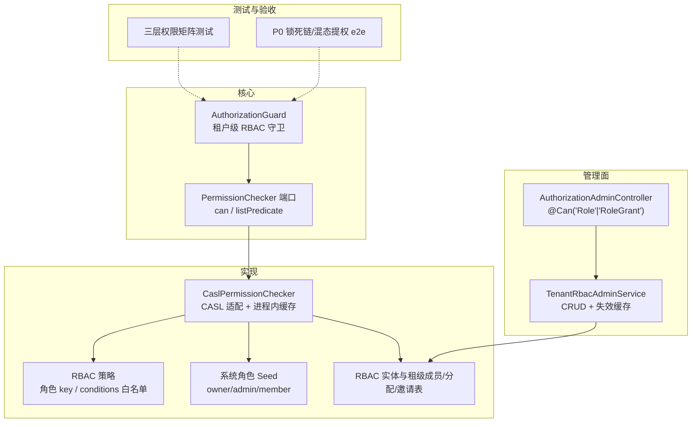
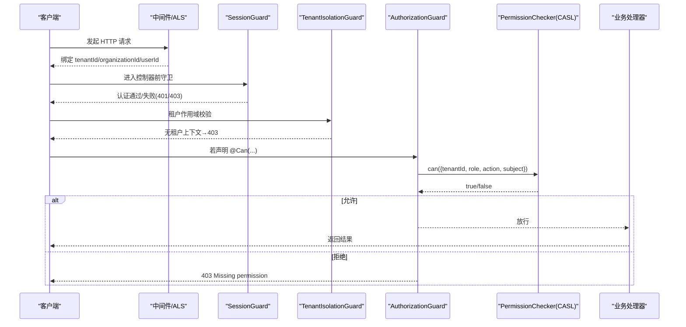
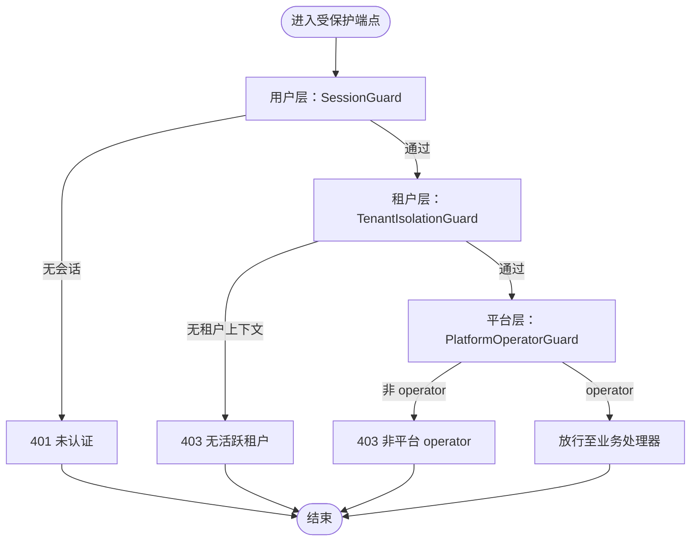
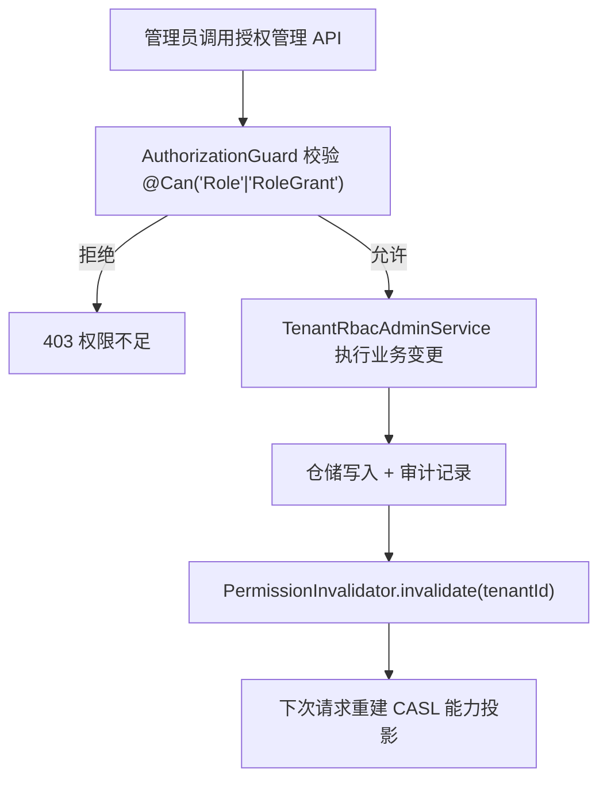
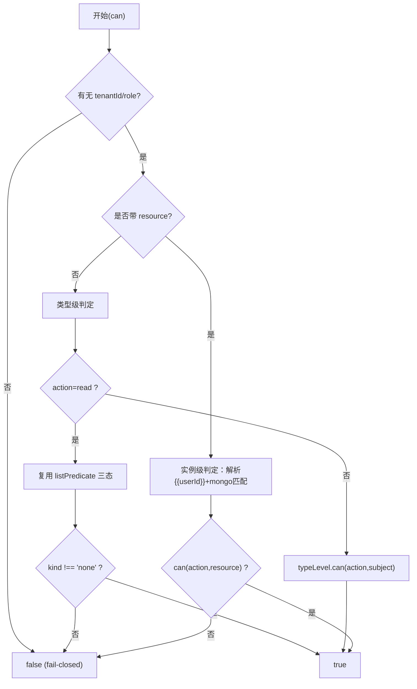
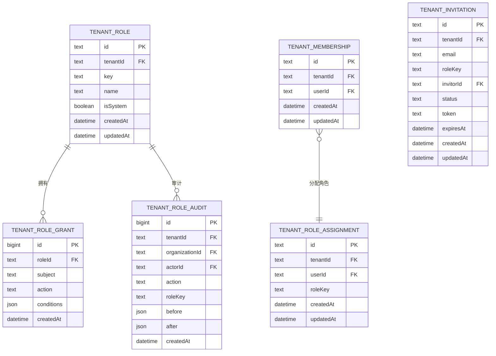
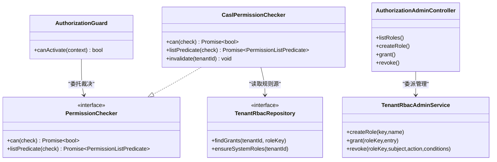

# 权限控制系统

<cite>
**本文引用的文件**   
- [apps/api/src/tenant-isolation/three-layer-permission.matrix.test.ts](file://apps/api/src/tenant-isolation/three-layer-permission.matrix.test.ts)
- [apps/api/src/tenant-isolation/p0-lockout-escalation.e2e.test.ts](file://apps/api/src/tenant-isolation/p0-lockout-escalation.e2e.test.ts)
- [libs/core/src/authorization/permission.port.ts](file://libs/core/src/authorization/permission.port.ts)
- [libs/core/src/authorization/authorization.guard.ts](file://libs/core/src/authorization/authorization.guard.ts)
- [apps/api/src/modules/authorization/infrastructure/casl-permission.checker.ts](file://apps/api/src/modules/authorization/infrastructure/casl-permission.checker.ts)
- [apps/api/src/modules/authorization/domain/policies/rbac.policy.ts](file://apps/api/src/modules/authorization/domain/policies/rbac.policy.ts)
- [apps/api/src/modules/authorization/domain/constants/system-role-seed.ts](file://apps/api/src/modules/authorization/domain/constants/system-role-seed.ts)
- [apps/api/src/modules/authorization/infrastructure/entities/rbac.entities.ts](file://apps/api/src/modules/authorization/infrastructure/entities/rbac.entities.ts)
- [apps/api/src/modules/authorization/application/organization-rbac-admin.service.ts](file://apps/api/src/modules/authorization/application/organization-rbac-admin.service.ts)
- [apps/api/src/modules/authorization/api/authorization-admin.controller.ts](file://apps/api/src/modules/authorization/api/authorization-admin.controller.ts)
</cite>

## 目录
1. [引言](#引言)
2. [项目结构](#项目结构)
3. [核心组件](#核心组件)
4. [架构总览](#架构总览)
5. [详细组件分析](#详细组件分析)
6. [依赖关系分析](#依赖关系分析)
7. [性能与缓存特性](#性能与缓存特性)
8. [故障排查指南](#故障排查指南)
9. [结论](#结论)
10. [附录：权限矩阵与边界场景](#附录权限矩阵与边界场景)

## 引言
本文件系统性梳理多租户 SaaS 系统中的权限控制机制，重点覆盖以下目标：
- P0/P1 权限级别的安全策略、访问控制与升级降级约束。
- 三层权限矩阵（平台 operator、租户管理员、普通用户）的设计原理与差异。
- 权限检查在请求处理流程中的执行时机与决策逻辑。
- 复杂多租户场景下的边界情况与防护（锁死链、混态会话提权）。
- 可操作的流程图、矩阵表与排障建议。

## 项目结构
权限相关代码分布在以下层次：
- 核心端口与守卫：定义租户级授权裁决接口、守卫接入点。
- CASL 适配层：将 DB 中的 grant 行投影为能力模型并做判定。
- 领域策略与种子数据：角色 key 白名单、conditions 语法校验、系统角色 seed。
- 实体与仓储契约：RBAC 三表（角色、授权、审计）及租级成员/角色分配/邀请表。
- 管理门面：角色与授权的 CRUD 入口，写后失效缓存。
- 三层权限矩阵测试与 P0 修复反证 e2e：验证互不授予、fail-closed、P0 锁死链与混态提权。

图表来源
- [libs/core/src/authorization/authorization.guard.ts:14-33](file://libs/core/src/authorization/authorization.guard.ts#L14-L33)
- [libs/core/src/authorization/permission.port.ts:92-125](file://libs/core/src/authorization/permission.port.ts#L92-L125)
- [apps/api/src/modules/authorization/infrastructure/casl-permission.checker.ts:28-70](file://apps/api/src/modules/authorization/infrastructure/casl-permission.checker.ts#L28-L70)
- [apps/api/src/modules/authorization/domain/policies/rbac.policy.ts:1-9](file://apps/api/src/modules/authorization/domain/policies/rbac.policy.ts#L1-L9)
- [apps/api/src/modules/authorization/domain/constants/system-role-seed.ts:7-22](file://apps/api/src/modules/authorization/domain/constants/system-role-seed.ts#L7-L22)
- [apps/api/src/modules/authorization/infrastructure/entities/rbac.entities.ts:9-25](file://apps/api/src/modules/authorization/infrastructure/entities/rbac.entities.ts#L9-L25)
- [apps/api/src/modules/authorization/api/authorization-admin.controller.ts:36-47](file://apps/api/src/modules/authorization/api/authorization-admin.controller.ts#L36-L47)
- [apps/api/src/modules/authorization/application/organization-rbac-admin.service.ts:27-41](file://apps/api/src/modules/authorization/application/organization-rbac-admin.service.ts#L27-L41)
- [apps/api/src/tenant-isolation/three-layer-permission.matrix.test.ts:15-23](file://apps/api/src/tenant-isolation/three-layer-permission.matrix.test.ts#L15-L23)
- [apps/api/src/tenant-isolation/p0-lockout-escalation.e2e.test.ts:26-53](file://apps/api/src/tenant-isolation/p0-lockout-escalation.e2e.test.ts#L26-L53)

章节来源
- [libs/core/src/authorization/authorization.guard.ts:14-33](file://libs/core/src/authorization/authorization.guard.ts#L14-L33)
- [libs/core/src/authorization/permission.port.ts:92-125](file://libs/core/src/authorization/permission.port.ts#L92-L125)
- [apps/api/src/modules/authorization/infrastructure/casl-permission.checker.ts:28-70](file://apps/api/src/modules/authorization/infrastructure/casl-permission.checker.ts#L28-L70)
- [apps/api/src/modules/authorization/domain/policies/rbac.policy.ts:1-9](file://apps/api/src/modules/authorization/domain/policies/rbac.policy.ts#L1-L9)
- [apps/api/src/modules/authorization/domain/constants/system-role-seed.ts:7-22](file://apps/api/src/modules/authorization/domain/constants/system-role-seed.ts#L7-L22)
- [apps/api/src/modules/authorization/infrastructure/entities/rbac.entities.ts:9-25](file://apps/api/src/modules/authorization/infrastructure/entities/rbac.entities.ts#L9-L25)
- [apps/api/src/modules/authorization/api/authorization-admin.controller.ts:36-47](file://apps/api/src/modules/authorization/api/authorization-admin.controller.ts#L36-L47)
- [apps/api/src/modules/authorization/application/organization-rbac-admin.service.ts:27-41](file://apps/api/src/modules/authorization/application/organization-rbac-admin.service.ts#L27-L41)
- [apps/api/src/tenant-isolation/three-layer-permission.matrix.test.ts:15-23](file://apps/api/src/tenant-isolation/three-layer-permission.matrix.test.ts#L15-L23)
- [apps/api/src/tenant-isolation/p0-lockout-escalation.e2e.test.ts:26-53](file://apps/api/src/tenant-isolation/p0-lockout-escalation.e2e.test.ts#L26-L53)

## 核心组件
- 租户级 RBAC 守卫 AuthorizationGuard：从 ALS 取 tenantId/role，按 @Can 声明调用 PermissionChecker 裁决；无活动租户或拒绝时抛 403。
- 权限裁决端口 PermissionChecker：统一 can() 单点判定与 listPredicate() 列表谓词；读侧由 CASL 适配实现。
- CASL 适配 CaslPermissionChecker：以租户 DB grant 行为 SSOT，懒加载系统角色、构建类型级 ability、实例级条件匹配；带进程内 LRU 缓存与写后失效。
- 领域策略 RBAC Policy：自定义角色 key 白名单、conditions 语法白名单、规范化比较。
- 系统角色 Seed：owner/admin/member 的静态授权格，lazy-ensure 落库。
- RBAC 实体与租级成员/分配/邀请：tenant_role、tenant_role_grant、tenant_role_audit；tenant_membership、tenant_role_assignment、tenant_invitation。
- 管理门面 Controller/Service：对 Role/RoleGrant 的 CRUD，写后调用 PermissionInvalidator.invalidate(tenantId)。

章节来源
- [libs/core/src/authorization/authorization.guard.ts:14-33](file://libs/core/src/authorization/authorization.guard.ts#L14-L33)
- [libs/core/src/authorization/authorization.guard.ts:50-84](file://libs/core/src/authorization/authorization.guard.ts#L50-L84)
- [libs/core/src/authorization/permission.port.ts:92-125](file://libs/core/src/authorization/permission.port.ts#L92-L125)
- [apps/api/src/modules/authorization/infrastructure/casl-permission.checker.ts:28-70](file://apps/api/src/modules/authorization/infrastructure/casl-permission.checker.ts#L28-L70)
- [apps/api/src/modules/authorization/infrastructure/casl-permission.checker.ts:88-127](file://apps/api/src/modules/authorization/infrastructure/casl-permission.checker.ts#L88-L127)
- [apps/api/src/modules/authorization/infrastructure/casl-permission.checker.ts:146-168](file://apps/api/src/modules/authorization/infrastructure/casl-permission.checker.ts#L146-L168)
- [apps/api/src/modules/authorization/domain/policies/rbac.policy.ts:1-9](file://apps/api/src/modules/authorization/domain/policies/rbac.policy.ts#L1-L9)
- [apps/api/src/modules/authorization/domain/constants/system-role-seed.ts:7-22](file://apps/api/src/modules/authorization/domain/constants/system-role-seed.ts#L7-L22)
- [apps/api/src/modules/authorization/infrastructure/entities/rbac.entities.ts:9-25](file://apps/api/src/modules/authorization/infrastructure/entities/rbac.entities.ts#L9-L25)
- [apps/api/src/modules/authorization/api/authorization-admin.controller.ts:36-47](file://apps/api/src/modules/authorization/api/authorization-admin.controller.ts#L36-L47)
- [apps/api/src/modules/authorization/application/organization-rbac-admin.service.ts:27-41](file://apps/api/src/modules/authorization/application/organization-rbac-admin.service.ts#L27-L41)

## 架构总览
下图展示一次受保护请求的完整链路：中间件绑定 ALS → 全局 SessionGuard → 租户隔离守卫 → 路由级 AuthorizationGuard → 业务处理器。

图表来源
- [libs/core/src/authorization/authorization.guard.ts:50-84](file://libs/core/src/authorization/authorization.guard.ts#L50-L84)
- [libs/core/src/authorization/permission.port.ts:92-125](file://libs/core/src/authorization/permission.port.ts#L92-L125)
- [apps/api/src/tenant-isolation/three-layer-permission.matrix.test.ts:86-115](file://apps/api/src/tenant-isolation/three-layer-permission.matrix.test.ts#L86-L115)

## 详细组件分析

### 三层权限矩阵（平台 operator / 租户管理员 / 普通用户）
- 各层各自 fail-closed：无会话/无租户/非 operator 均直接拒绝。
- 互不授予：平台 operator 身份不自动获得租户作用域；租户 admin 不自动获得平台权；用户级认证只绑定自身身份。
- 校验顺序与暂停联动：用户被暂停时，三层皆失权。

图表来源
- [apps/api/src/tenant-isolation/three-layer-permission.matrix.test.ts:86-115](file://apps/api/src/tenant-isolation/three-layer-permission.matrix.test.ts#L86-L115)
- [apps/api/src/tenant-isolation/three-layer-permission.matrix.test.ts:117-171](file://apps/api/src/tenant-isolation/three-layer-permission.matrix.test.ts#L117-L171)
- [apps/api/src/tenant-isolation/three-layer-permission.matrix.test.ts:173-203](file://apps/api/src/tenant-isolation/three-layer-permission.matrix.test.ts#L173-L203)

章节来源
- [apps/api/src/tenant-isolation/three-layer-permission.matrix.test.ts:15-23](file://apps/api/src/tenant-isolation/three-layer-permission.matrix.test.ts#L15-L23)
- [apps/api/src/tenant-isolation/three-layer-permission.matrix.test.ts:86-115](file://apps/api/src/tenant-isolation/three-layer-permission.matrix.test.ts#L86-L115)
- [apps/api/src/tenant-isolation/three-layer-permission.matrix.test.ts:117-171](file://apps/api/src/tenant-isolation/three-layer-permission.matrix.test.ts#L117-L171)
- [apps/api/src/tenant-isolation/three-layer-permission.matrix.test.ts:173-203](file://apps/api/src/tenant-isolation/three-layer-permission.matrix.test.ts#L173-L203)

### P0/P1 安全策略与升级降级
- P0（高优先级缺陷修复）：
  - X1 锁死链：多租户用户在活动组织锚定某租户时，目录查询需跨租户可见；切租操作应可达。
  - X2 租内提权：混态会话（activeTenantId 与 activeOrganizationId 不属于同一租户）必须 fail-closed，禁止借另一租户的高权角色在当前租户行权。
- P1（常规权限提升/降级）：
  - 通过 TenantRbacAdminService 进行角色与授权 CRUD；写后调用 PermissionInvalidator.invalidate(tenantId) 使热改立即生效。
  - 系统角色不可删除/修改；自定义角色 key 需过白名单；conditions 仅允许白名单语法。

图表来源
- [apps/api/src/modules/authorization/api/authorization-admin.controller.ts:65-179](file://apps/api/src/modules/authorization/api/authorization-admin.controller.ts#L65-L179)
- [apps/api/src/modules/authorization/application/organization-rbac-admin.service.ts:77-109](file://apps/api/src/modules/authorization/application/organization-rbac-admin.service.ts#L77-L109)
- [apps/api/src/modules/authorization/application/organization-rbac-admin.service.ts:143-169](file://apps/api/src/modules/authorization/application/organization-rbac-admin.service.ts#L143-L169)
- [apps/api/src/modules/authorization/application/organization-rbac-admin.service.ts:180-206](file://apps/api/src/modules/authorization/application/organization-rbac-admin.service.ts#L180-L206)

章节来源
- [apps/api/src/tenant-isolation/p0-lockout-escalation.e2e.test.ts:26-53](file://apps/api/src/tenant-isolation/p0-lockout-escalation.e2e.test.ts#L26-L53)
- [apps/api/src/tenant-isolation/p0-lockout-escalation.e2e.test.ts:199-224](file://apps/api/src/tenant-isolation/p0-lockout-escalation.e2e.test.ts#L199-L224)
- [apps/api/src/tenant-isolation/p0-lockout-escalation.e2e.test.ts:226-265](file://apps/api/src/tenant-isolation/p0-lockout-escalation.e2e.test.ts#L226-L265)
- [apps/api/src/modules/authorization/application/organization-rbac-admin.service.ts:27-41](file://apps/api/src/modules/authorization/application/organization-rbac-admin.service.ts#L27-L41)
- [apps/api/src/modules/authorization/application/organization-rbac-admin.service.ts:77-109](file://apps/api/src/modules/authorization/application/organization-rbac-admin.service.ts#L77-L109)
- [apps/api/src/modules/authorization/application/organization-rbac-admin.service.ts:143-169](file://apps/api/src/modules/authorization/application/organization-rbac-admin.service.ts#L143-L169)
- [apps/api/src/modules/authorization/application/organization-rbac-admin.service.ts:180-206](file://apps/api/src/modules/authorization/application/organization-rbac-admin.service.ts#L180-L206)

### 权限检查的执行时机与决策逻辑
- 执行时机：
  - 中间件解析会话并绑定 ALS（tenantId/organizationId/userId）。
  - 全局 SessionGuard 校验会话有效性，拦截未登录或被暂停用户。
  - TenantIsolationGuard 确保存在活跃租户上下文。
  - AuthorizationGuard 读取 @Can 声明，调用 PermissionChecker.can() 做最终裁决。
- 决策逻辑：
  - 无租户上下文 → 403。
  - 有租户上下文但角色缺失/非法 → 直拒。
  - 类型级判定（守卫路径）：read 动作放宽为“存在任一匹配 grant 行即放行”，写动作保守 deny。
  - 实例级判定（check 级）：携带 resource 快照，按 userId 解析 {{userId}} 模板后交由 CASL mongo 匹配。

图表来源
- [libs/core/src/authorization/authorization.guard.ts:50-84](file://libs/core/src/authorization/authorization.guard.ts#L50-L84)
- [apps/api/src/modules/authorization/infrastructure/casl-permission.checker.ts:88-127](file://apps/api/src/modules/authorization/infrastructure/casl-permission.checker.ts#L88-L127)
- [apps/api/src/modules/authorization/infrastructure/casl-permission.checker.ts:146-168](file://apps/api/src/modules/authorization/infrastructure/casl-permission.checker.ts#L146-L168)

章节来源
- [libs/core/src/authorization/authorization.guard.ts:50-84](file://libs/core/src/authorization/authorization.guard.ts#L50-L84)
- [apps/api/src/modules/authorization/infrastructure/casl-permission.checker.ts:88-127](file://apps/api/src/modules/authorization/infrastructure/casl-permission.checker.ts#L88-L127)
- [apps/api/src/modules/authorization/infrastructure/casl-permission.checker.ts:146-168](file://apps/api/src/modules/authorization/infrastructure/casl-permission.checker.ts#L146-L168)

### 数据模型与持久化
- 角色与授权：
  - tenant_role：角色定义（系统三 key isSystem=true）。
  - tenant_role_grant：行式授权（subject/action/conditions），conditions=null 表示整 subject 级。
  - tenant_role_audit：变更留痕（actor/who/before/after）。
- 租级成员与角色分配：
  - tenant_membership：user × tenant 成员关系。
  - tenant_role_assignment：(user, tenant) 单角色分配。
  - tenant_invitation：租级邀请（接受后建成员与角色分配）。

图表来源
- [apps/api/src/modules/authorization/infrastructure/entities/rbac.entities.ts:27-85](file://apps/api/src/modules/authorization/infrastructure/entities/rbac.entities.ts#L27-L85)
- [apps/api/src/modules/authorization/infrastructure/entities/rbac.entities.ts:137-200](file://apps/api/src/modules/authorization/infrastructure/entities/rbac.entities.ts#L137-L200)

章节来源
- [apps/api/src/modules/authorization/infrastructure/entities/rbac.entities.ts:9-25](file://apps/api/src/modules/authorization/infrastructure/entities/rbac.entities.ts#L9-L25)
- [apps/api/src/modules/authorization/infrastructure/entities/rbac.entities.ts:27-85](file://apps/api/src/modules/authorization/infrastructure/entities/rbac.entities.ts#L27-L85)
- [apps/api/src/modules/authorization/infrastructure/entities/rbac.entities.ts:137-200](file://apps/api/src/modules/authorization/infrastructure/entities/rbac.entities.ts#L137-L200)

## 依赖关系分析
- AuthorizationGuard 依赖：
  - Reflector：读取 @Can 元数据。
  - TenantIsolationService：获取 tenantId/role。
  - PermissionChecker：委托裁决。
- CaslPermissionChecker 依赖：
  - TenantRbacRepository：读取 grants、ensure 系统角色。
  - CASL 能力工厂：构建 type-level 与 instance-level 能力。
- 管理门面：
  - TenantRbacAdminService 依赖 TenantRbacRepository 与 PermissionInvalidator。
  - AuthorizationAdminController 使用 TenantIsolationGuard 与 AuthorizationGuard 保护所有管理端点。

图表来源
- [libs/core/src/authorization/authorization.guard.ts:34-40](file://libs/core/src/authorization/authorization.guard.ts#L34-L40)
- [libs/core/src/authorization/permission.port.ts:92-125](file://libs/core/src/authorization/permission.port.ts#L92-L125)
- [apps/api/src/modules/authorization/infrastructure/casl-permission.checker.ts:71-76](file://apps/api/src/modules/authorization/infrastructure/casl-permission.checker.ts#L71-L76)
- [apps/api/src/modules/authorization/application/organization-rbac-admin.service.ts:42-49](file://apps/api/src/modules/authorization/application/organization-rbac-admin.service.ts#L42-L49)
- [apps/api/src/modules/authorization/api/authorization-admin.controller.ts:65-68](file://apps/api/src/modules/authorization/api/authorization-admin.controller.ts#L65-L68)

章节来源
- [libs/core/src/authorization/authorization.guard.ts:34-40](file://libs/core/src/authorization/authorization.guard.ts#L34-L40)
- [libs/core/src/authorization/permission.port.ts:92-125](file://libs/core/src/authorization/permission.port.ts#L92-L125)
- [apps/api/src/modules/authorization/infrastructure/casl-permission.checker.ts:71-76](file://apps/api/src/modules/authorization/infrastructure/casl-permission.checker.ts#L71-L76)
- [apps/api/src/modules/authorization/application/organization-rbac-admin.service.ts:42-49](file://apps/api/src/modules/authorization/application/organization-rbac-admin.service.ts#L42-L49)
- [apps/api/src/modules/authorization/api/authorization-admin.controller.ts:65-68](file://apps/api/src/modules/authorization/api/authorization-admin.controller.ts#L65-L68)

## 性能与缓存特性
- 进程内 LRU 缓存：
  - 键为 (tenantId, role)，命中热路径免查库。
  - 上限默认 2048，超限驱逐最久未访问项。
- 懒加载与失效：
  - 首次访问 ensureSystemRoles 再 findGrants。
  - 写后 invalidate(tenantId) 淘汰该租户全部条目。
- 列表谓词优化：
  - listPredicate 复用 entryFor 缓存，避免逐请求查库。
  - 无条件类型级授权直接返回 all，减少过滤开销。

章节来源
- [apps/api/src/modules/authorization/infrastructure/casl-permission.checker.ts:20-24](file://apps/api/src/modules/authorization/infrastructure/casl-permission.checker.ts#L20-L24)
- [apps/api/src/modules/authorization/infrastructure/casl-permission.checker.ts:75-86](file://apps/api/src/modules/authorization/infrastructure/casl-permission.checker.ts#L75-L86)
- [apps/api/src/modules/authorization/infrastructure/casl-permission.checker.ts:170-186](file://apps/api/src/modules/authorization/infrastructure/casl-permission.checker.ts#L170-L186)
- [apps/api/src/modules/authorization/infrastructure/casl-permission.checker.ts:188-197](file://apps/api/src/modules/authorization/infrastructure/casl-permission.checker.ts#L188-L197)
- [apps/api/src/modules/authorization/infrastructure/casl-permission.checker.ts:146-168](file://apps/api/src/modules/authorization/infrastructure/casl-permission.checker.ts#L146-L168)

## 故障排查指南
- 常见错误与定位：
  - 401 未认证：SessionGuard 未拿到会话或用户被暂停。
  - 403 无活跃租户：TenantIsolationGuard 检测到无 tenantId。
  - 403 权限不足：AuthorizationGuard 调用 PermissionChecker.can() 返回 false。
  - 400 无效条件：自定义 grant conditions 不在白名单语法内。
  - 404 角色不存在：管理门面回读不到角色。
  - 409 重复/系统角色保护：角色 key 重复或尝试修改系统角色。
- 排查步骤：
  - 确认会话有效且未被暂停。
  - 确认 ALS 已绑定 tenantId 且与活动组织一致。
  - 检查 @Can 声明与 DB grant 行是否匹配。
  - 检查 conditions 是否符合白名单语法。
  - 检查写后是否调用 invalidate(tenantId)。

章节来源
- [libs/core/src/authorization/authorization.guard.ts:50-84](file://libs/core/src/authorization/authorization.guard.ts#L50-L84)
- [apps/api/src/modules/authorization/application/organization-rbac-admin.service.ts:87-109](file://apps/api/src/modules/authorization/application/organization-rbac-admin.service.ts#L87-L109)
- [apps/api/src/modules/authorization/application/organization-rbac-admin.service.ts:143-169](file://apps/api/src/modules/authorization/application/organization-rbac-admin.service.ts#L143-L169)
- [apps/api/src/modules/authorization/application/organization-rbac-admin.service.ts:180-206](file://apps/api/src/modules/authorization/application/organization-rbac-admin.service.ts#L180-L206)
- [apps/api/src/modules/authorization/domain/policies/rbac.policy.ts:51-71](file://apps/api/src/modules/authorization/domain/policies/rbac.policy.ts#L51-L71)

## 结论
本权限控制系统以“租户为轴”的动态 RBAC 为核心，结合三层守卫矩阵与 CASL 适配，实现了严格的多租户隔离与细粒度授权。通过 DB 化的 grant 行作为唯一事实源、进程内缓存与写后失效，兼顾了安全性与性能。P0 修复覆盖了锁死链与混态提权等关键风险，P1 管理面提供了安全的权限升级/降级通道。三层矩阵保证平台、租户与用户权限互不授予，fail-closed 贯穿全链路。

## 附录：权限矩阵与边界场景

### 三层权限矩阵表
- 平台 operator：具备平台管理能力，但不自动获得任何租户作用域。
- 租户管理员（owner/admin）：具备租户内管理与资源操作能力，具体取决于 grant 行。
- 普通用户（member）：仅具备有限读/写能力，依 grant 行而定。

| 层级 | 典型身份 | 作用域 | 关键限制 |
| --- | --- | --- | --- |
| 平台 | Platform Operator | 平台管理 | 不授予租户作用域；需显式选择租户 |
| 租户 | Owner/Admin/Member | 租户内资源 | 依赖 tenant_role_grant；conditions 可限制实例级可见性 |
| 用户 | 会话用户 | 自身会话 | 仅认证自身；不自动获得租户/角色 |

### 边界场景与处理
- 多租户目录锁死链（X1）：活动组织锚定某租户时，目录查询需跨租户可见；切租应可达。
- 混态会话提权（X2）：activeTenantId 与 activeOrganizationId 不一致时必须 fail-closed。
- 暂停用户：三层皆失权，防止绕过。

章节来源
- [apps/api/src/tenant-isolation/p0-lockout-escalation.e2e.test.ts:199-224](file://apps/api/src/tenant-isolation/p0-lockout-escalation.e2e.test.ts#L199-L224)
- [apps/api/src/tenant-isolation/p0-lockout-escalation.e2e.test.ts:226-265](file://apps/api/src/tenant-isolation/p0-lockout-escalation.e2e.test.ts#L226-L265)
- [apps/api/src/tenant-isolation/three-layer-permission.matrix.test.ts:173-203](file://apps/api/src/tenant-isolation/three-layer-permission.matrix.test.ts#L173-L203)