# 租户上下文传播

<cite>
**本文引用的文件**   
- [request-session.port.ts](file://libs/core/src/tenant-isolation/session/request-session.port.ts)
- [auth-session.reader.ts](file://apps/api/src/tenant-isolation/infrastructure/auth-session.reader.ts)
- [tenant-isolation.middleware.ts](file://libs/core/src/tenant-isolation/tenant-isolation.middleware.ts)
- [tenant-isolation-scope.ts](file://libs/core/src/tenant-isolation/tenant-isolation-scope.ts)
- [tenant-isolation.service.ts](file://libs/core/src/tenant-isolation/tenant-isolation.service.ts)
- [tenant-isolation.guard.ts](file://libs/core/src/tenant-isolation/tenant-isolation.guard.ts)
- [mikro-tenant-scope.resolver.ts](file://apps/api/src/tenant-isolation/infrastructure/mikro-tenant-scope.resolver.ts)
- [tenant-isolation.module.ts](file://apps/api/src/tenant-isolation/tenant-isolation.module.ts)
</cite>

## 目录
1. [引言](#引言)
2. [项目结构定位](#项目结构定位)
3. [核心组件](#核心组件)
4. [架构总览](#架构总览)
5. [详细组件分析](#详细组件分析)
6. [依赖关系分析](#依赖关系分析)
7. [性能与并发特性](#性能与并发特性)
8. [故障排查指南](#故障排查指南)
9. [结论](#结论)

## 引言
本文聚焦“租户上下文在请求生命周期中的传播机制”，从 HTTP 请求进入、会话读取、租户作用域解析，到最终响应返回的完整链路。重点说明：
- 如何通过 `AsyncLocalStorage` 实现线程安全的每请求上下文存储，避免并发请求间上下文污染。
- 会话读取器如何从认证会话中提取用户、活动组织、显式激活租户等关键信息。
- 中间件如何把可信会话转化为租户作用域，并绑定到异步上下文中。
- 守卫与服务层如何安全地读取当前租户上下文，保证多层调用链中上下文不丢失。
- 通过时序图与上下文传播图，展示复杂调用场景下的上下文保持策略。

## 项目结构定位
租户隔离能力由“核心库”和“应用侧适配”两部分组成：
- 核心库位于 `libs/core/src/tenant-isolation`，定义端口、中间件、守卫、服务与 ALS 作用域模型。
- 应用侧位于 `apps/api/src/tenant-isolation`，提供会话读取器与租户范围解析器的具体实现，并通过模块装配全局注册。

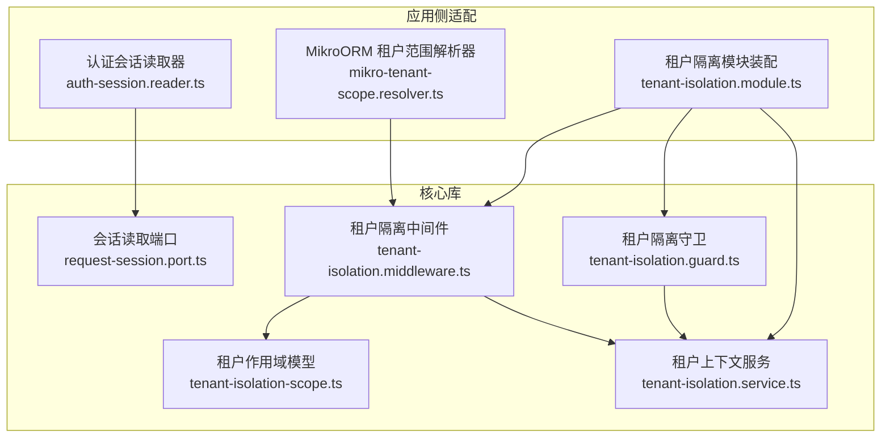

**图表来源**
- [request-session.port.ts:1-64](file://libs/core/src/tenant-isolation/session/request-session.port.ts#L1-L64)
- [auth-session.reader.ts:1-80](file://apps/api/src/tenant-isolation/infrastructure/auth-session.reader.ts#L1-L80)
- [tenant-isolation.middleware.ts:1-201](file://libs/core/src/tenant-isolation/tenant-isolation.middleware.ts#L1-L201)
- [tenant-isolation-scope.ts:1-42](file://libs/core/src/tenant-isolation/tenant-isolation-scope.ts#L1-L42)
- [tenant-isolation.service.ts:1-116](file://libs/core/src/tenant-isolation/tenant-isolation.service.ts#L1-L116)
- [tenant-isolation.guard.ts:1-69](file://libs/core/src/tenant-isolation/tenant-isolation.guard.ts#L1-L69)
- [mikro-tenant-scope.resolver.ts:1-84](file://apps/api/src/tenant-isolation/infrastructure/mikro-tenant-scope.resolver.ts#L1-L84)
- [tenant-isolation.module.ts:1-73](file://apps/api/src/tenant-isolation/tenant-isolation.module.ts#L1-L73)

**章节来源**
- [tenant-isolation.module.ts:11-57](file://apps/api/src/tenant-isolation/tenant-isolation.module.ts#L11-L57)

## 核心组件
- 会话读取端口：定义最小请求形状与可信会话视图，核心只消费标量字段，不感知认证实现。
- 认证会话读取器：应用侧适配，短路无 cookie、旁路路径与认证表面路由，调用会话解析器提取用户与活动租户。
- 租户隔离中间件：逐请求解析会话、校验封禁状态、派生租户主轴、绑定 `AsyncLocalStorage`。
- 租户作用域模型：定义 `tenantId`、`organizationId`、`workspaceId`、`userId`、`role`、`orgVisibility`。
- 租户上下文服务：单例暴露 ALS 读取接口，并提供 fail-closed 的强校验方法。
- 租户隔离守卫：全局守卫，要求存在活动租户，否则拒绝访问。
- 租户范围解析器：应用侧实现，从组织派生租户、读可见性策略、按租户解析角色与缺省租户。

**章节来源**
- [request-session.port.ts:1-64](file://libs/core/src/tenant-isolation/session/request-session.port.ts#L1-L64)
- [auth-session.reader.ts:15-79](file://apps/api/src/tenant-isolation/infrastructure/auth-session.reader.ts#L15-L79)
- [tenant-isolation.middleware.ts:9-27](file://libs/core/src/tenant-isolation/tenant-isolation.middleware.ts#L9-L27)
- [tenant-isolation-scope.ts:4-41](file://libs/core/src/tenant-isolation/tenant-isolation-scope.ts#L4-L41)
- [tenant-isolation.service.ts:6-18](file://libs/core/src/tenant-isolation/tenant-isolation.service.ts#L6-L18)
- [tenant-isolation.guard.ts:14-36](file://libs/core/src/tenant-isolation/tenant-isolation.guard.ts#L14-L36)
- [mikro-tenant-scope.resolver.ts:15-24](file://apps/api/src/tenant-isolation/infrastructure/mikro-tenant-scope.resolver.ts#L15-L24)

## 架构总览
下图展示一次受保护的 API 请求从进入服务器到返回响应的完整流程，包括会话读取、租户解析、ALS 绑定、守卫校验与服务层读取。

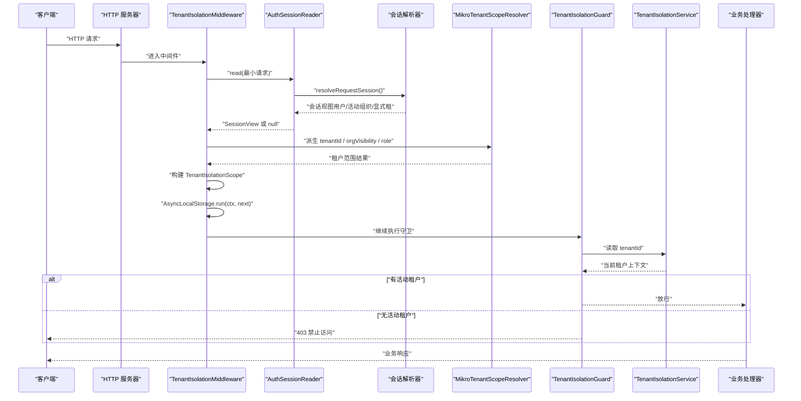

**图表来源**
- [tenant-isolation.module.ts:68-71](file://apps/api/src/tenant-isolation/tenant-isolation.module.ts#L68-L71)
- [auth-session.reader.ts:48-78](file://apps/api/src/tenant-isolation/infrastructure/auth-session.reader.ts#L48-L78)
- [tenant-isolation.middleware.ts:50-103](file://libs/core/src/tenant-isolation/tenant-isolation.middleware.ts#L50-L103)
- [mikro-tenant-scope.resolver.ts:29-41](file://apps/api/src/tenant-isolation/infrastructure/mikro-tenant-scope.resolver.ts#L29-L41)
- [tenant-isolation.guard.ts:52-66](file://libs/core/src/tenant-isolation/tenant-isolation.guard.ts#L52-L66)
- [tenant-isolation.service.ts:21-31](file://libs/core/src/tenant-isolation/tenant-isolation.service.ts#L21-L31)

## 详细组件分析

### 会话读取端口与会话视图
- 端口定义最小请求形状与可信会话视图，仅包含用户 id、活动组织 id、显式激活租户 id。
- 返回 `null` 表示无租户上下文，用于公开路由、认证路由、旁路路由或无 cookie 的请求。
- 该设计使核心库不依赖任何认证实现，保持跨包安全。

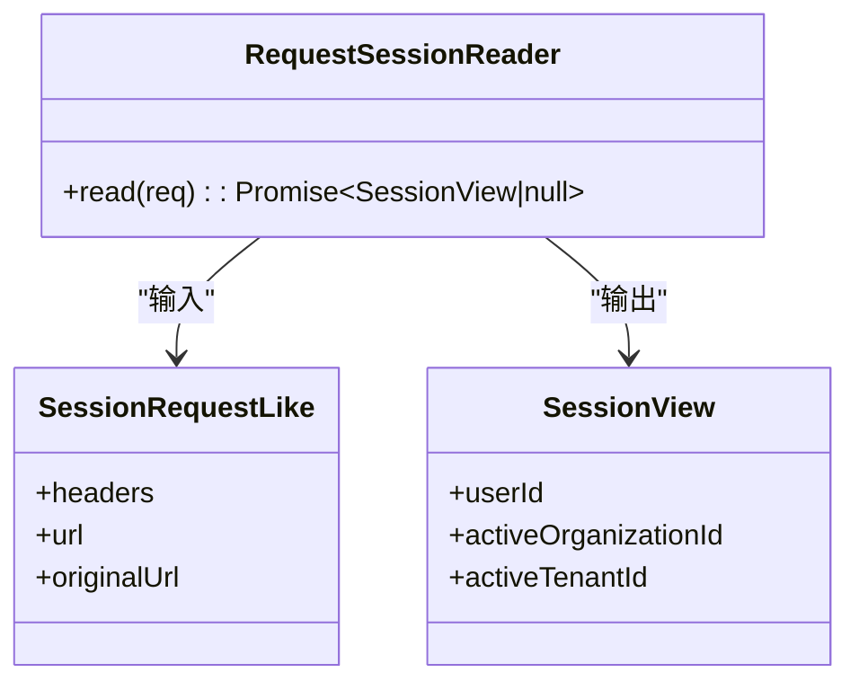

**图表来源**
- [request-session.port.ts:24-48](file://libs/core/src/tenant-isolation/session/request-session.port.ts#L24-L48)
- [request-session.port.ts:55-63](file://libs/core/src/tenant-isolation/session/request-session.port.ts#L55-L63)

**章节来源**
- [request-session.port.ts:1-64](file://libs/core/src/tenant-isolation/session/request-session.port.ts#L1-L64)

### 认证会话读取器
- 短路逻辑：无 cookie、认证表面路由、旁路路径直接返回 `null`，避免不必要的会话查询。
- 会话解析：调用会话解析器获取用户与活动组织；若未解析出则归一为无租户上下文。
- 显式租级激活：支持从会话额外字段读取显式激活租户 id，独立于活动组织。

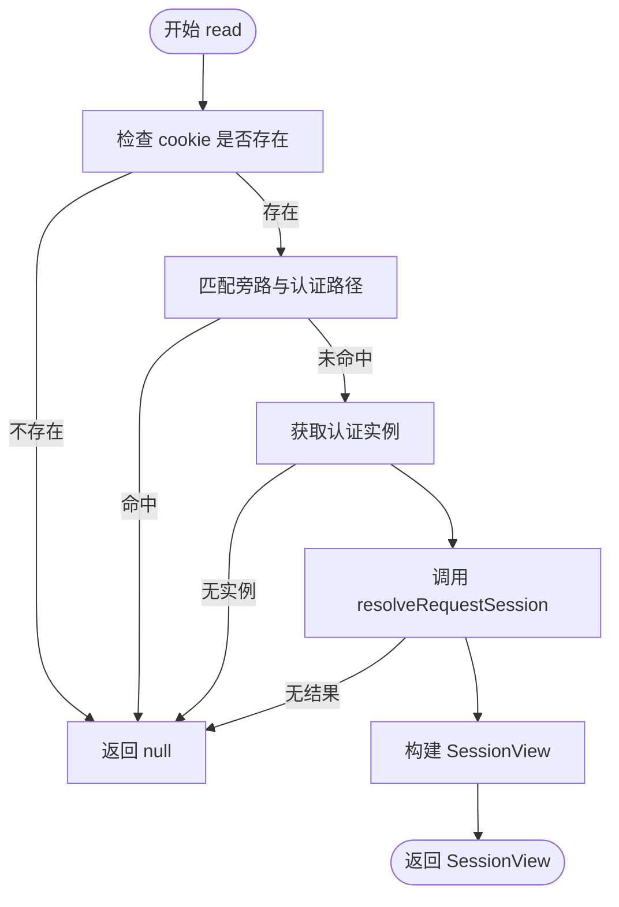

**图表来源**
- [auth-session.reader.ts:48-78](file://apps/api/src/tenant-isolation/infrastructure/auth-session.reader.ts#L48-L78)

**章节来源**
- [auth-session.reader.ts:15-79](file://apps/api/src/tenant-isolation/infrastructure/auth-session.reader.ts#L15-L79)

### 租户隔离中间件与 AsyncLocalStorage
- 中间件逐请求读取可信会话，解析用户封禁状态与租户封禁状态。
- 根据活动组织派生租户主轴，或根据显式激活租户建立租户上下文。
- 将 `TenantIsolationScope` 绑定到 `AsyncLocalStorage`，确保后续所有异步调用都能读取当前请求上下文。

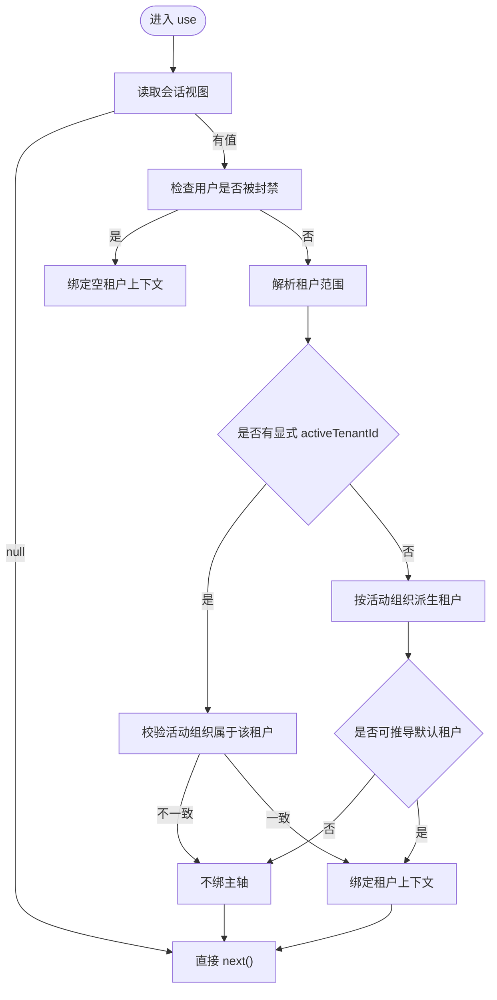

**图表来源**
- [tenant-isolation.middleware.ts:50-103](file://libs/core/src/tenant-isolation/tenant-isolation.middleware.ts#L50-L103)
- [tenant-isolation.middleware.ts:127-193](file://libs/core/src/tenant-isolation/tenant-isolation.middleware.ts#L127-L193)

**章节来源**
- [tenant-isolation.middleware.ts:9-27](file://libs/core/src/tenant-isolation/tenant-isolation.middleware.ts#L9-L27)
- [tenant-isolation.middleware.ts:50-103](file://libs/core/src/tenant-isolation/tenant-isolation.middleware.ts#L50-L103)
- [tenant-isolation.middleware.ts:105-193](file://libs/core/src/tenant-isolation/tenant-isolation.middleware.ts#L105-L193)

### 租户作用域模型与 ALS 存储
- `TenantIsolationScope` 定义租户主轴、活动组织、工作区、用户、角色与可见性策略。
- `tenantIsolationStorage` 使用 `AsyncLocalStorage` 保存每请求作用域，保证线程安全。

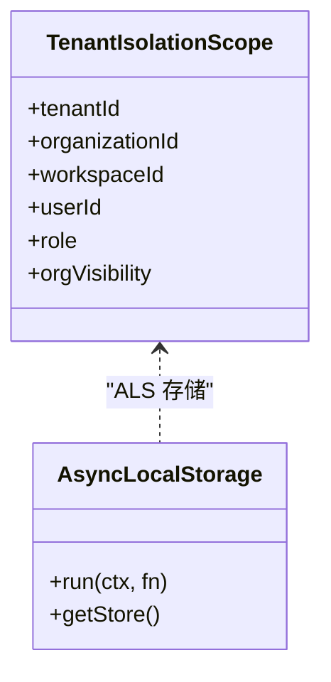

**图表来源**
- [tenant-isolation-scope.ts:17-41](file://libs/core/src/tenant-isolation/tenant-isolation-scope.ts#L17-L41)

**章节来源**
- [tenant-isolation-scope.ts:4-41](file://libs/core/src/tenant-isolation/tenant-isolation-scope.ts#L4-L41)

### 租户上下文服务
- 提供只读访问器，暴露当前请求的租户作用域、租户 id、组织 id、工作区 id、用户 id、角色与可见性策略。
- 提供 fail-closed 的强校验方法，要求存在活动租户或活动组织，否则抛出禁止访问异常。

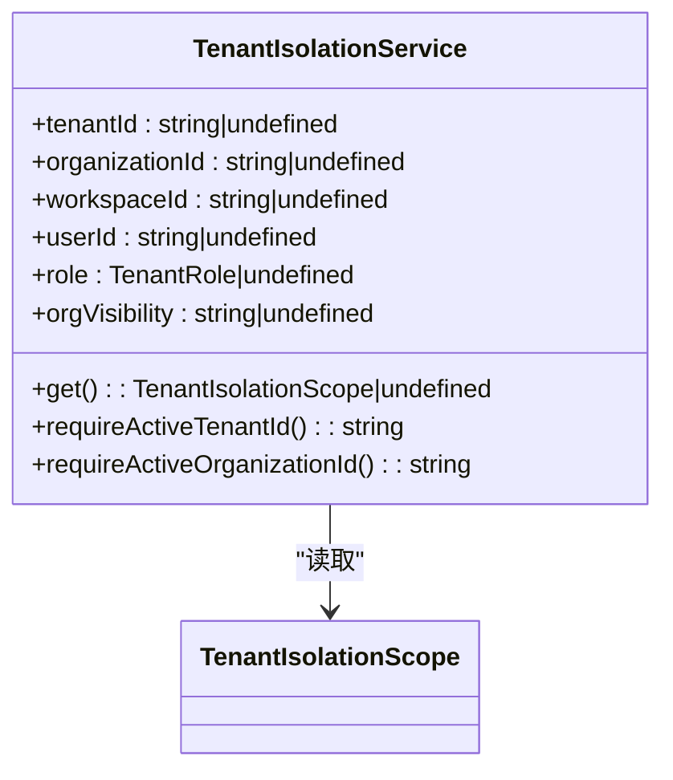

**图表来源**
- [tenant-isolation.service.ts:21-69](file://libs/core/src/tenant-isolation/tenant-isolation.service.ts#L21-L69)
- [tenant-isolation.service.ts:90-114](file://libs/core/src/tenant-isolation/tenant-isolation.service.ts#L90-L114)

**章节来源**
- [tenant-isolation.service.ts:6-18](file://libs/core/src/tenant-isolation/tenant-isolation.service.ts#L6-L18)
- [tenant-isolation.service.ts:21-69](file://libs/core/src/tenant-isolation/tenant-isolation.service.ts#L21-L69)
- [tenant-isolation.service.ts:90-114](file://libs/core/src/tenant-isolation/tenant-isolation.service.ts#L90-L114)

### 租户隔离守卫
- 全局守卫，默认要求存在活动租户。
- 支持 `@Public()` 与 `@TenantIsolationExempt()` 元数据旁路。
- 若无活动租户，抛出禁止访问异常。

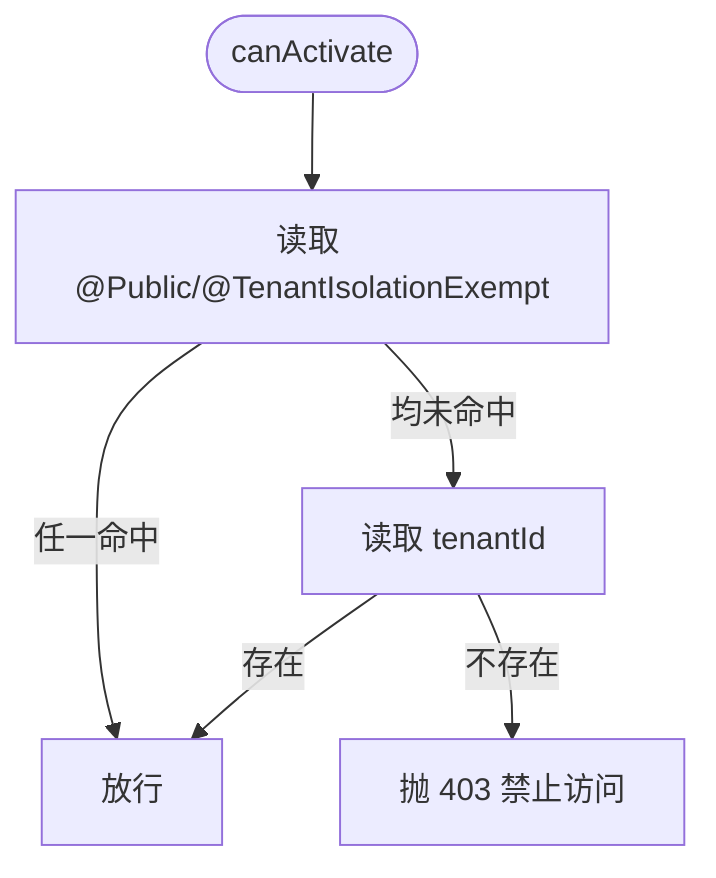

**图表来源**
- [tenant-isolation.guard.ts:52-66](file://libs/core/src/tenant-isolation/tenant-isolation.guard.ts#L52-L66)

**章节来源**
- [tenant-isolation.guard.ts:14-36](file://libs/core/src/tenant-isolation/tenant-isolation.guard.ts#L14-L36)
- [tenant-isolation.guard.ts:52-66](file://libs/core/src/tenant-isolation/tenant-isolation.guard.ts#L52-L66)

### 租户范围解析器
- 从活动组织派生租户主轴，并顺带读取租户的跨组织可见性策略。
- 按活动租户解析成员角色，确保角色随租户变化而非组织。
- 提供纯租级成员冷启动缺省租户推导，仅在用户恰属单一租户时返回。

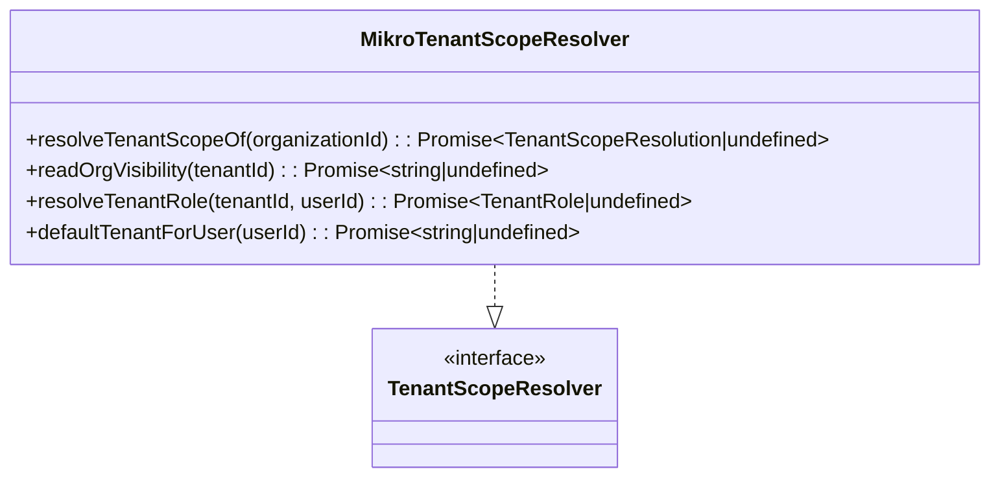

**图表来源**
- [mikro-tenant-scope.resolver.ts:29-41](file://apps/api/src/tenant-isolation/infrastructure/mikro-tenant-scope.resolver.ts#L29-L41)
- [mikro-tenant-scope.resolver.ts:64-82](file://apps/api/src/tenant-isolation/infrastructure/mikro-tenant-scope.resolver.ts#L64-L82)

**章节来源**
- [mikro-tenant-scope.resolver.ts:15-24](file://apps/api/src/tenant-isolation/infrastructure/mikro-tenant-scope.resolver.ts#L15-L24)
- [mikro-tenant-scope.resolver.ts:29-41](file://apps/api/src/tenant-isolation/infrastructure/mikro-tenant-scope.resolver.ts#L29-L41)
- [mikro-tenant-scope.resolver.ts:64-82](file://apps/api/src/tenant-isolation/infrastructure/mikro-tenant-scope.resolver.ts#L64-L82)

### 模块装配与全局注册
- 模块导出 `TenantIsolationService`、`TenantIsolationGuard` 与两个端口 token。
- 将 `SESSION_READER` 与 `TENANT_SCOPE_RESOLVER` 绑定到应用侧实现。
- 将 `TenantIsolationGuard` 注册为全局守卫，并在 `configure` 中将中间件应用到所有路由。

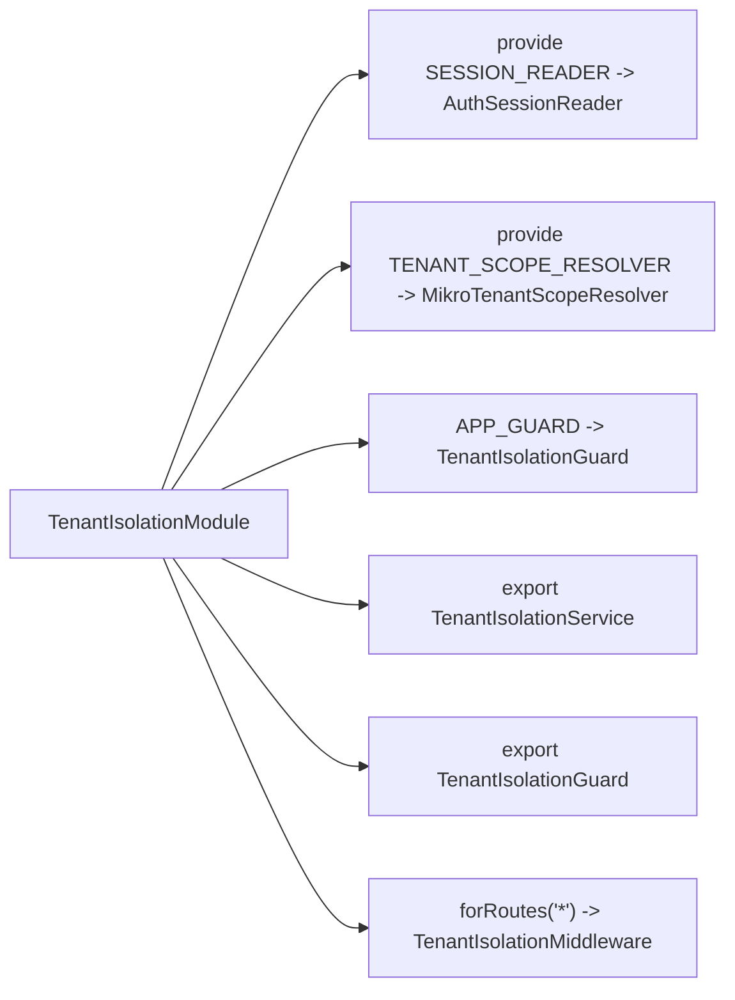

**图表来源**
- [tenant-isolation.module.ts:45-57](file://apps/api/src/tenant-isolation/tenant-isolation.module.ts#L45-L57)
- [tenant-isolation.module.ts:68-71](file://apps/api/src/tenant-isolation/tenant-isolation.module.ts#L68-L71)

**章节来源**
- [tenant-isolation.module.ts:11-57](file://apps/api/src/tenant-isolation/tenant-isolation.module.ts#L11-L57)
- [tenant-isolation.module.ts:68-71](file://apps/api/src/tenant-isolation/tenant-isolation.module.ts#L68-L71)

## 依赖关系分析
- 核心库依赖端口抽象，不依赖认证实现与 ORM。
- 应用侧通过模块装配注入会话读取器与租户范围解析器。
- 中间件依赖会话读取端口、租户状态服务、用户状态服务与租户范围解析端口。
- 守卫依赖租户上下文服务与反射器。
- 服务依赖 ALS 存储，提供只读访问与 fail-closed 校验。

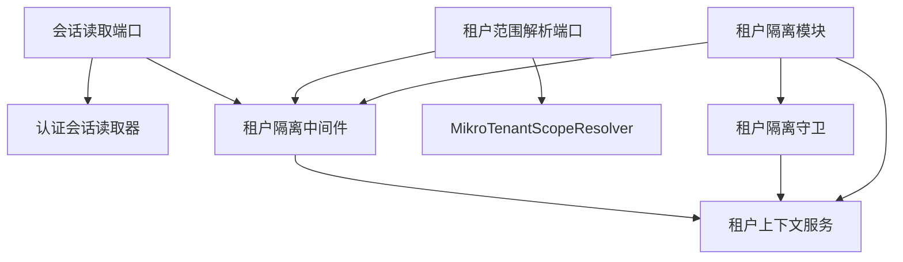

**图表来源**
- [request-session.port.ts:1-64](file://libs/core/src/tenant-isolation/session/request-session.port.ts#L1-L64)
- [auth-session.reader.ts:1-80](file://apps/api/src/tenant-isolation/infrastructure/auth-session.reader.ts#L1-L80)
- [tenant-isolation.middleware.ts:1-201](file://libs/core/src/tenant-isolation/tenant-isolation.middleware.ts#L1-L201)
- [tenant-isolation.service.ts:1-116](file://libs/core/src/tenant-isolation/tenant-isolation.service.ts#L1-L116)
- [tenant-isolation.guard.ts:1-69](file://libs/core/src/tenant-isolation/tenant-isolation.guard.ts#L1-L69)
- [mikro-tenant-scope.resolver.ts:1-84](file://apps/api/src/tenant-isolation/infrastructure/mikro-tenant-scope.resolver.ts#L1-L84)
- [tenant-isolation.module.ts:1-73](file://apps/api/src/tenant-isolation/tenant-isolation.module.ts#L1-L73)

**章节来源**
- [tenant-isolation.module.ts:45-66](file://apps/api/src/tenant-isolation/tenant-isolation.module.ts#L45-L66)

## 性能与并发特性
- 会话读取器对无 cookie、认证表面路由与旁路路径进行廉价短路，避免触发会话查询。
- 会话解析器使用请求级记忆化，跨守卫复用一次会话解析，减少重复开销。
- `AsyncLocalStorage` 提供每请求上下文存储，保证并发请求之间上下文隔离，避免线程安全问题。
- 租户范围解析器采用纯读操作，避免在解析过程中产生副作用。

[本节为通用性能讨论，不直接分析具体文件]

## 故障排查指南
- 若出现“无活动租户上下文”错误，检查：
  - 会话是否成功解析（cookie 是否存在、认证是否初始化）。
  - 活动组织是否能派生出租户主轴。
  - 显式激活租户是否与活动组织一致。
  - 用户或租户是否处于封禁状态。
- 若服务层读取不到租户上下文，确认：
  - 中间件是否正确绑定 ALS。
  - 是否在正确的异步上下文中调用服务。
  - 是否使用了 fail-closed 校验方法。

**章节来源**
- [tenant-isolation.guard.ts:61-66](file://libs/core/src/tenant-isolation/tenant-isolation.guard.ts#L61-L66)
- [tenant-isolation.service.ts:90-114](file://libs/core/src/tenant-isolation/tenant-isolation.service.ts#L90-L114)

## 结论
本方案通过端口倒置与应用侧适配，将认证细节与 ORM 实现解耦，核心库专注于租户隔离机制。借助 `AsyncLocalStorage`，租户上下文在请求生命周期中安全传播，中间件负责解析与绑定，守卫负责强制校验，服务层安全读取。该设计在多租户 SaaS 场景中提供了清晰、可扩展且线程安全的上下文传播机制。