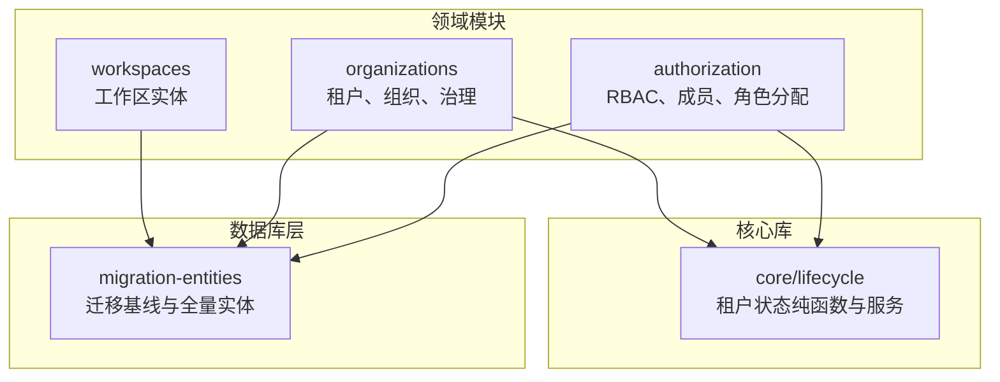
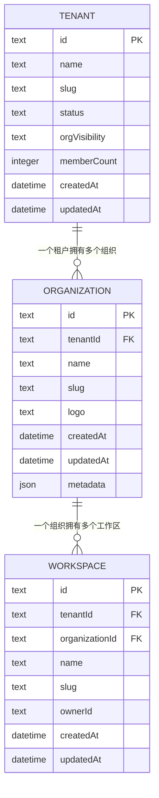
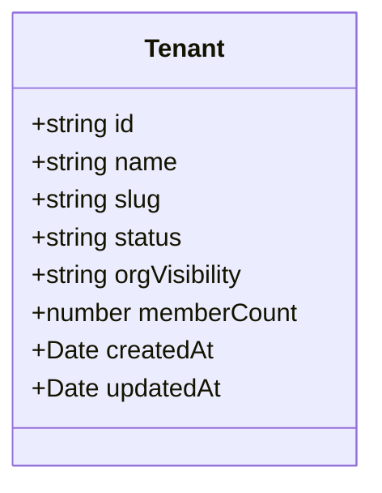
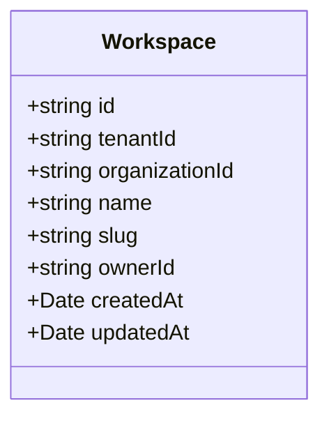
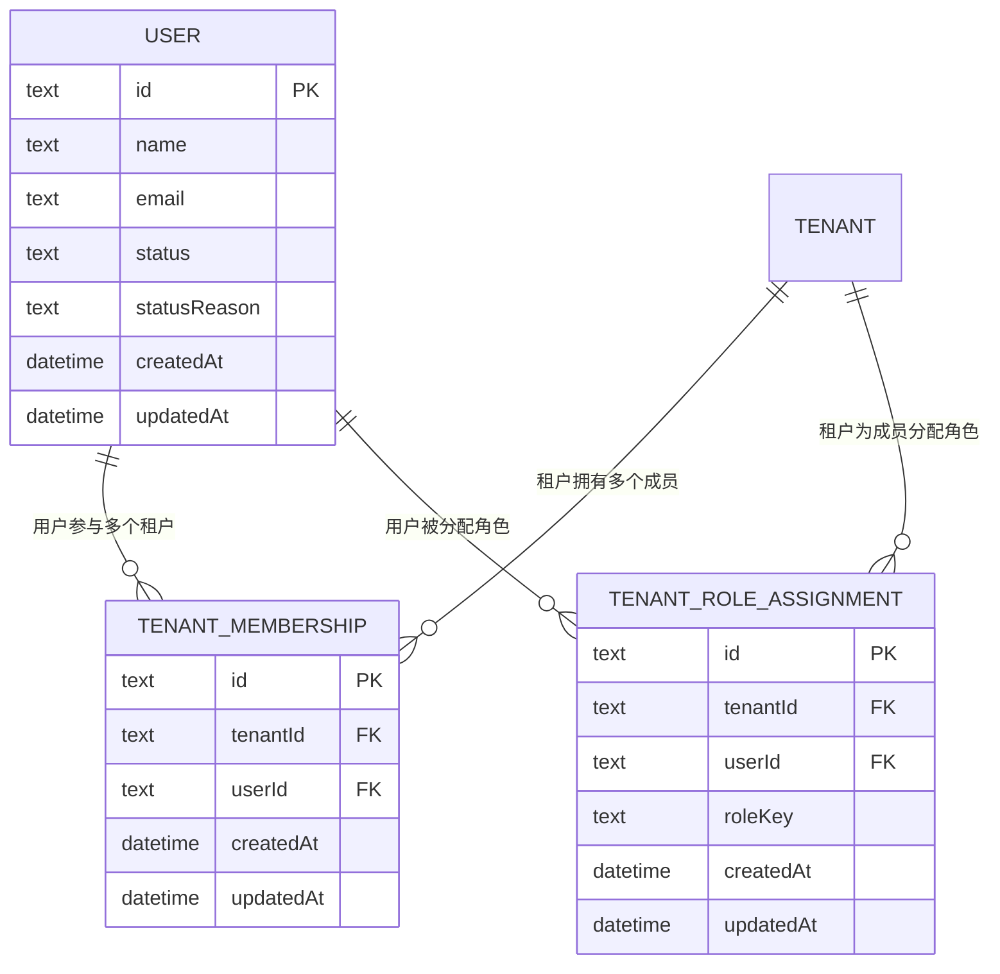
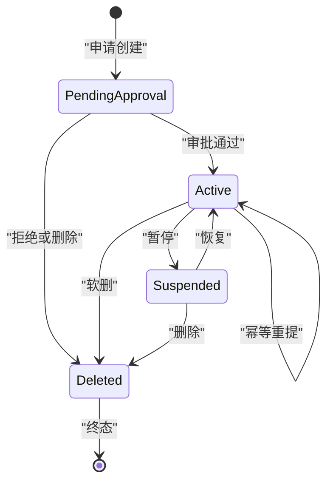
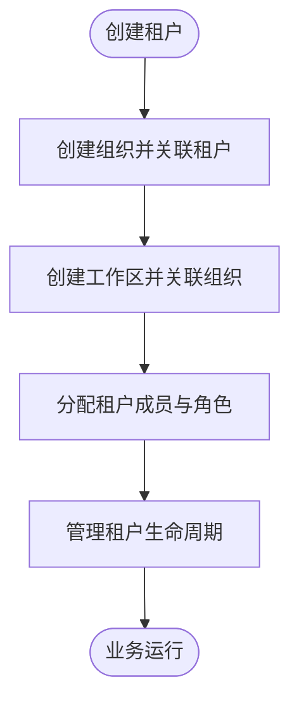
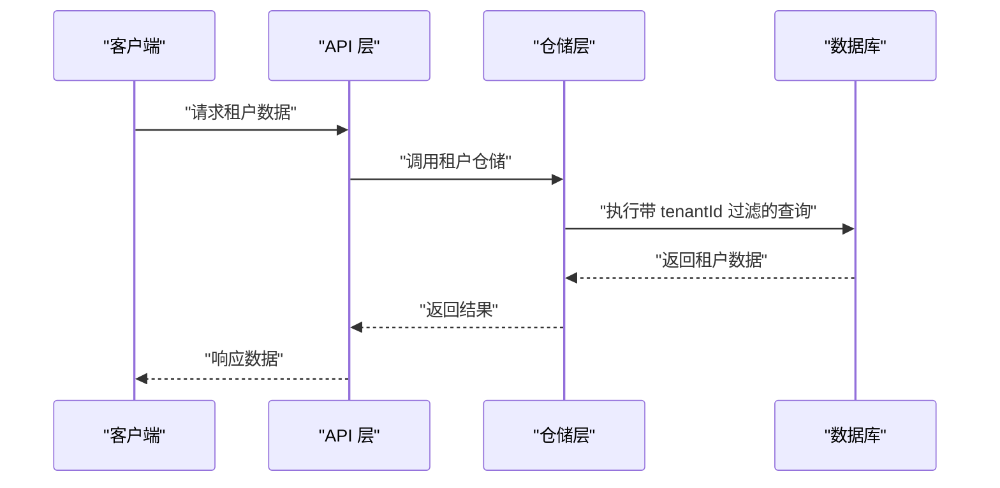
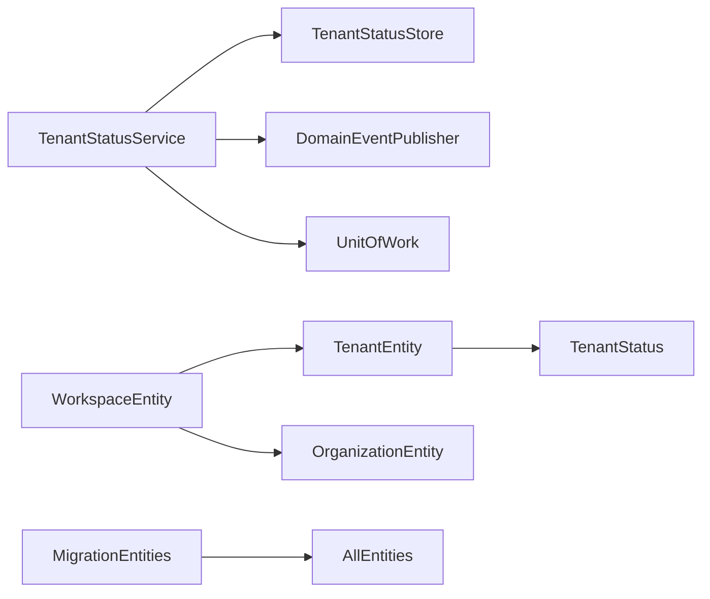

# 租户模型设计

<cite>
**本文引用的文件**   
- [tenant.entity.ts](file://apps/api/src/modules/organizations/infrastructure/entities/tenant.entity.ts)
- [workspace.entity.ts](file://apps/api/src/modules/workspaces/infrastructure/entities/workspace.entity.ts)
- [organization-lifecycle.ts](file://libs/core/src/modules/organizations/lifecycle/organization-lifecycle.ts)
- [tenant-status.service.ts](file://libs/core/src/modules/organizations/lifecycle/tenant-status.service.ts)
- [tenant-status.store.ts](file://libs/core/src/modules/organizations/lifecycle/tenant-status.store.ts)
- [rbac.entities.ts](file://apps/api/src/modules/authorization/infrastructure/entities/rbac.entities.ts)
- [mikro-tenant-membership.repository.ts](file://apps/api/src/modules/authorization/infrastructure/repositories/mikro-tenant-membership.repository.ts)
- [migration-entities.ts](file://apps/api/src/database/mikro/migration/migration-entities.ts)
- [organization-governance.repository.ts](file://apps/api/src/modules/organizations/infrastructure/repositories/mikro-organization-governance.repository.ts)
</cite>

## 目录
1. [引言](#引言)
2. [项目结构与边界划分](#项目结构与边界划分)
3. [两级边界架构总览](#两级边界架构总览)
4. [核心实体与字段说明](#核心实体与字段说明)
5. [全局用户与成员关系设计](#全局用户与成员关系设计)
6. [租户生命周期状态机](#租户生命周期状态机)
7. [租户、组织与工作区层级关系](#租户组织与工作区层级关系)
8. [数据隔离与权限边界](#数据隔离与权限边界)
9. [依赖关系分析](#依赖关系分析)
10. [性能与约束要点](#性能与约束要点)
11. [常见问题排查](#常见问题排查)
12. [结论](#结论)

## 引言
本文围绕“租户→工作区”的两级边界架构，系统说明租户模型的设计目标、实体关系、状态管理、成员共享机制以及数据隔离策略。重点解释：
- 为什么把治理态从组织上移到租户；
- 租户如何作为隔离与计费边界；
- 全局用户如何在多租户间共享身份，同时保持数据隔离；
- 租户生命周期状态机的合法转换规则；
- 组织在租户中的角色定位，以及工作区在组织内的作用。

## 项目结构与边界划分
本仓库采用按领域模块划分的 NestJS 结构，租户相关能力分布在以下位置：
- 租户实体定义位于 `apps/api/src/modules/organizations/.../tenant.entity.ts`；
- 工作区实体定义位于 `apps/api/src/modules/workspaces/.../workspace.entity.ts`；
- 租户生命周期纯函数与状态服务位于 `libs/core/src/modules/organizations/lifecycle/...`；
- 租户成员、角色分配、邀请等授权事实表位于 `apps/api/src/modules/authorization/.../rbac.entities.ts`；
- 迁移基线统一由 `apps/api/src/database/mikro/migration/migration-entities.ts` 维护。

**图表来源**
- [tenant.entity.ts:6-18](file://apps/api/src/modules/organizations/infrastructure/entities/tenant.entity.ts#L6-L18)
- [workspace.entity.ts:5-14](file://apps/api/src/modules/workspaces/infrastructure/entities/workspace.entity.ts#L5-L14)
- [organization-lifecycle.ts:1-14](file://libs/core/src/modules/organizations/lifecycle/organization-lifecycle.ts#L1-L14)
- [migration-entities.ts:20-46](file://apps/api/src/database/mikro/migration/migration-entities.ts#L20-L46)

**章节来源**
- [tenant.entity.ts:6-18](file://apps/api/src/modules/organizations/infrastructure/entities/tenant.entity.ts#L6-L18)
- [workspace.entity.ts:5-14](file://apps/api/src/modules/workspaces/infrastructure/entities/workspace.entity.ts#L5-L14)
- [migration-entities.ts:20-46](file://apps/api/src/database/mikro/migration/migration-entities.ts#L20-L46)

## 两级边界架构总览
系统采用“租户→组织→工作区”的层级边界：
- 租户是隔离与计费边界，承载治理态、可见性策略、成员计数等；
- 组织是租户内的业务分组，可包含多个工作区；
- 工作区是更细粒度的业务空间，通常用于产品或项目维度。

**图表来源**
- [tenant.entity.ts:34-61](file://apps/api/src/modules/organizations/infrastructure/entities/tenant.entity.ts#L34-L61)
- [migration-entities.ts:150-195](file://apps/api/src/database/mikro/migration/migration-entities.ts#L150-L195)
- [workspace.entity.ts:16-39](file://apps/api/src/modules/workspaces/infrastructure/entities/workspace.entity.ts#L16-L39)

**章节来源**
- [tenant.entity.ts:6-18](file://apps/api/src/modules/organizations/infrastructure/entities/tenant.entity.ts#L6-L18)
- [workspace.entity.ts:20-39](file://apps/api/src/modules/workspaces/infrastructure/entities/workspace.entity.ts#L20-L39)
- [migration-entities.ts:150-195](file://apps/api/src/database/mikro/migration/migration-entities.ts#L150-L195)

## 核心实体与字段说明

### 租户实体（Tenant）
租户实体的核心字段包括：
- id：租户主键；
- name、slug：租户名称与唯一标识；
- status：治理生命周期状态，值域由 `TENANT_STATUS` 单源控制；
- orgVisibility：租内跨组织可见性策略，默认 shared；
- memberCount：物化成员计数，由数据库触发器维护；
- createdAt、updatedAt：审计时间戳。

该表通过 CHECK 约束保证 `status` 和 `orgVisibility` 取值合法，并通过唯一索引保证 `slug` 全局唯一。

**图表来源**
- [tenant.entity.ts:34-74](file://apps/api/src/modules/organizations/infrastructure/entities/tenant.entity.ts#L34-L74)

**章节来源**
- [tenant.entity.ts:20-61](file://apps/api/src/modules/organizations/infrastructure/entities/tenant.entity.ts#L20-L61)
- [tenant.entity.ts:63-74](file://apps/api/src/modules/organizations/infrastructure/entities/tenant.entity.ts#L63-L74)

### 工作区实体（Workspace）
工作区实体包含：
- id：工作区主键；
- tenantId：归属租户，可为空但写路径需盖章；
- organizationId：所属组织；
- name、slug：名称与唯一标识；
- ownerId：实例属主，可为空；
- createdAt、updatedAt：审计时间戳。

工作区通过复合唯一索引 `(organizationId, slug)` 保证组织内 slug 唯一，并通过索引优化查询。

**图表来源**
- [workspace.entity.ts:16-56](file://apps/api/src/modules/workspaces/infrastructure/entities/workspace.entity.ts#L16-L56)

**章节来源**
- [workspace.entity.ts:20-39](file://apps/api/src/modules/workspaces/infrastructure/entities/workspace.entity.ts#L20-L39)
- [workspace.entity.ts:41-56](file://apps/api/src/modules/workspaces/infrastructure/entities/workspace.entity.ts#L41-L56)

## 全局用户与成员关系设计
全局用户模型位于 `user` 表，属于认证域，不直接绑定租户。租户成员关系通过 `tenant_membership` 表实现“用户×租户”的多对多关系，并在 `tenant_role_assignment` 中记录用户在当前租户的角色分配。

关键点：
- `tenant_membership` 以 `(tenantId, userId)` 唯一，确保同一用户在同一租户仅有一条成员记录；
- `tenant_role_assignment` 同样以 `(tenantId, userId)` 唯一，表示“一人一租一角色”；
- 展示字段如 email、name 通过跨上下文只读 join 获取，避免泄露实体细节；
- 成员数通过 `member` 表的触发器物化到 `tenant.memberCount`，提升读取性能。

**图表来源**
- [rbac.entities.ts:137-200](file://apps/api/src/modules/authorization/infrastructure/entities/rbac.entities.ts#L137-L200)
- [migration-entities.ts:299-305](file://apps/api/src/database/mikro/migration/migration-entities.ts#L299-L305)

**章节来源**
- [rbac.entities.ts:137-200](file://apps/api/src/modules/authorization/infrastructure/entities/rbac.entities.ts#L137-L200)
- [mikro-tenant-membership.repository.ts:14-59](file://apps/api/src/modules/authorization/infrastructure/repositories/mikro-tenant-membership.repository.ts#L14-L59)

## 租户生命周期状态机
租户生命周期状态由 `TENANT_STATUS` 单源定义，包括：
- pending_approval：待审批；
- active：活跃；
- suspended：暂停；
- deleted：已删除。

合法迁移规则：
- pending_approval → active / deleted；
- active → active / suspended / deleted；
- suspended → active / deleted；
- deleted 为终态，不接受任何迁移。

状态拦截策略：
- 仅当状态为 pending_approval、suspended、deleted 时，租户被拦截；
- 无状态记录视为不拦截，兼容存量数据。

**图表来源**
- [organization-lifecycle.ts:15-20](file://libs/core/src/modules/organizations/lifecycle/organization-lifecycle.ts#L15-L20)
- [organization-lifecycle.ts:52-69](file://libs/core/src/modules/organizations/lifecycle/organization-lifecycle.ts#L52-L69)

**章节来源**
- [organization-lifecycle.ts:1-14](file://libs/core/src/modules/organizations/lifecycle/organization-lifecycle.ts#L1-L14)
- [organization-lifecycle.ts:25-43](file://libs/core/src/modules/organizations/lifecycle/organization-lifecycle.ts#L25-L43)
- [organization-lifecycle.ts:45-69](file://libs/core/src/modules/organizations/lifecycle/organization-lifecycle.ts#L45-L69)

## 租户、组织与工作区层级关系
- 租户是根边界，组织通过 `tenantId` 外键归属租户；
- 工作区通过 `organizationId` 归属组织，并可选择性携带 `tenantId` 以支持租户级分组；
- 组织不再持有治理态，治理态集中在 `tenant.status`；
- 工作区在组织内提供业务空间，常用于产品或项目维度。

**图表来源**
- [migration-entities.ts:150-195](file://apps/api/src/database/mikro/migration/migration-entities.ts#L150-L195)
- [workspace.entity.ts:20-39](file://apps/api/src/modules/workspaces/infrastructure/entities/workspace.entity.ts#L20-L39)

**章节来源**
- [migration-entities.ts:150-195](file://apps/api/src/database/mikro/migration/migration-entities.ts#L150-L195)
- [workspace.entity.ts:20-39](file://apps/api/src/modules/workspaces/infrastructure/entities/workspace.entity.ts#L20-L39)

## 数据隔离与权限边界
- 租户级隔离：所有租户相关表（如 `tenant_membership`、`tenant_role_assignment`、`tenant_invitation`）均注册到全局 `tenantIsolation` filter，确保在租户上下文内跨租读自动收口；
- 跨租访问：需要显式使用 `fork({ scoped: false })` 并手动指定 `where{tenantId}`，避免误跨租；
- 成员与角色：成员关系与角色分配均在租户级 SSOT，组织降为数据分组；
- 可见性策略：`orgVisibility` 控制租内跨组织可见性，配合全局 filter 实现组织收窄；
- 会话与激活：会话表包含 `activeTenantId`，用于区分活动租户。

**图表来源**
- [rbac.entities.ts:130-200](file://apps/api/src/modules/authorization/infrastructure/entities/rbac.entities.ts#L130-L200)
- [mikro-tenant-membership.repository.ts:14-59](file://apps/api/src/modules/authorization/infrastructure/repositories/mikro-tenant-membership.repository.ts#L14-L59)

**章节来源**
- [rbac.entities.ts:130-200](file://apps/api/src/modules/authorization/infrastructure/entities/rbac.entities.ts#L130-L200)
- [mikro-tenant-membership.repository.ts:14-59](file://apps/api/src/modules/authorization/infrastructure/repositories/mikro-tenant-membership.repository.ts#L14-L59)

## 依赖关系分析
- 租户状态服务依赖状态存储端口与事件发布器；
- 租户状态服务通过纯函数 `canTransition` 校验状态迁移合法性；
- 租户实体依赖 `TENANT_STATUS` 与 `ORG_VISIBILITY` 单源；
- 工作区实体依赖租户与组织实体；
- 迁移基线统一维护所有实体，确保 schema 一致性。

**图表来源**
- [tenant-status.service.ts:47-122](file://libs/core/src/modules/organizations/lifecycle/tenant-status.service.ts#L47-L122)
- [tenant-status.store.ts:1-21](file://libs/core/src/modules/organizations/lifecycle/tenant-status.store.ts#L1-L21)
- [tenant.entity.ts:1-4](file://apps/api/src/modules/organizations/infrastructure/entities/tenant.entity.ts#L1-L4)
- [workspace.entity.ts:1-4](file://apps/api/src/modules/workspaces/infrastructure/entities/workspace.entity.ts#L1-L4)
- [migration-entities.ts:1-18](file://apps/api/src/database/mikro/migration/migration-entities.ts#L1-L18)

**章节来源**
- [tenant-status.service.ts:47-122](file://libs/core/src/modules/organizations/lifecycle/tenant-status.service.ts#L47-L122)
- [tenant-status.store.ts:1-21](file://libs/core/src/modules/organizations/lifecycle/tenant-status.store.ts#L1-L21)
- [tenant.entity.ts:1-4](file://apps/api/src/modules/organizations/infrastructure/entities/tenant.entity.ts#L1-L4)
- [workspace.entity.ts:1-4](file://apps/api/src/modules/workspaces/infrastructure/entities/workspace.entity.ts#L1-L4)
- [migration-entities.ts:1-18](file://apps/api/src/database/mikro/migration/migration-entities.ts#L1-L18)

## 性能与约束要点
- 成员计数物化：通过数据库触发器维护 `tenant.memberCount`，读取 O(1)；
- 唯一约束：`tenant.slug` 全局唯一，`(tenantId, userId)` 在成员与角色分配表中唯一；
- 索引优化：工作区通过 `(organizationId, ownerId)` 索引优化查询；
- 状态校验：通过 CHECK 约束保证 `status` 与 `orgVisibility` 取值合法；
- 跨租访问：仓储层显式绕过 ALS 并手动锚定 `tenantId`，避免 N+1 与误跨租。

**章节来源**
- [tenant.entity.ts:47-61](file://apps/api/src/modules/organizations/infrastructure/entities/tenant.entity.ts#L47-L61)
- [workspace.entity.ts:34-39](file://apps/api/src/modules/workspaces/infrastructure/entities/workspace.entity.ts#L34-L39)
- [mikro-tenant-membership.repository.ts:47-59](file://apps/api/src/modules/authorization/infrastructure/repositories/mikro-tenant-membership.repository.ts#L47-L59)

## 常见问题排查
- 租户状态非法：检查 `tenant.status` 是否落在 `TENANT_STATUS` 值域；
- 成员重复：检查 `tenant_membership` 是否已有 `(tenantId, userId)` 记录；
- 角色分配冲突：检查 `tenant_role_assignment` 是否已有 `(tenantId, userId)` 记录；
- 跨租访问异常：确认仓储层是否使用 `fork({ scoped: false })` 并显式指定 `tenantId`；
- 工作区 slug 冲突：检查 `(organizationId, slug)` 是否唯一。

**章节来源**
- [organization-lifecycle.ts:25-43](file://libs/core/src/modules/organizations/lifecycle/organization-lifecycle.ts#L25-L43)
- [rbac.entities.ts:137-200](file://apps/api/src/modules/authorization/infrastructure/entities/rbac.entities.ts#L137-L200)
- [workspace.entity.ts:34-39](file://apps/api/src/modules/workspaces/infrastructure/entities/workspace.entity.ts#L34-L39)

## 结论
本租户模型设计以“租户→组织→工作区”两级边界为核心，将治理态集中于租户，实现隔离与计费的统一入口。全局用户通过 `tenant_membership` 与 `tenant_role_assignment` 在多租户间共享身份，同时通过租户级 SSOT 与全局 filter 保障数据隔离。状态机严格限制迁移路径，确保租户生命周期可控。组织作为租户内的业务分组，工作区作为更细粒度的业务空间，共同构成清晰的数据与权限边界。