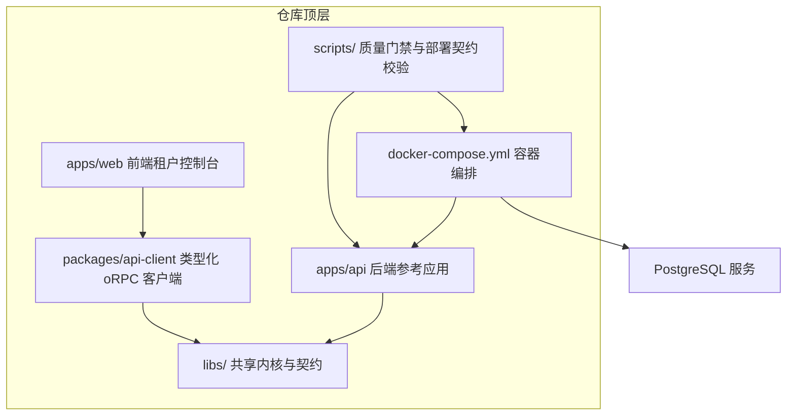
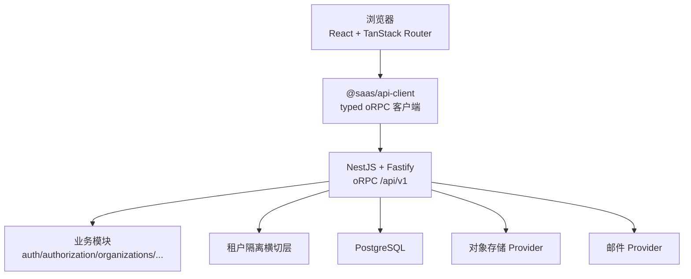
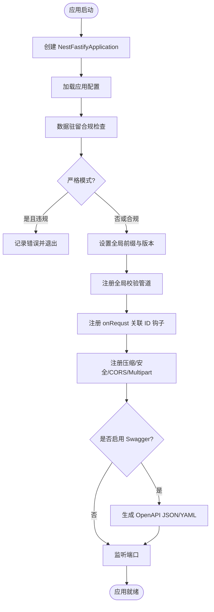
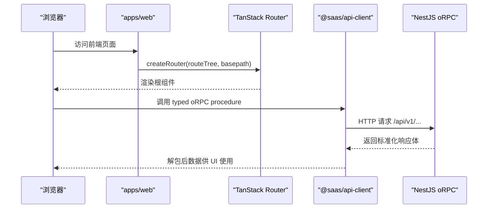
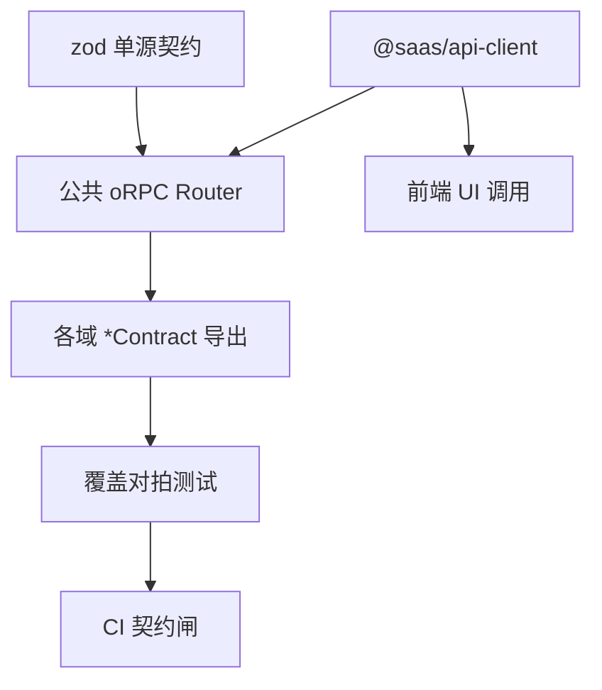
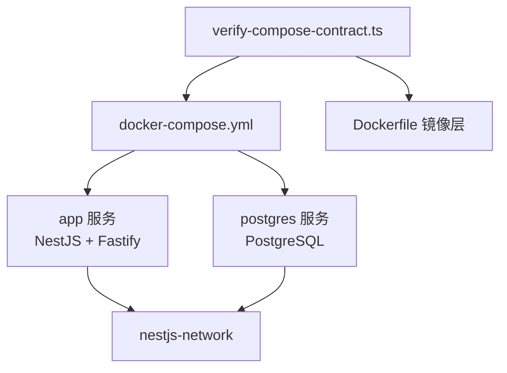
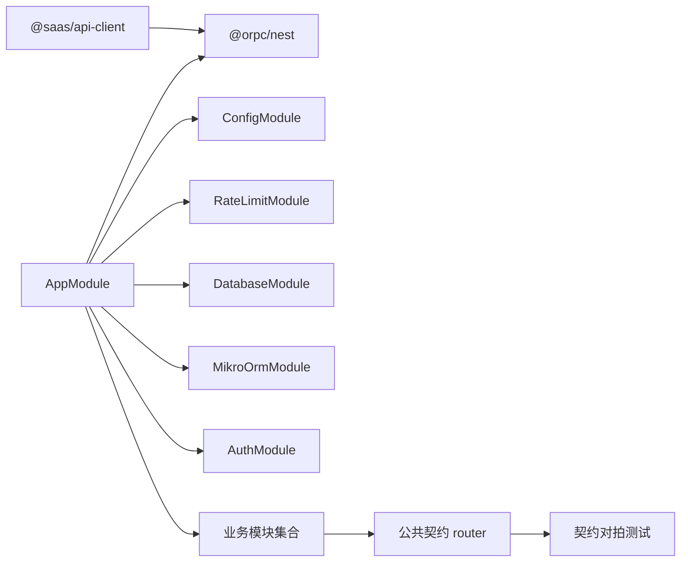

# 整体架构模式

<cite>
**本文引用的文件**   
- [README.md](file://README.md)
- [apps/api/src/main.ts](file://apps/api/src/main.ts)
- [apps/api/src/app.module.ts](file://apps/api/src/app.module.ts)
- [apps/web/src/main.tsx](file://apps/web/src/main.tsx)
- [docker-compose.yml](file://docker-compose.yml)
- [scripts/verify-compose-contract.ts](file://scripts/verify-compose-contract.ts)
- [apps/api/src/config/config.module.ts](file://apps/api/src/config/config.module.ts)
- [packages/api-client/src/rpc-client.ts](file://packages/api-client/src/rpc-client.ts)
- [apps/api/src/common/orpc/app-router.contract.test.ts](file://apps/api/src/common/orpc/app-router.contract.test.ts)
- [libs/api-contract/src/app-router.contract.test.ts](file://libs/api-contract/src/app-router.contract.test.ts)
</cite>

## 目录
1. [引言](#引言)
2. [项目结构](#项目结构)
3. [核心组件](#核心组件)
4. [架构总览](#架构总览)
5. [详细组件分析](#详细组件分析)
6. [依赖关系分析](#依赖关系分析)
7. [性能与可扩展性](#性能与可扩展性)
8. [故障排查指南](#故障排查指南)
9. [结论](#结论)
10. [附录：技术栈选择说明](#附录技术栈选择说明)

## 引言
本仓库是一个面向中国大陆场景的多租户 SaaS 工程模板，采用模块化单体形态，同时保留向微服务演进的条件。后端以 NestJS + Fastify 提供高性能 HTTP 面，前端以 React + TanStack Router 构建租户控制台；前后端通过 oRPC 契约驱动的类型安全 API 通信，并通过 Docker Compose 编排数据库与应用容器。系统强调 Clean Architecture、函数式领域内核、多租户隔离、RBAC 授权、订阅计费、对象存储、邮件与国际化等横切能力，并以 zod 作为跨端契约单源。

## 项目结构
仓库采用 pnpm workspace 组织共享内核、后端参考应用、前端与契约客户端：
- `libs/`：共享内核、跨端传输契约、oRPC 公共契约 router、Better Auth × MikroORM 适配层。
- `apps/api`：NestJS + Fastify 后端参考应用，按限界上下文垂直切片组织。
- `apps/web`：React + Vite + TanStack Router 租户控制台。
- `packages/api-client`：基于 oRPC 的 typed 客户端，类型锚从公共契约 router 派生。
- `docker/` 与根级 `docker-compose.yml`：开发/演示与生产容器编排。
- `scripts/`：本地 CI、契约对拍、部署契约校验等质量门禁脚本。

**图表来源**
- [README.md:82-101](file://README.md#L82-L101)
- [docker-compose.yml:3-51](file://docker-compose.yml#L3-L51)

**章节来源**
- [README.md:32-76](file://README.md#L32-L76)
- [README.md:82-101](file://README.md#L82-L101)

## 核心组件
- 后端启动与 Fastify 适配器：在引导阶段创建 NestFastifyApplication，注册压缩、安全头、CORS、Multipart、全局校验管道、请求关联 ID、版本控制与 Swagger/OpenAPI。
- 模块装配：根模块集中导入 oRPC、配置、限流、日志、数据库、MikroORM、i18n、通用能力、健康检查、认证、授权、平台治理、租户隔离与各业务模块，并支持 feature 叠加层。
- 前端路由：使用 TanStack Router 创建路由器，注入文件式 routeTree，设置 basepath、默认预取策略与全局错误/等待组件。
- 契约与客户端：后端通过 @orpc/nest 集成 oRPC procedure；公共契约 router 由 zod 单源派生；前端通过 @saas/api-client 消费 typed oRPC 客户端，统一拆信封、处理错误与 ISO 日期还原。
- 容器编排：Docker Compose 定义 app 与 postgres 服务，声明端口、环境变量、网络、卷、健康检查与依赖顺序，并通过脚本校验部署契约一致性。

**章节来源**
- [apps/api/src/main.ts:20-166](file://apps/api/src/main.ts#L20-L166)
- [apps/api/src/app.module.ts:33-73](file://apps/api/src/app.module.ts#L33-L73)
- [apps/web/src/main.tsx:14-23](file://apps/web/src/main.tsx#L14-L23)
- [packages/api-client/src/rpc-client.ts:145-173](file://packages/api-client/src/rpc-client.ts#L145-L173)
- [docker-compose.yml:3-83](file://docker-compose.yml#L3-L83)

## 架构总览
系统采用“前后端分离 + 模块化单体”的总体形态：
- 后端为单一 NestJS 进程，内部以垂直切片（users/auth/authorization/organizations/workspaces/platform/payment/storage/subscriptions/posts）划分限界上下文，并通过 tenant-isolation 横切机制实现请求级租户上下文传播与行级隔离。
- 前端为独立 SPA，通过 @saas/api-client 调用后端 oRPC procedure；契约树由后端公共 router 单源维护，前端类型自动派生。
- 部署层面，Docker Compose 将应用与 PostgreSQL 编排在同一网络中，服务名即内网 DNS，构成轻量服务发现。

**图表来源**
- [apps/web/src/main.tsx:1-37](file://apps/web/src/main.tsx#L1-L37)
- [apps/api/src/main.ts:20-166](file://apps/api/src/main.ts#L20-L166)
- [apps/api/src/app.module.ts:33-73](file://apps/api/src/app.module.ts#L33-L73)
- [docker-compose.yml:3-83](file://docker-compose.yml#L3-L83)

## 详细组件分析

### 后端：NestJS + Fastify 启动与中间件链
后端入口负责：
- 创建 FastifyAdapter 并传入 trustProxy 选项，使反向代理后的真实客户端 IP 可被限流墙正确识别。
- 读取配置，执行数据驻留合规检查（strict/warn），必要时拒绝启动。
- 设置全局前缀、URI 版本控制、全局 Zod 校验管道。
- 注册 Fastify 钩子注入 x-request-id，并启用 compression/helmet/CORS/multipart。
- 可选生成 Swagger/OpenAPI JSON/YAML 文档。

**图表来源**
- [apps/api/src/main.ts:20-166](file://apps/api/src/main.ts#L20-L166)

**章节来源**
- [apps/api/src/main.ts:20-166](file://apps/api/src/main.ts#L20-L166)

### 模块装配与依赖注入
根模块集中装配：
- oRPC 集成：提供 ImplementInterceptor、错误体编码器、状态映射与上下文工厂。
- 基础设施：ConfigModule、RateLimitModule、LoggerModule、DatabaseModule、MikroOrmModule、AppI18nModule、CommonModule、HealthModule。
- 领域模块：AuthModule、AuthorizationModule、PlatformModule、TenantIsolationModule、UsersModule、PostsModule、WorkspacesModule、OrganizationsModule、SubscriptionsModule、StorageModule、PaymentModule、MailerModule。
- Feature 叠加层：features/* 按需装配，不干扰主应用守卫排序。

```mermaid
classDiagram
class AppModule {
+imports
+controllers
+providers
}
class ORPCModule
class ConfigModule
class RateLimitModule
class DatabaseModule
class MikroOrmModule
class AuthModule
class AuthorizationModule
class PlatformModule
class TenantIsolationModule
class UsersModule
class PostsModule
class WorkspacesModule
class OrganizationsModule
class SubscriptionsModule
class StorageModule
class PaymentModule
class MailerModule
AppModule --> ORPCModule : "注册 oRPC"
AppModule --> ConfigModule : "配置"
AppModule --> RateLimitModule : "限流"
AppModule --> DatabaseModule : "数据库"
AppModule --> MikroOrmModule : "ORM"
AppModule --> AuthModule : "认证"
AppModule --> AuthorizationModule : "授权"
AppModule --> PlatformModule : "平台治理"
AppModule --> TenantIsolationModule : "租户隔离"
AppModule --> UsersModule : "用户"
AppModule --> PostsModule : "帖子示例"
AppModule --> WorkspacesModule : "工作区"
AppModule --> OrganizationsModule : "租户"
AppModule --> SubscriptionsModule : "订阅"
AppModule --> StorageModule : "存储"
AppModule --> PaymentModule : "支付"
AppModule --> MailerModule : "邮件"
```

**图表来源**
- [apps/api/src/app.module.ts:33-73](file://apps/api/src/app.module.ts#L33-L73)

**章节来源**
- [apps/api/src/app.module.ts:33-73](file://apps/api/src/app.module.ts#L33-L73)

### 前端：React + TanStack Router
前端入口：
- 使用 createRouter 注入 routeTree，设置 basepath 与默认预取策略。
- 提供全局 defaultErrorComponent/defaultPendingComponent，统一路由错误与等待态展示。
- 通过 ThemeProvider 包裹 RouterProvider，完成主题与路由挂载。

**图表来源**
- [apps/web/src/main.tsx:14-23](file://apps/web/src/main.tsx#L14-L23)
- [packages/api-client/src/rpc-client.ts:145-173](file://packages/api-client/src/rpc-client.ts#L145-L173)

**章节来源**
- [apps/web/src/main.tsx:1-37](file://apps/web/src/main.tsx#L1-L37)

### 契约与 oRPC 协议
- 后端通过 @orpc/nest 集成 oRPC，将 procedure 挂载到既有 Nest 路由生命周期上，复用守卫、拦截器与过滤器。
- 公共契约 router 位于 libs/api-contract，由 zod 单源派生；测试对拍确保 router 叶子集与控制器 *Contract 叶子集恒等，防止漂移。
- 前端通过 @saas/api-client 的 createRpcClient 构造 typed 客户端，OpenAPILink 负责 URL 解析与错误解码，统一拆信封与 ISO 日期还原。

**图表来源**
- [apps/api/src/common/orpc/app-router.contract.test.ts:20-155](file://apps/api/src/common/orpc/app-router.contract.test.ts#L20-L155)
- [libs/api-contract/src/app-router.contract.test.ts:1-115](file://libs/api-contract/src/app-router.contract.test.ts#L1-L115)
- [packages/api-client/src/rpc-client.ts:145-173](file://packages/api-client/src/rpc-client.ts#L145-L173)

**章节来源**
- [apps/api/src/common/orpc/app-router.contract.test.ts:20-155](file://apps/api/src/common/orpc/app-router.contract.test.ts#L20-L155)
- [libs/api-contract/src/app-router.contract.test.ts:1-115](file://libs/api-contract/src/app-router.contract.test.ts#L1-L115)
- [packages/api-client/src/rpc-client.ts:145-173](file://packages/api-client/src/rpc-client.ts#L145-L173)

### 容器化部署与服务发现
- docker-compose.yml 定义 app 与 postgres 两个服务，暴露端口、注入环境变量、声明网络与卷，并通过 healthcheck 保证数据库就绪后再启动应用。
- 数据驻留策略通过 DATA_RESIDENCY_ENFORCE 与 DATA_RESIDENCY_DB_HOST_ALLOWLIST 强制生效，避免 .env 文件覆写导致的生产环境降级。
- verify-compose-contract.ts 静态校验镜像层 HOST 唯一真源、compose 不双写 HOST、strict 下 DB 主机命中白名单或显式放行，且禁止关闭整闸。

**图表来源**
- [docker-compose.yml:3-83](file://docker-compose.yml#L3-L83)
- [scripts/verify-compose-contract.ts:1-96](file://scripts/verify-compose-contract.ts#L1-L96)

**章节来源**
- [docker-compose.yml:3-83](file://docker-compose.yml#L3-L83)
- [scripts/verify-compose-contract.ts:1-96](file://scripts/verify-compose-contract.ts#L1-L96)

## 依赖关系分析
- 后端模块间耦合集中在 AppModule 的 imports 列表，遵循“基础设施先于业务、横切先于领域”的装配顺序，确保限流、会话、租户隔离等横切机制优先生效。
- oRPC 与 REST 兼容：oRPC 通过 meta 路径与 HTTP 方法保持与旧 REST 语义等价，便于平滑迁移与文档生成。
- 前端与后端通过 @saas/api-client 与公共契约解耦，契约变更需通过 CI 契约对拍，降低前后端联调成本。

**图表来源**
- [apps/api/src/app.module.ts:33-73](file://apps/api/src/app.module.ts#L33-L73)
- [apps/api/src/common/orpc/app-router.contract.test.ts:20-155](file://apps/api/src/common/orpc/app-router.contract.test.ts#L20-L155)

**章节来源**
- [apps/api/src/app.module.ts:33-73](file://apps/api/src/app.module.ts#L33-L73)
- [apps/api/src/common/orpc/app-router.contract.test.ts:20-155](file://apps/api/src/common/orpc/app-router.contract.test.ts#L20-L155)

## 性能与可扩展性
- Fastify 适配器带来更高吞吐与更低内存占用；compression/helmet/CORS 等插件在引导阶段一次性注册，减少运行时开销。
- 全局 Zod 校验管道与 oRPC 契约单源减少序列化/反序列化歧义，提升端到端类型安全与调试效率。
- 模块化单体允许按触发判据拆分微服务，当前以垂直切片为主，避免过早碎片化带来的运维复杂度。
- 容器编排通过 healthcheck 与 depends_on 保障启动顺序，结合 compose contract 校验提升部署稳定性。

[本节为通用性能讨论，不直接分析具体文件]

## 故障排查指南
- 启动失败：检查 bootstrap 日志中的 data-residency 错误与退出码；确认 NODE_ENV、DATA_RESIDENCY_ENFORCE、DATABASE_URL、STORAGE_* 等关键环境变量已正确注入。
- CORS 问题：确认 ALLOWED_ORIGINS 包含前端 origin，且 credentials:true 时回显具体 origin；检查 fastifyCors 配置与 exposedHeaders。
- 文件上传失败：确认 fastifyMultipart 的 fileSize 限制与 storage.maxFileSize 一致；检查存储 provider 配置。
- 契约不一致：运行 CI 契约对拍（verify:orpc-contract），若 router 叶子集与控制器 *Contract 叶子集不等，需补齐挂载或修正引用。
- 容器不可达：检查 Dockerfile 中 ENV HOST 是否为容器语义地址（非 localhost），并确保 compose 未重复声明 HOST；验证 strict 模式下 DB 主机在白名单或显式放行。

**章节来源**
- [apps/api/src/main.ts:40-72](file://apps/api/src/main.ts#L40-L72)
- [apps/api/src/main.ts:94-122](file://apps/api/src/main.ts#L94-L122)
- [apps/api/src/common/orpc/app-router.contract.test.ts:120-155](file://apps/api/src/common/orpc/app-router.contract.test.ts#L120-L155)
- [scripts/verify-compose-contract.ts:83-96](file://scripts/verify-compose-contract.ts#L83-L96)

## 结论
该工程以 NestJS + Fastify 提供高性能后端，以 React + TanStack Router 构建灵活前端，通过 oRPC 与 zod 契约实现类型安全的跨端通信；以 Clean Architecture 与垂直切片组织领域边界，借助 tenant-isolation 与 RBAC 实现多租户与权限控制；以 Docker Compose 编排基础服务，并通过脚本校验部署契约一致性。整体设计兼顾可维护性、可扩展性与合规性，适合在中国大陆场景下快速孵化 SaaS 产品。

[本节为总结性内容，不直接分析具体文件]

## 附录：技术栈选择说明
- 后端框架：NestJS 12 + Fastify 5，提供结构化模块体系与高性能 HTTP 引擎。
- 传输与契约：oRPC（@orpc/nest）contract 模式，v2 beta，对外 HTTP 面与 REST 逐字节兼容；公共契约 router 单源居 @saas/api-contract。
- 架构范式：Clean Architecture + 函数式领域内核；CQRS/ES/EDA 按需引入。
- 数据库与 ORM：PostgreSQL + MikroORM（迁移与种子）。
- 认证与授权：Better Auth（邮箱/OAuth、会话/CSRF）+ CASL 能力模型 + 自研 RBAC 管理面。
- 校验与契约：zod 单源，驱动请求校验、响应序列化与前后端类型。
- 构建与测试：SWC 构建，Vitest 测试，Biome 规范。
- 日志与监控：Pino 结构化日志。
- 支付与存储：Stripe（海外）+ 境内通道预留；多云对象存储统一接口。
- 前端：React 19 + Vite + TanStack Router + Tailwind CSS 4；契约客户端 @saas/api-client。
- 容器化：Docker + Docker Compose（dev/prod）。

**章节来源**
- [README.md:55-76](file://README.md#L55-L76)