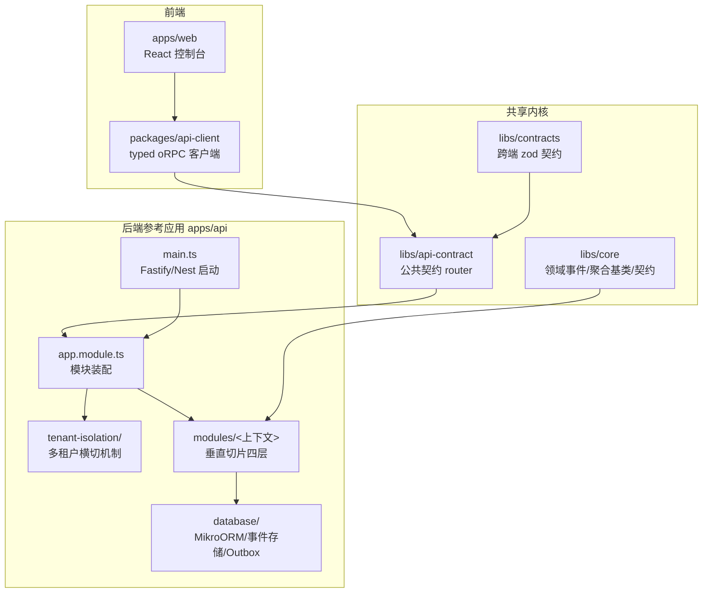
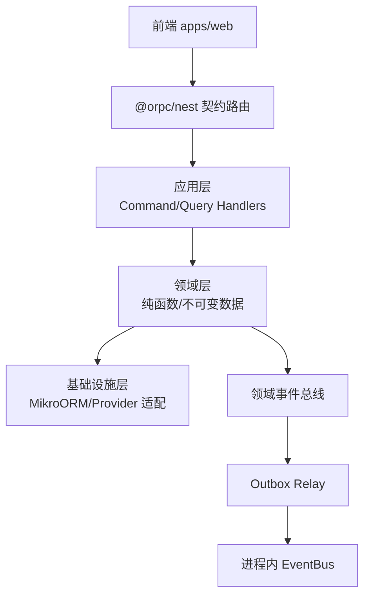
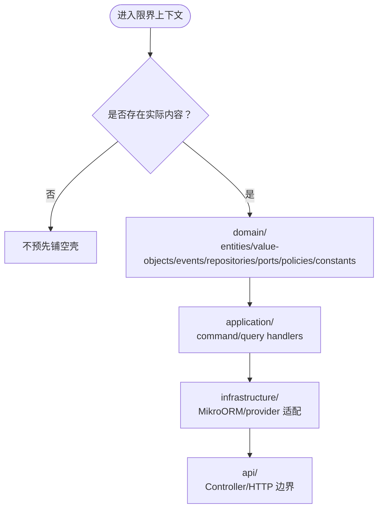
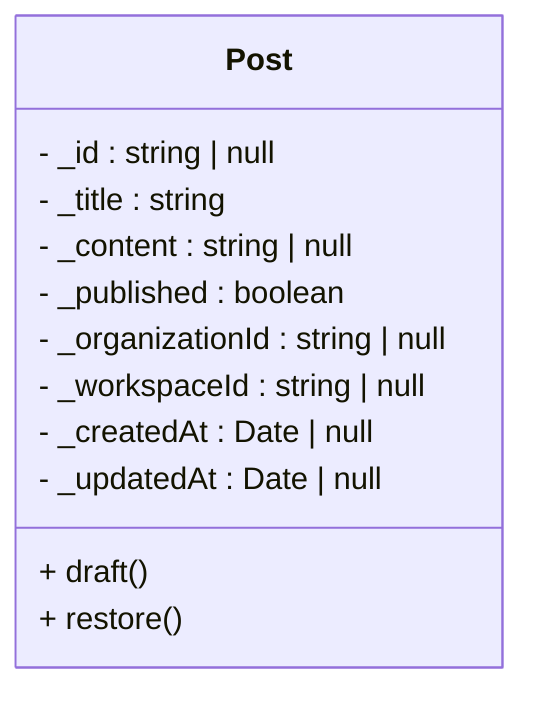
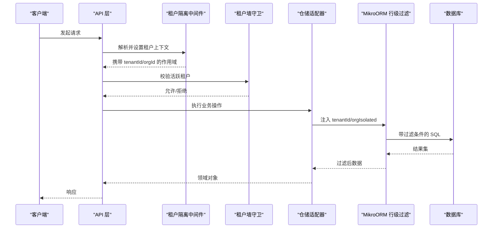
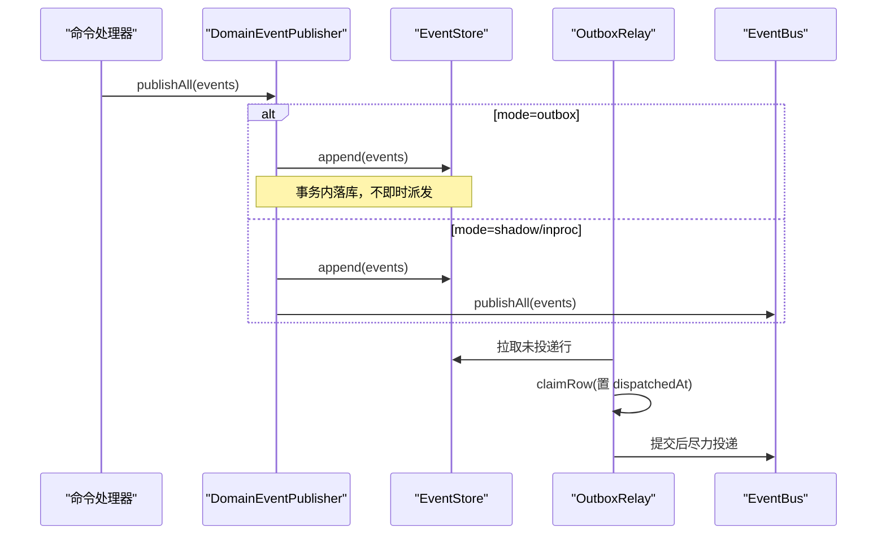
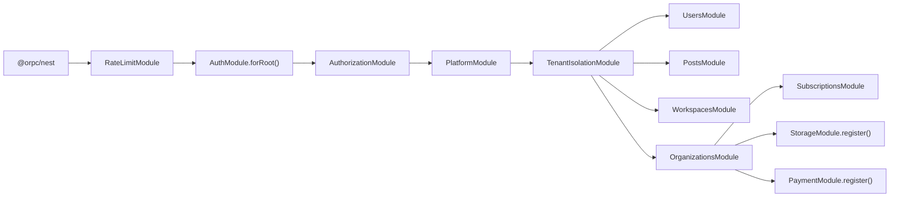
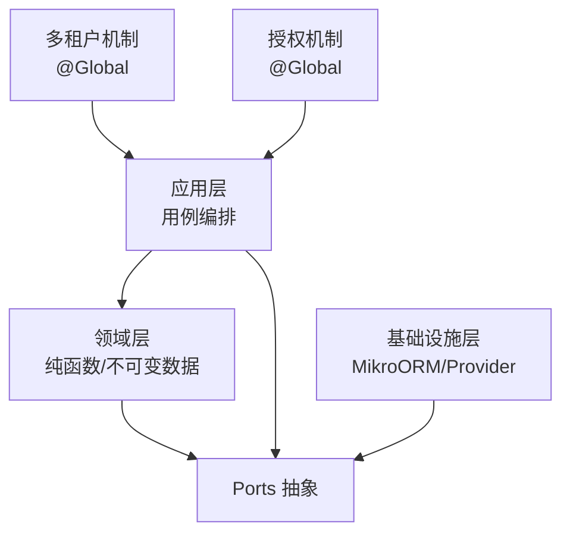

# 架构设计

<cite>
**本文引用的文件**   
- [README.md](file://README.md)
- [main.ts](file://apps/api/src/main.ts)
- [app.module.ts](file://apps/api/src/app.module.ts)
- [organizations.module.ts](file://apps/api/src/modules/organizations/organizations.module.ts)
- [users.module.ts](file://apps/api/src/modules/users/users.module.ts)
- [workspaces.module.ts](file://apps/api/src/modules/workspaces/workspaces.module.ts)
- [tenant-isolation.module.ts](file://apps/api/src/tenant-isolation/tenant-isolation.module.ts)
- [tenant-isolation-filter.ts](file://apps/api/src/database/mikro/tenant-isolation-filter.ts)
- [domain-event-publisher.ts](file://apps/api/src/database/eventing/domain-event-publisher.ts)
- [event-publisher.port.ts](file://libs/core/src/shared-kernel/domain/event-publisher.port.ts)
- [outbox-relay.ts](file://apps/api/src/database/eventing/outbox-relay.ts)
- [post.ts](file://apps/api/src/modules/posts/domain/entities/post.ts)
- [verify-domain-layout.ts](file://scripts/verify-domain-layout.ts)
</cite>

## 目录
1. [引言](#引言)
2. [项目结构](#项目结构)
3. [核心组件](#核心组件)
4. [架构总览](#架构总览)
5. [详细组件分析](#详细组件分析)
6. [依赖关系分析](#依赖关系分析)
7. [性能与可扩展性](#性能与可扩展性)
8. [故障排查指南](#故障排查指南)
9. [结论](#结论)

## 引言
本架构文档面向多租户 SaaS 后端参考应用，目标是说明系统如何以 Clean Architecture（六边形架构）组织代码、以垂直切片划分限界上下文、以函数式领域内核表达业务规则，并以两级边界（租户→工作区）和行级隔离实现多租户安全。同时解释跨上下文事件驱动通信机制，以及模块间依赖和数据流向。

## 项目结构
仓库采用 pnpm workspace 划分共享内核、后端参考应用、前端与契约客户端：
- `libs/core`：共享内核（领域事件基类、租户隔离与授权契约、部分领域层）。
- `libs/contracts`：跨端传输契约单源（zod schema + 派生类型）。
- `libs/api-contract`：公共契约 router，前后端类型锚单源。
- `apps/api`：NestJS + Fastify 后端参考应用，按垂直切片组织限界上下文。
- `apps/web`：React 租户控制台，经 typed oRPC 客户端消费后端。
- `packages/api-client`：typed oRPC 客户端，类型锚从公共契约 router 派生。

每个限界上下文内部自成四层：
- `domain`：纯领域内核（实体、值对象、事件、仓储端口、策略、常量）。
- `application`：用例编排（command/query + handler，或简单 service 直调）。
- `infrastructure`：仓储实现与外部集成（MikroORM、provider 适配等）。
- `api`：Controller / HTTP 边界。

**图表来源**
- [README.md:78-101](file://README.md#L78-L101)
- [main.ts:20-30](file://apps/api/src/main.ts#L20-L30)
- [app.module.ts:33-73](file://apps/api/src/app.module.ts#L33-L73)

**章节来源**
- [README.md:78-112](file://README.md#L78-L112)

## 核心组件
- 启动与网关：`main.ts` 负责 Fastify/Nest 应用创建、全局前缀、版本化、校验管道、CORS、压缩、Swagger、OpenAPI YAML 暴露等；`app.module.ts` 注册 oRPC、限流、配置、数据库、国际化、健康检查、认证、授权、平台治理、租户隔离与各业务模块。
- 多租户横切：`tenant-isolation.module.ts` 提供请求级租户上下文传播、全局租户墙守卫、会话与租户作用域解析端口倒置。
- 行级隔离：`tenant-isolation-filter.ts` 在 MikroORM 层注入 `tenantId` 恒过滤，并在租内机密维度追加 `organizationId` 收窄，支持 fail-closed 拒所有哨兵。
- 事件驱动：`domain-event-publisher.ts` 提供进程内派发与耐久发布双形；`outbox-relay.ts` 将 event 表投递到进程内 EventBus，保证 claim→提交→尽力投递的语义。
- 领域内核示例：`posts/domain/entities/post.ts` 展示充血领域实体、不可变状态与纯转移函数的实践。

**章节来源**
- [main.ts:20-167](file://apps/api/src/main.ts#L20-L167)
- [app.module.ts:33-73](file://apps/api/src/app.module.ts#L33-L73)
- [tenant-isolation.module.ts:11-73](file://apps/api/src/tenant-isolation/tenant-isolation.module.ts#L11-L73)
- [tenant-isolation-filter.ts:1-138](file://apps/api/src/database/mikro/tenant-isolation-filter.ts#L1-L138)
- [domain-event-publisher.ts:9-72](file://apps/api/src/database/eventing/domain-event-publisher.ts#L9-L72)
- [event-publisher.port.ts:16-42](file://libs/core/src/shared-kernel/domain/event-publisher.port.ts#L16-L42)
- [outbox-relay.ts:16-190](file://apps/api/src/database/eventing/outbox-relay.ts#L16-L190)
- [post.ts:35-59](file://apps/api/src/modules/posts/domain/entities/post.ts#L35-L59)

## 架构总览
系统遵循 Clean Architecture 依赖向内原则：表现层（oRPC/HTTP）→ 应用层（用例编排）→ 领域层（纯函数与不可变数据）→ 基础设施层（ORM/provider 适配）。跨上下文仅通过领域事件通信，避免直接耦合。

**图表来源**
- [app.module.ts:33-73](file://apps/api/src/app.module.ts#L33-L73)
- [domain-event-publisher.ts:9-72](file://apps/api/src/database/eventing/domain-event-publisher.ts#L9-L72)
- [outbox-relay.ts:16-190](file://apps/api/src/database/eventing/outbox-relay.ts#L16-L190)

## 详细组件分析

### Clean Architecture 与垂直切片
- 每个限界上下文（如 organizations、users、workspaces、posts、storage、payment、subscriptions、platform、authorization、auth）内部包含 domain/application/infrastructure/api 四层。
- 领域子目录法由脚本强制约束为 entities/value-objects/events/repositories/ports/policies/constants，确保领域内核整洁与可测试。
- 简单上下文可直接调用服务作为合法终态；复杂上下文可选 CQRS/ES/EDA，但跨上下文仍通过事件解耦。

**图表来源**
- [verify-domain-layout.ts:20-45](file://scripts/verify-domain-layout.ts#L20-L45)
- [README.md:78-101](file://README.md#L78-L101)

**章节来源**
- [README.md:78-112](file://README.md#L78-L112)
- [verify-domain-layout.ts:20-45](file://scripts/verify-domain-layout.ts#L20-L45)

### 函数式领域内核
- 领域实体采用不可变状态与构造期不变量，方法返回新实例而非原地修改，体现纯函数风格。
- 两阶段构造：写意图（业务字段）与持久层复原（技术字段），映射发生在完整实例上，避免领域实体越界进 api 层。
- 领域内核零框架依赖，便于单测与替换基础设施。

**图表来源**
- [post.ts:35-59](file://apps/api/src/modules/posts/domain/entities/post.ts#L35-L59)

**章节来源**
- [post.ts:35-59](file://apps/api/src/modules/posts/domain/entities/post.ts#L35-L59)

### 多租户架构与两级边界
- 全局用户与 membership 多对多：用户可在多个租户中拥有成员关系，SSOT 为租级成员表，BA org 降为数据分组。
- 两级边界：租户 → 工作区。查询默认按工作区复合过滤，工作区强数据分区。
- 行级隔离：MikroORM 全局 filter 注入 `tenantId` 恒过滤；当租内机密维度启用时追加 `organizationId` 收窄；无活动 org 且 org-partitioned 实体触发 fail-closed 拒所有。
- 租户上下文传播：中间件基于 AsyncLocalStorage 设置作用域，守卫与仓储适配器统一消费。

**图表来源**
- [tenant-isolation.module.ts:11-73](file://apps/api/src/tenant-isolation/tenant-isolation.module.ts#L11-L73)
- [tenant-isolation-filter.ts:1-138](file://apps/api/src/database/mikro/tenant-isolation-filter.ts#L1-L138)

**章节来源**
- [tenant-isolation.module.ts:11-73](file://apps/api/src/tenant-isolation/tenant-isolation.module.ts#L11-L73)
- [tenant-isolation-filter.ts:1-138](file://apps/api/src/database/mikro/tenant-isolation-filter.ts#L1-L138)

### 事件驱动跨上下文通信
- 领域事件发布端口定义进程内派发与耐久发布双形。
- 默认实现支持三种模式：inproc（进程内透传）、shadow（先落库再派发）、outbox（事务内 append，交由 relay 异步投递）。
- Outbox Relay 在 outbox 模式下定时拉取未投递行，claim 后置 dispatchedAt，提交后再尽力投递至进程内 EventBus；支持去重窗、版本校验、毒行停重试。

**图表来源**
- [event-publisher.port.ts:16-42](file://libs/core/src/shared-kernel/domain/event-publisher.port.ts#L16-L42)
- [domain-event-publisher.ts:9-72](file://apps/api/src/database/eventing/domain-event-publisher.ts#L9-L72)
- [outbox-relay.ts:16-190](file://apps/api/src/database/eventing/outbox-relay.ts#L16-L190)

**章节来源**
- [event-publisher.port.ts:16-42](file://libs/core/src/shared-kernel/domain/event-publisher.port.ts#L16-L42)
- [domain-event-publisher.ts:9-72](file://apps/api/src/database/eventing/domain-event-publisher.ts#L9-L72)
- [outbox-relay.ts:16-190](file://apps/api/src/database/eventing/outbox-relay.ts#L16-L190)

### 模块装配与依赖顺序
- `app.module.ts` 中模块导入顺序决定守卫执行序：限流 → 会话墙 → 租户墙 → 其他授权守卫。
- 各业务模块（如 organizations、users、workspaces）通过 CQRS 注册 command/query handlers，并通过 provider token 绑定仓储实现。
- 平台治理与授权能力以 @Global 导出，供跨上下文消费。

**图表来源**
- [app.module.ts:33-73](file://apps/api/src/app.module.ts#L33-L73)
- [organizations.module.ts:85-159](file://apps/api/src/modules/organizations/organizations.module.ts#L85-L159)
- [users.module.ts:15-29](file://apps/api/src/modules/users/users.module.ts#L15-L29)
- [workspaces.module.ts:18-31](file://apps/api/src/modules/workspaces/workspaces.module.ts#L18-L31)

**章节来源**
- [app.module.ts:33-73](file://apps/api/src/app.module.ts#L33-L73)
- [organizations.module.ts:85-159](file://apps/api/src/modules/organizations/organizations.module.ts#L85-L159)
- [users.module.ts:15-29](file://apps/api/src/modules/users/users.module.ts#L15-L29)
- [workspaces.module.ts:18-31](file://apps/api/src/modules/workspaces/workspaces.module.ts#L18-L31)

## 依赖关系分析
- 领域层不依赖框架与基础设施，仅通过 ports 抽象对外暴露能力。
- 应用层编排用例，调用领域服务与仓储端口，必要时发布领域事件。
- 基础设施层实现仓储端口与外部系统集成，对领域层透明。
- 多租户机制与授权机制以 @Global 模块形式提供，被各业务模块消费但不反向依赖业务域。

**图表来源**
- [README.md:78-112](file://README.md#L78-L112)
- [tenant-isolation.module.ts:11-73](file://apps/api/src/tenant-isolation/tenant-isolation.module.ts#L11-L73)

**章节来源**
- [README.md:78-112](file://README.md#L78-L112)
- [tenant-isolation.module.ts:11-73](file://apps/api/src/tenant-isolation/tenant-isolation.module.ts#L11-L73)

## 性能与可扩展性
- 使用 Fastify 提升 HTTP 处理性能，配合压缩与安全头增强吞吐与安全性。
- Outbox Relay 批量拉取与去重窗控制减少重复投递与内存压力。
- 行级隔离在 ORM 层统一生效，避免手写谓词遗漏导致的安全风险。
- 垂直切片与领域内核使业务逻辑易于并行开发与独立演进。

[本节为通用指导，无需具体文件引用]

## 故障排查指南
- 数据驻留合规：启动时根据环境变量严格检查数据库与存储位置，违规则拒绝启动。
- 事件投递失败：Outbox Relay 记录毒行 lastError 与 attemptCount，超过上限停重试，需人工介入清理。
- 租户隔离异常：检查租户上下文是否正确设置，orgVisibility 是否按预期开启，org-partitioned 实体是否触发拒所有。
- 模块装配顺序：确认限流、会话、租户守卫顺序符合预期，避免误杀或权限绕过。

**章节来源**
- [main.ts:40-72](file://apps/api/src/main.ts#L40-L72)
- [outbox-relay.ts:131-190](file://apps/api/src/database/eventing/outbox-relay.ts#L131-L190)
- [tenant-isolation-filter.ts:63-87](file://apps/api/src/database/mikro/tenant-isolation-filter.ts#L63-L87)

## 结论
该架构以 Clean Architecture 与垂直切片为核心，结合函数式领域内核与多租户行级隔离，构建了高内聚、低耦合、可扩展的多租户 SaaS 平台。事件驱动机制保障跨上下文解耦，Outbox 模式提供可靠投递。未来可按需引入 CQRS/ES/EDA，保持架构弹性与演进空间。

[本节为总结性内容，无需具体文件引用]