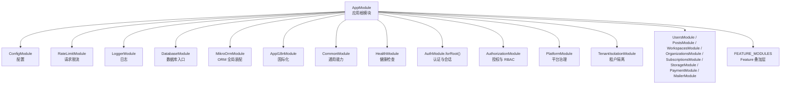
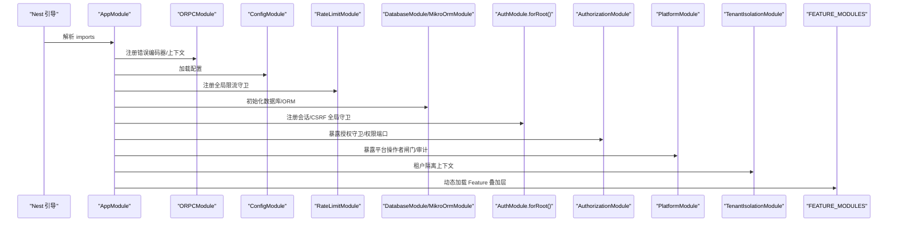
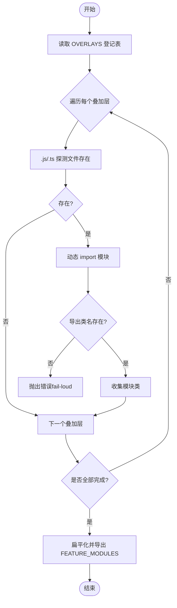
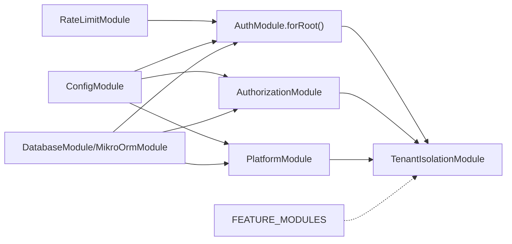

# 模块依赖关系

<cite>
**本文引用的文件**   
- [apps/api/src/app.module.ts](file://apps/api/src/app.module.ts)
- [apps/api/src/features/feature-loader.ts](file://apps/api/src/features/feature-loader.ts)
- [apps/api/src/modules/auth/auth.module.ts](file://apps/api/src/modules/auth/auth.module.ts)
- [apps/api/src/modules/authorization/authorization.module.ts](file://apps/api/src/modules/authorization/authorization.module.ts)
- [apps/api/src/modules/platform/platform.module.ts](file://apps/api/src/modules/platform/platform.module.ts)
- [apps/api/src/common/rate-limit.module.ts](file://apps/api/src/common/rate-limit.module.ts)
- [apps/api/src/database/mikro/mikro-orm.module.ts](file://apps/api/src/database/mikro/mikro-orm.module.ts)
</cite>

## 目录
1. [引言](#引言)
2. [项目结构](#项目结构)
3. [核心组件](#核心组件)
4. [架构总览](#架构总览)
5. [详细组件分析](#详细组件分析)
6. [依赖关系分析](#依赖关系分析)
7. [性能与加载时序](#性能与加载时序)
8. [故障排查指南](#故障排查指南)
9. [结论](#结论)

## 引言
本文聚焦 NestJS SaaS 启动项目的模块装配与依赖关系，重点回答以下问题：
- AppModule 中各模块的注册顺序与依赖约束是什么？为什么某些模块必须按特定顺序加载？
- Feature Loader 如何实现动态模块加载，从而在不影响主应用构建的前提下扩展运行时能力？
- 模块间如何避免循环依赖？接口抽象与依赖注入在此扮演什么角色？
- @Global 全局模块（如 AuthorizationModule、PlatformModule）的作用域与边界是什么？
- 通过模块依赖图与加载时序图，展示复杂的模块装配过程。

## 项目结构
本仓库采用多包 + 多应用结构，API 应用位于 apps/api，业务领域以 modules/* 划分，横切能力（配置、数据库、限流、日志、i18n、邮件等）以独立模块提供，Feature 叠加层集中在 features/*，由运行期探测装配。

图表来源
- [apps/api/src/app.module.ts:33-73](file://apps/api/src/app.module.ts#L33-L73)

章节来源
- [apps/api/src/app.module.ts:1-78](file://apps/api/src/app.module.ts#L1-L78)

## 核心组件
- AppModule：应用根模块，集中声明 imports 顺序，决定全局守卫、上下文、基础设施与业务模块的装配次序。
- RateLimitModule：全局限流墙，作为最廉价拒绝层，必须在 AuthModule 之前注册。
- AuthModule.forRoot()：认证与会话中心，提供全局 SessionGuard、CSRF Origin Guard、SSO 服务、会话回收、用户/会话存储端口等。
- AuthorizationModule：授权与 RBAC 上下文，@Global 暴露授权守卫与权限裁决端口。
- PlatformModule：平台治理上下文，@Global 暴露平台操作者闸门、审计单点与平台身份/配置端口。
- MikroOrmModule：ORM 全局装配，@Global 暴露 ORM 服务与事务单元端口。
- Feature Loader：运行期探测并动态 import 叠加层模块，缺席时返回空数组，实现“严格叠加·构建解耦”。

章节来源
- [apps/api/src/app.module.ts:33-73](file://apps/api/src/app.module.ts#L33-L73)
- [apps/api/src/common/rate-limit.module.ts:1-29](file://apps/api/src/common/rate-limit.module.ts#L1-L29)
- [apps/api/src/modules/auth/auth.module.ts:22-85](file://apps/api/src/modules/auth/auth.module.ts#L22-L85)
- [apps/api/src/modules/authorization/authorization.module.ts:18-60](file://apps/api/src/modules/authorization/authorization.module.ts#L18-L60)
- [apps/api/src/modules/platform/platform.module.ts:12-46](file://apps/api/src/modules/platform/platform.module.ts#L12-L46)
- [apps/api/src/database/mikro/mikro-orm.module.ts:8-29](file://apps/api/src/database/mikro/mikro-orm.module.ts#L8-L29)
- [apps/api/src/features/feature-loader.ts:5-60](file://apps/api/src/features/feature-loader.ts#L5-L60)

## 架构总览
AppModule 的导入顺序并非随意，而是承载了关键的安全与初始化语义：
- oRPC 集成最先注册，为后续控制器/处理器提供统一的错误编码与上下文工厂。
- 配置、限流、日志、数据库、ORM、国际化、通用能力依次就绪。
- AuthModule.forRoot() 在限流之后注册，确保全局会话墙在业务路由前生效。
- AuthorizationModule 与 PlatformModule 作为 @Global 横切能力，置于 TenantIsolationModule 之前，保证后续业务模块可消费其全局端口。
- 业务模块（用户、帖子、工作区、组织、订阅、存储、支付、邮件）按领域分层装配。
- Feature 叠加层置于末尾，不干扰 APP_GUARD 执行序，也不参与主应用构建闭合。

图表来源
- [apps/api/src/app.module.ts:33-73](file://apps/api/src/app.module.ts#L33-L73)
- [apps/api/src/features/feature-loader.ts:39-60](file://apps/api/src/features/feature-loader.ts#L39-L60)

## 详细组件分析

### AppModule 的模块注册顺序与依赖约束
- oRPC 集成：提供拦截器与错误序列化，使既有 Nest 路由生命周期上服务 oRPC procedure；错误面统一经 HttpExceptionFilter 处理。
- 配置与基础设施：ConfigModule 提供配置；RateLimitModule 提供全局限流；LoggerModule 提供日志；DatabaseModule 与 MikroOrmModule 提供数据库与 ORM 能力。
- 认证与会话：AuthModule.forRoot() 注册 SessionGuard 与 CSRF Origin Guard 为 APP_GUARD，同时导出用户/会话存储端口、SSO 服务等。
- 授权与平台：AuthorizationModule 与 PlatformModule 均为 @Global，分别暴露授权与平台治理能力，供其他模块消费。
- 租户隔离：TenantIsolationModule 提供租户上下文与隔离能力，被业务模块广泛依赖。
- 业务模块：用户、帖子、工作区、组织、订阅、存储、支付、邮件等模块按需装配。
- Feature 叠加层：FEATURE_MODULES 在末尾展开，不参与守卫排序，不影响主应用构建。

章节来源
- [apps/api/src/app.module.ts:33-73](file://apps/api/src/app.module.ts#L33-L73)

### Feature Loader 的动态模块加载机制
- 设计目标：第三方或私有集成（如 Odoo RPC、Provisioning、MCP Agent）以“叠加层”形式存在，运行期探测是否存在对应目录与模块文件；在场即动态 import，缺席即返回空数组，保持主应用构建不受具体叠加层绑架。
- 实现要点：
  - OVERLAYS 登记表声明每个叠加层的目录、模块文件名与导出类名。
  - resolveOverlay 对 .js/.ts 两态探测，使用动态 import(specifier) 加载模块，校验导出类名存在，否则 fail-loud。
  - FEATURE_MODULES 在顶层 await 聚合所有叠加层结果，AppModule.imports 直接展开，零网络/零副作用的缺席分支。
- 优势：新增/移除叠加层只需更新 OVERLAYS 登记，无需改动 AppModule；构建期静态分析不可见，避免耦合。

图表来源
- [apps/api/src/features/feature-loader.ts:27-60](file://apps/api/src/features/feature-loader.ts#L27-L60)

章节来源
- [apps/api/src/features/feature-loader.ts:5-60](file://apps/api/src/features/feature-loader.ts#L5-L60)

### 模块间的循环依赖解决方案
- 接口抽象与端口契约：
  - 认证模块通过 AUTH_SESSION_STORE、AUTH_USER_STORE、MCP_ACCESS_TOKEN_STORE 等 symbol token 暴露存储端口，供其他模块（如 organizations、platform）间接访问，避免直接依赖实体仓储。
  - 授权模块通过 PERMISSION_CHECKER、PERMISSION_INVALIDATOR、ROLE_ASSIGNABILITY_READER、TENANT_MEMBERSHIP_MANAGER、TENANT_INVITATION_MANAGER 等端口暴露授权与成员管理契约，供 tenants 门面消费。
  - 平台模块通过 PLATFORM_IDENTITY_LOOKUP、PLATFORM_SETTINGS 暴露平台身份与配置端口。
- 依赖方向清晰：
  - AuthorizationModule 与 PlatformModule 均不反向依赖业务模块，仅通过 @Global 暴露端口。
  - TenantIsolationModule 依赖 AuthorizationGuard 与 PlatformOperatorGuard，但自身不向它们暴露实现细节，避免环。
- 结果：通过端口化与 @Global 导出，将“谁提供能力”和“谁消费能力”解耦，消除循环引用风险。

章节来源
- [apps/api/src/modules/auth/auth.module.ts:46-82](file://apps/api/src/modules/auth/auth.module.ts#L46-L82)
- [apps/api/src/modules/authorization/authorization.module.ts:36-58](file://apps/api/src/modules/authorization/authorization.module.ts#L36-L58)
- [apps/api/src/modules/platform/platform.module.ts:33-44](file://apps/api/src/modules/platform/platform.module.ts#L33-L44)

### 全局模块（@Global）的设计模式与作用范围
- AuthorizationModule：
  - 作用：收拢授权事实与裁决机制，暴露 AuthorizationGuard 与权限端口，供各业务上下文逐路由 @Can 使用。
  - 边界：guard 依赖的 TenantIsolationService 由 @Global TenantIsolationModule 供给，模块图无环。
- PlatformModule：
  - 作用：平台治理限界上下文，暴露 PlatformOperatorGuard、PlatformAuditService 与平台身份/配置端口，供跨租户治理门面消费。
  - 边界：无自有表、不自持角色模型，guard 依赖 UserStatusService/SESSION_READER 由 @Global TenantIsolationModule 供给，模块图无环。
- MikroOrmModule：
  - 作用：ORM 全局装配，暴露 MikroOrmService 与 UNIT_OF_WORK 端口，供仓储与治理服务注入。
  - 边界：构造期不建连，不劫持 DB-free 装配冒烟。

章节来源
- [apps/api/src/modules/authorization/authorization.module.ts:18-60](file://apps/api/src/modules/authorization/authorization.module.ts#L18-L60)
- [apps/api/src/modules/platform/platform.module.ts:12-46](file://apps/api/src/modules/platform/platform.module.ts#L12-L46)
- [apps/api/src/database/mikro/mikro-orm.module.ts:8-29](file://apps/api/src/database/mikro/mikro-orm.module.ts#L8-L29)

## 依赖关系分析
- 安全链顺序：RateLimitModule（限流）→ AuthModule（会话/CSRF）→ TenantIsolationModule（租户隔离）。该顺序确保最廉价的拒绝在前，避免不必要的鉴权与租户解析开销。
- 横切能力前置：AuthorizationModule 与 PlatformModule 在 TenantIsolationModule 之前注册，保证后续业务模块可消费其全局端口。
- 基础设施先行：ConfigModule、DatabaseModule、MikroOrmModule 在业务模块之前就绪，确保仓储与服务可注入。
- Feature 叠加层后置：不注册 APP_GUARD，不涉守卫排序，落尾部保持既有导入序语义不变。

图表来源
- [apps/api/src/app.module.ts:33-73](file://apps/api/src/app.module.ts#L33-L73)
- [apps/api/src/common/rate-limit.module.ts:24-28](file://apps/api/src/common/rate-limit.module.ts#L24-L28)
- [apps/api/src/modules/auth/auth.module.ts:46-82](file://apps/api/src/modules/auth/auth.module.ts#L46-L82)
- [apps/api/src/modules/authorization/authorization.module.ts:36-58](file://apps/api/src/modules/authorization/authorization.module.ts#L36-L58)
- [apps/api/src/modules/platform/platform.module.ts:33-44](file://apps/api/src/modules/platform/platform.module.ts#L33-L44)

章节来源
- [apps/api/src/app.module.ts:33-73](file://apps/api/src/app.module.ts#L33-L73)

## 性能与加载时序
- 限流优先：RateLimitModule 在最外层拦截，减少无效请求进入认证与租户解析链路。
- 会话与 CSRF：AuthModule 的全局守卫在业务路由前执行，快速拒绝未认证与非法来源请求。
- 租户隔离：TenantIsolationModule 在授权与平台能力之后，确保上下文已就绪再解析租户。
- Feature 叠加层：动态 import 仅在运行时探测，缺席分支零成本；在场时按需加载，不影响主应用构建。

章节来源
- [apps/api/src/common/rate-limit.module.ts:6-18](file://apps/api/src/common/rate-limit.module.ts#L6-L18)
- [apps/api/src/modules/auth/auth.module.ts:54-60](file://apps/api/src/modules/auth/auth.module.ts#L54-L60)
- [apps/api/src/features/feature-loader.ts:39-60](file://apps/api/src/features/feature-loader.ts#L39-L60)

## 故障排查指南
- 动态导入失败：
  - 现象：Feature 叠加层缺导出类名时报错（fail-loud）。
  - 排查：确认 OVERLAYS 登记的 moduleFile 与 exportName 与实际模块一致；检查 .js/.ts 两态路径是否存在。
  - 参考：[apps/api/src/features/feature-loader.ts:46-52](file://apps/api/src/features/feature-loader.ts#L46-L52)
- 守卫执行序异常：
  - 现象：限流未生效或认证先于限流。
  - 排查：确认 RateLimitModule 在 AuthModule 之前注册；检查 APP_GUARD 提供者顺序。
  - 参考：[apps/api/src/app.module.ts:48-57](file://apps/api/src/app.module.ts#L48-L57)
- 全局端口解析失败：
  - 现象：业务模块无法注入 PERMISSION_CHECKER、PLATFORM_IDENTITY_LOOKUP 等端口。
  - 排查：确认 AuthorizationModule/PlatformModule 已注册且为 @Global；检查 exports 列表是否包含所需端口。
  - 参考：[apps/api/src/modules/authorization/authorization.module.ts:50-58](file://apps/api/src/modules/authorization/authorization.module.ts#L50-L58)、[apps/api/src/modules/platform/platform.module.ts:39-44](file://apps/api/src/modules/platform/platform.module.ts#L39-L44)
- ORM 连接问题：
  - 现象：构造期建连导致冒烟测试失败。
  - 排查：确认 MikroOrmModule 懒建连接；检查 ConfigModule 配置项是否正确。
  - 参考：[apps/api/src/database/mikro/mikro-orm.module.ts:8-17](file://apps/api/src/database/mikro/mikro-orm.module.ts#L8-L17)

章节来源
- [apps/api/src/features/feature-loader.ts:46-52](file://apps/api/src/features/feature-loader.ts#L46-L52)
- [apps/api/src/app.module.ts:48-57](file://apps/api/src/app.module.ts#L48-L57)
- [apps/api/src/modules/authorization/authorization.module.ts:50-58](file://apps/api/src/modules/authorization/authorization.module.ts#L50-L58)
- [apps/api/src/modules/platform/platform.module.ts:39-44](file://apps/api/src/modules/platform/platform.module.ts#L39-L44)
- [apps/api/src/database/mikro/mikro-orm.module.ts:8-17](file://apps/api/src/database/mikro/mikro-orm.module.ts#L8-L17)

## 结论
- AppModule 的模块注册顺序承载了安全链与初始化语义：限流 → 认证 → 授权/平台 → 租户隔离 → 业务模块 → Feature 叠加层。
- Feature Loader 通过运行期探测与动态 import 实现“严格叠加·构建解耦”，新增/移除叠加层无需改动 AppModule。
- 通过接口抽象与端口契约（symbol token），模块间依赖方向清晰，避免循环引用；@Global 模块（AuthorizationModule、PlatformModule、MikroOrmModule）提供横切能力与作用域边界。
- 依赖图与时序图展示了模块装配的关键路径，便于理解与维护复杂系统。