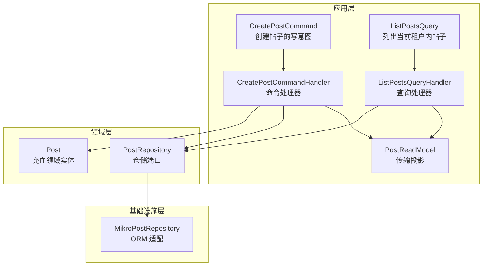
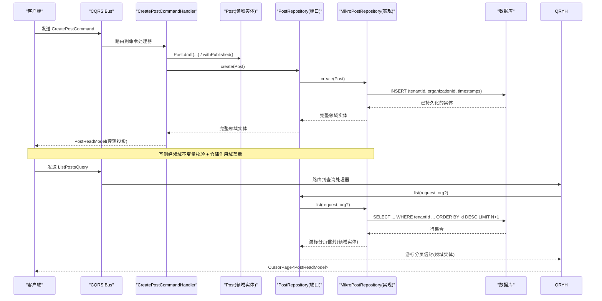
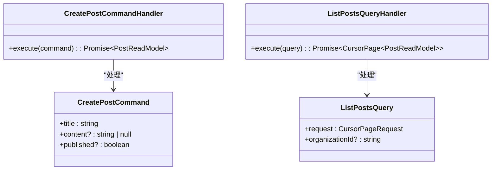
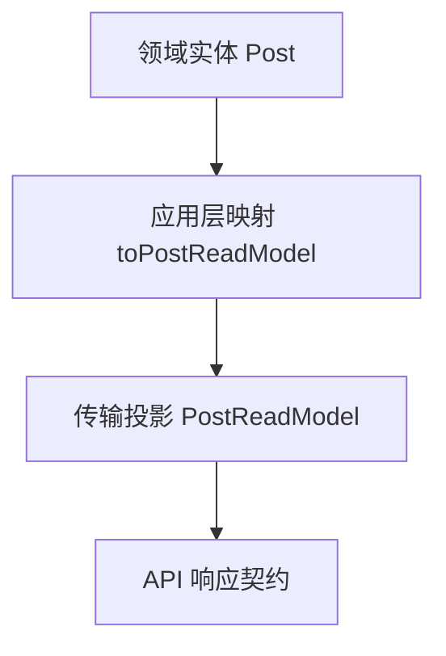
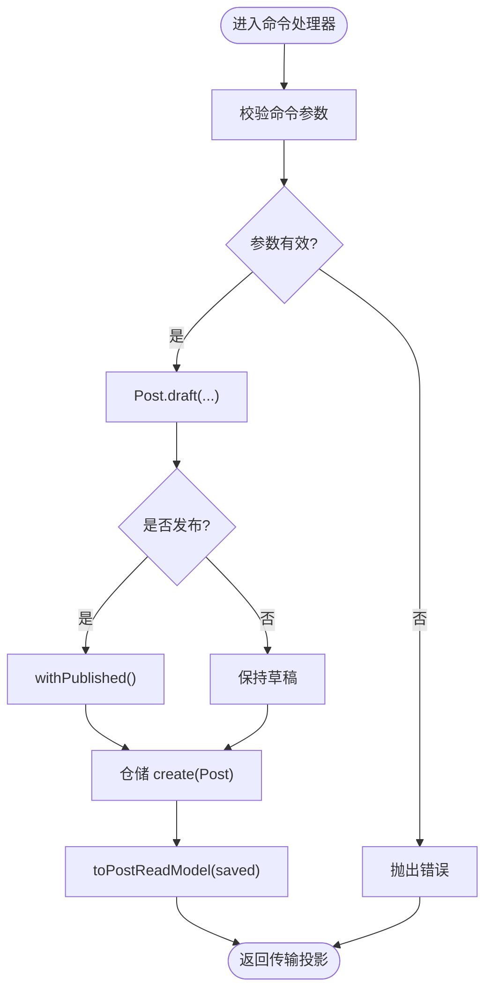
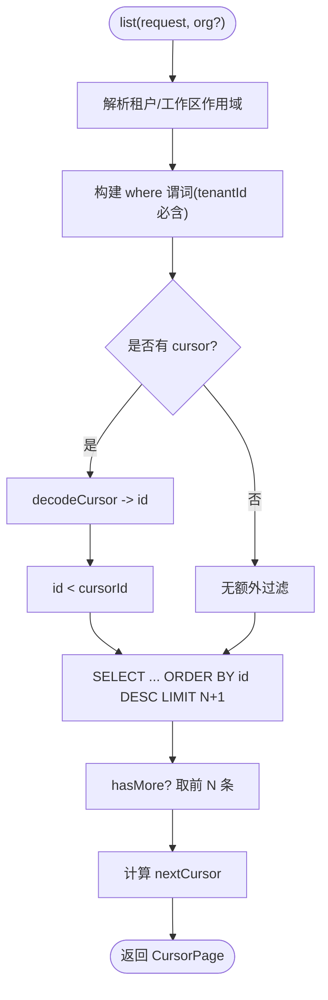
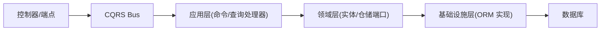

# CQRS 模式

<cite>
**本文引用的文件**   
- [apps/api/src/modules/posts/application/commands/create-post.command.ts](file://apps/api/src/modules/posts/application/commands/create-post.command.ts)
- [apps/api/src/modules/posts/application/queries/list-posts.query.ts](file://apps/api/src/modules/posts/application/queries/list-posts.query.ts)
- [apps/api/src/modules/posts/application/read-models/post.read-model.ts](file://apps/api/src/modules/posts/application/read-models/post.read-model.ts)
- [libs/core/src/shared-kernel/cqrs/types.ts](file://libs/core/src/shared-kernel/cqrs/types.ts)
- [apps/api/src/modules/posts/application/commands/handlers/create-post.command-handler.ts](file://apps/api/src/modules/posts/application/commands/handlers/create-post.command-handler.ts)
- [apps/api/src/modules/posts/application/queries/handlers/list-posts.query-handler.ts](file://apps/api/src/modules/posts/application/queries/handlers/list-posts.query-handler.ts)
- [apps/api/src/modules/posts/domain/repositories/post.repository.ts](file://apps/api/src/modules/posts/domain/repositories/post.repository.ts)
- [apps/api/src/modules/posts/infrastructure/repositories/mikro-post.repository.ts](file://apps/api/src/modules/posts/infrastructure/repositories/mikro-post.repository.ts)
- [apps/api/src/modules/posts/domain/entities/post.ts](file://apps/api/src/modules/posts/domain/entities/post.ts)
- [apps/api/src/modules/posts/posts.module.ts](file://apps/api/src/modules/posts/posts.module.ts)
- [apps/api/src/modules/users/users.module.ts](file://apps/api/src/modules/users/users.module.ts)
</cite>

## 目录
1. [引言](#引言)
2. [项目结构](#项目结构)
3. [核心组件](#核心组件)
4. [架构总览](#架构总览)
5. [详细组件分析](#详细组件分析)
6. [依赖关系分析](#依赖关系分析)
7. [性能与优化](#性能与优化)
8. [故障排查指南](#故障排查指南)
9. [与传统 CRUD 的对比与迁移](#与传统-crud-的对比与迁移)
10. [结论](#结论)

## 引言
本文件围绕 CQRS（命令查询职责分离）在该 NestJS SaaS 项目中的落地进行系统化说明。重点包括：
- 命令与查询的设计原则、处理器职责划分
- 读写模型分离策略、读模型优化与投影设计
- 命令验证、业务规则执行与状态变更流程
- 查询数据访问优化、分页与租户隔离
- 实际模块示例（帖子、用户等）
- 性能优化技巧（异步、批量、游标分页、作用域卡点）
- 与传统 CRUD 的对比及迁移建议

## 项目结构
该仓库采用按限界上下文划分的模块化结构，CQRS 在应用层以“命令 + 查询”组织，领域层通过仓储端口抽象持久化，基础设施层提供 ORM 实现。以下图展示帖子模块中 CQRS 相关文件的组织关系。

图表来源
- [apps/api/src/modules/posts/application/commands/create-post.command.ts:1-21](file://apps/api/src/modules/posts/application/commands/create-post.command.ts#L1-L21)
- [apps/api/src/modules/posts/application/queries/list-posts.query.ts:1-21](file://apps/api/src/modules/posts/application/queries/list-posts.query.ts#L1-L21)
- [apps/api/src/modules/posts/application/read-models/post.read-model.ts:1-54](file://apps/api/src/modules/posts/application/read-models/post.read-model.ts#L1-L54)
- [apps/api/src/modules/posts/application/commands/handlers/create-post.command-handler.ts:1-30](file://apps/api/src/modules/posts/application/commands/handlers/create-post.command-handler.ts#L1-L30)
- [apps/api/src/modules/posts/application/queries/handlers/list-posts.query-handler.ts:1-36](file://apps/api/src/modules/posts/application/queries/handlers/list-posts.query-handler.ts#L1-L36)
- [apps/api/src/modules/posts/domain/entities/post.ts:1-159](file://apps/api/src/modules/posts/domain/entities/post.ts#L1-L159)
- [apps/api/src/modules/posts/domain/repositories/post.repository.ts:1-51](file://apps/api/src/modules/posts/domain/repositories/post.repository.ts#L1-L51)
- [apps/api/src/modules/posts/infrastructure/repositories/mikro-post.repository.ts:1-140](file://apps/api/src/modules/posts/infrastructure/repositories/mikro-post.repository.ts#L1-L140)

章节来源
- [apps/api/src/modules/posts/posts.module.ts:1-24](file://apps/api/src/modules/posts/posts.module.ts#L1-L24)
- [apps/api/src/modules/users/users.module.ts:1-28](file://apps/api/src/modules/users/users.module.ts#L1-L28)

## 核心组件
- 命令与查询基类：统一继承自 `@nestjs/cqrs` 的消息基类，提供结果类型推断能力。
- 命令：表达写意图，仅携带原始值，不包含技术细节（如租户 ID）。
- 查询：表达读意图，携带分页、过滤等参数。
- 处理器：命令处理器负责业务规则与状态变更；查询处理器负责读取并映射为传输投影。
- 领域实体：承载不变量与纯转移方法，保证状态一致性。
- 仓储端口：定义领域操作契约，隐藏持久化细节与作用域约束。
- 仓储实现：基于 MikroORM 的适配器，负责租户隔离、分页、时间戳等横切关注点。
- 传输投影：面向 API 的输出形状，与领域实体解耦。

章节来源
- [libs/core/src/shared-kernel/cqrs/types.ts:1-24](file://libs/core/src/shared-kernel/cqrs/types.ts#L1-L24)
- [apps/api/src/modules/posts/application/commands/create-post.command.ts:1-21](file://apps/api/src/modules/posts/application/commands/create-post.command.ts#L1-L21)
- [apps/api/src/modules/posts/application/queries/list-posts.query.ts:1-21](file://apps/api/src/modules/posts/application/queries/list-posts.query.ts#L1-L21)
- [apps/api/src/modules/posts/application/read-models/post.read-model.ts:1-54](file://apps/api/src/modules/posts/application/read-models/post.read-model.ts#L1-L54)
- [apps/api/src/modules/posts/domain/entities/post.ts:1-159](file://apps/api/src/modules/posts/domain/entities/post.ts#L1-L159)
- [apps/api/src/modules/posts/domain/repositories/post.repository.ts:1-51](file://apps/api/src/modules/posts/domain/repositories/post.repository.ts#L1-L51)
- [apps/api/src/modules/posts/infrastructure/repositories/mikro-post.repository.ts:1-140](file://apps/api/src/modules/posts/infrastructure/repositories/mikro-post.repository.ts#L1-L140)

## 架构总览
下图展示一次“创建帖子”的命令处理流程，以及“列出帖子”的查询处理流程。

图表来源
- [apps/api/src/modules/posts/application/commands/handlers/create-post.command-handler.ts:1-30](file://apps/api/src/modules/posts/application/commands/handlers/create-post.command-handler.ts#L1-L30)
- [apps/api/src/modules/posts/application/queries/handlers/list-posts.query-handler.ts:1-36](file://apps/api/src/modules/posts/application/queries/handlers/list-posts.query-handler.ts#L1-L36)
- [apps/api/src/modules/posts/domain/entities/post.ts:1-159](file://apps/api/src/modules/posts/domain/entities/post.ts#L1-L159)
- [apps/api/src/modules/posts/domain/repositories/post.repository.ts:1-51](file://apps/api/src/modules/posts/domain/repositories/post.repository.ts#L1-L51)
- [apps/api/src/modules/posts/infrastructure/repositories/mikro-post.repository.ts:1-140](file://apps/api/src/modules/posts/infrastructure/repositories/mikro-post.repository.ts#L1-L140)

## 详细组件分析

### 命令与查询设计原则
- 命令（Command）
  - 只表达写意图，字段尽量为原始值，避免技术细节（例如不直接包含租户 ID）。
  - 由命令处理器驱动领域逻辑，确保不变量与业务规则在入口处被满足。
- 查询（Query）
  - 只表达读意图，可携带分页、排序、过滤等参数。
  - 查询处理器不应产生副作用，仅读取数据并返回传输投影。

章节来源
- [apps/api/src/modules/posts/application/commands/create-post.command.ts:1-21](file://apps/api/src/modules/posts/application/commands/create-post.command.ts#L1-L21)
- [apps/api/src/modules/posts/application/queries/list-posts.query.ts:1-21](file://apps/api/src/modules/posts/application/queries/list-posts.query.ts#L1-L21)

### 命令处理器与查询处理器职责
- 命令处理器
  - 构造领域对象（工厂方法），执行业务转移（如发布/撤回），调用仓储保存。
  - 将持久化后的领域实体映射为传输投影返回给调用方。
- 查询处理器
  - 通过仓储端口获取领域实体集合，逐项映射为传输投影，重建分页信封返回。

图表来源
- [apps/api/src/modules/posts/application/commands/create-post.command.ts:1-21](file://apps/api/src/modules/posts/application/commands/create-post.command.ts#L1-L21)
- [apps/api/src/modules/posts/application/queries/list-posts.query.ts:1-21](file://apps/api/src/modules/posts/application/queries/list-posts.query.ts#L1-L21)
- [apps/api/src/modules/posts/application/commands/handlers/create-post.command-handler.ts:1-30](file://apps/api/src/modules/posts/application/commands/handlers/create-post.command-handler.ts#L1-L30)
- [apps/api/src/modules/posts/application/queries/handlers/list-posts.query-handler.ts:1-36](file://apps/api/src/modules/posts/application/queries/handlers/list-posts.query-handler.ts#L1-L36)

章节来源
- [apps/api/src/modules/posts/application/commands/handlers/create-post.command-handler.ts:1-30](file://apps/api/src/modules/posts/application/commands/handlers/create-post.command-handler.ts#L1-L30)
- [apps/api/src/modules/posts/application/queries/handlers/list-posts.query-handler.ts:1-36](file://apps/api/src/modules/posts/application/queries/handlers/list-posts.query-handler.ts#L1-L36)

### 读写模型分离与投影设计
- 领域实体（Post）
  - 承载业务不变量与纯转移方法（如发布/撤回），保持不可变语义。
- 传输投影（PostReadModel）
  - 面向 API 的输出形状，与领域实体解耦，便于序列化与契约稳定。
- 映射
  - 在应用层完成从领域实体到传输投影的转换，领域层不感知 API 层。

图表来源
- [apps/api/src/modules/posts/domain/entities/post.ts:1-159](file://apps/api/src/modules/posts/domain/entities/post.ts#L1-L159)
- [apps/api/src/modules/posts/application/read-models/post.read-model.ts:1-54](file://apps/api/src/modules/posts/application/read-models/post.read-model.ts#L1-L54)

章节来源
- [apps/api/src/modules/posts/domain/entities/post.ts:1-159](file://apps/api/src/modules/posts/domain/entities/post.ts#L1-L159)
- [apps/api/src/modules/posts/application/read-models/post.read-model.ts:1-54](file://apps/api/src/modules/posts/application/read-models/post.read-model.ts#L1-L54)

### 命令验证、业务规则与状态变更
- 输入验证
  - HTTP 层使用 zod 先行拦截（标题非空），领域层再防御性校验（标题为空抛错）。
- 业务规则
  - 通过领域实体的工厂方法与纯转移方法（draft/withPublished/withUnpublished）表达状态迁移。
- 状态变更
  - 命令处理器调用仓储保存，仓储适配器负责租户/组织/工作区等元数据盖章与时间戳填充。

图表来源
- [apps/api/src/modules/posts/application/commands/handlers/create-post.command-handler.ts:1-30](file://apps/api/src/modules/posts/application/commands/handlers/create-post.command-handler.ts#L1-L30)
- [apps/api/src/modules/posts/domain/entities/post.ts:1-159](file://apps/api/src/modules/posts/domain/entities/post.ts#L1-L159)
- [apps/api/src/modules/posts/infrastructure/repositories/mikro-post.repository.ts:120-138](file://apps/api/src/modules/posts/infrastructure/repositories/mikro-post.repository.ts#L120-L138)

章节来源
- [apps/api/src/modules/posts/application/commands/handlers/create-post.command-handler.ts:1-30](file://apps/api/src/modules/posts/application/commands/handlers/create-post.command-handler.ts#L1-L30)
- [apps/api/src/modules/posts/domain/entities/post.ts:1-159](file://apps/api/src/modules/posts/domain/entities/post.ts#L1-L159)
- [apps/api/src/modules/posts/infrastructure/repositories/mikro-post.repository.ts:120-138](file://apps/api/src/modules/posts/infrastructure/repositories/mikro-post.repository.ts#L120-L138)

### 查询的数据访问优化与分页
- 租户隔离
  - 仓储实现强制从可信上下文解析租户 ID，作为主谓词，防止跨租访问。
- 游标分页
  - 使用 UUIDv7 生成有序 ID，以 id 单键构建 cursor，避免 COUNT 全量查询。
- 作用域收窄
  - 可选 workspaceId 与 organizationId 仅作为租内收窄维度，不会放宽安全边界。

图表来源
- [apps/api/src/modules/posts/infrastructure/repositories/mikro-post.repository.ts:69-110](file://apps/api/src/modules/posts/infrastructure/repositories/mikro-post.repository.ts#L69-L110)

章节来源
- [apps/api/src/modules/posts/infrastructure/repositories/mikro-post.repository.ts:69-110](file://apps/api/src/modules/posts/infrastructure/repositories/mikro-post.repository.ts#L69-L110)

### 多模块中的 CQRS 实践
- 帖子模块
  - 命令：创建帖子；查询：列出帖子。
- 用户模块
  - 命令：删除用户；查询：导出用户数据。
- 模块装配
  - 各模块引入 `CqrsModule`，注册命令处理器与查询处理器，并通过 DI 绑定仓储端口与实现。

章节来源
- [apps/api/src/modules/users/users.module.ts:1-28](file://apps/api/src/modules/users/users.module.ts#L1-L28)
- [apps/api/src/modules/posts/posts.module.ts:1-24](file://apps/api/src/modules/posts/posts.module.ts#L1-L24)

## 依赖关系分析
- 应用层依赖领域层（实体、仓储端口）
- 领域层不依赖基础设施层（依赖倒置）
- 基础设施层实现仓储端口，注入 ORM 服务与租户隔离服务
- 控制器/端点通过 CQRS Bus 调用处理器

图表来源
- [apps/api/src/modules/posts/posts.module.ts:1-24](file://apps/api/src/modules/posts/posts.module.ts#L1-L24)
- [apps/api/src/modules/posts/domain/repositories/post.repository.ts:1-51](file://apps/api/src/modules/posts/domain/repositories/post.repository.ts#L1-L51)
- [apps/api/src/modules/posts/infrastructure/repositories/mikro-post.repository.ts:1-42](file://apps/api/src/modules/posts/infrastructure/repositories/mikro-post.repository.ts#L1-L42)

章节来源
- [apps/api/src/modules/posts/domain/repositories/post.repository.ts:1-51](file://apps/api/src/modules/posts/domain/repositories/post.repository.ts#L1-L51)
- [apps/api/src/modules/posts/infrastructure/repositories/mikro-post.repository.ts:1-42](file://apps/api/src/modules/posts/infrastructure/repositories/mikro-post.repository.ts#L1-L42)

## 性能与优化
- 游标分页
  - 使用 UUIDv7 的时间有序特性，以 id 单键构建 cursor，避免 COUNT 全量查询，提升大数据集分页性能。
- 作用域前置校验
  - 在获取 EntityManager 之前解析租户 ID，失败则快速返回错误，避免无效查询。
- 独立连接
  - 每次操作 fork 独立的 EntityManager，避免共享连接带来的锁竞争与事务干扰。
- 投影映射
  - 在应用层进行领域实体到传输投影的映射，减少领域层对 API 层的耦合，便于缓存与序列化优化。
- 异步与批量
  - 命令处理器与查询处理器均为异步执行，适合后续扩展为消息队列或批量写入（仓储实现可扩展批量接口）。

[本节为通用指导，无需具体文件引用]

## 故障排查指南
- 租户缺失导致 403
  - 仓储实现会在解析租户时 fail-closed，若缺少活动租户会立即抛出异常，检查请求上下文是否正确设置租户信息。
- 分页 cursor 非法
  - 当 cursor 解码失败时抛出“Invalid pagination cursor”，检查前端传递的 cursor 是否为合法 base64url 编码且载荷为 [id]。
- 业务校验失败
  - 领域实体构造时对必填字段进行校验（如标题非空），若传入非法值将抛错，检查命令参数是否符合契约。

章节来源
- [apps/api/src/modules/posts/infrastructure/repositories/mikro-post.repository.ts:44-67](file://apps/api/src/modules/posts/infrastructure/repositories/mikro-post.repository.ts#L44-L67)
- [apps/api/src/modules/posts/infrastructure/repositories/mikro-post.repository.ts:83-91](file://apps/api/src/modules/posts/infrastructure/repositories/mikro-post.repository.ts#L83-L91)
- [apps/api/src/modules/posts/domain/entities/post.ts:68-74](file://apps/api/src/modules/posts/domain/entities/post.ts#L68-L74)

## 与传统 CRUD 的对比与迁移
- 对比
  - CRUD 通常将读写逻辑集中在一个服务或控制器中，容易混入业务规则与数据访问细节。
  - CQRS 将写侧（命令）与读侧（查询）分离，命令处理器专注业务规则与状态变更，查询处理器专注数据读取与投影。
- 迁移策略
  - 逐步拆分：先识别高频写操作，抽取命令与命令处理器；随后拆分查询为查询处理器与传输投影。
  - 引入仓储端口：将数据访问抽象为端口，逐步替换现有 Repository/Service 中的数据访问逻辑。
  - 强化作用域：在仓储实现中集中处理租户隔离、权限与审计等横切关注点。
  - 渐进式重构：保留旧接口兼容的同时，新增 CQRS 路径，逐步切换流量。

[本节为概念性内容，无需具体文件引用]

## 结论
该项目通过 CQRS 实现了清晰的职责分离：命令处理器负责业务规则与状态变更，查询处理器负责高效读取与投影输出。领域实体承载不变量与纯转移方法，仓储端口抽象持久化细节并在基础设施层实现租户隔离、分页与作用域控制。这种设计提升了系统的可维护性与可扩展性，并为后续引入事件溯源、异步处理与缓存优化奠定了坚实基础。