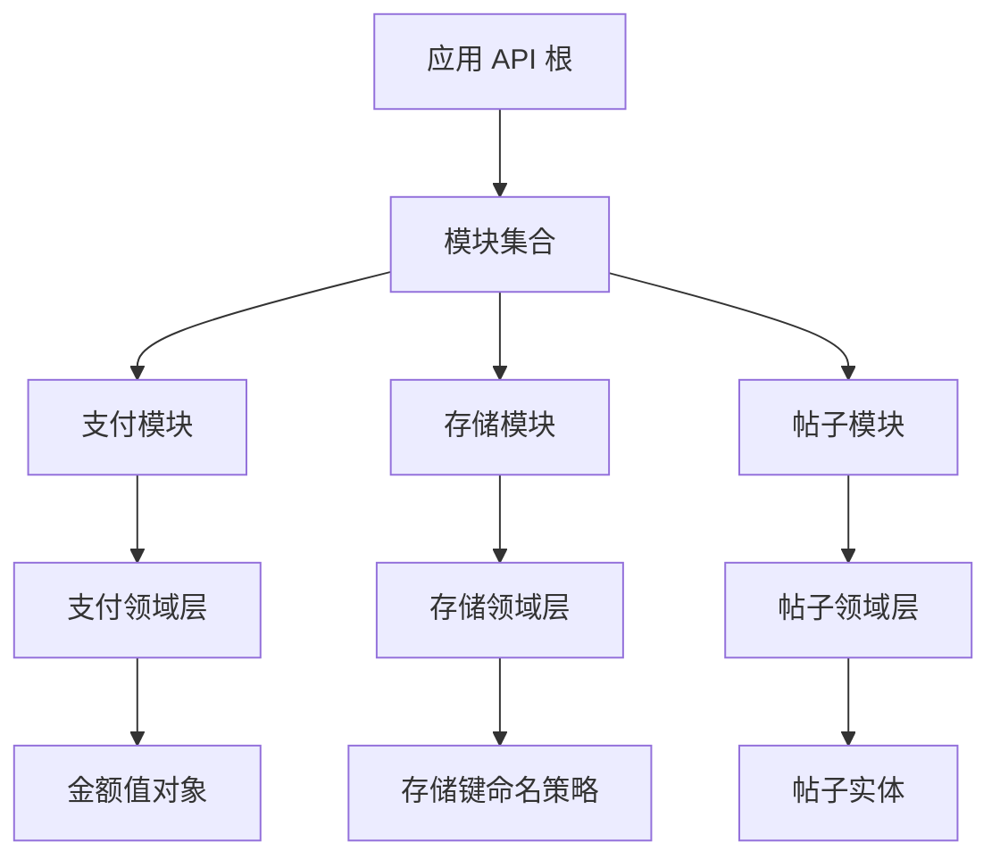
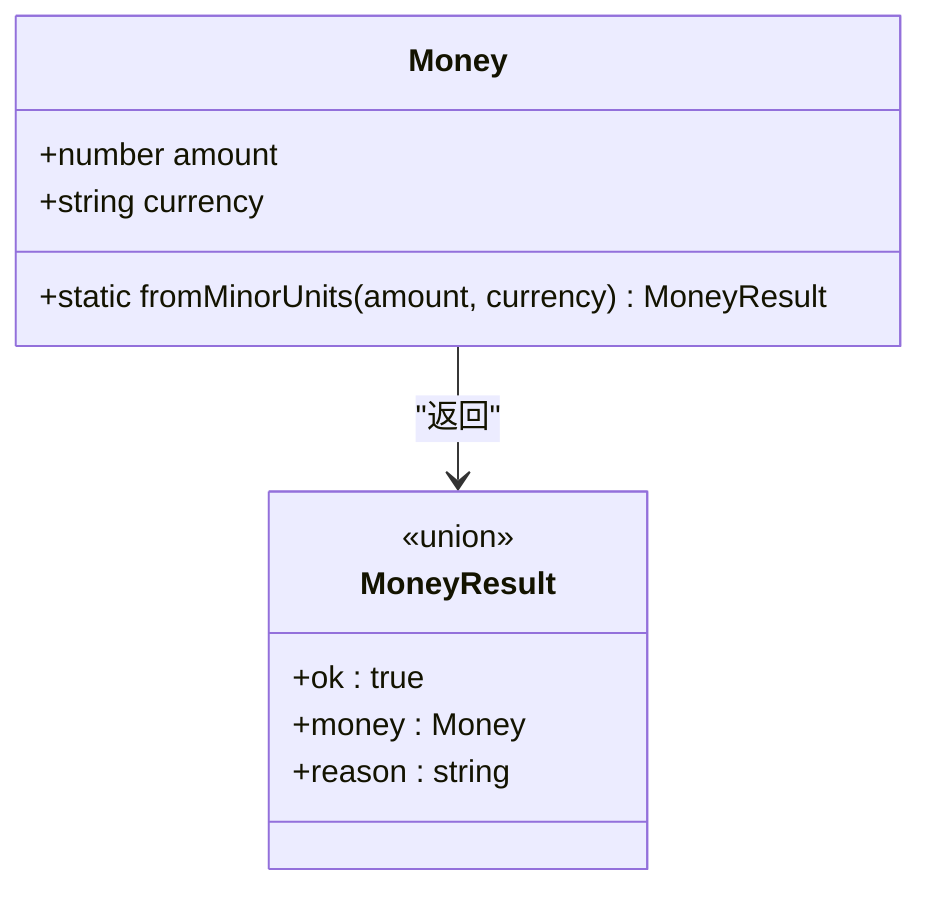
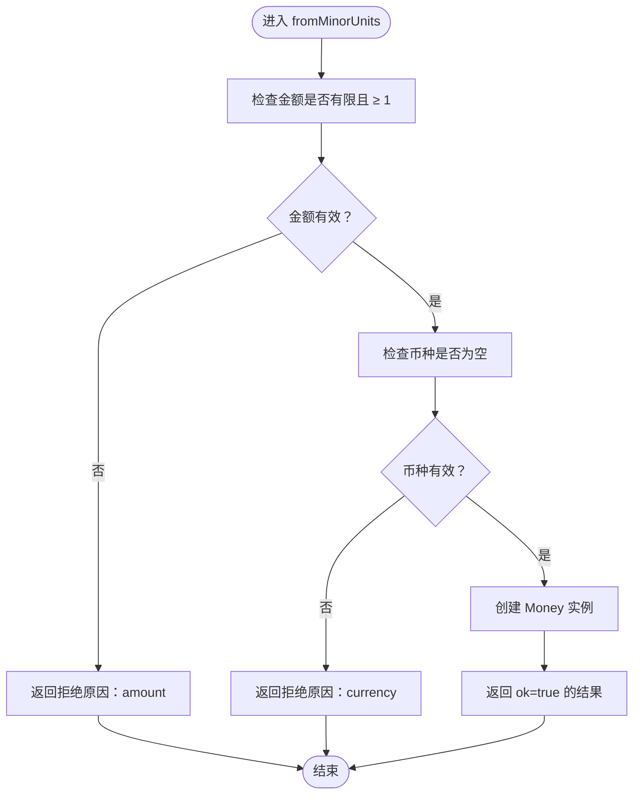
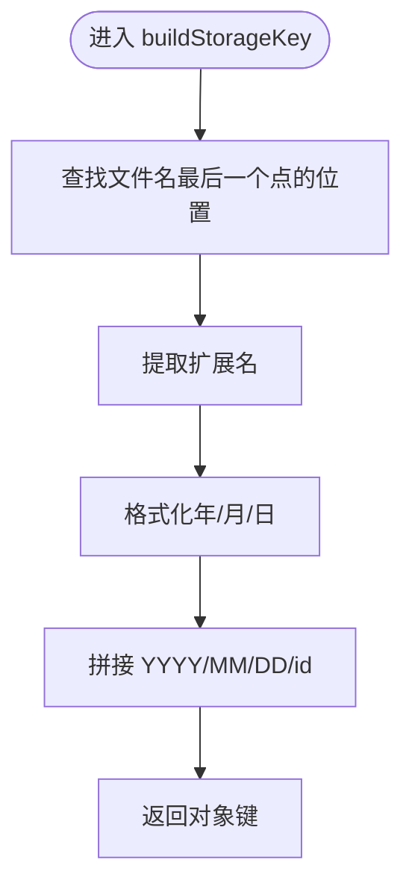
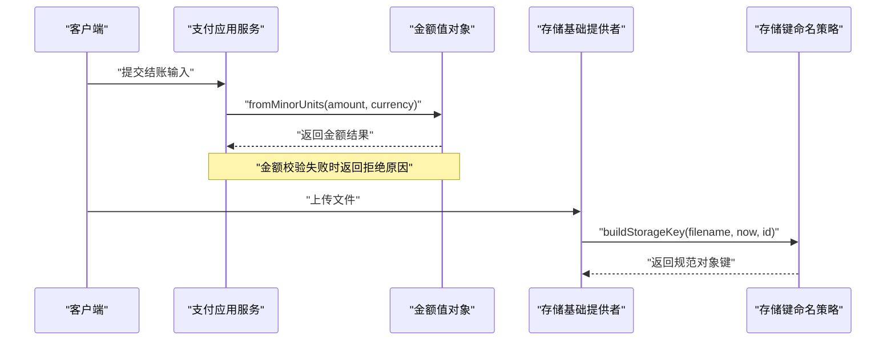
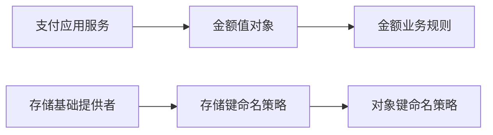
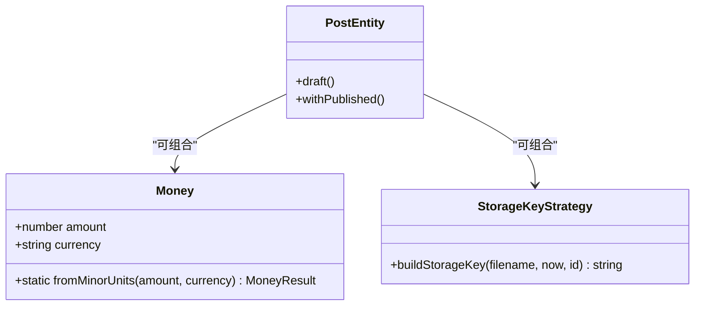

# 值对象

<cite>
**本文引用的文件**   
- [money.ts](file://apps/api/src/modules/payment/domain/value-objects/money.ts)
- [money.test.ts](file://apps/api/src/modules/payment/domain/value-objects/money.test.ts)
- [payment.service.ts](file://apps/api/src/modules/payment/application/payment.service.ts)
- [storage-key.ts](file://apps/api/src/modules/storage/domain/value-objects/storage-key.ts)
- [storage-key.test.ts](file://apps/api/src/modules/storage/domain/value-objects/storage-key.test.ts)
- [base-storage.provider.ts](file://apps/api/src/modules/storage/infrastructure/base-storage.provider.ts)
- [post.ts](file://apps/api/src/modules/posts/domain/entities/post.ts)
- [verify-domain-layout.ts](file://scripts/verify-domain-layout.ts)
</cite>

## 目录
1. [引言](#引言)
2. [项目结构中的值对象位置](#项目结构中的值对象位置)
3. [值对象设计原则](#值对象设计原则)
4. [核心值对象分析](#核心值对象分析)
5. [架构总览与调用关系](#架构总览与调用关系)
6. [依赖关系分析](#依赖关系分析)
7. [性能与可测试性](#性能与可测试性)
8. [序列化、反序列化与持久化策略](#序列化反序列化与持久化策略)
9. [值对象设计模式](#值对象设计模式)
10. [常见问题排查](#常见问题排查)
11. [结论](#结论)

## 引言
本文件围绕仓库中已落地的值对象实践，系统化说明值对象在领域建模中的作用：以不可变数据承载业务概念，通过构造期不变量表达业务约束，并通过纯函数或具名类隔离领域规则。当前仓库中明确体现值对象语义的落地包括支付模块的金额值对象，以及存储模块的对象键命名策略；同时，帖子实体也体现了“不可变状态 + 构造期不变量 + 纯转移函数”的领域建模风格，可作为值对象与实体协作的参考。

## 项目结构中的值对象位置
仓库采用按功能模块组织代码的方式，领域层位于 `apps/api/src/modules/<module>/domain` 下。脚本 `verify-domain-layout.ts` 将 `value-objects` 列为领域子目录的规范之一，表明值对象应放在领域层的专用子目录中，与实体、事件、仓储端口等并列。

**图示来源**
- [verify-domain-layout.ts:22-30](file://scripts/verify-domain-layout.ts#L22-L30)
- [money.ts:1-45](file://apps/api/src/modules/payment/domain/value-objects/money.ts#L1-L45)
- [storage-key.ts:1-24](file://apps/api/src/modules/storage/domain/value-objects/storage-key.ts#L1-L24)
- [post.ts:35-59](file://apps/api/src/modules/posts/domain/entities/post.ts#L35-L59)

**章节来源**
- [verify-domain-layout.ts:22-30](file://scripts/verify-domain-layout.ts#L22-L30)

## 值对象设计原则
结合仓库中的实现，值对象遵循以下原则：

- **不可变性**：值对象的字段声明为只读，构造函数私有，外部只能通过静态工厂方法创建实例，避免状态被意外修改。
- **构造期不变量**：所有业务约束在构造阶段校验，失败时返回明确的拒绝原因，而不是抛出异常或留下非法状态。
- **纯函数优先**：值对象相关逻辑尽量表达为无副作用的纯函数，便于单测和复用。
- **领域语义清晰**：值对象名称直接表达业务概念，例如金额由“数值 + 币种”组成，存储键由“文件名 + 时间 + 唯一 id + 扩展名”组成。
- **边界契约对齐**：值对象的校验规则与接口层 schema 保持一致，避免领域层收紧或放宽输入面，保持 HTTP 接受面的单一真实来源。
- **领域层零框架依赖**：值对象不引入 NestJS、ORM 或 HTTP 相关依赖，保证领域模型独立于基础设施。

这些原则在金额值对象和存储键命名策略中均有体现：金额通过 `fromMinorUnits` 进行构造校验并返回联合结果；存储键命名通过纯函数生成确定性的对象键路径。

**章节来源**
- [money.ts:13-44](file://apps/api/src/modules/payment/domain/value-objects/money.ts#L13-L44)
- [storage-key.ts:1-23](file://apps/api/src/modules/storage/domain/value-objects/storage-key.ts#L1-L23)
- [post.ts:35-47](file://apps/api/src/modules/posts/domain/entities/post.ts#L35-L47)

## 核心值对象分析

### 金额值对象 Money
金额值对象将“最小货币单位金额 + 币种”封装为一个具名、不可变的领域概念。其关键设计如下：

- **数据结构**：包含 `amount` 和 `currency` 两个只读字段。
- **构造入口**：提供静态工厂方法 `fromMinorUnits`，接收最小货币单位金额和币种。
- **不变量校验**：
  - 金额必须有限且不小于 1。
  - 币种不能为空字符串。
- **结果类型**：使用联合类型区分成功与失败，成功返回金额实例，失败返回拒绝原因。
- **边界对齐**：注释明确指出，金额值对象的校验与接口层 zod schema 对齐，不额外收紧为整数或 ISO-4217 三位码，以避免改变 HTTP 接受面。

**图示来源**
- [money.ts:23-44](file://apps/api/src/modules/payment/domain/value-objects/money.ts#L23-L44)

#### 构造流程

**图示来源**
- [money.ts:35-43](file://apps/api/src/modules/payment/domain/value-objects/money.ts#L35-L43)

**章节来源**
- [money.ts:1-45](file://apps/api/src/modules/payment/domain/value-objects/money.ts#L1-L45)
- [money.test.ts:1-38](file://apps/api/src/modules/payment/domain/value-objects/money.test.ts#L1-L38)

### 存储键命名策略 buildStorageKey
存储模块没有使用传统类式值对象，而是将“对象键命名规则”下沉到领域层，以纯函数形式表达。该函数的职责是生成统一的对象键格式：`YYYY/MM/DD/<id><ext>`。

- **输入**：原始文件名、基准时间、唯一 id。
- **输出**：规范的对象键字符串。
- **扩展名处理**：与 Node.js `path.extname` 语义对齐，仅当点号不在首位时视为扩展名；dotfile（如 `.env`）视为无扩展名。
- **日期格式化**：月份和日期补零，确保路径稳定。
- **确定性**：通过注入 `now` 和 `id`，使函数无外部依赖、可重复测试。

**图示来源**
- [storage-key.ts:14-22](file://apps/api/src/modules/storage/domain/value-objects/storage-key.ts#L14-L22)

**章节来源**
- [storage-key.ts:1-24](file://apps/api/src/modules/storage/domain/value-objects/storage-key.ts#L1-L24)
- [storage-key.test.ts:1-30](file://apps/api/src/modules/storage/domain/value-objects/storage-key.test.ts#L1-L30)

## 架构总览与调用关系
值对象通常不直接暴露给 API 层，而是在应用服务或基础设施层中被消费。仓库中的典型调用链如下：

- 支付应用服务从输入中解析金额和币种，调用 `Money.fromMinorUnits` 构造金额值对象。
- 存储基础设施层在生成对象键时调用领域层的 `buildStorageKey` 纯函数。
- 帖子实体展示了领域实体的不可变建模风格，与值对象共享“构造期不变量 + 纯转移函数”的设计思想。

**图示来源**
- [payment.service.ts:76-76](file://apps/api/src/modules/payment/application/payment.service.ts#L76-L76)
- [money.ts:35-43](file://apps/api/src/modules/payment/domain/value-objects/money.ts#L35-L43)
- [base-storage.provider.ts:114-114](file://apps/api/src/modules/storage/infrastructure/base-storage.provider.ts#L114-L114)
- [storage-key.ts:14-22](file://apps/api/src/modules/storage/domain/value-objects/storage-key.ts#L14-L22)

**章节来源**
- [payment.service.ts:76-76](file://apps/api/src/modules/payment/application/payment.service.ts#L76-L76)
- [base-storage.provider.ts:13-25](file://apps/api/src/modules/storage/infrastructure/base-storage.provider.ts#L13-L25)
- [base-storage.provider.ts:114-114](file://apps/api/src/modules/storage/infrastructure/base-storage.provider.ts#L114-L114)

## 依赖关系分析
值对象在仓库中的依赖关系呈现“领域层自洽、基础设施层消费”的特点：

- 金额值对象不依赖任何框架或基础设施，仅表达金额与币种的组合及校验。
- 存储键命名策略不依赖文件系统或云存储 SDK，仅负责字符串拼接。
- 应用服务和基础设施层分别消费这些值对象，从而将领域规则与外部实现解耦。

**图示来源**
- [payment.service.ts:76-76](file://apps/api/src/modules/payment/application/payment.service.ts#L76-L76)
- [money.ts:35-43](file://apps/api/src/modules/payment/domain/value-objects/money.ts#L35-L43)
- [base-storage.provider.ts:114-114](file://apps/api/src/modules/storage/infrastructure/base-storage.provider.ts#L114-L114)
- [storage-key.ts:14-22](file://apps/api/src/modules/storage/domain/value-objects/storage-key.ts#L14-L22)

**章节来源**
- [payment.service.ts:76-76](file://apps/api/src/modules/payment/application/payment.service.ts#L76-L76)
- [base-storage.provider.ts:114-114](file://apps/api/src/modules/storage/infrastructure/base-storage.provider.ts#L114-L114)

## 性能与可测试性
- **性能**：值对象逻辑简单、无 I/O，主要开销在于参数校验和字符串拼接，对整体性能影响极小。
- **可测试性**：
  - 金额值对象通过单元测试覆盖合法输入、非法金额、非法币种、小数金额等场景。
  - 存储键命名策略通过单元测试覆盖标准命名、无扩展名、多点扩展名、dotfile、双位月日等场景。
- **确定性**：存储键命名通过注入时间和 id，避免随机性和系统时间差异导致的测试不稳定。

**章节来源**
- [money.test.ts:1-38](file://apps/api/src/modules/payment/domain/value-objects/money.test.ts#L1-L38)
- [storage-key.test.ts:1-30](file://apps/api/src/modules/storage/domain/value-objects/storage-key.test.ts#L1-L30)

## 序列化、反序列化与持久化策略
当前仓库中，值对象本身并未直接承担 ORM 映射或 JSON 序列化的完整实现，但其设计为后续转换提供了良好基础：

- **金额值对象**：适合在应用层或基础设施层转换为数据库列（如分 + 币种字符串），并在 API 响应中投影为可读字段。
- **存储键值对象**：作为纯函数输出，可直接用于对象存储路径，无需额外序列化。
- **领域实体对比**：帖子实体强调领域实体与物理数据实体的分离，值对象可类比这种思路，在聚合内部使用不可变值对象，在持久化层通过 mapper 转换为数据库列。

建议的转换策略：
- 写入数据库：将金额值对象拆分为最小单位金额和币种列；存储键直接使用生成的字符串。
- 读取数据库：从列重建金额值对象或 DTO，避免在领域层直接操作数据库列。
- API 传输：对外暴露 DTO，内部使用值对象表达业务语义。

**章节来源**
- [post.ts:35-47](file://apps/api/src/modules/posts/domain/entities/post.ts#L35-L47)
- [money.ts:13-44](file://apps/api/src/modules/payment/domain/value-objects/money.ts#L13-L44)
- [storage-key.ts:1-23](file://apps/api/src/modules/storage/domain/value-objects/storage-key.ts#L1-L23)

## 值对象设计模式
仓库中体现了两种典型的值对象模式：

- **具名值对象类**：金额值对象使用类封装业务概念，提供静态工厂方法和结果联合类型，适合需要多个字段组合、复杂校验的场景。
- **纯函数值对象**：存储键命名策略以纯函数形式表达领域规则，适合无状态、确定性输出的场景。

此外，仓库还体现了以下相关模式：
- **枚举值对象**：可通过具名常量 + 校验函数表达有限取值集合，例如币种、状态等。
- **复合值对象**：将多个相关字段组合为一个不可变单元，例如地址由城市、街道、邮编组成。
- **值对象与实体协作**：实体持有值对象作为属性，值对象负责自身不变量，实体负责聚合级行为。

**图示来源**
- [money.ts:23-44](file://apps/api/src/modules/payment/domain/value-objects/money.ts#L23-L44)
- [storage-key.ts:14-22](file://apps/api/src/modules/storage/domain/value-objects/storage-key.ts#L14-L22)
- [post.ts:35-59](file://apps/api/src/modules/posts/domain/entities/post.ts#L35-L59)

**章节来源**
- [money.ts:1-45](file://apps/api/src/modules/payment/domain/value-objects/money.ts#L1-L45)
- [storage-key.ts:1-24](file://apps/api/src/modules/storage/domain/value-objects/storage-key.ts#L1-L24)
- [post.ts:35-59](file://apps/api/src/modules/posts/domain/entities/post.ts#L35-L59)

## 常见问题排查
- **金额校验失败**：检查传入金额是否为有限数且不小于 1，币种是否为非空字符串。
- **存储键不符合预期**：确认文件名扩展名提取逻辑、日期格式化、唯一 id 注入是否符合 `YYYY/MM/DD/<id><ext>` 约定。
- **领域层越界依赖**：确保值对象未引入 NestJS、ORM 或 HTTP 依赖，保持领域层纯净。
- **边界契约不一致**：若接口层 schema 与值对象校验规则不一致，优先统一在边界 schema 处收敛，避免领域层随意收紧或放宽输入。

**章节来源**
- [money.ts:35-43](file://apps/api/src/modules/payment/domain/value-objects/money.ts#L35-L43)
- [storage-key.ts:14-22](file://apps/api/src/modules/storage/domain/value-objects/storage-key.ts#L14-L22)
- [money.test.ts:19-36](file://apps/api/src/modules/payment/domain/value-objects/money.test.ts#L19-L36)
- [storage-key.test.ts:11-29](file://apps/api/src/modules/storage/domain/value-objects/storage-key.test.ts#L11-L29)

## 结论
仓库中的值对象实践体现了领域驱动设计的核心思想：用不可变数据表达业务概念，用构造期不变量守护业务规则，用纯函数隔离领域逻辑。金额值对象和存储键命名策略分别代表了具名值对象类和纯函数值对象两种常见形态。它们与应用服务、基础设施层解耦，提升了代码的可测试性、可维护性和领域表达能力。未来可在更多业务场景中推广值对象模式，例如地址、日期范围、权限角色等，进一步巩固领域模型的清晰度与稳定性。