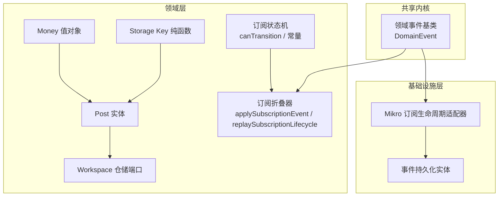
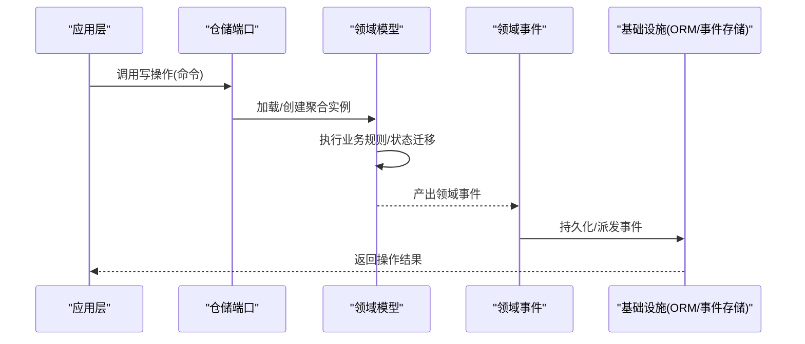
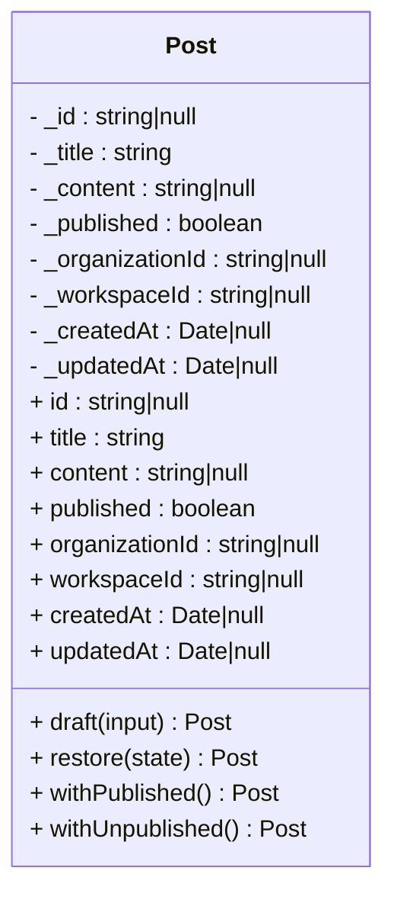
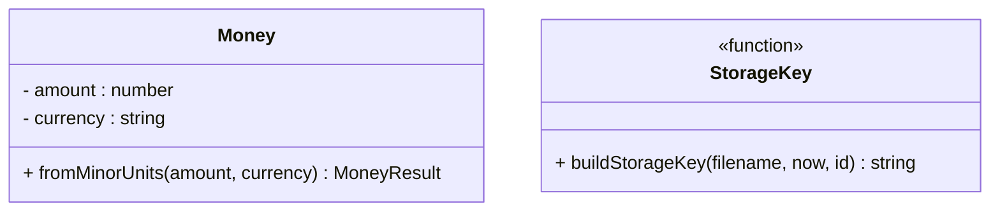
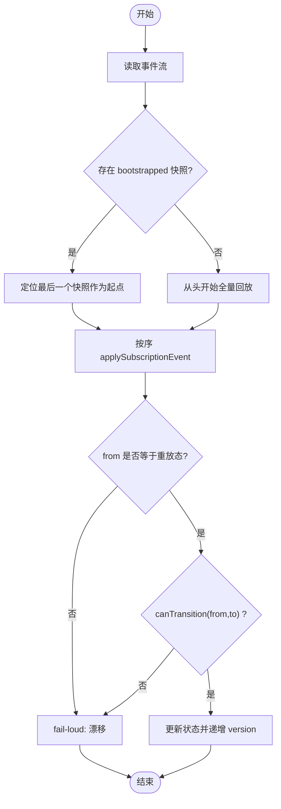
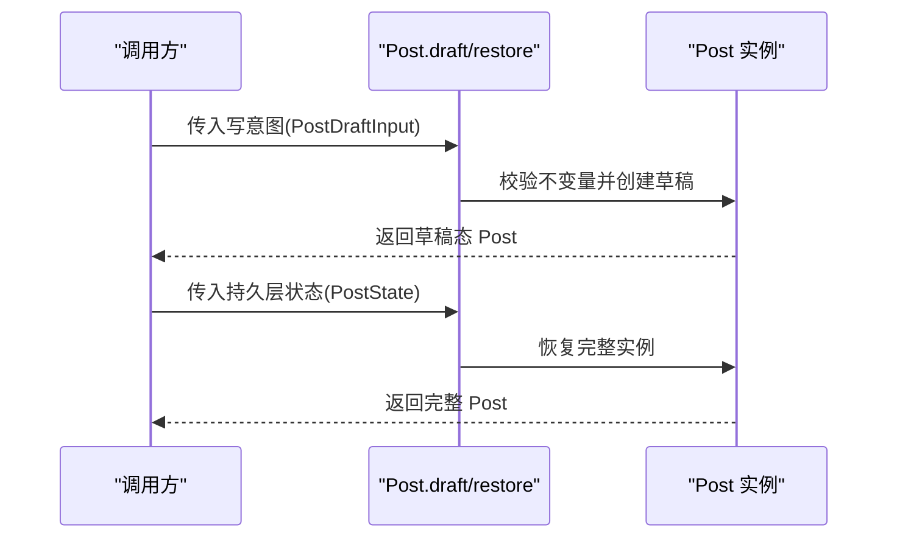
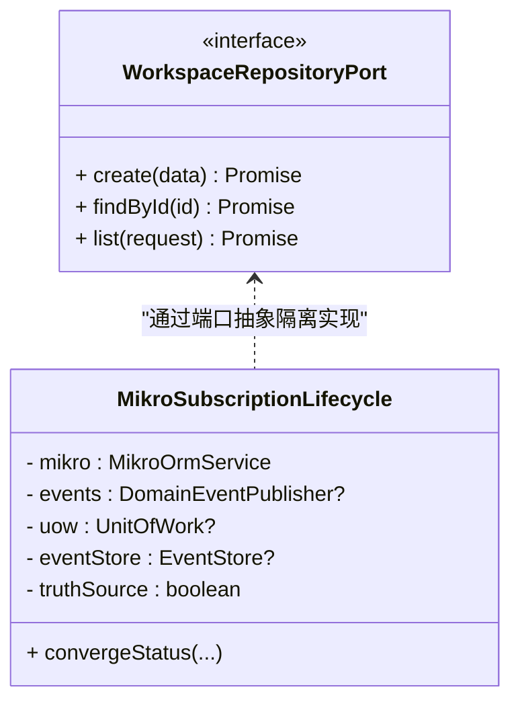
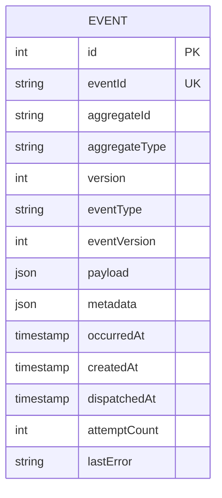
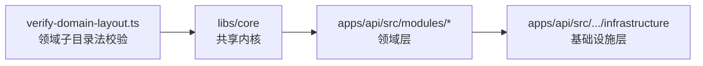

# 聚合设计

<cite>
**本文引用的文件**   
- [README.md](file://README.md)
- [domain-event.ts](file://libs/core/src/shared-kernel/domain/domain-event.ts)
- [post.ts](file://apps/api/src/modules/posts/domain/entities/post.ts)
- [money.ts](file://apps/api/src/modules/payment/domain/value-objects/money.ts)
- [storage-key.ts](file://apps/api/src/modules/storage/domain/value-objects/storage-key.ts)
- [subscription-lifecycle.ts](file://libs/core/src/modules/subscriptions/domain/subscription-lifecycle.ts)
- [subscription-lifecycle-fold.ts](file://libs/core/src/modules/subscriptions/domain/subscription-lifecycle-fold.ts)
- [mikro-subscription.lifecycle.ts](file://apps/api/src/modules/subscriptions/infrastructure/mikro-subscription.lifecycle.ts)
- [event.entity.ts](file://apps/api/src/database/eventing/entities/event.entity.ts)
- [workspace.repository.ts](file://libs/core/src/modules/workspaces/domain/repositories/workspace.repository.ts)
- [verify-domain-layout.ts](file://scripts/verify-domain-layout.ts)
</cite>

## 目录
1. [引言](#引言)
2. [项目结构](#项目结构)
3. [核心组件](#核心组件)
4. [架构总览](#架构总览)
5. [详细组件分析](#详细组件分析)
6. [依赖关系分析](#依赖关系分析)
7. [性能与一致性考量](#性能与一致性考量)
8. [故障排查指南](#故障排查指南)
9. [结论](#结论)
10. [附录：最佳实践与常见陷阱](#附录最佳实践与常见陷阱)

## 引言
本文件围绕“聚合设计”展开，结合仓库中的领域层、事件基础设施与仓储实现，系统阐述聚合根（Aggregate Root）的设计原则、边界划分、实体与值对象的关系管理、一致性与事务边界、工厂与生命周期、与仓储的交互模式，以及聚合在领域事件中的作用。文档同时给出可落地的示例路径与图示，帮助读者在不直接阅读源码的情况下理解并复用该项目的聚合建模方式。

## 项目结构
该项目采用 Clean Architecture + 垂直切片组织业务上下文，每个限界上下文内部包含 domain/application/infrastructure/api 四层；共享内核位于 libs/core，提供领域事件基类、分页、租户隔离、授权等横切能力。聚合相关代码主要分布在：
- 共享内核：领域事件基类与事件元数据契约
- 领域层：实体、值对象、仓储端口、策略与状态机
- 基础设施层：ORM 实体、事件存储、订阅生命周期适配器
- 脚本与规范：领域子目录法校验，保障领域内聚

**图表来源**
- [domain-event.ts:1-77](file://libs/core/src/shared-kernel/domain/domain-event.ts#L1-L77)
- [post.ts:1-159](file://apps/api/src/modules/posts/domain/entities/post.ts#L1-L159)
- [money.ts:1-45](file://apps/api/src/modules/payment/domain/value-objects/money.ts#L1-L45)
- [storage-key.ts:1-24](file://apps/api/src/modules/storage/domain/value-objects/storage-key.ts#L1-L24)
- [subscription-lifecycle.ts:1-70](file://libs/core/src/modules/subscriptions/domain/subscription-lifecycle.ts#L1-L70)
- [subscription-lifecycle-fold.ts:1-140](file://libs/core/src/modules/subscriptions/domain/subscription-lifecycle-fold.ts#L1-L140)
- [mikro-subscription.lifecycle.ts:40-53](file://apps/api/src/modules/subscriptions/infrastructure/mikro-subscription.lifecycle.ts#L40-L53)
- [event.entity.ts:48-64](file://apps/api/src/database/eventing/entities/event.entity.ts#L48-L64)

**章节来源**
- [README.md:78-111](file://README.md#L78-L111)

## 核心组件
本节聚焦与聚合设计直接相关的核心构件：领域事件基类、领域实体、值对象、状态机与折叠器、仓储端口与基础设施适配器。

- 领域事件基类：定义 eventId、aggregateId、aggregateType、eventType、eventVersion、occurredAt、correlationId、causationId、payload 等字段，为未来事件溯源提供稳定列集与版本演进钩子。
- 领域实体：以 Post 为例，展示两阶段构造（草稿/恢复）、不可变状态、纯转移方法（幂等迁移），以及与持久层实体的严格分离。
- 值对象：以 Money 和 Storage Key 为例，体现不可变、构造即守不变量、纯函数与结果联合返回的设计。
- 状态机与折叠器：订阅状态机提供合法迁移表与 canTransition；折叠器提供从事件流回放得到当前态的纯函数，支持“最后快照重启”。
- 仓储端口：Workspace 仓储端口明确不暴露租户参数，由适配层从可信上下文中解析 tenant，确保跨租户访问被拒绝。
- 基础设施适配器：MikroSubscriptionLifecycle 将领域状态机与事件存储、工作单元、ORM 集成，支持真相源切换（事件溯源 vs 投影）。

**章节来源**
- [domain-event.ts:1-77](file://libs/core/src/shared-kernel/domain/domain-event.ts#L1-L77)
- [post.ts:1-159](file://apps/api/src/modules/posts/domain/entities/post.ts#L1-L159)
- [money.ts:1-45](file://apps/api/src/modules/payment/domain/value-objects/money.ts#L1-L45)
- [storage-key.ts:1-24](file://apps/api/src/modules/storage/domain/value-objects/storage-key.ts#L1-L24)
- [subscription-lifecycle.ts:1-70](file://libs/core/src/modules/subscriptions/domain/subscription-lifecycle.ts#L1-L70)
- [subscription-lifecycle-fold.ts:1-140](file://libs/core/src/modules/subscriptions/domain/subscription-lifecycle-fold.ts#L1-L140)
- [workspace.repository.ts:1-21](file://libs/core/src/modules/workspaces/domain/repositories/workspace.repository.ts#L1-L21)
- [mikro-subscription.lifecycle.ts:40-53](file://apps/api/src/modules/subscriptions/infrastructure/mikro-subscription.lifecycle.ts#L40-L53)

## 架构总览
下图展示聚合在系统中的位置：应用层通过仓储端口操作领域模型，领域模型产生领域事件；基础设施层负责事件持久化与分发，并在需要时将事件流回放为可读状态。

**图表来源**
- [domain-event.ts:1-77](file://libs/core/src/shared-kernel/domain/domain-event.ts#L1-L77)
- [mikro-subscription.lifecycle.ts:40-53](file://apps/api/src/modules/subscriptions/infrastructure/mikro-subscription.lifecycle.ts#L40-L53)
- [event.entity.ts:48-64](file://apps/api/src/database/eventing/entities/event.entity.ts#L48-L64)

## 详细组件分析

### 聚合根与实体：Post 示例
Post 展示了充血领域实体的典型模式：
- 两阶段构造：draft 用于新建写意图（仅业务字段，id/租户/时间戳为空），restore 用于从持久层复原完整实例（含技术字段）。
- 不可变状态：所有属性通过 getter 暴露，无 setter。
- 纯转移方法：withPublished/withUnpublished 返回新实例或原实例（幂等），避免原地修改。
- 与持久层解耦：领域实体与 ORM 实体分离，映射逻辑在基础设施层完成。

**图表来源**
- [post.ts:1-159](file://apps/api/src/modules/posts/domain/entities/post.ts#L1-L159)

**章节来源**
- [post.ts:1-159](file://apps/api/src/modules/posts/domain/entities/post.ts#L1-L159)

### 值对象：Money 与 Storage Key
- Money：封装金额与币种，使用 result-union 表达构造成功/失败，保证构造期不变量。
- Storage Key：纯函数生成统一键命名规则，零外部依赖，便于测试与复用。

**图表来源**
- [money.ts:1-45](file://apps/api/src/modules/payment/domain/value-objects/money.ts#L1-L45)
- [storage-key.ts:1-24](file://apps/api/src/modules/storage/domain/value-objects/storage-key.ts#L1-L24)

**章节来源**
- [money.ts:1-45](file://apps/api/src/modules/payment/domain/value-objects/money.ts#L1-L45)
- [storage-key.ts:1-24](file://apps/api/src/modules/storage/domain/value-objects/storage-key.ts#L1-L24)

### 聚合一致性边界：订阅状态机与折叠器
订阅治理采用“纯函数状态机 + 事件回放折叠”的方式，确保一致性边界清晰：
- 状态机：定义合法迁移边与 canTransition 判定。
- 折叠器：对事件序列进行回放，支持“最后快照重启”，并对漂移与非法迁移 fail-loud。
- 读侧裁决形态等于 fold 重放态，写侧在追加事件前用 canTransition 前置校验。

**图表来源**
- [subscription-lifecycle.ts:1-70](file://libs/core/src/modules/subscriptions/domain/subscription-lifecycle.ts#L1-L70)
- [subscription-lifecycle-fold.ts:1-140](file://libs/core/src/modules/subscriptions/domain/subscription-lifecycle-fold.ts#L1-L140)

**章节来源**
- [subscription-lifecycle.ts:1-70](file://libs/core/src/modules/subscriptions/domain/subscription-lifecycle.ts#L1-L70)
- [subscription-lifecycle-fold.ts:1-140](file://libs/core/src/modules/subscriptions/domain/subscription-lifecycle-fold.ts#L1-L140)

### 聚合工厂与生命周期管理
- 工厂模式：Post.draft 充当聚合工厂，接收写意图输入并执行不变量校验，返回草稿态实例；Post.restore 用于从持久层恢复完整实例。
- 生命周期：Post.withPublished/withUnpublished 表示幂等的生命周期迁移；订阅场景通过状态机与折叠器管理更复杂的生命周期。

**图表来源**
- [post.ts:1-159](file://apps/api/src/modules/posts/domain/entities/post.ts#L1-L159)

**章节来源**
- [post.ts:1-159](file://apps/api/src/modules/posts/domain/entities/post.ts#L1-L159)

### 聚合与仓储（Repository）的交互模式
- 仓储端口：Workspace 仓储端口不暴露租户参数，租户归属在适配层从可信上下文中解析，确保跨租户访问被拒绝。
- 基础设施实现：MikroSubscriptionLifecycle 将领域状态机与事件存储、工作单元、ORM 集成，支持真相源切换（事件溯源 vs 投影），并通过乐观锁与同事务追加事件保证一致性。

**图表来源**
- [workspace.repository.ts:1-21](file://libs/core/src/modules/workspaces/domain/repositories/workspace.repository.ts#L1-L21)
- [mikro-subscription.lifecycle.ts:40-53](file://apps/api/src/modules/subscriptions/infrastructure/mikro-subscription.lifecycle.ts#L40-L53)

**章节来源**
- [workspace.repository.ts:1-21](file://libs/core/src/modules/workspaces/domain/repositories/workspace.repository.ts#L1-L21)
- [mikro-subscription.lifecycle.ts:40-53](file://apps/api/src/modules/subscriptions/infrastructure/mikro-subscription.lifecycle.ts#L40-L53)

### 聚合在领域事件中的作用
- 事件元数据：eventId、aggregateId、aggregateType、eventType、eventVersion、occurredAt、correlationId、causationId 构成稳定的事件信封，支撑事件溯源与跨请求追踪。
- 事件持久化：Event 实体承载事件流的物理列，包括 attemptCount、lastError、dispatchedAt 等，支持重试与审计。
- 事件驱动流程：订阅生命周期适配器在写入聚合状态的同时追加事件，后续消费者基于事件流重建状态。

**图表来源**
- [event.entity.ts:48-64](file://apps/api/src/database/eventing/entities/event.entity.ts#L48-L64)
- [domain-event.ts:1-77](file://libs/core/src/shared-kernel/domain/domain-event.ts#L1-L77)

**章节来源**
- [event.entity.ts:48-64](file://apps/api/src/database/eventing/entities/event.entity.ts#L48-L64)
- [domain-event.ts:1-77](file://libs/core/src/shared-kernel/domain/domain-event.ts#L1-L77)

## 依赖关系分析
领域层保持零框架依赖，基础设施层负责与 NestJS、ORM、事件存储等集成。领域子目录法校验脚本确保领域内聚与边界清晰。

**图表来源**
- [verify-domain-layout.ts:17-45](file://scripts/verify-domain-layout.ts#L17-L45)
- [README.md:78-111](file://README.md#L78-L111)

**章节来源**
- [verify-domain-layout.ts:17-45](file://scripts/verify-domain-layout.ts#L17-L45)
- [README.md:78-111](file://README.md#L78-L111)

## 性能与一致性考量
- 纯函数与不可变数据：减少副作用与竞态条件，提升可测性与可组合性。
- 事件溯源与折叠：通过回放事件重建状态，避免复杂查询与多表关联；“最后快照重启”降低回放成本。
- 乐观锁与同事务追加：在追加事件时携带 expectedVersion，确保并发安全与顺序一致。
- 仓储端口隔离租户：租户解析在适配层完成，避免调用方越权访问，降低跨租户扫描开销。

[本节为通用指导，无需特定文件引用]

## 故障排查指南
- 事件漂移：当回放事件中 from 与重放态不一致时，折叠器会 fail-loud，需检查事件顺序与版本。
- 非法迁移：canTransition 不允许的状态转换会被拒绝，需核对状态机迁移表。
- 未知事件类型：回放遇到未注册 eventType 会抛错，需检查事件注册与聚合类型匹配。
- 租户隔离异常：若出现跨租户访问，检查仓储端口调用是否绕过适配层或在适配层错误地注入租户上下文。

**章节来源**
- [subscription-lifecycle-fold.ts:1-140](file://libs/core/src/modules/subscriptions/domain/subscription-lifecycle-fold.ts#L1-L140)
- [subscription-lifecycle.ts:1-70](file://libs/core/src/modules/subscriptions/domain/subscription-lifecycle.ts#L1-L70)
- [workspace.repository.ts:1-21](file://libs/core/src/modules/workspaces/domain/repositories/workspace.repository.ts#L1-L21)

## 结论
本项目在聚合设计上遵循 Clean Architecture 与函数式领域内核原则：聚合根与实体保持不可变与纯转移，值对象封装领域概念与不变量，状态机与折叠器确保一致性边界清晰，仓储端口隔离基础设施细节与租户上下文，领域事件提供稳定契约与溯源能力。通过这些模式，系统在可扩展性、可维护性与一致性之间取得良好平衡。

[本节为总结性内容，无需特定文件引用]

## 附录：最佳实践与常见陷阱
- 最佳实践
  - 聚合根只暴露必要的业务方法，内部状态变更通过纯转移方法返回新实例。
  - 值对象应不可变且构造即守不变量，必要时使用结果联合表达失败原因。
  - 仓储端口定义清晰的读写语义，租户与权限在适配层处理。
  - 领域事件携带稳定元数据，eventType 与 aggregateType 作为路由键。
  - 使用折叠器实现“回放即真相”，避免复杂查询与状态同步问题。
- 常见陷阱
  - 在领域层引入框架依赖，破坏依赖方向与可测性。
  - 在仓储接口中暴露租户参数，导致跨租户访问风险。
  - 忽略事件版本与漂移校验，导致回放不一致。
  - 在实体中直接操作持久层或 HTTP 层，造成职责混乱。
  - 状态机迁移表不完整，导致非法迁移未被拦截。

[本节为通用指导，无需特定文件引用]