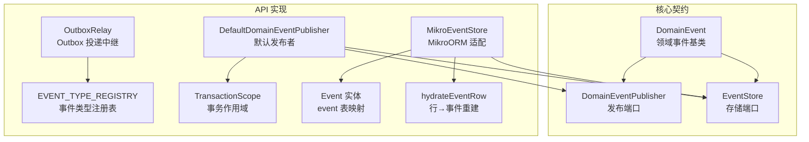
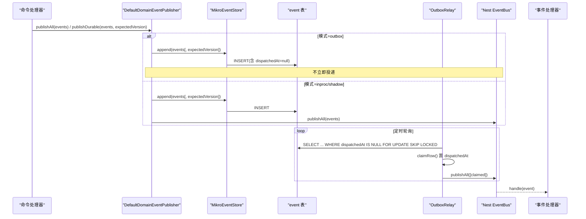
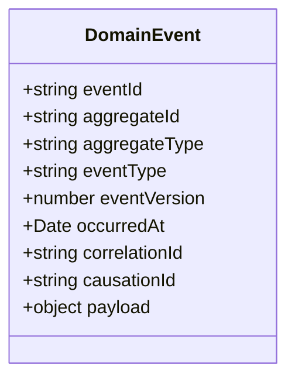
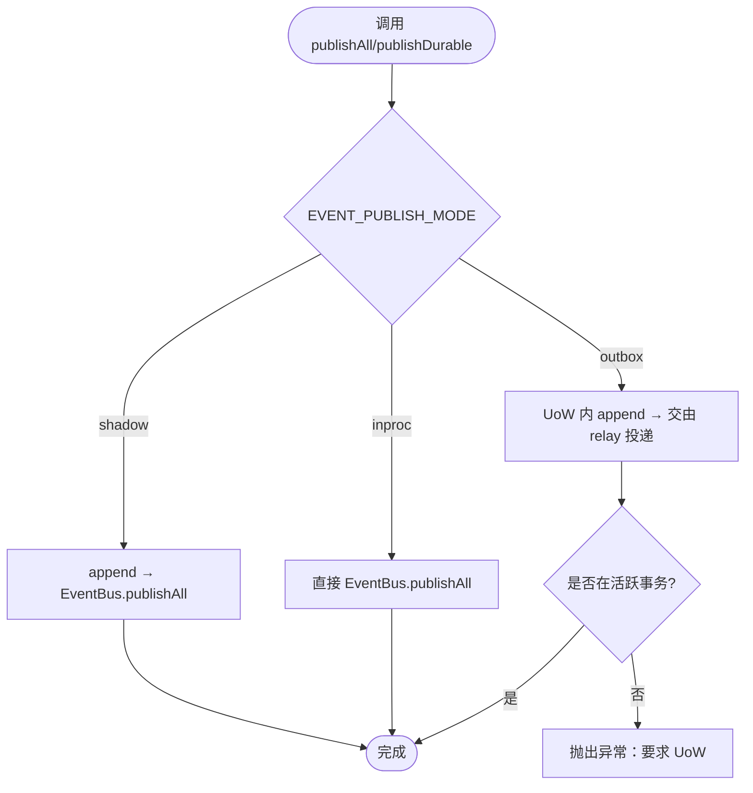
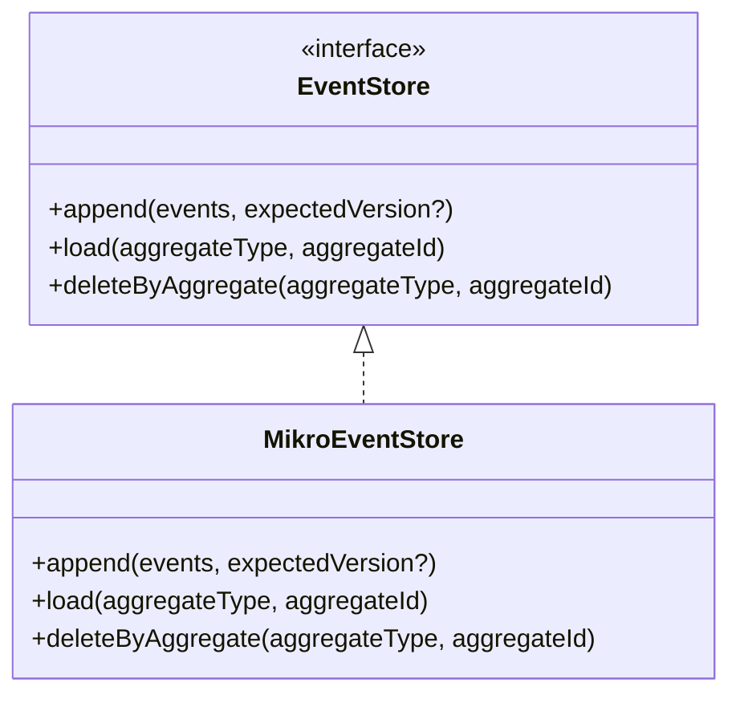
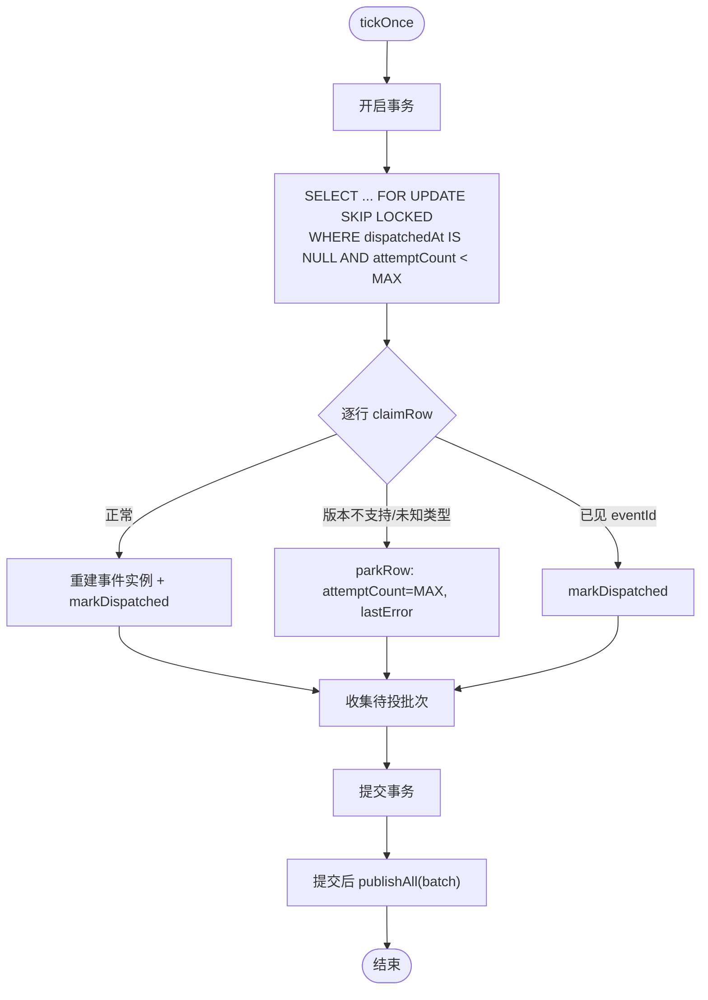
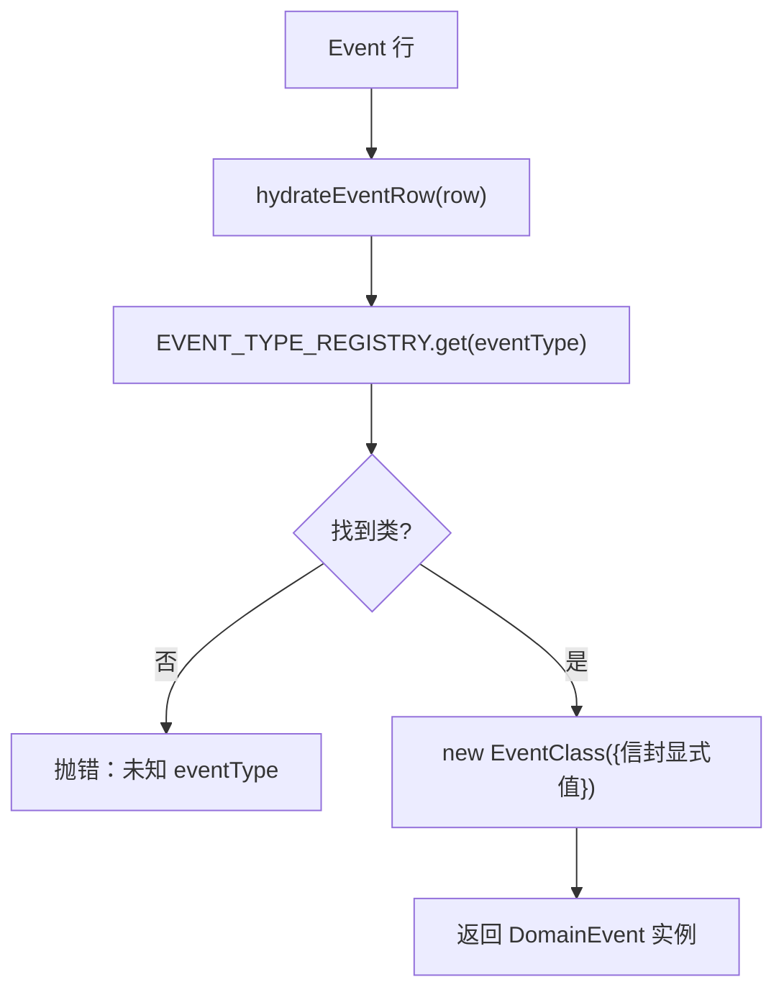
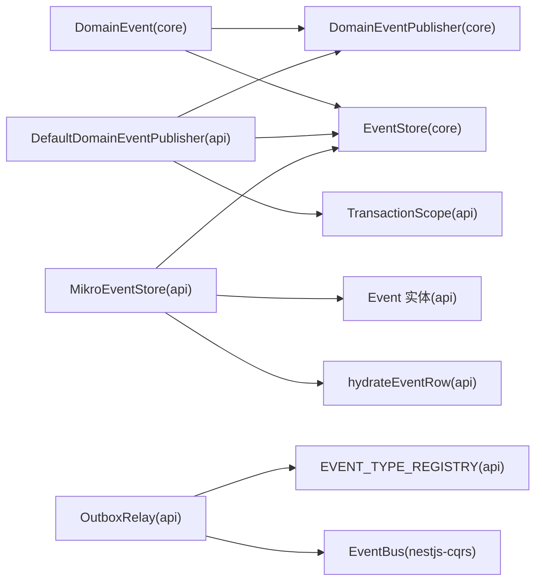

# 领域事件

<cite>
**本文引用的文件**   
- [domain-event.ts](file://libs/core/src/shared-kernel/domain/domain-event.ts)
- [event-publisher.port.ts](file://libs/core/src/shared-kernel/domain/event-publisher.port.ts)
- [event-store.port.ts](file://libs/core/src/shared-kernel/domain/event-store.port.ts)
- [domain-event-publisher.ts](file://apps/api/src/database/eventing/domain-event-publisher.ts)
- [mikro-event-store.ts](file://apps/api/src/database/eventing/mikro-event-store.ts)
- [outbox-relay.ts](file://apps/api/src/database/eventing/outbox-relay.ts)
- [event-type-registry.ts](file://apps/api/src/database/eventing/event-type-registry.ts)
- [event.entity.ts](file://apps/api/src/database/eventing/entities/event.entity.ts)
- [event-hydration.ts](file://apps/api/src/database/eventing/event-hydration.ts)
- [transaction-scope.ts](file://apps/api/src/database/eventing/transaction-scope.ts)
</cite>

## 目录
1. [引言](#引言)
2. [项目结构](#项目结构)
3. [核心组件](#核心组件)
4. [架构总览](#架构总览)
5. [详细组件分析](#详细组件分析)
6. [依赖关系分析](#依赖关系分析)
7. [性能与一致性](#性能与一致性)
8. [版本管理与向后兼容](#版本管理与向后兼容)
9. [错误处理与重试机制](#错误处理与重试机制)
10. [最佳实践](#最佳实践)
11. [故障排查指南](#故障排查指南)
12. [结论](#结论)

## 引言
本文件系统性梳理仓库中的领域事件体系，覆盖设计模式、实现机制、发布订阅、事件溯源（Event Sourcing）、事件存储（Event Store）、版本管理、向后兼容、完整生命周期以及最佳实践。读者无需深入代码即可理解从“产生事件”到“持久化、投递、消费、回放”的端到端流程。

## 项目结构
领域事件相关能力集中在以下位置：
- 核心契约层：定义领域事件基类、事件发布端口、事件存储端口。
- API 应用层：提供默认事件发布者、MikroORM 事件存储、Outbox 投递中继、事件类型注册表、事务作用域、事件实体模型与反序列化工具。

**图表来源**
- [domain-event.ts:45-76](file://libs/core/src/shared-kernel/domain/domain-event.ts#L45-L76)
- [event-publisher.port.ts:16-42](file://libs/core/src/shared-kernel/domain/event-publisher.port.ts#L16-L42)
- [event-store.port.ts:30-59](file://libs/core/src/shared-kernel/domain/event-store.port.ts#L30-L59)
- [domain-event-publisher.ts:23-71](file://apps/api/src/database/eventing/domain-event-publisher.ts#L23-L71)
- [mikro-event-store.ts:33-108](file://apps/api/src/database/eventing/mikro-event-store.ts#L33-L108)
- [outbox-relay.ts:37-189](file://apps/api/src/database/eventing/outbox-relay.ts#L37-L189)
- [event-type-registry.ts:22-38](file://apps/api/src/database/eventing/event-type-registry.ts#L22-L38)
- [event.entity.ts:11-64](file://apps/api/src/database/eventing/entities/event.entity.ts#L11-L64)
- [event-hydration.ts:23-49](file://apps/api/src/database/eventing/event-hydration.ts#L23-L49)
- [transaction-scope.ts:15-27](file://apps/api/src/database/eventing/transaction-scope.ts#L15-L27)

**章节来源**
- [domain-event.ts:1-76](file://libs/core/src/shared-kernel/domain/domain-event.ts#L1-L76)
- [event-publisher.port.ts:1-43](file://libs/core/src/shared-kernel/domain/event-publisher.port.ts#L1-L43)
- [event-store.port.ts:1-60](file://libs/core/src/shared-kernel/domain/event-store.port.ts#L1-L60)
- [domain-event-publisher.ts:1-73](file://apps/api/src/database/eventing/domain-event-publisher.ts#L1-L73)
- [mikro-event-store.ts:1-110](file://apps/api/src/database/eventing/mikro-event-store.ts#L1-L110)
- [outbox-relay.ts:1-190](file://apps/api/src/database/eventing/outbox-relay.ts#L1-L190)
- [event-type-registry.ts:1-39](file://apps/api/src/database/eventing/event-type-registry.ts#L1-L39)
- [event.entity.ts:1-65](file://apps/api/src/database/eventing/entities/event.entity.ts#L1-L65)
- [event-hydration.ts:1-50](file://apps/api/src/database/eventing/event-hydration.ts#L1-L50)
- [transaction-scope.ts:1-28](file://apps/api/src/database/eventing/transaction-scope.ts#L1-L28)

## 核心组件
- 领域事件基类 DomainEvent：承载聚合标识、事件名、负载、时间戳、关联/因果链等信封字段，并提供默认 id、时间戳生成策略。
- 事件发布端口 DomainEventPublisher：抽象进程内派发与“耐久真相优先”的发布形态，屏蔽底层实现差异。
- 事件存储端口 EventStore：抽象追加、回放读取、级联补删等原语，约定 fail-loud 语义与乐观锁行为。
- 默认发布者 DefaultDomainEventPublisher：根据配置在 inproc/shadow/outbox 三种模式间切换，并支持带乐观锁的 durable 发布。
- 事件存储 MikroEventStore：基于 MikroORM 的 event 表实现 append/load/deleteByAggregate，维护流内 version 递增与唯一键约束。
- Outbox 投递中继 OutboxRelay：定时拉取未投递事件，事务内 claim 后提交再尽力投递，保证“不提交不投递”。
- 事件类型注册表 EVENT_TYPE_REGISTRY：eventType → 事件类的单源映射，保障 relay 与 load 的反序列化一致性。
- 事务作用域 TransactionScope：通过 AsyncLocalStorage 暴露当前事务 EntityManager，确保写聚合与写事件同事务。
- 事件实体 Event：event 表的运行时实体与列元数据，包含 outbox 投递状态字段与索引。
- 事件反序列化 hydrateEventRow：将数据库行还原为领域事件实例，透传信封显式值。

**章节来源**
- [domain-event.ts:15-76](file://libs/core/src/shared-kernel/domain/domain-event.ts#L15-L76)
- [event-publisher.port.ts:16-42](file://libs/core/src/shared-kernel/domain/event-publisher.port.ts#L16-L42)
- [event-store.port.ts:30-59](file://libs/core/src/shared-kernel/domain/event-store.port.ts#L30-L59)
- [domain-event-publisher.ts:23-71](file://apps/api/src/database/eventing/domain-event-publisher.ts#L23-L71)
- [mikro-event-store.ts:33-108](file://apps/api/src/database/eventing/mikro-event-store.ts#L33-L108)
- [outbox-relay.ts:37-189](file://apps/api/src/database/eventing/outbox-relay.ts#L37-L189)
- [event-type-registry.ts:22-38](file://apps/api/src/database/eventing/event-type-registry.ts#L22-L38)
- [transaction-scope.ts:15-27](file://apps/api/src/database/eventing/transaction-scope.ts#L15-L27)
- [event.entity.ts:11-64](file://apps/api/src/database/eventing/entities/event.entity.ts#L11-L64)
- [event-hydration.ts:23-49](file://apps/api/src/database/eventing/event-hydration.ts#L23-L49)

## 架构总览
领域事件采用“端口 + 实现”的分层设计：核心只声明契约，API 层提供具体实现；同时以 Outbox 模式解耦“写入事件”和“投递事件”，并通过事件溯源提供回放能力。

**图表来源**
- [domain-event-publisher.ts:33-71](file://apps/api/src/database/eventing/domain-event-publisher.ts#L33-L71)
- [mikro-event-store.ts:37-68](file://apps/api/src/database/eventing/mikro-event-store.ts#L37-L68)
- [outbox-relay.ts:57-129](file://apps/api/src/database/eventing/outbox-relay.ts#L57-L129)

## 详细组件分析

### 领域事件基类与负载类型
- DomainEvent 提供统一信封字段：eventId、aggregateId、aggregateType、eventType、eventVersion、occurredAt、correlationId、causationId、payload。
- 构造时若未传入 eventId/occurredAt，则分别使用 uuidv7 与当前时间填充；eventVersion 缺省为 1。
- 负载 payload 是强类型对象，由具体事件类定义其结构，便于校验与回放。

**图表来源**
- [domain-event.ts:45-76](file://libs/core/src/shared-kernel/domain/domain-event.ts#L45-L76)

**章节来源**
- [domain-event.ts:15-76](file://libs/core/src/shared-kernel/domain/domain-event.ts#L15-L76)

### 事件发布端口与默认实现
- DomainEventPublisher 定义两类发布方法：
  - publishAll：按配置模式决定是否落库与是否立即投递。
  - publishDurable：总是先带乐观锁 append，再按模式决定投递（outbox 不即时投递）。
- DefaultDomainEventPublisher 支持三种模式：
  - inproc：仅进程内总线，不落库。
  - shadow：先 append 再立即投递。
  - outbox：仅在活跃 UoW 内 append，交由 OutboxRelay 异步投递。

**图表来源**
- [domain-event-publisher.ts:33-71](file://apps/api/src/database/eventing/domain-event-publisher.ts#L33-L71)
- [transaction-scope.ts:15-27](file://apps/api/src/database/eventing/transaction-scope.ts#L15-L27)

**章节来源**
- [event-publisher.port.ts:16-42](file://libs/core/src/shared-kernel/domain/event-publisher.port.ts#L16-L42)
- [domain-event-publisher.ts:23-71](file://apps/api/src/database/eventing/domain-event-publisher.ts#L23-L71)

### 事件存储端口与 MikroORM 实现
- EventStore 定义 append/load/deleteByAggregate 三个原语，约定空批 noop、唯一键冲突 fail-loud。
- MikroEventStore 实现：
  - append：计算流内 version=max+1，可选 expectedVersion 乐观锁校验，INSERT 直发。
  - load：按 version 升序读取，经 EVENT_TYPE_REGISTRY 重建事件实例。
  - deleteByAggregate：原生 DELETE 清理指定聚合全部事件行。

**图表来源**
- [event-store.port.ts:30-59](file://libs/core/src/shared-kernel/domain/event-store.port.ts#L30-L59)
- [mikro-event-store.ts:33-108](file://apps/api/src/database/eventing/mikro-event-store.ts#L33-L108)

**章节来源**
- [event-store.port.ts:1-60](file://libs/core/src/shared-kernel/domain/event-store.port.ts#L1-L60)
- [mikro-event-store.ts:1-110](file://apps/api/src/database/eventing/mikro-event-store.ts#L1-L110)

### Outbox 投递中继
- OutboxRelay 周期性轮询未投递事件，事务内以悲观锁 + SKIP LOCKED 取批，逐行 claim（置 dispatchedAt），提交后再尽力投递至 EventBus。
- 关键保证：
  - 不提交不投递，避免幻影事件。
  - 对未知 eventType 或超出 SUPPORTED_EVENT_VERSION 的行进行 parkRow（attemptCount 顶上限，lastError 留痕）。
  - 已投递 eventId 去重窗（LRU）避免重复投递。

**图表来源**
- [outbox-relay.ts:81-129](file://apps/api/src/database/eventing/outbox-relay.ts#L81-L129)
- [outbox-relay.ts:131-189](file://apps/api/src/database/eventing/outbox-relay.ts#L131-L189)

**章节来源**
- [outbox-relay.ts:1-190](file://apps/api/src/database/eventing/outbox-relay.ts#L1-L190)

### 事件类型注册表与反序列化
- EVENT_TYPE_REGISTRY 集中维护 eventType → 事件类的映射，供 OutboxRelay 与 store.load 使用，避免运行期反射漂移。
- hydrateEventRow 将数据库行还原为领域事件实例，透传信封显式值（eventId/occurredAt/correlationId/causationId），未知 eventType 直接 fail-loud。

**图表来源**
- [event-hydration.ts:23-49](file://apps/api/src/database/eventing/event-hydration.ts#L23-L49)
- [event-type-registry.ts:22-38](file://apps/api/src/database/eventing/event-type-registry.ts#L22-L38)

**章节来源**
- [event-hydration.ts:1-50](file://apps/api/src/database/eventing/event-hydration.ts#L1-L50)
- [event-type-registry.ts:1-39](file://apps/api/src/database/eventing/event-type-registry.ts#L1-L39)

### 事务作用域与同事务写聚合与事件
- TransactionScope 通过 AsyncLocalStorage 持有当前事务 EntityManager，供发布器判断是否在 UoW 内，从而强制 outbox 模式的事务边界。
- 该机制使“写聚合 + 写事件”共享同一事务，保证原子性。

**章节来源**
- [transaction-scope.ts:1-28](file://apps/api/src/database/eventing/transaction-scope.ts#L1-L28)
- [domain-event-publisher.ts:23-46](file://apps/api/src/database/eventing/domain-event-publisher.ts#L23-L46)

### 事件实体与索引
- Event 实体定义 event 表结构，包含投递状态字段（dispatchedAt、attemptCount、lastError）及必要索引（聚合流、投递查询）。
- 唯一键保障：
  - (aggregateType, aggregateId, version) 防止重复追加。
  - eventId 全局唯一。

**章节来源**
- [event.entity.ts:11-64](file://apps/api/src/database/eventing/entities/event.entity.ts#L11-L64)

## 依赖关系分析
- 核心契约（core）仅依赖基础工具，不包含 Nest/ORM 依赖。
- API 实现层依赖 core 契约与 MikroORM/Nest CQRS。
- OutboxRelay 依赖事件类型注册表与 EventBus。
- 默认发布者依赖配置服务、事件存储端口、事务作用域与 EventBus。

**图表来源**
- [domain-event.ts:45-76](file://libs/core/src/shared-kernel/domain/domain-event.ts#L45-L76)
- [event-publisher.port.ts:16-42](file://libs/core/src/shared-kernel/domain/event-publisher.port.ts#L16-L42)
- [event-store.port.ts:30-59](file://libs/core/src/shared-kernel/domain/event-store.port.ts#L30-L59)
- [domain-event-publisher.ts:23-71](file://apps/api/src/database/eventing/domain-event-publisher.ts#L23-L71)
- [mikro-event-store.ts:33-108](file://apps/api/src/database/eventing/mikro-event-store.ts#L33-L108)
- [outbox-relay.ts:37-189](file://apps/api/src/database/eventing/outbox-relay.ts#L37-L189)
- [event-type-registry.ts:22-38](file://apps/api/src/database/eventing/event-type-registry.ts#L22-L38)
- [event.entity.ts:11-64](file://apps/api/src/database/eventing/entities/event.entity.ts#L11-L64)
- [event-hydration.ts:23-49](file://apps/api/src/database/eventing/event-hydration.ts#L23-L49)
- [transaction-scope.ts:15-27](file://apps/api/src/database/eventing/transaction-scope.ts#L15-L27)

**章节来源**
- [domain-event-publisher.ts:1-73](file://apps/api/src/database/eventing/domain-event-publisher.ts#L1-L73)
- [mikro-event-store.ts:1-110](file://apps/api/src/database/eventing/mikro-event-store.ts#L1-L110)
- [outbox-relay.ts:1-190](file://apps/api/src/database/eventing/outbox-relay.ts#L1-L190)

## 性能与一致性
- append 批量写入：空批直接返回，减少无意义 IO。
- 流内 version 递增：每次查询流最大 version+1，避免并发冲突（配合唯一键 fail-loud）。
- OutboxRelay 批量拉取：BATCH_SIZE 控制每拍处理量，SKIP LOCKED 多实例安全。
- 投递幂等：eventId 去重窗避免重复投递；消费者仍需自身幂等。
- 乐观锁：expectedVersion 校验失败整批不写，避免脏写。

[本节为通用指导，不直接分析具体文件]

## 版本管理与向后兼容
- eventVersion：事件 schema 版本，用于 upcaster 识别与兼容处理。
- SUPPORTED_EVENT_VERSION：OutboxRelay 拒绝高于支持版本的信封，将其 parkRow 并记录 lastError，避免未知格式破坏投递。
- EVENT_TYPE_REGISTRY：新增事件必须登记，否则 relay 与 load 均 fail-loud，提前发现漂移。
- 建议：
  - 新增字段保持向后兼容（可空、有默认值）。
  - 变更枚举需双向锁定（契约测试）。
  - 升级 eventVersion 并在消费者侧做兼容逻辑。

**章节来源**
- [outbox-relay.ts:37-42](file://apps/api/src/database/eventing/outbox-relay.ts#L37-L42)
- [outbox-relay.ts:131-144](file://apps/api/src/database/eventing/outbox-relay.ts#L131-L144)
- [event-type-registry.ts:11-21](file://apps/api/src/database/eventing/event-type-registry.ts#L11-L21)
- [domain-event.ts:26-27](file://libs/core/src/shared-kernel/domain/domain-event.ts#L26-L27)

## 错误处理与重试机制
- append 唯一键冲突：fail-loud，不静默吞、不重试覆盖。
- OutboxRelay：
  - 未知 eventType 或超版本：parkRow（attemptCount=MAX，lastError 记录原因）。
  - 投递失败：best-effort，不更新 attemptCount（因为总线无 ack），但 claim 已提交，下次不再重投。
- 消费者幂等：at-least-once 投递下，消费者应依据业务主键或幂等键去重。

**章节来源**
- [mikro-event-store.ts:37-68](file://apps/api/src/database/eventing/mikro-event-store.ts#L37-L68)
- [outbox-relay.ts:131-189](file://apps/api/src/database/eventing/outbox-relay.ts#L131-L189)

## 最佳实践
- 事件命名规范：
  - 使用稳定字符串作为 eventType，集中常量管理（DOMAIN_EVENTS）。
  - 事件类静态常量 EVENT_TYPE 与注册表保持一致。
- 事件负载：
  - payload 使用强类型对象，必要时结合 schema 校验。
  - 新增字段保持向后兼容。
- 错误处理：
  - 所有 I/O 失败 fail-loud，不在上层静默吞错。
  - OutboxRelay 对毒行 parkRow，保留 lastError 以便人工介入。
- 重试机制：
  - OutboxRelay 对已知毒行停止重试；对投递失败不做 attemptCount 更新（总线无 ack）。
  - 消费者自行实现幂等与重试策略。
- 版本管理：
  - 谨慎升级 eventVersion，配合 upcaster 与消费者兼容逻辑。
  - 通过 EVENT_TYPE_REGISTRY 与契约测试锁定事件名与枚举值。

[本节为通用指导，不直接分析具体文件]

## 故障排查指南
- 现象：事件未投递
  - 检查 EVENT_PUBLISH_MODE 是否为 outbox，且调用是否在 UoW 内。
  - 查看 event 表中 dispatchedAt 是否为 null，attemptCount 是否已达上限。
  - 确认 EVENT_TYPE_REGISTRY 是否登记了对应 eventType。
- 现象：事件重复投递
  - 检查消费者是否实现幂等（如基于 eventId 或业务键）。
  - 确认 OutboxRelay 的 seenEventIds 去重窗是否生效。
- 现象：回放失败
  - 检查 load 是否遇到未知 eventType（会 fail-loud）。
  - 核对 eventVersion 与 upcaster 兼容性。

**章节来源**
- [domain-event-publisher.ts:33-71](file://apps/api/src/database/eventing/domain-event-publisher.ts#L33-L71)
- [outbox-relay.ts:57-129](file://apps/api/src/database/eventing/outbox-relay.ts#L57-L129)
- [event-hydration.ts:23-49](file://apps/api/src/database/eventing/event-hydration.ts#L23-L49)

## 结论
本项目的领域事件体系以清晰的端口契约为核心，结合 Outbox 模式与事件溯源，实现了高内聚、低耦合、可扩展的事件驱动架构。通过严格的事务边界、乐观锁、fail-loud 语义与完善的版本管理，系统在可靠性与可演进性之间取得平衡。遵循本文的最佳实践与排障建议，可在实际项目中稳健落地领域事件。