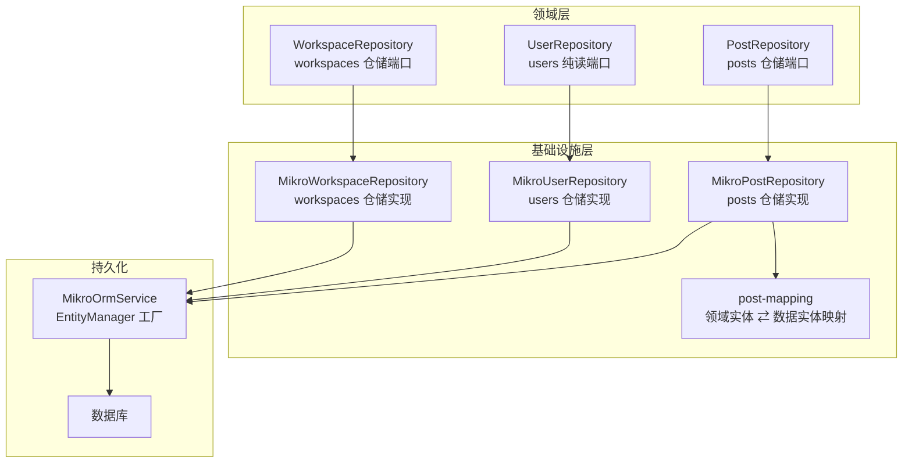
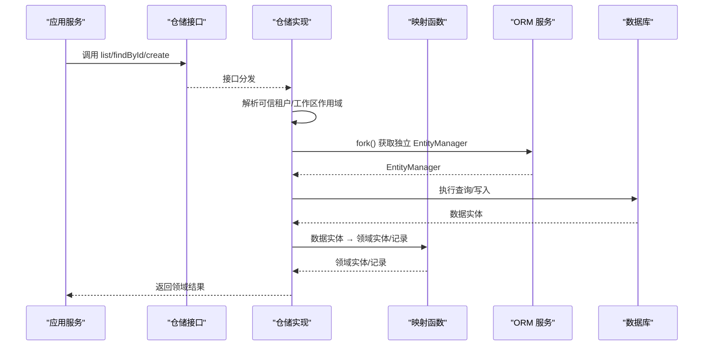
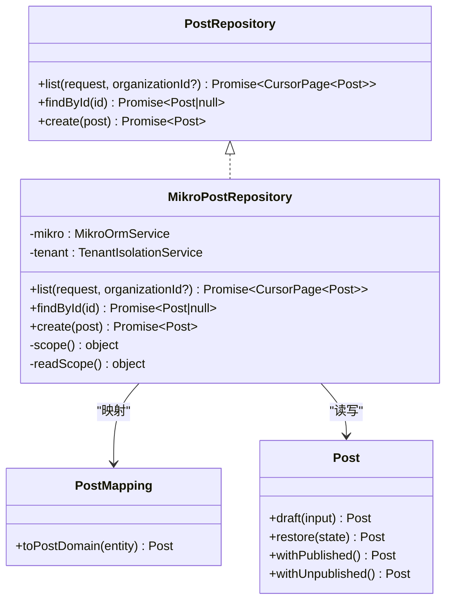
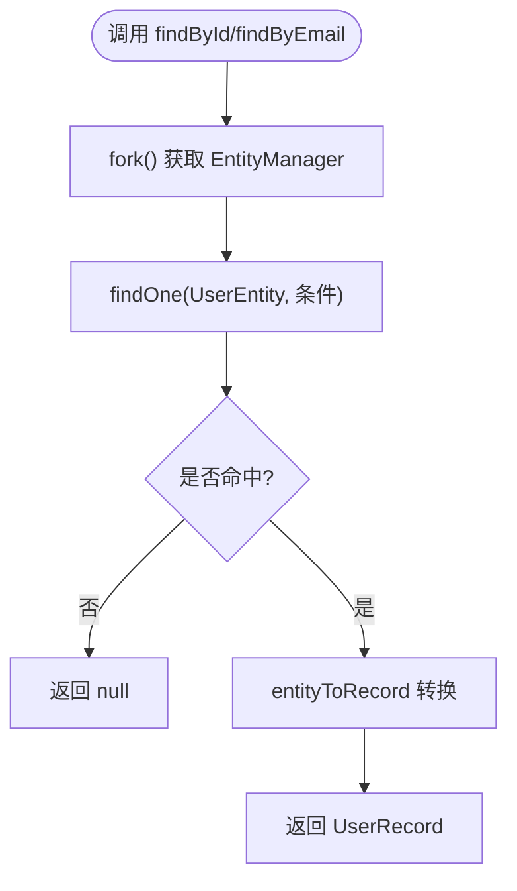
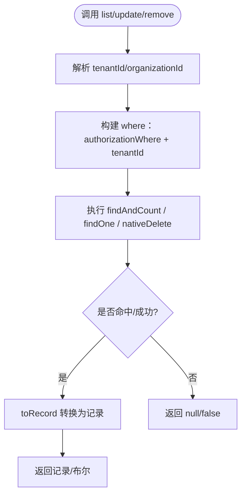
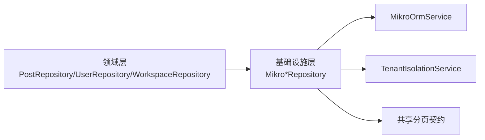
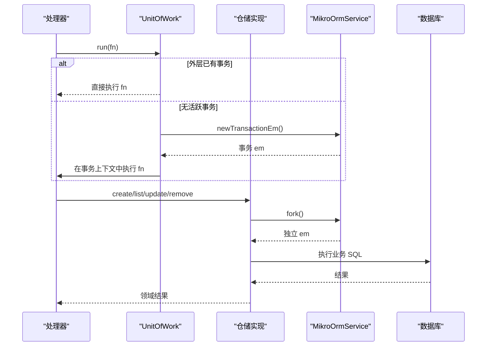

# 领域仓储

<cite>
**本文引用的文件**   
- [apps/api/src/modules/posts/domain/repositories/post.repository.ts](file://apps/api/src/modules/posts/domain/repositories/post.repository.ts)
- [apps/api/src/modules/posts/infrastructure/repositories/mikro-post.repository.ts](file://apps/api/src/modules/posts/infrastructure/repositories/mikro-post.repository.ts)
- [apps/api/src/modules/posts/infrastructure/repositories/post-mapping.ts](file://apps/api/src/modules/posts/infrastructure/repositories/post-mapping.ts)
- [apps/api/src/modules/posts/domain/entities/post.ts](file://apps/api/src/modules/posts/domain/entities/post.ts)
- [apps/api/src/modules/users/domain/repositories/user.repository.ts](file://apps/api/src/modules/users/domain/repositories/user.repository.ts)
- [apps/api/src/modules/users/infrastructure/repositories/mikro-user.repository.ts](file://apps/api/src/modules/users/infrastructure/repositories/mikro-user.repository.ts)
- [libs/core/src/modules/workspaces/domain/repositories/workspace.repository.ts](file://libs/core/src/modules/workspaces/domain/repositories/workspace.repository.ts)
- [apps/api/src/modules/workspaces/infrastructure/repositories/mikro-workspace.repository.ts](file://apps/api/src/modules/workspaces/infrastructure/repositories/mikro-workspace.repository.ts)
- [apps/api/src/database/eventing/mikro-unit-of-work.ts](file://apps/api/src/database/eventing/mikro-unit-of-work.ts)
- [apps/api/src/database/mikro/mikro-orm.module.ts](file://apps/api/src/database/mikro/mikro-orm.module.ts)
</cite>

## 目录
1. [引言](#引言)
2. [项目结构中的仓储位置](#项目结构中的仓储位置)
3. [核心设计原则](#核心设计原则)
4. [架构总览](#架构总览)
5. [详细组件分析](#详细组件分析)
6. [依赖关系分析](#依赖关系分析)
7. [事务、并发与一致性](#事务并发与一致性)
8. [测试策略](#测试策略)
9. [性能与可维护性建议](#性能与可维护性建议)
10. [故障排查](#故障排查)
11. [结论](#结论)

## 引言
本文件围绕仓库中“领域仓储”的设计与实现，系统性说明仓储模式在领域驱动设计中的作用：抽象数据访问逻辑、隔离持久化细节、保护领域模型完整性，并通过明确的接口规范承载 CRUD、复杂查询与业务方法。同时给出仓储实现层如何借助 ORM 适配器完成数据映射、事务管理、并发控制与一致性保证，并总结面向内存仓储、模拟仓储的测试策略，展示仓储与实际数据库操作的解耦能力。

## 项目结构中的仓储位置
仓储在本仓库中遵循“领域定义端口 + 基础设施实现”的分层组织方式：
- 领域层定义仓储接口、领域实体或记录类型、分页契约等。
- 基础设施层提供基于 MikroORM 的具体仓储实现，负责实体到领域模型的映射、租户隔离、分页与落库。
- 应用层通过依赖注入使用仓储接口，不感知具体 ORM 实现。

图表来源
- [apps/api/src/modules/posts/domain/repositories/post.repository.ts:1-51](file://apps/api/src/modules/posts/domain/repositories/post.repository.ts#L1-L51)
- [apps/api/src/modules/posts/infrastructure/repositories/mikro-post.repository.ts:1-140](file://apps/api/src/modules/posts/infrastructure/repositories/mikro-post.repository.ts#L1-L140)
- [apps/api/src/modules/posts/infrastructure/repositories/post-mapping.ts:1-40](file://apps/api/src/modules/posts/infrastructure/repositories/post-mapping.ts#L1-L40)
- [apps/api/src/modules/users/domain/repositories/user.repository.ts:1-62](file://apps/api/src/modules/users/domain/repositories/user.repository.ts#L1-L62)
- [apps/api/src/modules/users/infrastructure/repositories/mikro-user.repository.ts:1-50](file://apps/api/src/modules/users/infrastructure/repositories/mikro-user.repository.ts#L1-L50)
- [libs/core/src/modules/workspaces/domain/repositories/workspace.repository.ts:1-108](file://libs/core/src/modules/workspaces/domain/repositories/workspace.repository.ts#L1-L108)
- [apps/api/src/modules/workspaces/infrastructure/repositories/mikro-workspace.repository.ts:1-136](file://apps/api/src/modules/workspaces/infrastructure/repositories/mikro-workspace.repository.ts#L1-L136)

章节来源
- [apps/api/src/modules/posts/domain/repositories/post.repository.ts:1-51](file://apps/api/src/modules/posts/domain/repositories/post.repository.ts#L1-L51)
- [apps/api/src/modules/users/domain/repositories/user.repository.ts:1-62](file://apps/api/src/modules/users/domain/repositories/user.repository.ts#L1-L62)
- [libs/core/src/modules/workspaces/domain/repositories/workspace.repository.ts:1-108](file://libs/core/src/modules/workspaces/domain/repositories/workspace.repository.ts#L1-L108)

## 核心设计原则
- 依赖倒置与端口优先：仓储接口位于领域层，作为 DI token 暴露；具体实现放在基础设施层，避免领域层依赖框架。
- 租户隔离卡点：仓储接口不暴露租户参数，租户与工作区选择器由可信上下文解析并在适配层强制注入谓词，防止调用方越权。
- 领域模型保护：仓储读写以领域实体或不可变记录为边界，禁止传输对象进入领域层，禁止技术字段污染领域语义。
- 单一映射点：领域实体与数据实体的映射集中在基础设施层的映射函数，编译期一致性闸保障列变更同步。
- 分页契约统一：使用共享内核提供的分页类型（游标分页、偏移分页）作为仓储输入输出契约，屏蔽底层差异。
- 写意图与完整态分离：创建操作接收“写意图”，返回“完整态”，由适配器补充 id、租户、时间戳等技术字段。

章节来源
- [apps/api/src/modules/posts/domain/repositories/post.repository.ts:10-28](file://apps/api/src/modules/posts/domain/repositories/post.repository.ts#L10-L28)
- [apps/api/src/modules/posts/infrastructure/repositories/post-mapping.ts:12-28](file://apps/api/src/modules/posts/infrastructure/repositories/post-mapping.ts#L12-L28)
- [apps/api/src/modules/posts/domain/entities/post.ts:35-47](file://apps/api/src/modules/posts/domain/entities/post.ts#L35-L47)

## 架构总览
仓储架构将“领域意图”与“持久化细节”解耦：
- 领域层仅声明仓储接口与领域模型。
- 基础设施层实现仓储接口，封装 ORM 调用、实体映射、租户隔离、分页与事务。
- 应用层通过依赖注入消费仓储接口，保持对持久化技术的无知。

图表来源
- [apps/api/src/modules/posts/infrastructure/repositories/mikro-post.repository.ts:44-137](file://apps/api/src/modules/posts/infrastructure/repositories/mikro-post.repository.ts#L44-L137)
- [apps/api/src/modules/posts/infrastructure/repositories/post-mapping.ts:17-28](file://apps/api/src/modules/posts/infrastructure/repositories/post-mapping.ts#L17-L28)

## 详细组件分析

### Post 仓储：充血领域实体与游标分页
- 接口职责
  - list：按当前租户列出帖子，支持可选组织归属收窄与游标分页。
  - findById：按 id 取单条，返回领域实体或 null。
  - create：持久化领域草稿，返回完整领域实体。
- 实现要点
  - 租户隔离：readScope/scope 从可信上下文解析 tenantId/organizationId/workspaceId，所有查询必含 tenantId。
  - 游标分页：解码 cursor 得到 id 键，使用 id < cursor 与 ORDER BY id DESC 保证稳定排序与无重无漏。
  - 领域实体：create 接收业务态草稿，adapter 补 id/租户/时间戳；list/findById 返回 restore 后的完整实体。
  - 映射：toPostDomain 将数据实体转为领域实体，是唯一的投影缝。

图表来源
- [apps/api/src/modules/posts/domain/repositories/post.repository.ts:29-50](file://apps/api/src/modules/posts/domain/repositories/post.repository.ts#L29-L50)
- [apps/api/src/modules/posts/infrastructure/repositories/mikro-post.repository.ts:38-137](file://apps/api/src/modules/posts/infrastructure/repositories/mikro-post.repository.ts#L38-L137)
- [apps/api/src/modules/posts/domain/entities/post.ts:49-157](file://apps/api/src/modules/posts/domain/entities/post.ts#L49-L157)
- [apps/api/src/modules/posts/infrastructure/repositories/post-mapping.ts:17-28](file://apps/api/src/modules/posts/infrastructure/repositories/post-mapping.ts#L17-L28)

章节来源
- [apps/api/src/modules/posts/domain/repositories/post.repository.ts:10-50](file://apps/api/src/modules/posts/domain/repositories/post.repository.ts#L10-L50)
- [apps/api/src/modules/posts/infrastructure/repositories/mikro-post.repository.ts:19-137](file://apps/api/src/modules/posts/infrastructure/repositories/mikro-post.repository.ts#L19-L137)
- [apps/api/src/modules/posts/domain/entities/post.ts:35-157](file://apps/api/src/modules/posts/domain/entities/post.ts#L35-L157)
- [apps/api/src/modules/posts/infrastructure/repositories/post-mapping.ts:1-40](file://apps/api/src/modules/posts/infrastructure/repositories/post-mapping.ts#L1-L40)

### User 仓储：纯读记录与简单查询
- 接口职责
  - findById：按 id 取用户记录。
  - findByEmail：按邮箱取用户记录。
- 实现要点
  - 纯读：users 模块对 user 表零直接写，写侧收编至 auth 域端口。
  - 记录类型：返回不可变记录，密码哈希列存在但对外白名单治理。
  - 映射：entityToRecord 将 ORM 实体镜像为记录，处理可空列与默认值。

图表来源
- [apps/api/src/modules/users/infrastructure/repositories/mikro-user.repository.ts:38-48](file://apps/api/src/modules/users/infrastructure/repositories/mikro-user.repository.ts#L38-L48)
- [apps/api/src/modules/users/infrastructure/repositories/mikro-user.repository.ts:12-23](file://apps/api/src/modules/users/infrastructure/repositories/mikro-user.repository.ts#L12-L23)

章节来源
- [apps/api/src/modules/users/domain/repositories/user.repository.ts:18-61](file://apps/api/src/modules/users/domain/repositories/user.repository.ts#L18-L61)
- [apps/api/src/modules/users/infrastructure/repositories/mikro-user.repository.ts:1-50](file://apps/api/src/modules/users/infrastructure/repositories/mikro-user.repository.ts#L1-L50)

### Workspace 仓储：租户内 CRUD 与授权谓词下推
- 接口职责
  - list：分页列出活动租户内的 workspace，支持实例授权谓词下推。
  - create：创建 workspace 并盖章活动租户。
  - update：仅当归属活动租户时更新，否则返回 null。
  - remove：仅当归属活动租户时删除，否则返回 false。
- 实现要点
  - 租户隔离：所有查询/删除均包含 tenantId，外部 id 恒匹配 0 行。
  - 授权谓词合并：固定展开序确保 tenantId 始终为最后键，授权侧无法覆盖隔离卡点。
  - 分页：使用偏移分页，ORDER BY createdAt ASC。
  - 写路径：create 显式盖 tenantId/organizationId/时间戳；update 仅在脏字段时更新时间戳并 flush。

图表来源
- [apps/api/src/modules/workspaces/infrastructure/repositories/mikro-workspace.repository.ts:61-133](file://apps/api/src/modules/workspaces/infrastructure/repositories/mikro-workspace.repository.ts#L61-L133)
- [libs/core/src/modules/workspaces/domain/repositories/workspace.repository.ts:67-107](file://libs/core/src/modules/workspaces/domain/repositories/workspace.repository.ts#L67-L107)

章节来源
- [libs/core/src/modules/workspaces/domain/repositories/workspace.repository.ts:23-107](file://libs/core/src/modules/workspaces/domain/repositories/workspace.repository.ts#L23-L107)
- [apps/api/src/modules/workspaces/infrastructure/repositories/mikro-workspace.repository.ts:18-133](file://apps/api/src/modules/workspaces/infrastructure/repositories/mikro-workspace.repository.ts#L18-L133)

## 依赖关系分析
- 领域层依赖倒置：仓储接口与 DI token 在领域层定义，基础设施层实现。
- 基础设施层依赖 ORM 服务：仓储实现通过 MikroOrmService 获取 EntityManager，每次 fork 独立连接。
- 租户隔离服务：仓储实现依赖 TenantIsolationService 解析可信上下文，fail-closed 拒绝无租户请求。
- 分页契约：使用共享内核的 CursorPage/Page 类型，统一分页语义。

图表来源
- [apps/api/src/modules/posts/domain/repositories/post.repository.ts:1-8](file://apps/api/src/modules/posts/domain/repositories/post.repository.ts#L1-L8)
- [apps/api/src/modules/users/domain/repositories/user.repository.ts:1-8](file://apps/api/src/modules/users/domain/repositories/user.repository.ts#L1-L8)
- [libs/core/src/modules/workspaces/domain/repositories/workspace.repository.ts:1-21](file://libs/core/src/modules/workspaces/domain/repositories/workspace.repository.ts#L1-L21)
- [apps/api/src/modules/posts/infrastructure/repositories/mikro-post.repository.ts:1-17](file://apps/api/src/modules/posts/infrastructure/repositories/mikro-post.repository.ts#L1-L17)
- [apps/api/src/modules/users/infrastructure/repositories/mikro-user.repository.ts:1-5](file://apps/api/src/modules/users/infrastructure/repositories/mikro-user.repository.ts#L1-L5)
- [apps/api/src/modules/workspaces/infrastructure/repositories/mikro-workspace.repository.ts:1-16](file://apps/api/src/modules/workspaces/infrastructure/repositories/mikro-workspace.repository.ts#L1-L16)

章节来源
- [apps/api/src/modules/posts/infrastructure/repositories/mikro-post.repository.ts:1-17](file://apps/api/src/modules/posts/infrastructure/repositories/mikro-post.repository.ts#L1-L17)
- [apps/api/src/modules/users/infrastructure/repositories/mikro-user.repository.ts:1-5](file://apps/api/src/modules/users/infrastructure/repositories/mikro-user.repository.ts#L1-L5)
- [apps/api/src/modules/workspaces/infrastructure/repositories/mikro-workspace.repository.ts:1-16](file://apps/api/src/modules/workspaces/infrastructure/repositories/mikro-workspace.repository.ts#L1-L16)

## 事务、并发与一致性
- 单元工作（Unit of Work）
  - 通过 UNIT_OF_WORK 端口提供事务边界，支持重入：外层已有活跃事务则复用，否则创建新事务并将事务 em 放入 ALS。
  - 仓储实现通常使用 MikroOrmService.fork() 获取独立 EntityManager，避免共享全局 em。
- 并发控制
  - 每个请求使用独立 em，减少跨请求状态污染。
  - 写路径显式设置 updatedAt，避免触发器差异导致的时间不一致。
- 一致性保证
  - 租户隔离卡点：所有查询/删除必须包含 tenantId，外部 id 恒匹配 0 行，结构性防泄漏。
  - 授权谓词合并顺序固定：tenantId 始终为最后键，授权侧无法覆盖隔离条件。
  - 写意图与完整态分离：create 由 adapter 补充 id/租户/时间戳，保证领域模型不变量。

图表来源
- [apps/api/src/database/eventing/mikro-unit-of-work.ts:17-31](file://apps/api/src/database/eventing/mikro-unit-of-work.ts#L17-L31)
- [apps/api/src/database/mikro/mikro-orm.module.ts:19-28](file://apps/api/src/database/mikro/mikro-orm.module.ts#L19-L28)
- [apps/api/src/modules/posts/infrastructure/repositories/mikro-post.repository.ts:94-137](file://apps/api/src/modules/posts/infrastructure/repositories/mikro-post.repository.ts#L94-L137)
- [apps/api/src/modules/workspaces/infrastructure/repositories/mikro-workspace.repository.ts:87-133](file://apps/api/src/modules/workspaces/infrastructure/repositories/mikro-workspace.repository.ts#L87-L133)

章节来源
- [apps/api/src/database/eventing/mikro-unit-of-work.ts:1-32](file://apps/api/src/database/eventing/mikro-unit-of-work.ts#L1-L32)
- [apps/api/src/database/mikro/mikro-orm.module.ts:1-29](file://apps/api/src/database/mikro/mikro-orm.module.ts#L1-L29)
- [apps/api/src/modules/posts/infrastructure/repositories/mikro-post.repository.ts:44-137](file://apps/api/src/modules/posts/infrastructure/repositories/mikro-post.repository.ts#L44-L137)
- [apps/api/src/modules/workspaces/infrastructure/repositories/mikro-workspace.repository.ts:41-133](file://apps/api/src/modules/workspaces/infrastructure/repositories/mikro-workspace.repository.ts#L41-L133)

## 测试策略
- 内存仓储与模拟仓储
  - 针对仓储接口编写单元测试，使用内存仓储或桩对象模拟数据库行为，验证领域逻辑与分页、过滤、租户隔离等约束。
  - 对复杂查询（如游标分页、授权谓词合并）构造边界用例，断言返回结构与稳定性。
- 集成测试
  - 使用真实数据库运行 e2e 测试，验证仓储实现与 ORM 的行为一致，包括事务回滚、并发安全与租户隔离。
- 映射一致性
  - 利用编译期一致性闸（如 post-mapping 的类型断言）确保领域持久态与物理数据实体结构同构，任何列变更都会触发编译失败。

章节来源
- [apps/api/src/modules/posts/infrastructure/repositories/post-mapping.ts:31-39](file://apps/api/src/modules/posts/infrastructure/repositories/post-mapping.ts#L31-L39)

## 性能与可维护性建议
- 分页优化
  - 游标分页避免 COUNT 全量查询，使用 limit+1 探下一页，结合唯一键排序保证稳定。
  - 偏移分页适用于小数据集，注意 offset 较大时的性能退化。
- 查询谓词最小化
  - 仅传入必要过滤条件，避免过度收窄导致索引失效。
- 映射函数纯函数化
  - 保持 toPostDomain/entityToRecord 等映射函数无副作用，便于单元测试与重构。
- 领域实体不可变
  - 通过 withPublished/withUnpublished 等纯转移函数维持不可变性，降低状态竞态风险。

[本节为通用指导，不直接分析具体文件]

## 故障排查
- 租户隔离异常
  - 现象：跨租户数据泄露或查询结果为空。
  - 排查：确认仓储实现中 readScope/scope 是否正确解析 tenantId，且所有 where 条件包含 tenantId。
- 分页不稳定
  - 现象：游标分页出现重复或缺失。
  - 排查：检查 cursor 解码与 id 比较逻辑，确保 ORDER BY 与 cursor 键一致。
- 时间戳不一致
  - 现象：updatedAt 未更新或与预期不符。
  - 排查：确认写路径显式设置 updatedAt，并在使用 ORM 时避免触发器差异。
- 授权谓词覆盖隔离
  - 现象：授权侧条件意外覆盖 tenantId。
  - 排查：确认 where 合并顺序固定，tenantId 始终为最后键。

章节来源
- [apps/api/src/modules/posts/infrastructure/repositories/mikro-post.repository.ts:69-110](file://apps/api/src/modules/posts/infrastructure/repositories/mikro-post.repository.ts#L69-L110)
- [apps/api/src/modules/workspaces/infrastructure/repositories/mikro-workspace.repository.ts:61-84](file://apps/api/src/modules/workspaces/infrastructure/repositories/mikro-workspace.repository.ts#L61-L84)

## 结论
本仓库的领域仓储通过清晰的接口定义、严格的租户隔离、统一的分页契约与纯映射函数，实现了领域模型与持久化细节的有效解耦。仓储实现层借助 MikroORM 与单元工作模式，保证了事务边界、并发安全与数据一致性。该设计不仅支持多种持久化技术的替换，也为测试提供了内存仓储与模拟仓储的基础，有助于提升系统的可维护性与可扩展性。