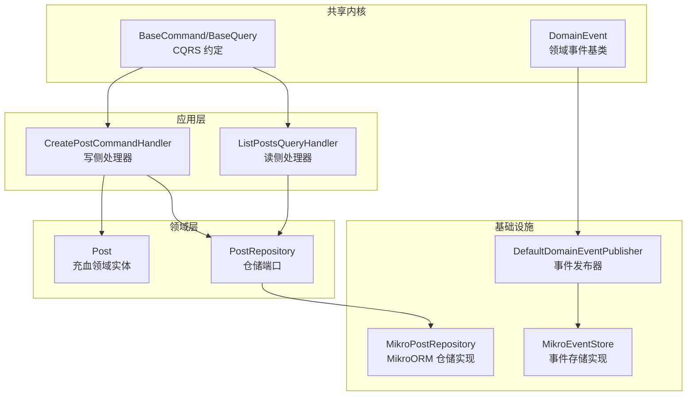
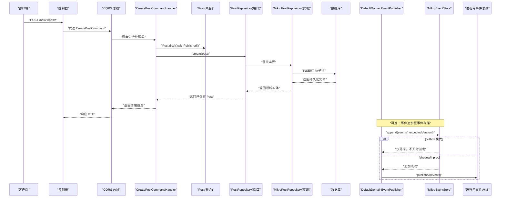
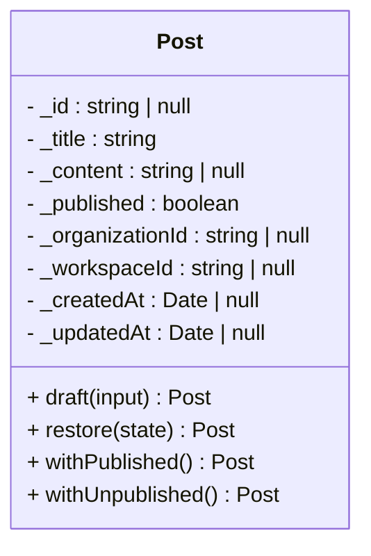
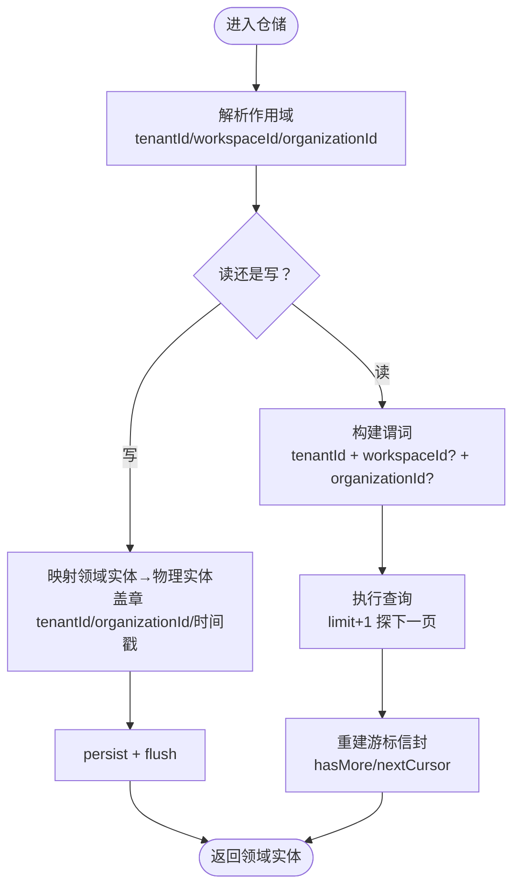
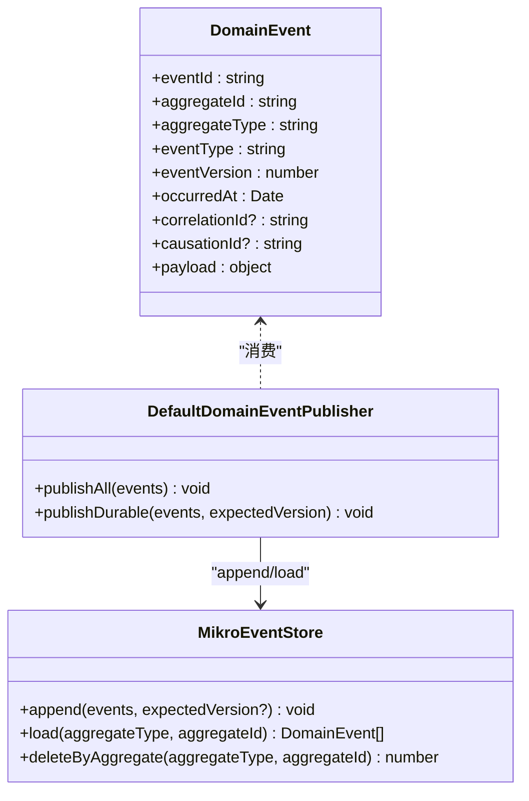
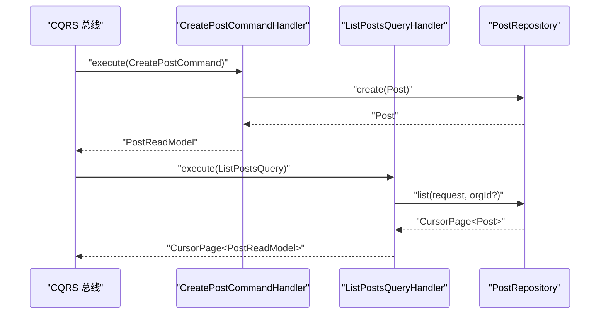
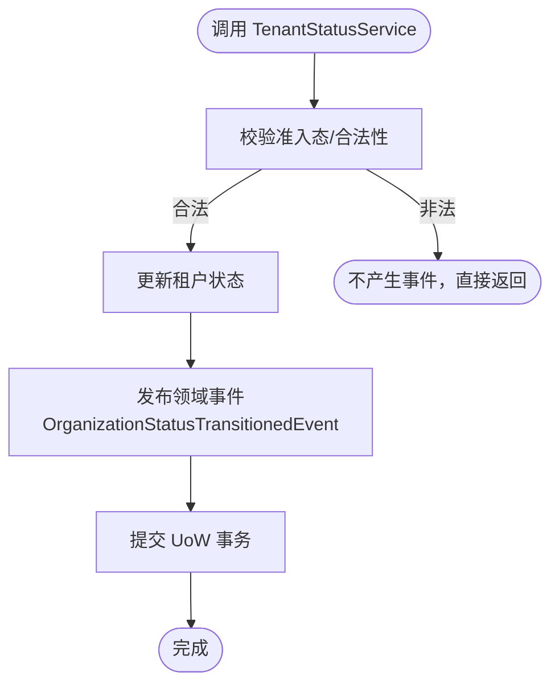
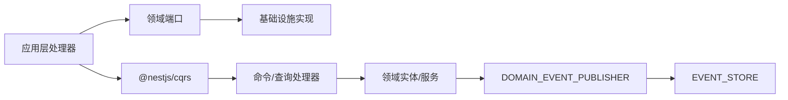

# 领域驱动设计

<cite>
**本文引用的文件**   
- [README.md](file://README.md)
- [verify-domain-layout.ts](file://scripts/verify-domain-layout.ts)
- [domain-event.ts](file://libs/core/src/shared-kernel/domain/domain-event.ts)
- [event-publisher.port.ts](file://libs/core/src/shared-kernel/domain/event-publisher.port.ts)
- [types.ts](file://libs/core/src/shared-kernel/cqrs/types.ts)
- [domain-event-publisher.ts](file://apps/api/src/database/eventing/domain-event-publisher.ts)
- [mikro-event-store.ts](file://apps/api/src/database/eventing/mikro-event-store.ts)
- [create-post.command-handler.ts](file://apps/api/src/modules/posts/application/commands/handlers/create-post.command-handler.ts)
- [list-posts.query-handler.ts](file://apps/api/src/modules/posts/application/queries/handlers/list-posts.query-handler.ts)
- [post.repository.ts](file://apps/api/src/modules/posts/domain/repositories/post.repository.ts)
- [post.ts](file://apps/api/src/modules/posts/domain/entities/post.ts)
- [mikro-post.repository.ts](file://apps/api/src/modules/posts/infrastructure/repositories/mikro-post.repository.ts)
- [organizations.module.ts](file://apps/api/src/modules/organizations/organizations.module.ts)
- [posts.module.ts](file://apps/api/src/modules/posts/posts.module.ts)
- [users.module.ts](file://apps/api/src/modules/users/users.module.ts)
- [tenant-status.service.ts](file://libs/core/src/modules/organizations/lifecycle/tenant-status.service.ts)
</cite>

## 目录
1. [引言](#引言)
2. [项目结构](#项目结构)
3. [核心组件](#核心组件)
4. [架构总览](#架构总览)
5. [详细组件分析](#详细组件分析)
6. [依赖关系分析](#依赖关系分析)
7. [性能与可扩展性](#性能与可扩展性)
8. [故障排查指南](#故障排查指南)
9. [结论](#结论)
10. [附录](#附录)

## 引言
本仓库采用 Clean Architecture + 垂直切片组织，以 NestJS 为应用骨架，在多个限界上下文（如 posts、organizations、users、subscriptions 等）内实践 DDD：聚合根、实体、值对象、仓储端口、领域服务与应用层命令/查询处理器清晰分层；事件与事件溯源能力通过共享内核的 DomainEvent 与 EventStore 端口预留并逐步落地；CQRS 借助 @nestjs/cqrs 实现命令与查询职责分离；持久化统一由 MikroORM 适配。

## 项目结构
- 每个限界上下文遵循 domain / application / infrastructure / api 四层，领域层保持纯函数式内核，基础设施负责 ORM 与外部集成。
- 共享内核提供领域事件基类、CQRS 基类、租户隔离与授权契约等横切能力。
- 脚本 `verify-domain-layout.ts` 强制 domain 子目录规范（entities、value-objects、events、repositories、ports、policies、constants），保障领域建模纪律。

**图示来源**
- [domain-event.ts:45-76](file://libs/core/src/shared-kernel/domain/domain-event.ts#L45-L76)
- [types.ts:16-23](file://libs/core/src/shared-kernel/cqrs/types.ts#L16-L23)
- [create-post.command-handler.ts:12-28](file://apps/api/src/modules/posts/application/commands/handlers/create-post.command-handler.ts#L12-L28)
- [list-posts.query-handler.ts:19-34](file://apps/api/src/modules/posts/application/queries/handlers/list-posts.query-handler.ts#L19-L34)
- [post.ts:49-157](file://apps/api/src/modules/posts/domain/entities/post.ts#L49-L157)
- [post.repository.ts:29-49](file://apps/api/src/modules/posts/domain/repositories/post.repository.ts#L29-L49)
- [mikro-post.repository.ts:37-138](file://apps/api/src/modules/posts/infrastructure/repositories/mikro-post.repository.ts#L37-L138)
- [mikro-event-store.ts:34-108](file://apps/api/src/database/eventing/mikro-event-store.ts#L34-L108)
- [domain-event-publisher.ts:24-71](file://apps/api/src/database/eventing/domain-event-publisher.ts#L24-L71)

**章节来源**
- [README.md:80-111](file://README.md#L80-L111)
- [verify-domain-layout.ts:22-45](file://scripts/verify-domain-layout.ts#L22-L45)

## 核心组件
- 领域事件：框架无关的 DomainEvent 基类，携带 eventId、aggregateId、aggregateType、eventType、eventVersion、occurredAt、correlationId、causationId、payload 等元数据，为事件溯源与跨上下文集成提供稳定契约。
- 事件发布端口：DOMAIN_EVENT_PUBLISHER 收口 handler 的派发点，屏蔽 event store 启用与否的差异，保证 append 失败不触发总线。
- CQRS 约定：BaseCommand/BaseQuery 薄约定层，使各上下文的命令/查询结果类型可由 bus 推断。
- 聚合与实体：以 posts 为例，Post 是充血领域实体，封装不可变状态、构造期不变量与纯转移方法（withPublished/withUnpublished）。
- 仓储端口：PostRepository 定义 list/findById/create，隐藏租户/工作区作用域细节，确保隔离卡点唯一。
- 基础设施适配：MikroPostRepository 将领域实体映射到物理表，强制租户隔离；MikroEventStore 实现 EventStore 端口，支持追加、乐观锁校验与回放读取；DefaultDomainEventPublisher 支持 inproc/shadow/outbox 三模事件发布。

**章节来源**
- [domain-event.ts:15-76](file://libs/core/src/shared-kernel/domain/domain-event.ts#L15-L76)
- [event-publisher.port.ts:1-14](file://libs/core/src/shared-kernel/domain/event-publisher.port.ts#L1-L14)
- [types.ts:1-23](file://libs/core/src/shared-kernel/cqrs/types.ts#L1-L23)
- [post.ts:49-157](file://apps/api/src/modules/posts/domain/entities/post.ts#L49-L157)
- [post.repository.ts:10-49](file://apps/api/src/modules/posts/domain/repositories/post.repository.ts#L10-L49)
- [mikro-post.repository.ts:19-138](file://apps/api/src/modules/posts/infrastructure/repositories/mikro-post.repository.ts#L19-L138)
- [mikro-event-store.ts:9-108](file://apps/api/src/database/eventing/mikro-event-store.ts#L9-L108)
- [domain-event-publisher.ts:9-71](file://apps/api/src/database/eventing/domain-event-publisher.ts#L9-L71)

## 架构总览
下图展示从 HTTP 请求到领域模型与持久化的端到端流程，以及事件发布的三种模式。

**图示来源**
- [create-post.command-handler.ts:12-28](file://apps/api/src/modules/posts/application/commands/handlers/create-post.command-handler.ts#L12-L28)
- [post.ts:68-157](file://apps/api/src/modules/posts/domain/entities/post.ts#L68-L157)
- [mikro-post.repository.ts:120-138](file://apps/api/src/modules/posts/infrastructure/repositories/mikro-post.repository.ts#L120-L138)
- [domain-event-publisher.ts:33-71](file://apps/api/src/database/eventing/domain-event-publisher.ts#L33-L71)
- [mikro-event-store.ts:37-68](file://apps/api/src/database/eventing/mikro-event-store.ts#L37-L68)

## 详细组件分析

### 聚合根与实体（Post）
- Post 作为充血领域实体，承担业务不变量与生命周期迁移（草稿→已发布/撤回），所有变更通过不可变转移方法产生新实例，避免副作用扩散。
- 两阶段构造：draft 用于新建写意图，restore 用于从持久层复原完整实例；仓储接口只暴露领域实体，禁止直接透传裸记录到 API 层。

**图示来源**
- [post.ts:49-157](file://apps/api/src/modules/posts/domain/entities/post.ts#L49-L157)

**章节来源**
- [post.ts:35-157](file://apps/api/src/modules/posts/domain/entities/post.ts#L35-L157)

### 仓储端口与 ORM 适配器
- PostRepository 端口隐藏租户与工作区作用域，调用方不得自行拼接 where 条件，隔离卡点唯一。
- MikroPostRepository 实现中，readScope/writeScope 分别处理读/写作用域，强制 tenantId 主轴，workspaceId 与 organizationId 仅做租内收窄；分页使用 UUIDv7 id 降序 + limit+1 探页，避免 COUNT 开销。

**图示来源**
- [mikro-post.repository.ts:44-138](file://apps/api/src/modules/posts/infrastructure/repositories/mikro-post.repository.ts#L44-L138)
- [post.repository.ts:29-49](file://apps/api/src/modules/posts/domain/repositories/post.repository.ts#L29-L49)

**章节来源**
- [post.repository.ts:10-49](file://apps/api/src/modules/posts/domain/repositories/post.repository.ts#L10-L49)
- [mikro-post.repository.ts:19-138](file://apps/api/src/modules/posts/infrastructure/repositories/mikro-post.repository.ts#L19-L138)

### 领域事件与事件溯源
- DomainEvent 提供稳定的事件信封字段，便于未来事件溯源与 upcaster。
- DefaultDomainEventPublisher 支持三模：
  - inproc：仅进程内派发，不落库。
  - shadow：先 append 事件存储，再进程内派发；append 失败则不进总线。
  - outbox：仅在活跃 UoW 事务内 append，不即时派发，交由 relay 投递（at-least-once）。
- MikroEventStore 实现 append/load/deleteByAggregate，支持乐观锁 expectedVersion 校验与按流回放。

**图示来源**
- [domain-event.ts:45-76](file://libs/core/src/shared-kernel/domain/domain-event.ts#L45-L76)
- [domain-event-publisher.ts:24-71](file://apps/api/src/database/eventing/domain-event-publisher.ts#L24-L71)
- [mikro-event-store.ts:34-108](file://apps/api/src/database/eventing/mikro-event-store.ts#L34-L108)

**章节来源**
- [domain-event.ts:15-76](file://libs/core/src/shared-kernel/domain/domain-event.ts#L15-L76)
- [domain-event-publisher.ts:9-71](file://apps/api/src/database/eventing/domain-event-publisher.ts#L9-L71)
- [mikro-event-store.ts:9-108](file://apps/api/src/database/eventing/mikro-event-store.ts#L9-L108)

### CQRS：命令处理器与查询处理器
- 命令处理器（CreatePostCommandHandler）：构造领域实体、执行业务转移、调用仓储持久化，并返回传输投影。
- 查询处理器（ListPostsQueryHandler）：通过仓储端口获取当前租户内的分页数据，映射为传输投影并重建游标信封。
- 模块装配（posts.module.ts）注册命令/查询处理器与仓储端口绑定。

**图示来源**
- [create-post.command-handler.ts:12-28](file://apps/api/src/modules/posts/application/commands/handlers/create-post.command-handler.ts#L12-L28)
- [list-posts.query-handler.ts:19-34](file://apps/api/src/modules/posts/application/queries/handlers/list-posts.query-handler.ts#L19-L34)
- [posts.module.ts:10-21](file://apps/api/src/modules/posts/posts.module.ts#L10-L21)

**章节来源**
- [create-post.command-handler.ts:8-28](file://apps/api/src/modules/posts/application/commands/handlers/create-post.command-handler.ts#L8-L28)
- [list-posts.query-handler.ts:8-34](file://apps/api/src/modules/posts/application/queries/handlers/list-posts.query-handler.ts#L8-L34)
- [posts.module.ts:1-24](file://apps/api/src/modules/posts/posts.module.ts#L1-L24)

### 领域服务与业务流程（以租户状态为例）
- TenantStatusService 作为租户生命周期状态的读写卡点，内部组合仓储端口与 DOMAIN_EVENT_PUBLISHER，并在 UNIT_OF_WORK 事务边界内完成状态回写与事件产出，保证 outbox 语义。
- organizations.module.ts 集中注册大量命令/查询处理器，体现复杂上下文中 CQRS 的组织方式。

**图示来源**
- [tenant-status.service.ts:33-54](file://libs/core/src/modules/organizations/lifecycle/tenant-status.service.ts#L33-L54)
- [organizations.module.ts:47-73](file://apps/api/src/modules/organizations/organizations.module.ts#L47-L73)

**章节来源**
- [tenant-status.service.ts:33-54](file://libs/core/src/modules/organizations/lifecycle/tenant-status.service.ts#L33-L54)
- [organizations.module.ts:47-73](file://apps/api/src/modules/organizations/organizations.module.ts#L47-L73)

### 领域模型与持久化模型的映射策略
- 领域模型（Post）与物理模型（PostEntity）严格分离，通过仓储适配器进行双向映射。
- 领域实体只暴露业务字段与不可变转移方法；持久化时由适配器补充技术字段（id、tenantId、organizationId、时间戳）。
- 读路径通过 fromRow 映射恢复完整领域实体，确保 API 层只消费传输投影。

**章节来源**
- [post.ts:35-92](file://apps/api/src/modules/posts/domain/entities/post.ts#L35-L92)
- [mikro-post.repository.ts:120-138](file://apps/api/src/modules/posts/infrastructure/repositories/mikro-post.repository.ts#L120-L138)

### ORM 适配器设计（MikroORM）
- 仓储适配器：MikroPostRepository 使用 MikroOrmService.fork() 获取独立 EntityManager，避免全局 em 污染；分页采用 UUIDv7 id 降序 + limit+1 探页；租户隔离通过 requireActiveTenantId 在取 em 前 fail-closed。
- 事件存储适配器：MikroEventStore 实现 EventStore 端口，支持 append/load/deleteByAggregate，并发保护通过 DB 唯一键与 expectedVersion 乐观锁实现。

**章节来源**
- [mikro-post.repository.ts:19-138](file://apps/api/src/modules/posts/infrastructure/repositories/mikro-post.repository.ts#L19-L138)
- [mikro-event-store.ts:9-108](file://apps/api/src/database/eventing/mikro-event-store.ts#L9-L108)

## 依赖关系分析
- 领域层不依赖框架与 ORM，仅定义端口与实体；基础设施实现端口并通过 DI 注入到应用层。
- 事件发布通过 DOMAIN_EVENT_PUBLISHER 解耦 handler 与具体事件通道；事件存储通过 EVENT_STORE 端口解耦持久化实现。
- CQRS 总线与处理器之间通过 BaseCommand/BaseQuery 约定解耦消息类型与结果类型推断。

**图示来源**
- [types.ts:16-23](file://libs/core/src/shared-kernel/cqrs/types.ts#L16-L23)
- [event-publisher.port.ts:1-14](file://libs/core/src/shared-kernel/domain/event-publisher.port.ts#L1-L14)
- [posts.module.ts:10-21](file://apps/api/src/modules/posts/posts.module.ts#L10-L21)
- [users.module.ts:15-25](file://apps/api/src/modules/users/users.module.ts#L15-L25)

**章节来源**
- [posts.module.ts:1-24](file://apps/api/src/modules/posts/posts.module.ts#L1-L24)
- [users.module.ts:1-28](file://apps/api/src/modules/users/users.module.ts#L1-L28)

## 性能与可扩展性
- 分页优化：使用 UUIDv7 id 降序 + limit+1 探页，避免 COUNT 全量扫描，减少 IO 与 CPU 消耗。
- 事件发布三模：inproc 零 IO；shadow 增加一次 append；outbox 与 relay 异步投递，适合高吞吐场景。
- 乐观锁：事件追加支持 expectedVersion，防止并发覆盖，提升一致性保障。
- 多租户隔离：在仓储层统一注入 tenantId 谓词，避免散点 SQL 拼接导致的索引失效与越权风险。

[本节为通用指导，不直接分析具体文件]

## 故障排查指南
- 事件发布失败：检查 EVENT_PUBLISH_MODE 配置与 TransactionScope 是否处于活跃事务（outbox 模式要求同事务）；确认 append 未抛异常，否则不会进入总线。
- 事件回放失败：确认 eventType 已在注册表中登记；load 会按 version 升序重建事件实例，未知类型会 fail-loud。
- 并发冲突：当 expectedVersion 与流当前 max+1 不一致时，append 会抛出错误，整批不写；需重试或降级处理。
- 租户隔离异常：确认仓储实现中 readScope/writeScope 始终包含 tenantId 主轴，且未在调用方绕过隔离卡点。

**章节来源**
- [domain-event-publisher.ts:33-71](file://apps/api/src/database/eventing/domain-event-publisher.ts#L33-L71)
- [mikro-event-store.ts:37-68](file://apps/api/src/database/eventing/mikro-event-store.ts#L37-L68)
- [mikro-post.repository.ts:44-67](file://apps/api/src/modules/posts/infrastructure/repositories/mikro-post.repository.ts#L44-L67)

## 结论
本项目在多租户 SaaS 场景中系统性地实践了 DDD：以聚合与实体承载业务不变量，以仓储端口隔离持久化细节，以 CQRS 明确命令与查询职责，以领域事件与事件溯源为扩展点预留可观测性与可回放能力。同时通过脚本与模块装配约束领域布局与依赖方向，保证代码演进的可维护性与可测试性。

## 附录
- 领域布局守护：verify-domain-layout.ts 强制 domain 子目录规范，确保领域建模纪律。
- 参考上下文：posts 作为示例内容上下文，演示领域建模与读写；organizations 展示复杂生命周期治理与 CQRS 编排。

**章节来源**
- [verify-domain-layout.ts:22-45](file://scripts/verify-domain-layout.ts#L22-L45)
- [README.md:113-128](file://README.md#L113-L128)