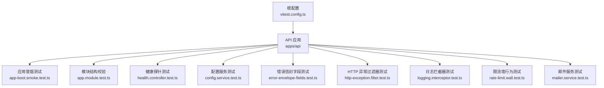
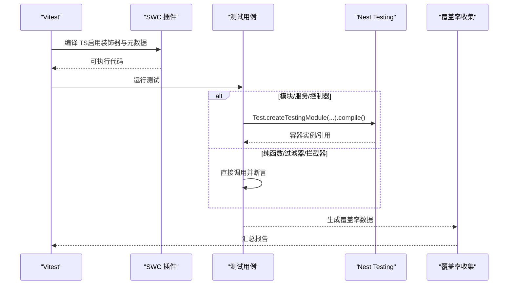
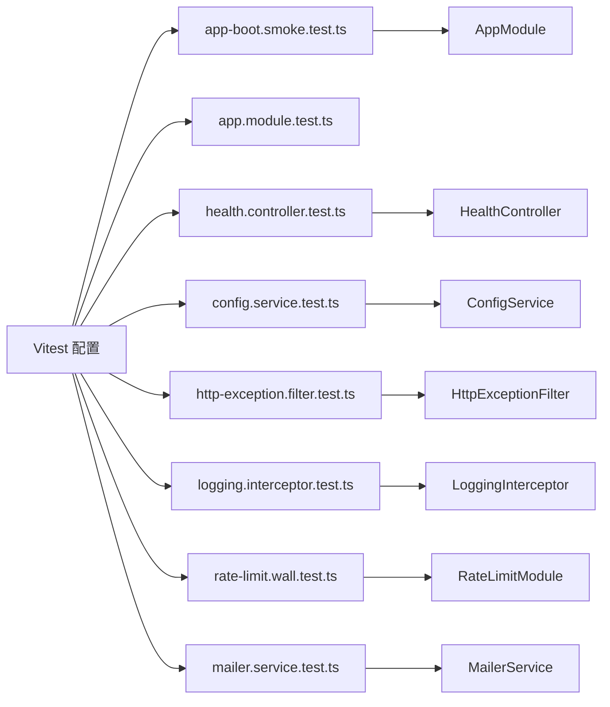

# 单元测试

<cite>
**本文引用的文件**   
- [vitest.config.ts](file://vitest.config.ts)
- [apps/api/package.json](file://apps/api/package.json)
- [apps/api/src/app.module.test.ts](file://apps/api/src/app.module.test.ts)
- [apps/api/src/app-boot.smoke.test.ts](file://apps/api/src/app-boot.smoke.test.ts)
- [apps/api/src/common/health/health.controller.test.ts](file://apps/api/src/common/health/health.controller.test.ts)
- [apps/api/src/config/config.service.test.ts](file://apps/api/src/config/config.service.test.ts)
- [apps/api/src/common/errors/error-envelope-fields.test.ts](file://apps/api/src/common/errors/error-envelope-fields.test.ts)
- [apps/api/src/common/filters/http-exception.filter.test.ts](file://apps/api/src/common/filters/http-exception.filter.test.ts)
- [apps/api/src/common/interceptors/logging.interceptor.test.ts](file://apps/api/src/common/interceptors/logging.interceptor.test.ts)
- [apps/api/src/common/rate-limit.wall.test.ts](file://apps/api/src/common/rate-limit.wall.test.ts)
- [apps/api/src/mailer/mailer.service.test.ts](file://apps/api/src/mailer/mailer.service.test.ts)
</cite>

## 目录
1. [引言](#引言)
2. [项目结构](#项目结构)
3. [核心组件](#核心组件)
4. [架构总览](#架构总览)
5. [详细组件分析](#详细组件分析)
6. [依赖关系分析](#依赖关系分析)
7. [性能与覆盖率](#性能与覆盖率)
8. [故障排查指南](#故障排查指南)
9. [结论](#结论)

## 引言
本文件面向 NestJS + Vitest 的单元测试实践，结合仓库现有测试用例与配置，系统化说明：
- Vitest 配置要点与最佳实践（ESM、装饰器元数据、环境变量、包含/排除规则、覆盖率）
- 测试文件组织规范（模块/服务/控制器/过滤器/拦截器/契约）
- Mock 策略（vi.fn、Test.createTestingModule、外部依赖隔离）
- 异步测试处理（Promise、RxJS Observable、Nest 应用生命周期）
- NestJS 模块测试、服务测试、控制器测试的编写方法
- 装饰器测试、依赖注入测试、异常处理测试的具体示例
- 测试覆盖率要求、性能优化技巧与调试方法
- 常见测试场景解决方案与最佳实践

## 项目结构
仓库采用多包工作区，API 应用位于 apps/api，测试统一由根级 vitest.config.ts 管理。测试文件遵循“源码同目录、同名 .test.ts”的组织方式，便于按模块定位。

图表来源
- [vitest.config.ts:10-83](file://vitest.config.ts#L10-L83)
- [apps/api/src/app-boot.smoke.test.ts:29-44](file://apps/api/src/app-boot.smoke.test.ts#L29-L44)
- [apps/api/src/app.module.test.ts:3-23](file://apps/api/src/app.module.test.ts#L3-L23)

章节来源
- [vitest.config.ts:10-83](file://vitest.config.ts#L10-L83)
- [apps/api/package.json:1-20](file://apps/api/package.json#L1-L20)

## 核心组件
本节聚焦仓库中体现出的关键测试能力与模式：
- 全应用 DI 图冒烟：通过 Test.createTestingModule({ imports: [AppModule] }).compile() 验证整树可解析，不触发 onModuleInit/onApplicationBootstrap，实现 DB-free 冒烟。
- 模块/服务/控制器静态结构校验：动态 import 校验模块、仓储、命令处理器、控制器是否存在。
- 装饰器元数据断言：对 @Public、@SkipThrottle 等装饰器的元数据进行反射断言。
- 异常处理契约：围绕 HttpExceptionFilter 的 requestId 兜底链、errorCode 透传、状态短名归一化进行回归锁。
- 请求上下文关联：基于 requestStorage.run 模拟 ALS 上下文，验证日志与错误信封的关联 id 来源一致性。
- 真实 Nest+Fastify 集成：在最小装配下发起 HTTP 请求，验证限流、代理信任 IP 等行为。
- i18n 与外部依赖 Mock：用 vi.fn 替换 I18nService 与 transporter，断言翻译键与插值参数。

章节来源
- [apps/api/src/app-boot.smoke.test.ts:15-44](file://apps/api/src/app-boot.smoke.test.ts#L15-L44)
- [apps/api/src/app.module.test.ts:3-23](file://apps/api/src/app.module.test.ts#L3-L23)
- [apps/api/src/common/health/health.controller.test.ts:15-32](file://apps/api/src/common/health/health.controller.test.ts#L15-L32)
- [apps/api/src/common/filters/http-exception.filter.test.ts:50-109](file://apps/api/src/common/filters/http-exception.filter.test.ts#L50-L109)
- [apps/api/src/common/interceptors/logging.interceptor.test.ts:28-55](file://apps/api/src/common/interceptors/logging.interceptor.test.ts#L28-L55)
- [apps/api/src/common/rate-limit.wall.test.ts:105-137](file://apps/api/src/common/rate-limit.wall.test.ts#L105-L137)
- [apps/api/src/mailer/mailer.service.test.ts:28-91](file://apps/api/src/mailer/mailer.service.test.ts#L28-L91)

## 架构总览
下图展示测试驱动的关键流程：Vitest 启动 → SWC 转换（含装饰器元数据）→ 加载测试 → 使用 Nest Testing 工具或纯函数断言 → 输出覆盖率报告。

图表来源
- [vitest.config.ts:14-32](file://vitest.config.ts#L14-L32)
- [vitest.config.ts:67-81](file://vitest.config.ts#L67-L81)
- [apps/api/src/app-boot.smoke.test.ts:30-44](file://apps/api/src/app-boot.smoke.test.ts#L30-L44)

## 详细组件分析

### Vitest 配置与最佳实践
- ESM 与路径别名：通过 tsconfigPaths 支持 @app/* 等路径别名解析。
- SWC 转换：开启 legacyDecorator 与 decoratorMetadata，确保 Nest DI 与 reflect-metadata 可用；同时兼容 web 侧 .tsx。
- 环境与时序：设置 test/hookTimeout 以容纳首次冷启动 swc 转换；默认 environment=node。
- 包含/排除：匹配 apps/libs/packages/scripts 下的 *.test.ts/tsx，排除 node_modules、dist、浏览器专用测试。
- 环境变量：提供最小必要变量（如 DATABASE_URL、JWT_SECRET、STORAGE_*、STRIPE_*），避免 ConfigModule 校验失败。
- 覆盖率：v8 provider，text/html/lcov 报告，reportsDirectory=coverage，include/exclude 明确业务代码范围，排除 DTO、接口、入口、seed、module 与包内测试。

章节来源
- [vitest.config.ts:10-83](file://vitest.config.ts#L10-L83)

### 测试文件组织规范
- 位置：与源码同级目录，文件名以 .test.ts 结尾。
- 分类：
  - 模块结构校验：app.module.test.ts 使用动态 import 校验模块、仓储、命令处理器、控制器存在性。
  - 冒烟测试：app-boot.smoke.test.ts 对 AppModule 整树进行 compile 冒烟，验证 DI 图可解析。
  - 契约/元数据：health.controller.test.ts 断言 @Public 元数据与 oRPC OpenAPI 元数据。
  - 过滤器/拦截器：http-exception.filter.test.ts、logging.interceptor.test.ts 针对横切关注点做回归锁。
  - 行为测试：rate-limit.wall.test.ts 在真实 Nest+Fastify 环境下验证限流与 trustProxy。
  - 服务测试：config.service.test.ts、mailer.service.test.ts 使用 vi.fn 与 Test.createTestingModule 组合。

章节来源
- [apps/api/src/app.module.test.ts:3-23](file://apps/api/src/app.module.test.ts#L3-L23)
- [apps/api/src/app-boot.smoke.test.ts:29-44](file://apps/api/src/app-boot.smoke.test.ts#L29-L44)
- [apps/api/src/common/health/health.controller.test.ts:15-32](file://apps/api/src/common/health/health.controller.test.ts#L15-L32)
- [apps/api/src/common/filters/http-exception.filter.test.ts:50-109](file://apps/api/src/common/filters/http-exception.filter.test.ts#L50-L109)
- [apps/api/src/common/interceptors/logging.interceptor.test.ts:28-55](file://apps/api/src/common/interceptors/logging.interceptor.test.ts#L28-L55)
- [apps/api/src/common/rate-limit.wall.test.ts:105-137](file://apps/api/src/common/rate-limit.wall.test.ts#L105-L137)
- [apps/api/src/config/config.service.test.ts:5-47](file://apps/api/src/config/config.service.test.ts#L5-L47)
- [apps/api/src/mailer/mailer.service.test.ts:28-91](file://apps/api/src/mailer/mailer.service.test.ts#L28-L91)

### Mock 策略
- 轻量 Mock：使用 vi.fn 构造最小依赖（如 ConfigService.get、I18nService.translate、transporter.sendMail）。
- 容器 Mock：使用 Test.createTestingModule 导入最小模块，按需替换 providers 或 imports。
- 全局 Mock：必要时使用 vi.stubGlobal 替换 fetch 等全局对象。
- 清理：在 beforeEach 或 afterAll 中调用 vi.clearAllMocks / vi.restoreAllMocks，避免测试间污染。

章节来源
- [apps/api/src/config/config.service.test.ts:5-47](file://apps/api/src/config/config.service.test.ts#L5-L47)
- [apps/api/src/mailer/mailer.service.test.ts:8-41](file://apps/api/src/mailer/mailer.service.test.ts#L8-L41)
- [apps/api/src/common/rate-limit.wall.test.ts:109-119](file://apps/api/src/common/rate-limit.wall.test.ts#L109-L119)

### 异步测试处理
- Promise 与 async/await：所有需要等待容器初始化、HTTP 请求、数据库操作的测试均使用 async/await。
- RxJS Observable：拦截器返回 Observable，测试中使用 subscribe 触发执行并断言日志。
- Nest 应用生命周期：在 beforeAll 中创建应用、init、server.ready，afterAll 中 close，保证资源释放。

章节来源
- [apps/api/src/app-boot.smoke.test.ts:30-44](file://apps/api/src/app-boot.smoke.test.ts#L30-L44)
- [apps/api/src/common/interceptors/logging.interceptor.test.ts:28-55](file://apps/api/src/common/interceptors/logging.interceptor.test.ts#L28-L55)
- [apps/api/src/common/rate-limit.wall.test.ts:109-119](file://apps/api/src/common/rate-limit.wall.test.ts#L109-L119)

### NestJS 模块测试、服务测试、控制器测试
- 模块测试：
  - 结构校验：动态 import 模块、仓储、命令处理器、控制器，确保分层结构正确。
  - DI 图冒烟：import AppModule 后 compile，断言关键守卫、控制器、ConfigModule 可解析。
- 服务测试：
  - ConfigService：Mock 底层 NestConfigService.get，断言 typed getter 与缺失 key 抛错。
  - MailerService：Mock I18nService 与 transporter，断言翻译键、插值参数、邮件字段。
- 控制器测试：
  - HealthController：断言类级 @Public 元数据、oRPC OpenAPI 元数据、ping-only 行为。
  - RateLimit 行为：在真实 Nest+Fastify 下发起 HTTP 请求，断言 429、@SkipThrottle、XFF 分桶。

章节来源
- [apps/api/src/app.module.test.ts:3-23](file://apps/api/src/app.module.test.ts#L3-L23)
- [apps/api/src/app-boot.smoke.test.ts:29-44](file://apps/api/src/app-boot.smoke.test.ts#L29-L44)
- [apps/api/src/config/config.service.test.ts:5-47](file://apps/api/src/config/config.service.test.ts#L5-L47)
- [apps/api/src/mailer/mailer.service.test.ts:28-91](file://apps/api/src/mailer/mailer.service.test.ts#L28-L91)
- [apps/api/src/common/health/health.controller.test.ts:15-32](file://apps/api/src/common/health/health.controller.test.ts#L15-L32)
- [apps/api/src/common/rate-limit.wall.test.ts:105-137](file://apps/api/src/common/rate-limit.wall.test.ts#L105-L137)

### 装饰器测试
- @Public：HealthController 类级元数据断言为 true，作为会话墙/租户墙豁免依据。
- @SkipThrottle：RateLimitModule 中 HealthController 类级跳过限流元数据在场断言。

章节来源
- [apps/api/src/common/health/health.controller.test.ts:15-18](file://apps/api/src/common/health/health.controller.test.ts#L15-L18)
- [apps/api/src/common/rate-limit.wall.test.ts:60-63](file://apps/api/src/common/rate-limit.wall.test.ts#L60-L63)

### 依赖注入测试
- 整树 DI 冒烟：Test.createTestingModule({ imports: [AppModule] }).compile() 捕获 UnknownDependenciesException。
- 关键节点断言：TenantIsolationGuard、AuthorizationGuard、PlatformOperatorGuard、SessionGuard、PostsController、ConfigModule 均可从容器解析。
- 单例一致性：PERMISSION_INVALIDATOR 与 PERMISSION_CHECKER 必须为同一实例（useExisting 归一）。

章节来源
- [apps/api/src/app-boot.smoke.test.ts:29-44](file://apps/api/src/app-boot.smoke.test.ts#L29-L44)

### 异常处理测试
- HttpExceptionFilter：
  - requestId 兜底链：ALS → Fastify req.id → 'req-unknown'。
  - errorCode 透传：object response 携带字符串 errorCode 时透传；非字符串时不透传；子类 string+options 形透传。
  - 状态短名归一：裸 object/string 的 4xx/5xx 响应 error 字段归一；子类自带 error 优先。
  - 安全文本：裸 Error 兜底 500 时 message 归一不外泄内部原文，堆栈入日志。
- errorEnvelopeFields：requestId 取值链与 path/timestamp 契约断言。

章节来源
- [apps/api/src/common/filters/http-exception.filter.test.ts:50-109](file://apps/api/src/common/filters/http-exception.filter.test.ts#L50-L109)
- [apps/api/src/common/filters/http-exception.filter.test.ts:111-194](file://apps/api/src/common/filters/http-exception.filter.test.ts#L111-L194)
- [apps/api/src/common/filters/http-exception.filter.test.ts:196-260](file://apps/api/src/common/filters/http-exception.filter.test.ts#L196-L260)
- [apps/api/src/common/errors/error-envelope-fields.test.ts:10-29](file://apps/api/src/common/errors/error-envelope-fields.test.ts#L10-L29)

### 请求上下文与关联 ID
- LoggingInterceptor：在 ALS 链上读取上下文 id；链外回落 Fastify req.id；连续两次调用 id 恒等，杜绝随机孤岛。
- errorEnvelopeFields：ALS 存在时取 currentRequestId()；缺位时回退 Fastify req.id；双缺位落哨兵 'req-unknown'。

章节来源
- [apps/api/src/common/interceptors/logging.interceptor.test.ts:28-55](file://apps/api/src/common/interceptors/logging.interceptor.test.ts#L28-L55)
- [apps/api/src/common/errors/error-envelope-fields.test.ts:10-29](file://apps/api/src/common/errors/error-envelope-fields.test.ts#L10-L29)

### 真实 Nest+Fastify 行为测试
- 限流墙：小窗 limit=2，第 3 击 429；@SkipThrottle 类不受计数；trustProxy 启用后按 XFF 真 IP 分桶。
- 构建选项：buildFastifyHttpOptions 透传 trustProxy 数组，未配/空/空白不传 trustProxy 键。

章节来源
- [apps/api/src/common/rate-limit.wall.test.ts:105-137](file://apps/api/src/common/rate-limit.wall.test.ts#L105-L137)
- [apps/api/src/common/rate-limit.wall.test.ts:139-182](file://apps/api/src/common/rate-limit.wall.test.ts#L139-L182)
- [apps/api/src/common/rate-limit.wall.test.ts:184-201](file://apps/api/src/common/rate-limit.wall.test.ts#L184-L201)

### i18n 与外部依赖测试
- MailerService：Mock I18nService.translate 与 transporter.sendMail，断言翻译键、lang、args 插值、邮件字段。
- 真实 i18n 资产：通过 I18nModule.forRoot(loaderOptions.path=src/i18n) 加载 zh/en JSON，断译键与插值行为。

章节来源
- [apps/api/src/mailer/mailer.service.test.ts:8-41](file://apps/api/src/mailer/mailer.service.test.ts#L8-L41)
- [apps/api/src/mailer/mailer.service.test.ts:93-122](file://apps/api/src/mailer/mailer.service.test.ts#L93-L122)

## 依赖关系分析
测试与实现的耦合关系如下：

图表来源
- [vitest.config.ts:40-47](file://vitest.config.ts#L40-L47)
- [apps/api/src/app-boot.smoke.test.ts:29-44](file://apps/api/src/app-boot.smoke.test.ts#L29-L44)
- [apps/api/src/app.module.test.ts:3-23](file://apps/api/src/app.module.test.ts#L3-L23)
- [apps/api/src/common/health/health.controller.test.ts:15-32](file://apps/api/src/common/health/health.controller.test.ts#L15-L32)
- [apps/api/src/config/config.service.test.ts:5-47](file://apps/api/src/config/config.service.test.ts#L5-L47)
- [apps/api/src/common/filters/http-exception.filter.test.ts:50-109](file://apps/api/src/common/filters/http-exception.filter.test.ts#L50-L109)
- [apps/api/src/common/interceptors/logging.interceptor.test.ts:28-55](file://apps/api/src/common/interceptors/logging.interceptor.test.ts#L28-L55)
- [apps/api/src/common/rate-limit.wall.test.ts:105-137](file://apps/api/src/common/rate-limit.wall.test.ts#L105-L137)
- [apps/api/src/mailer/mailer.service.test.ts:28-91](file://apps/api/src/mailer/mailer.service.test.ts#L28-L91)

章节来源
- [vitest.config.ts:40-47](file://vitest.config.ts#L40-L47)

## 性能与覆盖率
- 性能优化：
  - 首次冷启动耗时较长：已提高 testTimeout 与 hookTimeout 至 20s，避免 SWC 转换超时。
  - DB-free 冒烟：仅 compile 不 init/listen，避免连接数据库与触发懒连逻辑。
  - 最小装配：限流行为测试使用 WallTestModule/ProxyTestModule 小模块，减少启动开销。
- 覆盖率要求：
  - provider=v8，reporter=text/html/lcov，reportsDirectory=./coverage。
  - include 覆盖 apps/libs/packages 业务代码；exclude 排除测试、DTO、interfaces、main、seed、module、包内测试。
- 调试建议：
  - 使用 vi.fn().mockReturnValue/mockResolvedValue/mockImplementation 精确控制返回值。
  - 使用 expect.toThrow 断言抛错路径；使用 toMatchObject 断言部分结构。
  - 在 beforeAll/afterAll 中管理 Nest 应用生命周期，避免端口占用与资源泄漏。

章节来源
- [vitest.config.ts:33-39](file://vitest.config.ts#L33-L39)
- [vitest.config.ts:67-81](file://vitest.config.ts#L67-L81)
- [apps/api/src/app-boot.smoke.test.ts:25-28](file://apps/api/src/app-boot.smoke.test.ts#L25-L28)
- [apps/api/src/common/rate-limit.wall.test.ts:109-119](file://apps/api/src/common/rate-limit.wall.test.ts#L109-L119)

## 故障排查指南
- 装饰器元数据不可用：
  - 现象：DI 无法解析依赖、Reflect.getMetadata 返回 undefined。
  - 排查：确认 SWC 插件开启 legacyDecorator 与 decoratorMetadata；确保 reflect-metadata 已引入（部分测试需显式 import）。
- 环境变量缺失导致 ConfigModule 校验失败：
  - 现象：模块导入时报 Joi 校验错误。
  - 排查：检查 vitest.config.ts 的 test.env 是否提供必要变量（DATABASE_URL、JWT_SECRET、STORAGE_*、STRIPE_*）。
- 异步测试挂起：
  - 现象：测试长时间无结果或超时。
  - 排查：确认 await 了 Test.createTestingModule(...).compile()/createNestApplication(...).init()；检查 RxJS Observable 是否 subscribe。
- 覆盖率报告为空：
  - 现象：./coverage 下无文件或覆盖率极低。
  - 排查：检查 include/exclude 是否误排业务代码；确认测试被 include 规则匹配。

章节来源
- [vitest.config.ts:14-32](file://vitest.config.ts#L14-L32)
- [vitest.config.ts:48-66](file://vitest.config.ts#L48-L66)
- [apps/api/src/app-boot.smoke.test.ts:30-44](file://apps/api/src/app-boot.smoke.test.ts#L30-L44)
- [apps/api/src/common/interceptors/logging.interceptor.test.ts:28-55](file://apps/api/src/common/interceptors/logging.interceptor.test.ts#L28-L55)
- [vitest.config.ts:67-81](file://vitest.config.ts#L67-L81)

## 结论
该仓库的单元测试体系以 Vitest 为核心，配合 SWC 转换与 Nest Testing 工具，形成从模块结构校验、DI 图冒烟、装饰器元数据断言，到异常处理契约、请求上下文关联、真实 Nest+Fastify 行为测试的完整闭环。通过明确的 include/exclude 与 v8 覆盖率采集，既保证了测试质量，又兼顾了 CI 性能。建议在新增功能时遵循现有组织规范，优先使用最小装配与 Mock 隔离外部依赖，并以契约与元数据为锚点进行回归锁，持续提升系统稳定性与可维护性。