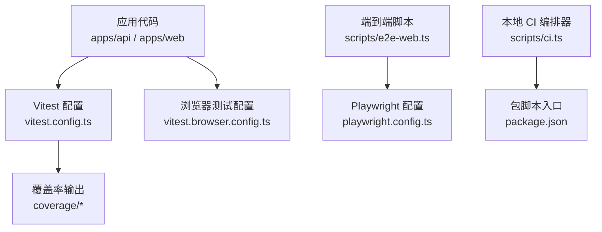
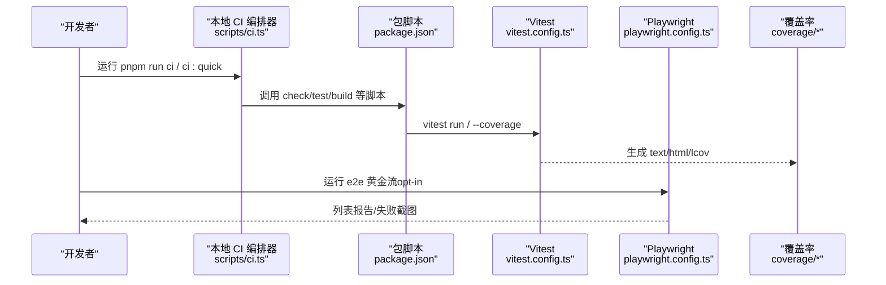
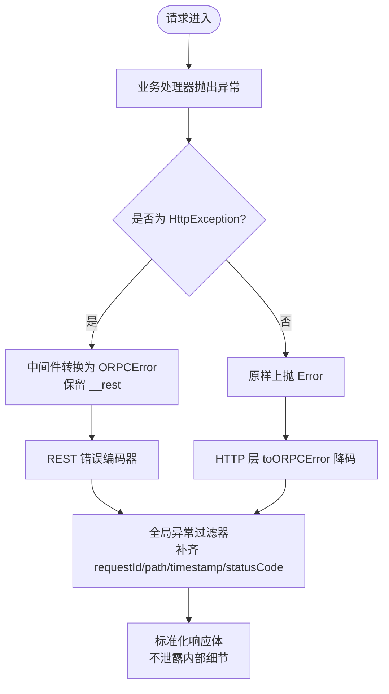
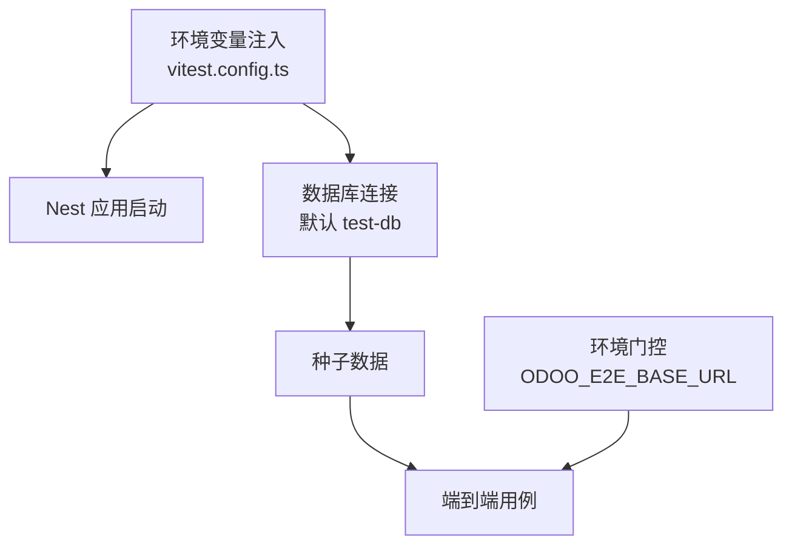
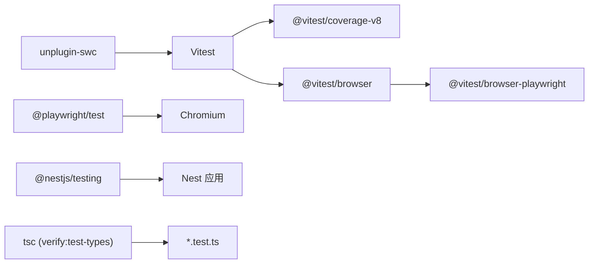
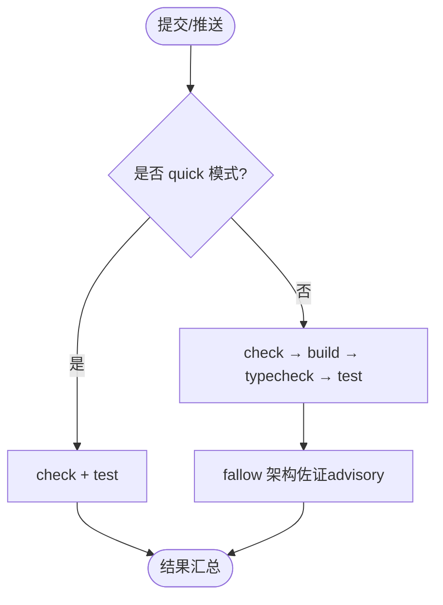

# 测试最佳实践

<cite>
**本文引用的文件**   
- [package.json](file://package.json)
- [vitest.config.ts](file://vitest.config.ts)
- [vitest.browser.config.ts](file://vitest.browser.config.ts)
- [playwright.config.ts](file://playwright.config.ts)
- [scripts/ci.ts](file://scripts/ci.ts)
- [apps/api/src/app.module.test.ts](file://apps/api/src/app.module.test.ts)
- [apps/api/src/common/errors/error-envelope-fields.test.ts](file://apps/api/src/common/errors/error-envelope-fields.test.ts)
- [apps/api/src/common/filters/http-exception.filter.test.ts](file://apps/api/src/common/filters/http-exception.filter.test.ts)
- [apps/api/src/config/config.service.test.ts](file://apps/api/src/config/config.service.test.ts)
- [apps/api/src/common/orpc/rest-error.test.ts](file://apps/api/src/common/orpc/rest-error.test.ts)
- [apps/web/src/components/forms.test.tsx](file://apps/web/src/components/forms.test.tsx)
</cite>

## 目录
1. [引言](#引言)
2. [项目结构](#项目结构)
3. [核心组件](#核心组件)
4. [架构总览](#架构总览)
5. [详细组件分析](#详细组件分析)
6. [依赖关系分析](#依赖关系分析)
7. [性能与内存优化](#性能与内存优化)
8. [CI/CD 流水线与自动化](#cicd-流水线与自动化)
9. [故障诊断与排错](#故障诊断与排错)
10. [结论](#结论)

## 引言
本指南面向后端 NestJS、前端 React 以及端到端 Web 测试，提炼仓库中已落地的测试规范、断言库选择、错误处理策略、数据与环境管理、覆盖率阈值、CI 门禁与失败处理机制，并给出可复用的最佳实践清单。目标是让新成员快速上手，同时为长期维护提供稳定基线。

## 项目结构
仓库采用 monorepo（pnpm workspaces），测试覆盖：
- 单元测试：Vitest（Node 环境）
- 浏览器端单测：Vitest Browser Mode + Playwright Provider
- 端到端黄金流：Playwright Test（真部署态 SPA）
- 本地 CI 编排器：scripts/ci.ts（统一门禁）

**图示来源**
- [vitest.config.ts:10-83](file://vitest.config.ts#L10-L83)
- [vitest.browser.config.ts:9-39](file://vitest.browser.config.ts#L9-L39)
- [playwright.config.ts:15-30](file://playwright.config.ts#L15-L30)
- [scripts/ci.ts:44-114](file://scripts/ci.ts#L44-L114)
- [package.json:49-65](file://package.json#L49-L65)

**章节来源**
- [package.json:1-65](file://package.json#L1-L65)
- [vitest.config.ts:1-84](file://vitest.config.ts#L1-L84)
- [vitest.browser.config.ts:1-40](file://vitest.browser.config.ts#L1-L40)
- [playwright.config.ts:1-31](file://playwright.config.ts#L1-L31)
- [scripts/ci.ts:1-137](file://scripts/ci.ts#L1-L137)

## 核心组件
- 测试运行器与断言
  - Vitest 作为主运行器，使用其内置 expect/it/describe/vi；React 侧使用 @testing-library/react。
  - 浏览器模式通过 @vitest/browser-playwright 驱动 Chromium。
- 端到端
  - Playwright Test 用于真部署态 SPA 的登录→首页引导→建帖等黄金流程。
- 覆盖率
  - V8 provider，输出 text/html/lcov，报告目录 coverage。
- 环境变量与数据库
  - 默认 DATABASE_URL 指向本地 test-db；真实 DB 仅在外部传入 DATABASE_URL 时启用。
- 构建与类型检查
  - SWC 转换 TypeScript 装饰器与元数据；全仓 tsc verify:test-types 在 full 模式下执行。

**章节来源**
- [vitest.config.ts:14-31](file://vitest.config.ts#L14-L31)
- [vitest.config.ts:33-81](file://vitest.config.ts#L33-L81)
- [vitest.browser.config.ts:27-38](file://vitest.browser.config.ts#L27-L38)
- [playwright.config.ts:15-30](file://playwright.config.ts#L15-L30)
- [package.json:130-158](file://package.json#L130-L158)

## 架构总览
下图展示从提交到测试产出的关键路径：开发者触发脚本 → 本地 CI 编排器 → Vitest/Playwright → 覆盖率与报告。

**图示来源**
- [scripts/ci.ts:44-114](file://scripts/ci.ts#L44-L114)
- [package.json:49-65](file://package.json#L49-L65)
- [vitest.config.ts:33-81](file://vitest.config.ts#L33-L81)
- [playwright.config.ts:15-30](file://playwright.config.ts#L15-L30)

## 详细组件分析

### 命名约定与测试组织
- 文件命名
  - 单元测试以 .test.ts/.test.tsx 结尾；端到端用例位于 e2e 目录，按 Playwright 规范组织。
  - 浏览器端单测使用 .browser.test.{ts,tsx}，由独立配置文件包含。
- 分组与描述
  - 使用 describe 对模块/功能分组，it 描述具体行为；断言使用 expect。
- 示例参考
  - 模块结构校验：[apps/api/src/app.module.test.ts:3-24](file://apps/api/src/app.module.test.ts#L3-L24)
  - 错误信封字段单测：[apps/api/src/common/errors/error-envelope-fields.test.ts:10-29](file://apps/api/src/common/errors/error-envelope-fields.test.ts#L10-L29)
  - React 表单无障碍断言：[apps/web/src/components/forms.test.tsx:9-28](file://apps/web/src/components/forms.test.tsx#L9-L28)

**章节来源**
- [apps/api/src/app.module.test.ts:1-25](file://apps/api/src/app.module.test.ts#L1-L25)
- [apps/api/src/common/errors/error-envelope-fields.test.ts:1-31](file://apps/api/src/common/errors/error-envelope-fields.test.ts#L1-L31)
- [apps/web/src/components/forms.test.tsx:1-64](file://apps/web/src/components/forms.test.tsx#L1-L64)

### 断言库与工具选择
- 后端与通用逻辑：Vitest 内置 expect；配合 vi 进行 mock/spy。
- 前端 UI：@testing-library/react 渲染与查询，结合 Vitest。
- 浏览器端：@vitest/browser-playwright 驱动 Chromium，复用 SWC 链。

**章节来源**
- [vitest.config.ts:14-31](file://vitest.config.ts#L14-L31)
- [vitest.browser.config.ts:1-39](file://vitest.browser.config.ts#L1-L39)
- [apps/web/src/components/forms.test.tsx:1-6](file://apps/web/src/components/forms.test.tsx#L1-L6)

### 错误处理策略与契约
- 全局异常过滤器
  - 统一 requestId 兜底链：ALS → Fastify req.id → 'req-unknown'。
  - 非 HttpException 兜底 500，message 归一不外泄内部原文，但堆栈入日志。
  - errorCode/errors 透传规则严格校验，避免破坏性字段。
- oRPC REST 错误面
  - in-handler 抛出的 HttpException 经中间件转为 ORPCError，保留 __rest 供下游过滤器复刻响应体。
  - 编码器分支区分业务对象、校验 issues、兜底 500，确保不泄露敏感信息。

**图示来源**
- [apps/api/src/common/filters/http-exception.filter.test.ts:50-108](file://apps/api/src/common/filters/http-exception.filter.test.ts#L50-L108)
- [apps/api/src/common/orpc/rest-error.test.ts:34-93](file://apps/api/src/common/orpc/rest-error.test.ts#L34-L93)

**章节来源**
- [apps/api/src/common/filters/http-exception.filter.test.ts:15-108](file://apps/api/src/common/filters/http-exception.filter.test.ts#L15-L108)
- [apps/api/src/common/orpc/rest-error.test.ts:10-93](file://apps/api/src/common/orpc/rest-error.test.ts#L10-L93)

### 测试数据与环境管理
- 环境变量
  - 默认注入 NODE_ENV=test、LOG_LEVEL=silent、JWT_SECRET、STORAGE_*、STRIPE_* 等占位值。
  - DATABASE_URL 默认指向本地 test-db；仅当外部传入时才连接真实库。
- 容器化依赖
  - Playwright 端到端由编排器启动 Testcontainers PostgreSQL，迁移+seed 后驱动 API 与前端。
- 隔离与门控
  - 活体 e2e（如 Odoo）通过 ODOO_E2E_BASE_URL 门控 skip，避免公共机器误跑。

**图示来源**
- [vitest.config.ts:48-66](file://vitest.config.ts#L48-L66)
- [playwright.config.ts:15-30](file://playwright.config.ts#L15-L30)

**章节来源**
- [vitest.config.ts:48-66](file://vitest.config.ts#L48-L66)
- [apps/api/src/features/odoo-provisioning/api/odoo-provisioning-live.e2e.test.ts:7-42](file://apps/api/src/features/odoo-provisioning/api/odoo-provisioning-live.e2e.test.ts#L7-L42)

### 覆盖率阈值与报告
- 提供者与报告
  - V8 provider，输出 text/html/lcov，目录 ./coverage。
- 包含与排除
  - include 限定 apps/libs/packages 源码；exclude 排除测试、DTO、接口、module、main、seed 等。
- 阈值建议
  - 建议在 CI 中解析 lcov 并设置最小阈值（例如行覆盖率≥80%，分支≥70%），未达标即 fail。

**章节来源**
- [vitest.config.ts:67-81](file://vitest.config.ts#L67-L81)

### 配置服务单测范式
- 使用 vi.mock/vi.fn 模拟底层 Nest ConfigService。
- 验证 typed getter 与缺失键抛错语义。

**章节来源**
- [apps/api/src/config/config.service.test.ts:1-49](file://apps/api/src/config/config.service.test.ts#L1-L49)

## 依赖关系分析
- 运行期依赖
  - Vitest 与 @vitest/coverage-v8、@vitest/browser、@vitest/browser-playwright。
  - Playwright 与 @playwright/test。
  - Nest Testing 与 @nestjs/testing。
- 构建与类型
  - unplugin-swc 负责 TS 装饰器与元数据转换。
  - tsc 在 full 模式下做全仓类型检查（含 *.test.ts）。

**图示来源**
- [package.json:130-158](file://package.json#L130-L158)
- [vitest.config.ts:14-31](file://vitest.config.ts#L14-L31)
- [vitest.browser.config.ts:27-38](file://vitest.browser.config.ts#L27-L38)

**章节来源**
- [package.json:130-158](file://package.json#L130-L158)

## 性能与内存优化
- 超时与钩子
  - 首次导入完整 AppModule 可能较慢，已将 testTimeout/hookTimeout 提升至 20s。
- 并发与并行
  - Playwright 端到端关闭并行（fullyParallel=false, workers=1），避免状态机链路竞态。
- 浏览器实例
  - 浏览器模式仅 chromium headless，减少资源占用。
- 覆盖率采集
  - 使用 v8 provider，避免额外运行时开销。
- 建议
  - 拆分慢测试为独立 suite，按需运行；避免在 beforeEach 中创建重型依赖。
  - 使用 mock 替代真实 I/O；必要时用 Testcontainers 按需拉起。

**章节来源**
- [vitest.config.ts:33-40](file://vitest.config.ts#L33-L40)
- [playwright.config.ts:17-21](file://playwright.config.ts#L17-L21)
- [vitest.browser.config.ts:32-37](file://vitest.browser.config.ts#L32-L37)

## CI/CD 流水线与自动化
- 本地 CI 编排器
  - 两种模式：full（check → build → test → 架构佐证）与 quick（check + test）。
  - 门禁顺序：lint/format → type-escape ratchet → domain layout guard → feature isolation guard → stories drift guard → i18n key parity guard → overturned rulings guard → config contract guard → build/typecheck → web/odoo-rpc-web typecheck → test typecheck → oRPC contract 对拍 → tenant-scoped registry guard → tests。
  - fallow 架构边界为 advisory，不阻断。
- 覆盖率与报告
  - 默认 vitest run 产出覆盖率；可在 CI 中解析 lcov 并设置阈值。
- 端到端
  - opt-in 触发（pnpm run test:e2e:web），不入默认 ci/pre-push；由 scripts/e2e-web.ts 编排 Testcontainers PG + 迁移 + seed + API + Vite dev proxy。

**图示来源**
- [scripts/ci.ts:1-137](file://scripts/ci.ts#L1-L137)

**章节来源**
- [scripts/ci.ts:1-137](file://scripts/ci.ts#L1-L137)
- [package.json:32-55](file://package.json#L32-L55)

## 故障诊断与排错
- 常见症状与定位
  - 首次测试超时：检查 testTimeout/hookTimeout 与 SWC 编译链；确认是否导入完整 AppModule。
    - 参考：[vitest.config.ts:33-40](file://vitest.config.ts#L33-L40)
  - 错误响应缺少 requestId：检查 ALS 上下文与 Fastify req.id 回退链。
    - 参考：[apps/api/src/common/filters/http-exception.filter.test.ts:50-80](file://apps/api/src/common/filters/http-exception.filter.test.ts#L50-L80)
  - 500 消息泄露：确认非 HttpException 分支 message 归一且原文仅入日志。
    - 参考：[apps/api/src/common/filters/http-exception.filter.test.ts:82-98](file://apps/api/src/common/filters/http-exception.filter.test.ts#L82-L98)
  - oRPC 错误体不一致：检查中间件 toRestORPCError 与编码器分支。
    - 参考：[apps/api/src/common/orpc/rest-error.test.ts:34-124](file://apps/api/src/common/orpc/rest-error.test.ts#L34-L124)
  - 浏览器测试无法加载 TSX：确认 swc 插件与 tsconfigPaths。
    - 参考：[vitest.browser.config.ts:14-25](file://vitest.browser.config.ts#L14-L25)
- 排查步骤
  - 缩小范围：仅运行相关测试文件；开启 verbose reporter。
  - 检查环境变量：DATABASE_URL、JWT_SECRET、STORAGE_*、STRIPE_* 是否与预期一致。
  - 清理缓存：删除 dist/node_modules 后重试；必要时重启容器。
  - 查看覆盖率差异：对比 lcov 变更定位未覆盖分支。

**章节来源**
- [apps/api/src/common/filters/http-exception.filter.test.ts:50-108](file://apps/api/src/common/filters/http-exception.filter.test.ts#L50-L108)
- [apps/api/src/common/orpc/rest-error.test.ts:34-124](file://apps/api/src/common/orpc/rest-error.test.ts#L34-L124)
- [vitest.browser.config.ts:14-25](file://vitest.browser.config.ts#L14-L25)

## 结论
本仓库已形成覆盖单元、组件、端到端的完整测试体系：以 Vitest 为核心、Playwright 补真浏览器场景、本地 CI 编排器统一门禁。通过严格的错误响应契约、环境变量门控与覆盖率报告，保障质量与可维护性。建议团队遵循本文命名、断言、错误处理与环境管理规范，并在 CI 中固化覆盖率阈值与失败阻断策略，持续降低回归风险。