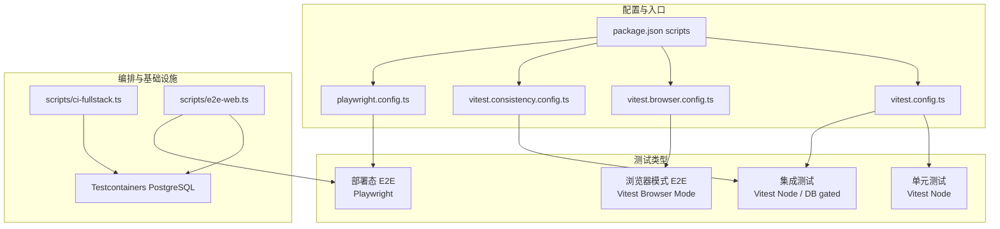
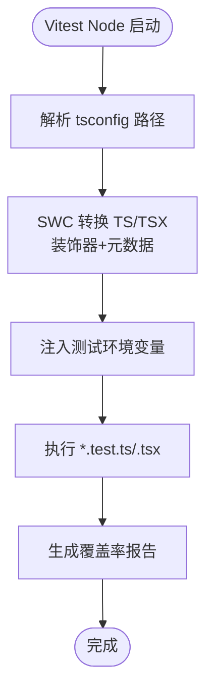
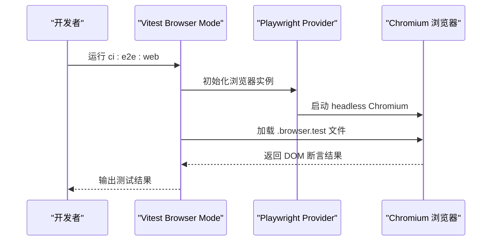
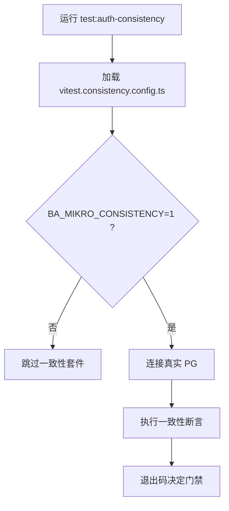
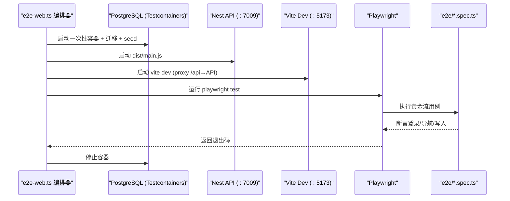
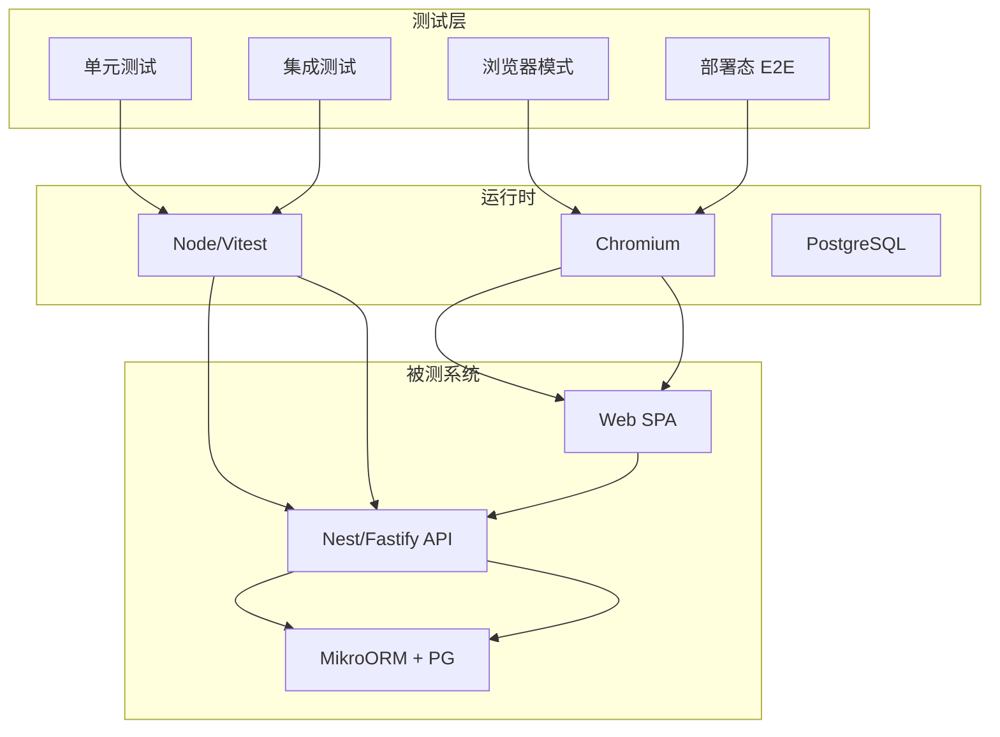
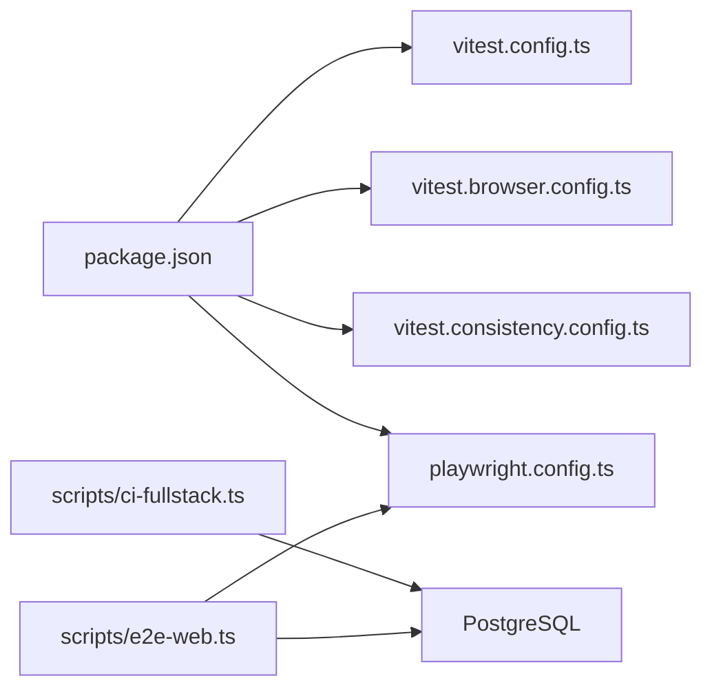
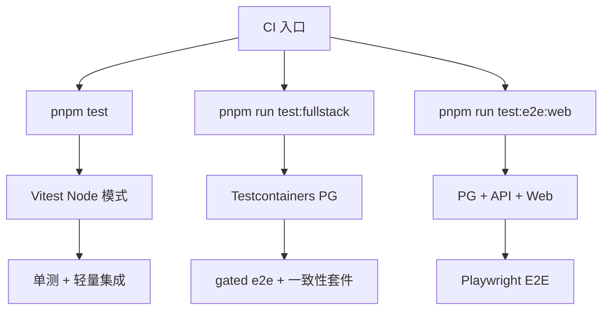

# 测试策略

<cite>
**本文引用的文件**   
- [vitest.config.ts](file://vitest.config.ts)
- [vitest.browser.config.ts](file://vitest.browser.config.ts)
- [vitest.consistency.config.ts](file://vitest.consistency.config.ts)
- [playwright.config.ts](file://playwright.config.ts)
- [package.json](file://package.json)
- [scripts/ci-fullstack.ts](file://scripts/ci-fullstack.ts)
- [scripts/e2e-web.ts](file://scripts/e2e-web.ts)
- [apps/web/src/browser.smoke.browser.test.ts](file://apps/web/src/browser.smoke.browser.test.ts)
</cite>

## 目录
1. [引言](#引言)
2. [项目结构与测试分层](#项目结构与测试分层)
3. [核心测试配置与最佳实践](#核心测试配置与最佳实践)
4. [架构总览](#架构总览)
5. [详细组件分析](#详细组件分析)
6. [依赖关系分析](#依赖关系分析)
7. [性能与稳定性考量](#性能与稳定性考量)
8. [持续集成中的测试流程](#持续集成中的测试流程)
9. [测试编写指南](#测试编写指南)
10. [常见测试场景与调试方法](#常见测试场景与调试方法)
11. [测试环境搭建与配置](#测试环境搭建与配置)
12. [结论](#结论)

## 引言
本测试策略文档面向 NestJS SaaS 前端、后端及全栈端到端测试，目标是建立可维护、可扩展且具备强门禁能力的三层测试体系：单元测试、集成测试与端到端测试。仓库采用 Vitest 作为主要测试运行器，结合 SWC 对装饰器与元数据的支持；使用 Playwright 驱动真实浏览器进行部署态黄金流 E2E；通过 Testcontainers 在 CI 中拉起一次性 PostgreSQL 容器，保证数据库相关用例的隔离性与可重复性。

该策略强调以下原则：
- 分层清晰：单元/逻辑层由 Vitest Node 模式覆盖，浏览器交互由 Vitest Browser Mode 或 Playwright 覆盖，真实部署态由 Playwright + 编排器覆盖。
- 配置隔离：默认 Vitest 配置仅跑单测与轻量集成；一致性套件、浏览器模式、Playwright E2E 均通过独立配置或脚本 opt-in 触发。
- 门禁可控：默认 CI 不跑昂贵 E2E；全栈 DB e2e 与 Web E2E 需显式命令或环境变量触发。
- 可观测与可复现：覆盖率报告、失败截图、迁移基线回放、一次性容器清理，确保问题可定位、结果可复现。

## 项目结构与测试分层
仓库测试按“应用模块 + 工具脚本”组织，测试文件命名遵循约定：
- 单元测试与轻量集成测试：`*.test.ts` / `*.test.tsx`
- 一致性/高成本集成测试：`*.spec.ts`（受环境变量门控）
- 端到端测试：`*.e2e.test.ts`（DB 真库 gated）
- 浏览器冒烟测试：`*.browser.test.{ts,tsx}`
- Playwright E2E：位于 `e2e/` 目录下的 `*.spec.ts`

**图表来源**
- [vitest.config.ts:10-83](file://vitest.config.ts#L10-L83)
- [vitest.browser.config.ts:9-39](file://vitest.browser.config.ts#L9-L39)
- [vitest.consistency.config.ts:15-42](file://vitest.consistency.config.ts#L15-L42)
- [playwright.config.ts:15-30](file://playwright.config.ts#L15-L30)
- [package.json:11-65](file://package.json#L11-L65)
- [scripts/ci-fullstack.ts:1-249](file://scripts/ci-fullstack.ts#L1-L249)
- [scripts/e2e-web.ts:1-206](file://scripts/e2e-web.ts#L1-L206)

**章节来源**
- [vitest.config.ts:10-83](file://vitest.config.ts#L10-L83)
- [vitest.browser.config.ts:9-39](file://vitest.browser.config.ts#L9-L39)
- [vitest.consistency.config.ts:15-42](file://vitest.consistency.config.ts#L15-L42)
- [playwright.config.ts:15-30](file://playwright.config.ts#L15-L30)
- [package.json:11-65](file://package.json#L11-L65)

## 核心测试配置与最佳实践
### Vitest 主配置（Node 模式）
- 目标与职责：运行所有 `apps/**/*.test.ts/.tsx`、`libs/**/*.test.ts`、`packages/**/*.test.ts`、`scripts/**/*.test.ts`，排除浏览器专用测试与构建产物。
- 关键特性：
  - 启用 `resolve.tsconfigPaths`，支持 tsconfig 路径别名。
  - 使用 `unplugin-swc` 编译 TS，开启装饰器与 `emitDecoratorMetadata`，满足 Nest DI 与 reflect-metadata。
  - 设置 `environment: 'node'`，并通过 `test.env` 注入最小必要环境变量，避免加载真实 `.env`。
  - 提高首次导入完整 AppModule 的超时阈值，避免冷启动开销导致误判。
  - 覆盖率使用 v8 provider，输出 text/html/lcov，并定义 include/exclude 规则以聚焦业务代码。

**图表来源**
- [vitest.config.ts:10-83](file://vitest.config.ts#L10-L83)

**章节来源**
- [vitest.config.ts:10-83](file://vitest.config.ts#L10-L83)

### Vitest 浏览器模式配置
- 目标与职责：为 `apps/web/src/**/*.browser.test.{ts,tsx}` 提供基于 Playwright 的真浏览器 DOM 环境，验证前端交互与路由跳转等 jsdom 无法覆盖的场景。
- 关键特性：
  - 复用 SWC 链，支持 TSX、装饰器与 React automatic runtime。
  - 启用 `browser.enabled`，provider 为 playwright，headless chromium。
  - 单独 opt-in 触发，不并入默认 CI 基线。

**图表来源**
- [vitest.browser.config.ts:9-39](file://vitest.browser.config.ts#L9-L39)

**章节来源**
- [vitest.browser.config.ts:9-39](file://vitest.browser.config.ts#L9-L39)

### Vitest 一致性配置（Auth Flow）
- 目标与职责：运行 authFlow 一致性套件，要求真实 PG 与特定环境变量门控，避免污染默认 CI 基线。
- 关键特性：
  - 仅包含单一一致性 spec 文件。
  - 延长测试与钩子超时，适配 ORM 一致性校验。
  - 通过 `BA_MIKRO_CONSISTENCY=1` 与 `DATABASE_URL` 控制是否执行。

**图表来源**
- [vitest.consistency.config.ts:15-42](file://vitest.consistency.config.ts#L15-L42)

**章节来源**
- [vitest.consistency.config.ts:15-42](file://vitest.consistency.config.ts#L15-L42)

### Playwright E2E 配置
- 目标与职责：驱动真实部署态 SPA，执行登录→首页引导落租→创建 post 的核心写流程。
- 关键特性：
  - 测试目录 `./e2e`，串行执行、无重试，避免状态机链路被并发掩盖。
  - 从 `E2E_BASE_URL` 读取 baseURL，默认指向本地 vite dev。
  - 仅 chromium，headless，失败截图，关闭 trace 以减少 IO。
  - 生命周期由 `scripts/e2e-web.ts` 编排，本配置不自行起服务。

**图表来源**
- [playwright.config.ts:15-30](file://playwright.config.ts#L15-L30)
- [scripts/e2e-web.ts:1-206](file://scripts/e2e-web.ts#L1-L206)

**章节来源**
- [playwright.config.ts:15-30](file://playwright.config.ts#L15-L30)
- [scripts/e2e-web.ts:1-206](file://scripts/e2e-web.ts#L1-L206)

## 架构总览
整体测试架构分为四层：
- 单元测试层：Vitest Node 模式，覆盖业务逻辑、过滤器、拦截器、配置、ORM 适配器、领域服务等。
- 集成测试层：Vitest Node 模式 + 可选真实 PG（gated），覆盖 HTTP 契约、事件存储、出站中继、租户隔离、授权矩阵等。
- 浏览器模式层：Vitest Browser Mode + Playwright provider，覆盖前端 DOM 操作、路由跳转、浏览器 UA 等。
- 部署态 E2E 层：Playwright + 编排器，覆盖真实部署态 SPA 的黄金流。

**图表来源**
- [vitest.config.ts:10-83](file://vitest.config.ts#L10-L83)
- [vitest.browser.config.ts:9-39](file://vitest.browser.config.ts#L9-L39)
- [playwright.config.ts:15-30](file://playwright.config.ts#L15-L30)
- [scripts/ci-fullstack.ts:1-249](file://scripts/ci-fullstack.ts#L1-L249)
- [scripts/e2e-web.ts:1-206](file://scripts/e2e-web.ts#L1-L206)

## 详细组件分析
### Vitest 主配置详解
- 路径解析：启用 `tsconfigPaths`，统一前后端路径别名。
- 转换链：SWC 开启 TypeScript 语法、装饰器、动态导入、React automatic runtime，保持与生产构建一致。
- 测试环境：Node 环境，全局禁用 globals，避免隐式依赖。
- 超时策略：提升 testTimeout/hookTimeout，应对冷启动 AppModule/CqrsModule 的初始开销。
- 包含/排除：明确 include 范围，排除浏览器专用测试与 node_modules/dist。
- 环境变量：注入 NODE_ENV、LOG_LEVEL、JWT_SECRET、STORAGE_*、STRIPE_* 等最小集，避免真实凭据泄露。
- 覆盖率：v8 provider，text/html/lcov 报告，include 业务代码，exclude 测试、DTO、接口、main、seed、module 文件。

**章节来源**
- [vitest.config.ts:10-83](file://vitest.config.ts#L10-L83)

### Vitest 浏览器模式详解
- 适用场景：需要真实浏览器 DOM 与 UA 的测试，如路由跳转、SPA 交互、跨域代理行为。
- 配置要点：
  - 仅匹配 `apps/web/src/**/*.browser.test.{ts,tsx}`。
  - 启用 browser.provider=playwright，headless chromium。
  - 延长超时以适应浏览器启动与页面渲染。
- 示例用例：浏览器冒烟测试验证 window/document 存在、UA 属 chromium。

**章节来源**
- [vitest.browser.config.ts:9-39](file://vitest.browser.config.ts#L9-L39)
- [apps/web/src/browser.smoke.browser.test.ts:1-20](file://apps/web/src/browser.smoke.browser.test.ts#L1-L20)

### Vitest 一致性配置详解
- 适用场景：authFlow 一致性校验，需真实 PG 与严格环境门控。
- 配置要点：
  - 仅包含单一 spec 文件，避免污染默认测试集合。
  - 延长超时，适配 ORM 一致性断言。
  - 通过 `BA_MIKRO_CONSISTENCY=1` 与 `DATABASE_URL` 控制执行。
- 门禁策略：默认 CI 不纳入，需显式运行 `test:auth-consistency`。

**章节来源**
- [vitest.consistency.config.ts:15-42](file://vitest.consistency.config.ts#L15-L42)

### Playwright E2E 详解
- 适用场景：真实部署态 SPA 的黄金流，包括登录、落租、创建 post 等核心写操作。
- 配置要点：
  - 测试目录 `./e2e`，串行执行、无重试，避免状态机链路被并发掩盖。
  - baseURL 来自 `E2E_BASE_URL`，默认本地 vite dev。
  - 仅 chromium，headless，失败截图，关闭 trace。
- 编排器职责：
  - 启动一次性 PG，重放基线迁移，seed 数据。
  - 编译产物并启动 API，轮询健康检查。
  - 启动 vite dev，代理 `/api` 到 API。
  - 运行 Playwright 测试，最终清理资源。

**章节来源**
- [playwright.config.ts:15-30](file://playwright.config.ts#L15-L30)
- [scripts/e2e-web.ts:1-206](file://scripts/e2e-web.ts#L1-L206)

### Mock 策略与异步测试处理
- Mock 策略：
  - 优先使用 Nest Testing 提供的 `TestingModule` 与 `Test.createNestApplication` 进行依赖替换。
  - 对外部服务（如 Stripe、S3、Odoo RPC）建议使用端口/适配器抽象，并在测试中注入 mock 实现。
  - 对于文件系统、网络请求、时间相关逻辑，建议使用标准库或第三方 mock 工具（如 `vi.fn()`、`vi.useFakeTimers()`）。
- 异步测试处理：
  - 使用 `async/await` 与 `expect().resolves`/`rejects` 进行断言。
  - 对于长耗时操作（如 ORM 一致性、浏览器启动），适当提升超时阈值。
  - 避免在测试中共享可变状态，必要时使用 `beforeEach`/`afterEach` 重置。

[本节为通用指导，不直接分析具体文件]

### 测试文件组织规范
- 文件名约定：
  - 单元测试：`*.test.ts` / `*.test.tsx`
  - 一致性测试：`*.spec.ts`
  - 端到端测试：`*.e2e.test.ts`
  - 浏览器测试：`*.browser.test.{ts,tsx}`
- 目录结构：
  - 按功能模块组织测试文件，与源码结构对应。
  - 公共测试工具放在 `testing/` 或 `__tests__/` 目录。
- 命名规范：
  - 测试描述应清晰表达被测行为与预期结果。
  - 避免使用模糊名称如 `test1`、`test2`。

[本节为通用指导，不直接分析具体文件]

## 依赖关系分析
测试配置与脚本之间的依赖关系如下：

**图表来源**
- [package.json:11-65](file://package.json#L11-L65)
- [scripts/ci-fullstack.ts:1-249](file://scripts/ci-fullstack.ts#L1-L249)
- [scripts/e2e-web.ts:1-206](file://scripts/e2e-web.ts#L1-L206)

**章节来源**
- [package.json:11-65](file://package.json#L11-L65)
- [scripts/ci-fullstack.ts:1-249](file://scripts/ci-fullstack.ts#L1-L249)
- [scripts/e2e-web.ts:1-206](file://scripts/e2e-web.ts#L1-L206)

## 性能与稳定性考量
- 冷启动优化：Vitest 首次导入 AppModule 可能较慢，已提升超时阈值以避免误判。
- 并行与串行：Playwright E2E 串行执行，避免状态机链路被并发掩盖。
- 资源清理：Testcontainers 一次性容器在 finally 块中显式停止，避免遗留进程。
- 覆盖率收集：v8 provider 高效且准确，报告输出至 `./coverage`。
- 重试策略：E2E 无重试，确保失败可复现；单测可根据需求调整重试策略。

[本节为通用指导，不直接分析具体文件]

## 持续集成中的测试流程
CI 流程分为三个层次：
- 基础测试：`pnpm test` 运行 Vitest Node 模式，覆盖单测与轻量集成。
- 全栈测试：`pnpm run test:fullstack` 启动 Testcontainers PG，运行 gated e2e 与一致性套件。
- Web E2E：`pnpm run test:e2e:web` 启动完整栈（PG + API + Web），运行 Playwright E2E。

**图表来源**
- [package.json:32-55](file://package.json#L32-L55)
- [scripts/ci-fullstack.ts:1-249](file://scripts/ci-fullstack.ts#L1-L249)
- [scripts/e2e-web.ts:1-206](file://scripts/e2e-web.ts#L1-L206)

**章节来源**
- [package.json:32-55](file://package.json#L32-L55)
- [scripts/ci-fullstack.ts:1-249](file://scripts/ci-fullstack.ts#L1-L249)
- [scripts/e2e-web.ts:1-206](file://scripts/e2e-web.ts#L1-L206)

## 测试编写指南
- 单元测试：
  - 聚焦单一函数或类的方法，避免依赖外部服务。
  - 使用 `describe`/`it` 组织测试用例，断言输入输出与副作用。
  - 对于异步逻辑，使用 `async/await` 与 `expect().resolves`/`rejects`。
- 集成测试：
  - 使用 `TestingModule` 组装被测模块，注入 mock 依赖。
  - 对于 DB 相关测试，使用 Testcontainers 或内存数据库。
  - 对于 HTTP 接口，使用 Fastify Testing 或 supertest 风格封装。
- 端到端测试：
  - 聚焦用户旅程，如登录、创建资源、权限校验。
  - 使用 Playwright 进行浏览器自动化，避免过度耦合 UI 细节。
  - 对于状态机链路，串行执行，避免并发干扰。
- 浏览器模式测试：
  - 验证 DOM 操作、路由跳转、浏览器 UA 等 jsdom 无法覆盖的场景。
  - 复用 SWC 链，确保与生产构建一致。

[本节为通用指导，不直接分析具体文件]

## 常见测试场景与调试方法
- 常见场景：
  - 认证与授权：登录、SSO、会话恢复、权限矩阵。
  - 租户隔离：跨租户访问拒绝、激活/解绑、可见性策略。
  - 支付与订阅：Stripe 回调、席位配额、退租流程。
  - 存储与上传：S3/OSS/Tencent COS 适配器。
  - 事件与消息：事件存储、出站中继、订阅流。
- 调试方法：
  - 使用 `console.log` 或日志框架输出上下文信息。
  - 对于浏览器测试，启用失败截图与 trace（Playwright）。
  - 对于 DB 测试，查看迁移回放与种子数据。
  - 对于 CI 失败，拉取日志与 artifacts 进行分析。

[本节为通用指导，不直接分析具体文件]

## 测试环境搭建与配置
- 前置条件：
  - Node.js >= 22
  - pnpm 包管理器
  - Docker（用于 Testcontainers）
  - Playwright 浏览器二进制（chromium）
- 安装依赖：
  - `pnpm install`
- 运行测试：
  - 单测：`pnpm test`
  - 带覆盖率：`pnpm test:cov`
  - 浏览器模式：`pnpm run ci:e2e:web`
  - 一致性套件：`pnpm run test:auth-consistency`
  - 全栈测试：`pnpm run test:fullstack`
  - Web E2E：`pnpm run test:e2e:web`
- 环境变量：
  - 单测：通过 `vitest.config.ts` 注入最小集。
  - 全栈测试：通过 `scripts/ci-fullstack.ts` 注入 `DATABASE_URL` 与 `E2E_DATABASE_URL`。
  - Web E2E：通过 `scripts/e2e-web.ts` 注入 `E2E_BASE_URL`、`E2E_ADMIN_EMAIL`、`E2E_ADMIN_PASSWORD`。

**章节来源**
- [package.json:75-77](file://package.json#L75-L77)
- [package.json:49-55](file://package.json#L49-L55)
- [vitest.config.ts:48-66](file://vitest.config.ts#L48-L66)
- [scripts/ci-fullstack.ts:229-240](file://scripts/ci-fullstack.ts#L229-L240)
- [scripts/e2e-web.ts:163-171](file://scripts/e2e-web.ts#L163-L171)

## 结论
本测试策略通过 Vitest 与 Playwright 的组合，构建了覆盖单元、集成、端到端的完整测试体系。通过配置隔离、环境变量门控、Testcontainers 一次性容器与编排器，确保了测试的可维护性、可重复性与门禁可控性。建议团队遵循本文档的编写规范与最佳实践，持续提升测试质量与交付效率。