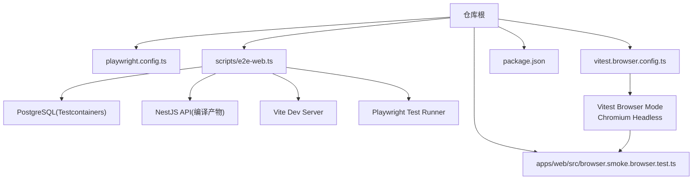
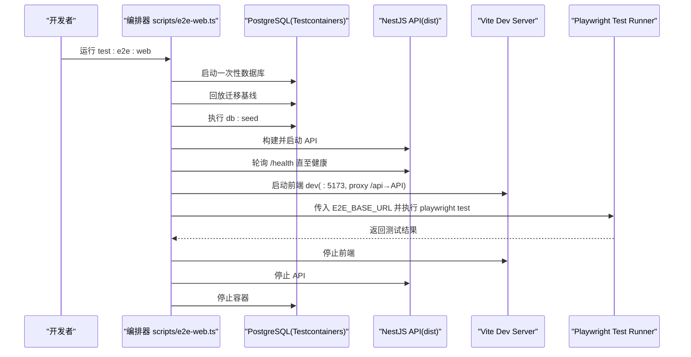
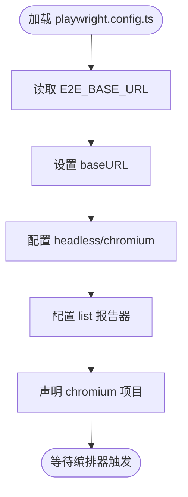
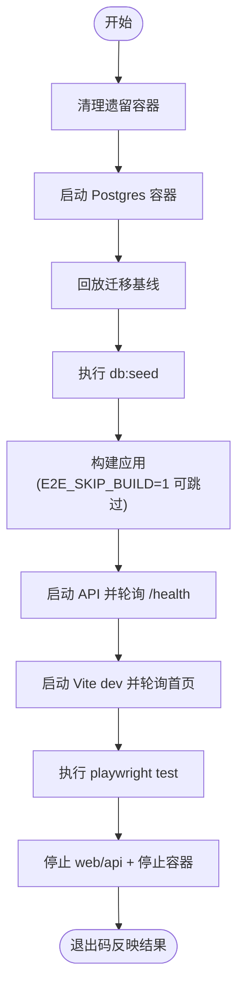
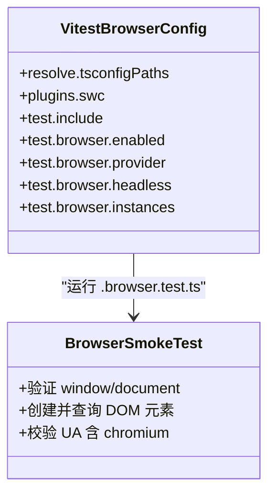
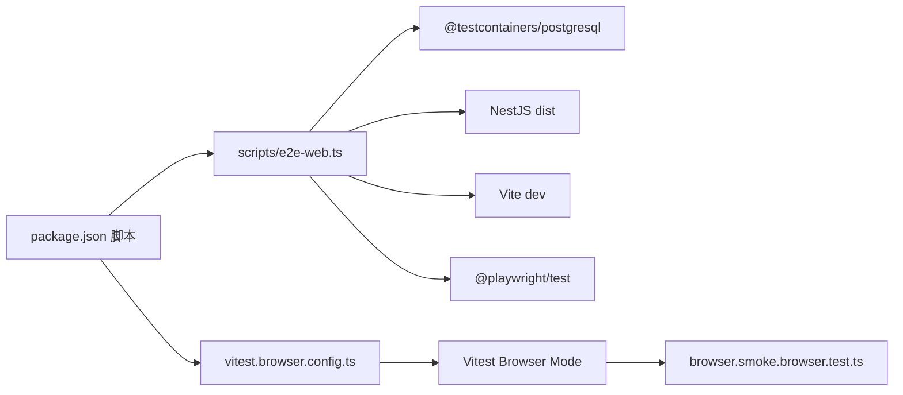

# 端到端测试

<cite>
**本文引用的文件**   
- [playwright.config.ts](file://playwright.config.ts)
- [scripts/e2e-web.ts](file://scripts/e2e-web.ts)
- [vitest.browser.config.ts](file://vitest.browser.config.ts)
- [apps/web/src/browser.smoke.browser.test.ts](file://apps/web/src/browser.smoke.browser.test.ts)
- [package.json](file://package.json)
</cite>

## 目录
1. [引言](#引言)
2. [项目结构](#项目结构)
3. [核心组件](#核心组件)
4. [架构总览](#架构总览)
5. [详细组件分析](#详细组件分析)
6. [依赖关系分析](#依赖关系分析)
7. [性能与稳定性考量](#性能与稳定性考量)
8. [故障排查指南](#故障排查指南)
9. [结论](#结论)
10. [附录：命令与运行方式](#附录命令与运行方式)

## 引言
本文件面向“端到端测试”主题，聚焦 Playwright 在本仓库中的配置与使用方式，并说明如何结合 Vitest Browser Mode、Testcontainers 与 Vite/NestJS 真实部署栈，完成浏览器自动化测试、用户流程模拟与跨浏览器兼容性验证。文档同时给出冒烟测试、回归测试、视觉回归测试的落地建议，以及前端路由、表单交互、认证流程等典型 E2E 用例的组织方式；最后补充并行执行、测试报告生成与持续集成中的 E2E 流程设计。

## 项目结构
本项目采用多包工作区，E2E 相关能力分布在以下位置：
- 根级 Playwright 配置：`playwright.config.ts`
- E2E 编排脚本：`scripts/e2e-web.ts`
- Vitest Browser Mode 配置（切片 A）：`vitest.browser.config.ts`
- 浏览器冒烟测试示例：`apps/web/src/browser.smoke.browser.test.ts`
- 顶层脚本入口：`package.json`

**图表来源**
- [playwright.config.ts:1-31](file://playwright.config.ts#L1-L31)
- [scripts/e2e-web.ts:1-206](file://scripts/e2e-web.ts#L1-L206)
- [vitest.browser.config.ts:1-40](file://vitest.browser.config.ts#L1-L40)
- [apps/web/src/browser.smoke.browser.test.ts:1-21](file://apps/web/src/browser.smoke.browser.test.ts#L1-L21)
- [package.json:11-65](file://package.json#L11-L65)

**章节来源**
- [playwright.config.ts:1-31](file://playwright.config.ts#L1-L31)
- [scripts/e2e-web.ts:1-206](file://scripts/e2e-web.ts#L1-L206)
- [vitest.browser.config.ts:1-40](file://vitest.browser.config.ts#L1-L40)
- [apps/web/src/browser.smoke.browser.test.ts:1-21](file://apps/web/src/browser.smoke.browser.test.ts#L1-L21)
- [package.json:11-65](file://package.json#L11-L65)

## 核心组件
- Playwright 配置层：定义测试目录、并行策略、浏览器项目、截图与追踪策略、baseURL 注入等。
- E2E 编排器：一次性拉起 PostgreSQL、执行迁移与 seed、构建并启动 API、启动 Vite dev server，再调用 Playwright 执行 e2e 测试，最终清理资源。
- Vitest Browser Mode：以 playwright 为 provider，在 Chromium headless 中运行 `.browser.test.ts/tsx`，用于组件/逻辑级真浏览器冒烟。
- 浏览器冒烟用例：验证 window/document 存在、DOM 操作与 UA 特征，证明真浏览器环境可用。
- 脚本入口：通过 `package.json` 暴露 `test:e2e:web` 与 `ci:e2e:web` 两类命令，分别驱动真实部署态黄金流与浏览器模式冒烟。

**章节来源**
- [playwright.config.ts:1-31](file://playwright.config.ts#L1-L31)
- [scripts/e2e-web.ts:1-206](file://scripts/e2e-web.ts#L1-L206)
- [vitest.browser.config.ts:1-40](file://vitest.browser.config.ts#L1-L40)
- [apps/web/src/browser.smoke.browser.test.ts:1-21](file://apps/web/src/browser.smoke.browser.test.ts#L1-L21)
- [package.json:49-65](file://package.json#L49-L65)

## 架构总览
下图展示“部署态黄金流 E2E”的整体时序：从数据库容器化到前端页面可访问，再到 Playwright 执行测试，最后统一回收资源。

**图表来源**
- [scripts/e2e-web.ts:91-190](file://scripts/e2e-web.ts#L91-L190)
- [playwright.config.ts:15-30](file://playwright.config.ts#L15-L30)

## 详细组件分析

### Playwright 配置层
- 测试目录：指向 `./e2e`，用于存放基于 Playwright 的 E2E 用例。
- 执行模型：关闭并行、单 worker、零重试，确保状态机式黄金流稳定。
- 浏览器项目：仅 chromium，便于快速收敛问题。
- 运行时选项：headless、失败截图、trace 关闭；baseURL 优先读取环境变量，否则回退本地开发端口。
- 报告器：list 输出，适合 CI 日志阅读。

**图表来源**
- [playwright.config.ts:15-30](file://playwright.config.ts#L15-L30)

**章节来源**
- [playwright.config.ts:1-31](file://playwright.config.ts#L1-L31)

### E2E 编排器（scripts/e2e-web.ts）
职责边界清晰：
- 容器管理：使用 Testcontainers 启动一次性 PostgreSQL，清理残留容器，避免污染。
- 数据准备：回放迁移基线，执行 seed，产出可登录运营者与组织数据。
- 服务启动：构建 NestJS 应用并启动 dist/main.js，轮询 `/health` 确认就绪。
- 前端启动：启动 Vite dev server，将 `/api` 代理至 API，保证同源 Cookie/CSRF。
- 测试执行：调用 Playwright 执行 `e2e/*.spec.ts`，透传环境变量。
- 资源回收：优雅终止子进程并停止容器，保证“用完即焚”。

**图表来源**
- [scripts/e2e-web.ts:36-84](file://scripts/e2e-web.ts#L36-L84)
- [scripts/e2e-web.ts:91-190](file://scripts/e2e-web.ts#L91-L190)

**章节来源**
- [scripts/e2e-web.ts:1-206](file://scripts/e2e-web.ts#L1-L206)

### Vitest Browser Mode（切片 A）
- 目标：在不启动后端的情况下，用 Chromium headless 运行 `.browser.test.ts/tsx`，验证 DOM 与浏览器环境可用性。
- 关键配置：启用 browser.provider=playwright，限定 chromium，headless，实例数 1，包含 apps/web 下的 browser.test 文件。
- 典型用例：浏览器冒烟测试验证 window/document 存在、DOM 操作与 UA 特征。

**图表来源**
- [vitest.browser.config.ts:9-39](file://vitest.browser.config.ts#L9-L39)
- [apps/web/src/browser.smoke.browser.test.ts:5-20](file://apps/web/src/browser.smoke.browser.test.ts#L5-L20)

**章节来源**
- [vitest.browser.config.ts:1-40](file://vitest.browser.config.ts#L1-L40)
- [apps/web/src/browser.smoke.browser.test.ts:1-21](file://apps/web/src/browser.smoke.browser.test.ts#L1-L21)

### 浏览器冒烟测试（apps/web/src/browser.smoke.browser.test.ts）
- 断言浏览器全局对象存在，证明非 jsdom。
- 动态创建 DOM 节点并查询，验证渲染链路。
- 检查 navigator.userAgent 包含 chromium，确认真实浏览器内核。

该用例作为“切片 A”的基础保障，确保后续更复杂的 UI 交互测试具备稳定的浏览器环境。

**章节来源**
- [apps/web/src/browser.smoke.browser.test.ts:1-21](file://apps/web/src/browser.smoke.browser.test.ts#L1-L21)

## 依赖关系分析
- 顶层脚本通过 `pnpm run test:e2e:web` 调用 `scripts/e2e-web.ts`，后者依次依赖：
  - Testcontainers PostgreSQL
  - NestJS 构建产物
  - Vite dev server
  - Playwright Test Runner
- Vitest Browser Mode 独立于 Playwright E2E，通过 `pnpm run ci:e2e:web` 触发，仅依赖 Chromium 与 SWC 转译链。

**图表来源**
- [package.json:49-65](file://package.json#L49-L65)
- [scripts/e2e-web.ts:16-20](file://scripts/e2e-web.ts#L16-L20)
- [vitest.browser.config.ts:1-40](file://vitest.browser.config.ts#L1-L40)

**章节来源**
- [package.json:49-65](file://package.json#L49-L65)
- [scripts/e2e-web.ts:1-206](file://scripts/e2e-web.ts#L1-L206)
- [vitest.browser.config.ts:1-40](file://vitest.browser.config.ts#L1-L40)

## 性能与稳定性考量
- 串行执行：Playwright 配置关闭并行与重试，避免状态机式黄金流出现竞态。
- 资源隔离：Testcontainers 一次性数据库，编排器负责清理，避免污染。
- 健康检查：API 与 Vite 均做轮询健康检查，缩短等待时间并快速失败。
- 构建优化：支持 `E2E_SKIP_BUILD=1` 复用已有 dist，加速本地迭代。
- 截图策略：仅在失败时截图，减少 IO 开销。

[本节为通用指导，不直接分析具体文件]

## 故障排查指南
- Docker 不可用或镜像拉取失败：
  - 编排器会尝试清理遗留容器；若 docker 缺失，会在启动阶段报错。
  - 参考：容器启动与清理逻辑。
- API 未就绪：
  - 检查 `/health` 是否返回 2xx；若超时则抛出错误。
  - 参考：健康检查轮询实现。
- Vite 未就绪：
  - 检查前端 dev server 是否监听指定端口并可访问。
  - 参考：前端健康检查轮询实现。
- Playwright 未找到浏览器二进制：
  - 确保已安装 Chromium；切片 A 已准备缓存路径。
  - 参考：Playwright 配置与 Vitest Browser Mode 配置。
- 端口冲突：
  - 可通过环境变量调整 API/Web 端口；默认 API:7009、Web:5173。
  - 参考：端口与环境变量处理。

**章节来源**
- [scripts/e2e-web.ts:36-84](file://scripts/e2e-web.ts#L36-L84)
- [scripts/e2e-web.ts:141-161](file://scripts/e2e-web.ts#L141-L161)
- [playwright.config.ts:22-29](file://playwright.config.ts#L22-L29)
- [vitest.browser.config.ts:32-37](file://vitest.browser.config.ts#L32-L37)

## 结论
本项目通过 Playwright 与 Vitest Browser Mode 双轨覆盖 E2E 测试需求：
- 切片 B（Playwright）：以真实部署栈为核心，串联数据库、API、前端与浏览器，验证端到端黄金流。
- 切片 A（Vitest Browser Mode）：在无后端情况下验证浏览器环境与 DOM 操作，提升反馈速度。
两者互补，既保证“配置就位”，也保证“实跑对拍”。配合 Testcontainers 与编排器，形成“一键起栈、用完即焚”的稳定 E2E 体验。

[本节为总结性内容，不直接分析具体文件]

## 附录：命令与运行方式
- 运行真实部署态黄金流：
  - 命令：`pnpm run test:e2e:web`
  - 行为：启动 PG → 迁移 → seed → 构建 → 启动 API → 启动 Vite → 执行 Playwright → 清理
- 运行浏览器模式冒烟：
  - 命令：`pnpm run ci:e2e:web`
  - 行为：以 Chromium headless 运行 `.browser.test.ts/tsx`
- 环境变量要点：
  - `E2E_BASE_URL`：Playwright baseURL
  - `E2E_API_PORT`、`E2E_WEB_PORT`：API/Web 端口
  - `E2E_ADMIN_EMAIL`、`E2E_ADMIN_PASSWORD`、`E2E_USER_PASSWORD`：种子数据账号密码
  - `E2E_SKIP_BUILD=1`：跳过构建，复用 dist

**章节来源**
- [package.json:49-65](file://package.json#L49-L65)
- [scripts/e2e-web.ts:21-29](file://scripts/e2e-web.ts#L21-L29)
- [scripts/e2e-web.ts:132-139](file://scripts/e2e-web.ts#L132-L139)
- [playwright.config.ts:22-29](file://playwright.config.ts#L22-L29)