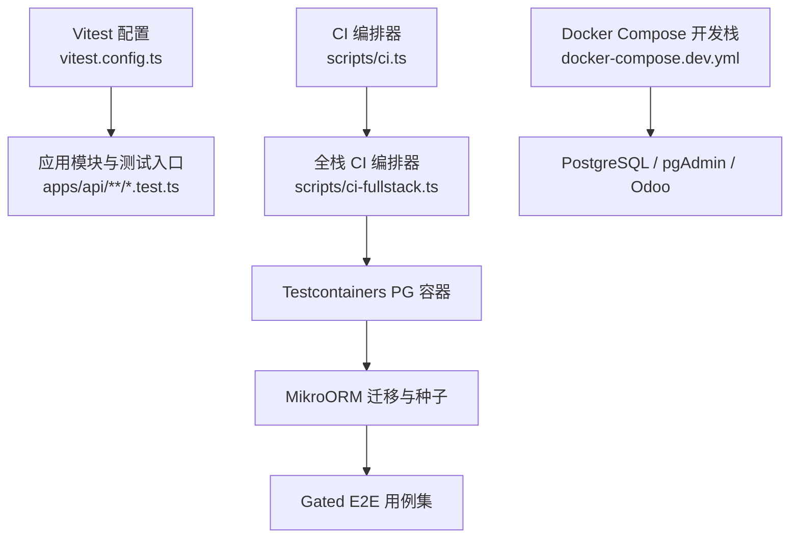
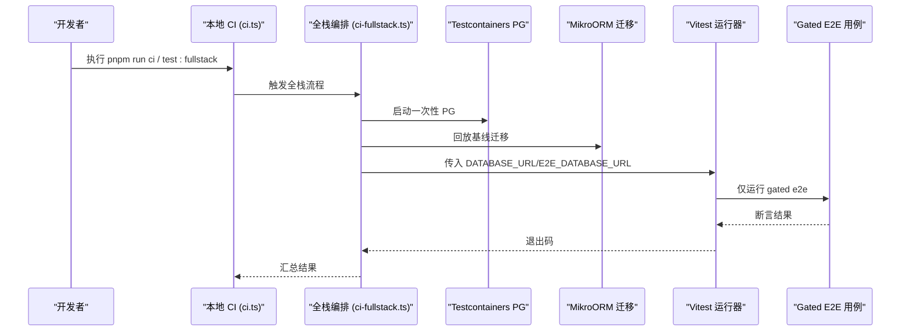
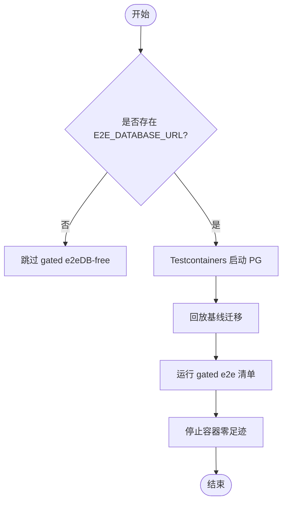
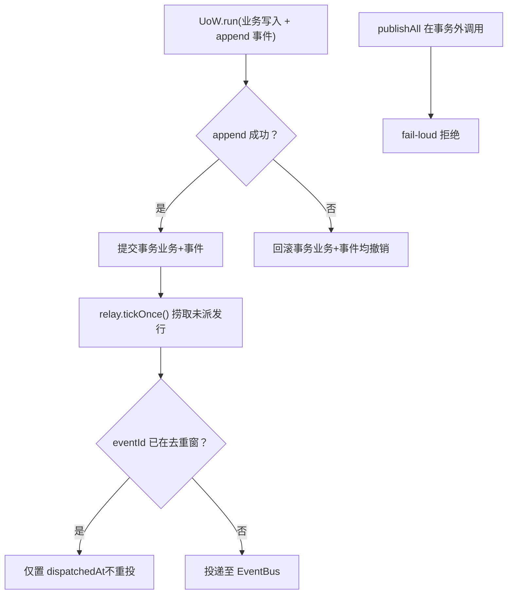
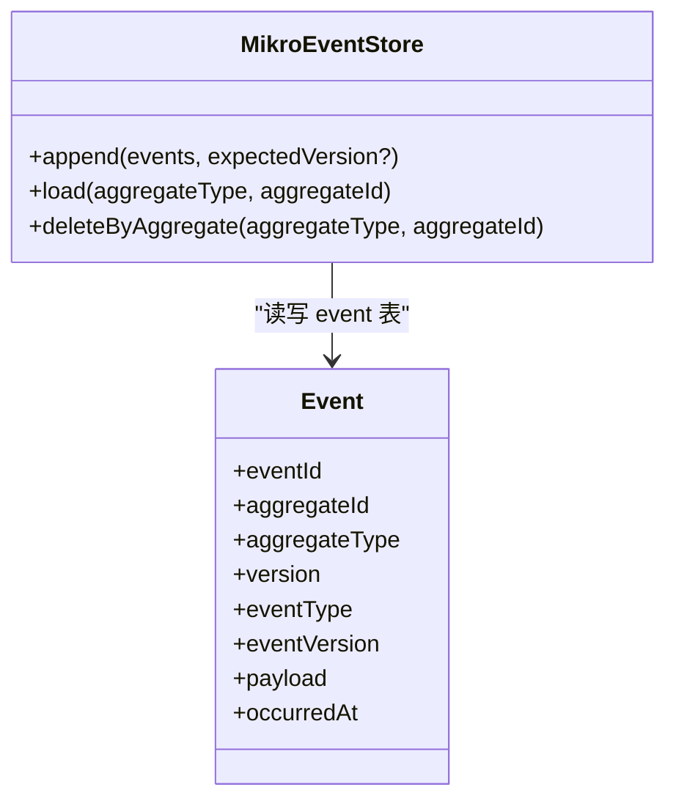
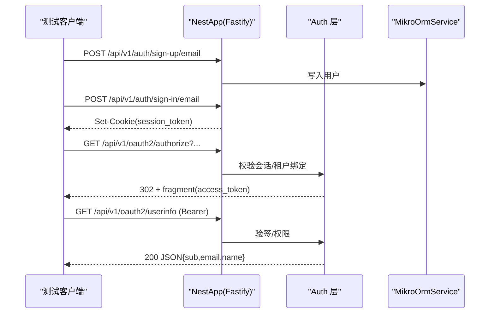
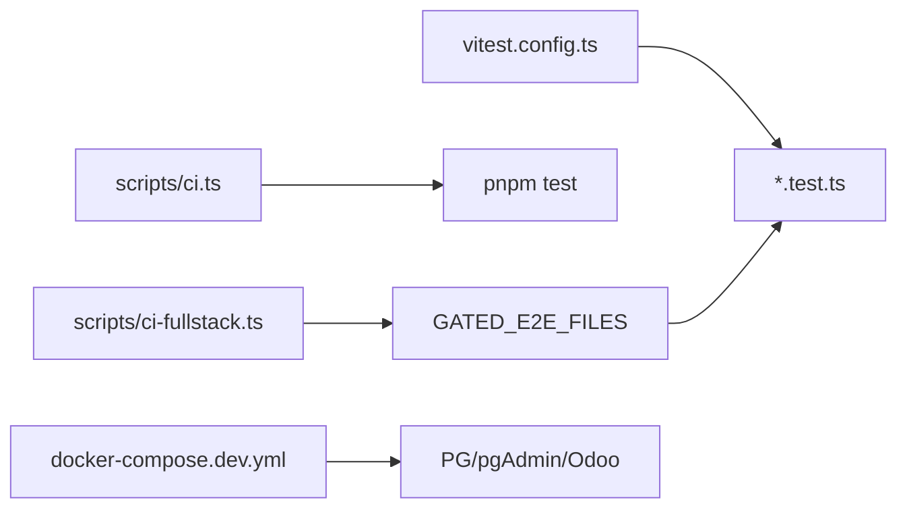

# 集成测试

<cite>
**本文引用的文件**   
- [vitest.config.ts](file://vitest.config.ts)
- [docker-compose.dev.yml](file://docker-compose.dev.yml)
- [ci-fullstack.ts](file://scripts/ci-fullstack.ts)
- [ci.ts](file://scripts/ci.ts)
- [event-store.mikro.e2e.test.ts](file://apps/api/src/database/eventing/event-store.mikro.e2e.test.ts)
- [outbox-relay.e2e.test.ts](file://apps/api/src/database/eventing/outbox-relay.e2e.test.ts)
- [oauth-sso.e2e.test.ts](file://apps/api/src/modules/auth/oauth-sso.e2e.test.ts)
- [oauth-sso.e2e.setup.ts](file://apps/api/src/modules/auth/oauth-sso.e2e.setup.ts)
</cite>

## 目录
1. [引言](#引言)
2. [项目结构](#项目结构)
3. [核心组件](#核心组件)
4. [架构总览](#架构总览)
5. [详细组件分析](#详细组件分析)
6. [依赖关系分析](#依赖关系分析)
7. [性能与并发](#性能与并发)
8. [故障排查指南](#故障排查指南)
9. [结论](#结论)
10. [附录](#附录)

## 引言
本文件面向“模块间交互与数据持久化”的集成测试，覆盖数据库环境搭建、测试数据准备、事务回滚策略、API 端点集成测试、外部服务 Mock、消息队列/事件总线测试、微服务/事件驱动集成最佳实践，以及测试隔离、并发控制与性能基准建议。内容基于仓库现有实现进行系统化梳理，帮助读者在本地与 CI 中稳定运行端到端（E2E）与集成测试。

## 项目结构
本项目采用 NestJS + Fastify 模块化单体，测试体系以 Vitest 为核心，结合 Testcontainers 提供一次性 PostgreSQL 容器，配合迁移脚本完成库表初始化；同时通过环境变量开关控制“带库 E2E”用例是否执行，保证默认 CI 保持 DB-free 不变量。

图表来源
- [vitest.config.ts:1-84](file://vitest.config.ts#L1-L84)
- [ci.ts:1-137](file://scripts/ci.ts#L1-L137)
- [ci-fullstack.ts:1-249](file://scripts/ci-fullstack.ts#L1-L249)
- [docker-compose.dev.yml:1-98](file://docker-compose.dev.yml#L1-L98)

章节来源
- [vitest.config.ts:1-84](file://vitest.config.ts#L1-L84)
- [ci.ts:1-137](file://scripts/ci.ts#L1-L137)
- [ci-fullstack.ts:1-249](file://scripts/ci-fullstack.ts#L1-L249)
- [docker-compose.dev.yml:1-98](file://docker-compose.dev.yml#L1-L98)

## 核心组件
- 测试运行时与类型转换：Vitest + SWC，支持装饰器与元数据，统一 tsconfig paths 解析，设置最小环境变量避免启动期校验失败。
- 数据库环境：默认不连真实库；当存在 E2E_DATABASE_URL 时启用 gated e2e；CI 使用 Testcontainers 拉起一次性 PG，并回放基线迁移。
- 事件与出站箱（Outbox）：事件存储与中继在真库往返场景下验证事务原子性、去重重投、版本拒收等关键语义。
- API 集成测试：以 AppModule 全树启动，注入 FastifyAdapter，模拟真实 HTTP 请求链路，覆盖认证、授权、SSO、租户隔离等横切能力。

章节来源
- [vitest.config.ts:1-84](file://vitest.config.ts#L1-L84)
- [ci-fullstack.ts:1-249](file://scripts/ci-fullstack.ts#L1-L249)
- [event-store.mikro.e2e.test.ts:1-236](file://apps/api/src/database/eventing/event-store.mikro.e2e.test.ts#L1-L236)
- [outbox-relay.e2e.test.ts:1-264](file://apps/api/src/database/eventing/outbox-relay.e2e.test.ts#L1-L264)
- [oauth-sso.e2e.test.ts:1-247](file://apps/api/src/modules/auth/oauth-sso.e2e.test.ts#L1-L247)

## 架构总览
下图展示从测试运行到数据库与外部服务的集成路径，以及 CI 如何编排一次性数据库与 gated 用例。

图表来源
- [ci.ts:1-137](file://scripts/ci.ts#L1-L137)
- [ci-fullstack.ts:1-249](file://scripts/ci-fullstack.ts#L1-L249)

## 详细组件分析

### 数据库测试环境与数据准备
- 默认 DB-free：vitest.config.ts 设置默认 DATABASE_URL 指向本地测试库串，但 gated e2e 仅在 E2E_DATABASE_URL 存在时运行，确保默认 CI 不触库。
- 开发联调：docker-compose.dev.yml 提供 PostgreSQL、pgAdmin、Odoo 一体化开发栈，便于本地联调与可视化调试。
- CI 一次性库：ci-fullstack.ts 使用 Testcontainers 拉起 PG，创建两个库（E2E 与一致性校验库），回放已提交基线迁移，再运行 gated e2e 清单。

图表来源
- [vitest.config.ts:33-66](file://vitest.config.ts#L33-L66)
- [ci-fullstack.ts:187-246](file://scripts/ci-fullstack.ts#L187-L246)
- [docker-compose.dev.yml:12-98](file://docker-compose.dev.yml#L12-L98)

章节来源
- [vitest.config.ts:33-66](file://vitest.config.ts#L33-L66)
- [ci-fullstack.ts:187-246](file://scripts/ci-fullstack.ts#L187-L246)
- [docker-compose.dev.yml:12-98](file://docker-compose.dev.yml#L12-L98)

### 事务回滚策略与 Outbox 原子性
- 同事务原子：业务行与事件行在同一 Unit of Work 内提交；若事件追加失败，业务行一并回滚，消除双写窗口。
- 去重重投：对已投递但未标记的事件，再次 tickOnce 只补标记而不重复投递。
- 版本拒收：超出上限 eventVersion 的行进入 park，不再重试，不影响其他行。
- 发布守卫：DefaultDomainEventPublisher 在事务外调用 publishAll 会 fail-loud，强制同事务约束。

图表来源
- [outbox-relay.e2e.test.ts:136-173](file://apps/api/src/database/eventing/outbox-relay.e2e.test.ts#L136-L173)
- [outbox-relay.e2e.test.ts:188-240](file://apps/api/src/database/eventing/outbox-relay.e2e.test.ts#L188-L240)
- [outbox-relay.e2e.test.ts:243-254](file://apps/api/src/database/eventing/outbox-relay.e2e.test.ts#L243-L254)

章节来源
- [outbox-relay.e2e.test.ts:136-173](file://apps/api/src/database/eventing/outbox-relay.e2e.test.ts#L136-L173)
- [outbox-relay.e2e.test.ts:188-240](file://apps/api/src/database/eventing/outbox-relay.e2e.test.ts#L188-L240)
- [outbox-relay.e2e.test.ts:243-254](file://apps/api/src/database/eventing/outbox-relay.e2e.test.ts#L243-L254)

### 事件存储（Event Store）真库往返
- 信封保真：事件 payload、occurredAt、eventId 等字段逐字节落库与读回一致。
- 流版本递增：同一 aggregateId 的版本按 max+1 递增，跨 eventType 共享连续序列。
- 唯一键保护：重复 eventId 追加 fail-loud。
- PIPL 级联清理：deleteByAggregate 按聚合维度删除，返回删除条数，后续查询为空。
- 乐观锁：append(expectedVersion) 不符则整批不写，符合则续位。
- 未知 eventType 回放：load 遇到注册表外 eventType 直接 fail-loud。

图表来源
- [event-store.mikro.e2e.test.ts:72-89](file://apps/api/src/database/eventing/event-store.mikro.e2e.test.ts#L72-L89)
- [event-store.mikro.e2e.test.ts:91-97](file://apps/api/src/database/eventing/event-store.mikro.e2e.test.ts#L91-L97)
- [event-store.mikro.e2e.test.ts:99-123](file://apps/api/src/database/eventing/event-store.mikro.e2e.test.ts#L99-L123)
- [event-store.mikro.e2e.test.ts:136-159](file://apps/api/src/database/eventing/event-store.mikro.e2e.test.ts#L136-L159)
- [event-store.mikro.e2e.test.ts:163-188](file://apps/api/src/database/eventing/event-store.mikro.e2e.test.ts#L163-L188)
- [event-store.mikro.e2e.test.ts:190-210](file://apps/api/src/database/eventing/event-store.mikro.e2e.test.ts#L190-L210)
- [event-store.mikro.e2e.test.ts:212-227](file://apps/api/src/database/eventing/event-store.mikro.e2e.test.ts#L212-L227)

章节来源
- [event-store.mikro.e2e.test.ts:72-89](file://apps/api/src/database/eventing/event-store.mikro.e2e.test.ts#L72-L89)
- [event-store.mikro.e2e.test.ts:91-97](file://apps/api/src/database/eventing/event-store.mikro.e2e.test.ts#L91-L97)
- [event-store.mikro.e2e.test.ts:99-123](file://apps/api/src/database/eventing/event-store.mikro.e2e.test.ts#L99-L123)
- [event-store.mikro.e2e.test.ts:136-159](file://apps/api/src/database/eventing/event-store.mikro.e2e.test.ts#L136-L159)
- [event-store.mikro.e2e.test.ts:163-188](file://apps/api/src/database/eventing/event-store.mikro.e2e.test.ts#L163-L188)
- [event-store.mikro.e2e.test.ts:190-210](file://apps/api/src/database/eventing/event-store.mikro.e2e.test.ts#L190-L210)
- [event-store.mikro.e2e.test.ts:212-227](file://apps/api/src/database/eventing/event-store.mikro.e2e.test.ts#L212-L227)

### API 端点集成测试（含 SSO 隐式流）
- 全链启动：通过 Test.createTestingModule({ imports: [AppModule] }) 启动完整 Nest 应用，注入 FastifyAdapter，设置全局前缀与 URI 版本化，挂载校验管道。
- 会话与鉴权：先注册并登录获取 Cookie，随后访问 authorize 端点；无会话返回 401，携带会话且租户 ready 绑定返回 302 并附带 access_token。
- 资源访问：userinfo 端点走 @Public 旁墙，需携带有效 Bearer；非法 token 返回 401；邮箱未验证返回 403。
- 客户端注册：通过 oauth-sso.e2e.setup.ts 在模块导入前注入 SSO_OAUTH_CLIENTS，确保 config 求值阶段可用。

图表来源
- [oauth-sso.e2e.test.ts:61-92](file://apps/api/src/modules/auth/oauth-sso.e2e.test.ts#L61-L92)
- [oauth-sso.e2e.test.ts:94-121](file://apps/api/src/modules/auth/oauth-sso.e2e.test.ts#L94-L121)
- [oauth-sso.e2e.test.ts:131-163](file://apps/api/src/modules/auth/oauth-sso.e2e.test.ts#L131-L163)
- [oauth-sso.e2e.test.ts:205-238](file://apps/api/src/modules/auth/oauth-sso.e2e.test.ts#L205-L238)
- [oauth-sso.e2e.setup.ts:1-17](file://apps/api/src/modules/auth/oauth-sso.e2e.setup.ts#L1-L17)

章节来源
- [oauth-sso.e2e.test.ts:61-92](file://apps/api/src/modules/auth/oauth-sso.e2e.test.ts#L61-L92)
- [oauth-sso.e2e.test.ts:94-121](file://apps/api/src/modules/auth/oauth-sso.e2e.test.ts#L94-L121)
- [oauth-sso.e2e.test.ts:131-163](file://apps/api/src/modules/auth/oauth-sso.e2e.test.ts#L131-L163)
- [oauth-sso.e2e.test.ts:205-238](file://apps/api/src/modules/auth/oauth-sso.e2e.test.ts#L205-L238)
- [oauth-sso.e2e.setup.ts:1-17](file://apps/api/src/modules/auth/oauth-sso.e2e.setup.ts#L1-L17)

### 外部服务 Mock 与消息队列测试
- 外部服务 Mock：在测试中通过 overrideProvider 替换 OutboxRelay，禁用后台轮询，避免与其他 gated e2e 进程竞争；或使用收集替身捕获总线事件，仅验证投递决定与表状态。
- 消息队列/事件总线：OutboxRelay 通过 EventBus.publishAll 投递；测试中以数组收集替代真实总线，验证事件重建实例与去重逻辑。

章节来源
- [oauth-sso.e2e.test.ts:61-70](file://apps/api/src/modules/auth/oauth-sso.e2e.test.ts#L61-L70)
- [outbox-relay.e2e.test.ts:108-120](file://apps/api/src/database/eventing/outbox-relay.e2e.test.ts#L108-L120)

### 微服务间通信与事件驱动架构测试要点
- 事件溯源：通过 Event Store 的 load/append 验证事件回放与乐观锁，确保不同事件类型在同一流上顺序一致。
- 出站箱模式：将事件持久化与投递解耦，tickOnce 负责拉取与标记，保障至少一次投递与幂等处理。
- 多上下文集成：组织生命周期、订阅、工作区等上下文通过领域事件协作，E2E 用例应覆盖跨上下文的数据一致性与边界条件。

章节来源
- [event-store.mikro.e2e.test.ts:163-188](file://apps/api/src/database/eventing/event-store.mikro.e2e.test.ts#L163-L188)
- [outbox-relay.e2e.test.ts:175-186](file://apps/api/src/database/eventing/outbox-relay.e2e.test.ts#L175-L186)

## 依赖关系分析
- 测试框架与运行时：Vitest 配置统一了 TS 编译、环境变量与包含/排除规则。
- CI 编排：ci.ts 负责常规门禁；ci-fullstack.ts 负责拉起 PG、回放迁移、运行 gated e2e 清单。
- 开发栈：docker-compose.dev.yml 提供 PG/pgAdmin/Odoo，便于本地联调。

图表来源
- [vitest.config.ts:40-47](file://vitest.config.ts#L40-L47)
- [ci.ts:114-114](file://scripts/ci.ts#L114-L114)
- [ci-fullstack.ts:37-88](file://scripts/ci-fullstack.ts#L37-L88)
- [docker-compose.dev.yml:12-98](file://docker-compose.dev.yml#L12-L98)

章节来源
- [vitest.config.ts:40-47](file://vitest.config.ts#L40-L47)
- [ci.ts:114-114](file://scripts/ci.ts#L114-L114)
- [ci-fullstack.ts:37-88](file://scripts/ci-fullstack.ts#L37-L88)
- [docker-compose.dev.yml:12-98](file://docker-compose.dev.yml#L12-L98)

## 性能与并发
- 测试超时：vitest.config.ts 提高 testTimeout/hookTimeout，避免首次冷启动 swc 转换导致超时。
- 并行隔离：Outbox relay 测试使用文件级互斥锁（临时文件 + PID 存活检测）串行化，避免多个进程同时 tickOnce 窃取对方未派发行。
- 后台轮询抑制：在不需要后台投递的用例中 override OutboxRelay.tickOnce，避免与其他 gated e2e 竞争事件行。
- 性能基准建议：
  - 针对事件回放与 Outbox 吞吐，可在独立脚本中批量 append/load/tickOnce，统计延迟分布与 QPS。
  - 使用 Node 内置 performance.mark/markMeasure 或第三方基准工具（如 autocannon 用于 HTTP 面）采集指标。
  - 在 CI 中引入阈值告警（例如 p95 延迟超过阈值即失败）。

章节来源
- [vitest.config.ts:33-39](file://vitest.config.ts#L33-L39)
- [outbox-relay.e2e.test.ts:45-89](file://apps/api/src/database/eventing/outbox-relay.e2e.test.ts#L45-L89)
- [oauth-sso.e2e.test.ts:61-70](file://apps/api/src/modules/auth/oauth-sso.e2e.test.ts#L61-L70)

## 故障排查指南
- 端口冲突：本地 PG 端口被占用时，优先检查 docker-compose.dev.yml 暴露端口与系统进程占用情况。
- 迁移失败：确认已提交基线迁移可回放；必要时手动执行 initMigrationOrm + migrator.up。
- 事件重复/丢失：检查 OutboxRelay 去重窗与 dispatchedAt 标记；确认 tickOnce 未被并发抢占。
- SSO 授权失败：核对 SSO_OAUTH_CLIENTS 是否在模块导入前注入；确认租户绑定与 activeOrganizationId 设置正确。
- 鉴权错误：userinfo 要求邮箱已验证；否则返回 403；非法 Bearer 返回 401。

章节来源
- [docker-compose.dev.yml:12-98](file://docker-compose.dev.yml#L12-L98)
- [ci-fullstack.ts:209-219](file://scripts/ci-fullstack.ts#L209-L219)
- [outbox-relay.e2e.test.ts:188-240](file://apps/api/src/database/eventing/outbox-relay.e2e.test.ts#L188-L240)
- [oauth-sso.e2e.test.ts:205-238](file://apps/api/src/modules/auth/oauth-sso.e2e.test.ts#L205-L238)
- [oauth-sso.e2e.setup.ts:1-17](file://apps/api/src/modules/auth/oauth-sso.e2e.setup.ts#L1-L17)

## 结论
本项目的集成测试体系以 Vitest 为入口，通过环境变量 gating 控制带库用例，借助 Testcontainers 提供一次性 PG 并在 CI 中回放基线迁移，确保测试稳定与可重现。事件与出站箱模式在真库往返场景中验证了事务原子性、去重重投与版本拒收等关键语义；API 集成测试覆盖认证、授权与 SSO 隐式流全链。通过文件级互斥锁与后台轮询抑制，解决了并发竞态问题。建议在后续演进中补充性能基准与阈值告警，进一步提升质量保障能力。

## 附录
- 常用命令
  - 本地开发：pnpm run start:dev
  - 前端开发：pnpm run dev:web
  - 构建：pnpm run build
  - 生产运行：pnpm run start:prod
  - 本地 CI：pnpm run ci / pnpm run ci:quick
  - 全栈 CI（带库）：pnpm run test:fullstack

章节来源
- [README.md:130-159](file://README.md#L130-L159)