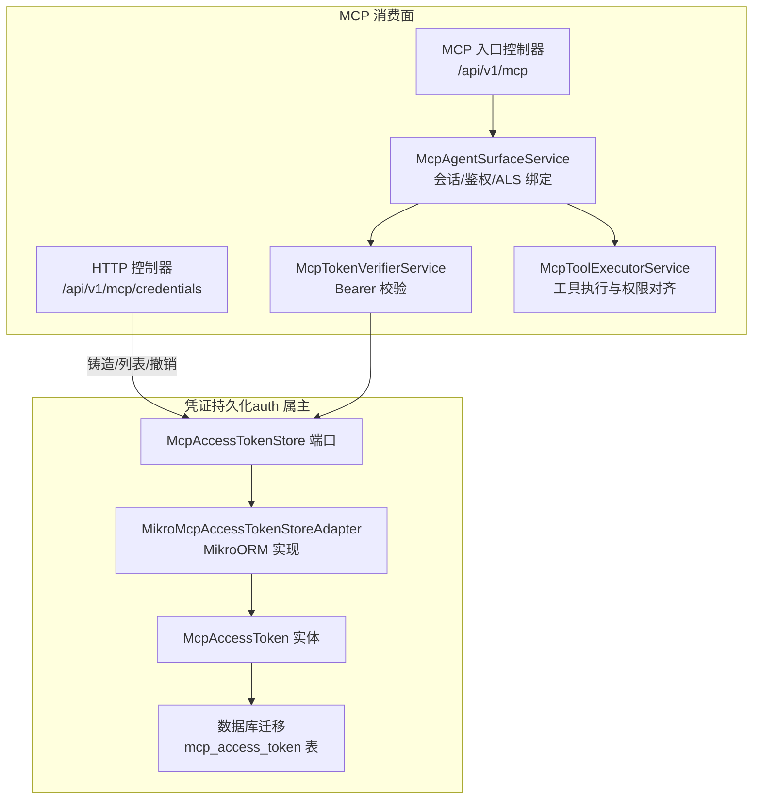
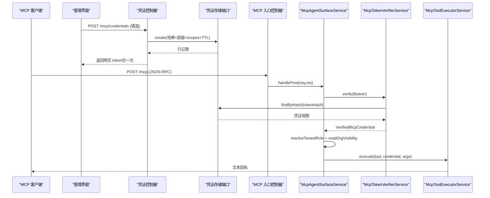
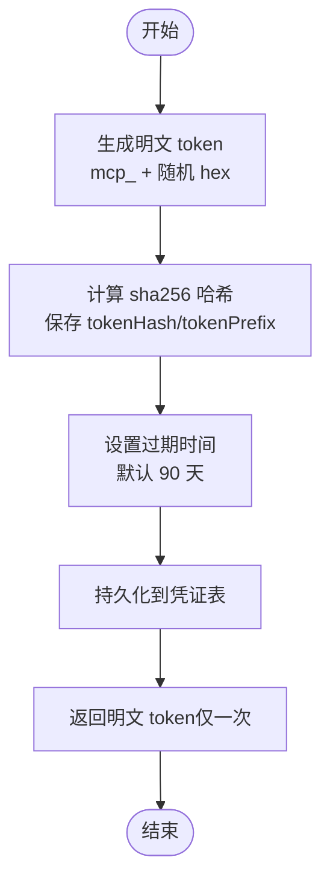
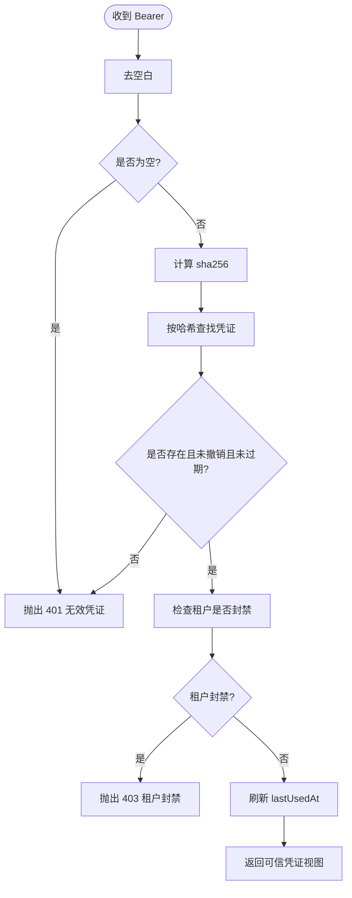
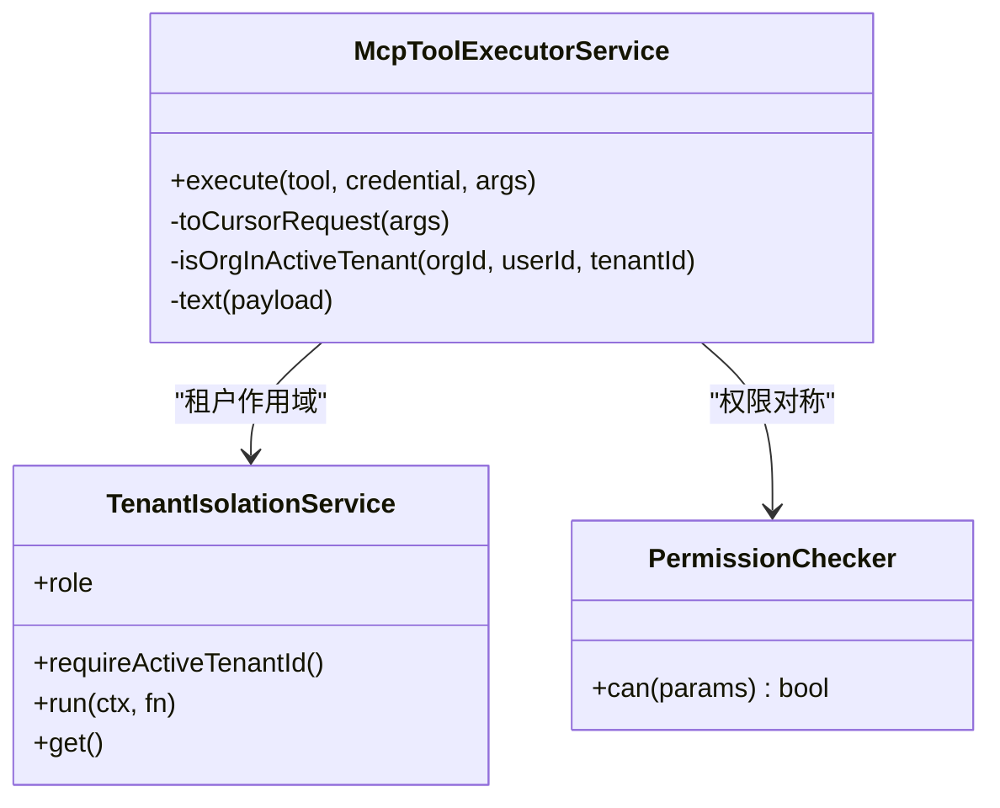
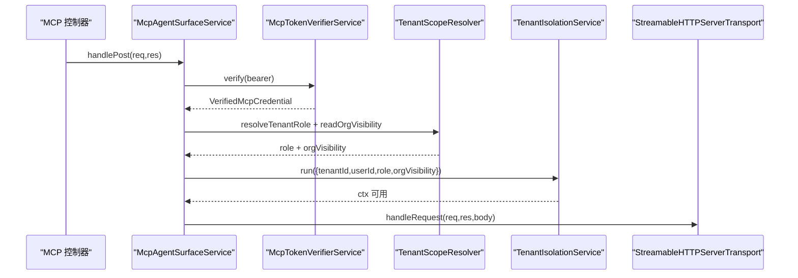
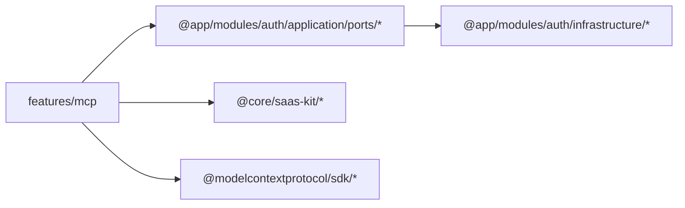

# MCP 访问控制

<cite>
**本文引用的文件**   
- [mcp-credentials.controller.ts](file://apps/api/src/features/mcp/api/mcp-credentials.controller.ts)
- [mcp.controller.ts](file://apps/api/src/features/mcp/api/mcp.controller.ts)
- [mcp-agent-surface.service.ts](file://apps/api/src/features/mcp/application/mcp-agent-surface.service.ts)
- [mcp-token-verifier.service.ts](file://apps/api/src/features/mcp/application/mcp-token-verifier.service.ts)
- [mcp-tool-executor.service.ts](file://apps/api/src/features/mcp/application/mcp-tool-executor.service.ts)
- [mcp-access-token-store.port.ts](file://apps/api/src/modules/auth/application/ports/mcp-access-token-store.port.ts)
- [mcp-token-verifier.port.ts](file://apps/api/src/modules/auth/application/ports/mcp-token-verifier.port.ts)
- [mcp-access-token-store.adapter.ts](file://apps/api/src/modules/auth/infrastructure/mcp-access-token-store.adapter.ts)
- [mcp-access-token.entity.ts](file://apps/api/src/modules/auth/infrastructure/entities/mcp-access-token.entity.ts)
- [Migration20261028131045_add_mcp_access_token.ts](file://apps/api/src/database/mikro/migration/migrations/Migration20261028131045_add_mcp_access_token.ts)
</cite>

## 目录
1. [简介](#简介)
2. [项目结构](#项目结构)
3. [核心组件](#核心组件)
4. [架构总览](#架构总览)
5. [详细组件分析](#详细组件分析)
6. [依赖关系分析](#依赖关系分析)
7. [性能与容量特性](#性能与容量特性)
8. [故障排查指南](#故障排查指南)
9. [结论](#结论)
10. [附录：客户端集成与安全最佳实践](#附录客户端集成与安全最佳实践)

## 简介
本文件面向 MCP（Model Context Protocol）访问控制，系统性说明令牌生成、验证与管理机制；Agent 工具执行权限与资源访问限制；凭证存储与生命周期；与主认证系统的集成方式（令牌映射与权限继承）；以及 MCP 客户端集成指南与安全最佳实践。整体设计遵循 deny-by-default、fail-closed、租户单源、最小暴露等安全原则。

## 项目结构
MCP 访问控制相关代码分布在 features/mcp 与 modules/auth 两个域：
- features/mcp：消费面与编排层（控制器、服务、工具执行器）。
- modules/auth：凭证持久化端口与实现、实体定义、迁移脚本。

**图示来源**
- [mcp-credentials.controller.ts:15-31](file://apps/api/src/features/mcp/api/mcp-credentials.controller.ts#L15-L31)
- [mcp.controller.ts:6-18](file://apps/api/src/features/mcp/api/mcp.controller.ts#L6-L18)
- [mcp-agent-surface.service.ts:66-93](file://apps/api/src/features/mcp/application/mcp-agent-surface.service.ts#L66-L93)
- [mcp-token-verifier.service.ts:14-32](file://apps/api/src/features/mcp/application/mcp-token-verifier.service.ts#L14-L32)
- [mcp-tool-executor.service.ts:34-49](file://apps/api/src/features/mcp/application/mcp-tool-executor.service.ts#L34-L49)
- [mcp-access-token-store.port.ts:45-77](file://apps/api/src/modules/auth/application/ports/mcp-access-token-store.port.ts#L45-L77)
- [mcp-access-token-store.adapter.ts:13-21](file://apps/api/src/modules/auth/infrastructure/mcp-access-token-store.adapter.ts#L13-L21)
- [mcp-access-token.entity.ts:5-18](file://apps/api/src/modules/auth/infrastructure/entities/mcp-access-token.entity.ts#L5-L18)
- [Migration20261028131045_add_mcp_access_token.ts:3-19](file://apps/api/src/database/mikro/migration/migrations/Migration20261028131045_add_mcp_access_token.ts#L3-L19)

**章节来源**
- [mcp-credentials.controller.ts:15-31](file://apps/api/src/features/mcp/api/mcp-credentials.controller.ts#L15-L31)
- [mcp.controller.ts:6-18](file://apps/api/src/features/mcp/api/mcp.controller.ts#L6-L18)
- [mcp-agent-surface.service.ts:66-93](file://apps/api/src/features/mcp/application/mcp-agent-surface.service.ts#L66-L93)
- [mcp-token-verifier.service.ts:14-32](file://apps/api/src/features/mcp/application/mcp-token-verifier.service.ts#L14-L32)
- [mcp-tool-executor.service.ts:34-49](file://apps/api/src/features/mcp/application/mcp-tool-executor.service.ts#L34-L49)
- [mcp-access-token-store.port.ts:45-77](file://apps/api/src/modules/auth/application/ports/mcp-access-token-store.port.ts#L45-L77)
- [mcp-access-token-store.adapter.ts:13-21](file://apps/api/src/modules/auth/infrastructure/mcp-access-token-store.adapter.ts#L13-L21)
- [mcp-access-token.entity.ts:5-18](file://apps/api/src/modules/auth/infrastructure/entities/mcp-access-token.entity.ts#L5-L18)
- [Migration20261028131045_add_mcp_access_token.ts:3-19](file://apps/api/src/database/mikro/migration/migrations/Migration20261028131045_add_mcp_access_token.ts#L3-L19)

## 核心组件
- MCP 凭证管理控制器：提供凭证铸造、本人列表、撤销接口，受会话与租户隔离守卫保护。
- MCP 消费面控制器：对外暴露 /mcp JSON-RPC 入口，豁免全局守卫，由服务侧完成 Bearer 校验与 ALS 绑定。
- 凭证校验服务：将明文 Bearer 转换为可信凭证视图，统一错误码防探测，并联动租户封禁状态。
- 工具执行服务：按工具名派发既有 CQRS 查询/命令，复用 HTTP 面权限判据，确保读写路径一致。
- 凭证存储端口与实现：定义凭证 CRUD 与哈希查找、最后使用时间戳更新；实现侧强制租户隔离与软撤销。
- 凭证实体与迁移：定义 mcp_access_token 表结构与索引，明文 token 永不落库，仅存哈希与前缀。

**章节来源**
- [mcp-credentials.controller.ts:57-98](file://apps/api/src/features/mcp/api/mcp-credentials.controller.ts#L57-L98)
- [mcp.controller.ts:19-43](file://apps/api/src/features/mcp/api/mcp.controller.ts#L19-L43)
- [mcp-token-verifier.service.ts:33-80](file://apps/api/src/features/mcp/application/mcp-token-verifier.service.ts#L33-L80)
- [mcp-tool-executor.service.ts:50-166](file://apps/api/src/features/mcp/application/mcp-tool-executor.service.ts#L50-L166)
- [mcp-access-token-store.port.ts:10-77](file://apps/api/src/modules/auth/application/ports/mcp-access-token-store.port.ts#L10-L77)
- [mcp-access-token-store.adapter.ts:22-101](file://apps/api/src/modules/auth/infrastructure/mcp-access-token-store.adapter.ts#L22-L101)
- [mcp-access-token.entity.ts:20-76](file://apps/api/src/modules/auth/infrastructure/entities/mcp-access-token.entity.ts#L20-L76)

## 架构总览
MCP 访问控制采用“凭证签发面”和“凭证消费面”分离的架构：
- 签发面：通过 REST 接口在浏览器会话内创建凭证，返回一次性明文 token，服务端仅保存哈希与前缀。
- 消费面：MCP JSON-RPC 入口使用 Bearer 令牌进行无会话校验，解析租户角色与作用域，绑定 ALS 后执行工具。

**图示来源**
- [mcp-credentials.controller.ts:62-98](file://apps/api/src/features/mcp/api/mcp-credentials.controller.ts#L62-L98)
- [mcp.controller.ts:24-43](file://apps/api/src/features/mcp/api/mcp.controller.ts#L24-L43)
- [mcp-agent-surface.service.ts:120-142](file://apps/api/src/features/mcp/application/mcp-agent-surface.service.ts#L120-L142)
- [mcp-token-verifier.service.ts:40-67](file://apps/api/src/features/mcp/application/mcp-token-verifier.service.ts#L40-L67)
- [mcp-access-token-store.port.ts:70-76](file://apps/api/src/modules/auth/application/ports/mcp-access-token-store.port.ts#L70-L76)
- [mcp-tool-executor.service.ts:67-127](file://apps/api/src/features/mcp/application/mcp-tool-executor.service.ts#L67-L127)

## 详细组件分析

### 凭证生成与生命周期
- 明文形态：`mcp_` + 32 字节 hex（128 bit 熵），仅响应时返回一次，永不落库。
- 落库字段：userId、name、tokenHash（sha256）、tokenPrefix（辨认用）、scopes、expiresAt、lastUsedAt、revokedAt。
- TTL 策略：默认 90 天，可在铸造时指定。
- 撤销：软标记 revokedAt，幂等；不可见/非本人/跨租均返回 404，不泄露存在性。
- 列表：仅返回本人活动租户内的凭证白名单视图，不含敏感列。

**图示来源**
- [mcp-access-token-store.port.ts:16-25](file://apps/api/src/modules/auth/application/ports/mcp-access-token-store.port.ts#L16-L25)
- [mcp-access-token.entity.ts:20-52](file://apps/api/src/modules/auth/infrastructure/entities/mcp-access-token.entity.ts#L20-L52)

**章节来源**
- [mcp-access-token-store.port.ts:16-25](file://apps/api/src/modules/auth/application/ports/mcp-access-token-store.port.ts#L16-L25)
- [mcp-access-token.entity.ts:20-52](file://apps/api/src/modules/auth/infrastructure/entities/mcp-access-token.entity.ts#L20-L52)

### 凭证校验与租户联动
- 输入：Bearer 明文 token（已剥离 `Bearer ` 前缀）。
- 流程：哈希查找 → 检查撤销/过期 → 检查租户是否被封禁 → 成功则刷新 lastUsedAt → 返回可信凭证视图。
- 错误语义：不存在/已撤销/已过期统一 401（防探测）；租户封禁返回 403。
- 租户上下文：以凭证签发时的 tenantId 为单源，调用侧无法伪造。

**图示来源**
- [mcp-token-verifier.service.ts:40-67](file://apps/api/src/features/mcp/application/mcp-token-verifier.service.ts#L40-L67)
- [mcp-token-verifier.port.ts:28-41](file://apps/api/src/modules/auth/application/ports/mcp-token-verifier.port.ts#L28-L41)

**章节来源**
- [mcp-token-verifier.service.ts:40-67](file://apps/api/src/features/mcp/application/mcp-token-verifier.service.ts#L40-L67)
- [mcp-token-verifier.port.ts:28-41](file://apps/api/src/modules/auth/application/ports/mcp-token-verifier.port.ts#L28-L41)

### 工具执行与权限对齐
- 工具注册：按凭证 scopes 过滤可见工具，deny-by-default（空集即零工具）。
- 读工具：
  - tenant.directory：基于凭证 userId 查询可见租户目录。
  - posts.list：要求活动租户（ALS fail-closed），分页游标查询。
- 写工具：
  - workspace.create：先校验 organizationId 属于活动租户且用户可见；再经 PermissionChecker 对称 HTTP 面 @Can('create','Workspace')；最后嵌套 ALS 补 organizationId 轴后派 Command。
- 错误处理：工具异常折成 isError 回执，避免协议层断链。

**图示来源**
- [mcp-tool-executor.service.ts:50-166](file://apps/api/src/features/mcp/application/mcp-tool-executor.service.ts#L50-L166)

**章节来源**
- [mcp-tool-executor.service.ts:50-166](file://apps/api/src/features/mcp/application/mcp-tool-executor.service.ts#L50-L166)

### 消费面会话与 ALS 绑定
- 每请求重验 Bearer，失败直落 verifier 错误体（含 errorCode/message）。
- 解析租户成员资格与组织可见性，合成 TenantIsolationScope。
- 以 run(ctx) 包裹 transport.handleRequest，使工具 handler 在同一异步链中天然可达 ALS。
- 会话管理：进程内 Map 缓存 StreamableHTTPServerTransport，LRU 逐出 + 闲置回收，防止无界增长。

**图示来源**
- [mcp-controller.ts:24-43](file://apps/api/src/features/mcp/api/mcp.controller.ts#L24-L43)
- [mcp-agent-surface.service.ts:120-142](file://apps/api/src/features/mcp/application/mcp-agent-surface.service.ts#L120-L142)
- [mcp-agent-surface.service.ts:267-276](file://apps/api/src/features/mcp/application/mcp-agent-surface.service.ts#L267-L276)

**章节来源**
- [mcp-controller.ts:24-43](file://apps/api/src/features/mcp/api/mcp.controller.ts#L24-L43)
- [mcp-agent-surface.service.ts:120-142](file://apps/api/src/features/mcp/application/mcp-agent-surface.service.ts#L120-L142)
- [mcp-agent-surface.service.ts:267-276](file://apps/api/src/features/mcp/application/mcp-agent-surface.service.ts#L267-L276)

## 依赖关系分析
- 模块边界：features/mcp 编排层通过 ports 与 auth 属主解耦，禁止直接导入 infrastructure。
- 注入点：
  - MCP_ACCESS_TOKEN_STORE：凭证持久化端口。
  - MCP_TOKEN_VERIFIER：凭证校验接口。
  - TENANT_SCOPE_RESOLVER：租户角色与组织可见性解析。
  - PERMISSION_CHECKER：权限检查器（与 HTTP 面守卫对齐）。
- 外部依赖：
  - MikroORM：凭证表读写。
  - ModelContextProtocol SDK：MCP Server 与 StreamableHTTPServerTransport。

**图示来源**
- [mcp-access-token-store.port.ts:45-77](file://apps/api/src/modules/auth/application/ports/mcp-access-token-store.port.ts#L45-L77)
- [mcp-token-verifier.port.ts:1-11](file://apps/api/src/modules/auth/application/ports/mcp-token-verifier.port.ts#L1-L11)
- [mcp-agent-surface.service.ts:104-109](file://apps/api/src/features/mcp/application/mcp-agent-surface.service.ts#L104-L109)

**章节来源**
- [mcp-access-token-store.port.ts:45-77](file://apps/api/src/modules/auth/application/ports/mcp-access-token-store.port.ts#L45-L77)
- [mcp-token-verifier.port.ts:1-11](file://apps/api/src/modules/auth/application/ports/mcp-token-verifier.port.ts#L1-L11)
- [mcp-agent-surface.service.ts:104-109](file://apps/api/src/features/mcp/application/mcp-agent-surface.service.ts#L104-L109)

## 性能与容量特性
- 校验成本：每次 verify = 2 次 DB 往返（findByHash + touchLastUsed）+ 租户封禁判据读；换撤销/封禁即时生效，无缓存窗口。
- 写放大：高频工具面下 lastUsedAt 逐请求更新；若后续量级坐实瓶颈，可考虑节流写或读面缓存（需另案评审）。
- 会话容量：进程内 LRU 上限 MAX_SESSIONS，闲置超 SESSION_IDLE_TTL_MS 惰性回收，超限逐出最久未命中者。
- 工具页宽：posts.list 缺省 20，硬上限 100，防大页拉爆。

**章节来源**
- [mcp-token-verifier.service.ts:25-31](file://apps/api/src/features/mcp/application/mcp-token-verifier.service.ts#L25-L31)
- [mcp-agent-surface.service.ts:96-99](file://apps/api/src/features/mcp/application/mcp-agent-surface.service.ts#L96-L99)
- [mcp-tool-executor.service.ts:29-32](file://apps/api/src/features/mcp/application/mcp-tool-executor.service.ts#L29-L32)

## 故障排查指南
- 401 无效凭证：常见于 token 不存在、已撤销、已过期或传入为空；三态同码防探测。
- 403 租户封禁：凭证有效但所属租户处于 suspend/deleted/pending_approval 状态。
- 404 凭证不存在：撤销接口对不可见/非本人/跨租返回 404，不泄露存在性。
- 400 会话无效：sessionId 跨租冒用或缺头非 initialize；或会话已过期被回收。
- 工具执行失败：工具异常折成 isError 回执；日志中记录警告但不泄露内部细节。

**章节来源**
- [mcp-token-verifier.service.ts:69-79](file://apps/api/src/features/mcp/application/mcp-token-verifier.service.ts#L69-L79)
- [mcp-credentials.controller.ts:87-98](file://apps/api/src/features/mcp/api/mcp-credentials.controller.ts#L87-L98)
- [mcp-agent-surface.service.ts:186-190](file://apps/api/src/features/mcp/application/mcp-agent-surface.service.ts#L186-L190)
- [mcp-agent-surface.service.ts:241-254](file://apps/api/src/features/mcp/application/mcp-agent-surface.service.ts#L241-L254)

## 结论
MCP 访问控制在设计上严格区分签发面与消费面，采用哈希存储、软撤销、租户单源、deny-by-default 等机制，确保凭证安全与权限收敛。工具执行路径复用既有 CQRS 与权限系统，避免第二套判据。消费面通过每请求重验与 ALS 绑定，保证撤销/封禁即时生效。会话层提供内存 LRU 与闲置回收，兼顾可用性与安全性。

## 附录：客户端集成与安全最佳实践

### MCP 客户端集成要点
- 凭证获取：通过管理端 POST /mcp/credentials 获取明文 token，仅在首次响应中显示，务必妥善保存。
- 调用入口：POST /api/v1/mcp，Authorization: Bearer <token>。
- 会话复用：首次 initialize 成功后，后续请求携带 mcp-session-id 头复用会话。
- 工具可见性：仅注册 scope 允许的工具；空 scopes 表示零工具可用。
- 参数约束：posts.list 支持 cursor/limit（1-100）；workspace.create 需要 name、slug、organizationId（必须属于活动租户且用户可见）。

**章节来源**
- [mcp-credentials.controller.ts:62-98](file://apps/api/src/features/mcp/api/mcp-credentials.controller.ts#L62-L98)
- [mcp-controller.ts:24-43](file://apps/api/src/features/mcp/api/mcp.controller.ts#L24-L43)
- [mcp-agent-surface.service.ts:223-235](file://apps/api/src/features/mcp/application/mcp-agent-surface.service.ts#L223-L235)
- [mcp-tool-executor.service.ts:80-127](file://apps/api/src/features/mcp/application/mcp-tool-executor.service.ts#L80-L127)

### 安全最佳实践
- 凭证安全：明文 token 仅一次性回显，丢失即轮换；不落库，仅存哈希与前缀。
- 权限最小化：scopes 仅授予必要能力；空集即零工具。
- 租户隔离：所有写操作必须带活动租户（ALS fail-closed），禁止跨租写。
- 错误防探测：无效凭证统一 401；撤销/过期/不存在不可区分。
- 审计与观测：lastUsedAt 用于活跃追踪；工具异常记录警告但不泄露内部细节。
- 容量治理：合理配置 MAX_SESSIONS 与 SESSION_IDLE_TTL_MS，避免内存膨胀。

**章节来源**
- [mcp-access-token-store.port.ts:16-25](file://apps/api/src/modules/auth/application/ports/mcp-access-token-store.port.ts#L16-L25)
- [mcp-token-verifier.service.ts:14-31](file://apps/api/src/features/mcp/application/mcp-token-verifier.service.ts#L14-L31)
- [mcp-tool-executor.service.ts:88-127](file://apps/api/src/features/mcp/application/mcp-tool-executor.service.ts#L88-L127)
- [mcp-agent-surface.service.ts:96-99](file://apps/api/src/features/mcp/application/mcp-agent-surface.service.ts#L96-L99)