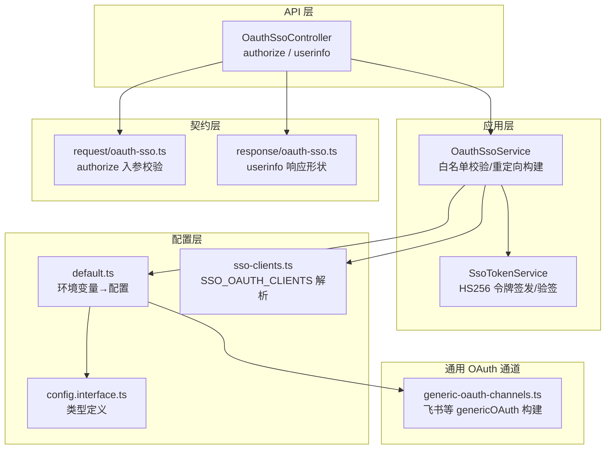
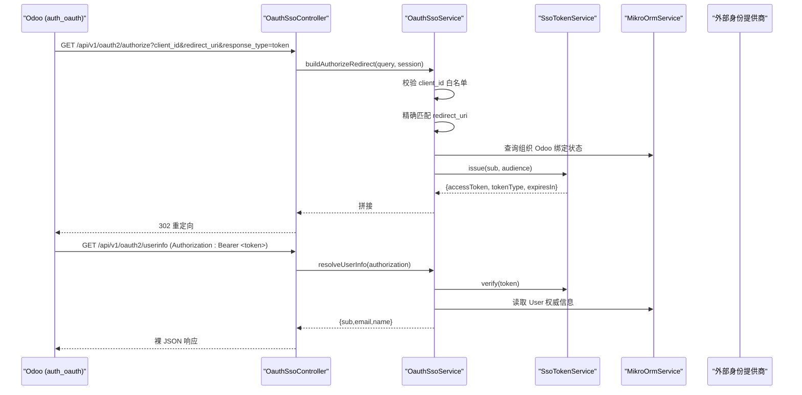
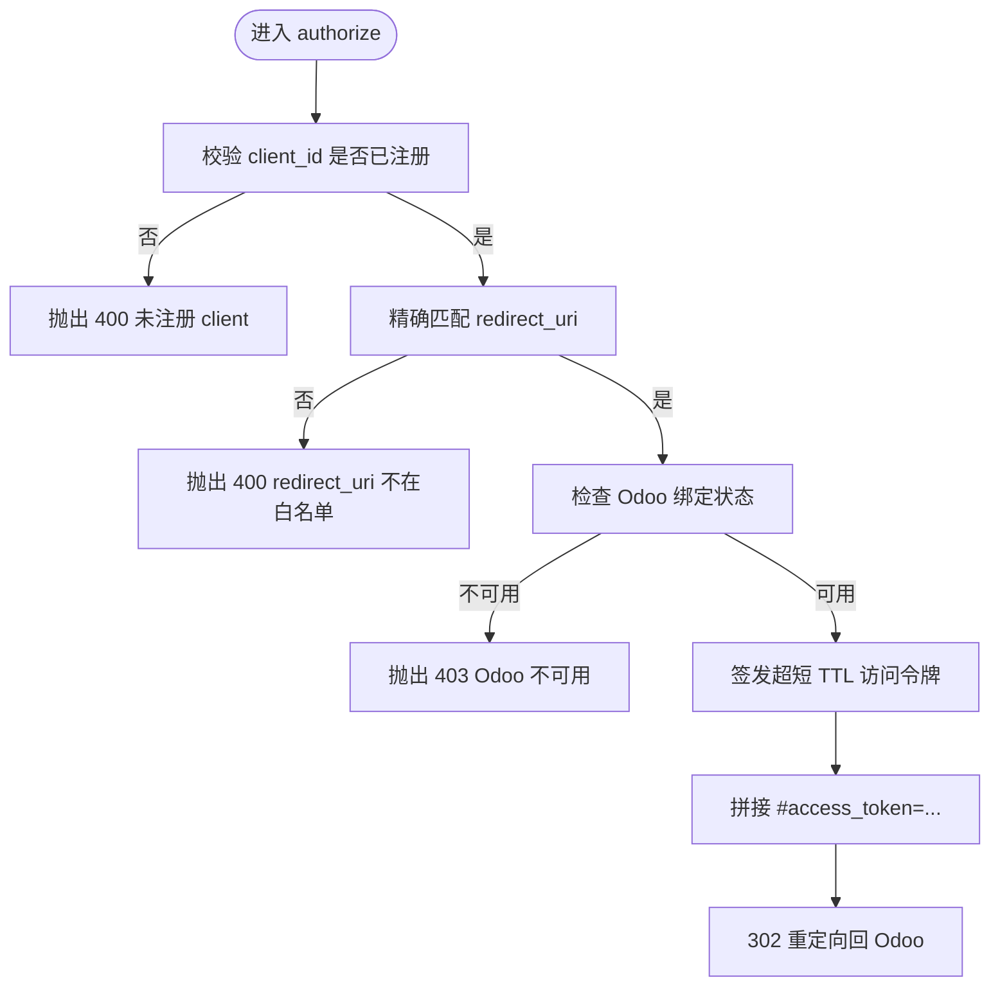
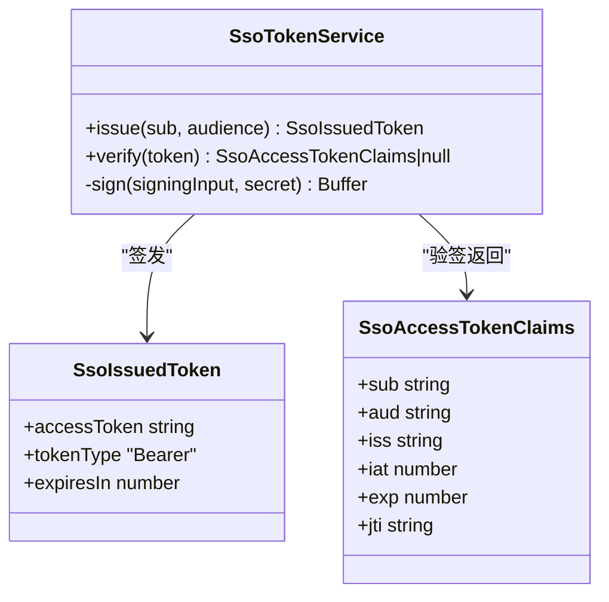
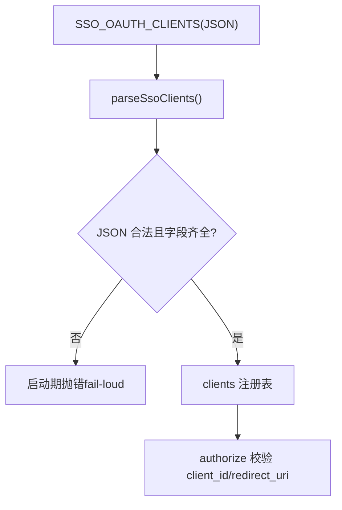
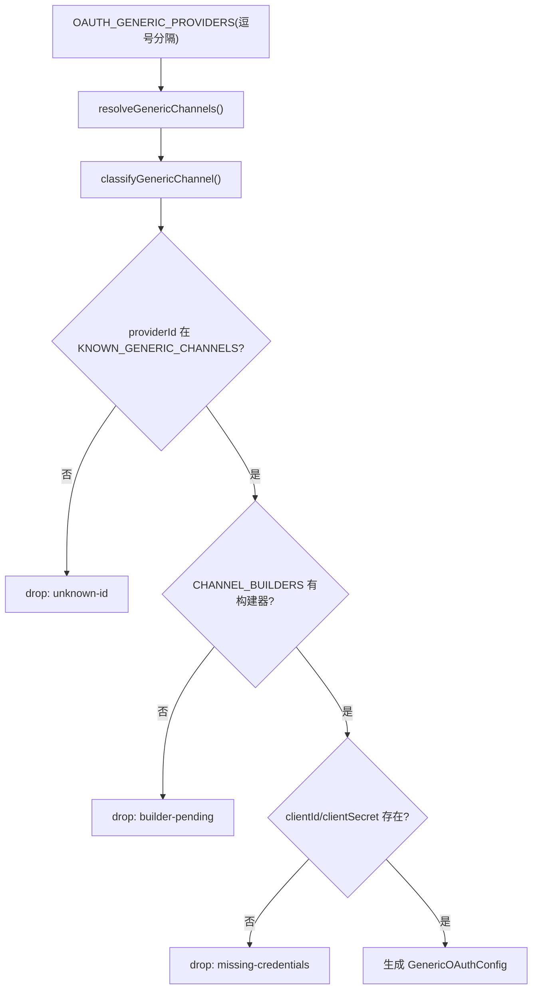
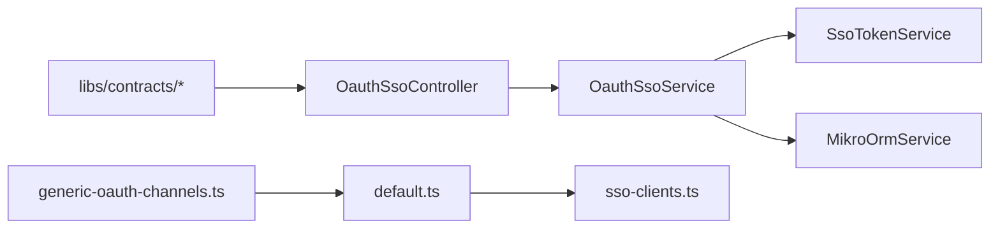

# OAuth2/SSO 集成

<cite>
**本文引用的文件**   
- [oauth-sso.controller.ts](file://apps/api/src/modules/auth/api/oauth-sso.controller.ts)
- [oauth-sso.service.ts](file://apps/api/src/modules/auth/infrastructure/oauth-sso.service.ts)
- [sso-token.service.ts](file://apps/api/src/modules/auth/infrastructure/sso-token.service.ts)
- [oauth-sso.ts（请求契约）](file://libs/contracts/src/request/oauth-sso.ts)
- [oauth-sso.ts（响应契约）](file://libs/contracts/src/response/oauth-sso.ts)
- [sso-clients.ts](file://apps/api/src/config/envs/sso-clients.ts)
- [default.ts（配置默认值）](file://apps/api/src/config/envs/default.ts)
- [config.interface.ts](file://apps/api/src/config/interfaces/config.interface.ts)
- [generic-oauth-channels.ts](file://apps/api/src/modules/auth/infrastructure/generic-oauth-channels.ts)
- [generic-oauth-channels.test.ts](file://apps/api/src/modules/auth/infrastructure/generic-oauth-channels.test.ts)
- [oauth-sso.e2e.setup.ts](file://apps/api/src/modules/auth/oauth-sso.e2e.setup.ts)
</cite>

## 目录
1. [简介](#简介)
2. [项目结构](#项目结构)
3. [核心组件](#核心组件)
4. [架构总览](#架构总览)
5. [详细组件分析](#详细组件分析)
6. [依赖关系分析](#依赖关系分析)
7. [性能与安全性考量](#性能与安全性考量)
8. [故障排查指南](#故障排查指南)
9. [结论](#结论)
10. [附录：配置清单与示例](#附录配置清单与示例)

## 简介
本仓库实现了两套身份集成能力：
- 通用社交登录通道（Better Auth social providers + genericOAuth），用于 Google、GitHub 等标准提供商，以及飞书等境内渠道。
- SSO 授权码流程（隐式流）作为 Odoo 的 OIDC OP，提供 authorize 与 userinfo 端点，完成客户端白名单校验、令牌交换与用户信息拉取。

本文重点说明：
- 支持的社交登录提供商及其配置方式（Google/GitHub/微信/企业微信/钉钉/飞书）。
- SSO 授权码流程与令牌交换机制（authorize → fragment 返回 access_token → userinfo）。
- 客户端白名单管理与重定向 URL 精确匹配策略。
- 通用 OAuth 通道的设计模式与扩展新提供商的方法。
- 具体配置项、错误处理与调试建议。

## 项目结构
与 OAuth2/SSO 直接相关的代码主要分布在以下位置：
- API 控制器与服务：`apps/api/src/modules/auth/api/oauth-sso.controller.ts`、`apps/api/src/modules/auth/infrastructure/oauth-sso.service.ts`
- 令牌服务：`apps/api/src/modules/auth/infrastructure/sso-token.service.ts`
- 契约定义：`libs/contracts/src/request/oauth-sso.ts`、`libs/contracts/src/response/oauth-sso.ts`
- SSO 客户端注册表解析：`apps/api/src/config/envs/sso-clients.ts`
- 配置默认值与环境变量映射：`apps/api/src/config/envs/default.ts`、`apps/api/src/config/interfaces/config.interface.ts`
- 通用 OAuth 通道（飞书等）：`apps/api/src/modules/auth/infrastructure/generic-oauth-channels.ts`

图表来源
- [oauth-sso.controller.ts:1-89](file://apps/api/src/modules/auth/api/oauth-sso.controller.ts#L1-L89)
- [oauth-sso.service.ts:1-125](file://apps/api/src/modules/auth/infrastructure/oauth-sso.service.ts#L1-L125)
- [sso-token.service.ts:1-112](file://apps/api/src/modules/auth/infrastructure/sso-token.service.ts#L1-L112)
- [oauth-sso.ts（请求契约）:1-44](file://libs/contracts/src/request/oauth-sso.ts#L1-L44)
- [oauth-sso.ts（响应契约）:1-21](file://libs/contracts/src/response/oauth-sso.ts#L1-L21)
- [sso-clients.ts:1-43](file://apps/api/src/config/envs/sso-clients.ts#L1-L43)
- [default.ts:92-143](file://apps/api/src/config/envs/default.ts#L92-L143)
- [config.interface.ts:63-107](file://apps/api/src/config/interfaces/config.interface.ts#L63-L107)
- [generic-oauth-channels.ts:1-198](file://apps/api/src/modules/auth/infrastructure/generic-oauth-channels.ts#L1-L198)

章节来源
- [oauth-sso.controller.ts:1-89](file://apps/api/src/modules/auth/api/oauth-sso.controller.ts#L1-L89)
- [oauth-sso.service.ts:1-125](file://apps/api/src/modules/auth/infrastructure/oauth-sso.service.ts#L1-L125)
- [sso-token.service.ts:1-112](file://apps/api/src/modules/auth/infrastructure/sso-token.service.ts#L1-L112)
- [oauth-sso.ts（请求契约）:1-44](file://libs/contracts/src/request/oauth-sso.ts#L1-L44)
- [oauth-sso.ts（响应契约）:1-21](file://libs/contracts/src/response/oauth-sso.ts#L1-L21)
- [sso-clients.ts:1-43](file://apps/api/src/config/envs/sso-clients.ts#L1-L43)
- [default.ts:92-143](file://apps/api/src/config/envs/default.ts#L92-L143)
- [config.interface.ts:63-107](file://apps/api/src/config/interfaces/config.interface.ts#L63-L107)
- [generic-oauth-channels.ts:1-198](file://apps/api/src/modules/auth/infrastructure/generic-oauth-channels.ts#L1-L198)

## 核心组件
- OauthSsoController：暴露 `/api/v1/oauth2/authorize` 与 `/api/v1/oauth2/userinfo`，分别处理隐式流授权与 Bearer 用户信息查询。
- OauthSsoService：集中实现 authorize 的业务逻辑——client_id 白名单校验、redirect_uri 精确匹配、Odoo 可用性门禁、生成带 fragment 的重定向地址；以及 userinfo 的 Bearer 令牌验证与最小 PII 返回。
- SsoTokenService：基于 HS256 的紧凑 JWS 令牌签发与验签，TTL 极短，aud 绑定 client audience，防混淆代理攻击。
- 契约层：authorize 入参 zod 校验（仅支持 response_type=token，scope 白名单），userinfo 响应体为裸 JSON `{sub,email,name}`。
- 配置层：SSO 客户端注册表通过 `SSO_OAUTH_CLIENTS` 注入；social providers 与 genericOAuth 渠道通过 `OAUTH_PROVIDERS`、`OAUTH_GENERIC_PROVIDERS` 及对应 secrets 装配。
- 通用 OAuth 通道：以 better-auth 的 genericOAuth 构建器形式接入飞书等境内渠道，当前已实现飞书，微信/钉钉/企业微信为接口位暂缓实现。

章节来源
- [oauth-sso.controller.ts:10-88](file://apps/api/src/modules/auth/api/oauth-sso.controller.ts#L10-L88)
- [oauth-sso.service.ts:22-116](file://apps/api/src/modules/auth/infrastructure/oauth-sso.service.ts#L22-L116)
- [sso-token.service.ts:42-105](file://apps/api/src/modules/auth/infrastructure/sso-token.service.ts#L42-L105)
- [oauth-sso.ts（请求契约）:5-44](file://libs/contracts/src/request/oauth-sso.ts#L5-L44)
- [oauth-sso.ts（响应契约）:1-21](file://libs/contracts/src/response/oauth-sso.ts#L1-L21)
- [sso-clients.ts:3-42](file://apps/api/src/config/envs/sso-clients.ts#L3-L42)
- [default.ts:92-143](file://apps/api/src/config/envs/default.ts#L92-L143)
- [generic-oauth-channels.ts:3-13](file://apps/api/src/modules/auth/infrastructure/generic-oauth-channels.ts#L3-L13)

## 架构总览
下图展示从 Odoo 发起授权到获取用户信息的完整调用链，以及通用社交登录通道的装配路径。

图表来源
- [oauth-sso.controller.ts:24-88](file://apps/api/src/modules/auth/api/oauth-sso.controller.ts#L24-L88)
- [oauth-sso.service.ts:52-116](file://apps/api/src/modules/auth/infrastructure/oauth-sso.service.ts#L52-L116)
- [sso-token.service.ts:56-105](file://apps/api/src/modules/auth/infrastructure/sso-token.service.ts#L56-L105)

## 详细组件分析

### SSO 授权端点与业务流程
- authorize 端点：
  - 要求已认证会话（全局 SessionGuard），跨租户豁免（TenantIsolationExempt）。
  - 校验 client_id 是否已注册、redirect_uri 是否在精确白名单中。
  - 检查活跃租户的 Odoo 绑定状态（fail-closed），未就绪则拒绝授权。
  - 签发超短 TTL 访问令牌并构造 fragment 重定向。
- userinfo 端点：
  - 旁路会话墙（@Public），但强制 Bearer 令牌验签与 aud 校验。
  - 从数据库读取权威用户信息，仅返回最小 PII（sub/email/name）。

图表来源
- [oauth-sso.service.ts:52-90](file://apps/api/src/modules/auth/infrastructure/oauth-sso.service.ts#L52-L90)

章节来源
- [oauth-sso.controller.ts:24-62](file://apps/api/src/modules/auth/api/oauth-sso.controller.ts#L24-L62)
- [oauth-sso.service.ts:52-90](file://apps/api/src/modules/auth/infrastructure/oauth-sso.service.ts#L52-L90)

### 令牌签发与验签（SsoTokenService）
- 使用 HS256 紧凑 JWS，TTL 固定为 120 秒，降低泄露风险。
- 载荷包含 sub、aud、iss、iat、exp、jti；aud 绑定 client audience。
- verify 对签名、过期时间进行严格校验，失败返回 null（fail-closed）。

图表来源
- [sso-token.service.ts:52-105](file://apps/api/src/modules/auth/infrastructure/sso-token.service.ts#L52-L105)

章节来源
- [sso-token.service.ts:42-105](file://apps/api/src/modules/auth/infrastructure/sso-token.service.ts#L42-L105)

### 客户端白名单与重定向 URL 管理
- 客户端注册表通过 `SSO_OAUTH_CLIENTS` 环境变量注入，格式为 JSON 数组，每项包含 clientId、redirectUris、audience。
- 解析器在未配置时返回空数组（fail-closed），非法配置在启动期 fail-loud 抛错。
- authorize 端点对 redirect_uri 执行逐字节精确匹配，防止前缀/子串绕过。

图表来源
- [sso-clients.ts:11-42](file://apps/api/src/config/envs/sso-clients.ts#L11-L42)
- [oauth-sso.service.ts:52-61](file://apps/api/src/modules/auth/infrastructure/oauth-sso.service.ts#L52-L61)

章节来源
- [sso-clients.ts:3-42](file://apps/api/src/config/envs/sso-clients.ts#L3-L42)
- [oauth-sso.service.ts:52-61](file://apps/api/src/modules/auth/infrastructure/oauth-sso.service.ts#L52-L61)

### 通用 OAuth 通道设计模式（飞书/微信/钉钉/企业微信）
- 通过 better-auth 的 genericOAuth 构建器统一装配境内渠道。
- 当前已实现飞书：自定义 getToken（JSON body）、getUserInfo（嵌套 data）、accountSubject（union_id/open_id）、mapProfileToUser（name/image/emailVerified=false）、disableSignUp=true、pkce=false。
- 微信/钉钉/企业微信为接口位（KNOWN_GENERIC_CHANNELS 登记），暂未提供构建器，按“未配即降级”策略跳过。
- 构建器登记表 CHANNEL_BUILDERS 控制实际可注册渠道；buildGenericOAuthConfigs 依启用列表与凭证装配。

图表来源
- [generic-oauth-channels.ts:15-23](file://apps/api/src/modules/auth/infrastructure/generic-oauth-channels.ts#L15-L23)
- [generic-oauth-channels.ts:105-113](file://apps/api/src/modules/auth/infrastructure/generic-oauth-channels.ts#L105-L113)
- [generic-oauth-channels.ts:119-180](file://apps/api/src/modules/auth/infrastructure/generic-oauth-channels.ts#L119-L180)

章节来源
- [generic-oauth-channels.ts:3-13](file://apps/api/src/modules/auth/infrastructure/generic-oauth-channels.ts#L3-L13)
- [generic-oauth-channels.ts:37-103](file://apps/api/src/modules/auth/infrastructure/generic-oauth-channels.ts#L37-L103)
- [generic-oauth-channels.ts:105-198](file://apps/api/src/modules/auth/infrastructure/generic-oauth-channels.ts#L105-L198)
- [generic-oauth-channels.test.ts:34-94](file://apps/api/src/modules/auth/infrastructure/generic-oauth-channels.test.ts#L34-L94)

### 社交登录提供商（Google/GitHub）
- 通过 `OAUTH_PROVIDERS` 指定启用的 provider（如 github, google）。
- 对应 secrets 槽位在 default.ts 中声明（github/google/apple/feishu），未声明槽位的 provider 即使环境变量存在也不会生效。
- 该面与 genericOAuth 渠道分治：social providers 走 Better Auth 内置通道，genericOAuth 走境内渠道构建器。

章节来源
- [default.ts:96-143](file://apps/api/src/config/envs/default.ts#L96-L143)
- [config.interface.ts:63-77](file://apps/api/src/config/interfaces/config.interface.ts#L63-L77)

## 依赖关系分析
- 控制器依赖服务：OauthSsoController 依赖 OauthSsoService。
- 服务依赖令牌服务与数据库：OauthSsoService 依赖 SsoTokenService 与 MikroOrmService。
- 配置依赖环境解析：default.ts 依赖 sso-clients.ts 解析 SSO_OAUTH_CLIENTS。
- 契约约束输入输出：authorize 入参与 userinfo 响应由 libs/contracts 定义。
- 通用通道依赖 better-auth 类型：generic-oauth-channels.ts 使用 GenericOAuthConfig 类型。

图表来源
- [oauth-sso.controller.ts:1-89](file://apps/api/src/modules/auth/api/oauth-sso.controller.ts#L1-L89)
- [oauth-sso.service.ts:1-125](file://apps/api/src/modules/auth/infrastructure/oauth-sso.service.ts#L1-L125)
- [sso-token.service.ts:1-112](file://apps/api/src/modules/auth/infrastructure/sso-token.service.ts#L1-L112)
- [default.ts:92-143](file://apps/api/src/config/envs/default.ts#L92-L143)
- [sso-clients.ts:1-43](file://apps/api/src/config/envs/sso-clients.ts#L1-L43)
- [oauth-sso.ts（请求契约）:1-44](file://libs/contracts/src/request/oauth-sso.ts#L1-L44)
- [oauth-sso.ts（响应契约）:1-21](file://libs/contracts/src/response/oauth-sso.ts#L1-L21)
- [generic-oauth-channels.ts:1-198](file://apps/api/src/modules/auth/infrastructure/generic-oauth-channels.ts#L1-L198)

章节来源
- [oauth-sso.controller.ts:1-89](file://apps/api/src/modules/auth/api/oauth-sso.controller.ts#L1-L89)
- [oauth-sso.service.ts:1-125](file://apps/api/src/modules/auth/infrastructure/oauth-sso.service.ts#L1-L125)
- [sso-token.service.ts:1-112](file://apps/api/src/modules/auth/infrastructure/sso-token.service.ts#L1-L112)
- [default.ts:92-143](file://apps/api/src/config/envs/default.ts#L92-L143)
- [sso-clients.ts:1-43](file://apps/api/src/config/envs/sso-clients.ts#L1-L43)
- [oauth-sso.ts（请求契约）:1-44](file://libs/contracts/src/request/oauth-sso.ts#L1-L44)
- [oauth-sso.ts（响应契约）:1-21](file://libs/contracts/src/response/oauth-sso.ts#L1-L21)
- [generic-oauth-channels.ts:1-198](file://apps/api/src/modules/auth/infrastructure/generic-oauth-channels.ts#L1-L198)

## 性能与安全性考量
- 令牌 TTL 极短（120 秒），减少泄露窗口。
- HS256 对称签名避免引入第三方库，降低供应链风险。
- aud 绑定 client audience，并在 userinfo 强制校验，防止混淆代理。
- redirect_uri 精确匹配，防止开放重定向漏洞。
- 社交渠道 disableSignUp=true（方案 C），不独立建号，复用邮箱账号体系。
- 飞书关闭 PKCE，因授权码流程不支持标准 PKCE。

[本节为通用指导，不直接分析具体文件]

## 故障排查指南
- authorize 返回 400：
  - unregistered client_id：检查 `SSO_OAUTH_CLIENTS` 是否包含对应 clientId。
  - redirect_uri not in exact whitelist：确认 redirect_uri 与注册表完全一致（含协议、主机、路径、参数顺序）。
- authorize 返回 403：
  - Odoo not available for the active organization：检查组织 Odoo 绑定状态是否为 ready。
- userinfo 返回 401：
  - Missing or malformed Authorization header：确保携带 `Authorization: Bearer <token>`。
  - Invalid or expired access token：检查令牌是否过期或签名无效。
  - access token audience not authorized：检查令牌 aud 是否在已注册受众集合内。
- userinfo 返回 403：
  - email not verified：用户邮箱未验证，需先完成邮箱验证。
- 通用 OAuth 渠道未注册：
  - unknown-id：providerId 未在 KNOWN_GENERIC_CHANNELS 登记。
  - builder-pending：渠道为接口位（wechat/dingtalk/wecom），本期无构建器。
  - missing-credentials：secrets 中 clientId/clientSecret 为空。

章节来源
- [oauth-sso.service.ts:52-116](file://apps/api/src/modules/auth/infrastructure/oauth-sso.service.ts#L52-L116)
- [generic-oauth-channels.ts:182-197](file://apps/api/src/modules/auth/infrastructure/generic-oauth-channels.ts#L182-L197)

## 结论
本仓库实现了两套身份集成能力：通用社交登录通道与面向 Odoo 的 SSO 授权码流程。前者通过 Better Auth 与 genericOAuth 构建器统一管理多渠道，后者通过严格的白名单与精确重定向校验保障安全。飞书渠道已落地，微信/钉钉/企业微信预留接口位。配置层面通过环境变量注入，遵循 fail-closed/fail-loud 原则，便于部署与排障。

[本节为总结性内容，不直接分析具体文件]

## 附录：配置清单与示例
- 环境变量与配置键
  - `OAUTH_PROVIDERS`：逗号分隔的 social provider 列表（如 github,google）。
  - `OAUTH_GENERIC_PROVIDERS`：逗号分隔的 genericOAuth providerId 列表（如 feishu）。
  - `GITHUB_CLIENT_ID`/`GITHUB_CLIENT_SECRET`：GitHub 凭证。
  - `GOOGLE_CLIENT_ID`/`GOOGLE_CLIENT_SECRET`：Google 凭证。
  - `FEISHU_APP_ID`/`FEISHU_APP_SECRET`：飞书 App ID/Secret。
  - `SSO_OAUTH_CLIENTS`：JSON 数组，每项包含 clientId、redirectUris、audience。
- 配置示例（概念性描述）
  - social providers：在 default.ts 的 oauth.secrets 中添加对应槽位，并在 OAUTH_PROVIDERS 中启用。
  - genericOAuth：在 default.ts 的 oauth.secrets 中添加 feishu 槽位，并在 OAUTH_GENERIC_PROVIDERS 中启用 feishu。
  - SSO clients：在 SSO_OAUTH_CLIENTS 中注册 Odoo 客户端，包含回调地址与 audience。
- e2e 预置
  - 测试环境通过 oauth-sso.e2e.setup.ts 预置一个测试 client（clientId=e2e-odoo，redirectUri=http://localhost:8069/odoo/oauth2/callback，audience=e2e-odoo-aud）。

章节来源
- [default.ts:96-143](file://apps/api/src/config/envs/default.ts#L96-L143)
- [oauth-sso.e2e.setup.ts:1-16](file://apps/api/src/modules/auth/oauth-sso.e2e.setup.ts#L1-L16)