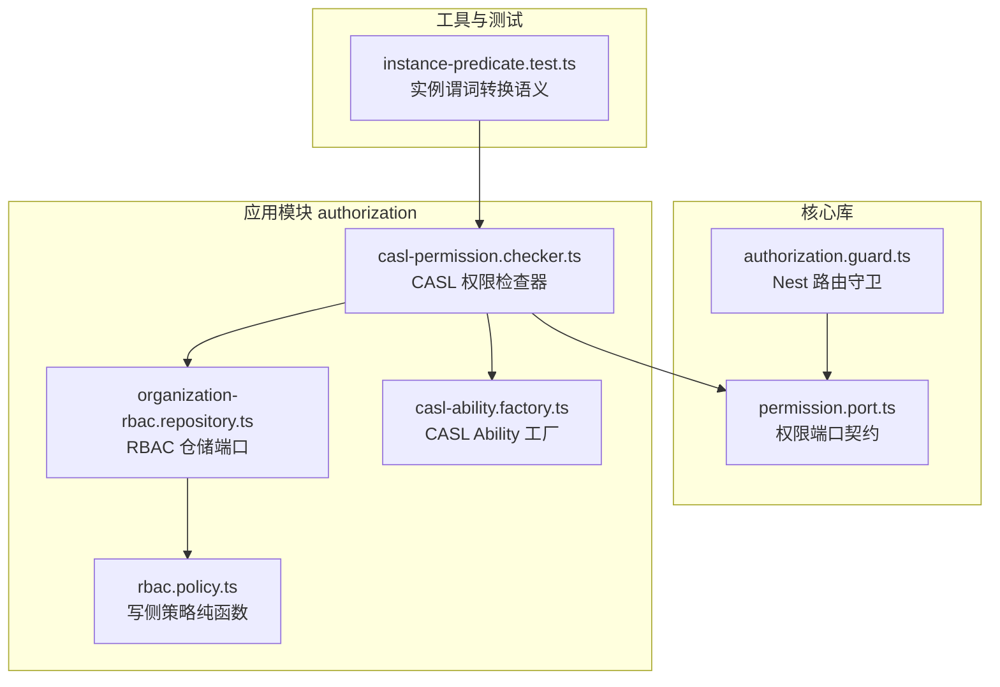
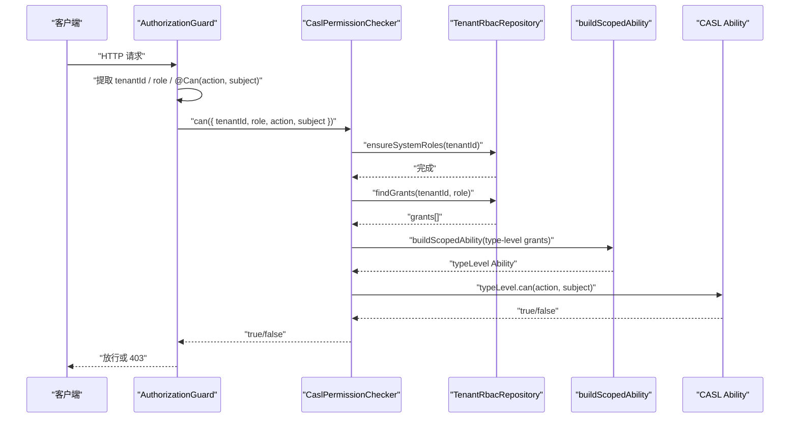
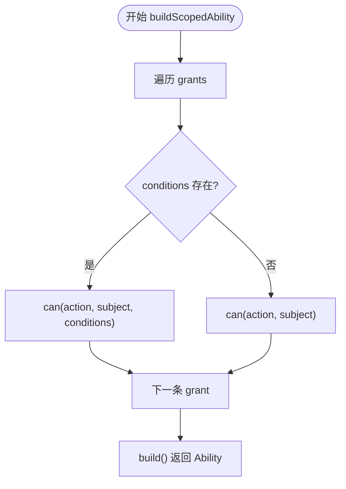
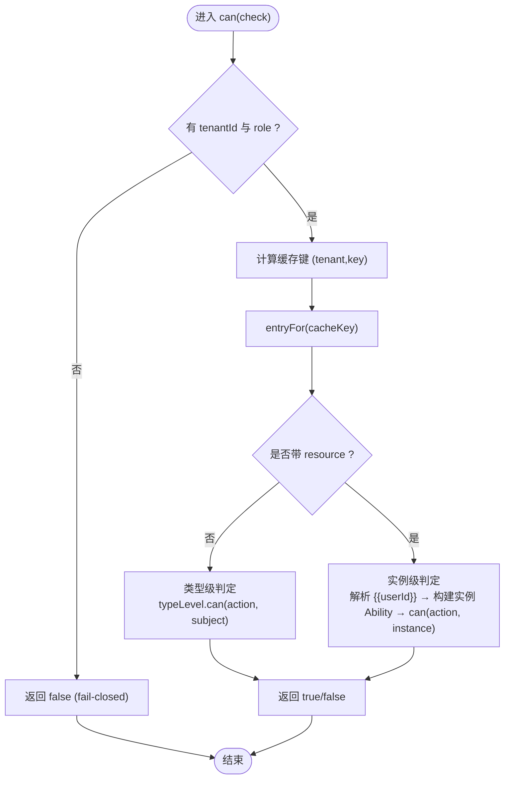
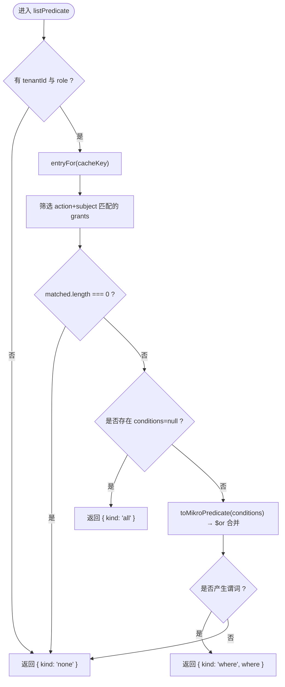
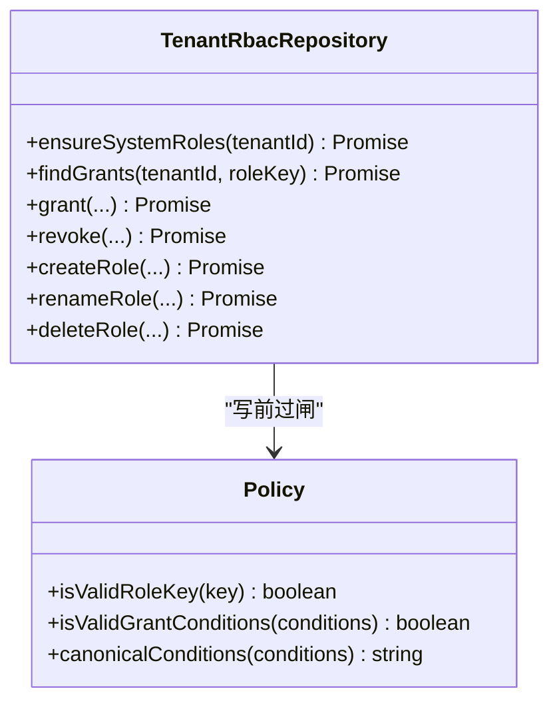
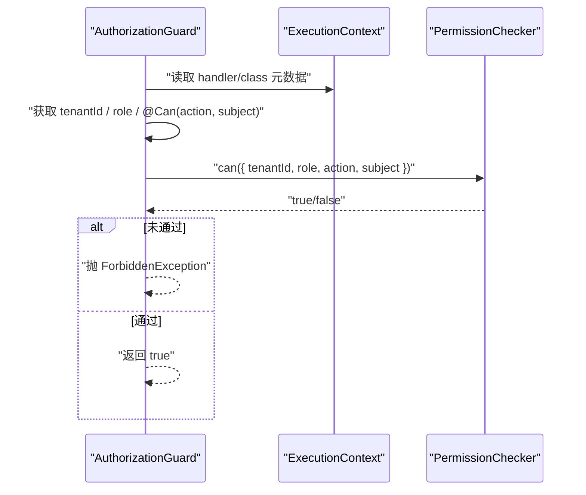
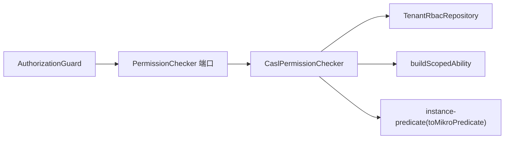
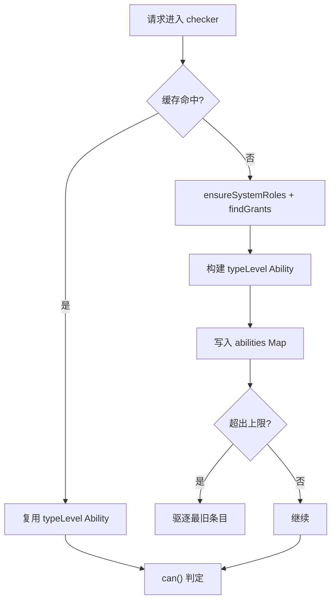

# CASL 能力模型实现

<cite>
**本文引用的文件**   
- [casl-ability.factory.ts](file://apps/api/src/modules/authorization/infrastructure/casl-ability.factory.ts)
- [casl-permission.checker.ts](file://apps/api/src/modules/authorization/infrastructure/casl-permission.checker.ts)
- [organization-rbac.repository.ts](file://apps/api/src/modules/authorization/domain/repositories/organization-rbac.repository.ts)
- [rbac.policy.ts](file://apps/api/src/modules/authorization/domain/policies/rbac.policy.ts)
- [permission.port.ts](file://libs/core/src/authorization/permission.port.ts)
- [authorization.guard.ts](file://libs/core/src/authorization/authorization.guard.ts)
- [instance-predicate.test.ts](file://libs/core/src/authorization/instance-predicate.test.ts)
</cite>

## 目录
1. [引言](#引言)
2. [项目结构](#项目结构)
3. [核心组件](#核心组件)
4. [架构总览](#架构总览)
5. [详细组件分析](#详细组件分析)
6. [依赖关系分析](#依赖关系分析)
7. [性能与缓存特性](#性能与缓存特性)
8. [最佳实践与优化建议](#最佳实践与优化建议)
9. [故障排查指南](#故障排查指南)
10. [结论](#结论)

## 引言
本文面向在 NestJS SaaS 项目中基于 CASL 构建灵活权限检查机制的实现，重点说明：
- 如何从租户角色授权事实（grant 行）构建 CASL Ability。
- 如何根据用户角色、上下文（租户、操作者、资源实例）生成并复用权限对象。
- 同步与异步权限检查的工作方式。
- 列表级过滤谓词与逐条判定的一致性保障。
- 进程内缓存、失效策略与性能优化建议。
- 结合守卫、仓储端口与策略闸的完整调用链。

本仓库采用“规则源在数据库”的设计：CASL 仅作为匹配引擎，不内置业务权限知识；所有可执行授权由 `tenant_role_grant` 等 grant 行驱动，并通过 `PermissionChecker` 端口对外暴露。

## 项目结构
围绕 CASL 能力模型的代码主要分布在以下位置：
- 基础设施层：CASL Ability 工厂与 Permission Checker 适配。
- 领域层：RBAC 仓储端口定义、写侧策略纯函数。
- 核心库：权限端口契约、Nest 守卫集成。
- 测试与转换逻辑：实例谓词到查询谓词的转换语义。

**图表来源**
- [permission.port.ts:1-153](file://libs/core/src/authorization/permission.port.ts#L1-L153)
- [authorization.guard.ts:1-85](file://libs/core/src/authorization/authorization.guard.ts#L1-L85)
- [organization-rbac.repository.ts:1-198](file://apps/api/src/modules/authorization/domain/repositories/organization-rbac.repository.ts#L1-L198)
- [rbac.policy.ts:1-95](file://apps/api/src/modules/authorization/domain/policies/rbac.policy.ts#L1-L95)
- [casl-ability.factory.ts:1-47](file://apps/api/src/modules/authorization/infrastructure/casl-ability.factory.ts#L1-L47)
- [casl-permission.checker.ts:1-199](file://apps/api/src/modules/authorization/infrastructure/casl-permission.checker.ts#L1-L199)
- [instance-predicate.test.ts:1-86](file://libs/core/src/authorization/instance-predicate.test.ts#L1-L86)

**章节来源**
- [permission.port.ts:1-153](file://libs/core/src/authorization/permission.port.ts#L1-L153)
- [authorization.guard.ts:1-85](file://libs/core/src/authorization/authorization.guard.ts#L1-L85)
- [organization-rbac.repository.ts:1-198](file://apps/api/src/modules/authorization/domain/repositories/organization-rbac.repository.ts#L1-L198)
- [rbac.policy.ts:1-95](file://apps/api/src/modules/authorization/domain/policies/rbac.policy.ts#L1-L95)
- [casl-ability.factory.ts:1-47](file://apps/api/src/modules/authorization/infrastructure/casl-ability.factory.ts#L1-L47)
- [casl-permission.checker.ts:1-199](file://apps/api/src/modules/authorization/infrastructure/casl-permission.checker.ts#L1-L199)
- [instance-predicate.test.ts:1-86](file://libs/core/src/authorization/instance-predicate.test.ts#L1-L86)

## 核心组件
- **PermissionChecker 端口**：定义 `can` 与 `listPredicate` 的输入输出契约，明确租户隔离、角色、动作、主体、实例资源、操作者模板解析等语义。
- **AuthorizationGuard**：Nest 路由守卫，负责提取活动租户、角色与 `@Can` 声明，委派给 `PermissionChecker` 做最终裁决。
- **CaslPermissionChecker**：CASL 适配器，负责从 RBAC 仓储读取 grant 行，构建类型级与实例级 Ability，并提供进程内缓存与失效接口。
- **buildScopedAbility**：将 grant 行投影为 CASL Ability，支持条件字段（conditions）。
- **TenantRbacRepository**：RBAC 仓储端口，提供 ensureSystemRoles、findGrants、grant/revoke 等读写方法。
- **rbac.policy**：写侧策略纯函数，校验自定义角色 key 与 conditions 语法白名单。

**章节来源**
- [permission.port.ts:1-153](file://libs/core/src/authorization/permission.port.ts#L1-L153)
- [authorization.guard.ts:1-85](file://libs/core/src/authorization/authorization.guard.ts#L1-L85)
- [casl-permission.checker.ts:1-199](file://apps/api/src/modules/authorization/infrastructure/casl-permission.checker.ts#L1-L199)
- [casl-ability.factory.ts:1-47](file://apps/api/src/modules/authorization/infrastructure/casl-ability.factory.ts#L1-L47)
- [organization-rbac.repository.ts:1-198](file://apps/api/src/modules/authorization/domain/repositories/organization-rbac.repository.ts#L1-L198)
- [rbac.policy.ts:1-95](file://apps/api/src/modules/authorization/domain/policies/rbac.policy.ts#L1-L95)

## 架构总览
下图展示一次典型请求的权限判定流程：Nest 守卫触发 → 读取活动租户与角色 → 调用 PermissionChecker → 加载或复用 Ability → 使用 CASL 进行类型级或实例级判定。

**图表来源**
- [authorization.guard.ts:50-82](file://libs/core/src/authorization/authorization.guard.ts#L50-L82)
- [casl-permission.checker.ts:88-127](file://apps/api/src/modules/authorization/infrastructure/casl-permission.checker.ts#L88-L127)
- [organization-rbac.repository.ts:88-123](file://apps/api/src/modules/authorization/domain/repositories/organization-rbac.repository.ts#L88-L123)
- [casl-ability.factory.ts:39-46](file://apps/api/src/modules/authorization/infrastructure/casl-ability.factory.ts#L39-L46)

## 详细组件分析

### 1) CASL Ability 工厂：从 grant 行到能力对象
- 输入：`ScopedAbilityGrant[]`，包含 `subject`、`action`、可选 `conditions`。
- 行为：遍历 grant 行，调用 `can(action, subject[, conditions])` 构建 Ability。
- 输出：`MongoAbility<[AuthorizationAction, AuthorizationSubject | CaslSubjectInstance]>`。
- 设计要点：
  - 工厂不含任何独立权限知识，只做“授权事实投影”。
  - 支持条件字段（conditions），用于 ABAC 实例级匹配。
  - 类型级 Ability 通常只纳入 `conditions=null` 的行，避免误把条件行提升为无条件全量授权。

**图表来源**
- [casl-ability.factory.ts:39-46](file://apps/api/src/modules/authorization/infrastructure/casl-ability.factory.ts#L39-L46)

**章节来源**
- [casl-ability.factory.ts:1-47](file://apps/api/src/modules/authorization/infrastructure/casl-ability.factory.ts#L1-L47)

### 2) 权限检查器：同步与异步检查、类型级与实例级
- 入口：`can(check)` 与 `listPredicate(check)`。
- 异步性：规则源在数据库，首次 miss 时懒加载 + ensure 系统角色，命中后走进程内版本缓存。
- 类型级判定（守卫路径）：不带 `resource`，使用仅含 `conditions=null` 的类型级 Ability。
- 实例级判定（check 级）：带 `resource`，按当前 `userId` 解析 `{{userId}}` 模板，构造实例 subject 交 CASL mongo 匹配。
- 列表级过滤：返回三态 `{kind:'all'|'where'|'none'}`，其中 `where` 可直接下推至数据库查询。

**图表来源**
- [casl-permission.checker.ts:88-127](file://apps/api/src/modules/authorization/infrastructure/casl-permission.checker.ts#L88-L127)

**章节来源**
- [casl-permission.checker.ts:1-199](file://apps/api/src/modules/authorization/infrastructure/casl-permission.checker.ts#L1-L199)

### 3) 列表级过滤谓词：与逐条判定同源同解
- 输入：`PermissionListPredicateRequest`（无 resource，以 userId 解模板）。
- 输出：`PermissionListPredicate`（`all` / `where` / `none`）。
- 语义：
  - 无匹配 grant 行 → `none`。
  - 存在无条件类型级行 → `all`。
  - 全部带 conditions 行 → 转换为 Mikro 谓词并以 `$or` 合并。
- 一致性：与 `can()` 同源同口径，保证“列表可见集 ⊆ 逐条允许集”。

**图表来源**
- [casl-permission.checker.ts:146-167](file://apps/api/src/modules/authorization/infrastructure/casl-permission.checker.ts#L146-L167)
- [instance-predicate.test.ts:1-86](file://libs/core/src/authorization/instance-predicate.test.ts#L1-L86)

**章节来源**
- [casl-permission.checker.ts:146-167](file://apps/api/src/modules/authorization/infrastructure/casl-permission.checker.ts#L146-L167)
- [instance-predicate.test.ts:1-86](file://libs/core/src/authorization/instance-predicate.test.ts#L1-L86)

### 4) 仓储端口与写侧策略：授权事实 SSOT
- 仓储端口 `TenantRbacRepository`：
  - 读：`ensureSystemRoles`、`findGrants`、`listRoles` 等。
  - 写：`grant`、`revoke`、`createRole`、`renameRole`、`deleteRole`。
- 写侧策略 `rbac.policy`：
  - 自定义角色 key 词法校验。
  - conditions 白名单：仅允许平铺等值与 `$in`，拒绝复杂运算符与非法形状。
  - canonicalConditions 用于精确撤销多条件行。

**图表来源**
- [organization-rbac.repository.ts:88-197](file://apps/api/src/modules/authorization/domain/repositories/organization-rbac.repository.ts#L88-L197)
- [rbac.policy.ts:1-95](file://apps/api/src/modules/authorization/domain/policies/rbac.policy.ts#L1-L95)

**章节来源**
- [organization-rbac.repository.ts:1-198](file://apps/api/src/modules/authorization/domain/repositories/organization-rbac.repository.ts#L1-L198)
- [rbac.policy.ts:1-95](file://apps/api/src/modules/authorization/domain/policies/rbac.policy.ts#L1-L95)

### 5) 守卫集成：Nest 路由级权限拦截
- `AuthorizationGuard` 从执行上下文取 `tenantId` 与 `role`，再调用 `PermissionChecker.can`。
- 若未声明 `@Can`，已认证且在租户上下文中即放行。
- 若未通过判定，抛出 `ForbiddenException`。

**图表来源**
- [authorization.guard.ts:50-82](file://libs/core/src/authorization/authorization.guard.ts#L50-L82)
- [permission.port.ts:97-124](file://libs/core/src/authorization/permission.port.ts#L97-L124)

**章节来源**
- [authorization.guard.ts:1-85](file://libs/core/src/authorization/authorization.guard.ts#L1-L85)
- [permission.port.ts:1-153](file://libs/core/src/authorization/permission.port.ts#L1-L153)

## 依赖关系分析
- 耦合关系：
  - `CaslPermissionChecker` 依赖 `TenantRbacRepository` 读取授权事实。
  - `CaslPermissionChecker` 依赖 `buildScopedAbility` 构建 Ability。
  - `AuthorizationGuard` 依赖 `PermissionChecker` 端口，不直接依赖 CASL 实现。
- 外部依赖：
  - CASL v7（`@casl/ability`）用于匹配。
  - Mikro ORM 谓词（通过 `toMikroPredicate` 与 `$or` 合并）用于列表过滤。

**图表来源**
- [authorization.guard.ts:1-85](file://libs/core/src/authorization/authorization.guard.ts#L1-L85)
- [permission.port.ts:1-153](file://libs/core/src/authorization/permission.port.ts#L1-L153)
- [casl-permission.checker.ts:1-199](file://apps/api/src/modules/authorization/infrastructure/casl-permission.checker.ts#L1-L199)
- [casl-ability.factory.ts:1-47](file://apps/api/src/modules/authorization/infrastructure/casl-ability.factory.ts#L1-L47)
- [instance-predicate.test.ts:1-86](file://libs/core/src/authorization/instance-predicate.test.ts#L1-L86)

**章节来源**
- [authorization.guard.ts:1-85](file://libs/core/src/authorization/authorization.guard.ts#L1-L85)
- [permission.port.ts:1-153](file://libs/core/src/authorization/permission.port.ts#L1-L153)
- [casl-permission.checker.ts:1-199](file://apps/api/src/modules/authorization/infrastructure/casl-permission.checker.ts#L1-L199)
- [casl-ability.factory.ts:1-47](file://apps/api/src/modules/authorization/infrastructure/casl-ability.factory.ts#L1-L47)
- [instance-predicate.test.ts:1-86](file://libs/core/src/authorization/instance-predicate.test.ts#L1-L86)

## 性能与缓存特性
- 进程内版本缓存：
  - 以 `(tenantId, roleKey)` 为键缓存 Ability 条目，避免重复查库。
  - 在途 Promise 防并发重入，miss 时先 ensure 系统角色再查 grants。
- 有界 LRU 驱逐：
  - 最大条目数默认 2048，超过则驱逐最久未访问项，防止内存泄漏。
- 热改失效：
  - 写侧管理门面调用 `invalidate(tenantId)` 淘汰该租户全部缓存条目，下一请求重建。
- 类型级 vs 实例级：
  - 类型级 Ability 仅纳入 `conditions=null` 行，避免误升为全量授权。
  - 实例级 Ability 每次按 `userId` 解析模板后构建，但共享同一 grants 缓存。

**图表来源**
- [casl-permission.checker.ts:75-86](file://apps/api/src/modules/authorization/infrastructure/casl-permission.checker.ts#L75-L86)
- [casl-permission.checker.ts:170-197](file://apps/api/src/modules/authorization/infrastructure/casl-permission.checker.ts#L170-L197)

**章节来源**
- [casl-permission.checker.ts:75-86](file://apps/api/src/modules/authorization/infrastructure/casl-permission.checker.ts#L75-L86)
- [casl-permission.checker.ts:170-197](file://apps/api/src/modules/authorization/infrastructure/casl-permission.checker.ts#L170-L197)

## 最佳实践与优化建议
- 优先使用类型级判定（守卫路径）减少开销：
  - 对无需实例条件的场景，尽量不带 `resource`，复用 typeLevel Ability。
- 谨慎使用 conditions：
  - 仅在需要实例级限制时使用，并确保 `userId` 正确传入以解析模板。
- 合理使用列表级过滤：
  - 对列表接口优先使用 `listPredicate`，将权限下推到数据库层，减少逐条判定成本。
- 保持 conditions 语法稳定：
  - 遵循写侧策略白名单（仅等值与 `$in`），避免引入复杂运算符导致转换失败。
- 关注缓存失效时机：
  - 在 grant/revoke/create/delete 后及时调用 `invalidate(tenantId)`，确保热改生效。
- 监控缓存命中率与驱逐：
  - 在生产环境观察 `abilities Map` 大小与驱逐频率，必要时调整 `maxEntries`。

[本节为通用指导，不直接分析具体文件]

## 故障排查指南
- 常见错误与处理：
  - 无租户上下文：守卫直接抛 403。
  - 无角色或角色不存在：checker 返回 deny。
  - 规则加载失败：淘汰缓存并 deny，下次重试。
  - conditions 语法非法：写侧策略拒绝入库，读侧转换器抛错归 none。
- 定位步骤：
  - 确认 `tenantId` 与 `role` 是否正确注入。
  - 检查 `@Can(action, subject)` 是否与 grant 行一致。
  - 若使用实例判定，确认 `resource` 与 `userId` 是否传入。
  - 查看 `listPredicate` 返回的 `where` 谓词是否符合预期。

**章节来源**
- [authorization.guard.ts:50-82](file://libs/core/src/authorization/authorization.guard.ts#L50-L82)
- [casl-permission.checker.ts:88-127](file://apps/api/src/modules/authorization/infrastructure/casl-permission.checker.ts#L88-L127)
- [casl-permission.checker.ts:146-167](file://apps/api/src/modules/authorization/infrastructure/casl-permission.checker.ts#L146-L167)
- [rbac.policy.ts:51-70](file://apps/api/src/modules/authorization/domain/policies/rbac.policy.ts#L51-L70)

## 结论
本项目通过“规则源在数据库 + CASL 匹配引擎”的方式实现了灵活的权限模型：
- 使用 `buildScopedAbility` 将 grant 行投影为 CASL Ability。
- 通过 `CaslPermissionChecker` 提供类型级与实例级判定，以及列表级过滤谓词。
- 借助 `AuthorizationGuard` 在路由层统一拦截，结合 `PermissionChecker` 端口解耦实现。
- 进程内缓存与失效机制保障性能与一致性。
- 写侧策略与仓储端口确保授权事实的安全与稳定。

这套方案既满足动态角色的灵活性，又通过 fail-closed 与严格语法白名单保障安全性，适合 SaaS 多租户场景下的细粒度权限控制。

[本节为总结性内容，不直接分析具体文件]