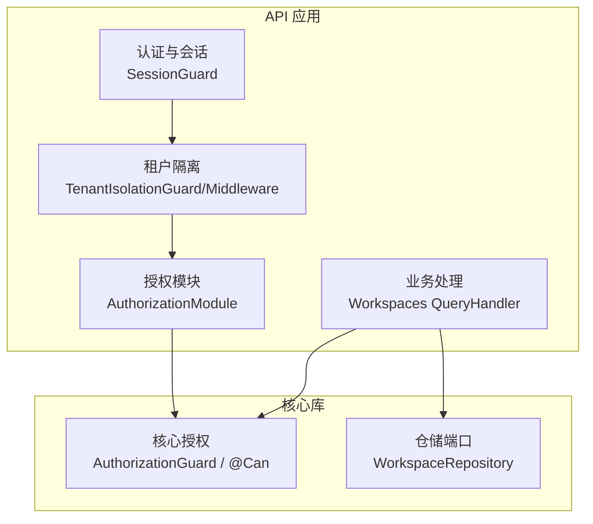
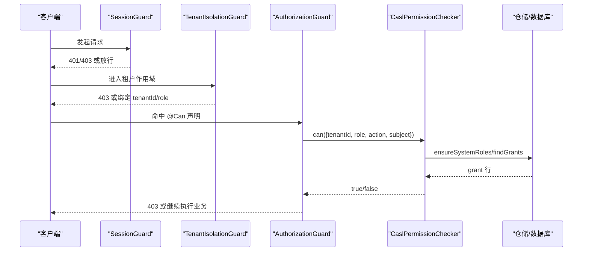
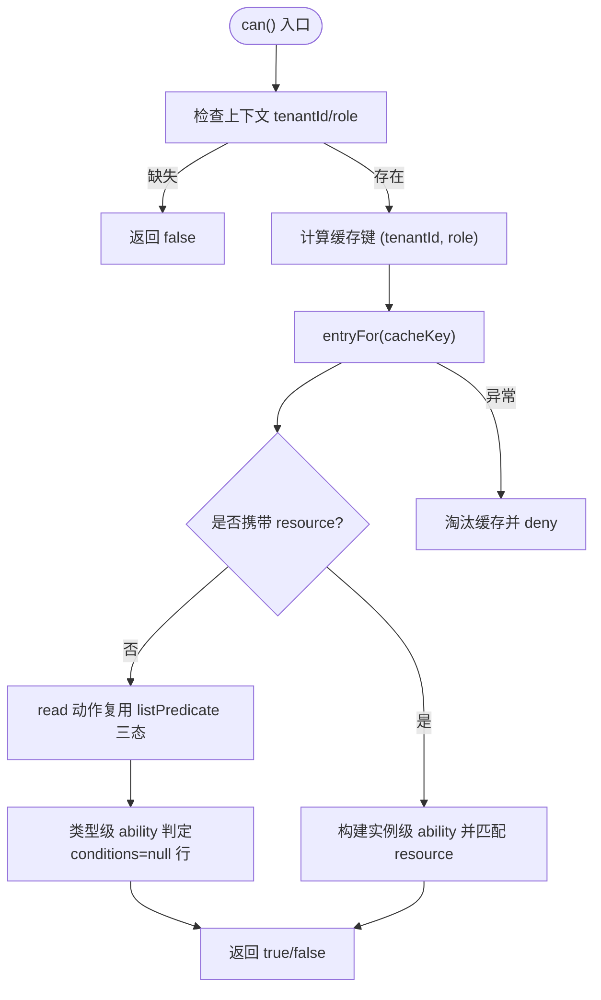
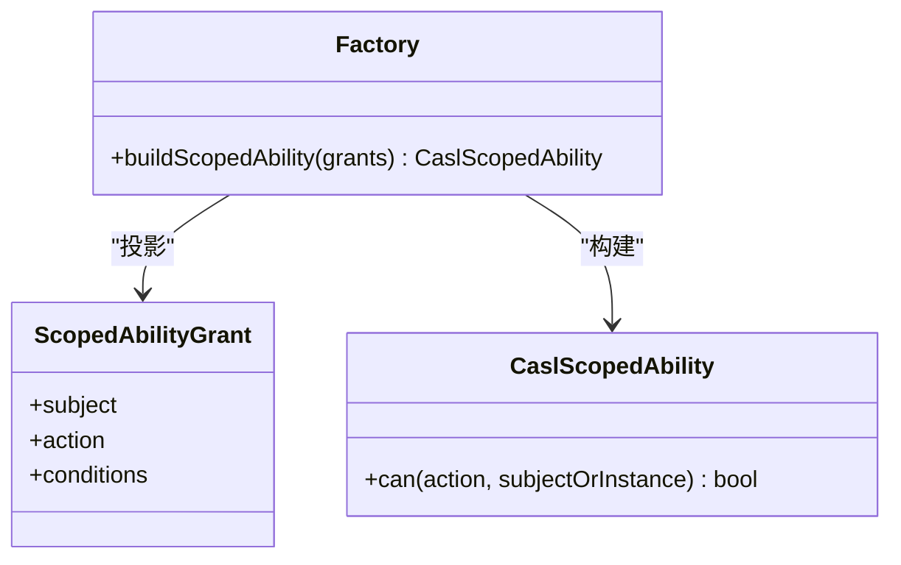
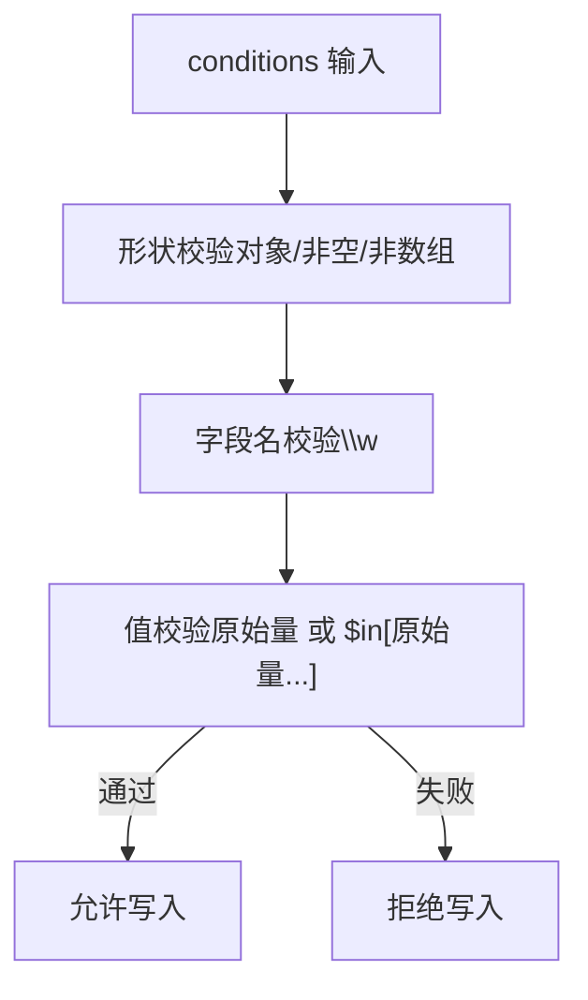
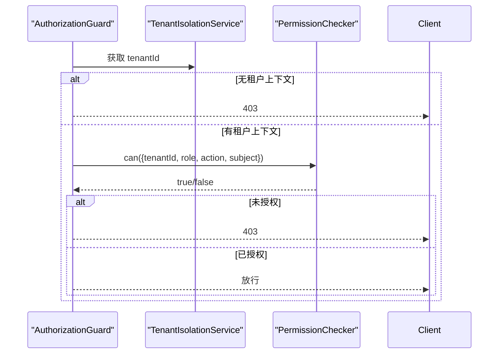
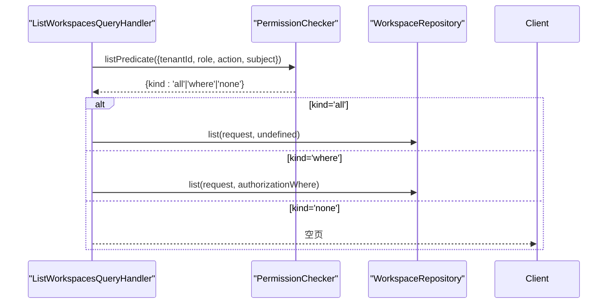
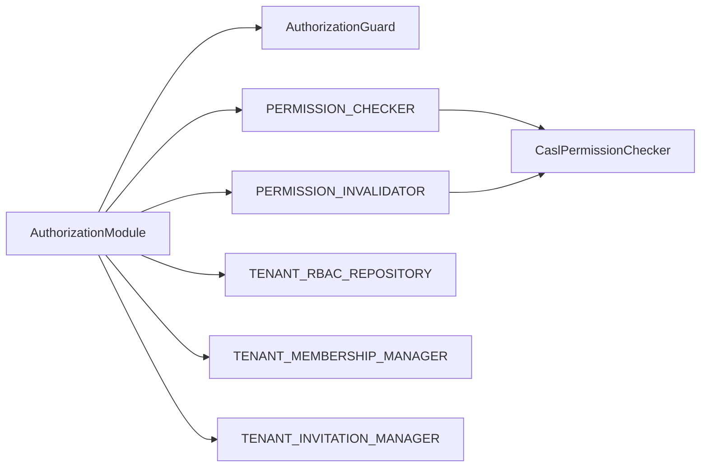
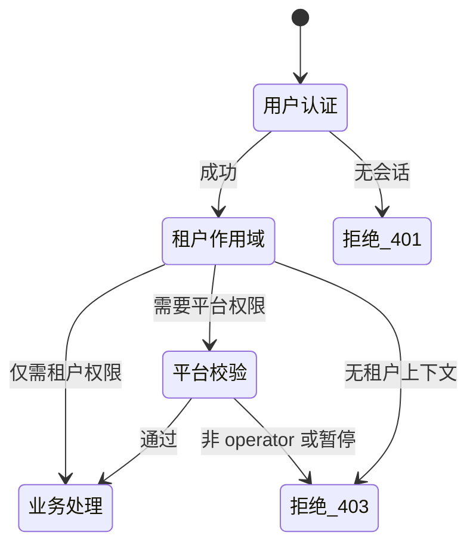

# RBAC 权限控制

<cite>
**本文引用的文件**   
- [authorization.module.ts](file://apps/api/src/modules/authorization/authorization.module.ts)
- [casl-ability.factory.ts](file://apps/api/src/modules/authorization/infrastructure/casl-ability.factory.ts)
- [casl-permission.checker.ts](file://apps/api/src/modules/authorization/infrastructure/casl-permission.checker.ts)
- [rbac.policy.ts](file://apps/api/src/modules/authorization/domain/policies/rbac.policy.ts)
- [system-role-seed.ts](file://apps/api/src/modules/authorization/domain/constants/system-role-seed.ts)
- [authorization.guard.ts](file://libs/core/src/authorization/authorization.guard.ts)
- [session.guard.ts](file://apps/api/src/modules/auth/api/guards/session.guard.ts)
- [three-layer-permission.matrix.test.ts](file://apps/api/src/tenant-isolation/three-layer-permission.matrix.test.ts)
- [list-workspaces.query-handler.ts](file://libs/core/src/modules/workspaces/application/queries/handlers/list-workspaces.query-handler.ts)
- [workspace.repository.ts](file://libs/core/src/modules/workspaces/domain/repositories/workspace.repository.ts)
</cite>

## 目录
1. [引言](#引言)
2. [项目结构](#项目结构)
3. [核心组件](#核心组件)
4. [架构总览](#架构总览)
5. [详细组件分析](#详细组件分析)
6. [依赖关系分析](#依赖关系分析)
7. [性能与缓存](#性能与缓存)
8. [三层权限模型与守卫链](#三层权限模型与守卫链)
9. [权限矩阵与策略设计](#权限矩阵与策略设计)
10. [故障排查与最佳实践](#故障排查与最佳实践)
11. [结论](#结论)

## 引言
本文件系统性梳理 SaaS 多租户系统中的 RBAC 权限控制实现，重点覆盖：
- 三层权限模型：平台级、租户级、工作区级（以租户为主轴）的边界与协作。
- CASL 能力模型的落地：角色定义、授权行（grant）、动态权限检查与实例级条件匹配。
- 权限策略引擎：从 DB grant 到 CASL ability 的投影、类型级与实例级判定、列表谓词下推。
- 权限守卫与自定义检查器：@Can 声明、AuthorizationGuard、SessionGuard、PlatformOperatorGuard 的组合。
- 权限矩阵、性能优化与最佳实践：fail-closed、进程内 LRU 缓存、查询级过滤、写后失效。

## 项目结构
RBAC 相关代码集中在 authorization 模块与 core 权限基础设施中，并与认证、租户隔离、业务仓储协同：
- authorization 模块：提供全局授权守卫、CASL 适配、策略闸、系统角色 seed、管理门面与仓储端口。
- core 权限基础设施：提供 @Can 装饰器、AuthorizationGuard、PermissionChecker 端口等通用能力。
- 认证与会话：SessionGuard 作为全局会话墙，结合用户状态服务做纵深防御。
- 租户隔离：TenantIsolationGuard/Middleware 绑定 tenantId/role，确保所有租户路由 fail-closed。
- 业务层：工作区等读侧处理器通过 PermissionChecker.listPredicate 将实例级授权下推到仓储层。

图表来源
- [authorization.module.ts:18-32](file://apps/api/src/modules/authorization/authorization.module.ts#L18-L32)
- [authorization.guard.ts:14-33](file://libs/core/src/authorization/authorization.guard.ts#L14-L33)
- [session.guard.ts:52-64](file://apps/api/src/modules/auth/api/guards/session.guard.ts#L52-L64)
- [list-workspaces.query-handler.ts:17-37](file://libs/core/src/modules/workspaces/application/queries/handlers/list-workspaces.query-handler.ts#L17-L37)
- [workspace.repository.ts:62-84](file://libs/core/src/modules/workspaces/domain/repositories/workspace.repository.ts#L62-L84)

章节来源
- [authorization.module.ts:18-32](file://apps/api/src/modules/authorization/authorization.module.ts#L18-L32)
- [authorization.guard.ts:14-33](file://libs/core/src/authorization/authorization.guard.ts#L14-L33)
- [session.guard.ts:52-64](file://apps/api/src/modules/auth/api/guards/session.guard.ts#L52-L64)
- [list-workspaces.query-handler.ts:17-37](file://libs/core/src/modules/workspaces/application/queries/handlers/list-workspaces.query-handler.ts#L17-L37)
- [workspace.repository.ts:62-84](file://libs/core/src/modules/workspaces/domain/repositories/workspace.repository.ts#L62-L84)

## 核心组件
- 权限裁决适配器（CaslPermissionChecker）：将 DB grant 行投影为 CASL ability，提供 can() 与 listPredicate()，并维护进程内版本缓存与热失效。
- CASL 能力工厂（buildScopedAbility）：纯函数，将 grant 行映射为 CASL 规则，支持 conditions 的 mongo 匹配。
- 策略闸（rbac.policy.ts）：校验自定义角色 key 与 grant conditions 的形状白名单，保证写入安全。
- 系统角色种子（system-role-seed.ts）：owner/admin/member 三系统角色的初始授权数据，用于 lazy-ensure。
- 租户级授权守卫（AuthorizationGuard）：读取 @Can 声明，调用 PermissionChecker 进行异步裁决。
- 会话守卫（SessionGuard）：全局会话墙，校验登录态与账号暂停状态。
- 三层权限矩阵测试：验证平台/租户/用户三层互不授予、fail-closed 与校验顺序。

章节来源
- [casl-permission.checker.ts:51-86](file://apps/api/src/modules/authorization/infrastructure/casl-permission.checker.ts#L51-L86)
- [casl-ability.factory.ts:7-16](file://apps/api/src/modules/authorization/infrastructure/casl-ability.factory.ts#L7-L16)
- [rbac.policy.ts:3-9](file://apps/api/src/modules/authorization/domain/policies/rbac.policy.ts#L3-L9)
- [system-role-seed.ts:7-22](file://apps/api/src/modules/authorization/domain/constants/system-role-seed.ts#L7-L22)
- [authorization.guard.ts:14-33](file://libs/core/src/authorization/authorization.guard.ts#L14-L33)
- [session.guard.ts:52-64](file://apps/api/src/modules/auth/api/guards/session.guard.ts#L52-L64)
- [three-layer-permission.matrix.test.ts:15-23](file://apps/api/src/tenant-isolation/three-layer-permission.matrix.test.ts#L15-L23)

## 架构总览
下图展示请求进入后的三层守卫链与授权决策路径：

图表来源
- [session.guard.ts:81-117](file://apps/api/src/modules/auth/api/guards/session.guard.ts#L81-L117)
- [authorization.guard.ts:50-83](file://libs/core/src/authorization/authorization.guard.ts#L50-L83)
- [casl-permission.checker.ts:88-127](file://apps/api/src/modules/authorization/infrastructure/casl-permission.checker.ts#L88-L127)

## 详细组件分析

### 权限裁决适配器 CaslPermissionChecker
职责与行为要点：
- 输入：PermissionCheckInput（tenantId、role、action、subject、可选 resource、userId）。
- 输出：布尔值（can）或列表谓词（listPredicate）。
- 关键机制：
  - fail-closed：无租户/无角色直接拒绝；加载失败也拒绝。
  - lazy-ensure：首次访问时确保系统角色存在，再读取 grant 行。
  - 进程内缓存：按 (tenantId, role) 二元组缓存 ability，LRU 驱逐，避免重复查库。
  - over-grant 防线：类型级 ability 仅包含 conditions=null 的行，防止带条件的 grant 误升全量。
  - 实例判定（S4）：当携带 resource 时，解析 {{userId}} 模板，使用 CASL mongo 匹配实例字段。
  - 列表谓词（query-level filtering）：返回 all/where/none，驱动仓储层下推 where 条件。

图表来源
- [casl-permission.checker.ts:88-127](file://apps/api/src/modules/authorization/infrastructure/casl-permission.checker.ts#L88-L127)
- [casl-permission.checker.ts:146-168](file://apps/api/src/modules/authorization/infrastructure/casl-permission.checker.ts#L146-L168)
- [casl-permission.checker.ts:170-197](file://apps/api/src/modules/authorization/infrastructure/casl-permission.checker.ts#L170-L197)

章节来源
- [casl-permission.checker.ts:51-86](file://apps/api/src/modules/authorization/infrastructure/casl-permission.checker.ts#L51-L86)
- [casl-permission.checker.ts:88-127](file://apps/api/src/modules/authorization/infrastructure/casl-permission.checker.ts#L88-L127)
- [casl-permission.checker.ts:146-168](file://apps/api/src/modules/authorization/infrastructure/casl-permission.checker.ts#L146-L168)
- [casl-permission.checker.ts:170-197](file://apps/api/src/modules/authorization/infrastructure/casl-permission.checker.ts#L170-L197)

### CASL 能力工厂 buildScopedAbility
- 输入：grant 行数组（subject、action、conditions?）。
- 行为：逐行调用 AbilityBuilder.can(action, subject, conditions?)，构建 MongoAbility。
- 特点：纯函数，不含任何权限知识；conditions 非空则走 mongo 匹配。

图表来源
- [casl-ability.factory.ts:7-16](file://apps/api/src/modules/authorization/infrastructure/casl-ability.factory.ts#L7-L16)
- [casl-ability.factory.ts:39-46](file://apps/api/src/modules/authorization/infrastructure/casl-ability.factory.ts#L39-L46)

章节来源
- [casl-ability.factory.ts:7-16](file://apps/api/src/modules/authorization/infrastructure/casl-ability.factory.ts#L7-L16)
- [casl-ability.factory.ts:39-46](file://apps/api/src/modules/authorization/infrastructure/casl-ability.factory.ts#L39-L46)

### 策略闸 rbac.policy.ts
- 自定义角色 key 校验：小写字母数字开头，允许 -/_，长度限制，且不得与系统保留 key 冲突。
- conditions 白名单：顶层对象，键为字段名，值为原始量或 $in 数组（元素为原始量），拒绝复杂运算符。
- canonicalConditions：JSON 规范化串，用于 grant 撤销时的精确比较。

图表来源
- [rbac.policy.ts:38-71](file://apps/api/src/modules/authorization/domain/policies/rbac.policy.ts#L38-L71)
- [rbac.policy.ts:83-94](file://apps/api/src/modules/authorization/domain/policies/rbac.policy.ts#L83-L94)

章节来源
- [rbac.policy.ts:3-9](file://apps/api/src/modules/authorization/domain/policies/rbac.policy.ts#L3-L9)
- [rbac.policy.ts:38-71](file://apps/api/src/modules/authorization/domain/policies/rbac.policy.ts#L38-L71)
- [rbac.policy.ts:83-94](file://apps/api/src/modules/authorization/domain/policies/rbac.policy.ts#L83-L94)

### 系统角色种子 system-role-seed.ts
- 定义 owner/admin/member 三系统角色的初始 grants。
- 用途：lazy-ensure 在租户首次解析授权时补种系统角色；迁移/seed 回填。
- 语义：Member/Invitation read 为现状对拍扩项；Role/RoleGrant 格为新增管理职权。

章节来源
- [system-role-seed.ts:7-22](file://apps/api/src/modules/authorization/domain/constants/system-role-seed.ts#L7-L22)
- [system-role-seed.ts:44-82](file://apps/api/src/modules/authorization/domain/constants/system-role-seed.ts#L44-L82)

### 租户级授权守卫 AuthorizationGuard
- 职责：读取 @Can 声明，校验活动租户上下文，调用 PermissionChecker 异步裁决。
- fail-closed：无活动租户即抛 403；缺少所需权限抛 403。
- 换轴：分区键锚 tenantId，不再透传活动 org。

图表来源
- [authorization.guard.ts:50-83](file://libs/core/src/authorization/authorization.guard.ts#L50-L83)

章节来源
- [authorization.guard.ts:14-33](file://libs/core/src/authorization/authorization.guard.ts#L14-L33)
- [authorization.guard.ts:50-83](file://libs/core/src/authorization/authorization.guard.ts#L50-L83)

### 会话守卫 SessionGuard
- 全局 APP_GUARD：默认要求已登录会话，@Public 路由旁路。
- 纵深防御：结合 UserStatusService，对暂停用户返回 403。
- 挂起 sessionUser：id/email/sessionId，供后续流程使用。

章节来源
- [session.guard.ts:52-64](file://apps/api/src/modules/auth/api/guards/session.guard.ts#L52-L64)
- [session.guard.ts:81-117](file://apps/api/src/modules/auth/api/guards/session.guard.ts#L81-L117)

### 列表级授权谓词与工作区读侧
- 读侧处理器通过 PermissionChecker.listPredicate 获取 all/where/none。
- 仓储端口接受 authorizationWhere，将实例级授权谓词并入租户盖章之前，保证隔离卡点不被覆盖。

图表来源
- [list-workspaces.query-handler.ts:17-37](file://libs/core/src/modules/workspaces/application/queries/handlers/list-workspaces.query-handler.ts#L17-L37)
- [workspace.repository.ts:62-84](file://libs/core/src/modules/workspaces/domain/repositories/workspace.repository.ts#L62-L84)

章节来源
- [list-workspaces.query-handler.ts:17-37](file://libs/core/src/modules/workspaces/application/queries/handlers/list-workspaces.query-handler.ts#L17-L37)
- [workspace.repository.ts:62-84](file://libs/core/src/modules/workspaces/domain/repositories/workspace.repository.ts#L62-L84)

## 依赖关系分析
- AuthorizationModule 注册全局守卫与端口：
  - 导出 AuthorizationGuard、PERMISSION_CHECKER、PERMISSION_INVALIDATOR。
  - 注入 CaslPermissionChecker 同时作为 checker 与 invalidator。
  - 暴露 TENANT_RBAC_REPOSITORY 与成员/邀请管理端口。

图表来源
- [authorization.module.ts:18-32](file://apps/api/src/modules/authorization/authorization.module.ts#L18-L32)
- [authorization.module.ts:34-59](file://apps/api/src/modules/authorization/authorization.module.ts#L34-L59)

章节来源
- [authorization.module.ts:18-32](file://apps/api/src/modules/authorization/authorization.module.ts#L18-L32)
- [authorization.module.ts:34-59](file://apps/api/src/modules/authorization/authorization.module.ts#L34-L59)

## 性能与缓存
- 进程内 LRU 缓存：
  - 键：(tenantId, role) 二元组。
  - 容量：默认 2048，可测试下调以验证驱逐。
  - 并发保护：在途 Promise 防重入，失败即时淘汰。
- 类型级 vs 实例级：
  - 类型级 ability 仅含 conditions=null 行，避免过宽放行。
  - 实例级 ability 纳入全部 grant 行，解析 {{userId}} 后 mongo 匹配。
- 列表谓词缓存：
  - listPredicate 复用 entryFor 缓存，避免逐请求查库。
  - 转换器外错误或加载失败 → none + 淘汰缓存。

章节来源
- [casl-permission.checker.ts:75-86](file://apps/api/src/modules/authorization/infrastructure/casl-permission.checker.ts#L75-L86)
- [casl-permission.checker.ts:170-197](file://apps/api/src/modules/authorization/infrastructure/casl-permission.checker.ts#L170-L197)
- [casl-permission.checker.ts:146-168](file://apps/api/src/modules/authorization/infrastructure/casl-permission.checker.ts#L146-L168)

## 三层权限模型与守卫链
- 用户级（SessionGuard）：校验会话与账号状态，挂 sessionUser。
- 租户级（TenantIsolationGuard/Middleware）：绑定 tenantId/role，fail-closed。
- 平台级（PlatformOperatorGuard）：基于配置 operatorEmail 与用户状态校验平台操作者。
- 矩阵测试验证：
  - 各层各自 fail-closed。
  - 互不授予：平台权不自动带来租户作用域，租户 admin 不自动获得平台权。
  - 校验顺序与暂停联动：暂停用户在三层皆失权。

图表来源
- [three-layer-permission.matrix.test.ts:86-115](file://apps/api/src/tenant-isolation/three-layer-permission.matrix.test.ts#L86-L115)
- [three-layer-permission.matrix.test.ts:117-171](file://apps/api/src/tenant-isolation/three-layer-permission.matrix.test.ts#L117-L171)
- [three-layer-permission.matrix.test.ts:173-203](file://apps/api/src/tenant-isolation/three-layer-permission.matrix.test.ts#L173-L203)

章节来源
- [three-layer-permission.matrix.test.ts:15-23](file://apps/api/src/tenant-isolation/three-layer-permission.matrix.test.ts#L15-L23)
- [three-layer-permission.matrix.test.ts:86-115](file://apps/api/src/tenant-isolation/three-layer-permission.matrix.test.ts#L86-L115)
- [three-layer-permission.matrix.test.ts:117-171](file://apps/api/src/tenant-isolation/three-layer-permission.matrix.test.ts#L117-L171)
- [three-layer-permission.matrix.test.ts:173-203](file://apps/api/src/tenant-isolation/three-layer-permission.matrix.test.ts#L173-L203)

## 权限矩阵与策略设计
- 系统角色矩阵（owner/admin/member）：
  - Owner：Organization/Member/Invitation/Workspace/Role/RoleGrant 的管理与读写。
  - Admin：略低于 Owner 的 Organization 删除权，其余类似 Owner。
  - Member：Member/Invitation/Workspace 的只读。
- 动态角色与 grant：
  - 自定义角色 key 需过策略闸。
  - grant conditions 白名单限缩为等值/$in，避免复杂表达式。
- 列表级过滤：
  - all：无条件全量。
  - where：$or 合并多个 conditions 行，下推到仓储层。
  - none：短路空页。

章节来源
- [system-role-seed.ts:44-82](file://apps/api/src/modules/authorization/domain/constants/system-role-seed.ts#L44-L82)
- [rbac.policy.ts:38-71](file://apps/api/src/modules/authorization/domain/policies/rbac.policy.ts#L38-L71)
- [casl-permission.checker.ts:146-168](file://apps/api/src/modules/authorization/infrastructure/casl-permission.checker.ts#L146-L168)

## 故障排查与最佳实践
常见问题与对策：
- 无租户上下文导致 403：
  - 确认中间件已绑定 tenantId，且路由未被 @Public/@TenantIsolationExempt 豁免。
- 权限判定 deny：
  - 检查 @Can 声明与 CASL subject/action 是否一致。
  - 确认租户角色与 grant 行是否存在（lazy-ensure 与 findGrants）。
- 列表查询为空：
  - 检查 listPredicate 返回 none 的原因（无匹配 grant 行或 conditions 解析失败）。
- 写后权限未生效：
  - 确认写侧调用了 PermissionInvalidator.invalidate(tenantId)。

最佳实践：
- 始终使用 @Can 声明最小必要权限。
- 优先使用 listPredicate 下推 where，减少内存与网络开销。
- 谨慎使用 conditions，遵循白名单语法。
- 对敏感写操作增加审计与二次确认。

章节来源
- [authorization.guard.ts:50-83](file://libs/core/src/authorization/authorization.guard.ts#L50-L83)
- [casl-permission.checker.ts:129-135](file://apps/api/src/modules/authorization/infrastructure/casl-permission.checker.ts#L129-L135)
- [casl-permission.checker.ts:146-168](file://apps/api/src/modules/authorization/infrastructure/casl-permission.checker.ts#L146-L168)

## 结论
该 RBAC 体系以租户为主轴，结合 CASL 能力模型与 DB grant 行，实现了细粒度、可扩展的动态权限控制。通过三层守卫链与 fail-closed 原则，确保平台、租户、用户三级权限严格隔离；通过列表级谓词下推与进程内缓存，兼顾性能与安全。建议在业务扩展中遵循策略闸与白名单约束，持续完善权限矩阵与自动化测试，保障授权一致性。