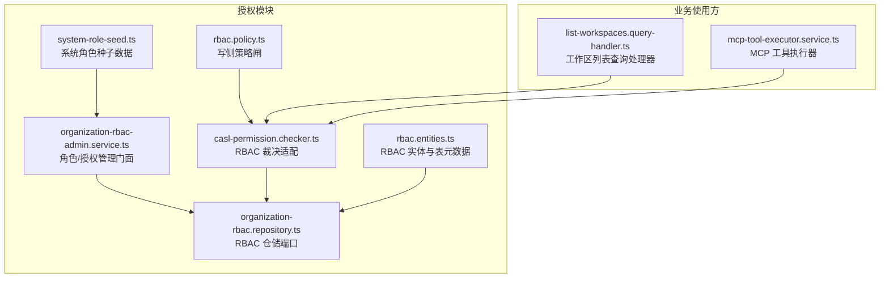
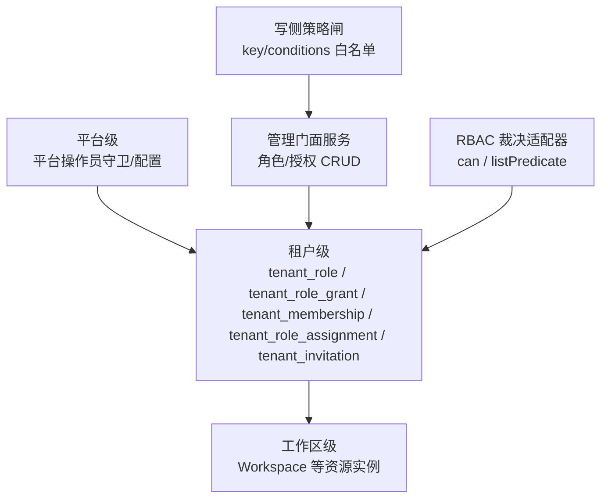
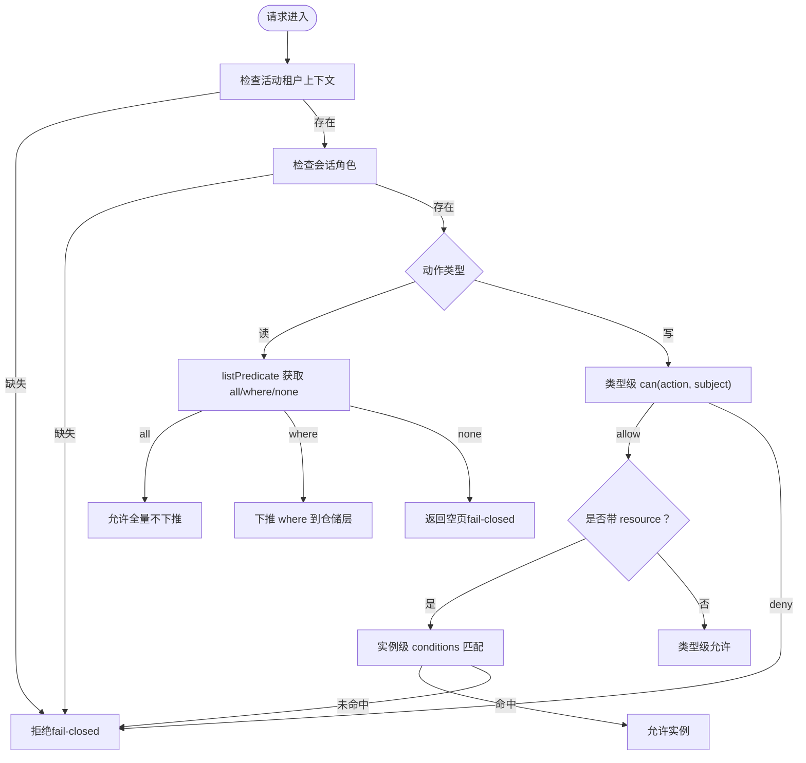
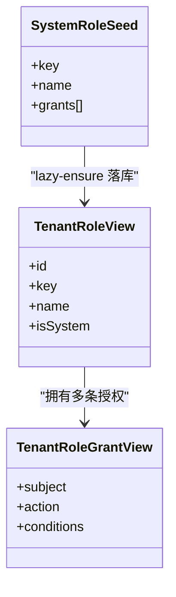
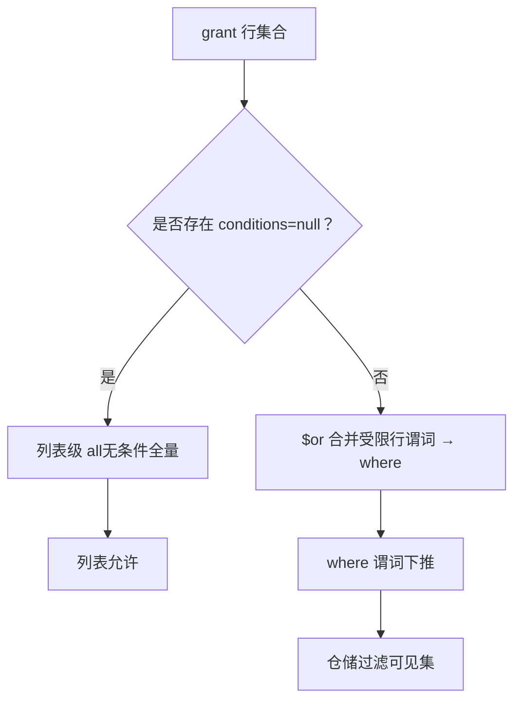
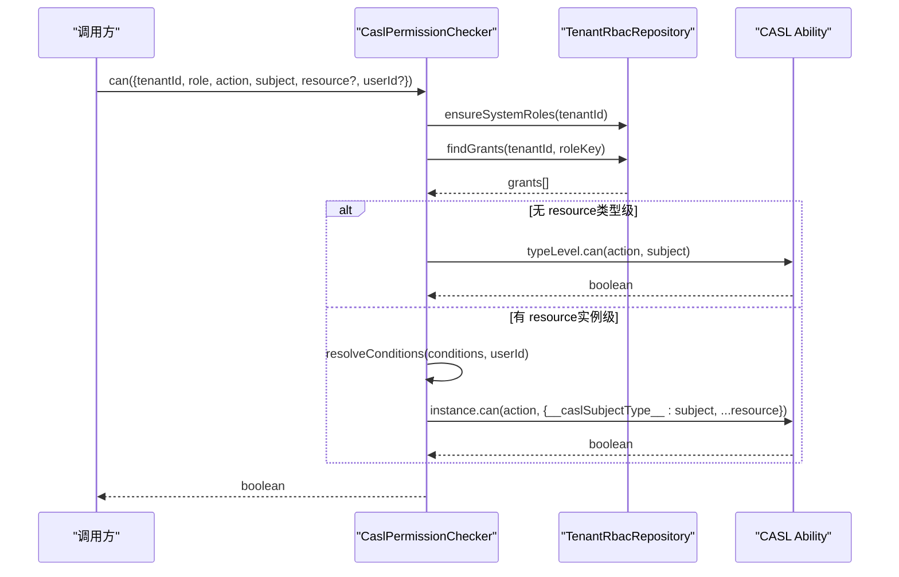
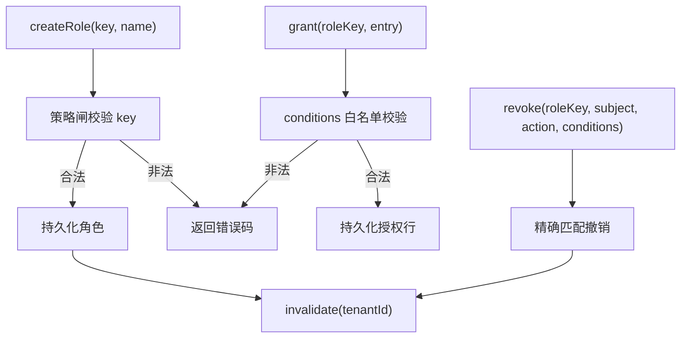
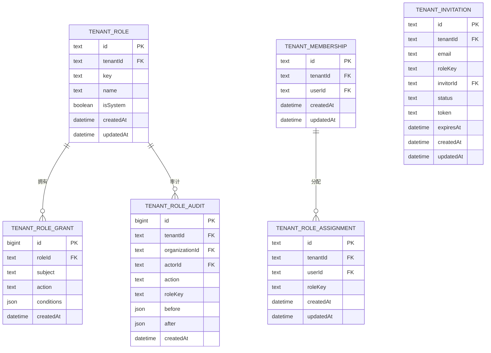
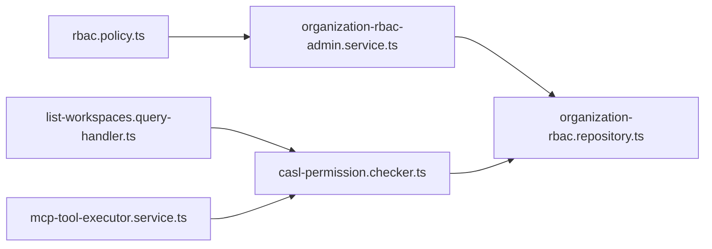

# 权限模型设计

<cite>
**本文引用的文件**   
- [apps/api/src/modules/authorization/domain/policies/rbac.policy.ts](file://apps/api/src/modules/authorization/domain/policies/rbac.policy.ts)
- [apps/api/src/modules/authorization/infrastructure/casl-permission.checker.ts](file://apps/api/src/modules/authorization/infrastructure/casl-permission.checker.ts)
- [apps/api/src/modules/authorization/infrastructure/casl-permission.checker.test.ts](file://apps/api/src/modules/authorization/infrastructure/casl-permission.checker.test.ts)
- [apps/api/src/modules/authorization/domain/constants/system-role-seed.ts](file://apps/api/src/modules/authorization/domain/constants/system-role-seed.ts)
- [apps/api/src/modules/authorization/application/organization-rbac-admin.service.ts](file://apps/api/src/modules/authorization/application/organization-rbac-admin.service.ts)
- [apps/api/src/modules/authorization/domain/repositories/organization-rbac.repository.ts](file://apps/api/src/modules/authorization/domain/repositories/organization-rbac.repository.ts)
- [apps/api/src/modules/authorization/infrastructure/entities/rbac.entities.ts](file://apps/api/src/modules/authorization/infrastructure/entities/rbac.entities.ts)
- [libs/core/src/modules/workspaces/application/queries/handlers/list-workspaces.query-handler.ts](file://libs/core/src/modules/workspaces/application/queries/handlers/list-workspaces.query-handler.ts)
- [apps/api/src/features/mcp/application/mcp-tool-executor.service.ts](file://apps/api/src/features/mcp/application/mcp-tool-executor.service.ts)
</cite>

## 目录
1. [引言](#引言)
2. [项目结构](#项目结构)
3. [核心组件](#核心组件)
4. [架构总览](#架构总览)
5. [详细组件分析](#详细组件分析)
6. [依赖关系分析](#依赖关系分析)
7. [性能与缓存特性](#性能与缓存特性)
8. [故障排查指南](#故障排查指南)
9. [结论](#结论)
10. [附录：代码示例路径](#附录代码示例路径)

## 引言
本设计文档阐述系统的三层权限架构（平台级/租户级/工作区级）与 RBAC 策略引擎的核心实现。重点包括：
- 三层权限边界与职责划分
- 角色层次结构与继承机制
- 资源访问控制规则与权限矩阵原则
- 预置系统角色与自定义角色创建流程
- RBAC 策略引擎的关键逻辑：角色 key 验证、条件白名单、权限规范化、实例级判定与列表谓词下推
- 冲突解决策略与 fail-closed 安全默认值

## 项目结构
权限相关代码主要分布在授权模块的领域层、基础设施层与应用门面层，同时在工作区读侧处理器中体现列表级权限下推。

**图表来源**
- [apps/api/src/modules/authorization/domain/policies/rbac.policy.ts:1-95](file://apps/api/src/modules/authorization/domain/policies/rbac.policy.ts#L1-L95)
- [apps/api/src/modules/authorization/infrastructure/casl-permission.checker.ts:1-199](file://apps/api/src/modules/authorization/infrastructure/casl-permission.checker.ts#L1-L199)
- [apps/api/src/modules/authorization/application/organization-rbac-admin.service.ts:1-242](file://apps/api/src/modules/authorization/application/organization-rbac-admin.service.ts#L1-L242)
- [apps/api/src/modules/authorization/domain/repositories/organization-rbac.repository.ts:1-40](file://apps/api/src/modules/authorization/domain/repositories/organization-rbac.repository.ts#L1-L40)
- [apps/api/src/modules/authorization/infrastructure/entities/rbac.entities.ts:1-249](file://apps/api/src/modules/authorization/infrastructure/entities/rbac.entities.ts#L1-L249)
- [apps/api/src/modules/authorization/domain/constants/system-role-seed.ts:1-83](file://apps/api/src/modules/authorization/domain/constants/system-role-seed.ts#L1-L83)
- [libs/core/src/modules/workspaces/application/queries/handlers/list-workspaces.query-handler.ts:17-63](file://libs/core/src/modules/workspaces/application/queries/handlers/list-workspaces.query-handler.ts#L17-L63)
- [apps/api/src/features/mcp/application/mcp-tool-executor.service.ts:88-110](file://apps/api/src/features/mcp/application/mcp-tool-executor.service.ts#L88-L110)

**章节来源**
- [apps/api/src/modules/authorization/domain/policies/rbac.policy.ts:1-95](file://apps/api/src/modules/authorization/domain/policies/rbac.policy.ts#L1-L95)
- [apps/api/src/modules/authorization/infrastructure/casl-permission.checker.ts:1-199](file://apps/api/src/modules/authorization/infrastructure/casl-permission.checker.ts#L1-L199)
- [apps/api/src/modules/authorization/application/organization-rbac-admin.service.ts:1-242](file://apps/api/src/modules/authorization/application/organization-rbac-admin.service.ts#L1-L242)
- [apps/api/src/modules/authorization/domain/repositories/organization-rbac.repository.ts:1-40](file://apps/api/src/modules/authorization/domain/repositories/organization-rbac.repository.ts#L1-L40)
- [apps/api/src/modules/authorization/infrastructure/entities/rbac.entities.ts:1-249](file://apps/api/src/modules/authorization/infrastructure/entities/rbac.entities.ts#L1-L249)
- [apps/api/src/modules/authorization/domain/constants/system-role-seed.ts:1-83](file://apps/api/src/modules/authorization/domain/constants/system-role-seed.ts#L1-L83)
- [libs/core/src/modules/workspaces/application/queries/handlers/list-workspaces.query-handler.ts:17-63](file://libs/core/src/modules/workspaces/application/queries/handlers/list-workspaces.query-handler.ts#L17-L63)
- [apps/api/src/features/mcp/application/mcp-tool-executor.service.ts:88-110](file://apps/api/src/features/mcp/application/mcp-tool-executor.service.ts#L88-L110)

## 核心组件
- 写侧策略闸：负责自定义角色 key 合法性校验与 grant conditions 白名单校验，并提供 JSON 规范化比较能力。
- RBAC 裁决适配器：将 DB 中的 grant 行投影为 CASL ability，提供 can 与 listPredicate 两种判定路径，并维护进程内缓存。
- 系统角色种子：定义 owner/admin/member 三系统角色的初始授权集合，用于 lazy-ensure 落库。
- 管理门面服务：暴露角色与授权的 CRUD 接口，统一转译领域结果为 HTTP 语义，并在写后失效权限缓存。
- RBAC 仓储端口：抽象租户 RBAC 读模型与操作契约，屏蔽底层存储细节。
- RBAC 实体与表元数据：定义 tenant_role / tenant_role_grant / tenant_role_audit 等表结构与运行时实体。
- 工作区列表查询处理器：通过 checker.listPredicate 获取 where 谓词并下推到仓储层，实现列表级可见性收窄。
- MCP 工具执行器：在工具调用路径复用 checker.can 守卫路径，确保类型级权限一致。

**章节来源**
- [apps/api/src/modules/authorization/domain/policies/rbac.policy.ts:1-95](file://apps/api/src/modules/authorization/domain/policies/rbac.policy.ts#L1-L95)
- [apps/api/src/modules/authorization/infrastructure/casl-permission.checker.ts:1-199](file://apps/api/src/modules/authorization/infrastructure/casl-permission.checker.ts#L1-L199)
- [apps/api/src/modules/authorization/domain/constants/system-role-seed.ts:1-83](file://apps/api/src/modules/authorization/domain/constants/system-role-seed.ts#L1-L83)
- [apps/api/src/modules/authorization/application/organization-rbac-admin.service.ts:1-242](file://apps/api/src/modules/authorization/application/organization-rbac-admin.service.ts#L1-L242)
- [apps/api/src/modules/authorization/domain/repositories/organization-rbac.repository.ts:1-40](file://apps/api/src/modules/authorization/domain/repositories/organization-rbac.repository.ts#L1-L40)
- [apps/api/src/modules/authorization/infrastructure/entities/rbac.entities.ts:1-249](file://apps/api/src/modules/authorization/infrastructure/entities/rbac.entities.ts#L1-L249)
- [libs/core/src/modules/workspaces/application/queries/handlers/list-workspaces.query-handler.ts:17-63](file://libs/core/src/modules/workspaces/application/queries/handlers/list-workspaces.query-handler.ts#L17-L63)
- [apps/api/src/features/mcp/application/mcp-tool-executor.service.ts:88-110](file://apps/api/src/features/mcp/application/mcp-tool-executor.service.ts#L88-L110)

## 架构总览
三层权限架构的职责边界如下：
- 平台级：平台操作员身份校验与平台级治理入口（例如平台租户/用户管理），由平台守卫与配置驱动。
- 租户级：RBAC 角色与授权以租户为单位隔离；成员与角色分配、邀请均按租户维度组织。
- 工作区级：具体资源（如 Workspace）的实例级访问控制通过 conditions 模板与实例字段匹配实现。

**图表来源**
- [apps/api/src/modules/authorization/application/organization-rbac-admin.service.ts:1-242](file://apps/api/src/modules/authorization/application/organization-rbac-admin.service.ts#L1-L242)
- [apps/api/src/modules/authorization/infrastructure/casl-permission.checker.ts:1-199](file://apps/api/src/modules/authorization/infrastructure/casl-permission.checker.ts#L1-L199)
- [apps/api/src/modules/authorization/domain/policies/rbac.policy.ts:1-95](file://apps/api/src/modules/authorization/domain/policies/rbac.policy.ts#L1-L95)
- [apps/api/src/modules/authorization/infrastructure/entities/rbac.entities.ts:1-249](file://apps/api/src/modules/authorization/infrastructure/entities/rbac.entities.ts#L1-L249)

## 详细组件分析

### 三层权限架构与资源访问控制
- 平台级：通过平台操作员守卫进行身份校验，仅允许配置的操作员邮箱命中时放行，未配置或用户被阻断时 fail-closed。
- 租户级：所有 RBAC 数据（角色、授权、成员、角色分配、邀请）均以 tenantId 为主轴隔离；X7 切片 C 将授权上收租级，grant 不再按活动组织收窄。
- 工作区级：对 Workspace 等资源的实例级访问通过 conditions 模板（如 ownerId=userId）与资源字段匹配；无 userId 时模板不解析，保守 deny。

**图表来源**
- [apps/api/src/modules/authorization/infrastructure/casl-permission.checker.ts:88-127](file://apps/api/src/modules/authorization/infrastructure/casl-permission.checker.ts#L88-L127)
- [apps/api/src/modules/authorization/infrastructure/casl-permission.checker.ts:146-168](file://apps/api/src/modules/authorization/infrastructure/casl-permission.checker.ts#L146-L168)
- [libs/core/src/modules/workspaces/application/queries/handlers/list-workspaces.query-handler.ts:45-62](file://libs/core/src/modules/workspaces/application/queries/handlers/list-workspaces.query-handler.ts#L45-L62)

**章节来源**
- [apps/api/src/modules/authorization/infrastructure/casl-permission.checker.ts:88-127](file://apps/api/src/modules/authorization/infrastructure/casl-permission.checker.ts#L88-L127)
- [apps/api/src/modules/authorization/infrastructure/casl-permission.checker.ts:146-168](file://apps/api/src/modules/authorization/infrastructure/casl-permission.checker.ts#L146-L168)
- [libs/core/src/modules/workspaces/application/queries/handlers/list-workspaces.query-handler.ts:45-62](file://libs/core/src/modules/workspaces/application/queries/handlers/list-workspaces.query-handler.ts#L45-L62)

### 角色层次结构与权限继承机制
- 系统角色：owner/admin/member 三个内置角色，lazy-ensure 首次解析授权时幂等落库，isSystem=true 不可改删。
- 自定义角色：通过管理门面创建，key 需满足词法白名单且非系统保留 key；授权行可叠加多行 OR 语义。
- 继承机制：采用“角色 + grant 行”的组合授权，不存在显式继承链；通过多个 grant 行组合形成更细粒度权限。

**图表来源**
- [apps/api/src/modules/authorization/domain/constants/system-role-seed.ts:48-82](file://apps/api/src/modules/authorization/domain/constants/system-role-seed.ts#L48-L82)
- [apps/api/src/modules/authorization/domain/repositories/organization-rbac.repository.ts:13-40](file://apps/api/src/modules/authorization/domain/repositories/organization-rbac.repository.ts#L13-L40)

**章节来源**
- [apps/api/src/modules/authorization/domain/constants/system-role-seed.ts:48-82](file://apps/api/src/modules/authorization/domain/constants/system-role-seed.ts#L48-L82)
- [apps/api/src/modules/authorization/domain/repositories/organization-rbac.repository.ts:13-40](file://apps/api/src/modules/authorization/domain/repositories/organization-rbac.repository.ts#L13-L40)

### 权限矩阵设计原则与冲突解决策略
- 设计原则：
  - 一权限格一行：(subject, action) 多行 = OR 并集语义。
  - conditions=null 表示整 subject 级授权；conditions≠null 表示实例级限制。
  - 类型级判定排除 conditions≠null 的行，防止 over-grant。
- 冲突解决：
  - 列表级：若存在 conditions=null 的类型级行 → all（无条件全量）；否则合并受限行谓词为 $or。
  - 实例级：conditions 模板 {{userId}} 解析为实值后走 CASL mongo 匹配；未命中则 deny。
  - 加载失败或 grammar 外 conditions：一律 none/deny（fail-closed）。

**图表来源**
- [apps/api/src/modules/authorization/infrastructure/casl-permission.checker.ts:153-162](file://apps/api/src/modules/authorization/infrastructure/casl-permission.checker.ts#L153-L162)

**章节来源**
- [apps/api/src/modules/authorization/infrastructure/casl-permission.checker.ts:153-162](file://apps/api/src/modules/authorization/infrastructure/casl-permission.checker.ts#L153-L162)

### RBAC 策略引擎核心逻辑
- 角色 key 验证：
  - 自定义 key 必须小写字母数字开头，允许 `-`/`_`，长度 ≤64，且不得为系统保留 key（owner/admin/member）。
- 条件白名单机制：
  - conditions 顶层为非空对象；键为合法字段名；值为原始量或 `{ $in: [原始量...] }`；拒绝空对象、数组、嵌套运算符、空 $in 等。
- 权限规范化处理：
  - canonicalConditions 对 conditions 键排序后 JSON.stringify，保证等值比较稳定。
- 模板解析与实例判定：
  - 仅支持 {{userId}} 模板；无 userId 时模板字面保留，mongo 匹配必落空 → deny。
- 缓存与失效：
  - 按 (tenant,key) 二元组缓存 ability；invalidate(tenantId) 清前缀键；LRU 有界上限防内存泄漏。

**图表来源**
- [apps/api/src/modules/authorization/infrastructure/casl-permission.checker.ts:88-127](file://apps/api/src/modules/authorization/infrastructure/casl-permission.checker.ts#L88-L127)
- [apps/api/src/modules/authorization/infrastructure/casl-permission.checker.ts:188-196](file://apps/api/src/modules/authorization/infrastructure/casl-permission.checker.ts#L188-L196)

**章节来源**
- [apps/api/src/modules/authorization/domain/policies/rbac.policy.ts:11-36](file://apps/api/src/modules/authorization/domain/policies/rbac.policy.ts#L11-L36)
- [apps/api/src/modules/authorization/domain/policies/rbac.policy.ts:51-94](file://apps/api/src/modules/authorization/domain/policies/rbac.policy.ts#L51-L94)
- [apps/api/src/modules/authorization/infrastructure/casl-permission.checker.ts:28-49](file://apps/api/src/modules/authorization/infrastructure/casl-permission.checker.ts#L28-L49)
- [apps/api/src/modules/authorization/infrastructure/casl-permission.checker.ts:75-86](file://apps/api/src/modules/authorization/infrastructure/casl-permission.checker.ts#L75-L86)

### 系统预置角色与自定义角色创建
- 系统预置角色：owner/admin/member，lazy-ensure 首次解析授权时幂等写入 tenant_role 与 tenant_role_grant。
- 自定义角色创建：
  - 调用管理门面 createRole(key, name)，key 经策略闸校验；成功后 invalidate 租户缓存。
  - 通过 grant(roleKey, entry) 添加授权行；revoke(subject, action, conditions) 精确撤权。
  - isRoleAssignable(role) 校验角色可挂载性（系统 key 或已存在的自定义角色）。

**图表来源**
- [apps/api/src/modules/authorization/application/organization-rbac-admin.service.ts:87-109](file://apps/api/src/modules/authorization/application/organization-rbac-admin.service.ts#L87-L109)
- [apps/api/src/modules/authorization/application/organization-rbac-admin.service.ts:143-169](file://apps/api/src/modules/authorization/application/organization-rbac-admin.service.ts#L143-L169)
- [apps/api/src/modules/authorization/application/organization-rbac-admin.service.ts:180-206](file://apps/api/src/modules/authorization/application/organization-rbac-admin.service.ts#L180-L206)
- [apps/api/src/modules/authorization/application/organization-rbac-admin.service.ts:215-218](file://apps/api/src/modules/authorization/application/organization-rbac-admin.service.ts#L215-L218)

**章节来源**
- [apps/api/src/modules/authorization/domain/constants/system-role-seed.ts:48-82](file://apps/api/src/modules/authorization/domain/constants/system-role-seed.ts#L48-L82)
- [apps/api/src/modules/authorization/application/organization-rbac-admin.service.ts:87-109](file://apps/api/src/modules/authorization/application/organization-rbac-admin.service.ts#L87-L109)
- [apps/api/src/modules/authorization/application/organization-rbac-admin.service.ts:143-169](file://apps/api/src/modules/authorization/application/organization-rbac-admin.service.ts#L143-L169)
- [apps/api/src/modules/authorization/application/organization-rbac-admin.service.ts:180-206](file://apps/api/src/modules/authorization/application/organization-rbac-admin.service.ts#L180-L206)
- [apps/api/src/modules/authorization/application/organization-rbac-admin.service.ts:215-218](file://apps/api/src/modules/authorization/application/organization-rbac-admin.service.ts#L215-L218)

### 数据库模型与审计
- 表结构：
  - tenant_role：角色（tenantId, key, name, isSystem）。
  - tenant_role_grant：授权行（roleId, subject, action, conditions）。
  - tenant_role_audit：变更留痕（actorId, roleKey, before/after）。
  - tenant_membership / tenant_role_assignment / tenant_invitation：租户级成员、角色分配与邀请。
- 索引与唯一约束：
  - tenant_role: unique(tenantId, key)。
  - tenant_role_grant: index(roleId, subject)。
  - tenant_role_assignment: unique(tenantId, userId)。
  - tenant_invitation: unique(tenantId, email), index(token)。

**图表来源**
- [apps/api/src/modules/authorization/infrastructure/entities/rbac.entities.ts:27-85](file://apps/api/src/modules/authorization/infrastructure/entities/rbac.entities.ts#L27-L85)
- [apps/api/src/modules/authorization/infrastructure/entities/rbac.entities.ts:141-200](file://apps/api/src/modules/authorization/infrastructure/entities/rbac.entities.ts#L141-L200)

**章节来源**
- [apps/api/src/modules/authorization/infrastructure/entities/rbac.entities.ts:27-85](file://apps/api/src/modules/authorization/infrastructure/entities/rbac.entities.ts#L27-L85)
- [apps/api/src/modules/authorization/infrastructure/entities/rbac.entities.ts:141-200](file://apps/api/src/modules/authorization/infrastructure/entities/rbac.entities.ts#L141-L200)

## 依赖关系分析
- 组件耦合：
  - CaslPermissionChecker 依赖 TenantRbacRepository 端口读取授权事实，零内置权限知识。
  - TenantRbacAdminService 依赖 TenantRbacRepository 与 PermissionInvalidator，统一转译领域结果为 HTTP 语义。
  - 写侧策略闸 rbac.policy 被管理门面与仓储适配器消费，确保写入前形状合法。
- 外部依赖：
  - CASL ability 工厂构建类型级与实例级判定能力。
  - 工作区列表查询处理器依赖 PERMISSION_CHECKER 获取列表谓词。
  - MCP 工具执行器复用 checker.can 守卫路径，保持权限对称。

**图表来源**
- [apps/api/src/modules/authorization/domain/policies/rbac.policy.ts:1-95](file://apps/api/src/modules/authorization/domain/policies/rbac.policy.ts#L1-L95)
- [apps/api/src/modules/authorization/application/organization-rbac-admin.service.ts:1-242](file://apps/api/src/modules/authorization/application/organization-rbac-admin.service.ts#L1-L242)
- [apps/api/src/modules/authorization/domain/repositories/organization-rbac.repository.ts:1-40](file://apps/api/src/modules/authorization/domain/repositories/organization-rbac.repository.ts#L1-L40)
- [apps/api/src/modules/authorization/infrastructure/casl-permission.checker.ts:1-199](file://apps/api/src/modules/authorization/infrastructure/casl-permission.checker.ts#L1-L199)
- [libs/core/src/modules/workspaces/application/queries/handlers/list-workspaces.query-handler.ts:17-63](file://libs/core/src/modules/workspaces/application/queries/handlers/list-workspaces.query-handler.ts#L17-L63)
- [apps/api/src/features/mcp/application/mcp-tool-executor.service.ts:88-110](file://apps/api/src/features/mcp/application/mcp-tool-executor.service.ts#L88-L110)

**章节来源**
- [apps/api/src/modules/authorization/domain/policies/rbac.policy.ts:1-95](file://apps/api/src/modules/authorization/domain/policies/rbac.policy.ts#L1-L95)
- [apps/api/src/modules/authorization/application/organization-rbac-admin.service.ts:1-242](file://apps/api/src/modules/authorization/application/organization-rbac-admin.service.ts#L1-L242)
- [apps/api/src/modules/authorization/domain/repositories/organization-rbac.repository.ts:1-40](file://apps/api/src/modules/authorization/domain/repositories/organization-rbac.repository.ts#L1-L40)
- [apps/api/src/modules/authorization/infrastructure/casl-permission.checker.ts:1-199](file://apps/api/src/modules/authorization/infrastructure/casl-permission.checker.ts#L1-L199)
- [libs/core/src/modules/workspaces/application/queries/handlers/list-workspaces.query-handler.ts:17-63](file://libs/core/src/modules/workspaces/application/queries/handlers/list-workspaces.query-handler.ts#L17-L63)
- [apps/api/src/features/mcp/application/mcp-tool-executor.service.ts:88-110](file://apps/api/src/features/mcp/application/mcp-tool-executor.service.ts#L88-L110)

## 性能与缓存特性
- 进程内缓存：按 (tenant,key) 二元组缓存 ability，避免逐请求查库。
- LRU 有界上限：默认 2048 项，超限时驱逐最久未访问项，miss 重建。
- 热改生效：invalidate(tenantId) 清除前缀键，下次请求重建。
- 并发保护：entryFor 对既有 Promise 重插标最近，避免并发重入。

**章节来源**
- [apps/api/src/modules/authorization/infrastructure/casl-permission.checker.ts:75-86](file://apps/api/src/modules/authorization/infrastructure/casl-permission.checker.ts#L75-L86)
- [apps/api/src/modules/authorization/infrastructure/casl-permission.checker.ts:170-186](file://apps/api/src/modules/authorization/infrastructure/casl-permission.checker.ts#L170-L186)
- [apps/api/src/modules/authorization/infrastructure/casl-permission.checker.test.ts:595-638](file://apps/api/src/modules/authorization/infrastructure/casl-permission.checker.test.ts#L595-L638)

## 故障排查指南
- 常见错误与定位：
  - 无租户/无角色直拒：检查中间件是否正确绑定 ALS 上下文。
  - 角色 key 非法：确认自定义 key 符合词法规则且非系统保留 key。
  - conditions 形状非法：确认仅使用等值与 $in，且元素为原始量。
  - 列表为空：检查 listPredicate 是否返回 none；确认是否存在匹配 grant 行。
  - 实例判定失败：确认 userId 是否传入且与资源 ownerId 匹配。
- 日志与审计：
  - 查看 tenant_role_audit 表记录变更轨迹（who/what/before/after）。
  - 关注 invalidate 调用点，确认写后缓存失效是否触发。

**章节来源**
- [apps/api/src/modules/authorization/infrastructure/casl-permission.checker.test.ts:40-189](file://apps/api/src/modules/authorization/infrastructure/casl-permission.checker.test.ts#L40-L189)
- [apps/api/src/modules/authorization/infrastructure/casl-permission.checker.test.ts:191-277](file://apps/api/src/modules/authorization/infrastructure/casl-permission.checker.test.ts#L191-L277)
- [apps/api/src/modules/authorization/infrastructure/casl-permission.checker.test.ts:279-366](file://apps/api/src/modules/authorization/infrastructure/casl-permission.checker.test.ts#L279-L366)
- [apps/api/src/modules/authorization/infrastructure/casl-permission.checker.test.ts:437-507](file://apps/api/src/modules/authorization/infrastructure/casl-permission.checker.test.ts#L437-L507)

## 结论
本权限模型以租户为中心，结合系统角色与自定义角色，通过 grant 行与 conditions 白名单实现灵活的实例级访问控制。RBAC 策略引擎在写侧严格校验、读侧高效判定，并通过进程内缓存与 LRU 保障性能。fail-closed 默认值与审计留痕确保安全与可追溯性。

## 附录：代码示例路径
- 定义与校验自定义角色 key：
  - [isValidRoleKey:34-36](file://apps/api/src/modules/authorization/domain/policies/rbac.policy.ts#L34-L36)
  - [isReservedRoleKey:24-26](file://apps/api/src/modules/authorization/domain/policies/rbac.policy.ts#L24-L26)
- 校验 grant conditions 白名单：
  - [isValidGrantConditions:51-71](file://apps/api/src/modules/authorization/domain/policies/rbac.policy.ts#L51-L71)
- 权限规范化比较：
  - [canonicalConditions:89-94](file://apps/api/src/modules/authorization/domain/policies/rbac.policy.ts#L89-L94)
- 系统角色种子数据：
  - [SYSTEM_ROLE_SEED:48-82](file://apps/api/src/modules/authorization/domain/constants/system-role-seed.ts#L48-L82)
- 创建自定义角色与授权：
  - [createRole:87-109](file://apps/api/src/modules/authorization/application/organization-rbac-admin.service.ts#L87-L109)
  - [grant:143-169](file://apps/api/src/modules/authorization/application/organization-rbac-admin.service.ts#L143-L169)
  - [revoke:180-206](file://apps/api/src/modules/authorization/application/organization-rbac-admin.service.ts#L180-L206)
- 列表级权限下推：
  - [listPredicate 使用:47-62](file://libs/core/src/modules/workspaces/application/queries/handlers/list-workspaces.query-handler.ts#L47-L62)
- 工具调用路径复用守卫：
  - [checker.can 调用:106-110](file://apps/api/src/features/mcp/application/mcp-tool-executor.service.ts#L106-L110)