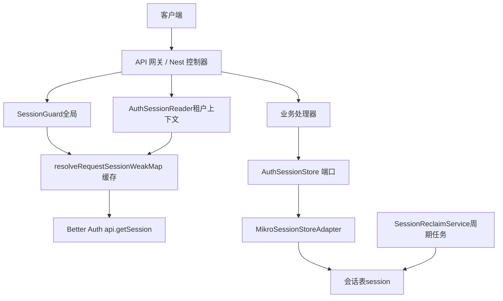
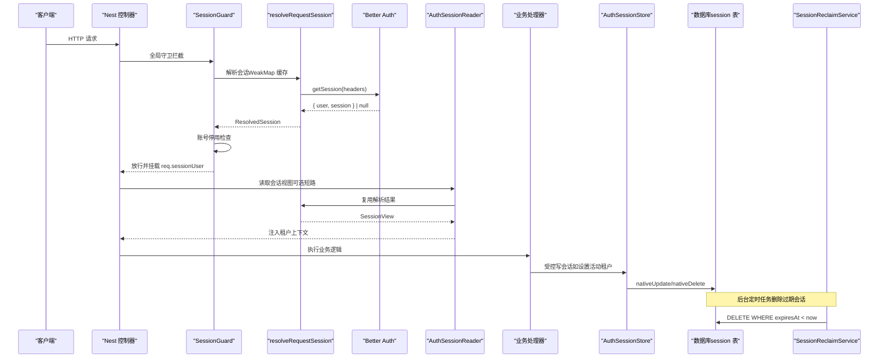
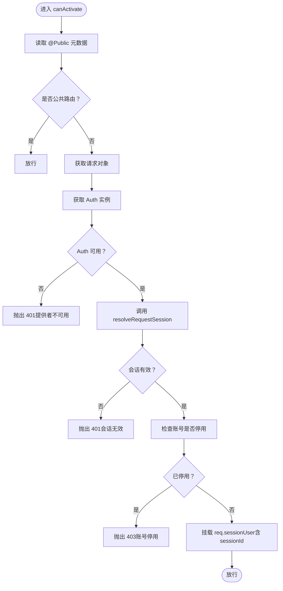
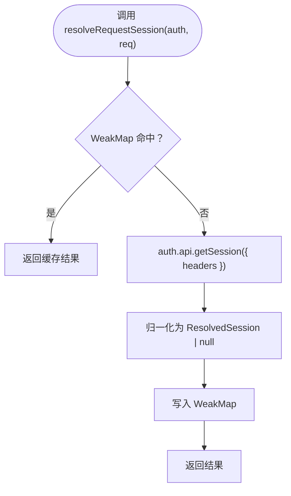
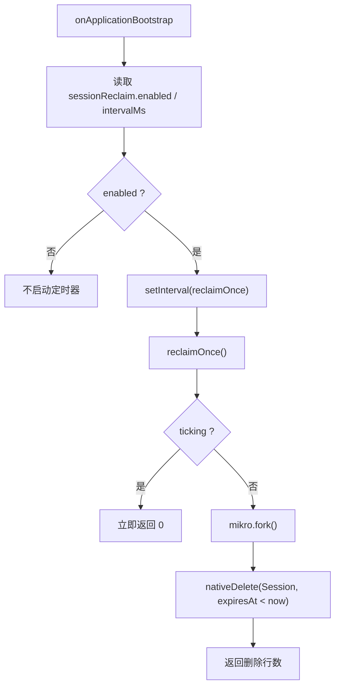
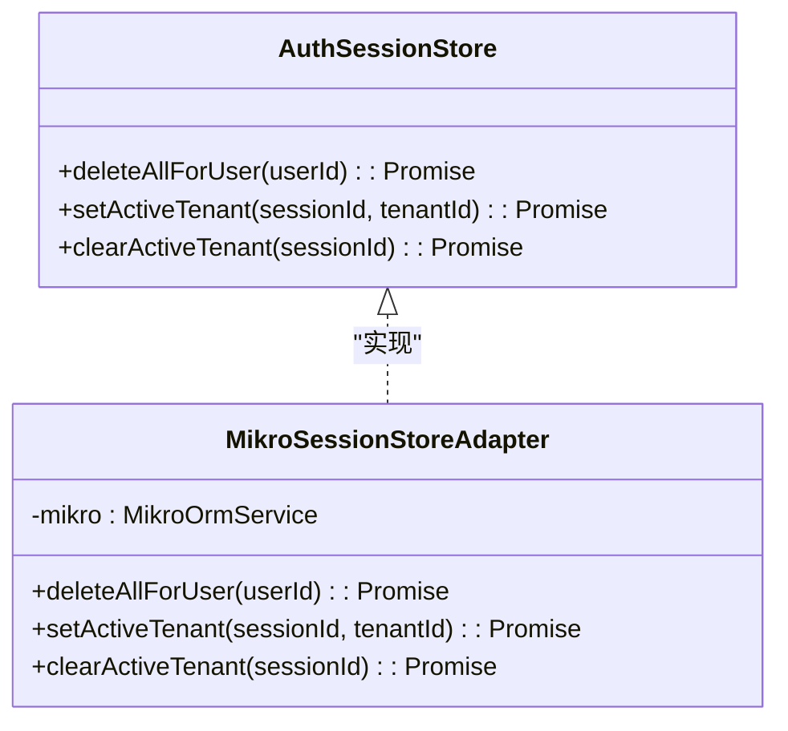
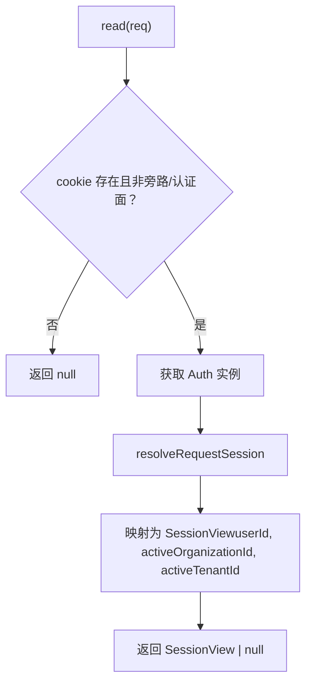
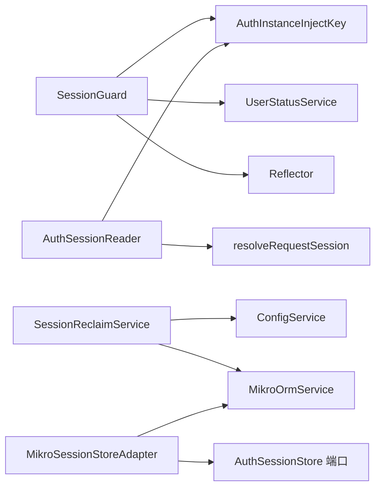

# 会话管理

<cite>
**本文引用的文件**   
- [apps/api/src/modules/auth/api/guards/session.guard.ts](file://apps/api/src/modules/auth/api/guards/session.guard.ts)
- [apps/api/src/modules/auth/infrastructure/session-resolver.ts](file://apps/api/src/modules/auth/infrastructure/session-resolver.ts)
- [apps/api/src/modules/auth/infrastructure/session-reclaim.service.ts](file://apps/api/src/modules/auth/infrastructure/session-reclaim.service.ts)
- [apps/api/src/modules/auth/domain/ports/session-store.port.ts](file://apps/api/src/modules/auth/domain/ports/session-store.port.ts)
- [apps/api/src/modules/auth/infrastructure/session-store.adapter.ts](file://apps/api/src/modules/auth/infrastructure/session-store.adapter.ts)
- [apps/api/src/tenant-isolation/infrastructure/auth-session.reader.ts](file://apps/api/src/tenant-isolation/infrastructure/auth-session.reader.ts)
- [apps/api/src/modules/auth/auth.module.ts](file://apps/api/src/modules/auth/auth.module.ts)
- [apps/api/src/config/config.service.ts](file://apps/api/src/config/config.service.ts)
- [apps/api/src/config/interfaces/config.interface.ts](file://apps/api/src/config/interfaces/config.interface.ts)
- [apps/api/src/config/envs/default.ts](file://apps/api/src/config/envs/default.ts)
- [apps/api/src/config/config.module.ts](file://apps/api/src/config/config.module.ts)
</cite>

## 目录
1. [引言](#引言)
2. [项目结构](#项目结构)
3. [核心组件](#核心组件)
4. [架构总览](#架构总览)
5. [详细组件分析](#详细组件分析)
6. [依赖关系分析](#依赖关系分析)
7. [性能与配置](#性能与配置)
8. [故障排除指南](#故障排除指南)
9. [结论](#结论)

## 引言
本文面向多租户 SaaS 后端中的“会话管理”子系统，系统性说明以下主题：
- 会话生命周期：创建、验证、注入、激活、回收。
- 存储策略：Better Auth 会话表、索引、受控写端口、事务一致性。
- 安全机制：全局会话守卫、账号停用拦截、CSRF 源校验、租户上下文隔离。
- 会话守卫工作原理：会话解析、防重入缓存、用户状态校验、请求主体挂载。
- 会话回收服务：过期清理的开关、调度、幂等删除与日志。
- 多租户集成：活动组织与会话字段、活动租户注入、权限继承与隔离。
- 配置项、性能优化建议与常见问题排查。

## 项目结构
与会话相关的代码主要分布在认证模块、租户隔离适配层以及配置层：
- 认证模块提供全局会话守卫、会话解析器、会话回收服务、会话写端口及适配器。
- 租户隔离层提供应用侧会话读取适配，将 Better Auth 会话映射为轻量级视图。
- 配置层暴露会话回收开关与间隔等环境变量。

图表来源
- [apps/api/src/modules/auth/api/guards/session.guard.ts:66-118](file://apps/api/src/modules/auth/api/guards/session.guard.ts#L66-L118)
- [apps/api/src/modules/auth/infrastructure/session-resolver.ts:23-35](file://apps/api/src/modules/auth/infrastructure/session-resolver.ts#L23-L35)
- [apps/api/src/tenant-isolation/infrastructure/auth-session.reader.ts:44-78](file://apps/api/src/tenant-isolation/infrastructure/auth-session.reader.ts#L44-L78)
- [apps/api/src/modules/auth/domain/ports/session-store.port.ts:18-41](file://apps/api/src/modules/auth/domain/ports/session-store.port.ts#L18-L41)
- [apps/api/src/modules/auth/infrastructure/session-store.adapter.ts:14-46](file://apps/api/src/modules/auth/infrastructure/session-store.adapter.ts#L14-L46)
- [apps/api/src/modules/auth/infrastructure/session-reclaim.service.ts:27-74](file://apps/api/src/modules/auth/infrastructure/session-reclaim.service.ts#L27-L74)

章节来源
- [apps/api/src/modules/auth/auth.module.ts:22-85](file://apps/api/src/modules/auth/auth.module.ts#L22-L85)
- [apps/api/src/modules/auth/api/guards/session.guard.ts:52-64](file://apps/api/src/modules/auth/api/guards/session.guard.ts#L52-L64)

## 核心组件
- 会话守卫 SessionGuard：全局 APP_GUARD，负责从请求头解析 Better Auth 会话，校验账号状态，并将已认证主体挂载到请求对象。
- 会话解析器 resolveRequestSession：统一解析入口，按请求 WeakMap 缓存一次解析结果，避免重复调用 getSession。
- 会话回收服务 SessionReclaimService：基于配置的定时任务，删除过期会话行；支持单测/e2e 直接调用 reclaimOnce。
- 会话写端口 AuthSessionStore 与适配器 MikroSessionStoreAdapter：对 session 表的唯一受控写入口，包含删除用户全部会话、设置/清除活动租户等。
- 租户会话读取器 AuthSessionReader：将 Better Auth 会话映射为轻量 SessionView，供租户隔离中间件使用。
- 配置 ConfigService + SessionReclaimConfig：通过环境变量控制会话回收是否启用与轮询间隔。

章节来源
- [apps/api/src/modules/auth/api/guards/session.guard.ts:66-118](file://apps/api/src/modules/auth/api/guards/session.guard.ts#L66-L118)
- [apps/api/src/modules/auth/infrastructure/session-resolver.ts:11-35](file://apps/api/src/modules/auth/infrastructure/session-resolver.ts#L11-L35)
- [apps/api/src/modules/auth/infrastructure/session-reclaim.service.ts:12-74](file://apps/api/src/modules/auth/infrastructure/session-reclaim.service.ts#L12-L74)
- [apps/api/src/modules/auth/domain/ports/session-store.port.ts:8-41](file://apps/api/src/modules/auth/domain/ports/session-store.port.ts#L8-L41)
- [apps/api/src/modules/auth/infrastructure/session-store.adapter.ts:6-46](file://apps/api/src/modules/auth/infrastructure/session-store.adapter.ts#L6-L46)
- [apps/api/src/tenant-isolation/infrastructure/auth-session.reader.ts:15-78](file://apps/api/src/tenant-isolation/infrastructure/auth-session.reader.ts#L15-L78)
- [apps/api/src/config/config.service.ts:68-70](file://apps/api/src/config/config.service.ts#L68-L70)
- [apps/api/src/config/interfaces/config.interface.ts:136-146](file://apps/api/src/config/interfaces/config.interface.ts#L136-L146)

## 架构总览
下图展示一次典型请求在“会话墙 → 租户上下文 → 业务处理”的完整流程，以及后台会话回收任务的触发路径。

图表来源
- [apps/api/src/modules/auth/api/guards/session.guard.ts:81-116](file://apps/api/src/modules/auth/api/guards/session.guard.ts#L81-L116)
- [apps/api/src/modules/auth/infrastructure/session-resolver.ts:25-35](file://apps/api/src/modules/auth/infrastructure/session-resolver.ts#L25-L35)
- [apps/api/src/tenant-isolation/infrastructure/auth-session.reader.ts:48-78](file://apps/api/src/tenant-isolation/infrastructure/auth-session.reader.ts#L48-L78)
- [apps/api/src/modules/auth/domain/ports/session-store.port.ts:18-41](file://apps/api/src/modules/auth/domain/ports/session-store.port.ts#L18-L41)
- [apps/api/src/modules/auth/infrastructure/session-store.adapter.ts:18-46](file://apps/api/src/modules/auth/infrastructure/session-store.adapter.ts#L18-L46)
- [apps/api/src/modules/auth/infrastructure/session-reclaim.service.ts:39-74](file://apps/api/src/modules/auth/infrastructure/session-reclaim.service.ts#L39-L74)

## 详细组件分析

### 会话守卫 SessionGuard
- 职责
  - 作为全局 APP_GUARD，默认 deny-by-default，所有路由需显式 @Public() 旁路。
  - 从请求头解析 Better Auth 会话，失败则返回 401。
  - 校验账号是否被停用，若停用则返回 403。
  - 将已认证主体 SessionUser 挂载到请求对象，包含 id、email、sessionId。
- 关键行为
  - 通过 Reflector 读取 IS_PUBLIC_KEY，允许公共路由跳过会话墙。
  - 通过 UserStatusService.isBlocked 做账号停用拦截，形成纵深防御。
  - sessionId 来自已验签会话主键，用于后续“设置活动租户”端点定位待写会话行。

图表来源
- [apps/api/src/modules/auth/api/guards/session.guard.ts:81-116](file://apps/api/src/modules/auth/api/guards/session.guard.ts#L81-L116)

章节来源
- [apps/api/src/modules/auth/api/guards/session.guard.ts:17-35](file://apps/api/src/modules/auth/api/guards/session.guard.ts#L17-L35)
- [apps/api/src/modules/auth/api/guards/session.guard.ts:52-64](file://apps/api/src/modules/auth/api/guards/session.guard.ts#L52-L64)
- [apps/api/src/modules/auth/api/guards/session.guard.ts:81-116](file://apps/api/src/modules/auth/api/guards/session.guard.ts#L81-L116)

### 会话解析器 resolveRequestSession
- 职责
  - 统一解析 Better Auth 会话，返回 ResolvedSession 或 null。
  - 使用 WeakMap 按请求缓存解析结果，确保同一请求内只调用一次 auth.api.getSession。
- 设计要点
  - 不决定 allow/deny，仅转发原始结果；各调用方自行实现 401/403 语义。
  - 避免同一请求多次解析会话带来的性能损耗。

图表来源
- [apps/api/src/modules/auth/infrastructure/session-resolver.ts:11-35](file://apps/api/src/modules/auth/infrastructure/session-resolver.ts#L11-L35)

章节来源
- [apps/api/src/modules/auth/infrastructure/session-resolver.ts:1-35](file://apps/api/src/modules/auth/infrastructure/session-resolver.ts#L1-L35)

### 会话回收服务 SessionReclaimService
- 职责
  - 根据配置决定是否启动定时器，周期性删除过期会话。
  - 提供 reclaimOnce 方法，供测试和 e2e 确定性驱动。
- 关键特性
  - enabled=false 时不启动 timer，保持 DB-free 装配不变量。
  - 防重入 flag ticking，避免并发 tick 叠加。
  - 使用原生 delete 谓词 expiresAt < now，走 F1 迁移提供的索引。
  - onModuleDestroy 清理定时器，防止资源泄漏。

图表来源
- [apps/api/src/modules/auth/infrastructure/session-reclaim.service.ts:39-74](file://apps/api/src/modules/auth/infrastructure/session-reclaim.service.ts#L39-L74)

章节来源
- [apps/api/src/modules/auth/infrastructure/session-reclaim.service.ts:12-74](file://apps/api/src/modules/auth/infrastructure/session-reclaim.service.ts#L12-L74)

### 会话写端口与适配器 AuthSessionStore / MikroSessionStoreAdapter
- 端口定义
  - deleteAllForUser：删除某用户的全部会话行，即时失权。
  - setActiveTenant：按 sessionId 直写 activeTenantId，同时清空 activeOrganizationId，保证租/组织互斥。
  - clearActiveTenant：反向操作，清 activeTenantId。
- 适配器实现
  - 通过 MikroOrmService.fork() 获取 EntityManager，ALS 感知：在 UoW 事务内返回事务 em，保证原子性。
  - 使用 nativeUpdate/nativeDelete 绕过全局租户过滤，直接操作 session 表。
  - 表所有权纪律：跨上下文写必须经属主端口（auth 域）。

图表来源
- [apps/api/src/modules/auth/domain/ports/session-store.port.ts:18-41](file://apps/api/src/modules/auth/domain/ports/session-store.port.ts#L18-L41)
- [apps/api/src/modules/auth/infrastructure/session-store.adapter.ts:14-46](file://apps/api/src/modules/auth/infrastructure/session-store.adapter.ts#L14-L46)

章节来源
- [apps/api/src/modules/auth/domain/ports/session-store.port.ts:8-41](file://apps/api/src/modules/auth/domain/ports/session-store.port.ts#L8-L41)
- [apps/api/src/modules/auth/infrastructure/session-store.adapter.ts:6-46](file://apps/api/src/modules/auth/infrastructure/session-store.adapter.ts#L6-L46)

### 租户会话读取器 AuthSessionReader
- 职责
  - 将 Better Auth 会话映射为轻量 SessionView，包含 userId、activeOrganizationId、activeTenantId。
  - 廉价短路：无 cookie、旁路路径、认证表面路径不触发会话查询。
  - 复用 resolveRequestSession 的 WeakMap 缓存，避免重复解析。
- 多租户集成
  - activeTenantId 由服务端写入会话 additionalField，客户端不可伪造。
  - 角色不再从 BA 取，改由中间件在活动租户下通过 TENANT_SCOPE_RESOLVER 解析。

图表来源
- [apps/api/src/tenant-isolation/infrastructure/auth-session.reader.ts:44-78](file://apps/api/src/tenant-isolation/infrastructure/auth-session.reader.ts#L44-L78)
- [apps/api/src/modules/auth/infrastructure/session-resolver.ts:25-35](file://apps/api/src/modules/auth/infrastructure/session-resolver.ts#L25-L35)

章节来源
- [apps/api/src/tenant-isolation/infrastructure/auth-session.reader.ts:15-78](file://apps/api/src/tenant-isolation/infrastructure/auth-session.reader.ts#L15-L78)

### 模块装配与全局守卫
- AuthModule.forRoot 注册：
  - 全局 APP_GUARD：SessionGuard、CsrfOriginGuard。
  - 导出 AUTH_SESSION_STORE、AUTH_USER_STORE、MCP_ACCESS_TOKEN_STORE 等端口。
  - 注册 SessionReclaimService，默认关闭（DB-free 不变量）。
- 安全语义：
  - 全局会话墙 deny-by-default，@Public() 路由旁路。
  - CSRF Origin/Referer 校验墙排在 SessionGuard 之后，先 401 后 403。

章节来源
- [apps/api/src/modules/auth/auth.module.ts:22-85](file://apps/api/src/modules/auth/auth.module.ts#L22-L85)

## 依赖关系分析
- 组件耦合
  - SessionGuard 依赖 AuthInstanceInjectKey、UserStatusService、Reflector。
  - AuthSessionReader 依赖 AuthInstanceInjectKey 与 resolveRequestSession。
  - SessionReclaimService 依赖 ConfigService 与 MikroOrmService。
  - MikroSessionStoreAdapter 依赖 MikroOrmService，并通过端口对外暴露。
- 外部依赖
  - Better Auth：会话解析与签名校验。
  - MikroORM：原生 SQL 操作与 ALS 感知的事务 fork。
  - NestJS：全局守卫、依赖注入、生命周期钩子。

图表来源
- [apps/api/src/modules/auth/api/guards/session.guard.ts:66-71](file://apps/api/src/modules/auth/api/guards/session.guard.ts#L66-L71)
- [apps/api/src/tenant-isolation/infrastructure/auth-session.reader.ts:44-46](file://apps/api/src/tenant-isolation/infrastructure/auth-session.reader.ts#L44-L46)
- [apps/api/src/modules/auth/infrastructure/session-reclaim.service.ts:33-37](file://apps/api/src/modules/auth/infrastructure/session-reclaim.service.ts#L33-L37)
- [apps/api/src/modules/auth/infrastructure/session-store.adapter.ts:14-16](file://apps/api/src/modules/auth/infrastructure/session-store.adapter.ts#L14-L16)

章节来源
- [apps/api/src/modules/auth/auth.module.ts:46-70](file://apps/api/src/modules/auth/auth.module.ts#L46-L70)

## 性能与配置

### 会话解析性能
- 单次请求内只解析一次 Better Auth 会话，通过 WeakMap 缓存，避免重复 IO。
- AuthSessionReader 在缺少 cookie 或命中旁路路径时短路，减少不必要的解析。

章节来源
- [apps/api/src/modules/auth/infrastructure/session-resolver.ts:11-35](file://apps/api/src/modules/auth/infrastructure/session-resolver.ts#L11-L35)
- [apps/api/src/tenant-isolation/infrastructure/auth-session.reader.ts:48-57](file://apps/api/src/tenant-isolation/infrastructure/auth-session.reader.ts#L48-L57)

### 会话回收性能
- 使用原生 delete 谓词 expiresAt < now，依赖 F1 迁移提供的 session_expires_at_idx 索引。
- 防重入 ticking 避免并发 tick 叠加；onModuleDestroy 清理定时器。
- enabled=false 时不启动 timer，保持 DB-free 装配不变量。

章节来源
- [apps/api/src/modules/auth/infrastructure/session-reclaim.service.ts:12-26](file://apps/api/src/modules/auth/infrastructure/session-reclaim.service.ts#L12-L26)
- [apps/api/src/modules/auth/infrastructure/session-reclaim.service.ts:39-74](file://apps/api/src/modules/auth/infrastructure/session-reclaim.service.ts#L39-L74)

### 配置选项
- sessionReclaim.enabled：布尔值，缺省 false；开启后启动定时器。
- sessionReclaim.intervalMs：数字，缺省 1h；定时器间隔毫秒数。
- 环境变量：SESSION_RECLAIM_ENABLED=true 开启回收。

章节来源
- [apps/api/src/config/interfaces/config.interface.ts:136-146](file://apps/api/src/config/interfaces/config.interface.ts#L136-L146)
- [apps/api/src/config/config.service.ts:68-70](file://apps/api/src/config/config.service.ts#L68-L70)
- [apps/api/src/config/envs/default.ts:81-81](file://apps/api/src/config/envs/default.ts#L81-L81)
- [apps/api/src/config/config.module.ts:73-73](file://apps/api/src/config/config.module.ts#L73-L73)

## 故障排除指南
- 401 未登录或会话无效
  - 检查请求头是否携带 cookie，确认 Better Auth 会话是否有效。
  - 确认路由未被 @Public() 旁路，且 SessionGuard 已全局注册。
  - 查看 resolveRequestSession 是否返回 null。
- 403 账号停用
  - 检查 UserStatusService.isBlocked 返回值。
  - 确认账号状态变更与会话失效的一致性（可通过 AuthSessionStore.deleteAllForUser 强制失权）。
- 租户上下文缺失
  - 检查 AuthSessionReader 是否命中旁路路径或无 cookie。
  - 确认会话中 activeOrganizationId 或 activeTenantId 是否存在。
- 活动租户设置异常
  - 检查 setActiveTenant 是否同时清空 activeOrganizationId，避免双激活位混态。
  - 确认调用方已进行成员资格校验，防止跨租提权。
- 会话回收未生效
  - 检查 SESSION_RECLAIM_ENABLED 是否为 true。
  - 检查 intervalMs 配置是否正确。
  - 确认数据库存在 session_expires_at_idx 索引。
  - 观察日志输出，确认定时器已启动且 reclaimOnce 执行成功。

章节来源
- [apps/api/src/modules/auth/api/guards/session.guard.ts:96-108](file://apps/api/src/modules/auth/api/guards/session.guard.ts#L96-L108)
- [apps/api/src/tenant-isolation/infrastructure/auth-session.reader.ts:48-78](file://apps/api/src/tenant-isolation/infrastructure/auth-session.reader.ts#L48-L78)
- [apps/api/src/modules/auth/infrastructure/session-store.adapter.ts:23-46](file://apps/api/src/modules/auth/infrastructure/session-store.adapter.ts#L23-L46)
- [apps/api/src/modules/auth/infrastructure/session-reclaim.service.ts:39-74](file://apps/api/src/modules/auth/infrastructure/session-reclaim.service.ts#L39-L74)

## 结论
本会话管理系统以 Better Auth 为基础，结合 NestJS 全局守卫、租户隔离适配与 MikroORM 事务能力，实现了：
- 安全的会话验证与主体注入。
- 高效的会话解析缓存与租户上下文注入。
- 可控的会话写端口与事务一致性。
- 可配置的过期会话回收机制。
在多租户场景下，系统通过活动组织与会话字段、活动租户注入与权限继承，确保跨租户隔离与最小权限原则。配合完善的配置与故障排除指南，可在生产环境中稳定运行。