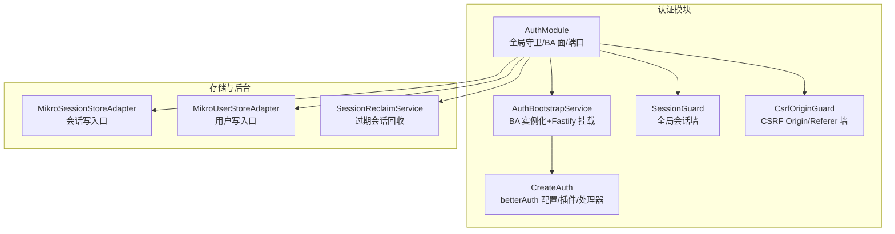
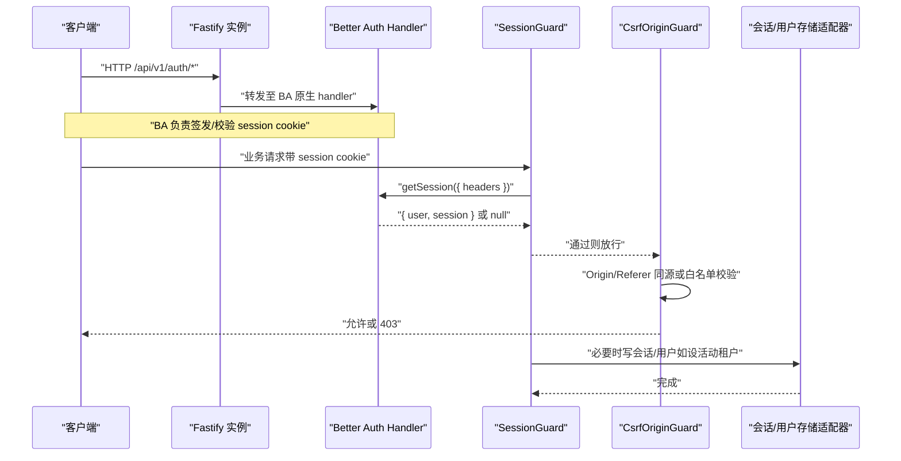
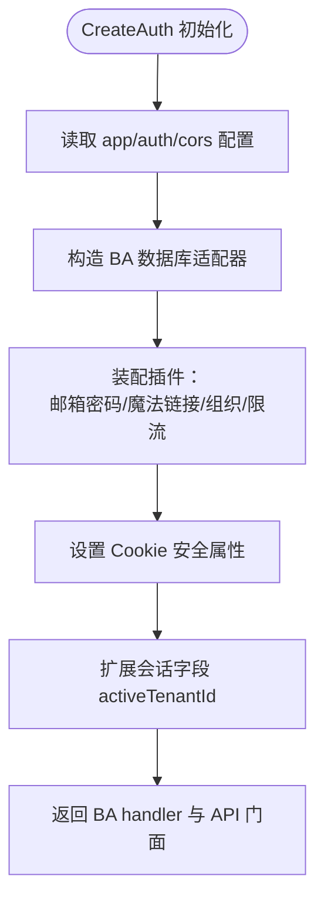
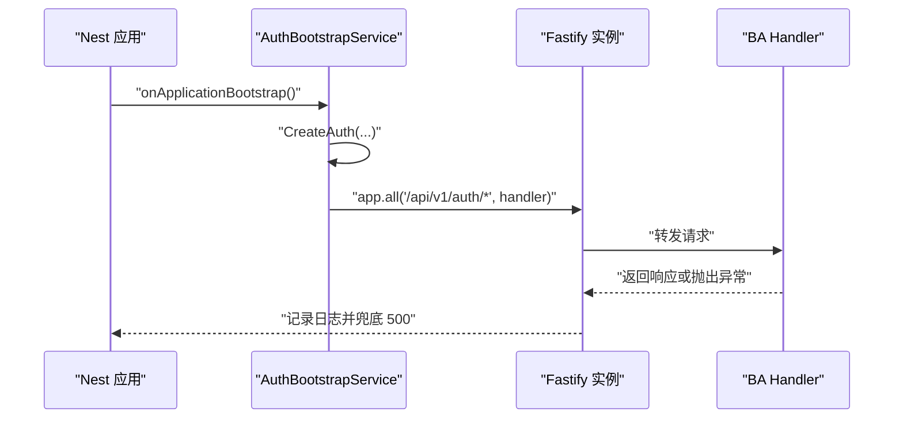
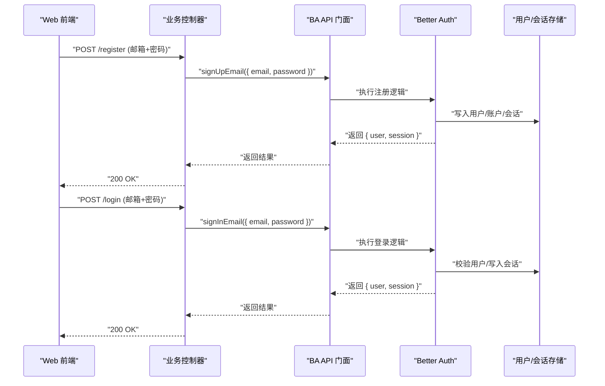
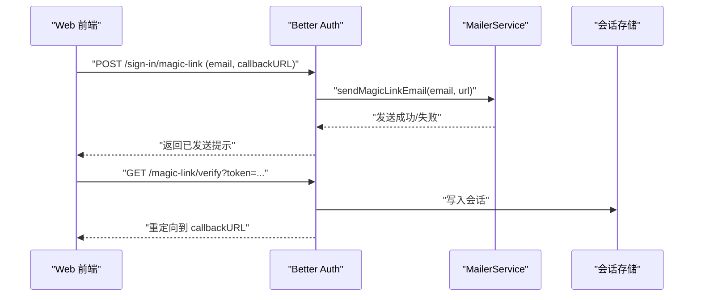
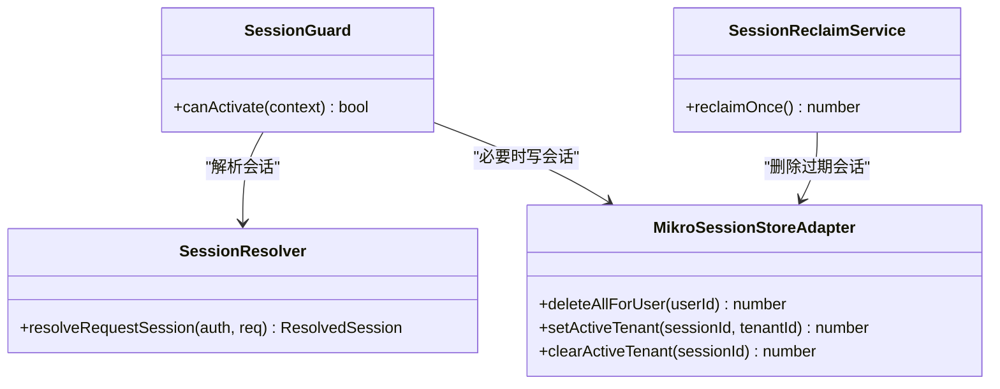
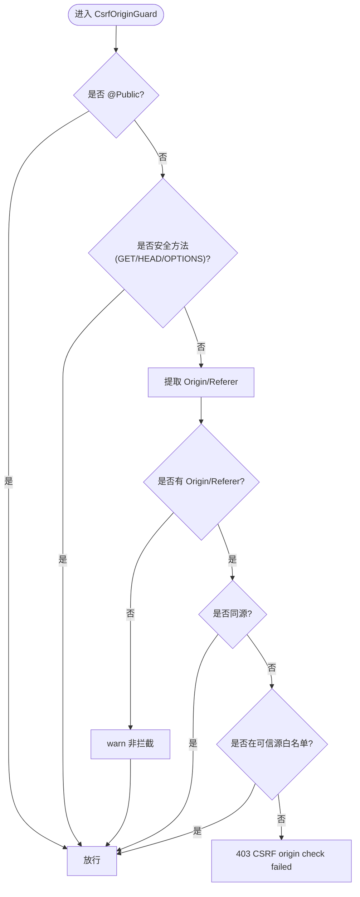
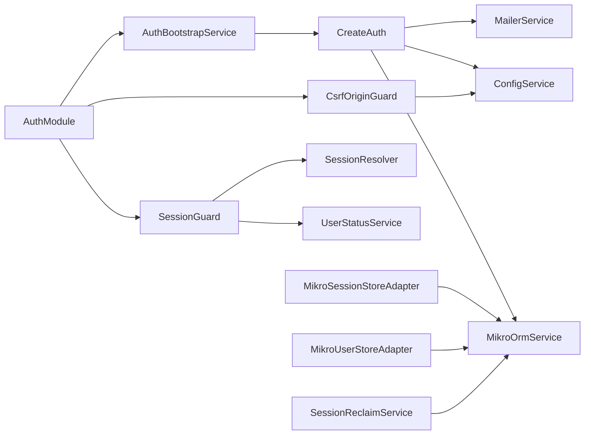

# 用户认证

<cite>
**本文引用的文件**   
- [auth.module.ts](file://apps/api/src/modules/auth/auth.module.ts)
- [auth.bootstrap.ts](file://apps/api/src/modules/auth/infrastructure/auth.bootstrap.ts)
- [auth.implement.ts](file://apps/api/src/modules/auth/infrastructure/auth.implement.ts)
- [csrf-origin.guard.ts](file://apps/api/src/modules/auth/api/guards/csrf-origin.guard.ts)
- [session.guard.ts](file://apps/api/src/modules/auth/api/guards/session.guard.ts)
- [session-resolver.ts](file://apps/api/src/modules/auth/infrastructure/session-resolver.ts)
- [session-store.adapter.ts](file://apps/api/src/modules/auth/infrastructure/session-store.adapter.ts)
- [user-store.adapter.ts](file://apps/api/src/modules/auth/infrastructure/user-store.adapter.ts)
- [session-reclaim.service.ts](file://apps/api/src/modules/auth/infrastructure/session-reclaim.service.ts)
- [config.service.ts](file://apps/api/src/config/config.service.ts)
- [login.tsx](file://apps/web/src/routes/login.tsx)
- [login.test.tsx](file://apps/web/src/routes/login.test.tsx)
</cite>

## 目录
1. [引言](#引言)
2. [项目结构](#项目结构)
3. [核心组件](#核心组件)
4. [架构总览](#架构总览)
5. [详细组件分析](#详细组件分析)
6. [依赖关系分析](#依赖关系分析)
7. [性能与可扩展性](#性能与可扩展性)
8. [故障排查指南](#故障排查指南)
9. [结论](#结论)
10. [附录：配置清单与最佳实践](#附录配置清单与最佳实践)

## 引言
本文件面向后端开发者与安全负责人，系统性说明 NestJS SaaS 启动项目中基于 Better Auth 的用户认证体系。重点覆盖：
- 邮箱密码认证、魔法链接认证的完整流程（注册、登录、邮件验证、密码重置）
- 会话管理机制（会话存储、过期回收、安全策略）
- CSRF 防护机制（Origin/Referer 校验）
- 具体配置示例与生产最佳实践（安全设置、错误处理、调试技巧）

## 项目结构
认证能力集中在 `apps/api/src/modules/auth`，采用“模块 + 基础设施适配器 + 守卫”的分层组织方式：
- 模块装配：`AuthModule.forRoot()` 统一注入全局守卫、BA HTTP 面、领域端口实现、后台任务等
- 基础设施：Better Auth 实例创建、Fastify 通配路由挂载、社交渠道装配、Magic Link 发信编排
- API 守卫：会话墙（SessionGuard）、CSRF Origin/Referer 墙（CsrfOriginGuard）
- 领域端口与适配器：会话存储、用户存储、MCP 访问令牌存储
- 后台任务：过期会话周期回收

**图表来源**
- [auth.module.ts:24-83](file://apps/api/src/modules/auth/auth.module.ts#L24-L83)
- [auth.bootstrap.ts:34-82](file://apps/api/src/modules/auth/infrastructure/auth.bootstrap.ts#L34-L82)
- [auth.implement.ts:101-302](file://apps/api/src/modules/auth/infrastructure/auth.implement.ts#L101-L302)

**章节来源**
- [auth.module.ts:24-83](file://apps/api/src/modules/auth/auth.module.ts#L24-L83)
- [auth.bootstrap.ts:34-82](file://apps/api/src/modules/auth/infrastructure/auth.bootstrap.ts#L34-L82)

## 核心组件
- Better Auth 实例构建与插件装配：包含邮箱密码、魔法链接、多租户组织、限流、Cookie 安全属性、会话扩展字段等
- Fastify 通配路由：将 BA 原生 handler 暴露到 `/api/v1/auth/*`
- 全局会话守卫：默认 deny-by-default，解析 BA 会话并挂到请求对象
- CSRF Origin/Referer 守卫：对非安全方法做同源或白名单校验
- 会话存储适配器：提供删除用户会话、设置活动租户等受控写入口
- 用户存储适配器：提供硬删除、状态更新等受控写入口
- 会话回收服务：定时清理过期会话行

**章节来源**
- [auth.implement.ts:101-302](file://apps/api/src/modules/auth/infrastructure/auth.implement.ts#L101-L302)
- [auth.bootstrap.ts:46-82](file://apps/api/src/modules/auth/infrastructure/auth.bootstrap.ts#L46-L82)
- [session.guard.ts:52-118](file://apps/api/src/modules/auth/api/guards/session.guard.ts#L52-L118)
- [csrf-origin.guard.ts:23-81](file://apps/api/src/modules/auth/api/guards/csrf-origin.guard.ts#L23-L81)
- [session-store.adapter.ts:14-46](file://apps/api/src/modules/auth/infrastructure/session-store.adapter.ts#L14-L46)
- [user-store.adapter.ts:14-41](file://apps/api/src/modules/auth/infrastructure/user-store.adapter.ts#L14-L41)
- [session-reclaim.service.ts:27-74](file://apps/api/src/modules/auth/infrastructure/session-reclaim.service.ts#L27-L74)

## 架构总览
Better Auth 在本项目中的集成路径如下：
- 应用引导阶段由 `AuthBootstrapService` 调用 `CreateAuth` 构建 BA 实例，并通过 Fastify 实例级 `all(pattern)` 挂载 BA 原生 handler
- BA 的插件体系启用邮箱密码、魔法链接、组织管理、限流等能力；会话通过 MikroORM 持久化
- Nest 侧通过两个全局守卫形成纵深防御：先会话校验，再 CSRF Origin/Referer 校验
- 业务端点通过 `@Public()` 旁路守卫，其余路由默认要求已登录且未暂停

**图表来源**
- [auth.bootstrap.ts:46-82](file://apps/api/src/modules/auth/infrastructure/auth.bootstrap.ts#L46-L82)
- [auth.implement.ts:304-346](file://apps/api/src/modules/auth/infrastructure/auth.implement.ts#L304-L346)
- [session.guard.ts:81-118](file://apps/api/src/modules/auth/api/guards/session.guard.ts#L81-L118)
- [csrf-origin.guard.ts:56-81](file://apps/api/src/modules/auth/api/guards/csrf-origin.guard.ts#L56-L81)

## 详细组件分析

### Better Auth 实例与插件装配
- 基础路径：`/api/v1/auth`，与 API 版本前缀一致
- 插件：
  - 邮箱密码：在非生产环境启用，自动登录、最小密码长度限制
  - 魔法链接：无条件挂载（含生产），禁用注册，一次性链接有效期短，开发模式控制台打印链接
  - 组织管理：仅作为认证与数据源，禁止用户自助创建组织
  - 限流：默认开启
  - Cookie 安全：SameSite=lax，跨源前端需配合 CORS 与 CSRF 策略
- 会话扩展字段：`activeTenantId`（仅服务端可写），用于租级激活位
- 用户扩展字段：`isOwner`、`handle`

**图表来源**
- [auth.implement.ts:101-302](file://apps/api/src/modules/auth/infrastructure/auth.implement.ts#L101-L302)

**章节来源**
- [auth.implement.ts:101-302](file://apps/api/src/modules/auth/infrastructure/auth.implement.ts#L101-L302)

### Fastify 通配路由挂载
- 在应用引导阶段，`AuthBootstrapService` 获取 BA 实例后，以 Fastify 实例级 `all('/api/v1/auth/*')` 挂载 BA 原生 handler
- 兼容 Fastify 已解析 body 的情况，避免 BA 读到空体报错
- 捕获 BA handler 抛出的异常，确保响应写出，防止悬挂连接

**图表来源**
- [auth.bootstrap.ts:46-82](file://apps/api/src/modules/auth/infrastructure/auth.bootstrap.ts#L46-L82)
- [auth.implement.ts:304-346](file://apps/api/src/modules/auth/infrastructure/auth.implement.ts#L304-L346)

**章节来源**
- [auth.bootstrap.ts:46-82](file://apps/api/src/modules/auth/infrastructure/auth.bootstrap.ts#L46-L82)

### 邮箱密码认证流程
- 启用条件：非生产环境启用邮箱密码登录
- 注册：通过 BA 原生 `signUpEmail` 接口（服务端编排面透传），自动登录并签发真实 session cookie
- 登录：通过 BA 原生 `signInEmail` 接口，自动登录
- 安全策略：最小密码长度、限流、CSRF 保护（后续请求经全局守卫）

**图表来源**
- [auth.implement.ts:376-386](file://apps/api/src/modules/auth/infrastructure/auth.implement.ts#L376-L386)

**章节来源**
- [auth.implement.ts:266-273](file://apps/api/src/modules/auth/infrastructure/auth.implement.ts#L266-L273)
- [auth.implement.ts:376-386](file://apps/api/src/modules/auth/infrastructure/auth.implement.ts#L376-L386)

### 魔法链接认证流程
- 前端发起 `POST /api/v1/auth/sign-in/magic-link`，后端使用 Magic Link 插件发送一次性链接邮件
- 用户在邮件中点击链接，BA 内部 `/magic-link/verify` 校验 token 并落会话，重定向回前端
- 开发模式会在控制台打印链接，便于本地调试；生产模式不发链接时走 warn 而非致命错误

**图表来源**
- [auth.implement.ts:44-60](file://apps/api/src/modules/auth/infrastructure/auth.implement.ts#L44-L60)
- [auth.implement.ts:243-248](file://apps/api/src/modules/auth/infrastructure/auth.implement.ts#L243-L248)
- [login.tsx:89-109](file://apps/web/src/routes/login.tsx#L89-L109)
- [login.test.tsx:71-90](file://apps/web/src/routes/login.test.tsx#L71-L90)

**章节来源**
- [auth.implement.ts:44-60](file://apps/api/src/modules/auth/infrastructure/auth.implement.ts#L44-L60)
- [auth.implement.ts:243-248](file://apps/api/src/modules/auth/infrastructure/auth.implement.ts#L243-L248)
- [login.tsx:89-109](file://apps/web/src/routes/login.tsx#L89-L109)
- [login.test.tsx:71-90](file://apps/web/src/routes/login.test.tsx#L71-L90)

### 密码重置流程
- 本项目未直接实现密码重置端点；可通过既有邮件模板与 i18n 能力扩展
- 建议复用 Magic Link 机制：生成一次性重置链接，校验后跳转重置页面
- 若引入第三方库，应遵循现有 CSRF 与会话守卫策略

[本节为概念性说明，不直接分析具体文件]

### 会话管理机制
- 会话存储：通过 `MikroSessionStoreAdapter` 提供删除用户会话、设置活动租户、清除活动租户等受控写入口
- 会话解析：`resolveRequestSession` 单次解析并缓存，避免重复查询
- 会话过期回收：`SessionReclaimService` 定时清理过期会话行，默认关闭，可按需启用
- 安全策略：SameSite=lax，CSRF Origin/Referer 校验，会话缺失或非法 401，账号暂停 403

**图表来源**
- [session.guard.ts:81-118](file://apps/api/src/modules/auth/api/guards/session.guard.ts#L81-L118)
- [session-resolver.ts:25-35](file://apps/api/src/modules/auth/infrastructure/session-resolver.ts#L25-L35)
- [session-store.adapter.ts:18-46](file://apps/api/src/modules/auth/infrastructure/session-store.adapter.ts#L18-L46)
- [session-reclaim.service.ts:63-74](file://apps/api/src/modules/auth/infrastructure/session-reclaim.service.ts#L63-L74)

**章节来源**
- [session-guard.ts:52-118](file://apps/api/src/modules/auth/api/guards/session.guard.ts#L52-L118)
- [session-resolver.ts:25-35](file://apps/api/src/modules/auth/infrastructure/session-resolver.ts#L25-L35)
- [session-store.adapter.ts:18-46](file://apps/api/src/modules/auth/infrastructure/session-store.adapter.ts#L18-L46)
- [session-reclaim.service.ts:27-74](file://apps/api/src/modules/auth/infrastructure/session-reclaim.service.ts#L27-L74)

### CSRF 防护机制
- 全局守卫 `CsrfOriginGuard` 在 `SessionGuard` 之后执行
- 对非安全方法（POST/PUT/DELETE 等）进行 Origin/Referer 校验
- 同源放行：Origin host 命中 Host/X-Forwarded-Host
- 可信源白名单：复用 CORS 配置 `ALLOWED_ORIGINS`
- 无 Origin/Referer：warn 非拦截，兼容纯 API 后端
- 校验失败：返回 403，错误码 `AUTH:CSRF_ORIGIN_MISMATCH`

**图表来源**
- [csrf-origin.guard.ts:56-81](file://apps/api/src/modules/auth/api/guards/csrf-origin.guard.ts#L56-L81)
- [csrf-origin.guard.ts:83-120](file://apps/api/src/modules/auth/api/guards/csrf-origin.guard.ts#L83-L120)

**章节来源**
- [csrf-origin.guard.ts:23-81](file://apps/api/src/modules/auth/api/guards/csrf-origin.guard.ts#L23-L81)

## 依赖关系分析
- `AuthModule` 装配全局守卫、BA HTTP 面、领域端口实现、后台任务
- `AuthBootstrapService` 依赖 `ConfigService`、`MikroOrmService`、`HttpAdapterHost`、`MailerService`
- `CreateAuth` 依赖 `ConfigService`、`MikroOrmService`、`MailerService`
- 守卫依赖 `Reflector`、`ConfigService`、`UserStatusService`
- 存储适配器依赖 `MikroOrmService`

**图表来源**
- [auth.module.ts:40-83](file://apps/api/src/modules/auth/auth.module.ts#L40-L83)
- [auth.bootstrap.ts:38-44](file://apps/api/src/modules/auth/infrastructure/auth.bootstrap.ts#L38-L44)
- [auth.implement.ts:101-107](file://apps/api/src/modules/auth/infrastructure/auth.implement.ts#L101-L107)
- [session.guard.ts:67-71](file://apps/api/src/modules/auth/api/guards/session.guard.ts#L67-L71)
- [csrf-origin.guard.ts:44-47](file://apps/api/src/modules/auth/api/guards/csrf-origin.guard.ts#L44-L47)
- [session-store.adapter.ts:14-16](file://apps/api/src/modules/auth/infrastructure/session-store.adapter.ts#L14-L16)
- [user-store.adapter.ts:14-16](file://apps/api/src/modules/auth/infrastructure/user-store.adapter.ts#L14-L16)
- [session-reclaim.service.ts:33-37](file://apps/api/src/modules/auth/infrastructure/session-reclaim.service.ts#L33-L37)

**章节来源**
- [auth.module.ts:40-83](file://apps/api/src/modules/auth/auth.module.ts#L40-L83)
- [auth.bootstrap.ts:38-44](file://apps/api/src/modules/auth/infrastructure/auth.bootstrap.ts#L38-L44)
- [auth.implement.ts:101-107](file://apps/api/src/modules/auth/infrastructure/auth.implement.ts#L101-L107)

## 性能与可扩展性
- 会话解析去重：`resolveRequestSession` 使用 WeakMap 缓存单次请求的会话解析结果，避免重复查询
- 会话回收：默认关闭，按需启用，单语句删除过期行，利用索引提升性能
- 限流：BA 默认开启登录类路径限流，结合反向代理 trustedProxies 避免共享桶误杀
- 扩展点：BA API 门面透传组织成员/邀请管理等操作，便于服务端编排

**章节来源**
- [session-resolver.ts:11-23](file://apps/api/src/modules/auth/infrastructure/session-resolver.ts#L11-L23)
- [session-reclaim.service.ts:12-26](file://apps/api/src/modules/auth/infrastructure/session-reclaim.service.ts#L12-L26)
- [auth.implement.ts:256-257](file://apps/api/src/modules/auth/infrastructure/auth.implement.ts#L256-L257)

## 故障排查指南
- BA handler 异常：记录错误消息并兜底 500，避免悬挂连接
- 会话缺失或非法：返回 401，错误码 `AUTH_SESSION_INVALID`
- 账号暂停：返回 403，错误码 `AUTH_ACCOUNT_SUSPENDED`
- CSRF Origin 校验失败：返回 403，错误码 `AUTH_CSRF_ORIGIN_MISMATCH`
- Magic Link 发信失败：开发模式 warn 非致命，生产模式上抛
- 生产环境缺配警告：`AUTH_TRUSTED_PROXIES`、`APP_URL` 未配置时输出 warn

**章节来源**
- [auth.bootstrap.ts:72-81](file://apps/api/src/modules/auth/infrastructure/auth.bootstrap.ts#L72-L81)
- [session.guard.ts:96-108](file://apps/api/src/modules/auth/api/guards/session.guard.ts#L96-L108)
- [csrf-origin.guard.ts:75-81](file://apps/api/src/modules/auth/api/guards/csrf-origin.guard.ts#L75-L81)
- [auth.implement.ts:51-58](file://apps/api/src/modules/auth/infrastructure/auth.implement.ts#L51-L58)
- [auth.implement.ts:116-134](file://apps/api/src/modules/auth/infrastructure/auth.implement.ts#L116-L134)

## 结论
本项目通过 Better Auth 实现了邮箱密码与魔法链接认证，结合 Nest 全局守卫形成会话与 CSRF 双重防护。会话存储与用户存储通过领域端口收敛写入口，后台任务支持过期会话回收。生产环境强调显式配置与告警，兼顾安全性与可运维性。

[本节为总结性内容，不直接分析具体文件]

## 附录：配置清单与最佳实践
- 环境变量
  - `APP_URL`：Magic Link 绝对 URL 基准，生产务必配置
  - `AUTH_TRUSTED_PROXIES`：反向代理网段 CIDR，避免限流共享桶误杀
  - `ALLOWED_ORIGINS`：CORS 可信源，同时被 CSRF 白名单复用
  - `SESSION_RECLAIM_ENABLED`：是否启用会话回收定时任务
  - `SESSION_RECLAIM_INTERVAL_MS`：回收间隔毫秒数
- 安全设置
  - Cookie SameSite=lax，跨源前端需配合 CORS 与 CSRF 策略
  - 生产环境禁用邮箱密码注册面，仅启用魔法链接
  - 全局会话墙 deny-by-default，仅 `@Public()` 路由旁路
- 错误处理
  - 统一错误码：`AUTH_SESSION_INVALID`、`AUTH_ACCOUNT_SUSPENDED`、`AUTH_CSRF_ORIGIN_MISMATCH`
  - BA handler 异常兜底 500，避免悬挂连接
- 调试技巧
  - 开发模式 Magic Link 控制台打印链接
  - 使用 BA API 门面透传 `signUpEmail`/`signInEmail` 驱动 e2e

**章节来源**
- [auth.implement.ts:116-134](file://apps/api/src/modules/auth/infrastructure/auth.implement.ts#L116-L134)
- [auth.implement.ts:243-248](file://apps/api/src/modules/auth/infrastructure/auth.implement.ts#L243-L248)
- [session.guard.ts:96-108](file://apps/api/src/modules/auth/api/guards/session.guard.ts#L96-L108)
- [csrf-origin.guard.ts:75-81](file://apps/api/src/modules/auth/api/guards/csrf-origin.guard.ts#L75-L81)
- [config.service.ts:68-70](file://apps/api/src/config/config.service.ts#L68-L70)