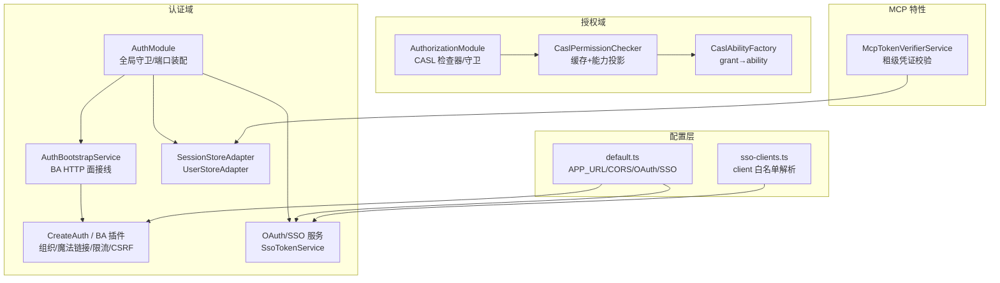
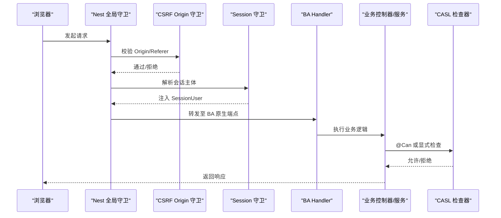
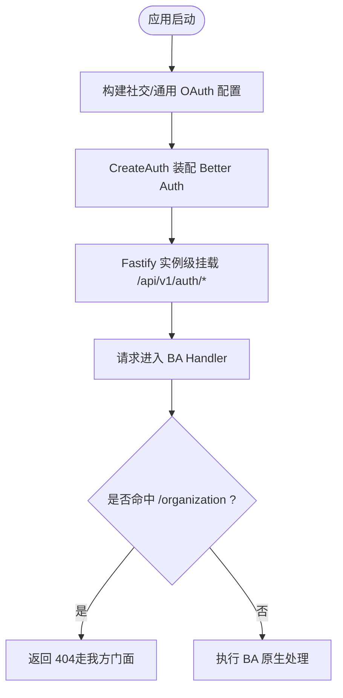
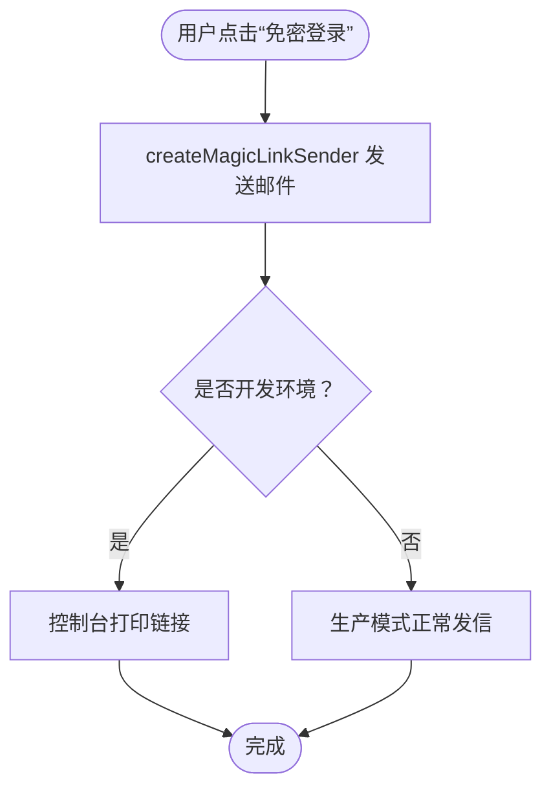
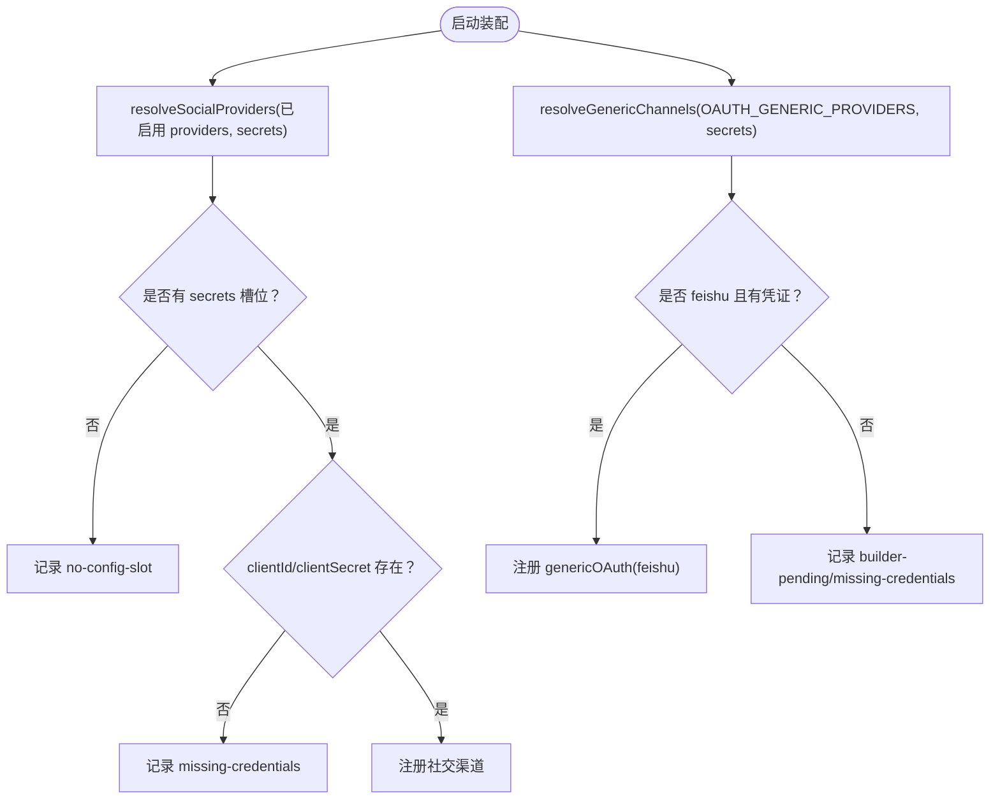
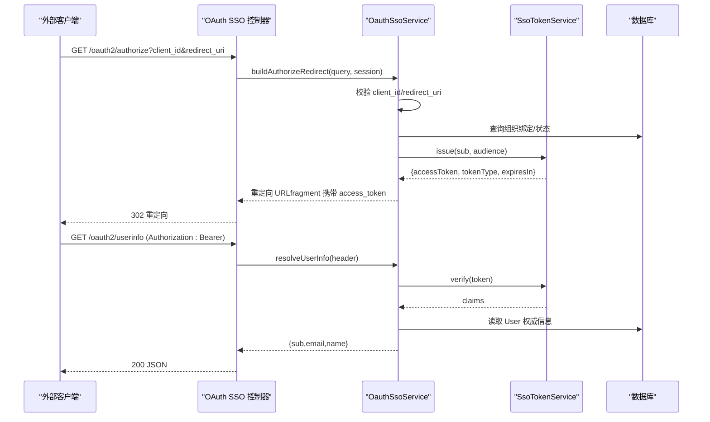
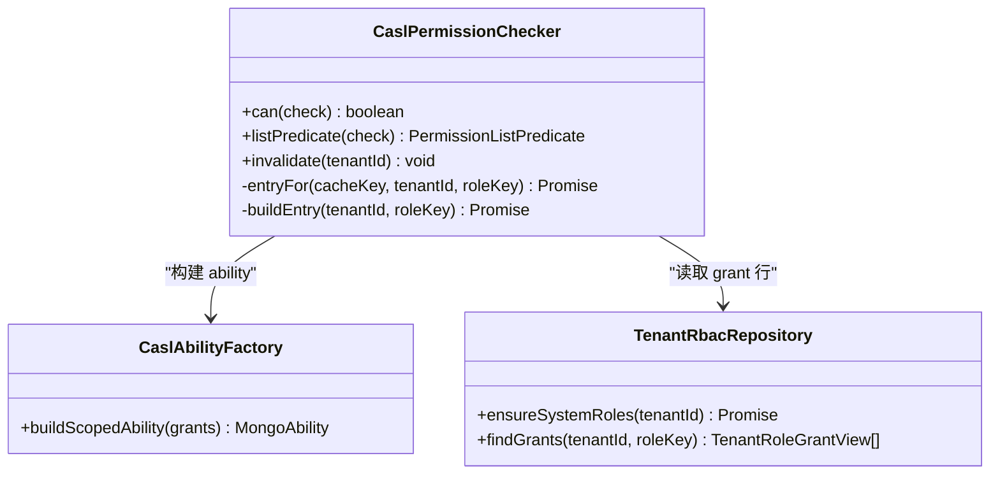
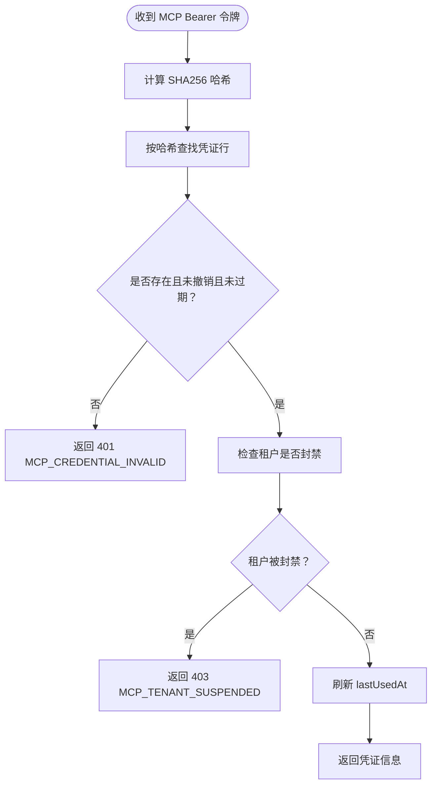
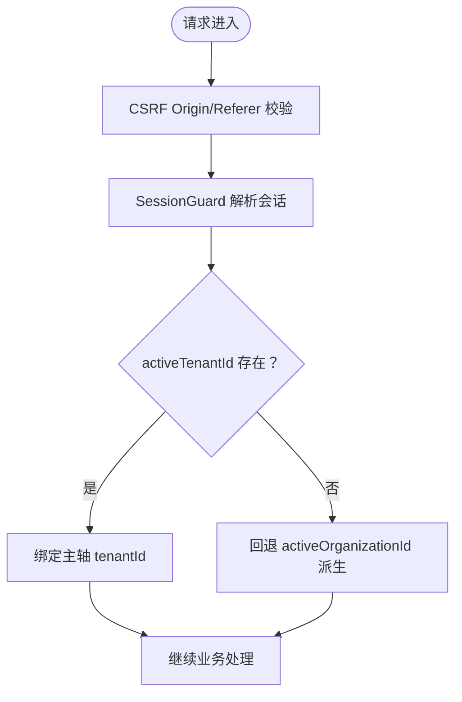
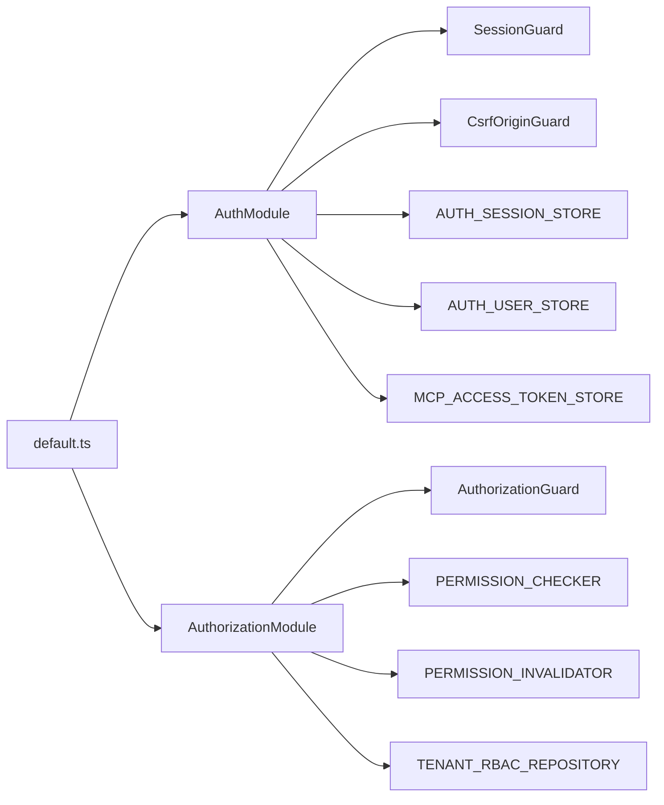

# 认证与授权

<cite>
**本文引用的文件**   
- [auth.module.ts](file://apps/api/src/modules/auth/auth.module.ts)
- [auth.bootstrap.ts](file://apps/api/src/modules/auth/infrastructure/auth.bootstrap.ts)
- [auth.implement.ts](file://apps/api/src/modules/auth/infrastructure/auth.implement.ts)
- [authorization.module.ts](file://apps/api/src/modules/authorization/authorization.module.ts)
- [casl-ability.factory.ts](file://apps/api/src/modules/authorization/infrastructure/casl-ability.factory.ts)
- [casl-permission.checker.ts](file://apps/api/src/modules/authorization/infrastructure/casl-permission.checker.ts)
- [default.ts](file://apps/api/src/config/envs/default.ts)
- [sso-clients.ts](file://apps/api/src/config/envs/sso-clients.ts)
- [mcp-token-verifier.service.ts](file://apps/api/src/features/mcp/application/mcp-token-verifier.service.ts)
- [oauth-sso.service.ts](file://apps/api/src/modules/auth/infrastructure/oauth-sso.service.ts)
- [generic-oauth-channels.ts](file://apps/api/src/modules/auth/infrastructure/generic-oauth-channels.ts)
- [social-provider-registration.ts](file://apps/api/src/modules/auth/infrastructure/social-provider-registration.ts)
- [session-store.adapter.ts](file://apps/api/src/modules/auth/infrastructure/session-store.adapter.ts)
- [user-store.adapter.ts](file://apps/api/src/modules/auth/infrastructure/user-store.adapter.ts)
- [sso-token.service.ts](file://apps/api/src/modules/auth/infrastructure/sso-token.service.ts)
</cite>

## 目录
1. [引言](#引言)
2. [项目结构](#项目结构)
3. [核心组件](#核心组件)
4. [架构总览](#架构总览)
5. [详细组件分析](#详细组件分析)
6. [依赖关系分析](#依赖关系分析)
7. [性能与安全考量](#性能与安全考量)
8. [故障排查指南](#故障排查指南)
9. [结论](#结论)
10. [附录：配置清单与最佳实践](#附录配置清单与最佳实践)

## 引言
本文件系统性梳理本仓库的认证与授权体系，覆盖 Better Auth 集成、邮箱密码与魔法链接登录、社交与通用 OAuth（含飞书等境内渠道）、SSO/OIDC OP 面、CSRF 防护与会话安全、三层权限模型（平台级/租户级/工作区级）及 CASL 能力模型，并说明 MCP 令牌验证与 Agent 访问控制。文档同时给出关键流程的时序图、类图与流程图，以及可操作的配置建议与排错要点。

## 项目结构
认证与授权相关代码主要分布在以下模块：
- 认证域：`modules/auth`（Better Auth 装配、会话存储、用户存储、OAuth/SSO、MCP 凭证端口）
- 授权域：`modules/authorization`（RBAC 管理门面、CASL 能力工厂与检查器、租户成员/邀请管理）
- 配置层：`config/envs/default.ts`、`config/envs/sso-clients.ts`
- MCP 特性：`features/mcp/application/mcp-token-verifier.service.ts`

**图表来源**
- [auth.module.ts:22-83](file://apps/api/src/modules/auth/auth.module.ts#L22-L83)
- [auth.bootstrap.ts:34-82](file://apps/api/src/modules/auth/infrastructure/auth.bootstrap.ts#L34-L82)
- [auth.implement.ts:101-302](file://apps/api/src/modules/auth/infrastructure/auth.implement.ts#L101-L302)
- [authorization.module.ts:33-60](file://apps/api/src/modules/authorization/authorization.module.ts#L33-L60)
- [casl-permission.checker.ts:71-199](file://apps/api/src/modules/authorization/infrastructure/casl-permission.checker.ts#L71-L199)
- [casl-ability.factory.ts:39-46](file://apps/api/src/modules/authorization/infrastructure/casl-ability.factory.ts#L39-L46)
- [default.ts:16-141](file://apps/api/src/config/envs/default.ts#L16-L141)
- [sso-clients.ts:11-42](file://apps/api/src/config/envs/sso-clients.ts#L11-L42)
- [mcp-token-verifier.service.ts:33-80](file://apps/api/src/features/mcp/application/mcp-token-verifier.service.ts#L33-L80)

**章节来源**
- [auth.module.ts:22-83](file://apps/api/src/modules/auth/auth.module.ts#L22-L83)
- [auth.bootstrap.ts:34-82](file://apps/api/src/modules/auth/infrastructure/auth.bootstrap.ts#L34-L82)
- [auth.implement.ts:101-302](file://apps/api/src/modules/auth/infrastructure/auth.implement.ts#L101-L302)
- [authorization.module.ts:33-60](file://apps/api/src/modules/authorization/authorization.module.ts#L33-L60)
- [default.ts:16-141](file://apps/api/src/config/envs/default.ts#L16-L141)
- [sso-clients.ts:11-42](file://apps/api/src/config/envs/sso-clients.ts#L11-L42)

## 核心组件
- Better Auth 装配与 HTTP 面：通过 `AuthBootstrapService` 在应用启动时创建 Better Auth 实例，并以 Fastify 实例级通配路由挂载 `/api/v1/auth/*`，将请求转发给 BA handler。
- 会话与用户存储：`MikroSessionStoreAdapter`、`MikroUserStoreAdapter` 作为 auth 域的受控写入口，提供会话删除、活动租户位写入、用户硬删与状态更新。
- 社交与通用 OAuth：社交渠道由 `resolveSocialProviders` 裁决注册；通用 OAuth（飞书等）由 `generic-oauth-channels` 构建 `genericOAuth` 配置。
- SSO/OIDC OP 面：`OauthSsoService` 负责 client 白名单校验、redirect_uri 精确匹配、短 TTL JWT 签发与 userinfo 鉴权；`SsoTokenService` 实现 HS256 紧凑 JWS。
- 授权与 RBAC：`AuthorizationModule` 暴露 `AuthorizationGuard` 与 CASL 检查器；`CaslPermissionChecker` 基于 grant 行构建 CASL ability，支持类型级与实例级判定，并提供列表谓词下推。
- MCP 令牌验证：`McpTokenVerifierService` 对 MCP 租级凭证进行哈希查找、撤销/过期/封禁校验，统一错误码防探测。

**章节来源**
- [auth.bootstrap.ts:34-82](file://apps/api/src/modules/auth/infrastructure/auth.bootstrap.ts#L34-L82)
- [session-store.adapter.ts:14-46](file://apps/api/src/modules/auth/infrastructure/session-store.adapter.ts#L14-L46)
- [user-store.adapter.ts:14-41](file://apps/api/src/modules/auth/infrastructure/user-store.adapter.ts#L14-L41)
- [social-provider-registration.ts:40-66](file://apps/api/src/modules/auth/infrastructure/social-provider-registration.ts#L40-L66)
- [generic-oauth-channels.ts:119-180](file://apps/api/src/modules/auth/infrastructure/generic-oauth-channels.ts#L119-L180)
- [oauth-sso.service.ts:52-116](file://apps/api/src/modules/auth/infrastructure/oauth-sso.service.ts#L52-L116)
- [sso-token.service.ts:52-106](file://apps/api/src/modules/auth/infrastructure/sso-token.service.ts#L52-L106)
- [authorization.module.ts:33-60](file://apps/api/src/modules/authorization/authorization.module.ts#L33-L60)
- [casl-permission.checker.ts:71-199](file://apps/api/src/modules/authorization/infrastructure/casl-permission.checker.ts#L71-L199)
- [mcp-token-verifier.service.ts:33-80](file://apps/api/src/features/mcp/application/mcp-token-verifier.service.ts#L33-L80)

## 架构总览
下图展示从浏览器到后端各层的调用链：Nest 全局守卫 → CSRF Origin 守卫 → Session 守卫 → BA 原生 handler → 业务控制器/服务 → CASL 授权检查。

**图表来源**
- [auth.module.ts:46-60](file://apps/api/src/modules/auth/auth.module.ts#L46-L60)
- [auth.implement.ts:304-346](file://apps/api/src/modules/auth/infrastructure/auth.implement.ts#L304-L346)
- [authorization.module.ts:33-60](file://apps/api/src/modules/authorization/authorization.module.ts#L33-L60)

## 详细组件分析

### Better Auth 装配与 HTTP 面
- 启动阶段通过 `AuthBootstrapService.onApplicationBootstrap` 调用 `CreateAuth` 装配 Better Auth，并在 Fastify 上以实例级通配路由挂载 `/api/v1/auth/*`。
- `CreateAuth` 中启用组织插件、魔法链接、限流、CSRF sameSite=lax、邮箱密码登录（非生产环境），并通过 `toNodeHandler` 适配 Fastify 请求。
- 对 BA 内置组织 HTTP 端点进行封堵，强制走我方门面（@Can + AuthorizationGuard）。

**图表来源**
- [auth.bootstrap.ts:46-82](file://apps/api/src/modules/auth/infrastructure/auth.bootstrap.ts#L46-L82)
- [auth.implement.ts:101-302](file://apps/api/src/modules/auth/infrastructure/auth.implement.ts#L101-L302)
- [auth.implement.ts:304-346](file://apps/api/src/modules/auth/infrastructure/auth.implement.ts#L304-L346)

**章节来源**
- [auth.bootstrap.ts:34-82](file://apps/api/src/modules/auth/infrastructure/auth.bootstrap.ts#L34-L82)
- [auth.implement.ts:101-302](file://apps/api/src/modules/auth/infrastructure/auth.implement.ts#L101-L302)
- [auth.implement.ts:304-346](file://apps/api/src/modules/auth/infrastructure/auth.implement.ts#L304-L346)

### 邮箱密码认证与魔法链接
- 邮箱密码登录在非生产环境启用，自动登录、最小密码长度限制。
- 魔法链接无条件挂载（含生产），禁用注册，使用一次性链接；开发环境控制台打印链接，SMTP 失败非致命；生产严格抛错。
- 邮件发送经 MailerService，链接绝对 URL 依赖 APP_URL canonical。

**图表来源**
- [auth.implement.ts:44-60](file://apps/api/src/modules/auth/infrastructure/auth.implement.ts#L44-L60)
- [auth.implement.ts:243-248](file://apps/api/src/modules/auth/infrastructure/auth.implement.ts#L243-L248)
- [auth.implement.ts:266-273](file://apps/api/src/modules/auth/infrastructure/auth.implement.ts#L266-L273)

**章节来源**
- [auth.implement.ts:44-60](file://apps/api/src/modules/auth/infrastructure/auth.implement.ts#L44-L60)
- [auth.implement.ts:243-248](file://apps/api/src/modules/auth/infrastructure/auth.implement.ts#L243-L248)
- [auth.implement.ts:266-273](file://apps/api/src/modules/auth/infrastructure/auth.implement.ts#L266-L273)

### 社交登录与通用 OAuth（Google/GitHub/飞书等）
- 社交渠道：通过 `resolveSocialProviders` 裁决已启用的 provider 是否具备 secrets 槽位与凭证；生产环境未注册即 fail-loud，非生产 warn。
- 通用 OAuth：仅飞书当前有构建器，wechat/dingtalk/wecom 为接口位暂不注册；未配凭证降级不报错。
- Google/GitHub 等需在 `oauth.secrets` 中补槽位，否则即使 OAUTH_PROVIDERS 声明也不会生效。

**图表来源**
- [social-provider-registration.ts:40-66](file://apps/api/src/modules/auth/infrastructure/social-provider-registration.ts#L40-L66)
- [social-provider-registration.ts:96-105](file://apps/api/src/modules/auth/infrastructure/social-provider-registration.ts#L96-L105)
- [generic-oauth-channels.ts:119-180](file://apps/api/src/modules/auth/infrastructure/generic-oauth-channels.ts#L119-L180)

**章节来源**
- [social-provider-registration.ts:40-66](file://apps/api/src/modules/auth/infrastructure/social-provider-registration.ts#L40-L66)
- [social-provider-registration.ts:96-105](file://apps/api/src/modules/auth/infrastructure/social-provider-registration.ts#L96-L105)
- [generic-oauth-channels.ts:119-180](file://apps/api/src/modules/auth/infrastructure/generic-oauth-channels.ts#L119-L180)

### SSO/OIDC OP 集成（authorize 与 userinfo）
- authorize：校验 client_id 是否在白名单、redirect_uri 精确匹配、活跃租户 Odoo 可用性门禁，签发超短 TTL JWT 并拼接 fragment。
- userinfo：Bearer 头解析、HS256 验签、aud 归属校验、实时 user 表权威值读取、邮箱验证门。

**图表来源**
- [oauth-sso.service.ts:52-116](file://apps/api/src/modules/auth/infrastructure/oauth-sso.service.ts#L52-L116)
- [sso-token.service.ts:56-106](file://apps/api/src/modules/auth/infrastructure/sso-token.service.ts#L56-L106)

**章节来源**
- [oauth-sso.service.ts:52-116](file://apps/api/src/modules/auth/infrastructure/oauth-sso.service.ts#L52-L116)
- [sso-token.service.ts:56-106](file://apps/api/src/modules/auth/infrastructure/sso-token.service.ts#L56-L106)

### 三层权限模型与 CASL 能力模型
- 三层模型：平台级（operatorEmail 指定）、租户级（tenantId 隔离）、工作区级（workspaces 上下文）。
- CASL 能力模型：grant 行映射为 CASL ability，支持类型级（无 conditions）与实例级（带 conditions，{{userId}} 模板解析）。
- 列表谓词下推：守卫路径对 read 动作放宽为“存在任一匹配 grant 行即放行”，具体行可见性由列表面谓词下推治理。

**图表来源**
- [casl-permission.checker.ts:71-199](file://apps/api/src/modules/authorization/infrastructure/casl-permission.checker.ts#L71-L199)
- [casl-ability.factory.ts:39-46](file://apps/api/src/modules/authorization/infrastructure/casl-ability.factory.ts#L39-L46)

**章节来源**
- [authorization.module.ts:33-60](file://apps/api/src/modules/authorization/authorization.module.ts#L33-L60)
- [casl-permission.checker.ts:71-199](file://apps/api/src/modules/authorization/infrastructure/casl-permission.checker.ts#L71-L199)
- [casl-ability.factory.ts:39-46](file://apps/api/src/modules/authorization/infrastructure/casl-ability.factory.ts#L39-L46)

### MCP 令牌验证与 Agent 访问控制
- 校验流程：SHA256 哈希查找凭证行，校验撤销/过期状态，联动租户封禁状态，成功后刷 lastUsedAt。
- 错误策略：不存在/已撤销/已过期统一 401（防探测），租户封禁 403。

**图表来源**
- [mcp-token-verifier.service.ts:40-67](file://apps/api/src/features/mcp/application/mcp-token-verifier.service.ts#L40-L67)

**章节来源**
- [mcp-token-verifier.service.ts:33-80](file://apps/api/src/features/mcp/application/mcp-token-verifier.service.ts#L33-L80)

### CSRF 防护与会话安全
- CSRF：BA 默认 sameSite=lax，跨源场景可通过配置调整；Origin/Referer 校验守卫在全局守卫链中运行。
- 会话：SessionGuard 全局启用，deny-by-default；会话表新增 activeTenantId 字段用于选租；会话回收任务可选开启。

**图表来源**
- [auth.module.ts:46-60](file://apps/api/src/modules/auth/auth.module.ts#L46-L60)
- [auth.implement.ts:258-264](file://apps/api/src/modules/auth/infrastructure/auth.implement.ts#L258-L264)
- [session-store.adapter.ts:23-46](file://apps/api/src/modules/auth/infrastructure/session-store.adapter.ts#L23-L46)

**章节来源**
- [auth.module.ts:46-60](file://apps/api/src/modules/auth/auth.module.ts#L46-L60)
- [auth.implement.ts:258-264](file://apps/api/src/modules/auth/infrastructure/auth.implement.ts#L258-L264)
- [session-store.adapter.ts:23-46](file://apps/api/src/modules/auth/infrastructure/session-store.adapter.ts#L23-L46)

## 依赖关系分析
- AuthModule 全局导出 SessionGuard、CSRF Origin 守卫、BA 实例注入键、AUTH_SESSION_STORE、AUTH_USER_STORE、MCP_ACCESS_TOKEN_STORE。
- AuthorizationModule 全局导出 AuthorizationGuard、PERMISSION_CHECKER、PERMISSION_INVALIDATOR、TENANT_RBAC_REPOSITORY、ROLE_ASSIGNABILITY_READER、TENANT_MEMBERSHIP_MANAGER、TENANT_INVITATION_MANAGER。
- 配置 default.ts 提供 APP_URL、CORS、OAuth providers/secrets、SSO clients 等关键环境变量。

**图表来源**
- [auth.module.ts:46-83](file://apps/api/src/modules/auth/auth.module.ts#L46-L83)
- [authorization.module.ts:33-60](file://apps/api/src/modules/authorization/authorization.module.ts#L33-L60)
- [default.ts:16-141](file://apps/api/src/config/envs/default.ts#L16-L141)

**章节来源**
- [auth.module.ts:46-83](file://apps/api/src/modules/auth/auth.module.ts#L46-L83)
- [authorization.module.ts:33-60](file://apps/api/src/modules/authorization/authorization.module.ts#L33-L60)
- [default.ts:16-141](file://apps/api/src/config/envs/default.ts#L16-L141)

## 性能与安全考量
- 性能
  - CASL 能力缓存：按 (tenant,role) 缓存 ability，LRU 上限 2048，避免逐请求查库。
  - 列表谓词下推：read 入口放宽但行可见仍由 where 下推，减少内存与计算开销。
  - MCP 校验每请求两次 DB 往返（读 + 窄写 lastUsedAt），换取撤销/封禁即时生效。
- 安全
  - CSRF sameSite=lax，Origin/Referer 校验守卫。
  - SSO 令牌 HS256 超短 TTL，aud 强制校验，防混淆副手攻击。
  - MCP 凭证统一 401 防探测，租户封禁 403。
  - 信任代理 IP 解析：生产未配置 AUTH_TRUSTED_PROXIES 会告警，防止共享桶限流误杀。

[本节为通用指导，不直接分析具体文件]

## 故障排查指南
- 社交渠道未生效
  - 现象：OAUTH_PROVIDERS 声明了某渠道但未出现在登录面。
  - 排查：确认 config/envs/default.ts 的 oauth.secrets 中存在该渠道槽位且 clientId/clientSecret 非空；生产环境未注册会 fail-loud。
  - 参考：[social-provider-registration.ts:40-66](file://apps/api/src/modules/auth/infrastructure/social-provider-registration.ts#L40-L66)、[social-provider-registration.ts:96-105](file://apps/api/src/modules/auth/infrastructure/social-provider-registration.ts#L96-L105)
- 魔法链接不可点
  - 现象：生产环境邮件内链接打开后域名错误。
  - 排查：确保 APP_URL 配置为公网 canonical URL，且 CORS_ORIGIN ∈ trustedOrigins。
  - 参考：[auth.implement.ts:126-134](file://apps/api/src/modules/auth/infrastructure/auth.implement.ts#L126-L134)
- SSO authorize 被拒
  - 现象：authorize 报 unregistered client_id 或 redirect_uri not in exact whitelist。
  - 排查：检查 SSO_OAUTH_CLIENTS 配置是否正确，redirect_uri 需精确匹配。
  - 参考：[oauth-sso.service.ts:52-61](file://apps/api/src/modules/auth/infrastructure/oauth-sso.service.ts#L52-L61)、[sso-clients.ts:11-42](file://apps/api/src/config/envs/sso-clients.ts#L11-L42)
- MCP 凭证无效
  - 现象：Agent 调用返回 401 MCP_CREDENTIAL_INVALID。
  - 排查：确认凭证未撤销、未过期；检查租户是否被封禁（403 MCP_TENANT_SUSPENDED）。
  - 参考：[mcp-token-verifier.service.ts:40-67](file://apps/api/src/features/mcp/application/mcp-token-verifier.service.ts#L40-L67)

**章节来源**
- [social-provider-registration.ts:40-66](file://apps/api/src/modules/auth/infrastructure/social-provider-registration.ts#L40-L66)
- [social-provider-registration.ts:96-105](file://apps/api/src/modules/auth/infrastructure/social-provider-registration.ts#L96-L105)
- [auth.implement.ts:126-134](file://apps/api/src/modules/auth/infrastructure/auth.implement.ts#L126-L134)
- [oauth-sso.service.ts:52-61](file://apps/api/src/modules/auth/infrastructure/oauth-sso.service.ts#L52-L61)
- [sso-clients.ts:11-42](file://apps/api/src/config/envs/sso-clients.ts#L11-L42)
- [mcp-token-verifier.service.ts:40-67](file://apps/api/src/features/mcp/application/mcp-token-verifier.service.ts#L40-L67)

## 结论
本系统以 Better Auth 为核心，结合 Nest 全局守卫与 CASL 能力模型，构建了稳健的认证与授权体系。通过严格的配置校验、CSRF 防护、会话安全与 MCP 令牌验证，实现了平台级/租户级/工作区级三层权限控制与 Agent 访问控制。建议在部署时完善 APP_URL、CORS、AUTH_TRUSTED_PROXIES、OAuth/SSO 配置，并按本文最佳实践进行运维与排障。

[本节为总结性内容，不直接分析具体文件]

## 附录：配置清单与最佳实践
- 基础应用与 API
  - APP_NAME、APP_DESCRIPTION、API_VERSION、PORT、HOST、API_PREFIX
  - DATABASE_URL
- 认证与会话
  - JWT_SECRET、JWT_EXPIRES_IN、JWT_REFRESH_SECRET、JWT_REFRESH_EXPIRES_IN
  - ALLOWED_ORIGINS（逗号分隔完整 origin）
  - AUTH_TRUSTED_PROXIES（反代 CIDR，逗号分隔）
  - SESSION_RECLAIM_ENABLED、SESSION_RECLAIM_INTERVAL_MS
- 社交与通用 OAuth
  - OAUTH_PROVIDERS（如 github,google）
  - OAUTH_GENERIC_PROVIDERS（如 feishu）
  - OAUTH_CALLBACK_URL_BASE、OAUTH_COOKIE_NAME、OAUTH_COOKIE_MAX_AGE、OAUTH_COOKIE_SECURE
  - GOOGLE_CLIENT_ID/SECRET、GITHUB_CLIENT_ID/SECRET、FEISHU_APP_ID/SECRET
- SSO OP 客户端注册
  - SSO_OAUTH_CLIENTS（JSON 数组：[{clientId, redirectUris[], audience}]）
- 平台经营者
  - PLATFORM_OPERATOR_EMAIL

**章节来源**
- [default.ts:16-141](file://apps/api/src/config/envs/default.ts#L16-L141)
- [sso-clients.ts:11-42](file://apps/api/src/config/envs/sso-clients.ts#L11-L42)