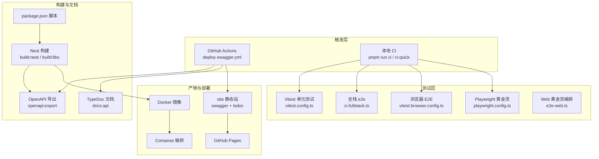
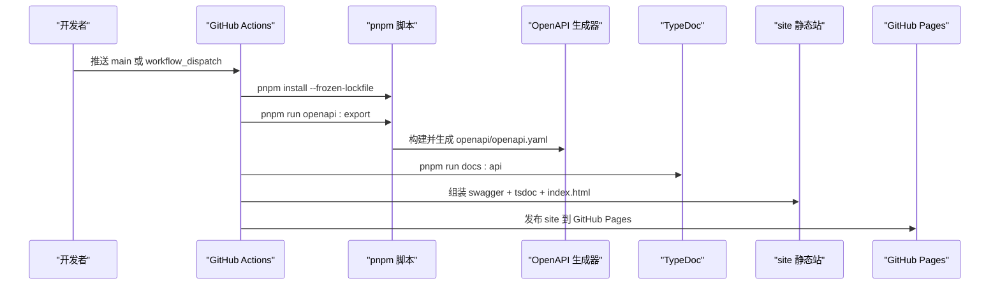
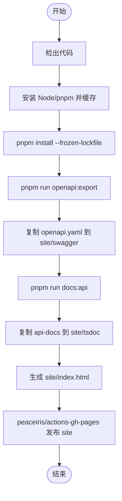
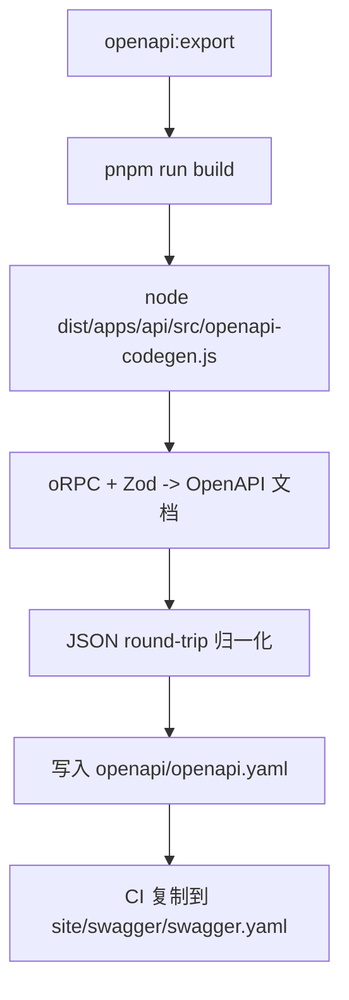
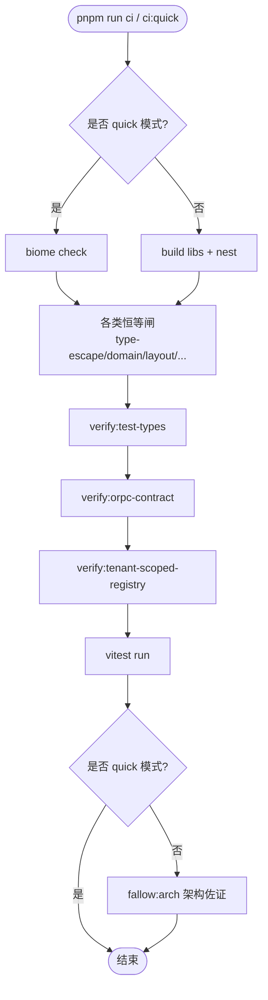
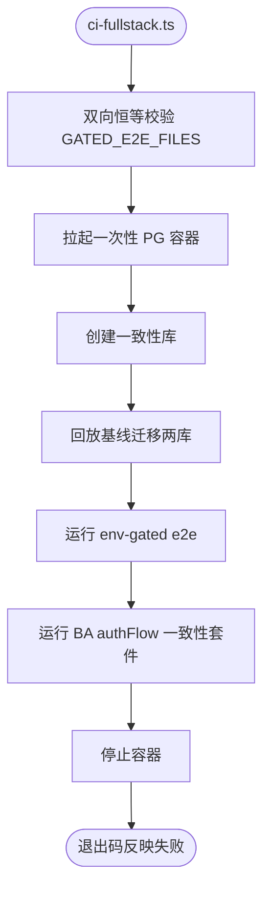
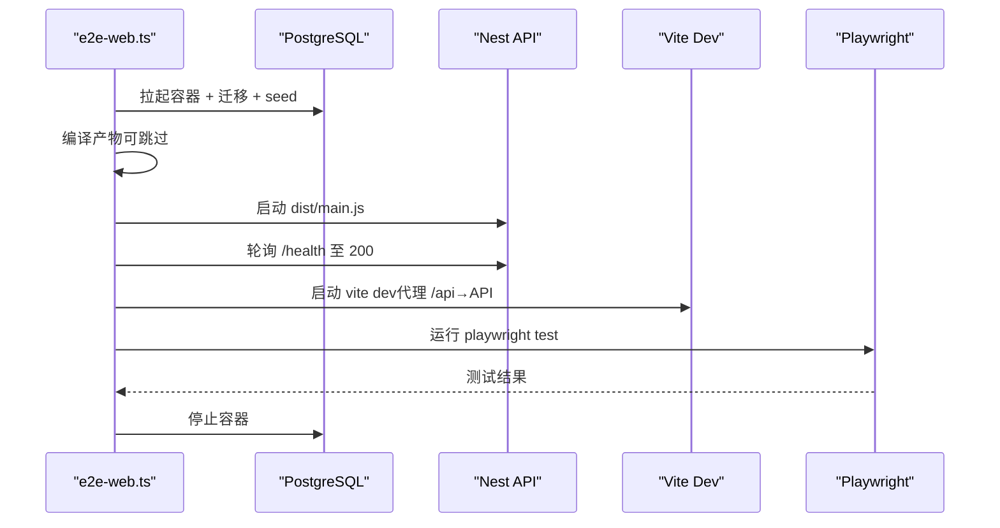
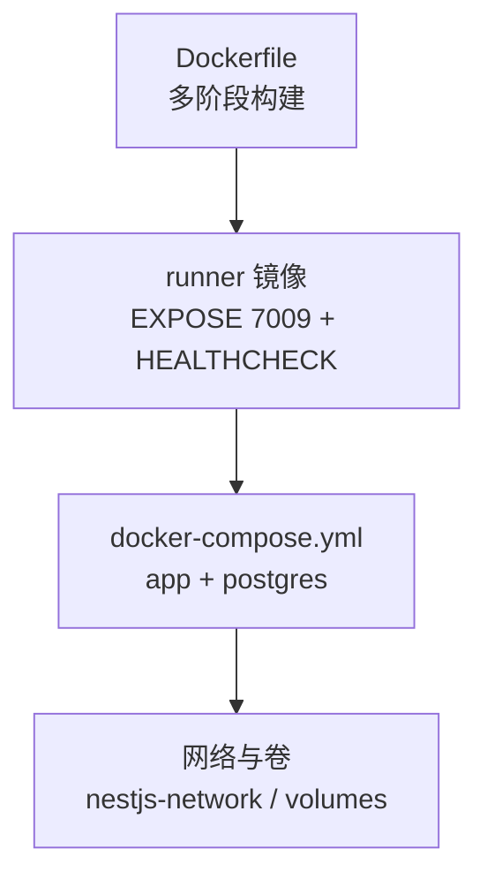
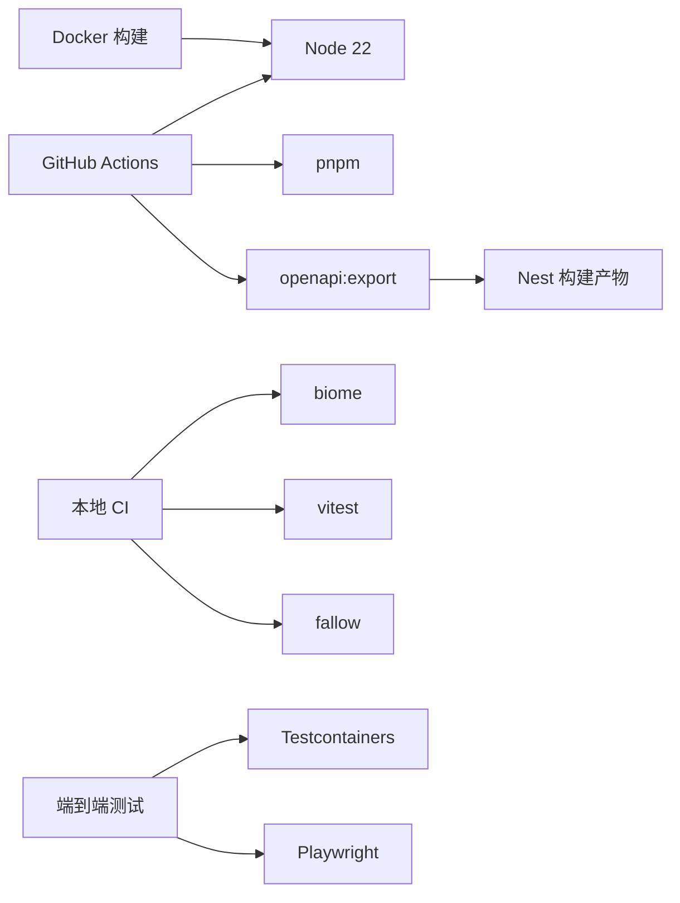

# CI/CD 流水线

<cite>
**本文引用的文件**   
- [.github/workflows/deploy-swagger.yml](file://.github/workflows/deploy-swagger.yml)
- [package.json](file://package.json)
- [apps/api/package.json](file://apps/api/package.json)
- [apps/api/src/openapi-codegen.ts](file://apps/api/src/openapi-codegen.ts)
- [scripts/ci.ts](file://scripts/ci.ts)
- [scripts/ci-fullstack.ts](file://scripts/ci-fullstack.ts)
- [scripts/e2e-web.ts](file://scripts/e2e-web.ts)
- [vitest.config.ts](file://vitest.config.ts)
- [vitest.browser.config.ts](file://vitest.browser.config.ts)
- [playwright.config.ts](file://playwright.config.ts)
- [Dockerfile](file://Dockerfile)
- [docker-compose.yml](file://docker-compose.yml)
</cite>

## 目录
1. [引言](#引言)
2. [项目结构](#项目结构)
3. [核心组件](#核心组件)
4. [架构总览](#架构总览)
5. [详细组件分析](#详细组件分析)
6. [依赖关系分析](#依赖关系分析)
7. [性能与优化建议](#性能与优化建议)
8. [故障排查指南](#故障排查指南)
9. [结论](#结论)

## 引言
本仓库采用 pnpm monorepo + NestJS Fastify 后端、Vite 前端，配合 Vitest、Playwright、Testcontainers 构建完整的持续集成与发布体系。当前已实现的自动化能力包括：
- GitHub Actions 文档站点自动构建与部署（Swagger/OpenAPI + TypeDoc）
- 本地 CI 编排器（质量门禁、类型检查、契约校验、测试）
- 全栈端到端测试（真数据库、真浏览器黄金流）
- Docker 多阶段构建与 Compose 编排
- OpenAPI 规范从 oRPC 契约驱动生成，并作为单一事实源对外发布

## 项目结构
CI/CD 相关的关键位置如下：
- 工作流定义：`.github/workflows/deploy-swagger.yml`
- 脚本与编排：`scripts/ci.ts`、`scripts/ci-fullstack.ts`、`scripts/e2e-web.ts`
- 测试配置：`vitest.config.ts`、`vitest.browser.config.ts`、`playwright.config.ts`
- 应用入口与代码生成：`apps/api/src/openapi-codegen.ts`
- 构建与发布：`Dockerfile`、`docker-compose.yml`
- 脚本命令入口：`package.json`、`apps/api/package.json`

**图示来源**
- [.github/workflows/deploy-swagger.yml:1-204](file://.github/workflows/deploy-swagger.yml#L1-L204)
- [package.json:11-66](file://package.json#L11-L66)
- [apps/api/src/openapi-codegen.ts:29-78](file://apps/api/src/openapi-codegen.ts#L29-L78)
- [vitest.config.ts:1-84](file://vitest.config.ts#L1-L84)
- [vitest.browser.config.ts:1-40](file://vitest.browser.config.ts#L1-L40)
- [playwright.config.ts:1-31](file://playwright.config.ts#L1-L31)
- [scripts/ci-fullstack.ts:1-249](file://scripts/ci-fullstack.ts#L1-L249)
- [scripts/e2e-web.ts:1-206](file://scripts/e2e-web.ts#L1-L206)
- [Dockerfile:1-65](file://Dockerfile#L1-L65)
- [docker-compose.yml:1-83](file://docker-compose.yml#L1-L83)

**章节来源**
- [.github/workflows/deploy-swagger.yml:1-204](file://.github/workflows/deploy-swagger.yml#L1-L204)
- [package.json:11-66](file://package.json#L11-L66)

## 核心组件
- GitHub Actions 文档站点构建与部署：在 main 分支推送或手动触发时，构建 Swagger/OpenAPI 与 TypeDoc，合并为 site 静态站并发布到 GitHub Pages。
- 本地 CI 编排器：统一执行 lint/format、类型逃逸与领域布局等恒等闸、构建、类型检查、单元测试、可选架构佐证。
- 全栈 e2e 编排：拉起一次性 PostgreSQL，回放迁移基线，运行受控的数据库相关 e2e 用例集。
- Web 黄金流编排：拉起 PG → 迁移 → seed → 编译 → 启动 API → 启动前端 dev → 运行 Playwright 黄金流。
- OpenAPI 代码生成：基于 oRPC 契约与 Zod schema 生成 openapi.yaml，供 Swagger UI 消费。
- Docker 构建与 Compose 编排：多阶段构建镜像，Compose 声明环境变量、健康检查与网络卷。

**章节来源**
- [scripts/ci.ts:1-137](file://scripts/ci.ts#L1-L137)
- [scripts/ci-fullstack.ts:1-249](file://scripts/ci-fullstack.ts#L1-L249)
- [scripts/e2e-web.ts:1-206](file://scripts/e2e-web.ts#L1-L206)
- [apps/api/src/openapi-codegen.ts:29-78](file://apps/api/src/openapi-codegen.ts#L29-L78)
- [Dockerfile:1-65](file://Dockerfile#L1-L65)
- [docker-compose.yml:1-83](file://docker-compose.yml#L1-L83)

## 架构总览
下图展示从代码变更到文档站点发布的完整链路，以及本地 CI 与端到端测试的协作关系。

**图示来源**
- [.github/workflows/deploy-swagger.yml:70-204](file://.github/workflows/deploy-swagger.yml#L70-L204)
- [package.json:62-65](file://package.json#L62-L65)
- [apps/api/src/openapi-codegen.ts:29-78](file://apps/api/src/openapi-codegen.ts#L29-L78)

## 详细组件分析

### GitHub Actions 文档站点构建与部署
- 触发条件：main 分支推送且路径包含 apps/libs/openapi/typedoc 相关文件或工作流本身；支持手动触发。
- 环境准备：安装 Node 22、pnpm，缓存 pnpm store。
- 文档构建：
  - 通过 `openapi:export` 调用 Nest 构建与 OpenAPI 生成器，产出 `openapi/openapi.yaml`，复制到 `site/swagger/swagger.yaml`，并生成 Swagger UI 页面。
  - 通过 `docs:api` 生成 TypeDoc 文档，复制到 `site/tsdoc`。
  - 生成根 landing 页，链接到 swagger 与 tsdoc 两个子站。
- 发布：使用 peaceiris/actions-gh-pages 将 `./site` 发布到 GitHub Pages。

**图示来源**
- [.github/workflows/deploy-swagger.yml:70-204](file://.github/workflows/deploy-swagger.yml#L70-L204)

**章节来源**
- [.github/workflows/deploy-swagger.yml:1-204](file://.github/workflows/deploy-swagger.yml#L1-L204)

### OpenAPI 规范自动生成
- 生成入口：`pnpm run openapi:export`，内部先执行 `pnpm run build`，再运行 `dist/apps/api/src/openapi-codegen.js`。
- 生成逻辑：
  - 使用 oRPC 契约路由器与 Zod JSON Schema 转换器生成 OpenAPI 文档。
  - 设置 info.title/description/version、servers.base path 与 API versioning。
  - 输出 `openapi/openapi.yaml`，并对对象进行 JSON round-trip 以消除原型/类实例。
- 文档站点消费：GitHub Actions 将生成的 YAML 与 Swagger UI 页面一并打包发布。

**图示来源**
- [package.json:62-63](file://package.json#L62-L63)
- [apps/api/src/openapi-codegen.ts:29-78](file://apps/api/src/openapi-codegen.ts#L29-L78)
- [.github/workflows/deploy-swagger.yml:87-96](file://.github/workflows/deploy-swagger.yml#L87-L96)

**章节来源**
- [package.json:62-65](file://package.json#L62-L65)
- [apps/api/src/openapi-codegen.ts:29-78](file://apps/api/src/openapi-codegen.ts#L29-L78)

### 本地 CI 编排器（质量门禁）
- 模式：
  - full：执行 check、type-escape ratchet、domain layout guard、feature isolation guard、stories drift guard、i18n key parity guard、overturned rulings guard、config contract guard、build、web/odoo-rpc-web typecheck、test typecheck、oRPC 契约对拍、tenant-scoped registry guard、tests、可选 fallow 架构佐证。
  - quick：仅 check + type-escape/domain-layout/feature-isolation/stories/i18n/overturned/config guards + tests。
- 失败策略：硬性门禁快速失败；fallow 仅为佐证不阻断。

**图示来源**
- [scripts/ci.ts:1-137](file://scripts/ci.ts#L1-L137)

**章节来源**
- [scripts/ci.ts:1-137](file://scripts/ci.ts#L1-L137)

### 全栈端到端测试（数据库相关）
- 容器编排：使用 Testcontainers 拉起一次性 PostgreSQL，创建两个库用于 e2e 与一致性测试。
- 迁移回放：对两库分别回放已提交基线迁移，保证与生产一致。
- 测试清单：维护 GATED_E2E_FILES 白名单，并在启动前双向恒等校验（实存 vs 登记），防止漏跑或漂移。
- 执行顺序：env-gated e2e → BA authFlow 一致性套件 → 停止容器。

**图示来源**
- [scripts/ci-fullstack.ts:1-249](file://scripts/ci-fullstack.ts#L1-L249)

**章节来源**
- [scripts/ci-fullstack.ts:1-249](file://scripts/ci-fullstack.ts#L1-L249)

### Web 黄金流端到端测试（浏览器）
- 编排流程：拉起 PG → 迁移 → seed → 编译 → 启动 API → 启动 vite dev → 轮询健康 → 运行 Playwright 黄金流 → 清理进程与容器。
- Playwright 配置：串行执行、无重试、headless chromium，baseURL 由编排器注入。
- Vitest 浏览器模式：独立配置文件，覆盖 `.browser.test.{ts,tsx}`，复用 swc 链。

**图示来源**
- [scripts/e2e-web.ts:1-206](file://scripts/e2e-web.ts#L1-L206)
- [playwright.config.ts:1-31](file://playwright.config.ts#L1-L31)
- [vitest.browser.config.ts:1-40](file://vitest.browser.config.ts#L1-L40)

**章节来源**
- [scripts/e2e-web.ts:1-206](file://scripts/e2e-web.ts#L1-L206)
- [playwright.config.ts:1-31](file://playwright.config.ts#L1-L31)
- [vitest.browser.config.ts:1-40](file://vitest.browser.config.ts#L1-L40)

### Docker 构建与 Compose 编排
- 多阶段构建：
  - base：启用 corepack 与 pnpm，固定 Node 版本。
  - dependencies：只拷贝清单文件并安装依赖，利用缓存。
  - builder：执行 `pnpm run build`。
  - runner：仅复制运行时所需文件，暴露端口与健康检查。
- Compose：
  - app 服务：声明必要环境变量（JWT、STORAGE、DATA_RESIDENCY_ENFORCE 等），依赖 postgres 健康状态。
  - postgres 服务：提供数据库，带健康检查与数据卷。

**图示来源**
- [Dockerfile:1-65](file://Dockerfile#L1-L65)
- [docker-compose.yml:1-83](file://docker-compose.yml#L1-L83)

**章节来源**
- [Dockerfile:1-65](file://Dockerfile#L1-L65)
- [docker-compose.yml:1-83](file://docker-compose.yml#L1-L83)

## 依赖关系分析
- 工作流依赖 Node 22 与 pnpm，依赖缓存通过 actions/setup-node 的 cache: pnpm 启用。
- OpenAPI 生成依赖 Nest 构建产物与 oRPC/Zod 转换工具链。
- 本地 CI 依赖 biome、fallow、vitest、typescript 等开发依赖。
- 端到端测试依赖 Testcontainers、Playwright、chromium。
- Docker 构建依赖 Node 22 与 pnpm（corepack）。

**图示来源**
- [.github/workflows/deploy-swagger.yml:74-85](file://.github/workflows/deploy-swagger.yml#L74-L85)
- [package.json:130-158](file://package.json#L130-L158)
- [scripts/ci.ts:1-137](file://scripts/ci.ts#L1-L137)
- [scripts/ci-fullstack.ts:1-249](file://scripts/ci-fullstack.ts#L1-L249)
- [scripts/e2e-web.ts:1-206](file://scripts/e2e-web.ts#L1-L206)
- [Dockerfile:1-65](file://Dockerfile#L1-L65)

**章节来源**
- [.github/workflows/deploy-swagger.yml:74-85](file://.github/workflows/deploy-swagger.yml#L74-L85)
- [package.json:130-158](file://package.json#L130-L158)

## 性能与优化建议
- 缓存策略：
  - GitHub Actions 已启用 pnpm 缓存；建议在后续 CI 中增加 node_modules/.cache 或 TypeScript 增量构建缓存。
  - 本地 CI 可通过环境变量控制 NO_COLOR 与并行度，减少 I/O 竞争。
- 并行执行：
  - 单元测试已通过 vitest 默认并行；可在 CI 中显式设置 workers 数量以提升吞吐。
  - 端到端测试保持串行（黄金流状态机），避免竞态。
- 增量构建：
  - 利用 pnpm workspace 与 SWC 构建器，优先构建 libs 与 client，再构建 nest 与 web。
  - 在 CI 中按变更路径触发最小化任务（例如仅 docs 变更时只跑 TypeDoc）。
- 资源隔离：
  - 端到端测试使用一次性容器，避免共享状态污染。
  - 健康检查轮询与超时保护，避免长时间挂起。

[本节为通用指导，不直接分析具体文件]

## 故障排查指南
- 文档站点未更新：
  - 确认 main 分支推送路径命中 apps/libs/openapi/typedoc 相关文件。
  - 检查工作流日志中 `openapi:export` 与 `docs:api` 步骤是否成功。
- OpenAPI 生成失败：
  - 检查 `openapi:export` 是否先执行了 `pnpm run build`。
  - 查看 `apps/api/src/openapi-codegen.ts` 的错误堆栈与环境变量（APP_NAME、API_VERSION 等）。
- 本地 CI 失败：
  - 根据 ci.ts 的步骤输出定位失败环节（lint、guards、build、test types、oRPC 契约对拍等）。
  - 若为架构佐证告警，需人工核验后决定是否调整规则。
- 端到端测试失败：
  - 检查 Testcontainers 是否可用、chromium 是否已安装。
  - 查看 e2e-web.ts 编排日志，确认 API /health 与 vite dev 是否就绪。
  - 核对 GATED_E2E_FILES 是否与实存文件一致。
- Docker 构建失败：
  - 确认 Node 版本与 pnpm 版本匹配（corepack 管理）。
  - 检查依赖安装层缓存是否命中，必要时清理缓存重试。

**章节来源**
- [.github/workflows/deploy-swagger.yml:87-143](file://.github/workflows/deploy-swagger.yml#L87-L143)
- [apps/api/src/openapi-codegen.ts:29-78](file://apps/api/src/openapi-codegen.ts#L29-L78)
- [scripts/ci.ts:1-137](file://scripts/ci.ts#L1-L137)
- [scripts/ci-fullstack.ts:102-145](file://scripts/ci-fullstack.ts#L102-L145)
- [scripts/e2e-web.ts:70-161](file://scripts/e2e-web.ts#L70-L161)
- [Dockerfile:1-65](file://Dockerfile#L1-L65)

## 结论
本项目已形成较为完善的 CI/CD 体系：
- 文档站点自动构建与发布，确保 OpenAPI 与 TypeDoc 文档始终与代码同步。
- 本地 CI 提供多层次质量门禁，涵盖代码风格、类型安全、领域契约与架构边界。
- 端到端测试通过真实数据库与浏览器黄金流保障关键路径稳定性。
- Docker 与 Compose 提供一致的构建与运行环境。

建议后续扩展：
- 在 GitHub Actions 中引入更多缓存与并行策略，缩短流水线时长。
- 将端到端测试纳入远程 CI（按需 opt-in），提升发布前置信度。
- 完善版本管理与回滚机制（如 Git tag + Pages 历史版本归档）。

[本节为总结性内容，不直接分析具体文件]