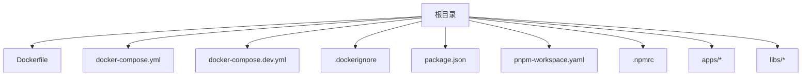
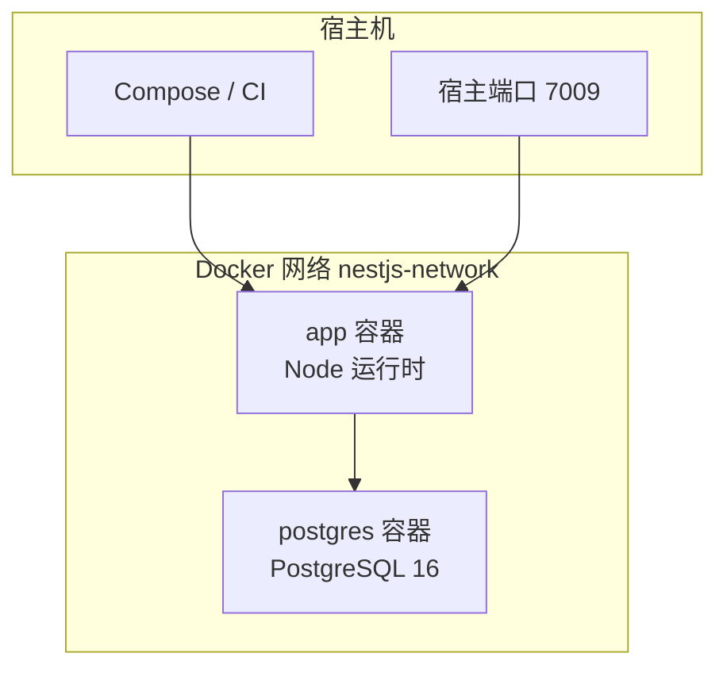
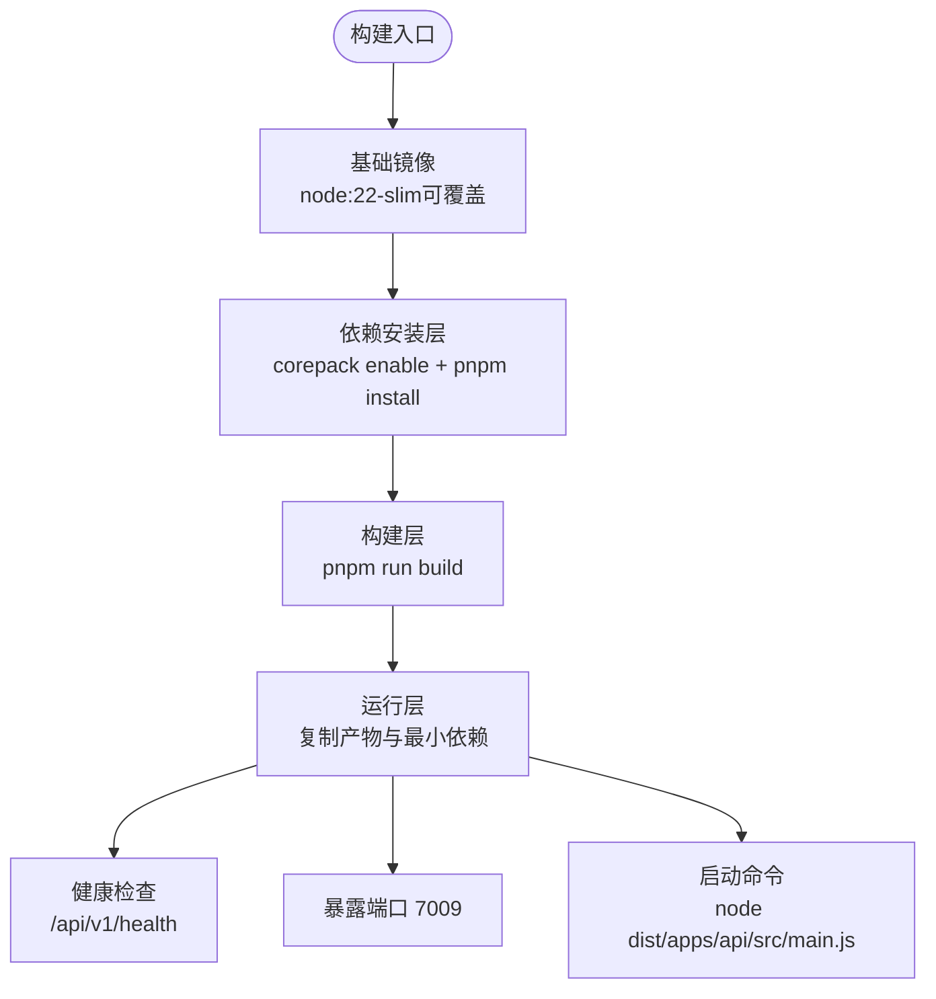
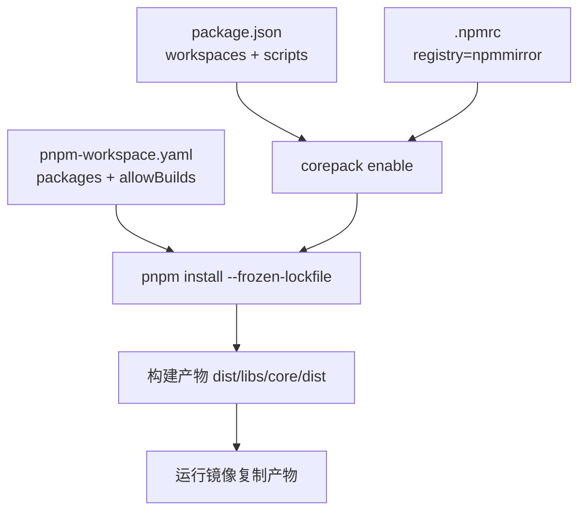
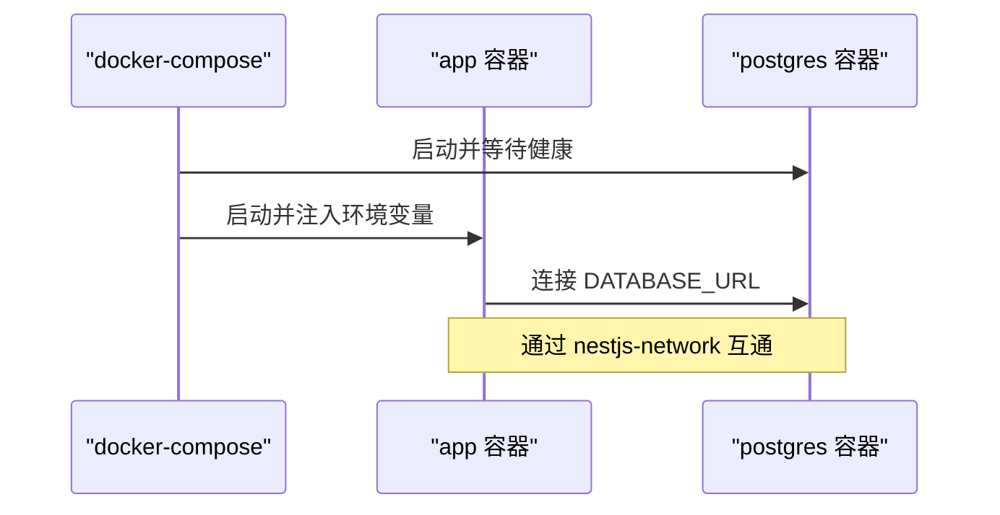
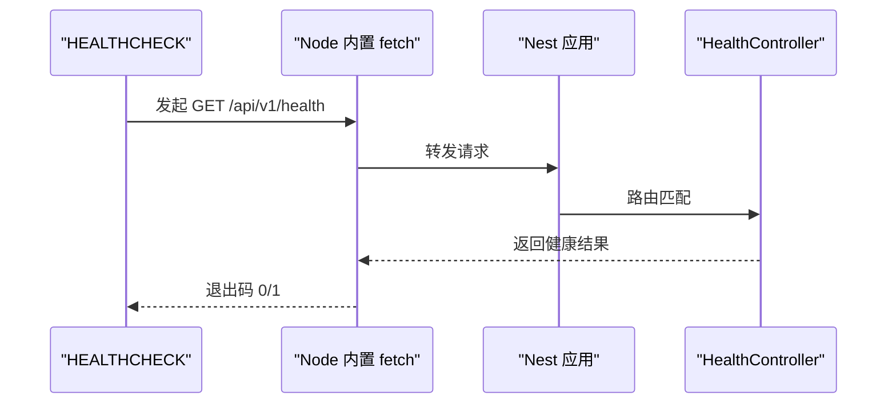
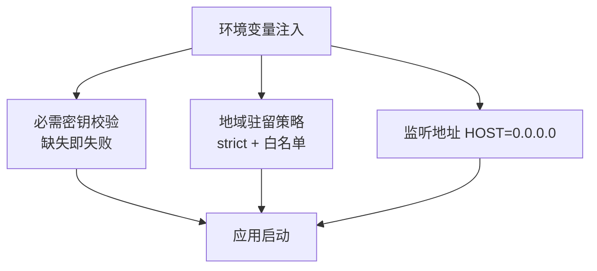
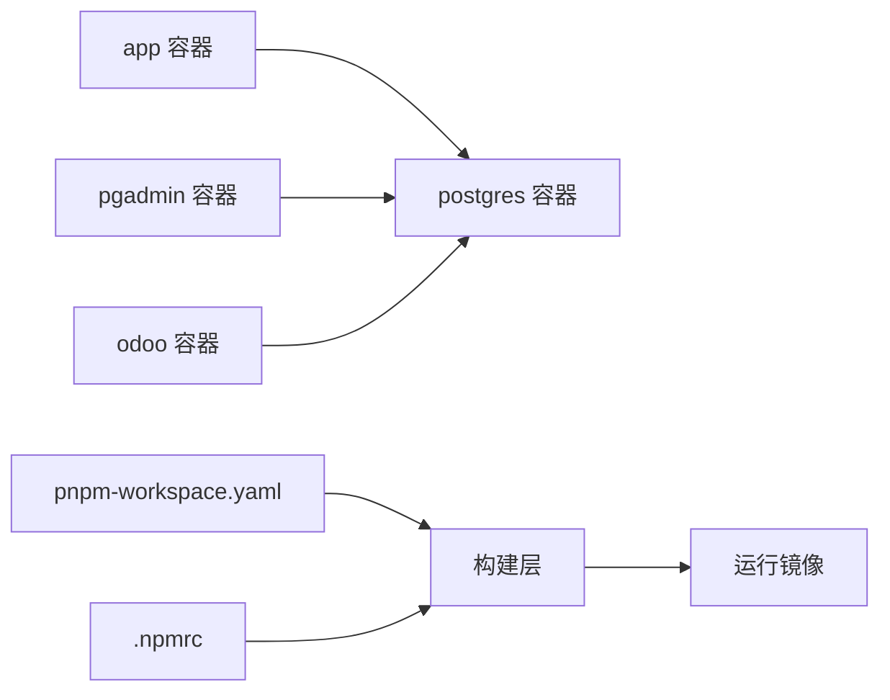

# 容器化部署

<cite>
**本文引用的文件**   
- [Dockerfile](file://Dockerfile)
- [docker-compose.yml](file://docker-compose.yml)
- [docker-compose.dev.yml](file://docker-compose.dev.yml)
- [.dockerignore](file://.dockerignore)
- [package.json](file://package.json)
- [pnpm-workspace.yaml](file://pnpm-workspace.yaml)
- [.npmrc](file://.npmrc)
- [apps/api/package.json](file://apps/api/package.json)
- [libs/core/package.json](file://libs/core/package.json)
- [apps/api/src/common/health/health.module.ts](file://apps/api/src/common/health/health.module.ts)
- [apps/api/src/common/health/health.controller.ts](file://apps/api/src/common/health/health.controller.ts)
- [libs/api-contract/src/health.contract.ts](file://libs/api-contract/src/health.contract.ts)
- [libs/contracts/src/response/health.ts](file://libs/contracts/src/response/health.ts)
- [scripts/verify-compose-contract.ts](file://scripts/verify-compose-contract.ts)
</cite>

## 目录
1. [引言](#引言)
2. [项目结构](#项目结构)
3. [核心组件](#核心组件)
4. [架构总览](#架构总览)
5. [详细组件分析](#详细组件分析)
6. [依赖关系分析](#依赖关系分析)
7. [性能与构建优化](#性能与构建优化)
8. [故障排查指南](#故障排查指南)
9. [结论](#结论)

## 引言
本文件面向“容器化部署”目标，系统性说明该 NestJS SaaS 项目的镜像构建、多阶段构建策略、pnpm workspace 在容器中的处理、corepack 配置、国内镜像源优化、docker-compose 服务编排（数据库、开发辅助服务）、健康检查、端口映射与环境变量注入，以及开发与生产环境的差异化配置。文档以仓库现有实现为依据，避免臆造配置，并提供可视化图示帮助理解。

## 项目结构
本项目采用 pnpm workspace 管理多包：应用位于 apps，共享库位于 libs，根 package.json 定义工作区与脚本；容器化相关的关键文件包括根级 Dockerfile、docker-compose.yml（生产/通用编排）、docker-compose.dev.yml（开发联调栈）、.dockerignore（构建上下文裁剪）等。

**图表来源**
- [Dockerfile:1-65](file://Dockerfile#L1-L65)
- [docker-compose.yml:1-83](file://docker-compose.yml#L1-L83)
- [docker-compose.dev.yml:1-98](file://docker-compose.dev.yml#L1-L98)
- [.dockerignore:1-53](file://.dockerignore#L1-L53)
- [package.json:1-160](file://package.json#L1-L160)
- [pnpm-workspace.yaml:1-24](file://pnpm-workspace.yaml#L1-L24)
- [.npmrc:1-4](file://.npmrc#L1-L4)

**章节来源**
- [Dockerfile:1-65](file://Dockerfile#L1-L65)
- [docker-compose.yml:1-83](file://docker-compose.yml#L1-L83)
- [docker-compose.dev.yml:1-98](file://docker-compose.dev.yml#L1-L98)
- [.dockerignore:1-53](file://.dockerignore#L1-L53)
- [package.json:1-160](file://package.json#L1-L160)
- [pnpm-workspace.yaml:1-24](file://pnpm-workspace.yaml#L1-L24)
- [.npmrc:1-4](file://.npmrc#L1-L4)

## 核心组件
- 镜像构建层：Dockerfile 使用多阶段构建，分离基础镜像、依赖安装、编译产物与运行镜像。
- 包管理与缓存：基于 corepack + pnpm，配合 .npmrc 与 COREPACK_NPM_REGISTRY 指向国内镜像源；pnpm store 通过 BuildKit cache 加速。
- 工作区支持：保留 pnpm-workspace.yaml 与必要的 package.json，确保运行时解析 workspace 符号链接与 exports。
- 编排与服务：docker-compose.yml 提供 app 与 postgres 服务；docker-compose.dev.yml 扩展 pgadmin 与 Odoo 联调服务。
- 健康检查：容器 HEALTHCHECK 调用 /api/v1/health，对应 Nest 模块与 oRPC 契约。

**章节来源**
- [Dockerfile:1-65](file://Dockerfile#L1-L65)
- [package.json:1-160](file://package.json#L1-L160)
- [pnpm-workspace.yaml:1-24](file://pnpm-workspace.yaml#L1-L24)
- [.npmrc:1-4](file://.npmrc#L1-L4)
- [docker-compose.yml:1-83](file://docker-compose.yml#L1-L83)
- [docker-compose.dev.yml:1-98](file://docker-compose.dev.yml#L1-L98)
- [apps/api/src/common/health/health.module.ts:1-15](file://apps/api/src/common/health/health.module.ts#L1-L15)
- [apps/api/src/common/health/health.controller.ts:1-40](file://apps/api/src/common/health/health.controller.ts#L1-L40)

## 架构总览
下图展示容器内外的关键交互：编排层启动 app 与 postgres，app 通过内部网络访问数据库，并通过暴露端口对外提供服务；健康检查由编排或外部探针触发，命中 Nest 健康端点。

**图表来源**
- [docker-compose.yml:1-83](file://docker-compose.yml#L1-L83)
- [Dockerfile:55-64](file://Dockerfile#L55-L64)

**章节来源**
- [docker-compose.yml:1-83](file://docker-compose.yml#L1-L83)
- [Dockerfile:55-64](file://Dockerfile#L55-L64)

## 详细组件分析

### Dockerfile 多阶段构建策略
- 基础镜像选择：默认使用境内镜像仓库的 node:22-slim，可通过构建参数切换为官方镜像。
- 依赖安装层：仅拷贝清单文件与 workspace 配置，启用 corepack 并安装依赖，pnpm store 挂载缓存。
- 构建层：复制源码执行构建脚本，产出 dist 与 libs/core/dist。
- 运行层：仅复制 node_modules、dist、必要的 package.json 与 pnpm-workspace.yaml；设置 HOST=0.0.0.0；暴露 7009 端口；定义 HEALTHCHECK 与 CMD。

**图表来源**
- [Dockerfile:1-65](file://Dockerfile#L1-L65)

**章节来源**
- [Dockerfile:1-65](file://Dockerfile#L1-L65)

### pnpm workspace 与 corepack 配置
- corepack：启用后按 packageManager 字段锁定 pnpm 版本，保证构建可复现。
- 国内镜像源：.npmrc 指定 npmmirror；COREPACK_NPM_REGISTRY 同样指向 npmmirror，避免首次拉取 pnpm tarball 时回源失败。
- workspace 布局：isolated 严格布局，无需 hoist；allowBuilds 白名单放行 @swc/core 与 esbuild 原生二进制，拒绝遥测与可选原生模块。
- 容器内解析：运行镜像保留 pnpm-workspace.yaml 与根及子包的 package.json，确保符号链接与 exports 路径正确解析。

**图表来源**
- [package.json:1-160](file://package.json#L1-L160)
- [pnpm-workspace.yaml:1-24](file://pnpm-workspace.yaml#L1-L24)
- [.npmrc:1-4](file://.npmrc#L1-L4)
- [Dockerfile:16-27](file://Dockerfile#L16-L27)
- [Dockerfile:42-53](file://Dockerfile#L42-L53)

**章节来源**
- [package.json:1-160](file://package.json#L1-L160)
- [pnpm-workspace.yaml:1-24](file://pnpm-workspace.yaml#L1-L24)
- [.npmrc:1-4](file://.npmrc#L1-L4)
- [Dockerfile:16-27](file://Dockerfile#L16-L27)
- [Dockerfile:42-53](file://Dockerfile#L42-L53)

### docker-compose 服务编排
- 应用服务 app：
  - 构建上下文与 Dockerfile 指定。
  - 端口映射 7009:7009。
  - 环境变量注入：NODE_ENV、DATABASE_URL、PORT、DATA_RESIDENCY_DB_HOST_ALLOWLIST、DATA_RESIDENCY_ENFORCE、JWT_SECRET、STORAGE_* 等。
  - depends_on postgres（condition: service_healthy）。
  - 网络 nestjs-network。
  - 卷挂载：./.env（仅补缺非决策键）、app-logs。
- 数据库服务 postgres：
  - 镜像 postgres:16-alpine。
  - 环境变量 POSTGRES_USER/PASSWORD/DB。
  - 端口映射 5432:5432。
  - 数据卷 postgres-data。
  - 健康检查 pg_isready。
- 开发编排 docker-compose.dev.yml：
  - 复用单一 PostgreSQL，新增 pgadmin 与 Odoo 20 CE 服务。
  - 初始化脚本目录挂载至 /docker-entrypoint-initdb.d。
  - 各服务独立网络 nestjs-network-dev。

**图表来源**
- [docker-compose.yml:1-83](file://docker-compose.yml#L1-L83)
- [docker-compose.dev.yml:1-98](file://docker-compose.dev.yml#L1-L98)

**章节来源**
- [docker-compose.yml:1-83](file://docker-compose.yml#L1-L83)
- [docker-compose.dev.yml:1-98](file://docker-compose.dev.yml#L1-L98)

### 健康检查与端口映射
- 容器 HEALTHCHECK：使用内置 node fetch 访问 http://127.0.0.1:7009/api/v1/health，避免 slim 镜像缺失 wget/curl。
- Nest 健康端点：HealthModule 引入 TerminusModule，HealthController 通过 oRPC 暴露 GET /health，经全局前缀 api 与 URI 版本 v1 合成 /api/v1/health。
- 端口映射：EXPOSE 7009；compose 将宿主 7009 映射到容器 7009。

**图表来源**
- [Dockerfile:55-64](file://Dockerfile#L55-L64)
- [apps/api/src/common/health/health.module.ts:1-15](file://apps/api/src/common/health/health.module.ts#L1-L15)
- [apps/api/src/common/health/health.controller.ts:1-40](file://apps/api/src/common/health/health.controller.ts#L1-L40)
- [libs/api-contract/src/health.contract.ts:1-19](file://libs/api-contract/src/health.contract.ts#L1-L19)
- [libs/contracts/src/response/health.ts:1-24](file://libs/contracts/src/response/health.ts#L1-L24)

**章节来源**
- [Dockerfile:55-64](file://Dockerfile#L55-L64)
- [apps/api/src/common/health/health.module.ts:1-15](file://apps/api/src/common/health/health.module.ts#L1-L15)
- [apps/api/src/common/health/health.controller.ts:1-40](file://apps/api/src/common/health/health.controller.ts#L1-L40)
- [libs/api-contract/src/health.contract.ts:1-19](file://libs/api-contract/src/health.contract.ts#L1-L19)
- [libs/contracts/src/response/health.ts:1-24](file://libs/contracts/src/response/health.ts#L1-L24)

### 环境变量注入与安全策略
- 必需密钥：JWT_SECRET、JWT_REFRESH_SECRET、ALLOWED_ORIGINS、STORAGE_REGION、STORAGE_ENDPOINT、STORAGE_ACCESS_KEY_ID、STORAGE_ACCESS_KEY_SECRET 在 compose 中强制要求存在，否则启动失败。
- 地域驻留策略：DATA_RESIDENCY_ENFORCE=true 强制 strict；DATA_RESIDENCY_DB_HOST_ALLOWLIST=postgres 仅放行图内主机名。
- 监听地址：HOST=0.0.0.0 在镜像层设定，避免容器内 localhost 导致端口不可达。
- 校验与契约：scripts/verify-compose-contract.ts 校验 compose 声明与 Dockerfile 一致性，防止配置漂移。

**图表来源**
- [docker-compose.yml:12-50](file://docker-compose.yml#L12-L50)
- [Dockerfile:33-40](file://Dockerfile#L33-L40)
- [scripts/verify-compose-contract.ts:18-65](file://scripts/verify-compose-contract.ts#L18-L65)

**章节来源**
- [docker-compose.yml:12-50](file://docker-compose.yml#L12-L50)
- [Dockerfile:33-40](file://Dockerfile#L33-L40)
- [scripts/verify-compose-contract.ts:18-65](file://scripts/verify-compose-contract.ts#L18-L65)

### 开发环境与生产环境差异
- 生产编排（docker-compose.yml）：
  - 仅包含 app 与 postgres。
  - 强制 DATA_RESIDENCY_ENFORCE=true 与 DB 白名单。
  - 端口映射 7009 与 5432。
  - 卷挂载 ./.env 仅用于非决策性键补缺。
- 开发编排（docker-compose.dev.yml）：
  - 增加 pgadmin 与 Odoo 20 CE 服务，便于本地联调。
  - 单独网络 nestjs-network-dev。
  - 首次初始化脚本挂载至 /docker-entrypoint-initdb.d。
  - 端口映射 5432、5050、8069。

**章节来源**
- [docker-compose.yml:1-83](file://docker-compose.yml#L1-L83)
- [docker-compose.dev.yml:1-98](file://docker-compose.dev.yml#L1-L98)

## 依赖关系分析
- 应用对数据库的依赖：app depends_on postgres，且条件为 service_healthy。
- 开发栈依赖：pgadmin 与 odoo 均 depends_on postgres。
- 构建期依赖：pnpm install 依赖 pnpm-lock.yaml 与 pnpm-workspace.yaml；corepack 负责 pnpm 版本锁定。
- 运行时依赖：node_modules 与 dist 复制到运行镜像；libs/core/dist 与 package.json 保留以支持 exports 解析。

**图表来源**
- [docker-compose.yml:41-66](file://docker-compose.yml#L41-L66)
- [docker-compose.dev.yml:53-85](file://docker-compose.dev.yml#L53-L85)
- [Dockerfile:16-27](file://Dockerfile#L16-L27)
- [Dockerfile:42-53](file://Dockerfile#L42-L53)

**章节来源**
- [docker-compose.yml:41-66](file://docker-compose.yml#L41-L66)
- [docker-compose.dev.yml:53-85](file://docker-compose.dev.yml#L53-L85)
- [Dockerfile:16-27](file://Dockerfile#L16-L27)
- [Dockerfile:42-53](file://Dockerfile#L42-L53)

## 性能与构建优化
- 构建缓存：
  - pnpm store 通过 BuildKit cache 挂载到 /pnpm/store，显著减少重复安装时间。
  - 依赖安装层仅拷贝清单文件，充分利用 Docker 层缓存。
- 镜像体积：
  - 运行镜像仅包含运行时依赖与编译产物，不保留 TS 源与迁移工具链。
  - 使用 node:22-slim 作为基础镜像，减小体积。
- 构建速度：
  - corepack 锁定 pnpm 版本，避免不同环境版本差异导致的缓存失效。
  - allowBuilds 白名单控制原生模块构建，减少不必要编译。

**章节来源**
- [Dockerfile:16-27](file://Dockerfile#L16-L27)
- [Dockerfile:29-53](file://Dockerfile#L29-L53)
- [pnpm-workspace.yaml:7-17](file://pnpm-workspace.yaml#L7-L17)

## 故障排查指南
- 健康检查失败：
  - 确认容器内进程监听 0.0.0.0:7009，而非 localhost。
  - 验证 /api/v1/health 是否可达，检查 Nest 健康模块是否正确装配。
- 数据库连接失败：
  - 检查 DATABASE_URL 是否正确，postgres 服务是否 healthy。
  - 确认 DATA_RESIDENCY_DB_HOST_ALLOWLIST 包含 postgres。
- 环境变量缺失：
  - 必需密钥未注入会导致启动失败；检查 compose environment 或宿主 .env。
- 构建缓存问题：
  - 清理 pnpm store 缓存或重建依赖层，确保 pnpm-lock.yaml 与 pnpm-workspace.yaml 一致。

**章节来源**
- [Dockerfile:55-64](file://Dockerfile#L55-L64)
- [apps/api/src/common/health/health.module.ts:1-15](file://apps/api/src/common/health/health.module.ts#L1-L15)
- [docker-compose.yml:12-50](file://docker-compose.yml#L12-L50)

## 结论
本项目通过多阶段 Dockerfile 实现了清晰的构建分层与最小运行镜像；借助 corepack 与 pnpm workspace 保证了依赖安装的确定性与可复现性；docker-compose 编排明确了服务依赖、网络与数据安全策略；健康检查与端口映射确保了容器的可观测性与可访问性。开发与生产环境通过独立的 compose 文件进行差异化配置，兼顾了联调便利性与生产安全性。