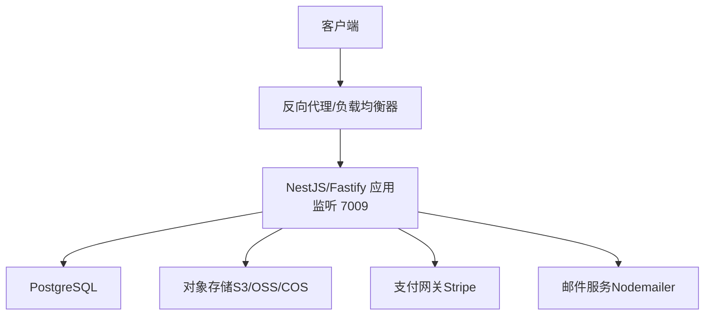
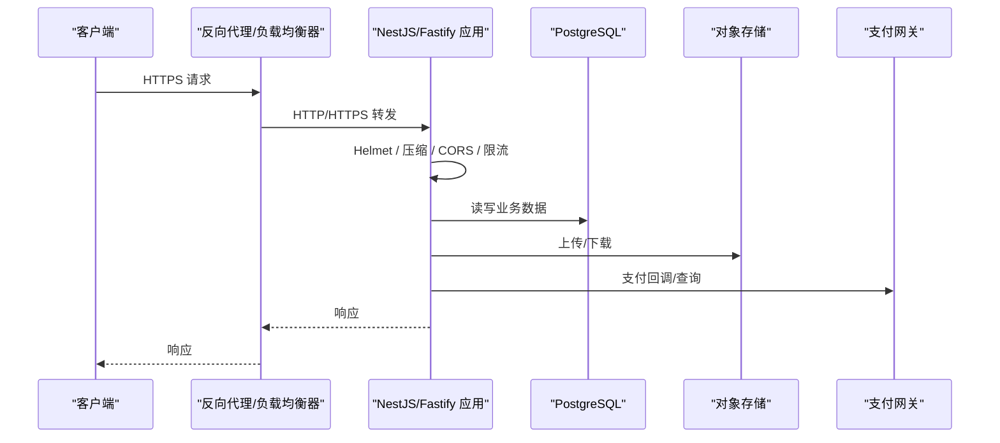
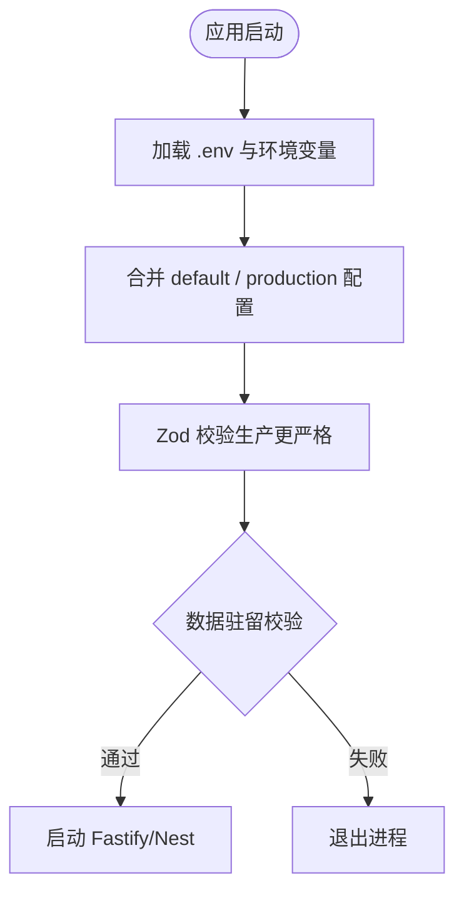
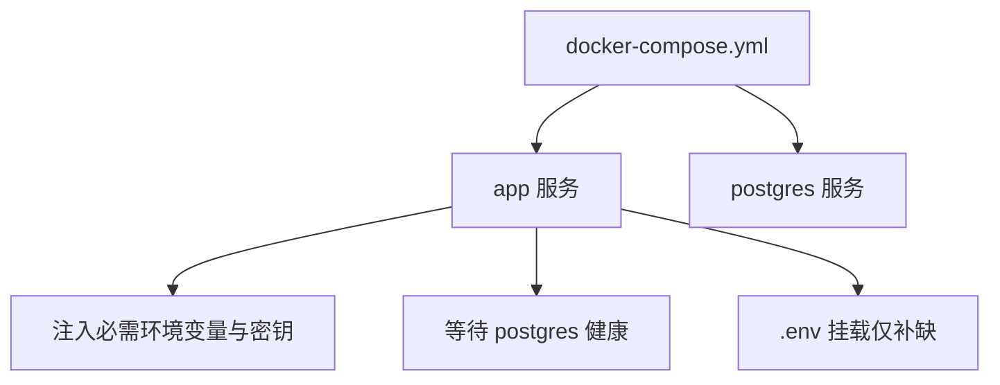
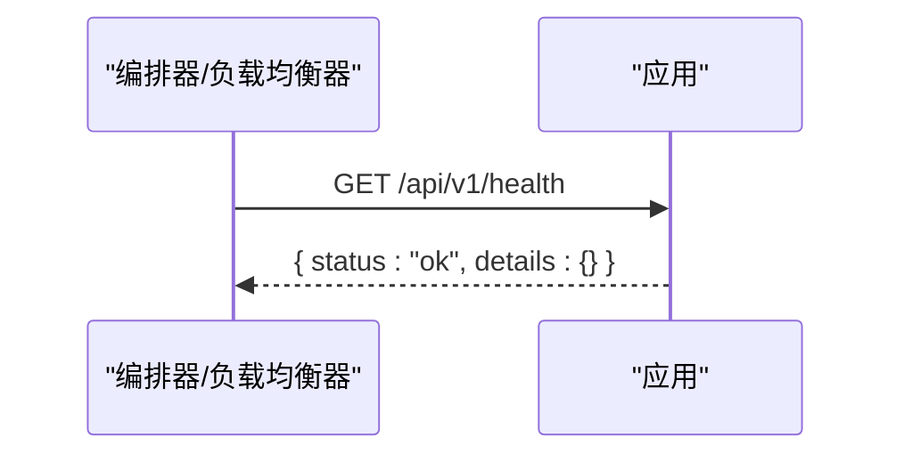
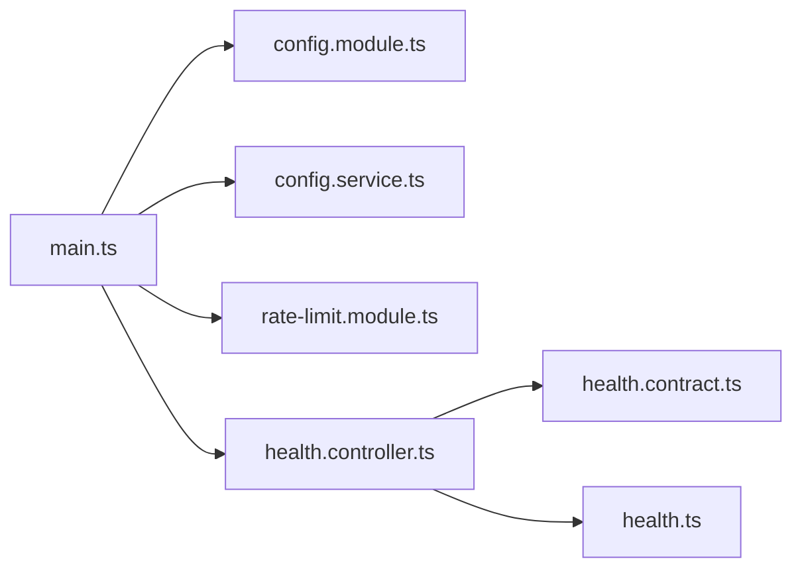
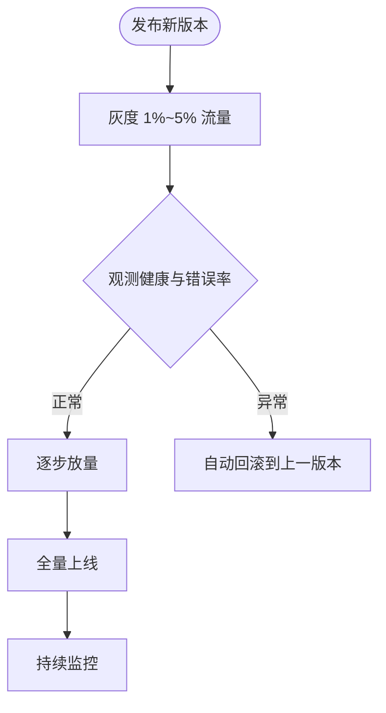

# 生产环境部署

<cite>
**本文引用的文件**   
- [README.md](file://README.md)
- [Dockerfile](file://Dockerfile)
- [docker-compose.yml](file://docker-compose.yml)
- [main.ts](file://apps/api/src/main.ts)
- [config.service.ts](file://apps/api/src/config/config.service.ts)
- [config.module.ts](file://apps/api/src/config/config.module.ts)
- [default.ts](file://apps/api/src/config/envs/default.ts)
- [production.ts](file://apps/api/src/config/envs/production.ts)
- [cors-origins.ts](file://apps/api/src/config/envs/cors-origins.ts)
- [rate-limit.module.ts](file://apps/api/src/common/rate-limit.module.ts)
- [health.controller.ts](file://apps/api/src/common/health/health.controller.ts)
- [health.ts](file://libs/contracts/src/response/health.ts)
- [health.contract.ts](file://libs/api-contract/src/health.contract.ts)
</cite>

## 目录
1. [引言](#引言)
2. [项目结构](#项目结构)
3. [核心组件](#核心组件)
4. [架构总览](#架构总览)
5. [详细组件分析](#详细组件分析)
6. [依赖关系分析](#依赖关系分析)
7. [性能与容量规划](#性能与容量规划)
8. [滚动更新与回滚策略](#滚动更新与回滚策略)
9. [安全加固指南](#安全加固指南)
10. [故障排查](#故障排查)
11. [结论](#结论)

## 引言
本指南面向生产环境，围绕该 NestJS + Fastify SaaS 应用的容器化运行、环境变量与安全参数、反向代理与负载均衡、滚动更新与自动回滚、审计与合规等主题，给出可落地的配置建议与排障要点。仓库已提供多阶段 Docker 镜像、健康探针、数据驻留校验、CORS 白名单解析、限流墙与结构化日志等能力，可作为生产基线。

## 项目结构
- 应用入口与运行时装配：`apps/api/src/main.ts`
- 配置加载与类型化访问：`apps/api/src/config/config.module.ts`、`apps/api/src/config/config.service.ts`
- 环境配置分层：`apps/api/src/config/envs/default.ts`、`apps/api/src/config/envs/production.ts`
- 容器镜像与端口暴露：`Dockerfile`
- 编排与密钥注入：`docker-compose.yml`
- 健康检查契约与控制器：`libs/contracts/src/response/health.ts`、`libs/api-contract/src/health.contract.ts`、`apps/api/src/common/health/health.controller.ts`
- 全局限流：`apps/api/src/common/rate-limit.module.ts`

[本图为概念图，不直接映射具体源码]

**章节来源**
- [README.md:168-172](file://README.md#L168-L172)
- [Dockerfile:32-64](file://Dockerfile#L32-L64)
- [docker-compose.yml:1-52](file://docker-compose.yml#L1-L52)

## 核心组件
- 应用启动与中间件装配：在 `main.ts` 中注册压缩、安全头、CORS、Multipart、请求 ID、版本化、全局校验管道，并基于配置启动服务。
- 配置系统：通过 `ConfigModule` 按 `NODE_ENV` 合并默认/开发/生产配置，并由 `ConfigService` 提供强类型访问；生产模式启用严格的数据驻留校验。
- 健康检查：`/api/v1/health` 为 ping-only 存活探针，供 K8s/编排器探测。
- 限流：全局 ThrottlerGuard 以 IP 维度进行宽档限流，认证面由 Better Auth 自有速率限制保护。
- 容器镜像：多阶段构建，生产镜像仅包含运行时依赖与健康检查命令，默认监听 `0.0.0.0:7009`。

**章节来源**
- [main.ts:20-153](file://apps/api/src/main.ts#L20-L153)
- [config.module.ts:94-110](file://apps/api/src/config/config.module.ts#L94-L110)
- [config.service.ts:1-72](file://apps/api/src/config/config.service.ts#L1-L72)
- [health.controller.ts:21-40](file://apps/api/src/common/health/health.controller.ts#L21-L40)
- [rate-limit.module.ts:6-28](file://apps/api/src/common/rate-limit.module.ts#L6-L28)
- [Dockerfile:55-64](file://Dockerfile#L55-L64)

## 架构总览
下图展示生产链路中的关键节点：外部流量经反向代理进入应用，应用侧完成 CORS、Helmet、压缩、限流、鉴权、租户隔离、数据库与对象存储访问，并通过健康端点对外暴露存活状态。

**图表来源**
- [main.ts:94-122](file://apps/api/src/main.ts#L94-L122)
- [health.controller.ts:21-40](file://apps/api/src/common/health/health.controller.ts#L21-L40)

**章节来源**
- [main.ts:20-153](file://apps/api/src/main.ts#L20-L153)

## 详细组件分析

### 环境变量与配置管理
- 配置加载顺序：默认配置 → 根据 `NODE_ENV` 选择开发或生产配置 → 被 `.env` 与环境变量覆盖。
- 生产配置重点：
  - 关闭 Swagger 文档。
  - CORS 采用显式白名单（`ALLOWED_ORIGINS`），凭证模式需回显具体 origin。
  - 事件发布通道默认进程内模式，outbox 需迁移列后方可开启。
  - 数据驻留严格模式（结合 `DATA_RESIDENCY_ENFORCE` 与 `DATA_RESIDENCY_DB_HOST_ALLOWLIST`）。
- 关键环境变量清单（节选）：
  - 应用：`APP_NAME`、`APP_DESCRIPTION`、`API_VERSION`、`PORT`、`HOST`、`API_PREFIX`
  - 数据库：`DATABASE_URL`
  - 认证：`JWT_SECRET`、`JWT_REFRESH_SECRET`、`JWT_EXPIRES_IN`、`JWT_REFRESH_EXPIRES_IN`
  - CORS：`ALLOWED_ORIGINS`
  - 存储：`STORAGE_PROVIDER`、`STORAGE_BUCKET`、`STORAGE_REGION`、`STORAGE_ENDPOINT`、`STORAGE_ACCESS_KEY_ID`、`STORAGE_ACCESS_KEY_SECRET`、`STORAGE_BASE_URL`、`STORAGE_MAX_FILE_SIZE`、`STORAGE_ALLOWED_MIME_TYPES`
  - 支付：`STRIPE_SECRET_KEY`、`STRIPE_PUBLIC_KEY`、`STRIPE_WEBHOOK_SECRET`、`STRIPE_API_VERSION`、`PAYMENT_PROVIDER`
  - 事件：`EVENT_PUBLISH_MODE`、`EVENT_OUTBOX_POLL_MS`
  - 数据驻留：`DATA_RESIDENCY_ENFORCE`、`DATA_RESIDENCY_DB_HOST_ALLOWLIST`
  - 其他：`SESSION_RECLAIM_ENABLED`、`SESSION_RECLAIM_INTERVAL_MS`、`PLATFORM_OPERATOR_EMAIL`、`SSO_OAUTH_CLIENTS`、`OAUTH_PROVIDERS`、`OAUTH_GENERIC_PROVIDERS`、`OAUTH_CALLBACK_URL_BASE`、`OAUTH_COOKIE_*`、`GOOGLE_CLIENT_ID/SECRET`、`FEISHU_APP_ID/SECRET` 等

**图表来源**
- [config.module.ts:94-110](file://apps/api/src/config/config.module.ts#L94-L110)
- [main.ts:40-72](file://apps/api/src/main.ts#L40-L72)

**章节来源**
- [default.ts:4-142](file://apps/api/src/config/envs/default.ts#L4-L142)
- [production.ts:3-67](file://apps/api/src/config/envs/production.ts#L3-L67)
- [cors-origins.ts:1-21](file://apps/api/src/config/envs/cors-origins.ts#L1-L21)
- [config.service.ts:1-72](file://apps/api/src/config/config.service.ts#L1-L72)
- [config.module.ts:70-110](file://apps/api/src/config/config.module.ts#L70-L110)

### 容器镜像与端口
- 基础镜像与包管理器：Node 22 slim + corepack/pnpm，使用国内 npm 镜像加速依赖拉取。
- 构建层：先安装依赖缓存，再执行 `pnpm run build`。
- 运行层：仅复制 `dist`、`node_modules`、workspace 元信息；设置 `NODE_ENV=production`、`HOST=0.0.0.0`；暴露 `7009`。
- 健康检查：使用内置 `fetch` 调用 `/api/v1/health`，避免镜像缺少 curl/wget。

**章节来源**
- [Dockerfile:1-64](file://Dockerfile#L1-L64)

### 编排与密钥注入
- 应用服务：
  - 绑定端口 `7009`。
  - 强制注入必要密钥与策略开关（如 `JWT_SECRET`、`JWT_REFRESH_SECRET`、`ALLOWED_ORIGINS`、存储凭据、`DATA_RESIDENCY_ENFORCE=true`）。
  - 通过 `depends_on` 等待 PostgreSQL 健康。
  - 挂载 `.env` 仅用于非决策性键补缺，不得将开发机 `.env` 直接作为生产配置源。
- 数据库服务：
  - 固定用户/密码/库名，持久化数据卷，暴露 `5432`。

**图表来源**
- [docker-compose.yml:1-52](file://docker-compose.yml#L1-L52)

**章节来源**
- [docker-compose.yml:1-83](file://docker-compose.yml#L1-L83)

### 反向代理与负载均衡
- 应用监听地址：生产镜像默认 `HOST=0.0.0.0`，端口 `7009`。
- 可信代理：通过 `AUTH_TRUSTED_PROXIES` 透传真实客户端 IP，使限流与风控按真实 IP 分桶。
- CORS：必须显式配置 `ALLOWED_ORIGINS`（完整 origin，含协议），且开启 `credentials: true`；未命中白名单的请求将被拒绝。
- 安全头与压缩：启用 Helmet 与 gzip/deflate 压缩，减少带宽并增强安全头。
- 会话保持：若使用 Cookie 会话，需在负载均衡器上启用基于 Cookie 的会话亲和（sticky session），确保同一会话后续请求落到同一实例。

**章节来源**
- [Dockerfile:32-40](file://Dockerfile#L32-L40)
- [main.ts:24-29](file://apps/api/src/main.ts#L24-L29)
- [main.ts:94-113](file://apps/api/src/main.ts#L94-L113)
- [rate-limit.module.ts:6-28](file://apps/api/src/common/rate-limit.module.ts#L6-L28)

### 健康检查与就绪探针
- 存活探针：`GET /api/v1/health` 返回 ping-only 结果，无敏感指纹。
- 契约定义：统一在 `@saas/contracts` 与 `@saas/api-contract` 维护，保证前后端一致。
- 容器健康检查：镜像内使用 `node -e "fetch(...)"` 轮询健康端点。

**图表来源**
- [health.controller.ts:21-40](file://apps/api/src/common/health/health.controller.ts#L21-L40)
- [health.ts:15-24](file://libs/contracts/src/response/health.ts#L15-L24)
- [health.contract.ts:13-19](file://libs/api-contract/src/health.contract.ts#L13-L19)
- [Dockerfile:55-58](file://Dockerfile#L55-L58)

**章节来源**
- [health.controller.ts:1-41](file://apps/api/src/common/health/health.controller.ts#L1-L41)
- [health.ts:1-24](file://libs/contracts/src/response/health.ts#L1-L24)
- [health.contract.ts:1-19](file://libs/api-contract/src/health.contract.ts#L1-L19)
- [Dockerfile:55-58](file://Dockerfile#L55-L58)

## 依赖关系分析
- 配置依赖：`ConfigModule` 加载 default/production 配置，`ConfigService` 提供 typed getter。
- 运行时依赖：Fastify 插件（compression、helmet、cors、multipart）、Throttler、Terminus。
- 外部依赖：PostgreSQL、对象存储、支付网关、邮件服务。

**图表来源**
- [main.ts:20-153](file://apps/api/src/main.ts#L20-L153)
- [config.module.ts:94-110](file://apps/api/src/config/config.module.ts#L94-L110)
- [config.service.ts:1-72](file://apps/api/src/config/config.service.ts#L1-L72)
- [rate-limit.module.ts:1-29](file://apps/api/src/common/rate-limit.module.ts#L1-L29)
- [health.controller.ts:1-41](file://apps/api/src/common/health/health.controller.ts#L1-L41)
- [health.contract.ts:1-19](file://libs/api-contract/src/health.contract.ts#L1-L19)
- [health.ts:1-24](file://libs/contracts/src/response/health.ts#L1-L24)

**章节来源**
- [main.ts:20-153](file://apps/api/src/main.ts#L20-L153)
- [config.module.ts:94-110](file://apps/api/src/config/config.module.ts#L94-L110)
- [rate-limit.module.ts:1-29](file://apps/api/src/common/rate-limit.module.ts#L1-L29)
- [health.controller.ts:1-41](file://apps/api/src/common/health/health.controller.ts#L1-L41)

## 性能与容量规划
- 网络与传输
  - 启用压缩（gzip/deflate）以减少带宽。
  - 合理设置反向代理连接池与超时，避免长尾请求堆积。
- 应用层
  - 全局限流：默认 60 秒窗口、每 IP 每端点 300 次，防止洪水攻击与误伤重前端并发。
  - 认证面限流：Better Auth 自带 10 秒 3 次限制，与全局限流互补。
  - 文件上传：通过 `STORAGE_MAX_FILE_SIZE` 控制单文件大小，避免内存峰值。
- 资源与弹性
  - 单副本建议 CPU 1~2 核、内存 1~2 GB 起步，随 QPS 与并发连接数调优。
  - 水平扩展：基于健康探针与 CPU/内存阈值进行 HPA 扩缩容。
  - 会话亲和：启用 sticky session 或使用共享会话存储（如 Redis）以支持无状态横向扩展。
- 数据库与存储
  - PostgreSQL 连接池大小与最大连接数需与应用副本数匹配。
  - 对象存储选择就近区域与 CDN 加速静态资源。

**章节来源**
- [rate-limit.module.ts:6-28](file://apps/api/src/common/rate-limit.module.ts#L6-L28)
- [main.ts:94-122](file://apps/api/src/main.ts#L94-L122)
- [production.ts:39-50](file://apps/api/src/config/envs/production.ts#L39-L50)

## 滚动更新与回滚策略
- 蓝绿部署
  - 同时运行两套相同版本的应用集群，通过负载均衡器切换流量。
  - 升级前验证新版本的 `/api/v1/health` 与冒烟用例，通过后切流。
- 金丝雀发布
  - 将少量流量（如 1%~5%）路由到新版本，观察错误率、延迟与业务指标。
  - 逐步放量至 100%，失败则立即回滚。
- 自动回滚
  - 基于健康探针与错误率阈值触发回滚：当新版本连续 N 次健康检查失败或错误率超过阈值时，自动切回旧版本。
  - 数据库变更需向前兼容，并在发布后通过独立迁移任务执行。

[本图为概念流程，不直接映射具体源码]

## 安全加固指南
- 网络安全
  - 强制 HTTPS，禁用弱加密套件；在反向代理终止 TLS，后端走内网 HTTP。
  - 启用 Helmet 安全头（HSTS、X-Frame-Options、Content-Security-Policy 等）。
  - 限制跨域：仅允许受信任的 `ALLOWED_ORIGINS`，开启 `credentials: true` 时必须回显具体 origin。
  - 可信代理：配置 `AUTH_TRUSTED_PROXIES`，确保限流与风控基于真实客户端 IP。
- 身份与会话
  - 使用强随机 `JWT_SECRET` 与独立的刷新令牌密钥；设置合理的过期时间。
  - 启用 CSRF 防护（Better Auth 默认启用），要求写操作携带 `Origin`。
  - 会话亲和或集中式会话存储，避免会话丢失与劫持。
- 数据与合规
  - 生产默认严格数据驻留校验；如需放行特定主机，使用 `DATA_RESIDENCY_DB_HOST_ALLOWLIST` 精确白名单。
  - 最小化 PII 写入审计表；审计记录 append-only，不可篡改。
- 访问控制与审计
  - 平台治理动作统一经审计单点输出 pino 结构化日志与 `audit_log` 耐久账本。
  - 对高价值接口实施细粒度限流与权限校验。

**章节来源**
- [main.ts:94-113](file://apps/api/src/main.ts#L94-L113)
- [production.ts:23-30](file://apps/api/src/config/envs/production.ts#L23-L30)
- [cors-origins.ts:1-21](file://apps/api/src/config/envs/cors-origins.ts#L1-L21)
- [docker-compose.yml:12-50](file://docker-compose.yml#L12-L50)
- [main.ts:40-72](file://apps/api/src/main.ts#L40-L72)

## 故障排查
- 无法访问 7009 端口
  - 确认镜像 `HOST=0.0.0.0` 与编排端口映射正确。
  - 检查反向代理是否转发到后端 7009。
- 健康检查失败
  - 确认 `/api/v1/health` 可达；容器内使用 node fetch 轮询。
  - 检查数据库与对象存储连通性。
- CORS 报错
  - 核对 `ALLOWED_ORIGINS` 是否为完整 origin 列表；确认 `credentials: true` 与回显逻辑。
- 限流导致 429
  - 调整全局限流阈值或针对昂贵端点单独限流；确认 `AUTH_TRUSTED_PROXIES` 配置正确。
- 数据驻留阻断启动
  - 检查 `DATA_RESIDENCY_ENFORCE` 与 `DATA_RESIDENCY_DB_HOST_ALLOWLIST`；确保数据库与存储位于合规区域。

**章节来源**
- [Dockerfile:32-40](file://Dockerfile#L32-L40)
- [Dockerfile:55-58](file://Dockerfile#L55-L58)
- [main.ts:40-72](file://apps/api/src/main.ts#L40-L72)
- [main.ts:94-113](file://apps/api/src/main.ts#L94-L113)
- [rate-limit.module.ts:6-28](file://apps/api/src/common/rate-limit.module.ts#L6-L28)

## 结论
该工程在生产环境具备完善的容器化、健康检查、安全头、CORS 白名单、限流与数据驻留校验等能力。生产部署应遵循“最小权限、显式配置、严格校验”的原则：通过编排注入必需密钥与策略开关，使用反向代理终止 TLS 并启用会话亲和，配合蓝绿/金丝雀与自动回滚保障发布安全，辅以结构化审计与合规检查满足监管要求。在此基础上，依据实际 QPS 与资源利用率进行容量规划与弹性伸缩，即可稳定支撑 SaaS 生产负载。