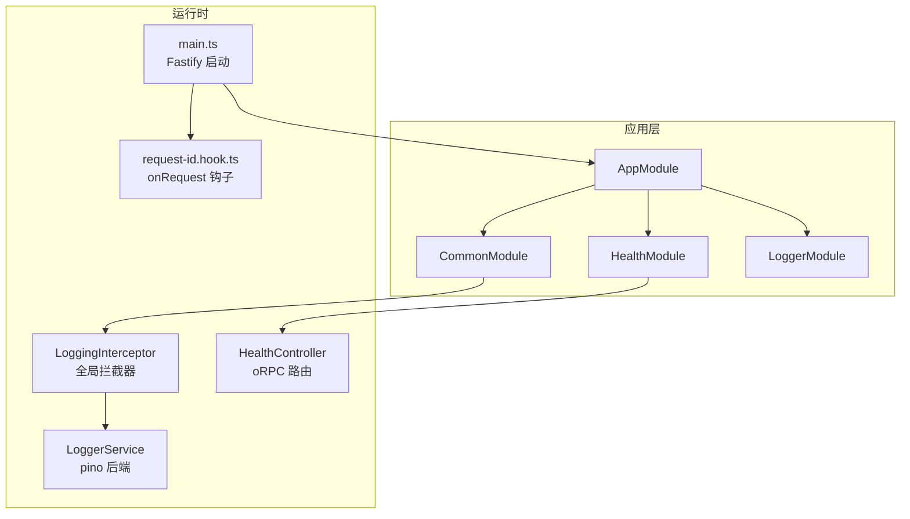
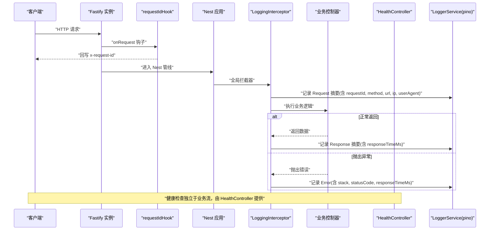
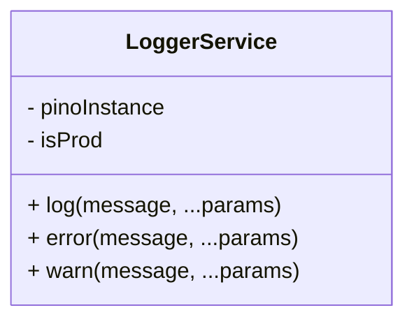
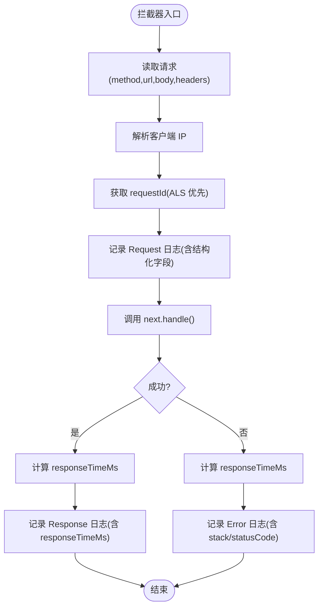
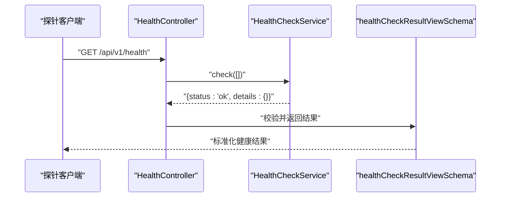
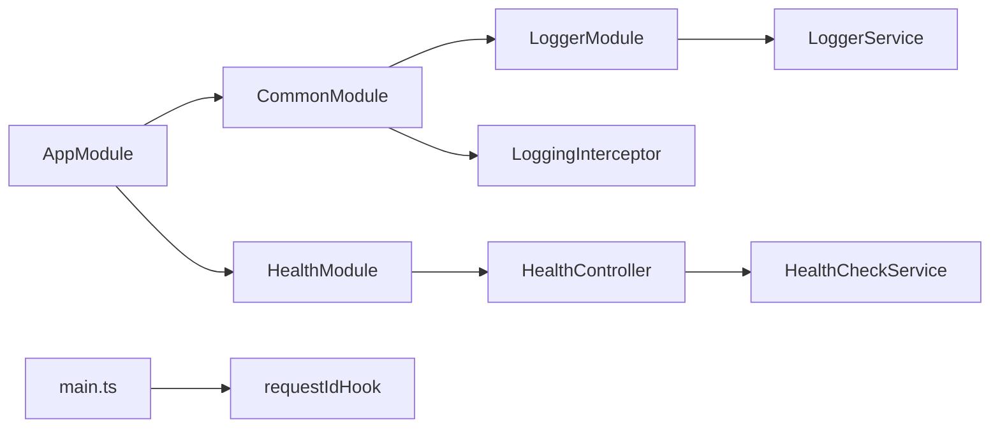

# 监控与日志

<cite>
**本文引用的文件**   
- [logger.service.ts](file://apps/api/src/logger/logger.service.ts)
- [logger.module.ts](file://apps/api/src/logger/logger.module.ts)
- [logging.interceptor.ts](file://apps/api/src/common/interceptors/logging.interceptor.ts)
- [health.controller.ts](file://apps/api/src/common/health/health.controller.ts)
- [health.module.ts](file://apps/api/src/common/health/health.module.ts)
- [common.module.ts](file://apps/api/src/common/common.module.ts)
- [app.module.ts](file://apps/api/src/app.module.ts)
- [main.ts](file://apps/api/src/main.ts)
- [request-id.hook.ts](file://apps/api/src/common/request-id.hook.ts)
- [config.interface.ts](file://apps/api/src/config/interfaces/config.interface.ts)
- [config.service.ts](file://apps/api/src/config/config.service.ts)
- [health.ts](file://libs/contracts/src/response/health.ts)
</cite>

## 目录
1. [引言](#引言)
2. [项目结构](#项目结构)
3. [核心组件](#核心组件)
4. [架构总览](#架构总览)
5. [详细组件分析](#详细组件分析)
6. [依赖关系分析](#依赖关系分析)
7. [性能与可观测性建议](#性能与可观测性建议)
8. [故障诊断指南](#故障诊断指南)
9. [结论](#结论)
10. [附录：环境变量与配置项](#附录环境变量与配置项)

## 引言
本文件面向“监控与日志”能力，覆盖应用日志收集、请求拦截器日志记录、健康检查端点、错误追踪链路，以及监控系统集成与实践建议。该 NestJS 应用通过自定义 LoggerService 接入 pino，结合 Fastify 生命周期钩子统一关联请求 ID，并通过 oRPC + Terminus 暴露轻量健康探针；全局拦截器在请求进入与返回时采集方法、URL、客户端 IP、User-Agent、响应耗时等指标，并捕获异常堆栈用于错误追踪。

## 项目结构
与监控与日志相关的代码主要分布在以下位置：
- 日志服务：apps/api/src/logger
- 请求拦截器：apps/api/src/common/interceptors
- 健康检查：apps/api/src/common/health
- 全局装配：apps/api/src/common/common.module.ts、apps/api/src/app.module.ts
- 启动入口与请求关联：apps/api/src/main.ts、apps/api/src/common/request-id.hook.ts
- 配置模型与服务：apps/api/src/config

图表来源
- [app.module.ts:33-76](file://apps/api/src/app.module.ts#L33-L76)
- [common.module.ts:10-44](file://apps/api/src/common/common.module.ts#L10-L44)
- [health.module.ts:11-15](file://apps/api/src/common/health/health.module.ts#L11-L15)
- [logger.module.ts:5-11](file://apps/api/src/logger/logger.module.ts#L5-L11)
- [main.ts:20-29](file://apps/api/src/main.ts#L20-L29)
- [request-id.hook.ts:11-16](file://apps/api/src/common/request-id.hook.ts#L11-L16)

章节来源
- [app.module.ts:33-76](file://apps/api/src/app.module.ts#L33-L76)
- [common.module.ts:10-44](file://apps/api/src/common/common.module.ts#L10-L44)
- [health.module.ts:11-15](file://apps/api/src/common/health/health.module.ts#L11-L15)
- [logger.module.ts:5-11](file://apps/api/src/logger/logger.module.ts#L5-L11)
- [main.ts:20-29](file://apps/api/src/main.ts#L20-L29)
- [request-id.hook.ts:11-16](file://apps/api/src/common/request-id.hook.ts#L11-L16)

## 核心组件
- 日志服务（LoggerService）：基于 pino，按环境切换输出目标（生产落文件、开发彩色控制台），支持结构化元数据与日志级别控制。
- 请求拦截器（LoggingInterceptor）：全局注册，记录入站请求摘要、出站响应摘要、异常信息，并采集响应耗时。
- 健康检查（HealthController + HealthModule）：基于 @nestjs/terminus 的 HealthCheckService，提供 ping-only 存活探针，经 oRPC 挂载到 /api/v1/health。
- 请求关联（requestIdHook）：Fastify onRequest 钩子，统一生成或透传 x-request-id，写入响应头并注入异步上下文。
- 全局装配：CommonModule 注册 LoggingInterceptor 与过滤器；AppModule 引入 LoggerModule、HealthModule 等。

章节来源
- [logger.service.ts:5-82](file://apps/api/src/logger/logger.service.ts#L5-L82)
- [logging.interceptor.ts:14-77](file://apps/api/src/common/interceptors/logging.interceptor.ts#L14-L77)
- [health.controller.ts:28-40](file://apps/api/src/common/health/health.controller.ts#L28-L40)
- [health.module.ts:11-15](file://apps/api/src/common/health/health.module.ts#L11-L15)
- [request-id.hook.ts:11-16](file://apps/api/src/common/request-id.hook.ts#L11-L16)
- [common.module.ts:27-34](file://apps/api/src/common/common.module.ts#L27-L34)
- [app.module.ts:48-55](file://apps/api/src/app.module.ts#L48-L55)

## 架构总览
下图展示一次 HTTP 请求从 Fastify 入口到控制器处理、再到日志与健康检查的关键路径。

图表来源
- [main.ts:90-93](file://apps/api/src/main.ts#L90-L93)
- [request-id.hook.ts:11-16](file://apps/api/src/common/request-id.hook.ts#L11-L16)
- [logging.interceptor.ts:17-66](file://apps/api/src/common/interceptors/logging.interceptor.ts#L17-L66)
- [health.controller.ts:31-39](file://apps/api/src/common/health/health.controller.ts#L31-L39)

## 详细组件分析

### 日志服务（LoggerService）
- 日志级别与环境：
  - 通过 LOG_LEVEL 设置日志级别，默认 info。
  - 通过 NODE_ENV 判断是否生产环境，决定输出目标。
- 输出目标：
  - 生产：使用 pino/file 将日志写入文件，默认 logs/app.log，可通过 LOG_FILE 指定路径。
  - 开发/测试：使用 pino-pretty 输出彩色控制台日志，便于本地调试。
- 结构化字段：
  - 支持以对象形式传入元数据，自动合并为结构化字段，便于检索与分析。
- 与 Nest 内置 Logger 的关系：
  - 继承 Nest Logger，在生产环境下保留 Nest 默认行为（stdout），避免与 pino 双写重复。

图表来源
- [logger.service.ts:5-82](file://apps/api/src/logger/logger.service.ts#L5-L82)

章节来源
- [logger.service.ts:9-53](file://apps/api/src/logger/logger.service.ts#L9-L53)
- [logger.service.ts:55-81](file://apps/api/src/logger/logger.service.ts#L55-L81)

### 请求拦截器（LoggingInterceptor）
- 记录内容：
  - 入站：method、url、ip、userAgent、requestId、body 摘要。
  - 出站：responseTimeMs、部分响应体摘要。
  - 异常：error.stack 或 JSON 序列化、statusCode、responseTimeMs。
- 关联 ID：
  - 优先读取 ALS 中的 currentRequestId()，否则回退到 request.id 或固定占位符。
- 客户端 IP：
  - 优先 x-forwarded-for，其次 connection.remoteAddress/socket.remoteAddress。

图表来源
- [logging.interceptor.ts:17-77](file://apps/api/src/common/interceptors/logging.interceptor.ts#L17-L77)

章节来源
- [logging.interceptor.ts:17-77](file://apps/api/src/common/interceptors/logging.interceptor.ts#L17-L77)

### 健康检查（HealthController + HealthModule）
- 实现方式：
  - 使用 @nestjs/terminus 的 HealthCheckService，调用 check([]) 实现 ping-only 存活探针。
  - 通过 oRPC 的 @Impl 注解挂载 router，契约定义位于 libs/contracts。
- 访问路径：
  - 最终路径为 /api/v1/health（由全局前缀 api 与版本化 v1 合成）。
- 豁免策略：
  - 类级 @Public() 豁免认证与租户墙；@SkipThrottle() 豁免限流，确保探针可用。
- 响应结构：
  - 遵循 healthCheckResultViewSchema，包含 status、info、error、details。

图表来源
- [health.controller.ts:16-39](file://apps/api/src/common/health/health.controller.ts#L16-L39)
- [health.ts:15-24](file://libs/contracts/src/response/health.ts#L15-L24)

章节来源
- [health.controller.ts:16-39](file://apps/api/src/common/health/health.controller.ts#L16-L39)
- [health.module.ts:11-15](file://apps/api/src/common/health/health.module.ts#L11-L15)
- [health.ts:15-24](file://libs/contracts/src/response/health.ts#L15-L24)

### 请求关联 ID（requestIdHook）
- 功能：
  - 若请求携带 x-request-id，则透传；否则使用 Fastify 原生 req.id。
  - 回写响应头 x-request-id，便于前端与日志对齐。
  - 使用 requestStorage.run 包裹后续全链，供拦截器与业务层读取。
- 作用域：
  - 作为 Fastify onRequest 钩子，先于所有 Nest middleware/guard/interceptor，天然覆盖 /health 等旁路路由。

章节来源
- [request-id.hook.ts:11-16](file://apps/api/src/common/request-id.hook.ts#L11-L16)
- [main.ts:90-93](file://apps/api/src/main.ts#L90-L93)

### 全局装配与拦截器注册
- CommonModule 注册：
  - APP_FILTER：HttpExceptionFilter、StandardSchemaValidationExceptionFilter。
  - APP_INTERCEPTOR：LoggingInterceptor、TransformInterceptor、StandardSchemaSerializerInterceptor。
- AppModule 引入：
  - LoggerModule、HealthModule、CommonModule 等基础模块。

章节来源
- [common.module.ts:10-44](file://apps/api/src/common/common.module.ts#L10-L44)
- [app.module.ts:48-55](file://apps/api/src/app.module.ts#L48-L55)

## 依赖关系分析
- LoggerModule 为 Global Module，导出 LoggerService，供各模块直接注入。
- CommonModule 依赖 LoggerModule，并在 APP_INTERCEPTOR 中注册 LoggingInterceptor。
- HealthModule 依赖 TerminusModule，HealthController 依赖 HealthCheckService。
- main.ts 中注册 Fastify 钩子 requestIdHook，并与 CORS 暴露 x-request-id 头配合。

图表来源
- [logger.module.ts:5-11](file://apps/api/src/logger/logger.module.ts#L5-L11)
- [common.module.ts:10-44](file://apps/api/src/common/common.module.ts#L10-L44)
- [app.module.ts:48-55](file://apps/api/src/app.module.ts#L48-L55)
- [health.module.ts:11-15](file://apps/api/src/common/health/health.module.ts#L11-L15)
- [main.ts:90-113](file://apps/api/src/main.ts#L90-L113)

章节来源
- [logger.module.ts:5-11](file://apps/api/src/logger/logger.module.ts#L5-L11)
- [common.module.ts:10-44](file://apps/api/src/common/common.module.ts#L10-L44)
- [app.module.ts:48-55](file://apps/api/src/app.module.ts#L48-L55)
- [health.module.ts:11-15](file://apps/api/src/common/health/health.module.ts#L11-L15)
- [main.ts:90-113](file://apps/api/src/main.ts#L90-L113)

## 性能与可观测性建议
- 日志级别与采样：
  - 生产环境建议使用 INFO 及以上级别，避免 DEBUG 造成 I/O 压力；在高吞吐场景下可考虑对高频接口进行采样。
- 结构化字段：
  - 保持 requestId、method、url、responseTimeMs、statusCode 等关键字段一致，便于 APM 与日志平台聚合。
- 响应体摘要：
  - 仅记录必要摘要（如前 100 字符），避免大对象导致日志膨胀。
- 健康检查：
  - 当前为 ping-only，适合 Liveness；如需 Readiness，可在 HealthCheckService 上注册数据库、缓存、外部 API 指示器。
- 指标采集：
  - 建议在拦截器中增加更多指标（如 CPU、内存、队列长度），并通过 Metrics 库（如 prom-client）暴露 /metrics 端点。
- 告警规则：
  - 基于错误率、P95/P99 延迟、健康状态变化、外部依赖失败率等维度配置告警。

[本节为通用指导，不直接分析具体文件]

## 故障诊断指南
- 无法定位请求链路：
  - 确认 Fastify onRequest 钩子已注册，且 x-request-id 已回写响应头。
  - 检查拦截器是否正确读取 ALS 中的 requestId。
- 日志缺失或重复：
  - 生产环境 LoggerService 会同时调用 Nest Logger 与 pino，注意容器 stdout 与文件输出的双重写入。
  - 开发环境使用 pino-pretty，避免与 Nest 默认日志混用。
- 健康检查异常：
  - 确认 HealthModule 已导入，HealthCheckService 可解析。
  - 若扩展健康指示器，需确保契约 schema 能容纳新增字段。
- 错误未记录堆栈：
  - 拦截器在 error 分支记录 error.stack 或 JSON 序列化，确保异常对象包含堆栈信息。

章节来源
- [main.ts:90-113](file://apps/api/src/main.ts#L90-L113)
- [logging.interceptor.ts:51-63](file://apps/api/src/common/interceptors/logging.interceptor.ts#L51-L63)
- [logger.service.ts:55-81](file://apps/api/src/logger/logger.service.ts#L55-L81)
- [health.controller.ts:31-39](file://apps/api/src/common/health/health.controller.ts#L31-L39)

## 结论
本项目通过 LoggerService 与 LoggingInterceptor 构建了统一的日志与性能采集体系，结合 Fastify 钩子实现请求关联 ID 的全链路追踪，并通过 Terminus 提供轻量健康探针。在此基础上，可进一步扩展健康指示器、指标采集与告警规则，以满足生产环境的可观测性需求。

[本节为总结性内容，不直接分析具体文件]

## 附录：环境变量与配置项
- 日志相关：
  - LOG_LEVEL：日志级别，默认 info。
  - LOG_FILE：生产环境日志文件路径，默认 logs/app.log。
  - NODE_ENV：运行环境，production 时启用文件输出。
- 应用配置（ConfigService 提供 typed 访问）：
  - app.port、app.host、app.apiPrefix
  - cors.enabled、cors.origin、cors.credentials、cors.methods
  - swagger.enabled、swagger.path、swagger.version
  - database.url
  - storage.provider、storage.bucket、storage.region、storage.endpoint、storage.accessKeyId、storage.maxFileSize、storage.allowedMimeTypes
  - stripe.secretKey、stripe.publicKey、stripe.webhookSecret、stripe.apiVersion
  - payment.provider
  - platform.operatorEmail
  - oauthSso.clients
  - oauth.providers、oauth.genericProviders、oauth.baseConfig、oauth.secrets
  - eventPublish.mode、eventPublish.pollMs
  - esTruthSource.subscriptions
  - sessionReclaim.enabled、sessionReclaim.intervalMs

章节来源
- [logger.service.ts:12-31](file://apps/api/src/logger/logger.service.ts#L12-L31)
- [config.service.ts:17-70](file://apps/api/src/config/config.service.ts#L17-L70)
- [config.interface.ts:1-147](file://apps/api/src/config/interfaces/config.interface.ts#L1-L147)