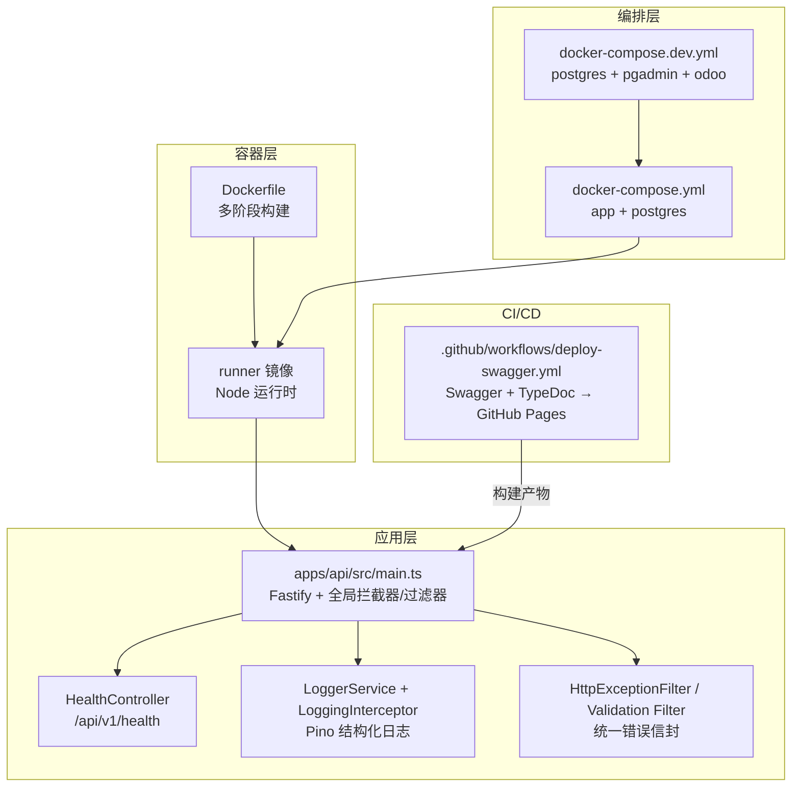
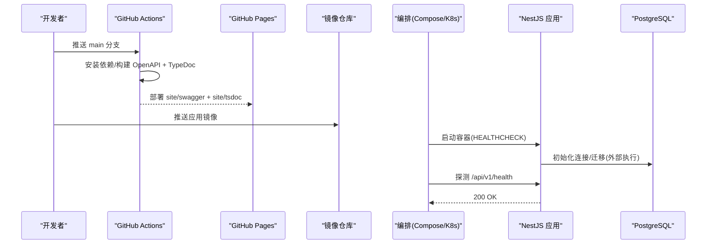
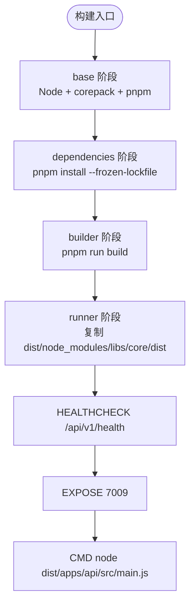
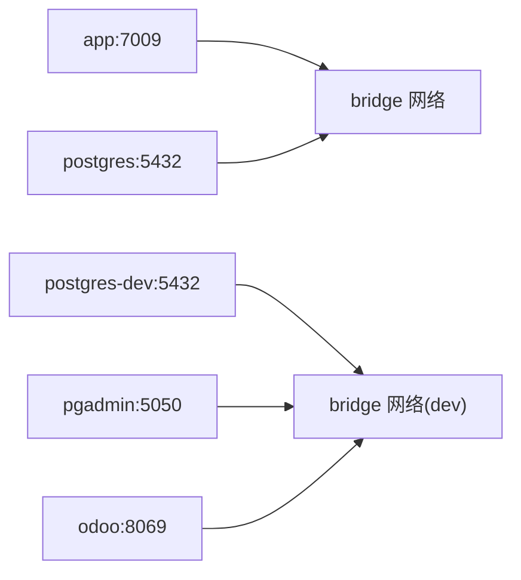
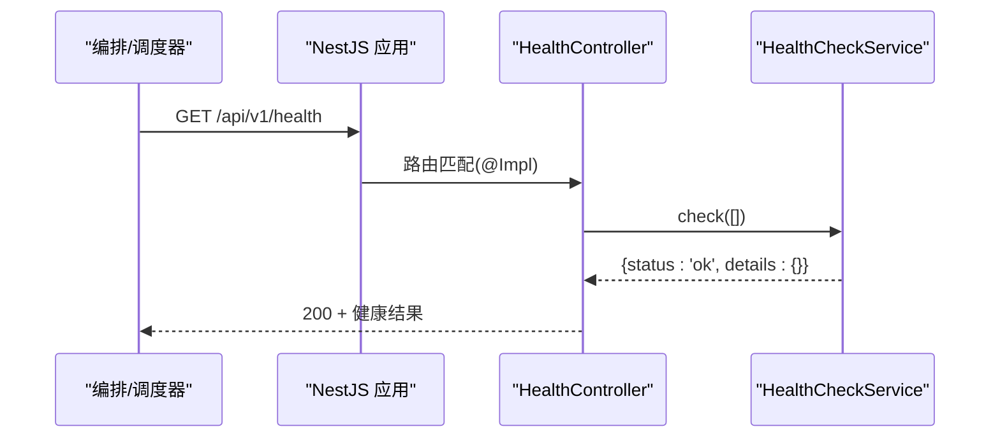
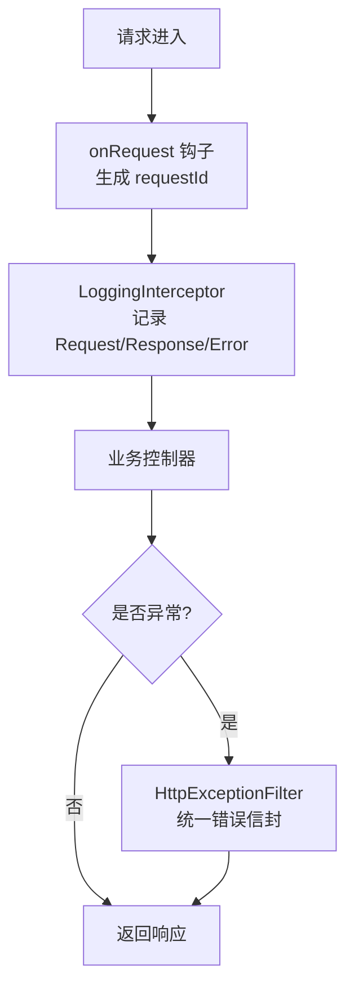
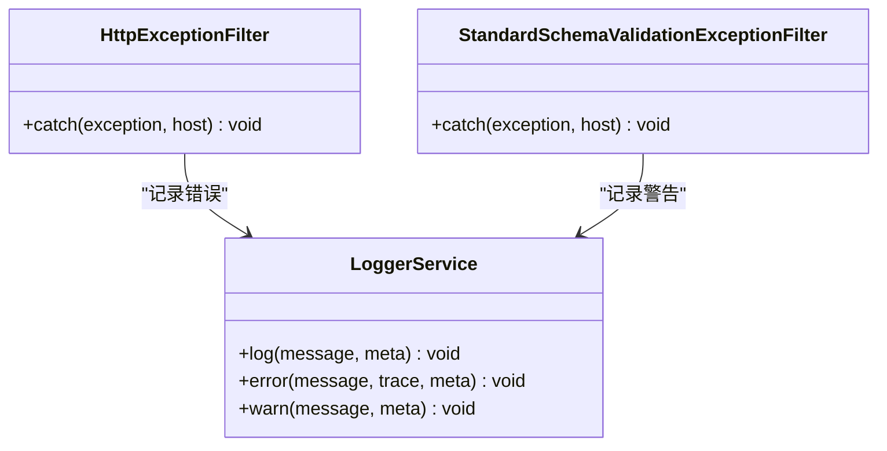
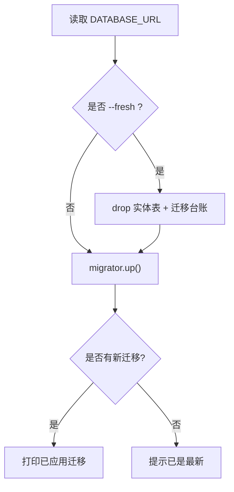
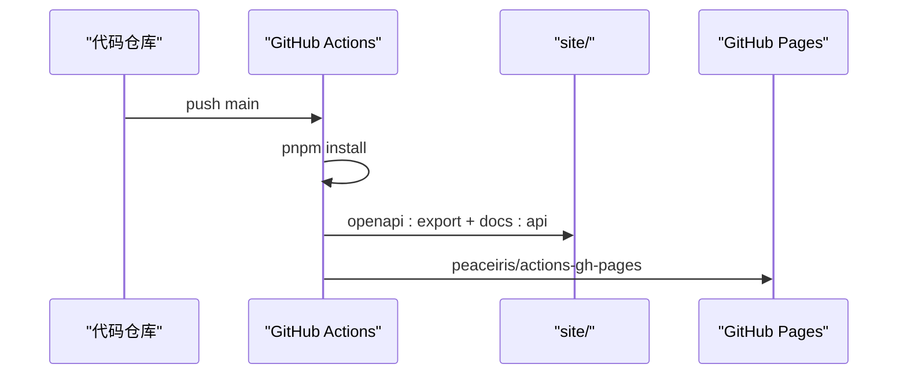
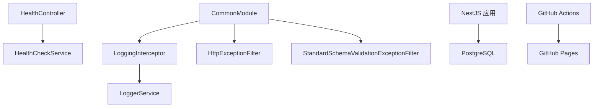

# 部署与运维

<cite>
**本文引用的文件**   
- [Dockerfile](file://Dockerfile)
- [docker-compose.yml](file://docker-compose.yml)
- [docker-compose.dev.yml](file://docker-compose.dev.yml)
- [deploy-swagger.yml](file://.github/workflows/deploy-swagger.yml)
- [main.ts](file://apps/api/src/main.ts)
- [health.controller.ts](file://apps/api/src/common/health/health.controller.ts)
- [health.module.ts](file://apps/api/src/common/health/health.module.ts)
- [health.contract.ts](file://libs/api-contract/src/health.contract.ts)
- [health.ts](file://libs/contracts/src/response/health.ts)
- [logger.service.ts](file://apps/api/src/logger/logger.service.ts)
- [logging.interceptor.ts](file://apps/api/src/common/interceptors/logging.interceptor.ts)
- [common.module.ts](file://apps/api/src/common/common.module.ts)
- [http-exception.filter.ts](file://apps/api/src/common/filters/http-exception.filter.ts)
- [standard-schema-validation.filter.ts](file://apps/api/src/common/filters/standard-schema-validation.filter.ts)
- [mikro-migrate.ts](file://scripts/mikro-migrate.ts)
- [verify-compose-contract.ts](file://scripts/verify-compose-contract.ts)
- [01-odoo-role.sql](file://docker/postgres/init/01-odoo-role.sql)
- [servers.json](file://docker/pgadmin/servers.json)
</cite>

## 目录
1. [简介](#简介)
2. [项目结构](#项目结构)
3. [核心组件](#核心组件)
4. [架构总览](#架构总览)
5. [详细组件分析](#详细组件分析)
6. [依赖关系分析](#依赖关系分析)
7. [性能考虑](#性能考虑)
8. [故障排查指南](#故障排查指南)
9. [结论](#结论)
10. [附录](#附录)

## 简介
本文件面向生产环境的容器化部署、CI/CD、监控告警、日志收集、备份恢复与安全加固，提供从镜像构建到编排上线的完整实践说明。仓库采用多阶段 Docker 构建、NestJS + Fastify、Terminus 健康检查、Pino 结构化日志、MikroORM 迁移脚本以及 GitHub Actions 文档发布流水线；同时通过 compose 契约校验脚本保障部署配置自洽。

## 项目结构
- 应用服务：`apps/api`（NestJS API），对外暴露 `/api/v1/...`，默认监听端口 `7009`。
- 运行时镜像：基于 Node slim，使用 pnpm + corepack 锁定依赖版本，产物仅包含运行所需文件。
- 编排：`docker-compose.yml` 定义生产态应用与 PostgreSQL；`docker-compose.dev.yml` 增加 pgAdmin 与 Odoo 联调栈。
- CI/CD：`.github/workflows/deploy-swagger.yml` 在 main 分支推送时生成 Swagger + TypeDoc 并部署至 GitHub Pages。
- 数据库迁移：`scripts/mikro-migrate.ts` 提供增量与重建模式。
- 部署契约校验：`scripts/verify-compose-contract.ts` 静态校验 compose 与 Dockerfile 的一致性。

**图示来源** 
- [Dockerfile:1-65](file://Dockerfile#L1-L65)
- [docker-compose.yml:1-83](file://docker-compose.yml#L1-L83)
- [docker-compose.dev.yml:1-98](file://docker-compose.dev.yml#L1-L98)
- [deploy-swagger.yml:1-204](file://.github/workflows/deploy-swagger.yml#L1-L204)
- [main.ts:80-92](file://apps/api/src/main.ts#L80-L92)
- [health.controller.ts:1-41](file://apps/api/src/common/health/health.controller.ts#L1-L41)
- [logger.service.ts:1-83](file://apps/api/src/logger/logger.service.ts#L1-L83)
- [logging.interceptor.ts:1-78](file://apps/api/src/common/interceptors/logging.interceptor.ts#L1-L78)
- [http-exception.filter.ts:1-97](file://apps/api/src/common/filters/http-exception.filter.ts#L1-L97)

**章节来源**
- [Dockerfile:1-65](file://Dockerfile#L1-L65)
- [docker-compose.yml:1-83](file://docker-compose.yml#L1-L83)
- [docker-compose.dev.yml:1-98](file://docker-compose.dev.yml#L1-L98)
- [deploy-swagger.yml:1-204](file://.github/workflows/deploy-swagger.yml#L1-L204)

## 核心组件
- 镜像构建与运行
  - 基础镜像：Node slim，启用 corepack 以 packageManager 字段锁定 pnpm 版本。
  - 依赖安装层：缓存 pnpm store，isolated workspace 清单参与安装。
  - 构建层：先编译 libs/core，再编译 apps/api。
  - 运行层：仅复制 node_modules/dist/libs/core/dist 及必要 package.json/workspace 文件；不保留迁移工具链。
  - 健康检查：使用内置 node fetch 探测 `/api/v1/health`。
  - 监听地址：默认 HOST=0.0.0.0，避免容器内回环不可达。
- 编排与依赖
  - app 服务：端口 7009，挂载 .env 与日志卷，依赖 healthy 的 postgres。
  - postgres 服务：Alpine 镜像，数据持久化，自带 healthcheck。
  - 开发栈：pgAdmin UI 与 Odoo 20 CE 共享同一 PG 实例。
- 健康探针
  - HealthController 通过 oRPC 挂载 `/api/v1/health`，ping-only，豁免限流与会话墙。
  - 契约与响应体 schema 单源定义，确保文档与运行时一致。
- 日志与错误
  - LoggerService：生产落文件（pino/file），开发彩色控制台。
  - LoggingInterceptor：记录请求/响应时间、客户端 IP、User-Agent、requestId。
  - HttpExceptionFilter：统一错误信封，透传 errorCode/errors，5xx 记录堆栈。
  - StandardSchemaValidationExceptionFilter：将标准 schema 校验失败渲染为统一错误格式。
- 数据库迁移
  - mikro-migrate.ts：支持 up 与 --fresh 重建，连接 DATABASE_URL 执行未应用迁移。
- CI/CD
  - deploy-swagger.yml：构建 OpenAPI + TypeDoc，生成 site 并部署到 GitHub Pages。

**章节来源**
- [Dockerfile:1-65](file://Dockerfile#L1-L65)
- [docker-compose.yml:1-83](file://docker-compose.yml#L1-L83)
- [docker-compose.dev.yml:1-98](file://docker-compose.dev.yml#L1-L98)
- [health.controller.ts:1-41](file://apps/api/src/common/health/health.controller.ts#L1-L41)
- [health.module.ts:1-15](file://apps/api/src/common/health/health.module.ts#L1-L15)
- [health.contract.ts:1-19](file://libs/api-contract/src/health.contract.ts#L1-L19)
- [health.ts:1-24](file://libs/contracts/src/response/health.ts#L1-L24)
- [logger.service.ts:1-83](file://apps/api/src/logger/logger.service.ts#L1-L83)
- [logging.interceptor.ts:1-78](file://apps/api/src/common/interceptors/logging.interceptor.ts#L1-L78)
- [http-exception.filter.ts:1-97](file://apps/api/src/common/filters/http-exception.filter.ts#L1-L97)
- [standard-schema-validation.filter.ts:1-27](file://apps/api/src/common/filters/standard-schema-validation.filter.ts#L1-L27)
- [mikro-migrate.ts:1-50](file://scripts/mikro-migrate.ts#L1-L50)
- [deploy-swagger.yml:1-204](file://.github/workflows/deploy-swagger.yml#L1-L204)

## 架构总览
下图展示从 CI 到容器运行的关键路径：代码变更触发文档站点构建；应用镜像通过多阶段构建产出；编排启动 app 与 postgres；应用内部通过 Terminus 暴露健康端点，Pino 输出结构化日志，统一过滤器处理错误。

**图示来源** 
- [deploy-swagger.yml:70-204](file://.github/workflows/deploy-swagger.yml#L70-L204)
- [Dockerfile:55-64](file://Dockerfile#L55-L64)
- [docker-compose.yml:41-51](file://docker-compose.yml#L41-L51)
- [health.controller.ts:21-40](file://apps/api/src/common/health/health.controller.ts#L21-L40)

## 详细组件分析

### 容器镜像与多阶段构建
- 阶段划分
  - base：设置 Node 镜像、corepack、pnpm 环境变量与 registry。
  - dependencies：拷贝清单并安装依赖，缓存 pnpm store。
  - builder：编译 libs/core 与 apps/api。
  - runner：仅复制运行所需文件，暴露 7009，定义 HEALTHCHECK。
- 优化要点
  - 利用清单分层缓存依赖安装。
  - 运行镜像剔除构建期工具链，减小体积。
  - 使用内置 node fetch 做健康检查，避免 slim 镜像缺 curl/wget。
  - 默认 HOST=0.0.0.0，保证容器端口可被代理转发。

**图示来源** 
- [Dockerfile:1-65](file://Dockerfile#L1-L65)

**章节来源**
- [Dockerfile:1-65](file://Dockerfile#L1-L65)

### 编排与依赖管理
- 生产编排
  - app：端口映射、环境变量注入、依赖 healthy 的 postgres、挂载 .env 与日志卷。
  - postgres：Alpine 镜像、数据卷持久化、healthcheck 使用 pg_isready。
- 开发编排
  - postgres-dev：同实例供 SaaS 与 Odoo 共用。
  - pgadmin：自动注册 postgres 服务。
  - odoo：首次建库耗时，healthcheck 使用 python3 socket 探测。
- 安全与合规
  - strict 模式下需显式放行 DB 主机或命中内置白名单。
  - DATA_RESIDENCY_ENFORCE=true 由编排钉死，防止 .env 静默降级。

**图示来源** 
- [docker-compose.yml:41-83](file://docker-compose.yml#L41-L83)
- [docker-compose.dev.yml:13-98](file://docker-compose.dev.yml#L13-L98)

**章节来源**
- [docker-compose.yml:1-83](file://docker-compose.yml#L1-L83)
- [docker-compose.dev.yml:1-98](file://docker-compose.dev.yml#L1-L98)

### 健康检查与就绪性
- 端点：GET `/api/v1/health`（经 Nest 全局前缀 api + URI 版本化 v1）。
- 实现：HealthController 使用 Terminus 的 HealthCheckService，ping-only。
- 契约：healthProcedureContract 与 healthCheckResultViewSchema 作为文档与运行时双重约束。
- 探针：Dockerfile HEALTHCHECK 使用 node fetch 访问 127.0.0.1:7009。

**图示来源** 
- [health.controller.ts:21-40](file://apps/api/src/common/health/health.controller.ts#L21-L40)
- [health.module.ts:11-15](file://apps/api/src/common/health/health.module.ts#L11-L15)
- [health.contract.ts:13-19](file://libs/api-contract/src/health.contract.ts#L13-L19)
- [health.ts:15-24](file://libs/contracts/src/response/health.ts#L15-L24)
- [Dockerfile:55-58](file://Dockerfile#L55-L58)

**章节来源**
- [health.controller.ts:1-41](file://apps/api/src/common/health/health.controller.ts#L1-L41)
- [health.module.ts:1-15](file://apps/api/src/common/health/health.module.ts#L1-L15)
- [health.contract.ts:1-19](file://libs/api-contract/src/health.contract.ts#L1-L19)
- [health.ts:1-24](file://libs/contracts/src/response/health.ts#L1-L24)
- [Dockerfile:55-58](file://Dockerfile#L55-L58)

### 日志收集与关联追踪
- LoggerService
  - 生产：pino/file 写入 LOG_FILE 或 logs/app.log。
  - 开发：pino-pretty 彩色控制台。
- LoggingInterceptor
  - 记录 requestId（ALS 优先，回退 Fastify req.id）、method/url/ip/userAgent/responseTimeMs。
  - 错误路径记录 statusCode 与堆栈摘要。
- 全局装配
  - CommonModule 注册 LoggingInterceptor、TransformInterceptor、StandardSchemaSerializerInterceptor、HttpExceptionFilter、StandardSchemaValidationExceptionFilter。

**图示来源** 
- [main.ts:85-92](file://apps/api/src/main.ts#L85-L92)
- [logging.interceptor.ts:17-77](file://apps/api/src/common/interceptors/logging.interceptor.ts#L17-L77)
- [logger.service.ts:12-52](file://apps/api/src/logger/logger.service.ts#L12-L52)
- [common.module.ts:10-47](file://apps/api/src/common/common.module.ts#L10-L47)
- [http-exception.filter.ts:22-95](file://apps/api/src/common/filters/http-exception.filter.ts#L22-L95)

**章节来源**
- [logger.service.ts:1-83](file://apps/api/src/logger/logger.service.ts#L1-L83)
- [logging.interceptor.ts:1-78](file://apps/api/src/common/interceptors/logging.interceptor.ts#L1-L78)
- [common.module.ts:1-47](file://apps/api/src/common/common.module.ts#L1-L47)
- [http-exception.filter.ts:1-97](file://apps/api/src/common/filters/http-exception.filter.ts#L1-L97)

### 错误处理与统一信封
- HttpExceptionFilter
  - 根据 HTTP 状态推导 error 短名，透传 errorCode/errors。
  - 非 HttpException 的任意 Error 不泄露 message，仅记录堆栈。
- StandardSchemaValidationExceptionFilter
  - 将标准 schema 校验失败渲染为统一 ErrorResponse（message 可为译文数组，errors[] 明细）。
- 契约一致性
  - contracts 中定义 ApiResponse/ErrorResponse 等类型，测试断言实跑产物与契约形一致。

**图示来源** 
- [http-exception.filter.ts:22-95](file://apps/api/src/common/filters/http-exception.filter.ts#L22-L95)
- [standard-schema-validation.filter.ts:22-27](file://apps/api/src/common/filters/standard-schema-validation.filter.ts#L22-L27)
- [logger.service.ts:55-81](file://apps/api/src/logger/logger.service.ts#L55-L81)

**章节来源**
- [http-exception.filter.ts:1-97](file://apps/api/src/common/filters/http-exception.filter.ts#L1-L97)
- [standard-schema-validation.filter.ts:1-27](file://apps/api/src/common/filters/standard-schema-validation.filter.ts#L1-L27)

### 数据库迁移与数据初始化
- 迁移脚本
  - mikro-migrate.ts：读取 DATABASE_URL，执行 migrator.up()；--fresh 模式删除实体表与迁移台账后重放。
- 开发环境初始化
  - docker/postgres/init/01-odoo-role.sql：首次 initdb 创建 odoo 角色（LOGIN+CREATEDB），供 Odoo 20 使用。
- 部署建议
  - 生产环境在 CI 或运维机执行迁移，不在容器内保留 TS 源与迁移工具链。

**图示来源** 
- [mikro-migrate.ts:19-49](file://scripts/mikro-migrate.ts#L19-L49)
- [01-odoo-role.sql:1-14](file://docker/postgres/init/01-odoo-role.sql#L1-L14)

**章节来源**
- [mikro-migrate.ts:1-50](file://scripts/mikro-migrate.ts#L1-L50)
- [01-odoo-role.sql:1-14](file://docker/postgres/init/01-odoo-role.sql#L1-L14)

### CI/CD 与文档发布
- 触发条件：main 分支推送或手动触发。
- 步骤：
  - 安装依赖（pnpm）。
  - 导出 OpenAPI（openapi:export）并生成 Swagger UI 页面。
  - 生成 TypeDoc 公共 API 参考。
  - 合并 landing 页并部署到 GitHub Pages。

**图示来源** 
- [deploy-swagger.yml:1-204](file://.github/workflows/deploy-swagger.yml#L1-L204)

**章节来源**
- [deploy-swagger.yml:1-204](file://.github/workflows/deploy-swagger.yml#L1-L204)

## 依赖关系分析
- 组件耦合
  - HealthController 依赖 Terminus HealthCheckService，并通过 oRPC 挂载。
  - LoggingInterceptor 依赖 LoggerService，读取 ALS 中的 requestId。
  - CommonModule 集中注册全局拦截器与过滤器。
- 外部依赖
  - PostgreSQL：数据持久化。
  - GitHub Pages：文档站点托管。
  - pnpm/corepack：依赖管理与版本锁定。

**图示来源** 
- [health.controller.ts:1-41](file://apps/api/src/common/health/health.controller.ts#L1-L41)
- [logging.interceptor.ts:1-78](file://apps/api/src/common/interceptors/logging.interceptor.ts#L1-L78)
- [common.module.ts:1-47](file://apps/api/src/common/common.module.ts#L1-L47)
- [docker-compose.yml:53-72](file://docker-compose.yml#L53-L72)
- [deploy-swagger.yml:195-204](file://.github/workflows/deploy-swagger.yml#L195-L204)

**章节来源**
- [health.controller.ts:1-41](file://apps/api/src/common/health/health.controller.ts#L1-L41)
- [logging.interceptor.ts:1-78](file://apps/api/src/common/interceptors/logging.interceptor.ts#L1-L78)
- [common.module.ts:1-47](file://apps/api/src/common/common.module.ts#L1-L47)
- [docker-compose.yml:53-72](file://docker-compose.yml#L53-L72)
- [deploy-swagger.yml:195-204](file://.github/workflows/deploy-swagger.yml#L195-L204)

## 性能考虑
- 镜像体积与启动速度
  - 多阶段构建减少运行镜像体积；仅复制 dist 与必要 workspace 文件。
  - 使用 Node slim 与内置 fetch 健康检查，避免额外系统包。
- 依赖安装
  - 冻结锁文件与 pnpm store 缓存提升构建稳定性与速度。
- 运行时
  - Pino 在生产落文件，避免频繁 IO 抖动；可通过 LOG_LEVEL 控制级别。
  - 全局拦截器与过滤器仅在请求链路生效，开销可控。
- 数据库
  - 使用 pg_isready 快速判定数据库就绪；生产建议使用托管数据库与连接池。

[本节为通用指导，不直接分析具体文件]

## 故障排查指南
- 容器无法访问
  - 确认 HOST 是否为 0.0.0.0（镜像默认值），避免只绑定回环。
  - 检查端口映射与反向代理转发。
- 健康检查失败
  - 验证 /api/v1/health 可达且返回 200；确认 Terminus 模块已导入。
- 日志缺失或重复
  - 生产环境 LoggerService 会同时调用 super.log 与 pino；确认 LOG_FILE 路径与权限。
  - 开发环境使用 pino-pretty，避免双打。
- 错误响应不一致
  - 检查 HttpExceptionFilter 与 StandardSchemaValidationExceptionFilter 注册顺序。
  - 确认 contracts 中的 ErrorResponse 与实跑产物一致。
- 数据库连接失败
  - 检查 DATABASE_URL 与 DATA_RESIDENCY_DB_HOST_ALLOWLIST；strict 模式下必须放行或命中白名单。
  - 使用 verify-compose-contract.ts 校验 compose 与 Dockerfile 一致性。
- 迁移失败
  - 使用 mikro-migrate.ts 查看已应用迁移；--fresh 仅用于开发重建，勿指向生产库。

**章节来源**
- [Dockerfile:33-40](file://Dockerfile#L33-L40)
- [Dockerfile:55-58](file://Dockerfile#L55-L58)
- [logger.service.ts:12-52](file://apps/api/src/logger/logger.service.ts#L12-L52)
- [http-exception.filter.ts:22-95](file://apps/api/src/common/filters/http-exception.filter.ts#L22-L95)
- [docker-compose.yml:12-26](file://docker-compose.yml#L12-L26)
- [verify-compose-contract.ts:98-138](file://scripts/verify-compose-contract.ts#L98-L138)
- [mikro-migrate.ts:25-49](file://scripts/mikro-migrate.ts#L25-L49)

## 结论
本项目提供了完整的容器化与编排方案：多阶段构建优化镜像体积，compose 明确依赖与健康检查，应用侧具备健壮的健康探针、结构化日志与统一错误信封；CI 自动生成并托管 API 文档；迁移脚本与 compose 契约校验保障部署一致性。生产部署应遵循严格的数据驻留策略、最小权限原则与外部化密钥管理，并结合平台级负载均衡、滚动更新与备份恢复策略落地。

[本节为总结性内容，不直接分析具体文件]

## 附录
- 常用命令
  - 构建与运行：docker compose up -d
  - 查看健康：curl http://localhost:7009/api/v1/health
  - 查看日志：docker compose logs -f app
  - 执行迁移：npx tsx scripts/mikro-migrate.ts [--fresh]
- 环境变量要点
  - NODE_ENV=production
  - PORT=7009
  - DATABASE_URL
  - DATA_RESIDENCY_DB_HOST_ALLOWLIST
  - DATA_RESIDENCY_ENFORCE=true
  - STORAGE_*（按存储提供商配置）
  - JWT_SECRET/JWT_REFRESH_SECRET/ALLOWED_ORIGINS
- 开发工具
  - pgAdmin：http://localhost:5050（dev compose）
  - Swagger UI：CI 生成的 site/swagger
  - TypeDoc：CI 生成的 site/tsdoc

**章节来源**
- [docker-compose.yml:12-51](file://docker-compose.yml#L12-L51)
- [docker-compose.dev.yml:36-55](file://docker-compose.dev.yml#L36-L55)
- [deploy-swagger.yml:87-204](file://.github/workflows/deploy-swagger.yml#L87-L204)
- [mikro-migrate.ts:1-50](file://scripts/mikro-migrate.ts#L1-L50)