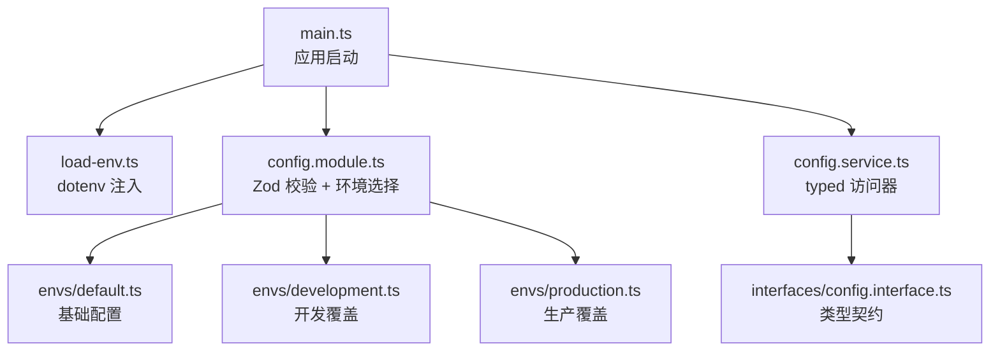
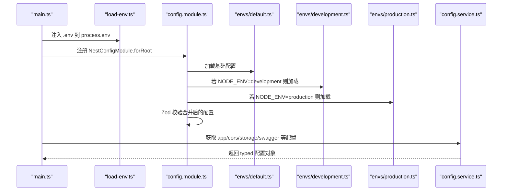
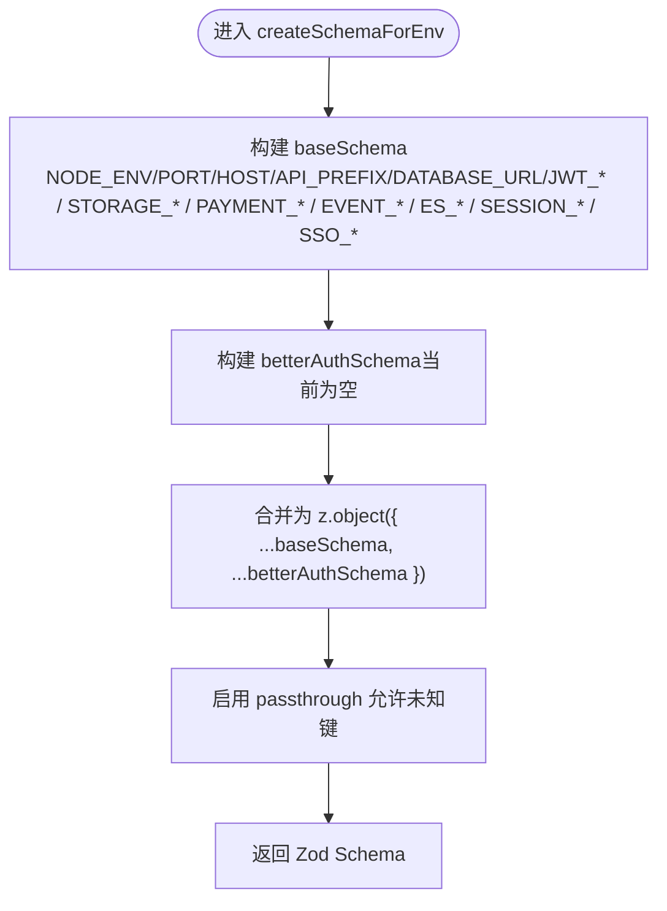
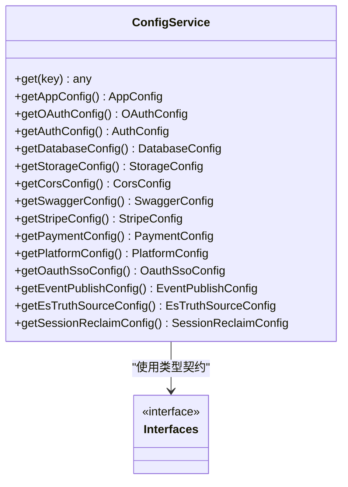
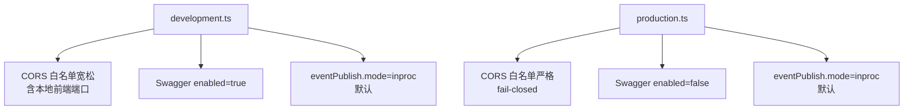
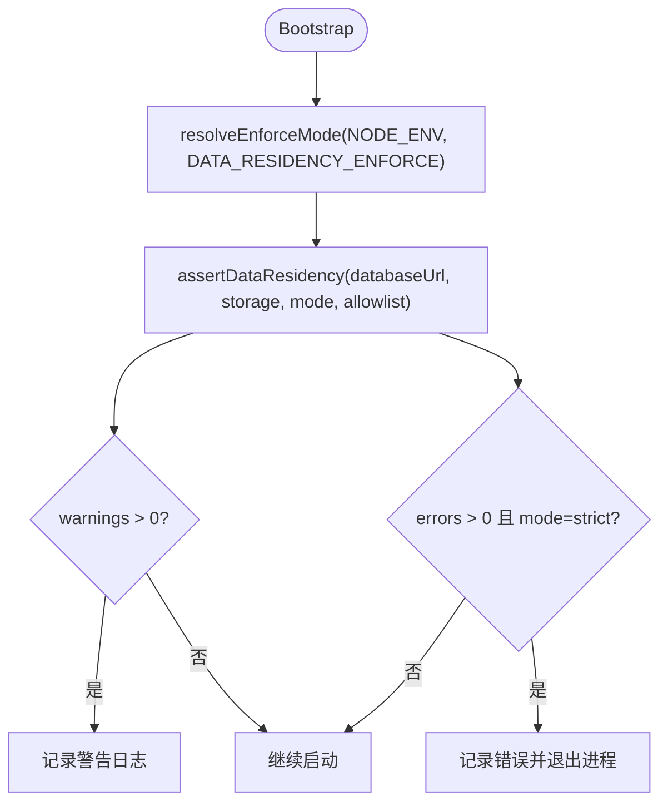
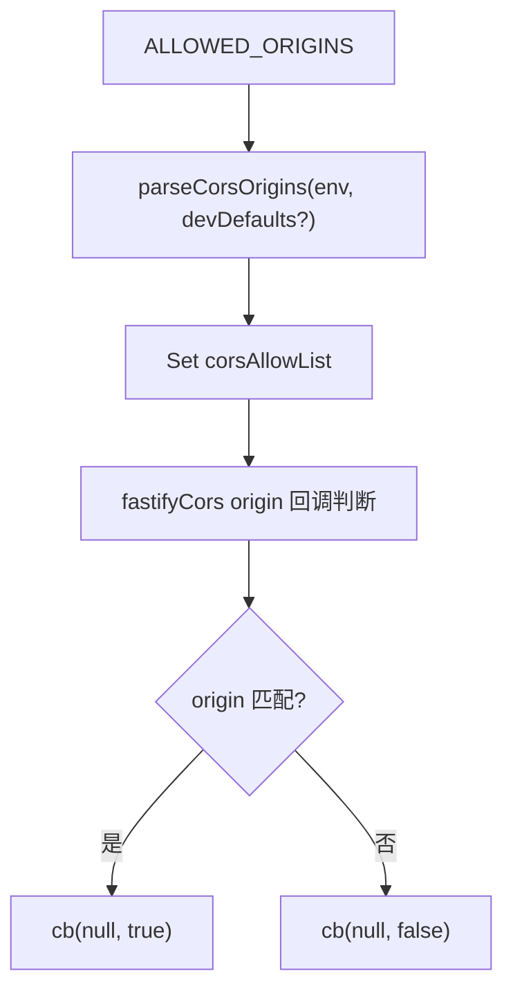
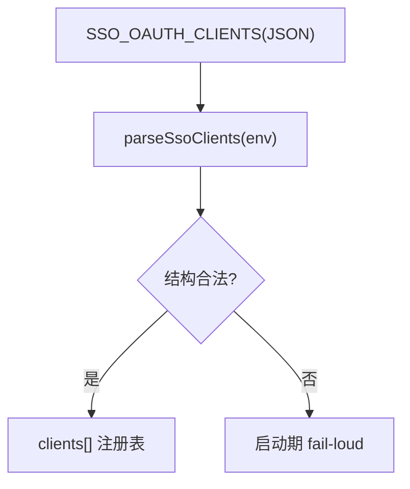
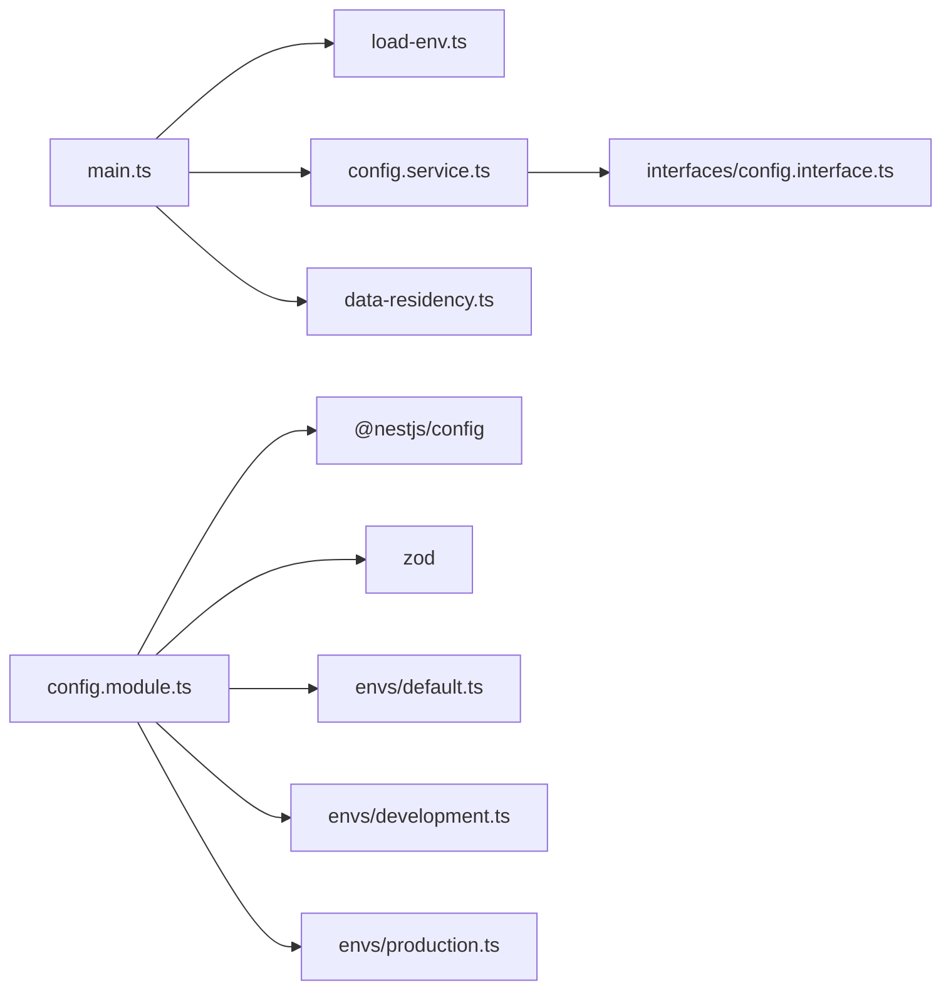

# 配置管理

<cite>
**本文引用的文件**   
- [apps/api/src/config/config.module.ts](file://apps/api/src/config/config.module.ts)
- [apps/api/src/config/config.service.ts](file://apps/api/src/config/config.service.ts)
- [apps/api/src/config/interfaces/config.interface.ts](file://apps/api/src/config/interfaces/config.interface.ts)
- [apps/api/src/config/envs/default.ts](file://apps/api/src/config/envs/default.ts)
- [apps/api/src/config/envs/development.ts](file://apps/api/src/config/envs/development.ts)
- [apps/api/src/config/envs/production.ts](file://apps/api/src/config/envs/production.ts)
- [apps/api/src/load-env.ts](file://apps/api/src/load-env.ts)
- [apps/api/src/main.ts](file://apps/api/src/main.ts)
</cite>

## 目录
1. [引言](#引言)
2. [项目结构](#项目结构)
3. [核心组件](#核心组件)
4. [架构总览](#架构总览)
5. [详细组件分析](#详细组件分析)
6. [依赖关系分析](#依赖关系分析)
7. [性能与启动特性](#性能与启动特性)
8. [安全与敏感信息管理](#安全与敏感信息管理)
9. [环境变量清单与示例](#环境变量清单与示例)
10. [动态配置与热重载](#动态配置与热重载)
11. [最佳实践与安全建议](#最佳实践与安全建议)
12. [故障排除指南](#故障排除指南)
13. [结论](#结论)

## 引言
本文件面向 SaaS 后端应用的配置管理体系，围绕以下目标展开：
- 环境变量加载、分层合并与运行时校验。
- 不同环境（development、production）的配置差异与管理方式。
- 敏感信息的安全处理、默认值策略与配置契约。
- 数据驻留检查、CORS 白名单解析、SSO 客户端注册等高级配置能力。
- 动态配置更新与热重载的可行性评估。
- 配置最佳实践、安全建议与常见问题排查方法。

该项目的配置体系基于 NestJS 的 @nestjs/config，结合 Zod 进行强类型校验，并通过 envs 层按环境提供差异化默认值。

## 项目结构
配置相关代码集中在 apps/api/src/config 目录下，采用“模块 + 服务 + 接口 + 环境配置”的分层组织：
- config.module.ts：注册全局配置模块、定义 Zod 校验 Schema、选择环境配置。
- config.service.ts：对外暴露 typed getter，统一访问配置。
- interfaces/config.interface.ts：配置对象的 TypeScript 类型契约。
- envs/default.ts：全环境共享的基础配置与默认值。
- envs/development.ts：开发环境覆盖项。
- envs/production.ts：生产环境覆盖项。
- load-env.ts：确保 .env 在模块求值前注入。
- main.ts：应用启动入口，读取配置并执行数据驻留检查、CORS 设置、Swagger 启用等。

**图表来源**
- [apps/api/src/main.ts:1-167](file://apps/api/src/main.ts#L1-L167)
- [apps/api/src/load-env.ts:1-10](file://apps/api/src/load-env.ts#L1-L10)
- [apps/api/src/config/config.module.ts:1-111](file://apps/api/src/config/config.module.ts#L1-L111)
- [apps/api/src/config/envs/default.ts:1-143](file://apps/api/src/config/envs/default.ts#L1-L143)
- [apps/api/src/config/envs/development.ts:1-75](file://apps/api/src/config/envs/development.ts#L1-L75)
- [apps/api/src/config/envs/production.ts:1-68](file://apps/api/src/config/envs/production.ts#L1-L68)
- [apps/api/src/config/config.service.ts:1-72](file://apps/api/src/config/config.service.ts#L1-L72)
- [apps/api/src/config/interfaces/config.interface.ts:1-147](file://apps/api/src/config/interfaces/config.interface.ts#L1-L147)

**章节来源**
- [apps/api/src/config/config.module.ts:1-111](file://apps/api/src/config/config.module.ts#L1-L111)
- [apps/api/src/config/config.service.ts:1-72](file://apps/api/src/config/config.service.ts#L1-L72)
- [apps/api/src/config/interfaces/config.interface.ts:1-147](file://apps/api/src/config/interfaces/config.interface.ts#L1-L147)
- [apps/api/src/config/envs/default.ts:1-143](file://apps/api/src/config/envs/default.ts#L1-L143)
- [apps/api/src/config/envs/development.ts:1-75](file://apps/api/src/config/envs/development.ts#L1-L75)
- [apps/api/src/config/envs/production.ts:1-68](file://apps/api/src/config/envs/production.ts#L1-L68)
- [apps/api/src/load-env.ts:1-10](file://apps/api/src/load-env.ts#L1-L10)
- [apps/api/src/main.ts:1-167](file://apps/api/src/main.ts#L1-L167)

## 核心组件
- 配置模块（ConfigModule）
  - 使用 NestConfigModule.forRoot 注册全局配置。
  - 通过 createSchemaForEnv 生成 Zod 校验 Schema，强制 NODE_ENV、PORT、HOST、API_PREFIX、数据库连接、JWT 密钥、存储凭证、支付通道、事件发布模式、ES 真相源开关、限流信任代理、会话回收开关等必填或可选字段。
  - 根据 process.env.NODE_ENV 选择 development 或 production 配置；默认加载 default 配置。
- 配置服务（ConfigService）
  - 封装 NestConfigService，提供 typed getter（如 getAppConfig、getDatabaseConfig、getCorsConfig、getStorageConfig、getStripeConfig、getPaymentConfig、getPlatformConfig、getOauthSsoConfig、getEventPublishConfig、getEsTruthSourceConfig、getSessionReclaimConfig）。
  - get 方法对 undefined 键抛出错误，避免静默失败。
- 配置接口（interfaces/config.interface.ts）
  - 定义 AppConfig、AuthConfig、CorsConfig、SwaggerConfig、DatabaseConfig、StorageConfig、StripeConfig、PaymentConfig、OAuthConfig、PlatformConfig、OauthSsoConfig、EventPublishConfig、EsTruthSourceConfig、SessionReclaimConfig 等类型。
- 环境配置（envs/*.ts）
  - default.ts：提供所有域的基础配置与默认值，包括 app、database、auth、cors、swagger、storage、stripe、payment、eventPublish、esTruthSource、sessionReclaim、platform、oauthSso、oauth。
  - development.ts：放宽 CORS 白名单（包含本地前端端口），保留其他默认行为。
  - production.ts：关闭 Swagger，严格 CORS 白名单（fail-closed），保持 eventPublish 默认 inproc。

**章节来源**
- [apps/api/src/config/config.module.ts:14-102](file://apps/api/src/config/config.module.ts#L14-L102)
- [apps/api/src/config/config.service.ts:5-71](file://apps/api/src/config/config.service.ts#L5-L71)
- [apps/api/src/config/interfaces/config.interface.ts:1-147](file://apps/api/src/config/interfaces/config.interface.ts#L1-L147)
- [apps/api/src/config/envs/default.ts:4-142](file://apps/api/src/config/envs/default.ts#L4-L142)
- [apps/api/src/config/envs/development.ts:3-74](file://apps/api/src/config/envs/development.ts#L3-L74)
- [apps/api/src/config/envs/production.ts:3-67](file://apps/api/src/config/envs/production.ts#L3-L67)

## 架构总览
配置加载与校验流程如下：
1. 应用入口 main.ts 首先 import load-env.ts，确保 dotenv 先于任何模块求值执行，将 .env 注入到 process.env。
2. NestFactory 创建应用时，ConfigModule 被导入，NestConfigModule.forRoot 加载配置：
   - 顺序加载 default 配置与环境特定配置（development 或 production）。
   - 使用 Zod Schema 对最终合并后的配置进行强类型校验。
3. ConfigService 提供 typed getter，供业务模块消费。
4. main.ts 在启动阶段读取配置，执行数据驻留检查、CORS 设置、Swagger 启用、文件上传限制等。

**图表来源**
- [apps/api/src/main.ts:1-167](file://apps/api/src/main.ts#L1-L167)
- [apps/api/src/load-env.ts:1-10](file://apps/api/src/load-env.ts#L1-L10)
- [apps/api/src/config/config.module.ts:94-102](file://apps/api/src/config/config.module.ts#L94-L102)
- [apps/api/src/config/envs/default.ts:1-143](file://apps/api/src/config/envs/default.ts#L1-L143)
- [apps/api/src/config/envs/development.ts:1-75](file://apps/api/src/config/envs/development.ts#L1-L75)
- [apps/api/src/config/envs/production.ts:1-68](file://apps/api/src/config/envs/production.ts#L1-L68)
- [apps/api/src/config/config.service.ts:1-72](file://apps/api/src/config/config.service.ts#L1-L72)

## 详细组件分析

### 配置模块与 Zod 校验
- 职责
  - 定义 createSchemaForEnv，产出 Zod 对象 Schema，包含所有必需与可选的环境变量键。
  - 通过 NestConfigModule.forRoot 的 validationSchema 启用强类型校验。
  - 根据 NODE_ENV 选择 development 或 production 配置，始终加载 default 配置作为基线。
- 关键设计点
  - 使用 z.enum 限定枚举值（如 NODE_ENV、STORAGE_PROVIDER、PAYMENT_PROVIDER、EVENT_PUBLISH_MODE、ES_TRUTH_SOURCE_SUBSCRIPTIONS）。
  - 使用 z.coerce.number 将字符串环境变量转换为数字（如 PORT、STORAGE_MAX_FILE_SIZE）。
  - 使用 z.url() 与 refine 校验 DATABASE_URL scheme。
  - 使用 passthrough 允许未声明的 env 透传，便于扩展。
  - 保留 baseSchema/betterAuthSchema 结构以支持静态契约门禁。

**图表来源**
- [apps/api/src/config/config.module.ts:14-92](file://apps/api/src/config/config.module.ts#L14-L92)

**章节来源**
- [apps/api/src/config/config.module.ts:14-102](file://apps/api/src/config/config.module.ts#L14-L102)

### 配置服务与类型契约
- 职责
  - 封装 NestConfigService，提供 typed getter，避免业务代码直接操作原始配置对象。
  - 对缺失键抛出明确错误，提升可观测性。
- 类型契约
  - 通过 interfaces/config.interface.ts 定义各域配置类型，保证编译期类型安全。
  - 涵盖 app、auth、cors、swagger、database、storage、stripe、payment、platform、oauthSso、oauth、eventPublish、esTruthSource、sessionReclaim。

**图表来源**
- [apps/api/src/config/config.service.ts:5-71](file://apps/api/src/config/config.service.ts#L5-L71)
- [apps/api/src/config/interfaces/config.interface.ts:1-147](file://apps/api/src/config/interfaces/config.interface.ts#L1-L147)

**章节来源**
- [apps/api/src/config/config.service.ts:1-72](file://apps/api/src/config/config.service.ts#L1-L72)
- [apps/api/src/config/interfaces/config.interface.ts:1-147](file://apps/api/src/config/interfaces/config.interface.ts#L1-L147)

### 环境配置差异（development vs production）
- 共同点
  - 均继承 default.ts 的基础配置。
  - 均从 process.env 读取对应键，未设置时使用默认值。
- 差异点
  - CORS 白名单：
    - development：默认包含本地前端端口（5173、5174）与 API 端口（7009），便于本地联调。
    - production：fail-closed，未显式配置 ALLOWED_ORIGINS 即拒绝所有跨源请求。
  - Swagger：
    - development：enabled=true。
    - production：enabled=false。
  - 事件发布模式：
    - 两者均默认 inproc；如需 shadow/outbox 需显式置位并满足迁移要求。
  - 其他域（app、database、auth、storage、stripe、payment）保持一致，由 env 决定具体值。

**图表来源**
- [apps/api/src/config/envs/development.ts:23-36](file://apps/api/src/config/envs/development.ts#L23-L36)
- [apps/api/src/config/envs/production.ts:23-38](file://apps/api/src/config/envs/production.ts#L23-L38)
- [apps/api/src/config/envs/development.ts:67-73](file://apps/api/src/config/envs/development.ts#L67-L73)
- [apps/api/src/config/envs/production.ts:61-66](file://apps/api/src/config/envs/production.ts#L61-L66)

**章节来源**
- [apps/api/src/config/envs/development.ts:1-75](file://apps/api/src/config/envs/development.ts#L1-L75)
- [apps/api/src/config/envs/production.ts:1-68](file://apps/api/src/config/envs/production.ts#L1-L68)

### 数据驻留与启动守卫
- 启动阶段 main.ts 调用 resolveEnforceMode 与 assertDataResidency，依据 NODE_ENV 与 DATA_RESIDENCY_ENFORCE 决定 strict/warn 模式。
- 若 strict 模式下存在违规（如数据库或存储不在允许区域），应用拒绝启动并退出。
- 可通过 DATA_RESIDENCY_DB_HOST_ALLOWLIST 追加额外允许列表。

**图表来源**
- [apps/api/src/main.ts:40-72](file://apps/api/src/main.ts#L40-L72)

**章节来源**
- [apps/api/src/main.ts:40-72](file://apps/api/src/main.ts#L40-L72)

### CORS 白名单解析
- default.ts 与 development/production 均通过 parseCorsOrigins 解析 ALLOWED_ORIGINS。
- development 默认附加本地前端端口；production 严格 fail-closed。
- main.ts 中 fastifyCors 的 origin 回调实现函数式回显兼容凭证：无 Origin 头放行；命中白名单或 * 回显自身；否则拒绝。

**图表来源**
- [apps/api/src/config/envs/default.ts:27-33](file://apps/api/src/config/envs/default.ts#L27-L33)
- [apps/api/src/config/envs/development.ts:23-36](file://apps/api/src/config/envs/development.ts#L23-L36)
- [apps/api/src/config/envs/production.ts:23-30](file://apps/api/src/config/envs/production.ts#L23-L30)
- [apps/api/src/main.ts:96-113](file://apps/api/src/main.ts#L96-L113)

**章节来源**
- [apps/api/src/config/envs/default.ts:27-33](file://apps/api/src/config/envs/default.ts#L27-L33)
- [apps/api/src/config/envs/development.ts:23-36](file://apps/api/src/config/envs/development.ts#L23-L36)
- [apps/api/src/config/envs/production.ts:23-30](file://apps/api/src/config/envs/production.ts#L23-L30)
- [apps/api/src/main.ts:96-113](file://apps/api/src/main.ts#L96-L113)

### SSO 客户端注册表
- default.ts 通过 parseSsoClients 解析 SSO_OAUTH_CLIENTS（JSON 数组 env），未配置即为空数组（fail-closed）。
- 配置非法会在启动期 fail-loud，确保 authorize 流程有明确边界。

**图表来源**
- [apps/api/src/config/envs/default.ts:89-94](file://apps/api/src/config/envs/default.ts#L89-L94)

**章节来源**
- [apps/api/src/config/envs/default.ts:89-94](file://apps/api/src/config/envs/default.ts#L89-L94)

## 依赖关系分析
- 模块耦合
  - main.ts 依赖 load-env.ts、config.service.ts、data-residency.ts。
  - config.module.ts 依赖 NestConfigModule、zod、envs/default.ts、envs/development.ts、envs/production.ts。
  - config.service.ts 依赖 NestConfigService 与 interfaces/config.interface.ts。
- 外部依赖
  - @nestjs/config 提供配置加载与注入。
  - zod 提供强类型校验。
  - fastify 插件用于压缩、Helmet、CORS、Multipart。
- 潜在循环依赖
  - 配置模块与服务之间无循环依赖；envs 层仅读取 process.env，不反向依赖业务模块。

**图表来源**
- [apps/api/src/main.ts:1-167](file://apps/api/src/main.ts#L1-L167)
- [apps/api/src/load-env.ts:1-10](file://apps/api/src/load-env.ts#L1-L10)
- [apps/api/src/config/config.module.ts:1-111](file://apps/api/src/config/config.module.ts#L1-L111)
- [apps/api/src/config/config.service.ts:1-72](file://apps/api/src/config/config.service.ts#L1-L72)
- [apps/api/src/config/interfaces/config.interface.ts:1-147](file://apps/api/src/config/interfaces/config.interface.ts#L1-L147)

**章节来源**
- [apps/api/src/main.ts:1-167](file://apps/api/src/main.ts#L1-L167)
- [apps/api/src/config/config.module.ts:1-111](file://apps/api/src/config/config.module.ts#L1-L111)
- [apps/api/src/config/config.service.ts:1-72](file://apps/api/src/config/config.service.ts#L1-L72)
- [apps/api/src/config/interfaces/config.interface.ts:1-147](file://apps/api/src/config/interfaces/config.interface.ts#L1-L147)

## 性能与启动特性
- 启动阶段
  - 数据驻留检查在启动早期执行，strict 模式下违规直接退出，避免无效运行。
  - CORS 白名单解析与 fastifyCors 回调在启动时完成，请求路径无额外开销。
  - Swagger 仅在 enabled=true 时生成文档与 YAML 端点，生产默认关闭以减少暴露面。
- 配置加载
  - 使用 @nestjs/config 的 load 数组顺序合并配置，Zod 校验一次性完成。
  - 未声明的 env 通过 passthrough 透传，不影响性能。
- 文件上传
  - fastifyMultipart 的 fileSize 限制来自 storage.maxFileSize，避免大文件占用内存。

[本节为通用性能讨论，不直接分析具体文件]

## 安全与敏感信息管理
- 敏感信息位置
  - JWT_SECRET、JWT_REFRESH_SECRET、STORAGE_ACCESS_KEY_ID、STORAGE_ACCESS_KEY_SECRET、STRIPE_SECRET_KEY、STRIPE_WEBHOOK_SECRET、ODOO_API_KEY 等均为敏感配置。
  - 这些键在 Zod Schema 中被标记为必填或可选，但不应硬编码到代码仓库。
- 加密存储
  - 当前仓库未实现敏感信息的自动加解密；建议在部署平台（如 K8s Secrets、云厂商 Secret Manager）中管理敏感值，并在运行时注入到 process.env。
- 默认值策略
  - 非敏感键提供合理默认值（如 PORT、STORAGE_PROVIDER、PAYMENT_PROVIDER、EVENT_PUBLISH_MODE）。
  - 敏感键不提供默认值，缺失时由 Zod 校验或业务逻辑报错，避免静默降级。
- 数据驻留
  - 启动期校验数据库与存储区域，strict 模式下违规拒绝启动。
- CORS 安全
  - production 默认 fail-closed，必须显式登记完整 origin。
- 限流信任代理
  - AUTH_TRUSTED_PROXIES 控制反代网段 CIDR，影响 req.ip 解出真客户端，防止共享桶误杀。

**章节来源**
- [apps/api/src/config/config.module.ts:14-92](file://apps/api/src/config/config.module.ts#L14-L92)
- [apps/api/src/config/envs/default.ts:42-63](file://apps/api/src/config/envs/default.ts#L42-L63)
- [apps/api/src/main.ts:24-29](file://apps/api/src/main.ts#L24-L29)
- [apps/api/src/main.ts:40-72](file://apps/api/src/main.ts#L40-L72)
- [apps/api/src/config/envs/production.ts:23-30](file://apps/api/src/config/envs/production.ts#L23-L30)

## 环境变量清单与示例
以下为关键环境变量及其作用与默认值说明（不展示具体代码内容）：
- 应用基础
  - NODE_ENV：development | production | test，默认 development。
  - PORT：监听端口，默认 7009。
  - HOST：监听主机，默认 localhost。
  - API_PREFIX：API 前缀，默认 api。
  - OPEN_API_VERSION：OpenAPI 版本，默认 3.1.0。
- 数据库
  - DATABASE_URL：Postgres 连接串，须以 postgres:// 或 postgresql:// 开头。
- 认证与授权
  - JWT_SECRET：JWT 签名密钥（必填）。
  - JWT_EXPIRES_IN：JWT 过期时间，默认 30d。
  - JWT_REFRESH_SECRET：Refresh Token 密钥（必填）。
  - JWT_REFRESH_EXPIRES_IN：Refresh Token 过期时间，默认 90d。
  - ALLOWED_ORIGINS：CORS 白名单，逗号分隔完整 origin。
- 存储
  - STORAGE_PROVIDER：s3 | alioss | tencentoss，默认 alioss。
  - STORAGE_BUCKET：存储桶名，默认 my-bucket。
  - STORAGE_REGION：存储区域。
  - STORAGE_ENDPOINT：存储端点。
  - STORAGE_ACCESS_KEY_ID：访问密钥 ID。
  - STORAGE_ACCESS_KEY_SECRET：访问密钥 Secret。
  - STORAGE_BASE_URL：可选基础 URL。
  - STORAGE_MAX_FILE_SIZE：最大文件大小（字节），默认 10MB。
  - STORAGE_ALLOWED_MIME_TYPES：允许的 MIME 类型，逗号分隔。
- 支付
  - STRIPE_SECRET_KEY：Stripe 密钥（可选）。
  - STRIPE_PUBLIC_KEY：Stripe 公钥（可选）。
  - STRIPE_WEBHOOK_SECRET：Stripe Webhook 密钥（可选）。
  - STRIPE_API_VERSION：Stripe API 版本（可选）。
  - PAYMENT_PROVIDER：stripe | alipay | wechat_pay，默认 stripe。
- 事件与 ES
  - EVENT_PUBLISH_MODE：inproc | shadow | outbox，可选。
  - EVENT_OUTBOX_POLL_MS：outbox 轮询间隔（正则 ^[1-9]\d*$），可选。
  - ES_TRUTH_SOURCE_SUBSCRIPTIONS：true | false，可选。
- 会话回收
  - SESSION_RECLAIM_ENABLED：true | false，可选。
  - SESSION_RECLAIM_INTERVAL_MS：回收间隔（正则 ^[1-9]\d*$），可选。
- SSO
  - SSO_OAUTH_CLIENTS：JSON 数组，描述身份提供方 client 注册表，可选。
- 平台与 OAuth
  - PLATFORM_OPERATOR_EMAIL：平台经营者邮箱，默认 admin@example.com。
  - OAUTH_PROVIDERS：OAuth 提供商列表，默认 github。
  - OAUTH_GENERIC_PROVIDERS：境内 genericOAuth providerId 列表，可选。
  - OAUTH_CALLBACK_URL_BASE：回调基础 URL。
  - OAUTH_COOKIE_NAME：Cookie 名称。
  - OAUTH_COOKIE_MAX_AGE：Cookie 最大年龄（秒）。
  - OAUTH_COOKIE_SECURE：是否启用 Secure Cookie。
  - 各提供商 clientId/clientSecret（如 GITHUB_CLIENT_ID、GOOGLE_CLIENT_ID、FEISHU_APP_ID 等）。

注意：
- 敏感键（如 JWT_SECRET、STORAGE_ACCESS_KEY_SECRET、STRIPE_SECRET_KEY、ODOO_API_KEY）不应写入仓库，应通过部署平台注入。
- 生产环境务必显式配置 ALLOWED_ORIGINS，避免跨源请求被拒。
- 如需启用 shadow/outbox 事件发布模式，请先完成事件投递列迁移。

**章节来源**
- [apps/api/src/config/config.module.ts:14-92](file://apps/api/src/config/config.module.ts#L14-L92)
- [apps/api/src/config/envs/default.ts:4-142](file://apps/api/src/config/envs/default.ts#L4-L142)

## 动态配置与热重载
- 现状
  - 当前配置在应用启动时加载并校验，之后由 ConfigService 提供只读访问。
  - 未实现运行时热重载机制（如监听配置文件变更或远程配置中心推送后刷新）。
- 可行性建议
  - 可在 ConfigService 中增加 reload 方法，重新读取 .env 或远程配置源，并触发依赖模块的初始化钩子。
  - 对于敏感配置（如 JWT_SECRET、存储密钥），不建议热重载，应在重启时生效以确保一致性。
  - 对于非敏感配置（如 CORS 白名单、Swagger 开关），可实现热重载以提升运维效率。
- 风险与注意事项
  - 热重载可能引发状态不一致（如已建立的数据库连接、缓存失效）。
  - 需要配合配置版本管理与灰度发布策略。

[本节为概念性建议，不直接分析具体文件]

## 最佳实践与安全建议
- 环境变量管理
  - 使用 .env 仅用于本地开发；生产与 staging 使用部署平台的 Secret 管理。
  - 区分敏感与非敏感配置，敏感配置绝不硬编码。
- 配置校验
  - 充分利用 Zod Schema 进行强类型校验，避免运行时类型错误。
  - 对枚举值使用 z.enum，对数值使用 z.coerce.number，对 URL 使用 z.url()。
- 环境差异
  - 在 envs 层按环境提供覆盖项，避免在业务代码中分支判断环境。
  - production 默认严格（fail-closed），development 默认宽松以便调试。
- 数据安全
  - 启用数据驻留检查，strict 模式下违规拒绝启动。
  - CORS 白名单在生产环境严格配置。
  - 限流信任代理（AUTH_TRUSTED_PROXIES）正确配置，防止 IP 伪造。
- 可观测性
  - 启动日志输出应用配置摘要（不含敏感信息）。
  - 对配置缺失或非法值抛出明确错误，便于快速定位问题。

[本节为通用最佳实践，不直接分析具体文件]

## 故障排除指南
- 启动时报错 Configuration key xxx is undefined
  - 检查 .env 是否包含对应键，或通过部署平台注入。
  - 确认 ConfigService.get 调用是否正确，避免访问未定义的键。
- 数据库连接失败
  - 检查 DATABASE_URL 是否为有效的 Postgres 连接串，scheme 是否为 postgres:// 或 postgresql://。
  - 确认网络连通性与凭据正确。
- CORS 跨域失败
  - 检查 ALLOWED_ORIGINS 是否包含完整 origin（含协议、域名、端口）。
  - 生产环境务必显式配置，避免 fail-closed。
- Swagger 无法访问
  - 检查 swagger.enabled 是否为 true（development 默认开启，production 默认关闭）。
- 文件上传失败
  - 检查 STORAGE_MAX_FILE_SIZE 是否过小，导致 fastifyMultipart 限制。
- 数据驻留违规
  - 检查 DATA_RESIDENCY_ENFORCE 与 DATA_RESIDENCY_DB_HOST_ALLOWLIST 配置。
  - 在 strict 模式下，违规将导致启动失败。

**章节来源**
- [apps/api/src/config/config.service.ts:9-15](file://apps/api/src/config/config.service.ts#L9-L15)
- [apps/api/src/config/config.module.ts:22-27](file://apps/api/src/config/config.module.ts#L22-L27)
- [apps/api/src/main.ts:96-113](file://apps/api/src/main.ts#L96-L113)
- [apps/api/src/main.ts:115-122](file://apps/api/src/main.ts#L115-L122)
- [apps/api/src/main.ts:40-72](file://apps/api/src/main.ts#L40-L72)

## 结论
该项目的配置管理体系以 @nestjs/config 为核心，结合 Zod 实现强类型校验，并通过 envs 层按环境提供差异化默认值。启动阶段的数据驻留检查、CORS 白名单解析、SSO 客户端注册等高级配置能力，确保了系统在安全性与可扩展性方面的平衡。尽管当前未实现动态配置热重载，但通过合理的部署策略与配置管理最佳实践，可有效保障系统稳定运行。未来可在 ConfigService 中引入热重载机制，以满足更灵活的运维需求。

[本节为总结性内容，不直接分析具体文件]