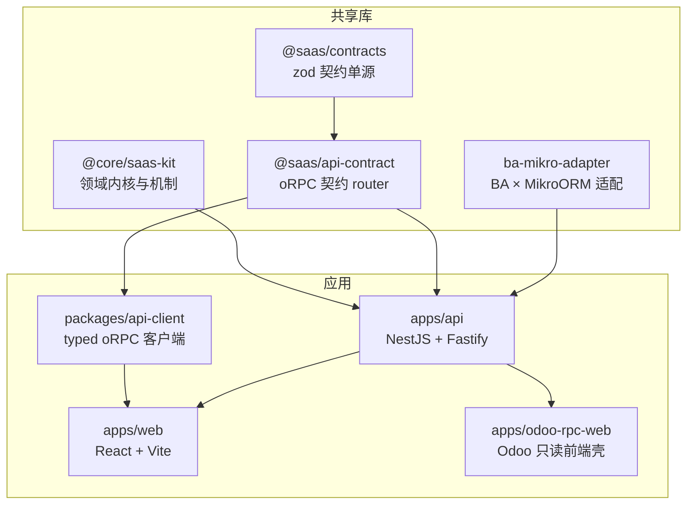
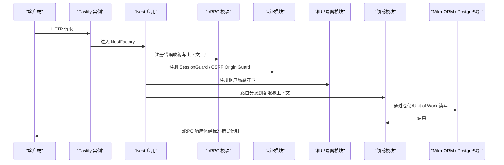
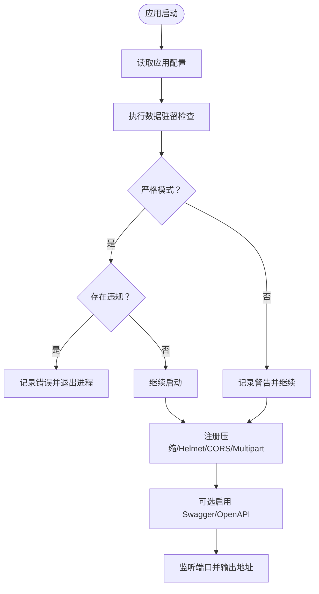
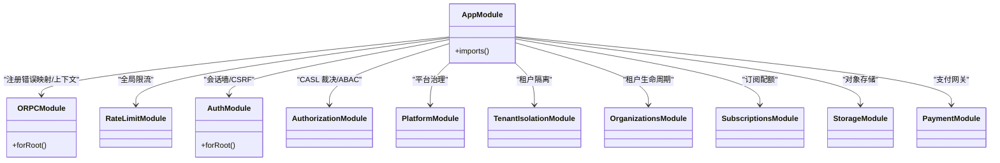
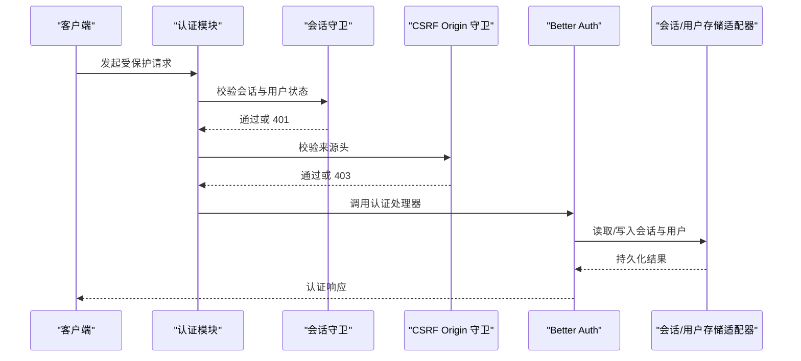
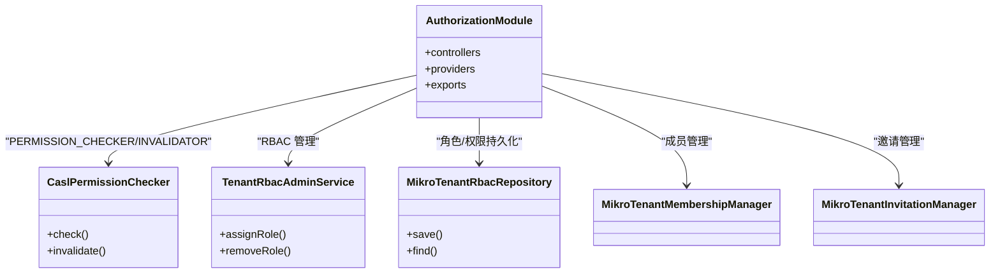
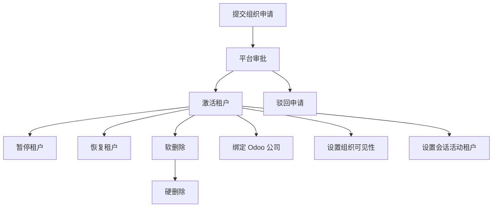
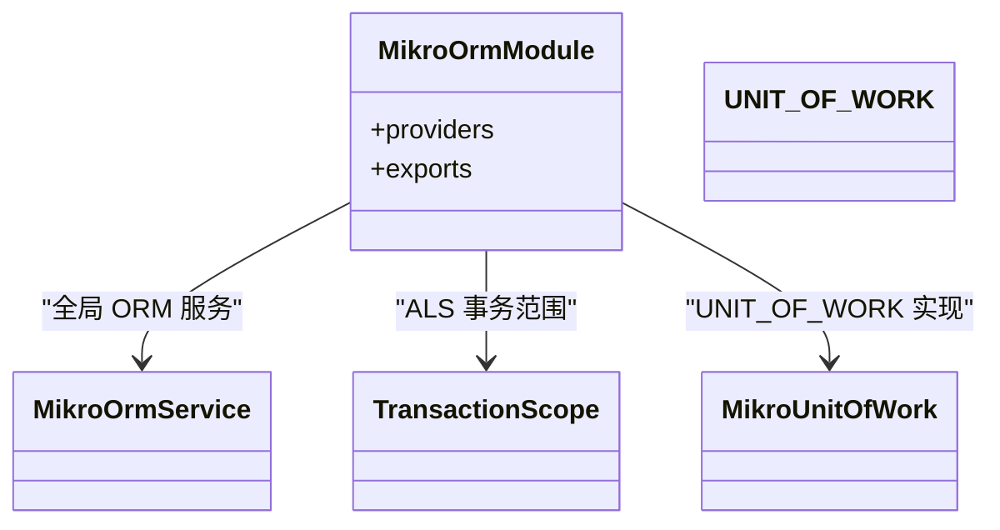
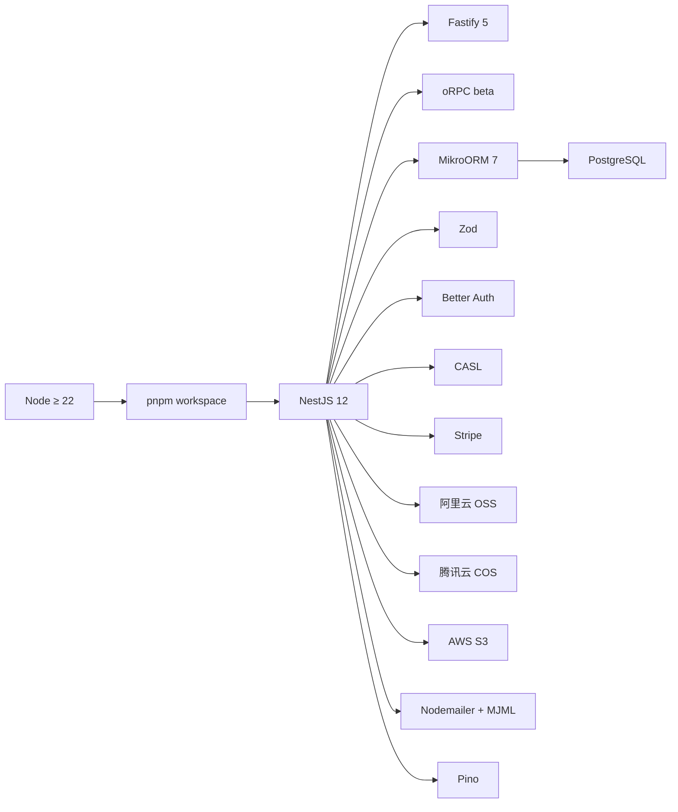
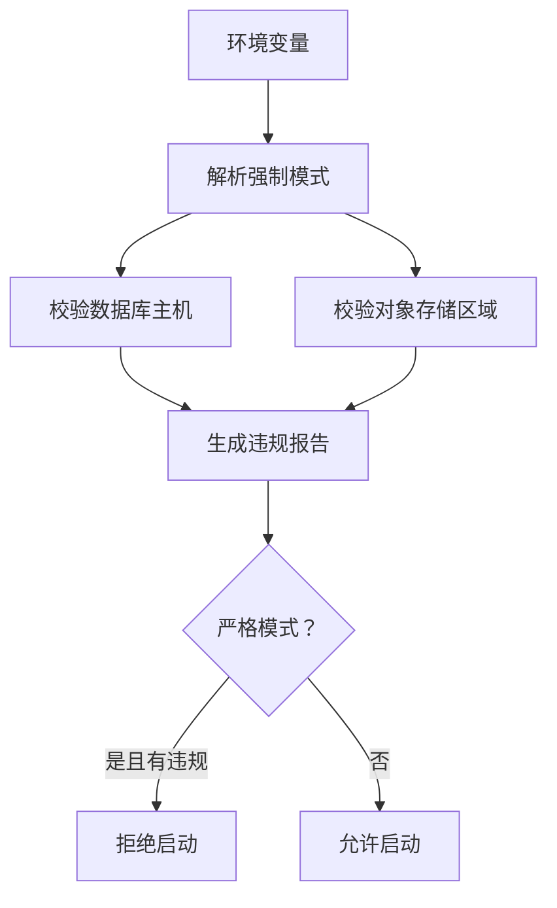

# 项目概览

<cite>
**本文引用的文件**   
- [README.md](file://README.md)
- [package.json](file://package.json)
- [apps/api/src/main.ts](file://apps/api/src/main.ts)
- [apps/api/src/app.module.ts](file://apps/api/src/app.module.ts)
- [apps/api/src/config/data-residency.ts](file://apps/api/src/config/data-residency.ts)
- [apps/api/src/database/mikro/mikro-orm.module.ts](file://apps/api/src/database/mikro/mikro-orm.module.ts)
- [apps/api/src/modules/auth/auth.module.ts](file://apps/api/src/modules/auth/auth.module.ts)
- [apps/api/src/modules/authorization/authorization.module.ts](file://apps/api/src/modules/authorization/authorization.module.ts)
- [apps/api/src/modules/organizations/organizations.module.ts](file://apps/api/src/modules/organizations/organizations.module.ts)
</cite>

## 目录
1. [引言](#引言)
2. [项目结构](#项目结构)
3. [核心组件](#核心组件)
4. [架构总览](#架构总览)
5. [详细组件分析](#详细组件分析)
6. [依赖关系分析](#依赖关系分析)
7. [性能与可运维性](#性能与可运维性)
8. [快速开始](#快速开始)
9. [合规与地域取向](#合规与地域取向)
10. [故障排查指南](#故障排查指南)
11. [结论](#结论)

## 引言
本项目是一个面向中国大陆场景的多租户 AI Agent SaaS 启动模板，目标是逐步演进为 Odoo 全栈应用和 ERP 本体系统，最终走向多源数据治理与企业综合服务平台。它以模块化单体形态起步，保留向微服务演进的边界条件；当前多租户核心能力可用，在建方向包括订阅计费闭环、事件溯源与境内支付通道接入。

核心价值：
- 以 Clean Architecture 与垂直切片组织业务，领域规则内聚、副作用隔离在边缘。
- 内置多租户身份、权限、隔离、订阅、存储、邮件、国际化等横切能力。
- 契约单源驱动前后端类型安全 API，并支持 MCP Agent 导出面。
- 技术选型优先境内可访问与合规可用，预留 ICP 备案、数据驻留与 PIPL 合规要求。

**章节来源**
- [README.md:1-40](file://README.md#L1-L40)

## 项目结构
仓库采用 pnpm workspace 划分共享内核、后端参考应用、前端与契约客户端：
- `libs/core`：共享内核（领域事件、聚合基类、tenant-isolation/authorization 契约、organizations 生命周期状态机内核等）。
- `libs/contracts`：跨端传输契约单源（zod schema + 派生类型）。
- `libs/api-contract`：公共契约 router，作为前后端类型锚单源。
- `libs/ba-mikro-adapter`：Better Auth × MikroORM 适配层。
- `apps/api`：NestJS + Fastify 后端参考应用，按限界上下文拆分为 `modules/<context>`。
- `apps/web`：React + Vite + TanStack Router 租户控制台。
- `packages/api-client`：typed oRPC 客户端。
- `apps/odoo-rpc-web`：可选的 Odoo 只读访问前端壳。

**图表来源**
- [README.md:80-101](file://README.md#L80-L101)

**章节来源**
- [README.md:80-101](file://README.md#L80-L101)

## 核心组件
- 运行时与构建：Node ≥ 22、pnpm workspace、SWC 构建、Vitest 测试、Biome 规范。
- 框架与传输：NestJS 12 + Fastify 5；对外统一走 oRPC contract 模式，REST 仅保留必要 carve-out。
- 数据库与 ORM：PostgreSQL + MikroORM（迁移与种子），并通过全局模块提供 Unit of Work 端口。
- 认证与授权：Better Auth（邮箱/OAuth/会话/CSRF）+ CASL 能力模型 + 三层 RBAC。
- 校验与契约：Zod 单源，oRPC `.input/.output` 与 Nest standard-schema 共用同一契约树。
- 横切能力：限流、请求 ID、CORS、压缩、Helmet、i18n、日志、邮件、对象存储、支付 provider 抽象。
- 多租户：两级边界（租户 → 工作区）、行级隔离、平台/租户/工作区三层权限、结构化审计。
- 集成专属区：`features/` 下放置 Odoo RPC、Odoo Provisioning、MCP Agent 工具面，与 `modules/` 双向隔离。

**章节来源**
- [README.md:55-76](file://README.md#L55-L76)
- [README.md:113-128](file://README.md#L113-L128)

## 架构总览
后端以 AppModule 为装配根，按“基础设施 → 横切机制 → 领域上下文 → 叠加特性”的顺序注册模块；oRPC 错误编码、限流墙、会话墙、租户隔离守卫共同构成请求处理主链。

**图表来源**
- [apps/api/src/main.ts:20-151](file://apps/api/src/main.ts#L20-L151)
- [apps/api/src/app.module.ts:33-72](file://apps/api/src/app.module.ts#L33-L72)

**章节来源**
- [apps/api/src/main.ts:20-151](file://apps/api/src/main.ts#L20-L151)
- [apps/api/src/app.module.ts:33-72](file://apps/api/src/app.module.ts#L33-L72)

## 详细组件分析

### 启动与数据驻留守卫
启动流程负责加载配置、设置全局前缀与版本化、挂载验证管道、注入 Fastify 插件、开启 CORS、注册 Swagger/OpenAPI，并在启动早期执行数据驻留检查。生产环境默认严格模式，违反时直接拒绝启动。

**图表来源**
- [apps/api/src/main.ts:20-151](file://apps/api/src/main.ts#L20-L151)
- [apps/api/src/config/data-residency.ts:82-124](file://apps/api/src/config/data-residency.ts#L82-L124)

**章节来源**
- [apps/api/src/main.ts:20-151](file://apps/api/src/main.ts#L20-L151)
- [apps/api/src/config/data-residency.ts:1-124](file://apps/api/src/config/data-residency.ts#L1-L124)

### 模块装配与请求链路
AppModule 将 oRPC、配置、限流、日志、数据库、I18n、健康检查、认证、授权、平台治理、租户隔离与各业务模块串联起来。限流模块必须排在认证之前，保证最廉价的拒绝先发生；认证模块再挂全局会话墙与 CSRF Origin 守卫；租户隔离随后生效。

**图表来源**
- [apps/api/src/app.module.ts:33-72](file://apps/api/src/app.module.ts#L33-L72)

**章节来源**
- [apps/api/src/app.module.ts:1-78](file://apps/api/src/app.module.ts#L1-L78)

### 认证模块（Better Auth）
认证模块提供动态装配入口，注册会话守卫、CSRF Origin 守卫、SSO 控制器、Better Auth 引导服务、会话回收、用户/会话存储适配器以及 MCP 访问令牌存储适配器。它同时暴露全局 APP_GUARD，实现默认拒绝的全局会话墙，并通过 Reflector 对 `@Public()` 路由旁路。

**图表来源**
- [apps/api/src/modules/auth/auth.module.ts:22-83](file://apps/api/src/modules/auth/auth.module.ts#L22-L83)

**章节来源**
- [apps/api/src/modules/auth/auth.module.ts:1-86](file://apps/api/src/modules/auth/auth.module.ts#L1-L86)

### 授权模块（CASL + RBAC）
授权模块收敛授权事实与裁决机制，提供 CASL 能力检查器、RBAC 管理控制器、租户成员与邀请管理器，并以 published port 形式供其他上下文消费。该模块为 `@Global`，使 `AuthorizationGuard` 与裁决端口在各业务上下文中可直接解析。

**图表来源**
- [apps/api/src/modules/authorization/authorization.module.ts:18-60](file://apps/api/src/modules/authorization/authorization.module.ts#L18-L60)

**章节来源**
- [apps/api/src/modules/authorization/authorization.module.ts:1-61](file://apps/api/src/modules/authorization/authorization.module.ts#L1-L61)

### 组织与租户模块（生命周期与治理）
组织模块承载租户生命周期与治理：提交申请、审批、驳回、暂停、恢复、删除、永久删除，以及与 Odoo 公司绑定、可见性策略、活动租户切换、用户暂停/恢复等命令；并提供平台租户列表、诊断、数据导出等查询。它通过 CQRS 总线编排 handler，并通过仓储端口对接持久化与审计。

**图表来源**
- [apps/api/src/modules/organizations/organizations.module.ts:47-146](file://apps/api/src/modules/organizations/organizations.module.ts#L47-L146)

**章节来源**
- [apps/api/src/modules/organizations/organizations.module.ts:1-159](file://apps/api/src/modules/organizations/organizations.module.ts#L1-L159)

### 数据库与事件溯源准备
MikroORM 模块以 `@Global` 暴露 `MikroOrmService` 与 `UNIT_OF_WORK` 端口，并装配 `TransactionScope` 与 `MikroUnitOfWork`，为后续事件溯源与事务范围控制提供基础。构造期不建连，避免影响无数据库冒烟测试。

**图表来源**
- [apps/api/src/database/mikro/mikro-orm.module.ts:8-29](file://apps/api/src/database/mikro/mikro-orm.module.ts#L8-L29)

**章节来源**
- [apps/api/src/database/mikro/mikro-orm.module.ts:1-30](file://apps/api/src/database/mikro/mikro-orm.module.ts#L1-L30)

## 依赖关系分析
- 运行时与包管理：Node ≥ 22、pnpm workspace。
- 后端核心：NestJS 12、Fastify 5、oRPC beta、MikroORM 7、PostgreSQL、Zod、Better Auth、CASL。
- 第三方集成：Stripe、阿里云 OSS、腾讯云 COS、AWS S3、Nodemailer、MJML、Pino。
- 工程协作：Husky、commitlint、Biome、Vitest、Playwright、Testcontainers。

**图表来源**
- [package.json:74-128](file://package.json#L74-L128)

**章节来源**
- [package.json:1-160](file://package.json#L1-L160)

## 性能与可运维性
- 高性能传输：Fastify 5 与压缩插件提升吞吐。
- 请求追踪：统一 request-id 钩子贯穿全链，便于问题定位。
- 限流防护：全局限流墙置于认证之前，降低无效请求成本。
- 安全加固：Helmet、CORS 白名单函数式回显、CSRF Origin 校验。
- 可观测性：Pino 结构化日志，健康检查端点与 OpenAPI 文档。
- 部署回归：`verify:prod-boot` 在生产镜像中校验 `/api/v1/health`。

[本节为通用指导，不直接分析具体文件]

## 快速开始
前置要求：Node ≥ 22、pnpm 11、PostgreSQL（或使用 Docker Compose）。

推荐步骤：
1. 安装依赖。
2. 复制环境变量模板并填写数据库连接等配置。
3. 执行迁移与种子数据。
4. 启动开发后端与前端。
5. 构建与生产运行。

关键脚本：
- `pnpm install`
- `cp .env.example .env`
- `pnpm run db:setup`
- `pnpm run start:dev`
- `pnpm run dev:web`
- `pnpm run build`
- `pnpm run start:prod`

**章节来源**
- [README.md:130-146](file://README.md#L130-L146)

## 合规与地域取向
- 数据驻留：启动阶段校验数据库主机与对象存储区域是否位于中国大陆允许范围；生产环境默认严格模式，违规即拒绝启动。
- 合规要点：预留 ICP 备案、数据驻留与个人信息保护法（PIPL）合规要求；用户数据导出与硬删级联清除纳入用户域职责。
- 资源选择：依赖镜像、支付、登录、监控等优先境内可访问方案，跨境调用（如 Stripe、海外 OAuth）不作为个人数据存储，不在驻留约束范围内。

**图表来源**
- [apps/api/src/config/data-residency.ts:82-124](file://apps/api/src/config/data-residency.ts#L82-L124)
- [apps/api/src/main.ts:40-72](file://apps/api/src/main.ts#L40-L72)

**章节来源**
- [apps/api/src/config/data-residency.ts:1-124](file://apps/api/src/config/data-residency.ts#L1-L124)
- [apps/api/src/main.ts:40-72](file://apps/api/src/main.ts#L40-L72)
- [README.md:32-39](file://README.md#L32-L39)

## 故障排查指南
- 启动失败且提示数据驻留违规：检查 `DATABASE_URL` 主机与对象存储 provider/region 是否在允许清单内；必要时调整环境变量或临时放宽 allowlist。
- 认证 401/403：确认全局会话墙与 CSRF Origin 守卫已启用，检查 `@Public()` 旁路与 CORS 白名单配置。
- 租户隔离异常：确认租户上下文传播与隔离守卫已注册，检查平台/租户/工作区三层权限策略。
- 数据库连接问题：确认 MikroORM 模块已全局装配，Unit of Work 与 TransactionScope 正常提供。
- 前端无法访问后端：检查 Vite 反向代理与 API 前缀 `/api/v1`，以及同源 Cookie 与 CORS 配置。

**章节来源**
- [apps/api/src/main.ts:20-151](file://apps/api/src/main.ts#L20-L151)
- [apps/api/src/modules/auth/auth.module.ts:22-83](file://apps/api/src/modules/auth/auth.module.ts#L22-L83)
- [apps/api/src/database/mikro/mikro-orm.module.ts:8-29](file://apps/api/src/database/mikro/mikro-orm.module.ts#L8-L29)

## 结论
该项目以模块化单体形态提供完整的多租户 SaaS 基座，技术栈围绕 NestJS v12 + Fastify + Better Auth + CASL + MikroORM + PostgreSQL + Zod 构建，兼顾性能、类型安全与合规可用。当前多租户核心能力可用，未来将围绕订阅计费闭环、事件溯源与 Odoo 全栈集成持续演进，最终形成企业级综合服务平台。

[本节为总结性内容，不直接分析具体文件]