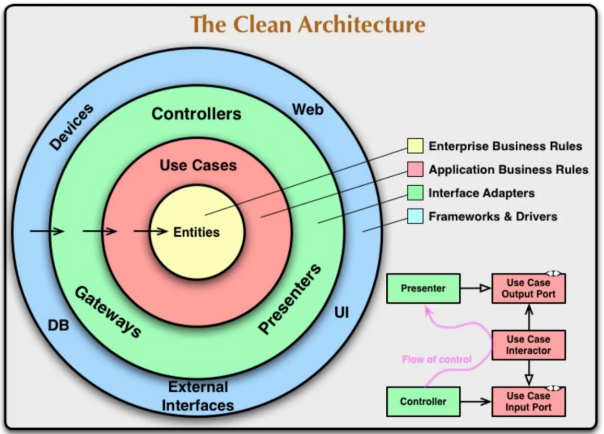
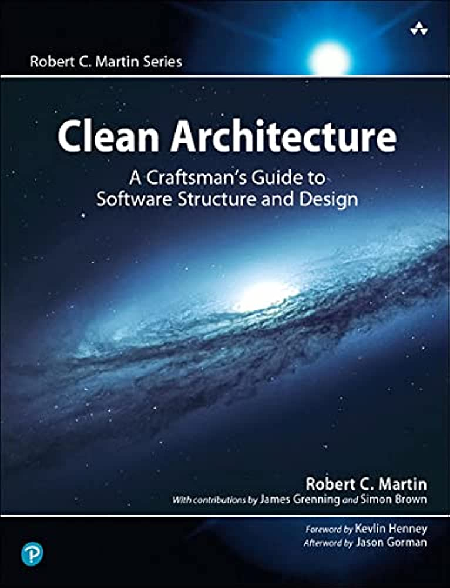
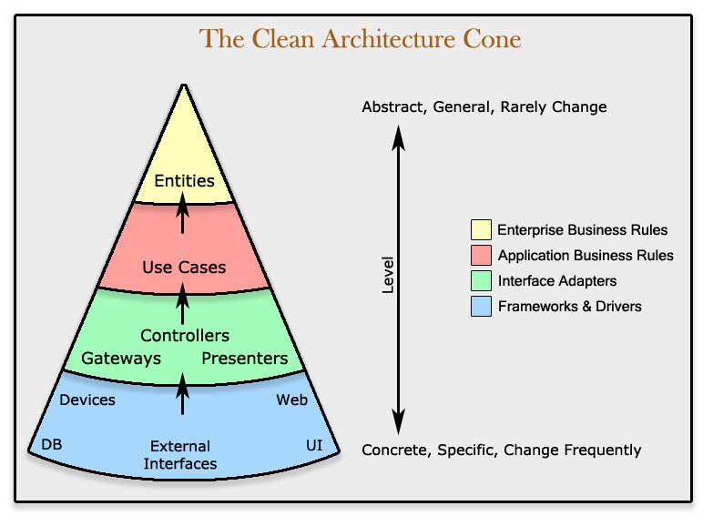
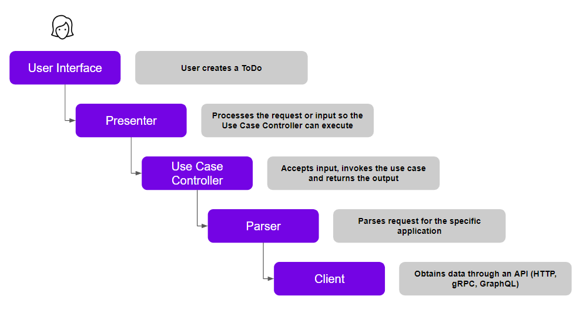
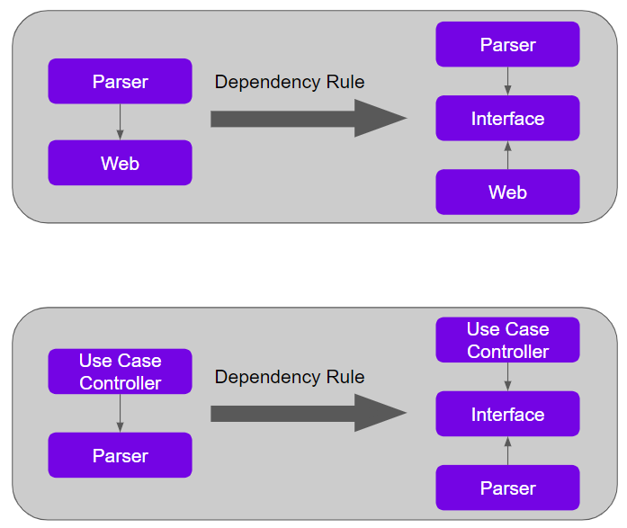
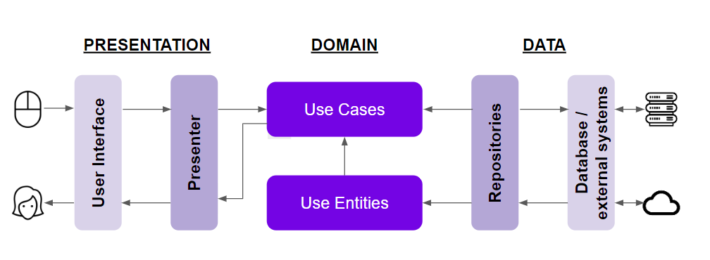

# Bitloops《Clean Architecture Reference Guide》整理

> 用途: 调研参考（**非开发依据**）· 单篇参考指南的逐节对译 + 判读 + 与本仓对照
> 来源: Bitloops 官方文档 · Learning / Software Architecture 分支
> 原始链接: https://bitloops.com/docs/bitloops-language/learning/software-architecture/clean-architecture
> 抓取方式: WebFetch 于 2026-10-21（去 HTML 版式后的正文，非逐字源 markdown；6 张配图已下载至 `./imges/`，原始 URL 记录在文末「配图清单」）
> 姊妹读物: 本仓另有一套逐篇忠实对译的 19 篇 dev.to 系列，见 [../clean-architecture/README.md](../clean-architecture/README.md)；横向批判口径见 [../clean-architecture/09-critique-and-repo-mapping.md](../clean-architecture/09-critique-and-repo-mapping.md)
> 结论须经人二次核验后方可写入方案（`workflow.md` §3）；本文不复述细节、不裁决

---

## 原文信息

| 项 | 值 |
| --- | --- |
| 原标题 | Clean Architecture Reference Guide: Everything You Need to Know About Clean Architecture |
| 站点 / 栏目 | Bitloops Docs → `bitloops-language/learning/software-architecture` |
| 作者 / 署名 | Bitloops（公司文档，无个人署名） |
| 发布时间 | 页面未标注（无法取证） |
| 体裁 | **营销向科普长文**——是 Bitloops 自家 DSL 产品（Bitloops Language）文档树里的 "learning" 引流页，SEO 属性强 |
| 代码 | **全文零代码**（纯概念 + 示意图，无可运行示例） |
| 结构 | Origins → Fundamentals → Implementation rules → Dependency Rule（重点）→ 与 DDD 关系 → Benefits → Conclusion → FAQs |
| 原图 | 6 张（Uncle Bob 同心圆图 / 书封 / 稳定锥 / 用例流示例 / 依赖倒置转换图 / DDD-CA 关系图） |
| 姊妹页 | 正文两处前向引用「DDD 下一节」——属另一独立页，**不在本次抓取范围** |

> 定位判读（先摆事实）：本页**没有任何新理论**——通篇是对 Robert C. Martin《Clean Architecture》的二次通俗复述，配合 Bitloops 产品文档树做流量入口。它的可取之处仅在"把依赖规则讲得比多数科普更细（配了违反/修正的两段式示例）"与"点明 CA 与 DDD 的互补关系"。凡是想做架构判断的人，都应把它当**二手科普**，权威口径回到 Uncle Bob 原书与本仓 `docs/specs/architecture.md`。

---

## 逐节对译（严格按原文节次 · 配图全量照录 · 判读内嵌）

### 开篇（导语）

> Clean architecture is a software architecture pattern that has gained popularity in recent years due to its ability to create flexible, scalable, and maintainable software systems. The approach prioritizes the separation of concerns and the independence of frameworks and tools, allowing developers to focus on domain logic and business rules. ... based on the principle that software systems should be designed with a clear separation of concerns, where each component of the system is responsible for a specific task or functionality.

Clean Architecture 是一种软件架构模式，因能构建**灵活、可伸缩、可维护**的系统而流行；它强调关注点分离与"框架/工具无关"，让开发者聚焦领域逻辑与业务规则；核心原则是系统各组件各司其职。

> 注记：开篇三段是同一句话的三次换词复述（separation of concerns 出现两次），信息密度低——典型的 SEO 铺陈。

### Origins of clean architecture（起源）

> Clean architecture was first introduced by Uncle Bob ... in his book "Clean Architecture: A Craftsman's Guide to Software Structure and Design." Martin's book builds upon his earlier works, such as "Clean Code," "Agile Software Development, Principles, Patterns, and Practices," and "The Clean Coder." Uncle Bob's motivation ... was to address ... rigid software systems ... high coupling ... a lack of modularity. He believed that these problems were caused by a focus on technical details rather than domain logic and business requirements. ... He proposed a layered architecture with clear boundaries and interfaces, where the domain logic is at the center ...

由 Uncle Bob（Robert C. Martin）在其《Clean Architecture》一书中提出，承接《Clean Code》《Agile Software Development》《The Clean Coder》；动机是解决系统僵化、高耦合、缺模块化——他认为根因是"重技术细节、轻领域逻辑"；于是提出**领域逻辑居中、外层负责交付机制（UI/DB/网络）**的分层架构，终极目标是可随业务需求演进的灵活可维护架构。

> 注记：史实基本无误。补一句原文没讲的：Uncle Bob 的"Clean Architecture"思想源头还包括 **SOLID（尤其 DIP）**与更早的**六边形/端口-适配器架构（Alistair Cockburn）**、**Onion 架构（Jeffrey Palermo）**——本页把 CA 说成他"独创"是简化（六边形才是同心圆/层次模型的近亲，见后文它自己承认"Onion、Hexagonal 也用同一依赖规则"，已自证 CA 非孤立发明）。

### Clean Architecture — The Fundamentals（四层基本面）

> The central theme ... is that it breaks up software systems into layers ... At its core, Clean Architecture is based on the idea that software systems should be built around a set of core business rules or **entities** ... **Use cases** are the next layer ... application business rules ... The **interface adapters** layer is responsible for converting data between the outside world and the use case layer ... controllers, gateways, presenters ... Finally, the **external interfaces layer** represents the interfaces that the system has with the outside world ... databases, user interfaces, web APIs ...

中心主题是把系统拆成更易维护的层次。四层（由内而外）：

1. **Entities（实体）**：核心业务规则/企业级业务规则，是被用例操作的业务对象，不受 UI 或外部因素影响，是架构中最稳定的部分。
2. **Use cases（用例）**：应用级业务规则（特定于本应用而非企业通用），调用实体来实现具体规则，每个用例=用户可执行的一个动作。
3. **Interface adapters（接口适配器）**：在外部世界与用例层之间转换数据，含 **controllers / gateways / presenters**（控制器处理输入、网关访问外部数据源、呈现器渲染 UI 数据）。
4. **External interfaces（外部接口层）**：系统与外部世界的接口——数据库、UI、Web API 等，负责在应用与外部系统间翻译数据。

> **判读（三处要点）**：
> 1. **第四层命名走样**：Uncle Bob 原书第四层叫 **"Frameworks & Drivers"**（框架与驱动，即 Web/DB/UI/外部设备这些具体框架），本页改称 "external interfaces layer" 并把 controller 归到第三层——这个归置**其实更接近原著**（controller 属 interface adapters），但把第四层说成"接口"而非"框架/驱动方"，是科普化简后的模糊表述，别据此以为原著有两套词。
> 2. **配图与正文错位**：本节正文讲的是**同心圆（concentric circles）**，配的却是**"稳定锥（Cone of Stability）"**——那是 Uncle Bob **较晚期**（SOLID/包与组件 + OSP 依赖稳定原则）材料里的图，强调"稳定在上、动荡在下"，与本书四层同心圆是**两种不同隐喻**。用锥图配四层文字，属于素材混搭（**推断**：编者从 CA 关联图集中取图，未严格对应）。
> 3. **presenter 的定位偏窄**：原文说 presenter "负责渲染数据在 UI"，但在标准 CA/MVP 流里 presenter 是**用例输出边界（Output Boundary）的翻译者**，把 handler 产出的 DTO 转成视图模型，而非"渲染"（渲染是 view/framework 的事）。这一格之差在后面"依赖规则示例"里会被再次暴露。

### Clean Architecture — Implementation rules（实现规则）

> ... clean architecture provides a set of key rules ... These rules include: **Dependency rule / Use of interfaces / Separation of concerns / Domain models / Testing**. By following these rules ...

实现时遵循五条关键规则：**依赖规则、使用接口、关注点分离、领域模型、测试**。

> 注记：这"五条规则"**不是原著的成体系清单**——原著的硬规则只有一条 **The Dependency Rule**；其余四项（用接口/SoC/领域模型/测试）是达成手段或旁支原则，被本页平铺成"规则"，层级混乱（把"结构约束"与"设计实践"并列）。引用时须知：这不是 Uncle Bob 的原文分类，是 Bitloops 的归纳。

### The dependency rule — Learn this really well!（依赖规则 · 本页干货）

> The Dependency Rule ... helps to minimize coupling ... It is important to use **interfaces or protocols** to represent abstractions, and to ensure that dependencies always point **towards the stable abstractions and away from the volatile concrete implementations** ... An incorrect usage ... would be when a higher-level module depends on a lower-level module, or when both modules depend on each other. This creates tight coupling ...

依赖规则要点：源码依赖**只能指向内侧**（指向稳定抽象，远离易变的具体实现）；用 interface/protocol 表示抽象；**错误用法**=高层依赖低层，或两者互相依赖（紧耦合、变更易连锁破坏）。

**原文示例（逐字，含它自身的前后不一致）**：

> Below you can see a standard scenario where a user creates a **todo** on their Web-based **ToDo** application.

（正文说"ToDo 应用创建待办"，但下面的流程与标签讲的是 **Translate 翻译**用例——见判读 1。）

> This is a typical flow ... the UI makes a data request from the Presenter, which in turn calls the Use Case, which in turn calls the controller to then present it back to the user.

"典型流程"（原文）：UI 向 Presenter 请求数据 → Presenter 调用 Use Case → Use Case 调用 Controller → 再回呈给用户。其中：

- `UI → Presenter`（✅ 不违反）
- `Presenter → Translate Usecase`（✅ 不违反）
- `Translate Usecase → Translate Controller`（❌ 违反）
- `Translate Controller → Web`（❌ 违反）

> ... we need to **invert the direction of the arrow**, which can be achieved through the use of **Polymorphism**. By introducing an **Interface** between the two layers, we can invert the dependency, which is known as **The Dependency Inversion Principle** ... By allowing the application to order what data it wants without caring how the database or API prepares that data ... following the single-way dependency rule helps to prevent the system from entering a **deadlock state** ...

修正之道：靠**多态**把箭头方向**倒置**——在两层之间引入 interface，即**依赖倒置原则（DIP）**；让应用只"点菜"要什么数据、不关心 DB/API 如何备数据，于是可换 DB/API 实现而不破坏应用；单向依赖还能避免"互相依赖导致的死锁/连锁破坏"。

> **判读（本页最值得警惕的一段）**：
> 1. **示例前后对不上（实存笔误）**：引导句讲 "ToDo 应用创建待办"，配图与标签却是 "Translate Usecase / Translate Controller"（翻译用例）——文字与图不同源，是编者从别处迁移示例未改引导句。**逐字照录、不替它圆场。**
> 2. **"典型流程"把数据流讲反了**：原文写 "UI → Presenter → Use Case → Controller"。标准 CA/MVP 的实际调用序应是 **Input View/Controller → Use Case（Interactor）→ Output Port → Presenter → Output View**：**Controller 在最外层接收输入、调用用例**，用例**绝不该反向依赖 Controller**（这恰是它自己列为 ❌ 的那条）。它却把"用例调用 controller"写进"typical flow"，与它随后给出的违规判定自相矛盾——**科普示例本身逻辑没自洽**。
> 3. **把 DIP 与"多态"划等号过简**：倒置依赖靠的是"抽象（接口/端口）+ 依赖注入"，多态只是运行时选择实现的机制之一。真正落地需要**组合根**（DI 容器/工厂）在系统边界把具体实现注入——本页通篇没提 DI 容器如何完成这次"倒置"（对照本仓 NestJS 构造注入 + token，见下表）。
> 4. 正面之处：把"依赖必须指向稳定抽象、远离易变实现"讲清楚了，且点出"互相依赖=死锁风险"，这一点比多数科普到位。

### How clean architecture works well with DDD（与 DDD 的互补）

> Clean architecture and domain-driven design (DDD) share several principles, making them complementary ... DDD ... prioritizes the importance of the domain model ..., while clean architecture focuses on the separation of concerns and the use of clear boundaries and interfaces ... in clean architecture, the domain logic is at the center ... This separation allows developers to change the implementation of one layer ... but then the question is: **how do I organize my business domain logic?** This is where DDD comes in ...

二者原则相通、互补：DDD 重"领域模型的组织与获取业务需求"，CA 重"关注点分离与清晰边界/接口"；CA 把领域逻辑居中但不告诉你**如何组织**领域逻辑——这正是 DDD 补位之处。组合起来可交付可演进、贴合业务变更的系统。

> 注记：这段是全页**最有价值**的观点——点破"CA 只给分层骨架、DDD 才给领域内容的组织法"，与本仓"垂直切片按限界上下文拆分 + 领域逻辑居 `libs/core`"的实践完全吻合。但止步于口号，未讲聚合/实体/值对象/领域事件如何映射到 CA 四层，并前向引用"下一节 DDD"（不在本页范围）。

### Benefits of clean architecture（收益清单）

原文列七项收益：**关注点分离 / 框架工具无关 / 灵活与可伸缩 / 可测试 / 可维护 / 可适配（敏捷与持续交付）/ 与 DDD 兼容**。

> 注记：与开篇导语高度重复（同一批话术换序再讲一遍），是长文 SEO 撑字数的常见形态。七项本身无错，但都是**未量化的定性承诺**——本仓纪律是"收益须能在真跑对拍中验证"（AGENTS.md §2「部署声明必须真跑对拍」），科普页的"更 testable/更易维护"属**未经证实的一般性论断**，引用时不应当作落地依据。

### Conclusion（结论）

> ... clean architecture is a powerful way to design and build software that is easy to maintain, update, and scale ... By following its rules, developers can separate different parts of the app into layers ... Clean Architecture also encourages developers to use interfaces, break down the app into smaller parts ... has become a popular choice because of its flexibility, scalability, and focus on maintainability.

结论重申：CA 是构建易维护/更新/伸缩软件的有力方式，靠分层、接口、拆小块与聚焦核心达成。（无新增信息。）

### FAQs（常见问题 · 含原文的"空答案"）

原文 8 问，其中 **3 问有问无答**（页面实存内容缺口，照录不补）：

| 问题 | 原文是否有答案 |
| --- | --- |
| 1. CA 的主要目标？ | 有—— scalable/maintainable/flexible，靠关注点分离 |
| 2. CA 与传统分层架构的区别？ | 有——传统只分层，CA **额外强制单向依赖规则**（依赖一律向内） |
| 3. CA 如何助益可维护性？ | 有—— 关注点分离使各组件职责清晰，改一处不波及其他 |
| 4. CA 与微服务兼容吗？ | **❌ 空答案**（有问无答） |
| 5. 任意语言/框架都能用 CA 吗？ | 有—— 语言/框架无关，关键是分离 + 单向依赖 |
| 6. CA 能否与事件驱动架构结合？ | **❌ 空答案** |
| 7. 为什么 CA 被认为复杂？ | **❌ 空答案** |
| 8. Additional resources（延伸阅读） | 有—— 3 条外链（Uncle Bob 博客 / freeCodeCamp / Bharath 新手指南） |

> **判读**：第 4/6/7 问是**页面未写完的空壳**（尤其第 7 问"为什么复杂"恰是最该辩证的地方，却空着）。这说明该页是**持续增补中的营销内容**，非定稿技术文献——进一步支撑"二手科普、非依据"的定位。第 2 问答得其实最准（点出"分层人人有、单向依赖才是 CA 的额外强制项"），可作快速校准卡片。

---

## 整理注记（本篇结构性小结）

| 维度 | 事实 |
| --- | --- |
| 内容原创性 | **零原创**——对 Uncle Bob CA 的通俗复述 + Bitloops 产品文档引流页 |
| 真正可取 | ①依赖规则配了"违反→修正"两段式讲解；②点明 CA↔DDD 互补（CA 给骨架、DDD 给领域组织法）；③FAQ 第 2 问对"CA vs 传统分层"的区别一句话到位 |
| 事实/逻辑硬伤 | ①示例文字 ToDo、配图与标签 Translate 前后不一；②"typical flow"把 Controller↔Use Case 调用序写反，与其自身违规判定自相矛盾；③"DIP=多态"过简且全程未讲 DI 组合根；④同心圆文字配"稳定锥"图（隐喻错配） |
| 体例缺陷 | 五条"规则"层级混乱（结构约束与设计实践并列）；Benefits 与开篇重复；FAQ 三问空答案 |
| 术语漂移 | 第四层作 "external interfaces"（原著为 "Frameworks & Drivers"）；presenter 职责窄化为"渲染" |
| 完整性 | 前向引用 "next section about DDD" 属另一页，未纳入本次整理 |
| 结论 | **定位=营销向二手科普**：可读不可信；权威口径回 Uncle Bob 原书与本仓 `docs/specs/architecture.md` |

---

## 与本仓对照（本篇）

> 本仓是 Clean Architecture 的 **NestJS + TypeScript + MikroORM** 变体落地（垂直切片 + DDD + CQRS）。本页讲的是"图该怎么画"，本仓讲的是"码怎么写、门怎么把"——对照见下表。逐项深对照另见 [../clean-architecture/09-critique-and-repo-mapping.md](../clean-architecture/09-critique-and-repo-mapping.md)。

| 本页概念 | 本仓实态（以仓库目录/机制为证） |
| --- | --- |
| 四层 Entities / Use cases / Interface adapters / External | 垂直切片四层 `modules/<上下文>/{domain,application,infrastructure,api}`：domain≈实体、application≈用例（CQRS handler）、api≈controller、infrastructure≈驱动适配（ORM/外部服务）；目录地图见 `AGENTS.md §5` |
| "Interface adapters 含 controller/gateway/presenter" | Controller 居 `api/`；仓储/外部服务 port 声明居 `application/contracts`、adapter 实现居 `infrastructure/`——即"端口/适配器"落位 |
| Dependency Rule：依赖只指向内层 | 由**工具强制**而非口头：`libs/core` 域层零外部依赖；依赖方向守卫 + `fallow` 佐证（`AGENTS.md §2` 铁律 / tooling §4.7） |
| "DIP 靠多态倒置依赖"（未讲 DI 容器） | NestJS **构造函数注入 + token** 完成倒置；注意本仓 ESM 铁律——DI 注入类**必须值导入**，`import type` 会擦除元数据致运行期 `UnknownDependenciesException` |
| "用 domain models 表达业务逻辑" + DDD 补位 | 按**限界上下文**拆垂直切片（`docs/plans/global-domain-context-refactor.md`），跨上下文**只经领域事件**通信；ORM 映射外置（`libs/mikro-adapter`），域实体不绑定 MikroORM |
| "presenter 渲染 UI 数据" | 无 MVP presenter 概念：响应转换走 **`@SerializeOptions({schema})` + zod 契约单源 `libs/contracts`**，序列化/校验收在 Fastify 官方 standard-schema 路径 |
| Benefits：更 testable | 落为 Vitest 测试金字塔 + gated e2e（Testcontainers 真库）——本仓以实跑证明，而非定性承诺 |
| "语言/框架无关" | 成立；但落地细节强依赖栈——本仓踩过的 Node-ESM/装饰器元数据坑（tooling §4.1 R-η）正是"通用原则 ≠ 免适配"的反证 |

---

## 配图清单（原始 URL 备查）

| 本地文件（`./imges/`） | 原始 URL |
| --- | --- |
| `clean-architecture-uncle-bob-diagram.png` | https://storage.googleapis.com/bitloops-github-assets/Documentation%20Images/Clean-Architecture-Uncle-Bob.png |
| `clean-architecture-book-uncle-bob.jpg` | https://storage.googleapis.com/bitloops-github-assets/Documentation%20Images/clean-architecture-book-uncle-bob.jpg |
| `clean-architecture-cone.jpg`（源为 `.jfif`，实为 JPEG，已改扩展名） | https://storage.googleapis.com/bitloops-github-assets/Documentation%20Images/clean-architecture-cone.jfif |
| `clean-architecture-usecase-example.png` | https://storage.googleapis.com/bitloops-github-assets/Documentation%20Images/Clean%20Architecture%20Use%20Case%20Example.png |
| `clean-architecture-dependency-rule-transformation.png` | https://storage.googleapis.com/bitloops-github-assets/Documentation%20Images/Clean-architecture-dependency-rule-transformation.png |
| `clean-architecture-and-ddd.png` | https://storage.googleapis.com/bitloops-github-assets/Documentation%20Images/clean-architecture-and-ddd.png |

> 保真口径：正文对译严格按原文节次，代码块/流程图**零改写**；本仓判读以"注记/判读"显式标注、与原文陈述物理区隔。因来源是 WebFetch 去版式渲染（非逐字源 markdown），"逐字性"以抓取到的正文为准，**图片 alt 中的 "​"（零宽字符）与 "On this page" 导航残留已在整理时剔除**，特此留痕以免被误当作原文内容。
