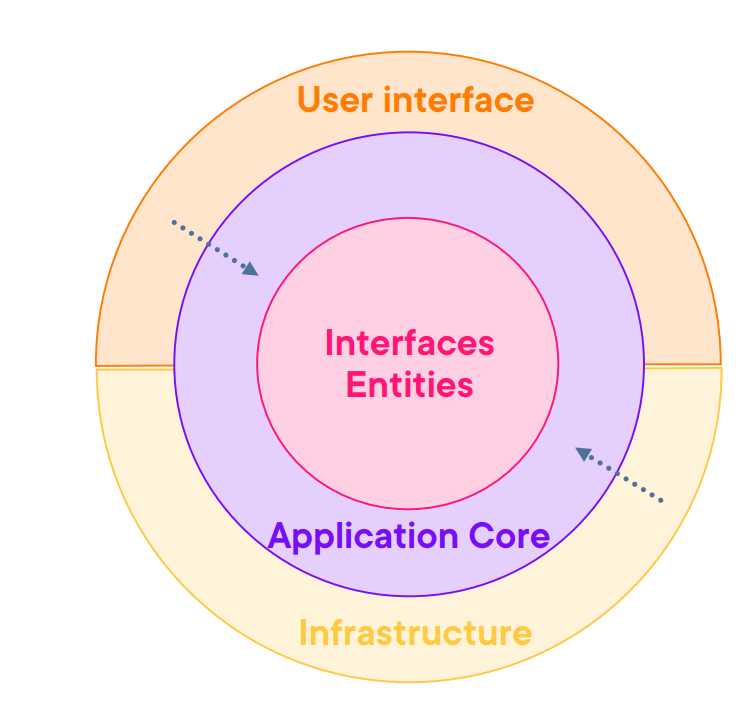

# Part 1：什么是 Clean Architecture？

> 用途: 调研参考（非开发依据）· 逐篇忠实对译，本仓横向判读见 [09](09-critique-and-repo-mapping.md)，主题串读见 [01](01-foundations-and-principles.md)

## 原文信息

| 项 | 值 |
| --- | --- |
| 原标题 | Part 1: What is Clean Architecture? |
| 链接 | https://dev.to/moh_moh701/part-1-what-is-clean-architecture-4bn1 |
| 作者 | mohamed Tayel（`moh_moh701`） |
| 发布时间 | 2024-07-03T10:41:39Z |
| 系列 | Clean Architecture（collection 28557）第 1 篇 |
| 平台标注阅读时长 | 3 分钟 |
| 反应数 / 评论数 | 415 / 19（实测可见 11 条 + 被作者隐藏 1 条 + 作者回复 6 条，见本文末） |
| 标签 | `dotnetcore` `microservices` `architecture` |
| AI 披露状态 | `not_disclosed` |
| dev.to 文章 id | 1910003 |
| 本篇原图 | 1 张（已下载至 `imges/`） |

---

## 逐段对译

### Understanding Clean Architecture（理解 Clean Architecture）

> 原文开头是一段致谢，不是技术内容，但它是理解本系列来源的关键：作者明说自己的 Clean Architecture 认知来自 Pluralsight 作者 **Gill Cleeren** 的课程《ASP.NET Core Clean Architecture》，并把 CA 定义为「由 Robert C. Martin（Uncle Bob）提出、聚焦于构建易理解、灵活、可维护系统的设计理念」，课程强调「关注点分离，让应用的业务逻辑与其依赖（框架、数据库、用户界面）解耦」。

中文对译：作者首先向 Pluralsight 作者 Gill Cleeren 致谢，称其《ASP.NET Core Clean Architecture》一课极大地深化了他对 Clean Architecture 的理解——这是一套由 Robert C. Martin（Uncle Bob）提出的软件设计理念，目标是让系统**易理解、灵活、可维护**；课程强调**关注点分离**，确保应用的业务逻辑与框架、数据库、用户界面这类依赖解耦。

### Definition and Principles of Clean Architecture（定义与原则）

> **Definition:** Clean Architecture is a layered architecture that organizes code into a set of concentric circles, each representing different layers of the application. These layers include entities, use cases, interface adapters, and frameworks/drivers. The core idea is that the inner layers should be independent of the outer layers, making the system more modular and easier to test.

**定义**：Clean Architecture 是一种分层架构，它把代码组织成一组**同心圆**，每个圆代表应用的不同层。这些层包括 **entities（实体）、use cases（用例）、interface adapters（接口适配器）、frameworks/drivers（框架与驱动）**。核心思想是**内层必须独立于外层**，从而让系统更模块化、更易测试。

**原则**（原文列 5 条）：

1. **Separation of Concerns（关注点分离）**：每层职责各异，帮助管理复杂度、提升可读性。
2. **Dependency Rule（依赖规则）**：源码依赖只能**指向内侧**；内圈中的任何东西都不能知晓外圈中的任何东西。
3. **Independent of Frameworks（与框架无关）**：架构不应依赖任何外部框架，使应用内核在框架变化时保持稳定。
4. **Testability（可测试性）**：业务规则可在不依赖 UI、数据库及其他外部依赖的情况下被测试。
5. **Flexibility and Maintainability（灵活性与可维护性）**：系统可在不大幅改动整体结构的前提下演进。

### Benefits of Using Clean Architecture in Software Development（收益）

原文列 5 条收益，逐条对译：

1. **Improved Testability（可测试性提升）**：业务逻辑与外部依赖解耦后，单元测试更易写、覆盖率更易提高。
2. **Flexibility（灵活性）**：改动系统某一部分（如替换数据库或 Web 框架）对其他部分影响极小。
3. **Maintainability（可维护性）**：清晰的关注点分离与模块化让代码库更易理解、维护和扩展。
4. **Reusability（可复用性）**：业务逻辑可跨项目/跨组件复用，减少冗余。
5. **Scalability（可伸缩性）**：CA 便于应用在「承载更多负载」与「新增功能」两个维度上扩展。

### Key Components and Layers in Clean Architecture（关键组成与层次）

> 注意：本节的层名与上一节（以及 Uncle Bob 原著）**不一致**，是原文的一处内部矛盾，详见下方「注记」。原文列 4 项：

1. **Entities（实体）**：代表应用的核心业务对象，封装最通用、最高层的规则；原文称它们「通常是包含业务规则与逻辑的**富领域对象**（rich domain objects）」。
2. **Application Core（应用核心）**：包含应用专属的业务规则，定义应用需要完成的"工作"，封装并实现系统所有用例。
3. **infrastructure（基础设施）**：把数据从「对用例和实体最方便的格式」转换为「对数据库、Web、UI 或外部服务等外部机构最方便的格式」。
4. **User interface（用户界面）**：包含 UI、数据库、Web 框架及任何外部工具或交付机制；是最外层、代码量最少的一层。

### Diagrams to Illustrate Concepts（配图说明）

原文在此给出全篇唯一的示意图：

对译：图中 **entities** 是定义核心属性与行为的核心业务对象；**Application Core** 封装应用专属业务逻辑，决定应用该做什么；**infrastructure** 处理用例与外部世界之间的交互（如 Web 请求、数据库访问）；**User interface** 层包含 Web 框架、数据库及其他外部依赖的实际实现。以这种方式组织应用，可获得干净的分离关注点，让代码库更健壮、可测、可维护。

### Conclusion（结语）

对译：理解并落地 CA 能显著提升软件项目的质量与寿命；坚持其原则可让应用保持灵活、可维护、可伸缩，并为未来的需求与技术做好准备。原文末预告下一篇：「Stay tuned for the next part of our series, where we will dive into the concept of **microservices** and how they can be integrated with Clean Architecture in .NET 8.」——**这个预告最终没有兑现**：系列后续没有专门讲微服务，第 2 篇转向了设计原则（见 [Part 2](part-02-design-principles.md)）。

---

## 整理注记

- **层名失真**：本节「Key Components」用 `Entities / Application Core / infrastructure / User interface` 四命名，既不同于上一节的原著四分法（entities / use cases / interface adapters / frameworks & drivers），也不同于后续实现篇实际采用的 `Domain / Application / Infrastructure / Persistence / API`。作者本人未察觉这一漂移。
- **"rich domain objects" 只是一句口号**：P1 明确说实体应是富领域对象，但 [Part 7](part-07-domain-project.md) 实际产出的实体是无行为的纯数据袋（贫血模型）。这是全系列最大的一处言行不一。
- **本节把 infrastructure 与 UI 并列为"外层"，但没有 interface adapters 这一层**，容易让读者把"基础设施"误解成最外层框架；而原著里 controllers↔use cases 的转换层（适配器）恰恰是 CA 的关键。本仓垂直切片中的 `api/` + `application/contracts` 更接近原著语义。
- **可当作教学卡的两句**：「源码依赖只能指向内侧」「业务规则可在不依赖 UI/DB 的情况下被测试」——这两句在本仓是有运行时对应物的（`libs/core` 的 domain 层零外部依赖；仓储 port 居 `application`、adapter 居 `infrastructure`）。

## 与本仓对照（本篇）

| 本篇论点 | 本仓实存对应物 |
| --- | --- |
| Dependency Rule：依赖只指向内侧 | `libs/core/src` 共享内核不引 apps；`modules/<上下文>/domain` 不引 `infrastructure`（详见 [01 §与本仓对照](01-foundations-and-principles.md)） |
| Testability：业务规则脱离 UI/DB 可测 | domain 层纯 TS 类可单测；带库的 e2e 走 `*.e2e.test.ts` + Testcontainers（env-gated） |
| Independent of Frameworks | 本仓**部分让步**：domain 仍位于 NestJS 进程内、用装饰器；ORM 通过 `libs/mikro-adapter` 隔离而非完全无关 |
| 契约与传输分离 | 跨端 zod 契约单源居 `libs/contracts`（@saas/contracts），非本系列所述分层 |

---

## 评论区实录（原文下方讨论）

下面按时间序逐字存照（👍 = 页面 JSON-LD 给出的点赞数）：

| # | 评论者 | 时间 | 原话（英文逐字）与中文摘要 | 命中正文何处 |
| --- | --- | --- | --- | --- |
| 0 | （被作者隐藏的评论） | 2024-07-03 | 「[hidden by post author]」——API 只给状态不给正文 | — |
| 0b | **z2lai**（**本条被作者隐藏**，仅 permalink 可见） | 2024-07-03（07-03 编辑）👍1 | 「Your diagram looks more like rectangles instead of circles 😀. I've always wondered, is there an actual difference in what the circlular clean architecture diagrams depict vs the non-circular diagrams? / FYI, if your article was assisted by AI, you should disclose that or tag it appropriately.」——① 质疑本文配图是矩形而非同心圆，问两种图有无实质差别；② 提醒若为 AI 辅助创作应按 dev.to 指南披露或打标。 | ① 命中本文配图（实为矩形分层）；② 本文元数据 `ai_disclosure_level: not_disclosed`，**至整理时仍未披露**（见 [09 §2](09-critique-and-repo-mapping.md)） |
| 1 | Adesoji1 | 2024-07-04 👍2 | 「This is rich」 | — |
| 2 | Antonio（Litlyx CEO） | 2024-07-04 👍3 | 「MVVM, Clean architeture is a standard for very large and complex code bases that need a structure. ... the barrier was really big for a person who is not a "at his prime" so sometimes scares the people. But is the optimal solution for large scale codebases.」——摘要：CA 适合超大复杂代码库，但**入门门槛很高、会吓到人**。 | 与本仓「先拆层是否过度设计」的顾虑同源，见 [09 §2](09-critique-and-repo-mapping.md) |
| 3 | Nehemiah Jeyakumar | 2024-07-04 👍1 | 「Great article」 | — |
| 4 | Marcelloh | 2024-07-05 👍1 | 「How would a business rule be applied on an entity-field (if the only way is in)?」——追问：业务规则如何作用于实体字段。 | 正是 P1 「实体是富领域对象」这句话留下的空洞 |
| 5 | HlexNC | 2024-07-05 👍3 | 「Can you next time provide an example of project with clean architecture? Thanks.」——要求给出**完整项目示例**。 | 作者从 P4 起正是用 GloboTicket 示例仓库作答 |
| 6 | James McMenamin | 2024-07-06 👍2 | 「For mobile and large codebase I have switched to a Vertical architecture + clean design approach nowadays just easier to manage the base.」——提出**垂直架构 + clean 设计**的替代路线。 | 与本仓「垂直切片 + 四层」形态一致，见 [09 §4](09-critique-and-repo-mapping.md) |
| 7 | Michal Kunikowski | 2024-07-07 👍2 | 「There is also hexagon architecture. Maybe you can compere.」并附两篇参考（SSense Tech《Hexagonal Architecture, there are always two sides to every story》、J.M. Garrido Paz 的六边形文档）。 | 作者全系列未做该对比；本整理在 [09 §4](09-critique-and-repo-mapping.md) 补上 |
| 8 | Ali Nour Al Din | 2024-07-09 👍1 | 「منور يا هندسة💕」（阿拉伯语：你太亮了/多谢，工程帅） | — |
| 9 | Top Developers | 2024-08-29 👍1 | 两点质疑问：「I believe entities shouldn't have any business logic and if you need to have some validation rules we can keep it in use cases or in a helper class to validate data before saving, is that right ?」与「the user interface layer is just part of the framework & drivers layer and this layer includes (DB - Devices - Web - UI - External Interfaces)」——① 质疑实体不该带业务逻辑（与 P1「rich domain objects」相反）；② 指出 P1 把 UI 说成外层是层名错位，UI 只是 frameworks & drivers 层的一部分。 | ②直接命中本文「Key Components」的层名失真（见上方注记） |
| 10 | Navin Yadav | 2024-09-01 👍2 | 「ok」 | — |

#### 作者本人的回复（同样是原文的一部分，必须存照）

这一节比正文重要——**作者在评论区亲手给出了富领域模型的答案，而 8 周后的 P7 试验了贫血模型**：

| 时间 | 回复对象 | 作者原话（逐字） | 判读 |
| --- | --- | --- | --- |
| 2024-07-04 | Adesoji1 | 「thanks」 | — |
| 2024-07-05 | Nehemiah / Antonio | 「thanks」× 2 | — |
| 2024-07-05 21:17 | **Marcelloh**（问实体字段怎么上业务规则） | 「Let's say we have an entity called order and i want make sure when set quantity it must >0 we will do the following `public class Order { public int Quantity { get; private set; } public void SetQuantity(int quantity) { if (quantity <= 0) { throw new ArgumentException("Quantity must be greater than zero."); } Quantity = quantity; } }` as you see the i make private set and create method for validate the quantity **This encapsulates the business rule within the entity**, making it easier to maintain and understand」 | ★ 作者主张 **private set + 行为方法把不变式封在实体里**（富模型），与 P1 「rich domain objects」一致；但 [Part 7](part-07-domain-project.md) 实做的 `Category/Event/Order` 全是公开 `{ get; set; }` 的纯数据袋，**无任何行为方法**——言行不一致的硬证据 |
| 2024-07-05 23:19 | HlexNC（要项目例子） | 「soon」 | 实际 **52 天后**（2024-08-26）才回复并给出仓库；P4–P19 均发布于 08-26 以后 |
| 2024-08-26 21:38 | HlexNC | 「example using .net core API github.com/mohamedtayel1980/clean-...」 | 示例仓库地址即仍在本整理各篇「代码原貌」的数据源 |

> 取证口径：可见评论与作者回复分别来自 dev.to 官方 `comments?a_id=1910003` API（含 `children` 嵌套字段，共 11 根 + 6 回复）与文章页 JSON-LD（含被隐藏条目）；点赞数只见于 JSON-LD。页面显示「View full discussion (19 comments)」，而上述可取到正文的共 17 条（11+6），**余下 2 条属已删除或未公开推送，此推断未验证**。z2lai 一条被作者隐藏（页面标记「Comment hidden by post author – thread only accessible via permalink」），仅能通过 permalink 取到——这本身就是值得记录的事实：**系列唯一直接质疑 AI 披露的评论被隐藏了**。

---

## 附：原文英文全稿（逐字保留）

> 来源：dev.to 官方 API `body_markdown` 字段（作者原始稿），抓取于 2026-10-21；除把图片链接改为本地 `./imges/` 副本（原始 URL 保留在链接 title 中）外，未作任何增删改。
>
> 呈现口径：以下英文全稿**不做代码块包裹、直接按 Markdown 渲染**（保留作者原始标题层级、粗体、列表、代码块与图片）；逐字性以上述 body_markdown 抓取为准，本区未增删改任何文字。

#### Understanding Clean Architecture

I would like to express my gratitude to Gill Cleeren, Pluralsight Author, for his excellent course on [ASP.NET Core Clean Architecture](https://app.pluralsight.com/library/courses/asp-dot-net-core-6-clean-architecture/table-of-contents). His insights and teachings have greatly deepened my understanding of Clean Architecture, a software design philosophy introduced by Robert C. Martin (Uncle Bob) that focuses on creating systems that are easy to understand, flexible, and maintainable. The course emphasizes the importance of separation of concerns, ensuring that the business logic of an application is decoupled from its dependencies, such as frameworks, databases, and user interfaces. Thank you, Gill, for your valuable contribution!.

#### Definition and Principles of Clean Architecture

**Definition:**
Clean Architecture is a layered architecture that organizes code into a set of concentric circles, each representing different layers of the application. These layers include entities, use cases, interface adapters, and frameworks/drivers. The core idea is that the inner layers should be independent of the outer layers, making the system more modular and easier to test.

**Principles:**
1. **Separation of Concerns**: Each layer has a distinct responsibility, which helps to manage complexity and improve code readability.
2. **Dependency Rule**: Source code dependencies can only point inward. Nothing in an inner circle can know anything at all about something in an outer circle.
3. **Independent of Frameworks**: The architecture should not depend on any external frameworks. This allows the core of the application to remain stable even if frameworks change.
4. **Testability**: Business rules can be tested independently of UI, database, and other external dependencies.
5. **Flexibility and Maintainability**: The system can evolve without significant changes to the overall structure, making it easier to maintain and extend.

#### Benefits of Using Clean Architecture in Software Development

1. **Improved Testability**: By decoupling the business logic from external dependencies, it becomes easier to write unit tests and achieve higher test coverage.
2. **Flexibility**: Changes to one part of the system (e.g., replacing a database or a web framework) can be made with minimal impact on other parts.
3. **Maintainability**: Clear separation of concerns and modularity make the codebase easier to understand, maintain, and extend.
4. **Reusability**: Business logic can be reused across different projects or components, reducing redundancy.
5. **Scalability**: Clean Architecture facilitates scaling the application, both in terms of handling increased load and adding new features.

#### Key Components and Layers in Clean Architecture

1. **Entities**: Represent the core business objects of the application. They encapsulate the most general and high-level rules. They are typically rich domain objects containing business rules and logic.

2. **Application Core**: Contain the application-specific business rules. They define the jobs the application needs to perform, encapsulating and implementing all the use cases of the system.

3. **infrastructure**: Convert data from the format most convenient for the use cases and entities to the format most convenient for external agencies such as databases, web, UI, or external services.

4. **User interface**: Include the UI, database, web frameworks, and any other external tools or delivery mechanisms. These are the outermost layer and have the least amount of code.

#### Diagrams to Illustrate Concepts

To better understand Clean Architecture, let’s look at the corresponding diagram:

Diagram:

In this diagram, the entities are the core business objects that define the essential properties and behaviors. The Application Core encapsulate the application-specific business logic, defining what the application should do. The infrastructure handle the interaction between the use cases and the external world, such as web requests and database access. Finally, the User interface layer includes the actual implementation of the web framework, database, and other external dependencies.

By organizing your application in this manner, you can achieve a clean separation of concerns, making your codebase more robust, testable, and maintainable.

### Conclusion
Understanding and implementing Clean Architecture can significantly enhance the quality and longevity of your software projects. By adhering to its principles, you ensure that your application remains flexible, maintainable, and scalable, ready to adapt to future requirements and technologies. Stay tuned for the next part of our series, where we will dive into the concept of microservices and how they can be integrated with Clean Architecture in .NET 8.
