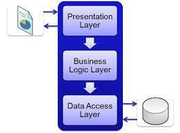

# Part 3：All-in-One、分层架构与 Clean Architecture 的对比

> 用途: 调研参考（非开发依据）· 逐篇忠实对译，主题串读见 [01](01-foundations-and-principles.md)，横向判读见 [09](09-critique-and-repo-mapping.md)

## 原文信息

| 项 | 值 |
| --- | --- |
| 原标题 | Part 3:Comparing All-in-One Architecture, Layered Architecture, and Clean Architecture |
| 链接 | https://dev.to/moh_moh701/comparing-all-in-one-architecture-layered-architecture-and-clean-architecture-e28 |
| 作者 | mohamed Tayel（`moh_moh701`） |
| 发布时间 | 2024-07-05T22:05:32Z |
| 系列 | Clean Architecture（collection 28557）第 3 篇 |
| 平台标注阅读时长 | 2 分钟 |
| 反应数 / 评论数 | 64 / 0 |
| 标签 | `architecture` |
| AI 披露状态 | `not_disclosed` |
| dev.to 文章 id | 1913219 |
| 本篇原图 | 2 张（已下载至 `imges/`） |

---

## 逐段对译

### 开篇

> In software design, choosing the right architecture is crucial for ensuring maintainability, scalability, and robustness of the application. This article provides a simple comparison between All-in-One architecture, Layered architecture, and Clean Architecture.

在软件设计中，选对架构对保证应用的可维护性、可伸缩性与健壮性至关重要。本文对 **All-in-One 架构、分层架构、Clean Architecture** 做一个简单对比。

### All-in-One Architecture（一体化架构）

**Overview（概述）**，原文逐条：

- Contained typically in one (large) Visual Studio project.（通常装在一个（大型）Visual Studio 项目里。）
- Starts with File → New Project.（从「文件 → 新建项目」开始。）
- "Layers" are represented as folders within the project.（所谓"层"只是项目内的文件夹。）

**Pros（优点）**：部署过程简单；初始开发更容易（所有组件都在一处）；因为没有服务间通信开销，性能更容易优化。

**Cons（缺点）**：应用变大后难以维护；伸缩性受限（扩一部分就要扩整体）；**一个 bug 可能拖垮整个应用**。

**Use Case（适用场景）**：适合小型、直截了当的应用或早期创业阶段——此时快速开发比长期可维护性更重要。

### Layered Architecture（分层架构）

**Overview**：按关注点切分，把应用分成表现层、业务逻辑层、数据访问层（有时更多）；**每层只与相邻层交互**。

**Pros**：便于跨应用复用层；关注点分离清晰所以更易维护；可插拔（层可独立替换或更新）。

**Cons**：层间仍存在耦合，会产生依赖；整体仍表现为单个应用，**一层的故障可能影响整个应用**；层间通信开销会影响性能。

**Use Case**：适合中到大型应用——在这些场景里关注点分离对可维护性与可伸缩性至关重要。

### Clean Architecture

> 注意：本节**没有配图**，且原文在这一层没有沿用前两节的"Overview/Pros/Cons/Use Case"完全一致的展开深度（Pros/Cons 各 3 条），也没有给出任何代码或目录示例。

**Overview**：Clean Architecture 是一种设计理念，强调关注点分离以及对框架、数据库等外部机构的独立；它把代码组织成把业务逻辑与基础设施、用户界面分离的层。

**Pros**：关注点分离清晰带来高可维护性与可测试性；独立于框架与技术，便于替换组件；有利于伸缩并灵活响应需求变化。

**Cons**：初期实现比简单架构更复杂；需要对设计原则与架构模式有更深的理解；在不需要如此严谨的小应用上会引入额外开销。

**Use Case**：适合长期可维护性、可测试性与灵活性至关重要的大型复杂应用。

### Comparison Summary（对比小结）

原文表格逐字照录（列名与单元格内容与原文一致）：

| Aspect | All-in-One Architecture | Layered Architecture | Clean Architecture |
| --- | --- | --- | --- |
| **Deployment** | Simple | Layered | Modular |
| **Scalability** | Limited | Moderate | High |
| **Maintainability** | Low | Moderate | High |
| **Complexity** | Low | Moderate | High |
| **Use Case** | Small applications | Medium to large applications | Large, complex applications |

对译：部署（简单 / 分层 / 模块化）、伸缩性（受限 / 中等 / 高）、可维护性（低 / 中 / 高）、复杂度（低 / 中 / 高）、适用场景（小应用 / 中大应用 / 大型复杂应用）。

原文结尾两段：

> By understanding the strengths and weaknesses of each architecture, you can choose the one that best fits the needs of your application. For a deeper dive into Clean Architecture, you can refer to [this article](https://dev.to/moh_moh701/part-1-what-is-clean-architecture-4bn1).
>
> This comparison highlights how each architecture has its place in software development, and the right choice depends on the specific requirements and constraints of your project.

对译：理解了各架构的强弱，你就能选出最契合应用需要的那一种；想更深入 Clean Architecture 可参考（P1 那篇）。本对比说明每种架构在软件开发中各有其位，正确选择取决于项目-specific 的需求与约束。

---

## 整理注记

- **这张表把 Layered 与 Clean 的差异描述得过轻**：唯一的差别落在 "Deployment: Layered vs Modular" 与 "Complexity: Moderate vs High"，而真正的分水岭——**依赖方向**——在表里完全没出现。传统分层是上层依赖下层（表现层 → 业务层 → 数据层，最不稳定的是数据层却处在被依赖的位置）；CA 通过 DIP 把"数据访问抽象"放进应用核心、把"数据库实现"甩到外围，于是**最内层最稳定、最外层最可替换**。
- **表格读起来像"三档复杂度阶梯"**，容易误导成"项目大了就升级到 CA"，而忽略真正的判据是"是否值得为可替换性与可测性付出结构成本"。
- **"一个 bug 拖垮整个应用"被同时列为 All-in-One 与 Layered 的缺点**，但这个缺点在 CA 一节没有被声明解决——CA 若仍以单进程单体部署（本仓与原文示例都是如此），单体内一处崩溃照样影响全部。**这一条是三张对比里最经不起推敲的**：进程边界与源码依赖方向是两件事，作者把它们混在一张表里比较。
- **Clean 一节无图、无代码、无目录结构**，而前两节各有配图与具体描述；这也是 P1–P3 被读者评为"概念篇"的原因，实操从 P4 才开始。
- **本篇 0 条评论、64 反应**（P1 是 415 反应 / 19 评论）：从数据看，这是三篇概念文里传播最弱的一篇。

## 与本仓对照（本篇）

| 原文论点 | 本仓实态 |
| --- | --- |
| All-in-One = "层只是文件夹" | 本仓不是这种形态：层居**不同 package**（`libs/core` / `libs/contracts` / `apps/api`），跨层引用要改 package 依赖，不是文件夹约定 |
| Layered 的"层间耦合" | 本仓 `apps/api/src/modules/<上下文>` 内部确实保留 `domain → application → infrastructure → api` 的目录序，但**依赖方向由 port/adapter 反转**（仓储接口在 `application`、实现在 `infrastructure`） |
| "复杂度 High 是小应用的额外开销" | 本仓立场一致：`docs/plans` 里的审计门要求先有已审方案再拆层，反对无必要的四层化（见 AGENTS.md §2「无已审方案不写码」） |

---

## 评论区实录

本篇 **0 条评论**（API `?a_id=1913219` 返回空数组，`comments_count: 0`，页面无「View full discussion」计数与隐藏标记）。

---

## 附：原文英文全稿（逐字保留）

> 来源：dev.to 官方 API `body_markdown` 字段（作者原始稿），抓取于 2026-10-21；除把图片链接改为本地 `./imges/` 副本（原始 URL 保留在链接 title 中）外，未作任何增删改。
>
> 呈现口径：以下英文全稿**不做代码块包裹、直接按 Markdown 渲染**（保留作者原始标题层级、粗体、列表、代码块与图片）；逐字性以上述 body_markdown 抓取为准，本区未增删改任何文字。

In software design, choosing the right architecture is crucial for ensuring maintainability, scalability, and robustness of the application. This article provides a simple comparison between All-in-One architecture, Layered architecture, and Clean Architecture.

#### All-in-One Architecture

**Overview:**
- Contained typically in one (large) Visual Studio project.
- Starts with File → New Project.
- “Layers” are represented as folders within the project.

**Pros:**
- Simple deployment process.
- Easier to develop initially, as all components are in one place.
- Performance can be optimized more easily as there is no inter-service communication overhead.

**Cons:**
- Can be difficult to maintain as the application grows.
- Scalability is limited; scaling one part of the application requires scaling the entire application.
- A single bug can potentially bring down the entire application.

**Use Case:**
- Suitable for small, straightforward applications or startups in the early stages where rapid development is more critical than long-term maintainability.

#### Layered Architecture

**Overview:**
- Split according to concern, dividing the application into layers such as presentation, business logic, data access, and sometimes more.
- Each layer has a specific responsibility and interacts only with the adjacent layers.

**Pros:**
- Promotes reuse of layers across different applications.
- Easier to maintain due to clear separation of concerns.
- Pluggable, allowing for layers to be swapped or updated independently.

**Cons:**
- Still involves coupling between layers, which can lead to dependencies.
- Behaves as a single application, meaning that issues in one layer can affect the entire application.
- Performance can be affected by the overhead of communication between layers.

**Use Case:**
- Suitable for medium to large applications where separation of concerns is crucial for maintainability and scalability.

#### Clean Architecture

**Overview:**
- Clean Architecture is a design philosophy that emphasizes separation of concerns and independence of frameworks, databases, and other external agencies.
- It organizes code into layers that separate the business logic from the infrastructure and user interface.

**Pros:**
- High maintainability and testability due to clear separation of concerns.
- Independence from frameworks and technologies, making it easier to swap out components.
- Facilitates scalability and flexibility in responding to changing requirements.

**Cons:**
- More complex to implement initially compared to simpler architectures.
- Requires a deeper understanding of design principles and architectural patterns.
- Can introduce overhead in small applications where such rigor is unnecessary.

**Use Case:**
- Ideal for large, complex applications where long-term maintainability, testability, and flexibility are critical.

### Comparison Summary

| Aspect               | All-in-One Architecture      | Layered Architecture       | Clean Architecture       |
|----------------------|------------------------------|----------------------------|--------------------------|
| **Deployment**       | Simple                       | Layered                    | Modular                  |
| **Scalability**      | Limited                      | Moderate                   | High                     |
| **Maintainability**  | Low                          | Moderate                   | High                     |
| **Complexity**       | Low                          | Moderate                   | High                     |
| **Use Case**         | Small applications           | Medium to large applications | Large, complex applications |

By understanding the strengths and weaknesses of each architecture, you can choose the one that best fits the needs of your application. For a deeper dive into Clean Architecture, you can refer to [this article](https://dev.to/moh_moh701/part-1-what-is-clean-architecture-4bn1).

This comparison highlights how each architecture has its place in software development, and the right choice depends on the specific requirements and constraints of your project.
