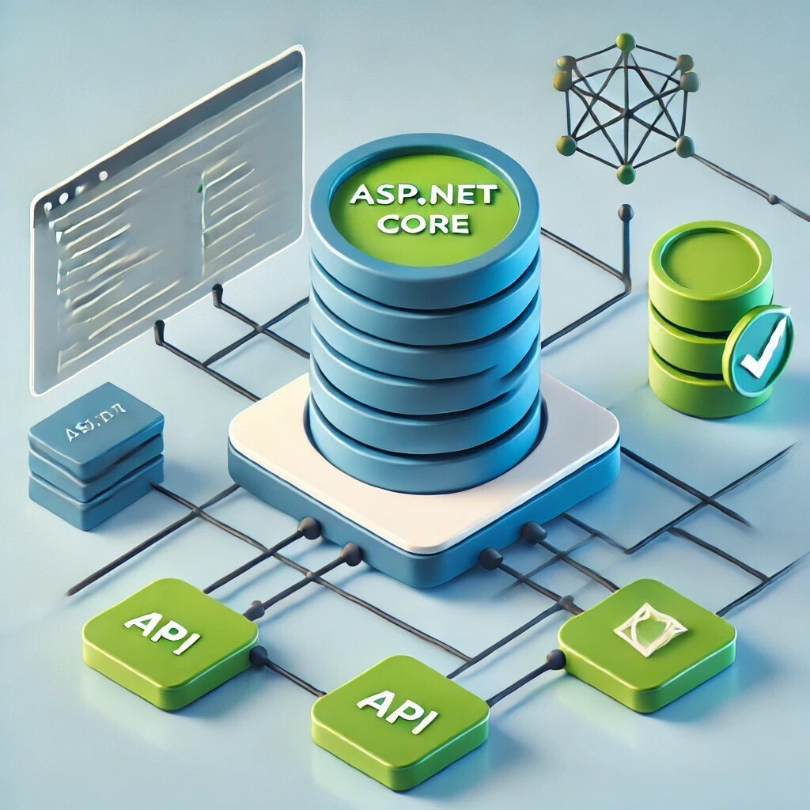
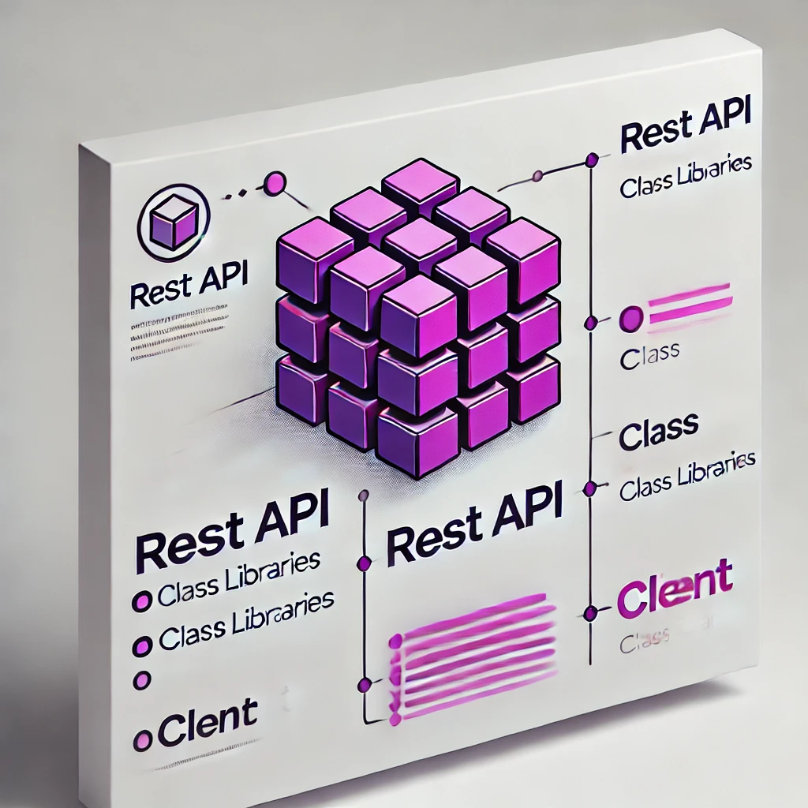

# Part 5：确立核心——只做后端与技术栈站队

> 用途: 调研参考（非开发依据）· 逐篇忠实对译，主题串读见 [02](02-from-business-need-to-skeleton.md)，横向判读见 [09](09-critique-and-repo-mapping.md)

## 原文信息

| 项 | 值 |
| --- | --- |
| 原标题 | Clean Architecture P5: Establishing the Core Foundation |
| 链接 | https://dev.to/moh_moh701/setting-up-the-application-core-and-architecture-for-aspnet-core-8-hcb |
| 作者 | mohamed Tayel（`moh_moh701`） |
| 发布时间 | 2024-08-26T20:05:40Z（与 P4 相隔 2 小时 15 分，同日连发） |
| 系列 | Clean Architecture（collection 28557）第 5 篇 |
| 平台标注阅读时长 | 2 分钟 |
| 反应数 / 评论数 | 2 / 0 |
| 标签 | `architecture` `dotnetcore` |
| AI 披露状态 | `not_disclosed` |
| dev.to 文章 id | 1974289 |
| 本篇原图 | 2 张（已下载至 `imges/`） |

---

## 逐段对译

### 开篇

> With a clear understanding of the business requirements, we are now ready to set up the application architecture. This setup is crucial as it lays the foundation for building a robust and scalable system. Our focus will be entirely on the backend, using a clean architecture approach with ASP.NET Core 8. Although client implementations are possible, they are not within the scope of this series.

在业务需求已经明确之后，我们准备搭建应用架构。这一步至关重要，因为它为构建健壮、可伸缩的系统打下基础。**本系列的焦点完全在后端**，采用 ASP.NET Core 8 上的 clean architecture 做法；**客户端实现虽然可能，但不在本系列范围内**。

### Backend-Focused Architecture（后端导向的架构）

> Our backend architecture centers on an ASP.NET Core API, which will serve as the hub for all business logic and data access. The API connects to a SQL Server database, a choice driven by GloboTicket's existing infrastructure. By focusing on the API and data layer, we ensure that the system is both scalable and flexible, prepared to integrate with various client technologies if necessary.

后端架构以 **ASP.NET Core API** 为中心，它是所有业务逻辑与数据访问的枢纽；API 连接 **SQL Server** 数据库——这个选择由 **GloboTicket 已有的基础设施**决定。聚焦 API 与数据层，可保证系统既可伸缩又灵活，必要时能与各种客户端技术集成。

### Technology Stack（技术栈）

原文三条逐字：

- **ASP.NET Core 8**: The API will be built using ASP.NET Core 8, leveraging its powerful features for developing modern, cloud-ready applications.
  API 用 ASP.NET Core 8 构建，利用其面向现代、云就绪应用的强大能力。
- **Entity Framework Core 8**: For data access, we will use Entity Framework Core 8, allowing seamless interaction with the SQL Server database.
  数据访问使用 Entity Framework Core 8，与 SQL Server 无缝交互。
- **Clean Architecture**: The application will adhere to clean architecture principles, ensuring that the core business logic remains independent of external concerns such as the database or client applications.
  应用遵循 clean architecture 原则，确保核心业务逻辑独立于数据库、客户端等外部关注点。

### Clean and Maintainable Code（干净可维护的代码）

> By isolating the core business logic from infrastructure concerns, we maintain a clean and modular codebase. This separation allows for easier testing, maintenance, and future enhancements. Although our focus remains on the backend, this architecture supports integration with various clients, such as Blazor, Maui, Angular, or React, if needed in the future.

把核心业务逻辑与基础设施关注点隔离，就能保持干净、模块化的代码库；这种分离让测试、维护与未来增强都更容易。虽然焦点仍在后端，但该架构支持将来与 **Blazor、Maui、Angular、React** 等各种客户端集成。

### Summary（小结）

> In this series, we will walk through setting up the backend architecture for a ticket management system, focusing on ASP.NET Core 8 and Entity Framework Core 8. While we won't dive into client-side implementations, the API will be designed to support any future client needs. This approach ensures that our application is both powerful and adaptable, ready for any challenges that may come its way. For more detailed guidance on this architecture, you can refer to the [ASP.NET Core 6 Clean Architecture course on Pluralsight](https://app.pluralsight.com/library/courses/asp-dot-net-core-6-clean-architecture/table-of-contents).

本系列将演示如何为一个票务管理系统搭建后端架构，聚焦 ASP.NET Core 8 与 EF Core 8；不深入客户端实现，但 API 会被设计成可支撑任何未来客户端需求。文末再次指向 Pluralsight 课程。

> **注意原文自身的一处不一致**：正文说的是 **ASP.NET Core 8**，而文末链接与课程标题是 **ASP.NET Core 6 Clean Architecture**（P1、P4 也反复指向同一门 6 的课程）。作者没有说明版本差异如何处理——这是"知识来源（.NET 6 课程）与落地版本（.NET 8）"之间的未加声明的缝隙。

---

## 整理注记

- **本篇是全系列唯一的"技术栈站队"文档**，做出的三个选择各有代价，原文都未展开：
  1. **锁 EF Core + SQL Server**：后面 P16 的实现因此完全按 EF Core 的口味设计（`DbContext` 直接 `SaveChangesAsync`、`HasData` 种子、`IEntityTypeBuilder` 配置），仓储抽象（P8 的 `IAsyncRepository<T>`）实际上是**围着 EF Core 的能力形状挖的坑**，换成别的 ORM 未必填得进——这与 CA「独立于框架/技术」的宣言相冲突。
  2. **"客户端不在范围内"**：于是 P19 结束后没有前端、没有认证授权（作者只在 P15 评论区承诺将来补 Identity），本系列交付的是一个**无鉴权的公开写接口**（见 [part-18](part-18-api-layer.md) 的 CORS 缺陷）。
  3. **宣称可对接 Blazor/Angular/React，但契约层没有任何设计**：没有 OpenAPI 约定、没有版本化、没有跨端 DTO 单源——"支持任何客户端"只是意愿，不是机制。
- **"a choice driven by GloboTicket's existing infrastructure"（由客户既有基础设施决定选 SQL Server）**是原文中少见的**架构决策溯源**范例：选型挂在约束上，而不是挂在"我们喜欢"上。本仓选型同理走约束链（国内镜像、PostgreSQL 已有、MikroORM 与 ESM 兼容性），见 `docs/plans/global-orm-mikro-constitution-amendment.md`。
- 本篇 2 个反应、0 评论。

## 与本仓对照（本篇）

| 本篇选择 | 本仓选择 | 差异要点 |
| --- | --- | --- |
| ASP.NET Core 8 Web API | NestJS 12 + Fastify 5（`apps/api`，前缀 `/api/v1`） | 本仓**显式版本化前缀**；原文无路由版本化设计 |
| EF Core 8 | **MikroORM** + PostgreSQL（工具红线，禁 Prisma/TypeORM） | 本仓 ORM 被宪法锁定，且映射与领域分离有专门迁移文档 |
| SQL Server | PostgreSQL | — |
| 客户端不在范围 | `apps/web`（React + Vite，dev :5173 反代 7009）**在同仓同 CI 内** | 本仓前后端同 workspace，跨端契约居 `libs/contracts` |
| "可对接任意客户端"（无机制） | 契约单源 + OpenAPI 产物（`openapi/openapi.yaml`）+ `packages/api-client` | 本仓把该承诺落成机制 |

---

## 评论区实录

本篇 **0 条评论**（API `?a_id=1974289` 返回空数组，`comments_count: 0`）。

---

## 附：原文英文全稿（逐字保留）

> 来源：dev.to 官方 API `body_markdown` 字段（作者原始稿），抓取于 2026-10-21；除把图片链接改为本地 `./imges/` 副本（原始 URL 保留在链接 title 中）外，未作任何增删改。
>
> 呈现口径：以下英文全稿**不做代码块包裹、直接按 Markdown 渲染**（保留作者原始标题层级、粗体、列表、代码块与图片）；逐字性以上述 body_markdown 抓取为准，本区未增删改任何文字。

With a clear understanding of the business requirements, we are now ready to set up the application architecture. This setup is crucial as it lays the foundation for building a robust and scalable system. Our focus will be entirely on the backend, using a clean architecture approach with ASP.NET Core 8. Although client implementations are possible, they are not within the scope of this series.

#### Backend-Focused Architecture

Our backend architecture centers on an ASP.NET Core API, which will serve as the hub for all business logic and data access. The API connects to a SQL Server database, a choice driven by GloboTicket’s existing infrastructure. By focusing on the API and data layer, we ensure that the system is both scalable and flexible, prepared to integrate with various client technologies if necessary.

#### Technology Stack

- **ASP.NET Core 8**: The API will be built using ASP.NET Core 8, leveraging its powerful features for developing modern, cloud-ready applications.
- **Entity Framework Core 8**: For data access, we will use Entity Framework Core 8, allowing seamless interaction with the SQL Server database.
- **Clean Architecture**: The application will adhere to clean architecture principles, ensuring that the core business logic remains independent of external concerns such as the database or client applications.

#### Clean and Maintainable Code

By isolating the core business logic from infrastructure concerns, we maintain a clean and modular codebase. This separation allows for easier testing, maintenance, and future enhancements. Although our focus remains on the backend, this architecture supports integration with various clients, such as Blazor, Maui, Angular, or React, if needed in the future.

#### Summary

In this series, we will walk through setting up the backend architecture for a ticket management system, focusing on ASP.NET Core 8 and Entity Framework Core 8. While we won’t dive into client-side implementations, the API will be designed to support any future client needs. This approach ensures that our application is both powerful and adaptable, ready for any challenges that may come its way.

For more detailed guidance on this architecture, you can refer to the [ASP.NET Core 6 Clean Architecture course on Pluralsight](https://app.pluralsight.com/library/courses/asp-dot-net-core-6-clean-architecture/table-of-contents).
