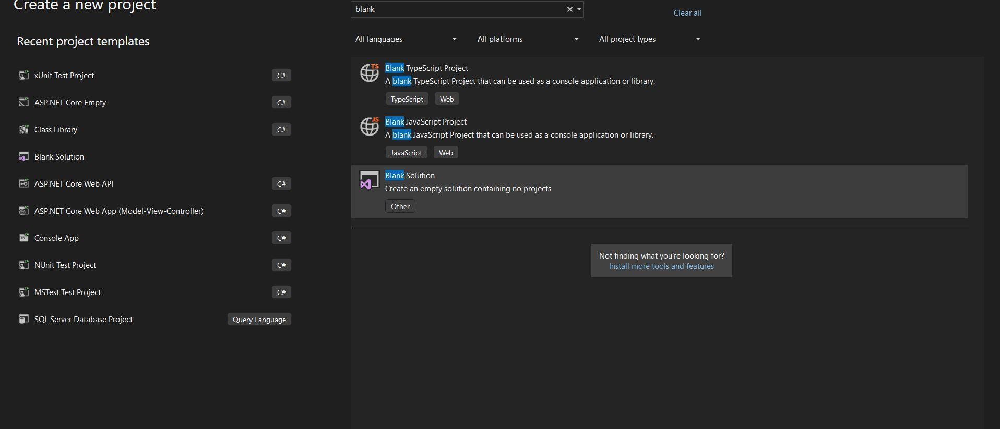
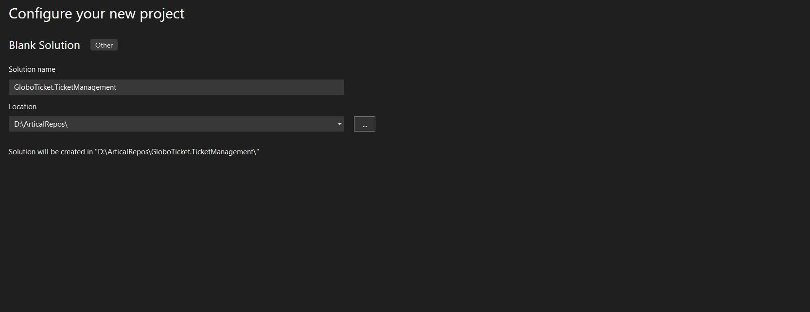
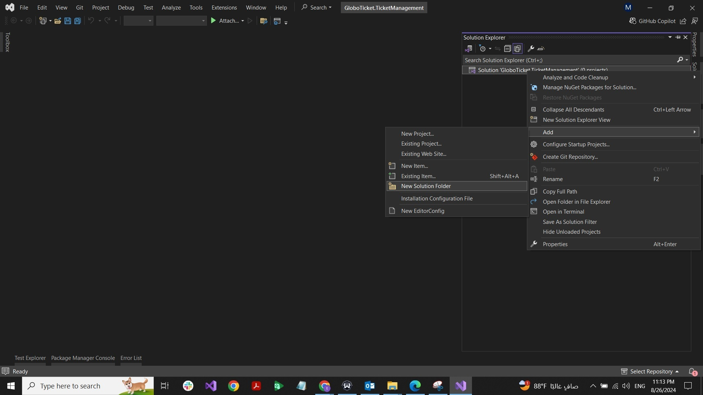
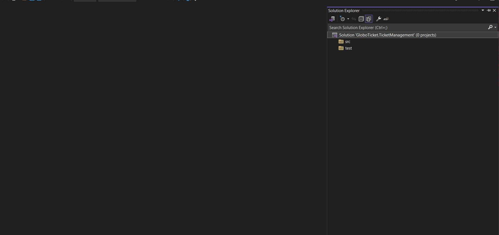
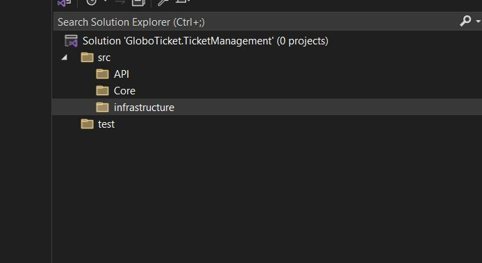

# Part 6：在 Visual Studio 里搭 Solution 骨架（src / test / API / Core / Infrastructure）

> 用途: 调研参考（非开发依据）· 逐篇忠实对译，主题串读见 [02](02-from-business-need-to-skeleton.md)，横向判读见 [09](09-critique-and-repo-mapping.md)

## 原文信息

| 项 | 值 |
| --- | --- |
| 原标题 | What is Clean Architecture: Part 6 - Structuring the Application Core with Visual Studio |
| 链接 | https://dev.to/moh_moh701/getting-started-structuring-the-application-core-with-visual-studio-4bk8 |
| 作者 | mohamed Tayel（`moh_moh701`） |
| 发布时间 | 2024-08-26T20:35:56Z（P4/P5/P6/P7 **同一天 3.5 小时内连发 4 篇**） |
| 系列 | Clean Architecture（collection 28557）第 6 篇 |
| 平台标注阅读时长 | 2 分钟 |
| 反应数 / 评论数 | 1 / 0 |
| 标签 | `architecture` `dotnetcore` `softwareengineering` |
| AI 披露状态 | `not_disclosed` |
| dev.to 文章 id | 1974311 |
| 本篇原图 | 5 张（已下载至 `imges/`，本篇是截图教学的第一篇） |

---

## 逐段对译（本篇原文**逐字保留 IDE 操作步骤**，不做精简）

### 开篇

> In this demo, we'll set up the solution and establish a basic structure in Visual Studio. Starting with a blank slate allows us to organize everything neatly from the beginning, ensuring a clean and maintainable architecture.

本演示将在 Visual Studio 中建立 solution 与基本结构。从空白开始能让我们从一开始就把一切整理干净，确保得到干净且可维护的架构。

### Step 1: Start with a Blank Solution（从空 Solution 开始）

> First, let's create a blank solution. In Visual Studio, select the **Blank Solution** template.

先创建空 solution：在 Visual Studio 中选择 **Blank Solution** 模板。

> Name the solution `GloboTicket.TicketManagement` and choose the directory where you want to save it.

把 solution 命名为 `GloboTicket.TicketManagement`，并选择保存目录。

### Step 2: Organize the Solution Structure（组织 solution 结构）

> Before we start coding, let's prepare a few solution folders that will help keep the project organized. Begin by adding two main folders: one for the source code (`src`) and one for the tests (`test`).

开始编码前，先准备若干 **solution folder**（Visual Studio 的概念，非磁盘目录）以帮助保持工程有序。**先加两个主文件夹：一个放源码 `src`，一个放测试 `test`。**

### Step 3: Organize the src folder（组织 src 文件夹）

> Under the `src` folder, we will further organize the solution by adding specific folders for the API, Core, and Infrastructure. This structure will ensure that our clean architecture principles are reflected in the solution layout.

在 `src` 下再细分为 **API、Core、Infrastructure** 三个 solution folder。这个结构让 clean architecture 原则**体现在 solution 布局上**。

### 收尾两段

> This process sets up the foundation for a clean, well-organized project in Visual Studio, making it easier to adhere to clean architecture principles as you progress.
>
> Finally, in the next steps, we'll be ready to add the actual projects into these folders, keeping the solution structure clean and manageable from the start.

这一过程为 Visual Studio 中干净、井井有条的工程打下基础，使后续更容易遵循 CA 原则；下一步就是往这些文件夹里放入真正的 project，让 solution 结构从一开始就干净、可管理。

---

## 整理注记

- **本篇产出的不是架构，而是"目录约定"**。CA 的实质是依赖方向（谁引用谁），本篇只完成了一次**视觉整理**：`src/{API,Core,Infrastructure}` + `test/`。真正的依赖约束要到 P18（API 的 csproj 引用三个工程）才第一次可被验证。
- **层名与 P1/P7 三处不一致，本篇是源头之一**：这里的三分法是 `API / Core / Infrastructure`（Core 内含 Domain+Application），而 P1 讲四层同心圆、P7 起实际用 `Domain / Application / Infrastructure / Persistence / API`。**读者若在 P6 就按"三大块"心智模型理解，后面很难理解为什么 Application 与 Infrastructure 之间还要倒置依赖。**
- **`test` 文件夹建了，但全系列 19 篇从未在其中放任何一个工程**：作者在 P1 宣称 CA 的收益之一是 "Improved Testability / 更容易写单元测试"，而本教程的可测试性收益**从未被兑现成测试代码**。这是全系列最重要的一条"言行落差"，也是 09 判读里的头一条。
- 截图密度从本篇开始陡增（P6 5 张、P7 8 张、P10 10 张）：这也解释了流量塌陷——**内容从"讲原则"变成了"IDE 操作录屏"**，与本系列标题里的 architecture 关系变弱（见 [part-04 注记](part-04-business-need-globoticket.md) 的反应数对比）。
- 与本仓的形态差异：本仓用 **pnpm workspace 四包**（`libs/core`、`libs/contracts`、`apps/api`、`apps/web`）承载层边界，跨层引用必须改 package 依赖，因此"层"是**构建期可校验的**；本仓另有 `pnpm run ci`（check→build→test）与 fallow 静态分析兜底。本系列在 .NET 里靠 csproj 引用来做同样的事，但**没有任何一条 CI 或 lint 规则守护依赖方向**（作者未提及 ArchUnitNet 之类的架构测试）。

## 与本仓对照（本篇）

| 本篇骨架 | 本仓对应 | 备注 |
| --- | --- | --- |
| `GloboTicket.TicketManagement`（solution 名） | workspace 根 `nestjs-project-template` + `pnpm-workspace.yaml` | — |
| `src` / `test` solution folder | `apps/` `libs/` + 就近 `*.spec.ts` / `*.e2e.test.ts` | 本仓测试**真实存在并入门禁**（`pnpm run ci`），与本篇"建了 test 但零测试"形成对照 |
| `src/{API, Core, Infrastructure}` | `apps/api` + `libs/core`（@core 共享内核）+ `libs/contracts` | 本仓把 contracts 独立成包（跨端 zod 单源），本系列无对应物 |
| 无 | `apps/api/src/modules/<上下文>/{domain,application,infrastructure,api}` | 本仓层边界在**上下文内部**（垂直切片），不在 solution 顶层（水平分层） |

---

## 评论区实录

本篇 **0 条评论**（API `?a_id=1974311` 返回空数组，`comments_count: 0`）。

---

## 附：原文英文全稿（逐字保留）

> 来源：dev.to 官方 API `body_markdown` 字段（作者原始稿），抓取于 2026-10-21；除把图片链接改为本地 `./imges/` 副本（原始 URL 保留在链接 title 中）外，未作任何增删改。
>
> 呈现口径：以下英文全稿**不做代码块包裹、直接按 Markdown 渲染**（保留作者原始标题层级、粗体、列表、代码块与图片）；逐字性以上述 body_markdown 抓取为准，本区未增删改任何文字。

In this demo, we’ll set up the solution and establish a basic structure in Visual Studio. Starting with a blank slate allows us to organize everything neatly from the beginning, ensuring a clean and maintainable architecture.

#### Step 1: Start with a Blank Solution

First, let’s create a blank solution. In Visual Studio, select the **Blank Solution** template.

Name the solution `GloboTicket.TicketManagement` and choose the directory where you want to save it.

#### Step 2: Organize the Solution Structure

Before we start coding, let’s prepare a few solution folders that will help keep the project organized. Begin by adding two main folders: one for the source code (`src`) and one for the tests (`test`).

#### Step 3: Organize the src folder 

Under the `src` folder, we will further organize the solution by adding specific folders for the API, Core, and Infrastructure. This structure will ensure that our clean architecture principles are reflected in the solution layout.

This process sets up the foundation for a clean, well-organized project in Visual Studio, making it easier to adhere to clean architecture principles as you progress. 

Finally, in the next steps, we'll be ready to add the actual projects into these folders, keeping the solution structure clean and manageable from the start.
