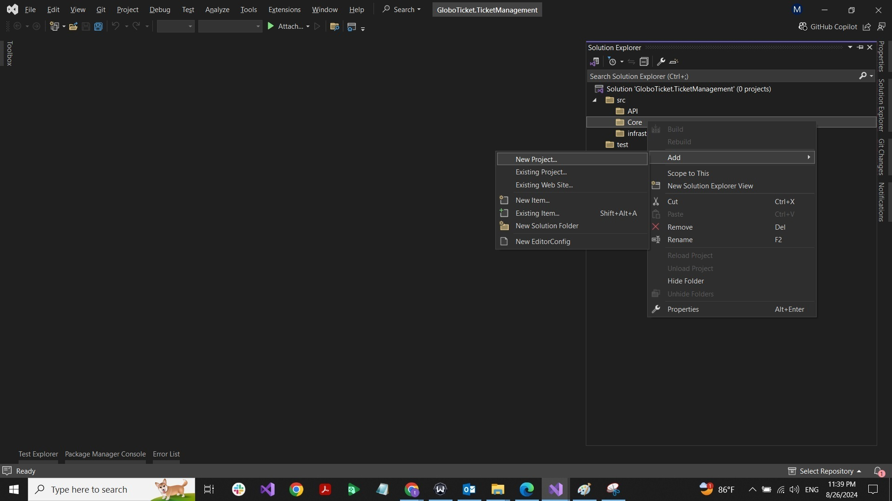
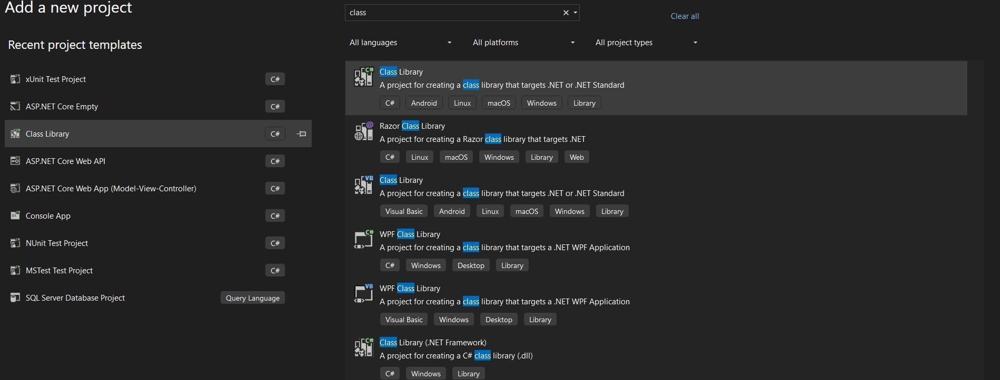
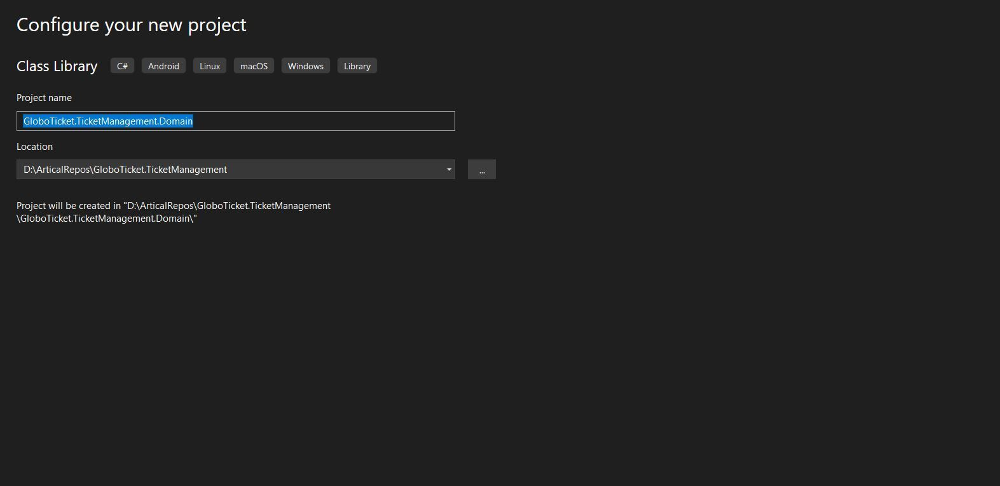
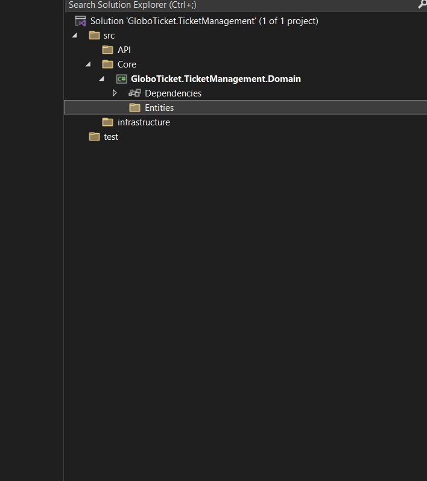
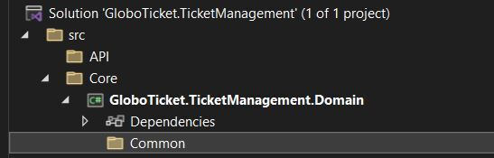
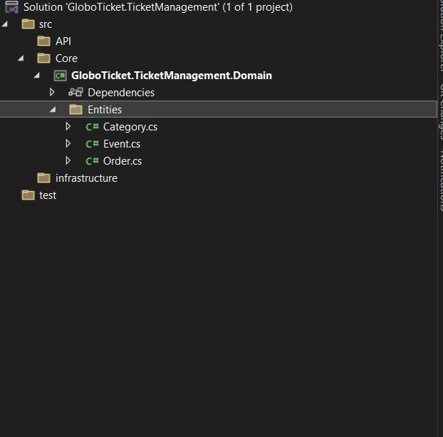
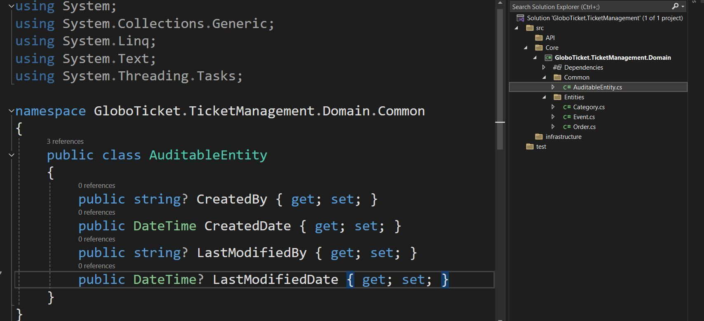
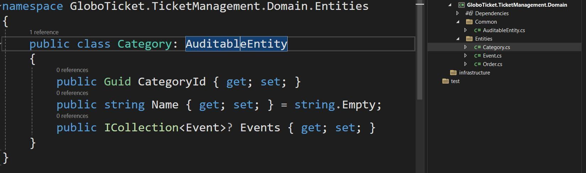

# Part 7：创建 Domain 工程（Category / Event / Order / AuditableEntity）

> 用途: 调研参考（非开发依据）· 逐篇忠实对译，主题串读见 [03](03-domain-layer.md)，横向判读见 [09](09-critique-and-repo-mapping.md)

## 原文信息

| 项 | 值 |
| --- | --- |
| 原标题 | What is Clean Architecture: Part 7 - Create Domain Project |
| 链接 | https://dev.to/moh_moh701/clean-architecture-p7create-domain-project-eca |
| 作者 | mohamed Tayel（`moh_moh701`） |
| 发布时间 | 2024-08-26T21:24:53Z（P4–P7 同日连发的最后一篇） |
| 系列 | Clean Architecture（collection 28557）第 7 篇 |
| 平台标注阅读时长 | 3 分钟 |
| 反应数 / 评论数 | 5 / 0（P4–P19 中除 P15 外最高，但仍不足 P1 的 1.2%） |
| 标签 | `architecture` `dotnetcore` `softwareengineering` `designsystem` |
| AI 披露状态 | `not_disclosed` |
| dev.to 文章 id | 1974326 |
| 本篇原图 | 8 张（已下载至 `imges/`） |
| 示例仓库 | https://github.com/mohamedtayel1980/clean-architecture（本篇文末首次给出） |

---

## 逐段对译（IDE 步骤与代码**全量照录**）

### 开篇

> In this article, we'll walk through the process of setting up the domain layer of our application by creating a Visual Studio solution. This domain layer will house the core entities that define our application's business logic. We'll implement this using a clean architecture approach, which ensures that our domain remains independent of external dependencies like data access or UI frameworks.

本篇演示如何通过创建 Visual Studio solution 来搭建应用的 **domain 层**。这一层存放定义业务逻辑的核心实体；采用 clean architecture 做法，**确保领域独立于数据访问、UI 框架等外部依赖**。

### Creating the Domain Project（创建 Domain 工程）

> Based on the domain discussed during the initial planning stage, we will start by setting up the domain project. The domain will be a part of the Core application, which typically includes all the business logic and core entities of the application. We'll place this domain in a separate project, keeping it independent and focused.

依据初始规划阶段讨论出的领域，先建立 domain 工程。**Domain 属于 Core 应用的一部分**（Core 通常包含全部业务逻辑与核心实体），但要把 domain 放到**独立工程**里，保持其独立与聚焦。

### Steps to Create the Domain Project

**1. Add a New Class Library Project（新建类库工程）**

- Start by creating a new class library project within your Visual Studio solution.（在 solution 中新建 class library。）
- Navigate to the solution explorer, right-click on the Core folder, and select `Add > New Project...`.（在 Solution Explorer 里右键 **Core 文件夹**，选 `Add > New Project...`。）
- In the project templates, search for "Class Library," choose the C# version, and name the project `GloboTicket.TicketManagement.Domain`.（在模板中搜 "Class Library"，选 **C# 版**，工程命名 `GloboTicket.TicketManagement.Domain`。）







**2. Set Up the Project Structure（组织工程结构）**

- Once the project is created, delete the default `Class1.cs` file.（工程建好后**删掉默认的 `Class1.cs`**。）
- Organize the project by creating the following folders:（按下列文件夹组织：）
  - **Entities**: This folder will contain our domain entities like `Event`, `Category`, and `Order`.（放领域实体 `Event` / `Category` / `Order`。）



  - **Common**: This folder will house common classes that other entities might inherit, such as the `AuditableEntity`.（放其他实体可能继承的公共类，例如 `AuditableEntity`。）



**3. Create Domain Entities（创建领域实体）**



**Category.cs**（原文逐字）

```csharp
public class Category 
{
    public Guid CategoryId { get; set; }
    public string Name { get; set; } = string.Empty;
    public ICollection<Event>? Events { get; set; }
}
```

**Event.cs**（原文逐字）

```csharp
public class Event 
{
    public Guid EventId { get; set; }
    public string Name { get; set; } = string.Empty;
    public int Price { get; set; }
    public string? Artist { get; set; }
    public DateTime Date { get; set; }
    public string? Description { get; set; }
    public string? ImageUrl { get; set; }
    public Guid CategoryId { get; set; }
    public Category Category { get; set; } = default!;
}
```

**Order.cs**（原文逐字）

```csharp
public class Order 
{
    public Guid Id { get; set; }
    public Guid UserId { get; set; }
    public int OrderTotal { get; set; }
    public DateTime OrderPlaced { get; set; }
    public bool OrderPaid { get; set; }
}
```

**AuditableEntity.cs**（放 `Common` 文件夹，原文逐字）



```csharp
public class AuditableEntity
{
    public string? CreatedBy { get; set; }
    public DateTime CreatedDate { get; set; }
    public string? LastModifiedBy { get; set; }
    public DateTime? LastModifiedDate { get; set; }
}
```

**4. Inherit Common Properties（继承公共属性）**

> The `Category`, `Event`, and `Order` entities all inherit from `AuditableEntity`, which provides common properties like `CreatedBy`, `CreatedDate`, `LastModifiedBy`, and `LastModifiedDate`. This inheritance allows for easy tracking of who created or modified records.

`Category`、`Event`、`Order` **三个实体都继承 `AuditableEntity`**，从而获得 `CreatedBy` / `CreatedDate` / `LastModifiedBy` / `LastModifiedDate`，便于追踪记录被谁创建或修改。



**Category.cs**（改后，原文逐字——注意原文缩进即如此）

```csharp
public class Category: AuditableEntity
{
    public Guid CategoryId { get; set; }
    public string Name { get; set; } = string.Empty;
    public ICollection<Event>? Events { get; set; }
}
```

> **原文只给出了 `Category` 继承后的代码，`Event` 与 `Order` 的改后版本没有贴出**（声明了要做、实际只演示一个）。据示例仓库与 P16 的 `ChangeTracker.Entries<AuditableEntity>()` 推断，两者最终同样继承了 `AuditableEntity`——**此处属推断，非原文实存**。

### Conclusion

> With these steps, we have successfully set up the core domain project for our application. This project is now ready to be expanded with additional business logic and connected to other layers, such as the infrastructure and UI. Keeping the domain project clean and focused ensures that our application remains maintainable and scalable.
>
> For the complete source code, you can visit the GitHub repository: [Clean Architecture on GitHub](https://github.com/mohamedtayel1980/clean-architecture).

至此核心 domain 工程搭建完成，"准备好被扩展以容纳更多业务逻辑，并与 infrastructure、UI 等其他层连接"；保持 domain 干净聚焦可让应用可维护、可伸缩。文末**首次给出示例仓库地址**。

---

## 整理注记（本篇是全系列贫血立场的确证点）

- **做对的事**：Domain 工程**零 NuGet 依赖、零框架引用**（只 `class` + `Guid`/`DateTime` 基元），映射完全外置（到 P16 才用 `IEntityTypeConfiguration`），审计字段抽成公共基类——这三点确实是 CA/DDD 的正确姿势。
- **但"业务逻辑"一个字都没有**：四个类全是 `{ get; set; }` 自动属性，**没有任何方法、没有不变式、没有构造校验**。P1 说实体是 "rich domain objects containing business rules and logic"、作者在 P1 评论区也主张用 `private set` + `SetQuantity()` 把规则封进实体（见 [part-01 评论区实录](part-01-what-is-clean-architecture.md)），本篇实操却恰好相反。文末"ready to be expanded with additional business logic"这句承诺，**后续 12 篇从未回来补过**——规则全部住在 Application 层的 FluentValidation（P13）里。这就是典型的 **Anemic Domain Model**。
- **主键命名不统一**：`CategoryId` / `EventId` 用「实体名+Id」，`Order` 却用裸 `Id`。这在 P8 的泛型仓储 `IAsyncRepository<T>` 里没暴露（因为该接口按 `Guid id` 传参、不关心名字），但一旦要写通用反射/约定式代码就会踩坑。
- **`Order` 缺明细行（结构性缺口）**：只有 `OrderTotal` 汇总数，**没有 `ICollection<OrderDetail>`**，也就没有"每张票价格 × 数量"的可追溯记录；`OrderTotal` 因此是**一个无法被校验的自证数字**（客户端传多少就存多少）。原 Gill Cleeren 课程里有 `OrderLine`，本系列把它删掉了，且未说明理由。
- **`Order.UserId` 是无主外键**：`Guid UserId` 既无 `User` 实体也无导航属性，且本系列**没有 User/Identity 领域模型**（作者只在 P15 评论区承诺将来补 Identity）。于是 `GetOrdersByMonth`（P17 导出 CSV）里的"用户"只是一个裸 GUID。
- **`int Price`（分）可以，但 P4 需求要求 name/price/date 必填**：本篇属性全是值类型默认零值，`int Price` 默认 0 表示"未填"还是"免费"没有区分；必填只在 P13 请求校验里兜，**领域层不设防**。
- **`AuditableEntity` 是"具体类"而非接口/标记，触发 EF Core 继承映射副作用**：三个实体都继承它后，P16 的 `GloboTicketDbContext` 里 `DbSet<Category>/DbSet<Event>/DbSet<Order>` 齐全且**未配置任何继承策略**，EF Core 默认按 **TPH（单表 + 判别列）** 处理 `AuditableEntity` 这条继承链。这一条属于"部署声明必须真跑对拍"范畴（本仓铁律），**本系列全程没有运行过迁移或对数据库做过任何验证，故此判断标注为推断/未验证**；但无论 TPH 还是被忽略，用具体基类承载审计字段都比"接口 + 约定"更容易踩到这类隐式建模陷阱。
- **删 `Class1.cs`** 这类步骤看似琐碎，但对教程忠实度有意义：本篇 8 张截图 + 上述步骤合计约 60% 篇幅在讲 IDE 操作，技术判断只占 40%。

## 与本仓对照（本篇）

| 本篇实体写法 | 本仓实态 |
| --- | --- |
| 纯 POCO + 公开 `{ get; set; }`，无行为 | `libs/core/src` 与 `apps/api/src/modules/<上下文>/domain` 走 **Rich Domain**：不变式在实体/值对象方法内，私有构造 + 工厂方法 |
| 审计字段用具体基类继承 | 本仓审计走 MikroORM 生命周期/订阅器 + 平台层约定，不在领域类上建继承链（避免 ORM 继承映射副作用） |
| `Order` 无明细 | 本仓 `subscriptions` 等上下文以聚合根维护明细集合，金额由聚合内计算而非外部传入 |
| `Order.UserId` 裸 GUID、无 User 模型 | 本仓 users/auth 是独立限界上下文，跨上下文以 id 引用 + 明确契约，且有真实 Better Auth 身份层 |
| 无租户概念 | 本仓多租户为一级约束（`tenancy/` 边界层 + 仓储 port 不暴露 tenantId，ALS 注入） |

---

## 评论区实录

本篇 **0 条评论**（API `?a_id=1974326` 返回空数组，`comments_count: 0`）。值得注意的是：P1 评论区里 "实体该不该有业务逻辑" 的争论，在本篇（真正给出实体代码的一篇）**没有任何读者提问**——争议发生在概念篇，落地篇无人对账。

---

## 附：原文英文全稿（逐字保留）

> 来源：dev.to 官方 API `body_markdown` 字段（作者原始稿），抓取于 2026-10-21；除把图片链接改为本地 `./imges/` 副本（原始 URL 保留在链接 title 中）外，未作任何增删改。
>
> 呈现口径：以下英文全稿**不做代码块包裹、直接按 Markdown 渲染**（保留作者原始标题层级、粗体、列表、代码块与图片）；逐字性以上述 body_markdown 抓取为准，本区未增删改任何文字。

In this article, we'll walk through the process of setting up the domain layer of our application by creating a Visual Studio solution. This domain layer will house the core entities that define our application's business logic. We'll implement this using a clean architecture approach, which ensures that our domain remains independent of external dependencies like data access or UI frameworks.

## Creating the Domain Project

Based on the domain discussed during the initial planning stage, we will start by setting up the domain project. The domain will be a part of the Core application, which typically includes all the business logic and core entities of the application. We'll place this domain in a separate project, keeping it independent and focused.

### Steps to Create the Domain Project

1. **Add a New Class Library Project**
   - Start by creating a new class library project within your Visual Studio solution.
   - Navigate to the solution explorer, right-click on the Core folder, and select `Add > New Project...`.
   - In the project templates, search for "Class Library," choose the C# version, and name the project `GloboTicket.TicketManagement.Domain`.  
   


   


2. **Set Up the Project Structure**
   - Once the project is created, delete the default `Class1.cs` file.
   - Organize the project by creating the following folders:
     - **Entities**: This folder will contain our domain entities like `Event`, `Category`, and `Order`.

     - **Common**: This folder will house common classes that other entities might inherit, such as the `AuditableEntity`.


3. **Create Domain Entities**
   - Add the following classes to the `Entities` folder:


   **Category.cs**
   ```csharp
   public class Category 
   {
       public Guid CategoryId { get; set; }
       public string Name { get; set; } = string.Empty;
       public ICollection<Event>? Events { get; set; }
   }
   ```

   **Event.cs**
   ```csharp
   public class Event 
   {
       public Guid EventId { get; set; }
       public string Name { get; set; } = string.Empty;
       public int Price { get; set; }
       public string? Artist { get; set; }
       public DateTime Date { get; set; }
       public string? Description { get; set; }
       public string? ImageUrl { get; set; }
       public Guid CategoryId { get; set; }
       public Category Category { get; set; } = default!;
   }
   ```

   **Order.cs**
   ```csharp
   public class Order 
   {
       public Guid Id { get; set; }
       public Guid UserId { get; set; }
       public int OrderTotal { get; set; }
       public DateTime OrderPlaced { get; set; }
       public bool OrderPaid { get; set; }
   }
   ```

   **AuditableEntity.cs** (in the `Common` folder)

   ```csharp
   public class AuditableEntity
   {
       public string? CreatedBy { get; set; }
       public DateTime CreatedDate { get; set; }
       public string? LastModifiedBy { get; set; }
       public DateTime? LastModifiedDate { get; set; }
   }
   ```

   
4. **Inherit Common Properties**
   - The `Category`, `Event`, and `Order` entities all inherit from `AuditableEntity`, which provides common properties like `CreatedBy`, `CreatedDate`, `LastModifiedBy`, and `LastModifiedDate`. This inheritance allows for easy tracking of who created or modified records.

  

**Category.cs**
   ```csharp
   public class Category: AuditableEntity
{
    public Guid CategoryId { get; set; }
    public string Name { get; set; } = string.Empty;
    public ICollection<Event>? Events { get; set; }
}
   ```
### Conclusion

With these steps, we have successfully set up the core domain project for our application. This project is now ready to be expanded with additional business logic and connected to other layers, such as the infrastructure and UI. Keeping the domain project clean and focused ensures that our application remains maintainable and scalable.

For the complete source code, you can visit the GitHub repository: [Clean Architecture on GitHub](https://github.com/mohamedtayel1980/clean-architecture).

---
