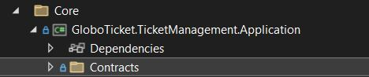
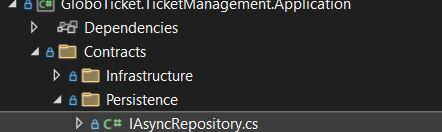

# Part 9：在 Visual Studio 里建立 Application 工程与 `IAsyncRepository<T>` 契约

> 用途: 调研参考（非开发依据）· 逐篇忠实对译，主题串读见 [04](04-application-layer-ports.md)，横向判读见 [09](09-critique-and-repo-mapping.md)

## 原文信息

| 项 | 值 |
| --- | --- |
| 原标题 | What is Clean Architecture: Part 9 - Setting Up the Application Project in Visual Studio |
| 链接 | https://dev.to/moh_moh701/clean-architecture-part-9-setting-up-the-application-project-in-visual-studio-3dj0 |
| 作者 | mohamed Tayel（`moh_moh701`） |
| 发布时间 | 2024-08-29T14:13:17Z（与 P8 相隔 29 分钟） |
| 系列 | Clean Architecture（collection 28557）第 9 篇 |
| 平台标注阅读时长 | 3 分钟 |
| 反应数 / 评论数 | 2 / 1 |
| 标签 | `architecture` `dotnetcore` `softwareengineering` `designsystem` |
| AI 披露状态 | `not_disclosed` |
| dev.to 文章 id | 1979039 |
| 本篇原图 | 4 张（已下载至 `imges/`） |
| 作者另一篇 | 本篇外链其自撰《Understanding and implementing the Repository Pattern in .NET》（https://dev.to/moh_moh701/understanding-and-implementing-the-repository-pattern-in-net-3ikj） |

---

## 逐段对译（IDE 步骤与代码全量照录）

### 开篇

> In our previous article, we discussed the design principles behind the Application Project, focusing on the importance of contracts, messaging, and the repository pattern. Now, it's time to put theory into practice by heading back to Visual Studio and starting the actual implementation.

上一篇讨论了 Application 工程背后的设计原则（契约、messaging、仓储模式的重要性）；现在把理论付诸实践，回到 Visual Studio 开始真正的实现。

### Creating the Application Project

> First things first—let's create the Application Project that will house our core application logic. This project is a vital part of our architecture, as it encapsulates the business rules and interacts with the domain layer through well-defined contracts.
>
> I've already set up a new class library in Visual Studio, named `GloboTicket.TicketManagement.ApplicationProject`. This project will contain all the necessary contracts and application logic that drive the functionality of our application.

先创建承载核心应用逻辑的 Application 工程；它是架构的关键部分，**封装业务规则并经由定义良好的契约与领域层交互**。作者已在 Visual Studio 建好一个新类库，命名 `GloboTicket.TicketManagement.ApplicationProject`，它将包含驱动应用功能所需的全部契约与应用逻辑。


> 注记：工程名写作 **`...ApplicationProject`**（带 Project 后缀），而 P10–P17 里所有代码的命名空间都是 `GloboTicket.TicketManagement.Application.*`。这一 `-Project` 后缀要么是笔误、要么后来被改名，原文未说明——**属原文实存的不一致**。

### Organizing the Application Project

> Given the nature of our architecture, it's crucial to keep things organized right from the start. Even though our application isn't large, it's good practice to structure the project in a way that scales well for enterprise applications.

考虑到架构性质，从一开始就保持有序至关重要；即使应用不大，也应按"能良好扩展到企业级"的方式组织结构。

- **Creating the Contracts Folder**

> To maintain a clear separation of concerns, we'll begin by creating a folder named `Contracts`. This folder will hold all the interfaces that define the operations our application will perform.

为保持关注点分离，先建 `Contracts` 文件夹，存放定义应用将要执行之操作的全部接口。



- **Adding Subfolders for Better Organization**

> Inside the `Contracts` folder, we'll add subfolders to categorize the different types of contracts. For instance, a `Persistence` folder will be created to store contracts related to database interactions. This way, we ensure that even as our project grows, the structure remains clean and navigable.

在 `Contracts` 内再加子文件夹对契约分类，例如建 `Persistence` 存放与数据库交互相关的契约，以保证项目增长后结构仍干净可导航。


> 注记：`Contracts/Persistence` 这个命名把"契约分类"与"实现层名"绑定了（持久化契约按实现技术命名）。更中性的做法是按能力命名（如 `repositories` / `data`），因为**契约名一旦带上基础设施词汇，替换基础设施时契约就得改名**——这与 P1 的 "Independent of Frameworks" 有轻微张力。

### Introducing the IAsyncRepository Interface

> One of the first contracts we'll create is the `IAsyncRepository` interface. This interface will serve as a base repository contract that defines the essential CRUD operations.

要创建的第一个契约之一是 `IAsyncRepository`，它将作为**基础仓储契约**，定义必需的 CRUD 操作。



> if want to know more about repository pattern read this article [repository-pattern](https://dev.to/moh_moh701/understanding-and-implementing-the-repository-pattern-in-net-3ikj)

（原文这句英文有语法缺失，逐字为 "if want to know more about…"）想进一步了解仓储模式可读作者本人这篇：Understanding and implementing the repository pattern in .NET。

契约代码（原文逐字）：

```csharp
public interface IAsyncRepository<T> where T : class
{
    Task<T> GetByIdAsync(Guid id);
    Task<IReadOnlyList<T>> ListAllAsync();
    Task<T> AddAsync(T entity);
    Task UpdateAsync(T entity);
    Task DeleteAsync(T entity);
}
```

- **Generic Repository**

> The `IAsyncRepository` interface is generic, meaning it can work with any entity type that is a class. This design allows us to create a single, reusable interface for all our repositories, ensuring consistency across the application.

该接口是泛型的，可用于任何"是 class"的实体类型；这个设计让我们能为所有仓储创建**单一、可复用的接口**，保证全应用一致。

- **Key Methods**

> The methods defined in `IAsyncRepository` include `GetByIdAsync`, `ListAllAsync`, `AddAsync`, `UpdateAsync`, and `DeleteAsync`. These methods cover the basic operations required for most entities in the application.

方法包括 `GetByIdAsync` / `ListAllAsync` / `AddAsync` / `UpdateAsync` / `DeleteAsync`，覆盖应用中大多数实体的基本操作。

> **本篇最关键的一段判读——这 5 行契约的四处缺陷**（原文对此毫无自察）：
>
> 1. **主键类型被钉成 `Guid`**：`GetByIdAsync(Guid id)` 让所有实体必须用 Guid 主键（P7 恰好都满足），但一旦某表想用 bigint/序列（如订单号、账单号）就得破契约。本仓允许实体主键类型各异，port 按用例定义。
> 2. **`Task<T>` 没有可空性**：`GetByIdAsync` 找不到时到底返回 `null` 还是抛异常，契约没说。后果是下游各自即兴：[part-10](part-10-request-handler.md) 的 `GetEventDetailQueryHandler` **完全不判空**（拿到 null 直接 `_mapper.Map<EventDetailVm>(eventEntity)` 并访问 `eventEntity.CategoryId`，属运行时空引用），而 [part-12](part-12-commands-cud.md) 的更新/删除 Handler 写的是 `if (eventEntity == null) throw new NotFoundException(nameof(Event), request.EventId);`——但 **`NotFoundException` 这个类型在全系列 19 篇中从未被定义或给出实现**（只在 P12 被使用两次）。契约含糊 → 错误通路不统一 → 其中一条还引用不存在的类型，这三步是同一根因的连锁。
> 3. **`ListAllAsync()` 无分页、无过滤、无排序**：P4 需求明确要求订单列表界面能承载"可能很长的列表"，而这个契约从根上排除了分页；P10 的 `GetEventsListQuery` 因此真的走 `ListAllAsync` 全表读出、再用 AutoMapper 整表映射返回。**需求 → 契约 → 实现三处连环失守**。
> 4. **无并发令牌/无乐观并发**：契约里没有 `rowversion`/`ConcurrencyToken` 概念，导致 P12 的 `UpdateEvent` 采用"取全实体 → 用 DTO 覆盖全部字段 → Update"的写法，**丢失并发检测**（两个管理员同时编辑同一活动，后提交者静默覆盖前者）。
> 5. 另外（承 [part-08](part-08-application-design-rationale.md)）：契约里**没有任何提交/事务方法**，而作者又声明"不手写 UoW"，于是事务边界无人持有——P16 每个方法各自 `SaveChangesAsync()`。

### Creating Specific Repositories

> While the generic `IAsyncRepository` provides a good starting point, we often need more specialized repositories tailored to specific entities. For example, we'll create interfaces for managing events, orders, and categories.

泛型 `IAsyncRepository` 是不错的起点，但常需要针对具体实体的更专门仓储；例如为 event、order、category 建接口。

- **IEventRepository Interface**

```csharp
public interface IEventRepository : IAsyncRepository<Event>
{
    // Define additional methods specific to the Event entity
}
```

- **IOrderRepository Interface**

```csharp
public interface IOrderRepository : IAsyncRepository<Order>
{
    // Define additional methods specific to the Order entity
}
```

- **ICategoryRepository Interface**

```csharp
public interface ICategoryRepository : IAsyncRepository<Category>
{
    // Define additional methods specific to the Category entity
}
```

> Each of these interfaces extends `IAsyncRepository` and adds any methods that are unique to the respective entity. For example, `IEventRepository` might include methods for retrieving events within a certain date range.

这些接口各自继承 `IAsyncRepository` 并添加该实体独有的方法；例如 `IEventRepository` 可能包含"取某日期范围内活动"的方法。

> 注记：三个专用接口在本篇**全是空体 + 注释占位**；后续兑现情况（全系列 grep 实测）：`IEventRepository` 直到 P16 才出现 `IsEventNameAndDateUnique` 实现（接口补码从未展示），`ICategoryRepository` 只在 P16 实现了 `GetCategoriesWithEvents`（P11 调用的 `GetAllCategoriesAsync` 幽灵方法至完结未定义），而 `IOrderRepository` **全系列没有任何成员方法现身**（P16 只注册了一个从未定义的 `OrderRepository` 类）。也就是说本篇交付的"契约"其实是 4 个接口、其中 3 个为空且至完结未补齐——**教程在这里只完成了形式**。原文举的"按日期范围取活动"例子最终从未被实现；P4 真正提的"按月审查全部活动销售、列表可能很长"界面也在后续篇目里落空（P17 实作的是无过滤全量活动 CSV 导出，与按月销售无关，见 [part-17](part-17-csv-export-email.md) 判读）。

### Referencing the Domain Project

> To make these specific repositories functional, we need to reference the domain entities in our application project. This involves adding a reference from the `ApplicationProject` to the `DomainProject` in Visual Studio. Once the reference is added, we can bring in the necessary domain models (like `Event`, `Order`, and `Category`) using the correct `using` statements.

要让这些专用仓储可用，Application 工程需要引用领域实体：在 Visual Studio 里加一条 **从 `ApplicationProject` 到 `DomainProject` 的项目引用**；加好后即可用正确的 `using` 引入 `Event` / `Order` / `Category` 等领域模型。

> 注记：**这是全系列第一次出现可验证的依赖方向事实**（Application → Domain，单向）。可惜作者没有展示 `.csproj` 内容，也没有说明 Domain **不引用** Application（这是默认成立的，但教程应当显式声明并演示如何检查）。对照 P18 会展示 API 的 csproj 引用三个工程——那才是依赖方向的完整证据链。

### Preparing for the Next Steps

> With these contracts in place, we've laid the groundwork for our application logic. We'll be writing most of our business logic against these contracts, ensuring that the core application remains decoupled from implementation details.
>
> In the upcoming module, we'll shift our focus to the implementation phase. Specifically, we'll implement these repositories in the persistence layer and connect them to our database. This will bring our application closer to a functional state, where business rules are executed seamlessly through a well-defined architecture.

有了这些契约，应用逻辑的地基就打下了；**大部分业务逻辑将针对这些契约编写**，确保核心与实现细节解耦。接下来的模块将转向实现阶段：在持久化层实现这些仓储并连上数据库，让应用更接近功能状态，业务规则在定义良好的架构中被顺畅执行。

> 注记：本篇说"接下来就实现仓储"，实际顺序是 P10–P14 先写 Application 逻辑（Handler/Validator/DI），**P16 才回来实现仓储**——原文的"upcoming module"位置不准。此外"business rules are executed seamlessly"是宣传式措辞，无任何机制保证（无测试）。

### Conclusion

> Setting up the Application Project is a crucial step in our clean architecture journey. By creating and organizing contracts, we've ensured that our application logic will be both scalable and maintainable. The next steps will involve implementing these contracts in the infrastructure, where the real power of our architecture will come to life. Stay tuned as we continue building this robust and clean architecture in the following articles!
> For the complete source code, you can visit the GitHub repository: https://github.com/mohamedtayel1980/clean-architecture

建立 Application 工程是 CA 旅程的关键一步；通过创建并组织契约，"我们已确保应用逻辑既可伸缩又可维护"。下一步在外层实现这些契约，架构的真正威力将显现。文末再次给出仓库地址。

> 注记：「By creating interfaces we've ensured scalability and maintainability」是**把手段当成果的推断**——建接口本身不产生可伸缩/可维护性，只有当接口被测试覆盖、被替换验证时才成立；本系列两者都没做。

---

## 整理注记（一句话）

本篇是全系列**结构上最正确、内容上最单薄**的一篇：项目引用方向、契约归属、泛型 + 专用派生的姿态都对；但契约只有 5 个方法且四处缺陷（Guid 钉死、无可空性、无分页、无并发令牌），三个专用接口全是空壳，且承诺的"业务逻辑针对契约编写"最终写成了"字段校验 + 流程编排"。

## 与本仓对照（本篇）

| 本篇契约设计 | 本仓实态 |
| --- | --- |
| `IAsyncRepository<T>` 五方法泛型基座 | 本仓 port 按**用例所需**定义（不预设通用 CRUD），避免"为了通用而全表读" |
| `GetByIdAsync(Guid id)` 返回 `Task<T>` | 本仓取不到即返回 `undefined`/抛领域错误，类型上显式 `T \| undefined`，且错误走结构化错误码（`global-readiness-error-pagination`） |
| `ListAllAsync()` 无分页 | 本仓列表一律带分页契约，分页参数在 `libs/contracts` 单源 |
| 无并发令牌 | 本仓对可并发编辑的聚合用 MikroORM 乐观锁（version/`@Property({ version: true })`） |
| 专用仓储接口空壳占位 | 本仓不允许空 port 提交（无消费者的接口会被 fallow/`check` 检出） |
| Application → Domain 单向引用 | 一致，且本仓另有 `verify-config-contract` / `ci` 门禁守护包边界 |

---

## 评论区实录（1 条）

| 评论者 | 时间 | 原话（逐字） | 👍 |
| --- | --- | --- | --- |
| Facundo Paez | 2024-09-03 | 「Excellent article, it's very useful!!」 | 1 |

无作者回复；无隐藏评论（API `?a_id=1979039` 与页面 JSON-LD 一致，`comments_count: 1`）。

---

## 附：原文英文全稿（逐字保留）

> 来源：dev.to 官方 API `body_markdown` 字段（作者原始稿），抓取于 2026-10-21；除把图片链接改为本地 `./imges/` 副本（原始 URL 保留在链接 title 中）外，未作任何增删改。
>
> 呈现口径：以下英文全稿**不做代码块包裹、直接按 Markdown 渲染**（保留作者原始标题层级、粗体、列表、代码块与图片）；逐字性以上述 body_markdown 抓取为准，本区未增删改任何文字。

In our previous article, we discussed the design principles behind the Application Project, focusing on the importance of contracts, messaging, and the repository pattern. Now, it's time to put theory into practice by heading back to Visual Studio and starting the actual implementation.

#### **Creating the Application Project**

First things first—let’s create the Application Project that will house our core application logic. This project is a vital part of our architecture, as it encapsulates the business rules and interacts with the domain layer through well-defined contracts.

I've already set up a new class library in Visual Studio, named `GloboTicket.TicketManagement.ApplicationProject`. This project will contain all the necessary contracts and application logic that drive the functionality of our application.


#### **Organizing the Application Project**

Given the nature of our architecture, it's crucial to keep things organized right from the start. Even though our application isn't large, it's good practice to structure the project in a way that scales well for enterprise applications.

- **Creating the Contracts Folder**
  To maintain a clear separation of concerns, we’ll begin by creating a folder named `Contracts`. This folder will hold all the interfaces that define the operations our application will perform.


- **Adding Subfolders for Better Organization**
  Inside the `Contracts` folder, we'll add subfolders to categorize the different types of contracts. For instance, a `Persistence` folder will be created to store contracts related to database interactions. This way, we ensure that even as our project grows, the structure remains clean and navigable.


#### **Introducing the IAsyncRepository Interface**

One of the first contracts we’ll create is the `IAsyncRepository` interface. This interface will serve as a base repository contract that defines the essential CRUD operations.


if want to know more about repository pattern read this article
[repository-pattern](https://dev.to/moh_moh701/understanding-and-implementing-the-repository-pattern-in-net-3ikj)
```csharp
public interface IAsyncRepository<T> where T : class
{
    Task<T> GetByIdAsync(Guid id);
    Task<IReadOnlyList<T>> ListAllAsync();
    Task<T> AddAsync(T entity);
    Task UpdateAsync(T entity);
    Task DeleteAsync(T entity);
}
```

- **Generic Repository**
  The `IAsyncRepository` interface is generic, meaning it can work with any entity type that is a class. This design allows us to create a single, reusable interface for all our repositories, ensuring consistency across the application.

- **Key Methods**
  The methods defined in `IAsyncRepository` include `GetByIdAsync`, `ListAllAsync`, `AddAsync`, `UpdateAsync`, and `DeleteAsync`. These methods cover the basic operations required for most entities in the application.

#### **Creating Specific Repositories**

While the generic `IAsyncRepository` provides a good starting point, we often need more specialized repositories tailored to specific entities. For example, we’ll create interfaces for managing events, orders, and categories.

- **IEventRepository Interface**
  
  ```csharp
  public interface IEventRepository : IAsyncRepository<Event>
  {
      // Define additional methods specific to the Event entity
  }
  ```

- **IOrderRepository Interface**
  
  ```csharp
  public interface IOrderRepository : IAsyncRepository<Order>
  {
      // Define additional methods specific to the Order entity
  }
  ```

- **ICategoryRepository Interface**
  
  ```csharp
  public interface ICategoryRepository : IAsyncRepository<Category>
  {
      // Define additional methods specific to the Category entity
  }
  ```

Each of these interfaces extends `IAsyncRepository` and adds any methods that are unique to the respective entity. For example, `IEventRepository` might include methods for retrieving events within a certain date range.

#### **Referencing the Domain Project**

To make these specific repositories functional, we need to reference the domain entities in our application project. This involves adding a reference from the `ApplicationProject` to the `DomainProject` in Visual Studio. Once the reference is added, we can bring in the necessary domain models (like `Event`, `Order`, and `Category`) using the correct `using` statements.

#### **Preparing for the Next Steps**

With these contracts in place, we’ve laid the groundwork for our application logic. We’ll be writing most of our business logic against these contracts, ensuring that the core application remains decoupled from implementation details.

In the upcoming module, we’ll shift our focus to the implementation phase. Specifically, we’ll implement these repositories in the persistence layer and connect them to our database. This will bring our application closer to a functional state, where business rules are executed seamlessly through a well-defined architecture.

#### **Conclusion**

Setting up the Application Project is a crucial step in our clean architecture journey. By creating and organizing contracts, we’ve ensured that our application logic will be both scalable and maintainable. The next steps will involve implementing these contracts in the infrastructure, where the real power of our architecture will come to life. Stay tuned as we continue building this robust and clean architecture in the following articles!
For the complete source code, you can visit the GitHub repository: https://github.com/mohamedtayel1980/clean-architecture
---
