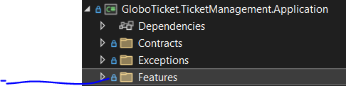
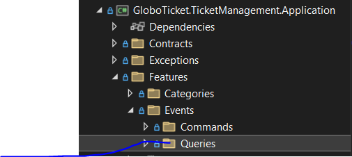
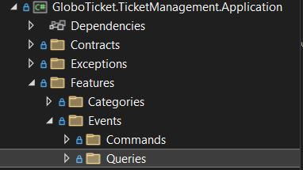
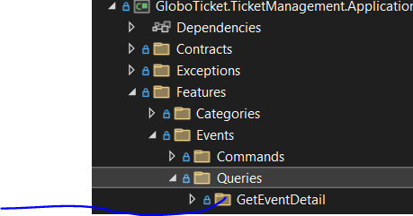
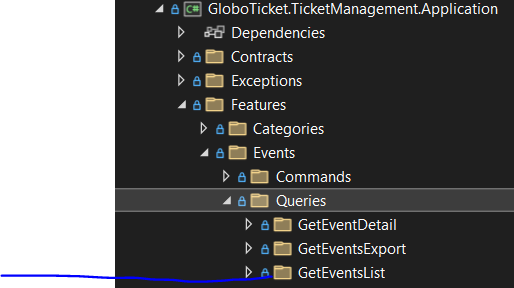
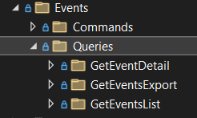
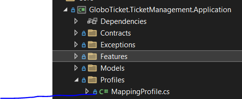
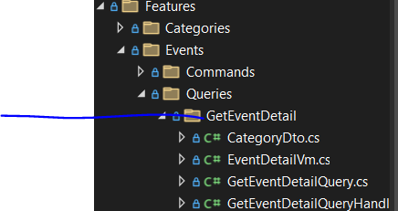
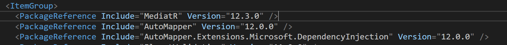

# Part 10：在 Request Handler 里写应用逻辑（MediatR + AutoMapper）

> 用途: 调研参考（非开发依据）· 逐篇忠实对译，主题串读见 [05](05-application-layer-cqrs.md)，横向判读见 [09](09-critique-and-repo-mapping.md)

## 原文信息

| 项 | 值 |
| --- | --- |
| 原标题 | What is Clean Architecture: Part 10 - Writing the Application Logic in the Request Handler |
| 链接 | https://dev.to/moh_moh701/what-is-clean-architecture-part-10-writing-the-application-logic-in-the-request-handler-2a1o |
| 作者 | mohamed Tayel（`moh_moh701`） |
| 发布时间 | 2024-09-03T21:17:59Z |
| 系列 | Clean Architecture（collection 28557）第 10 篇 |
| 平台标注阅读时长 | 5 分钟（全系列第二长） |
| 反应数 / 评论数 | 3 / 0 |
| 标签 | `architecture` `dotnet` `softwareengineering` |
| AI 披露状态 | `not_disclosed` |
| dev.to 文章 id | 1985916 |
| 本篇原图 | 10 张（全系列最多，已下载至 `imges/`） |

---

## 逐段对译（目录步骤与代码**全量照录**，含原稿自身的命名空间错位）

### Introduction

> Welcome back to the "What is Clean Architecture" series! We've covered a lot of ground so far, exploring essential architectural principles and setting up our projects. Now, it's time to bring all of these concepts to life by implementing the actual business logic within our request handlers.
>
> In this part, we'll walk through integrating MediatR and AutoMapper into our application, creating request and request handler classes, and finally, preparing everything to be registered in the `IServiceCollection`. This is where the rubber meets the road—transforming contracts into meaningful implementation code.

欢迎回到本系列！前面已覆盖大量内容（架构原则与工程搭建）；现在是把这些概念变成现实的时候——**在 request handler 里实现真正的业务逻辑**。本篇演示把 **MediatR 与 AutoMapper 集成**进应用、创建 request 与 request handler 类，最后为注册进 `IServiceCollection` 做好准备；这里是"把契约变成有意义的实现代码"的地方。

> If you're not familiar with MediatR or AutoMapper or CQRS, I highly recommend checking out my previous articles on these topics:（若不熟悉 MediatR / AutoMapper / CQRS，推荐阅读作者前述三篇：）
>
> - [Understanding the Mediator Pattern in .NET](https://dev.to/moh_moh701/understanding-the-mediator-pattern-in-net-52do)（原文此项是**裸 HTML `<a target="_new">`**，非 markdown 链接）
> - [AutoMapper in .NET: When to Use It and When to Avoid It](https://dev.to/moh_moh701/automapper-in-net-when-to-use-it-and-when-to-avoid-it-16b4)
> - [Enhancing .NET Applications with CQRS and SOLID Principles](https://dev.to/moh_moh701/enhancing-net-applications-with-cqrs-and-solid-principles-30i8)

> 注记：作者自撰的 AutoMapper 一文标题就叫 **"When to Use It and When to Avoid It"**（何时该用、何时该回避），而本篇**无条件使用了 `ReverseMap()`**——这是原作者自己体系内的价值冲突，非读者过度解读。

### Step 1: Setting Up the Project Structure（建立工程结构）

#### Adding Feature Folders

> To maintain a clean and organized project structure, we'll start by creating feature-specific folders under the Application layer. This helps in grouping related classes together, making the project more maintainable.

1. **Create a folder named `Features` under the Application layer.** — This folder will contain all the business logic related to different features in the application.
   在 Application 层下建 `Features` 文件夹，存放与各个 feature 相关的全部业务逻辑。
2. **Under the `Features` folder, create another folder named `Events`.** — The `Events` folder will encapsulate all the logic related to the event management feature.
   在 `Features` 下建 `Events`，封装活动管理 feature 的全部逻辑。
3. **Within the `Events` folder, create a subfolder named `Queries`.** — This folder will contain all the query logic related to events.
   在 `Events` 内建 `Queries`，存放与活动相关的全部查询逻辑。






> Here's how the folder structure should look so far:



### Step 2: Creating Query Folders（为每个查询建文件夹）

> Within the `Queries` folder, we'll create specific folders for each query:

1. **Create a folder named `GetEventDetail` under `Queries`.** — This folder will contain the query and handler classes for fetching event details.（`Queries` 下建 `GetEventDetail`，放取活动详情的 query 与 handler 类。）



2. **Create another folder named `GetEventsList` under `Queries`.** — This folder will contain the query and handler classes for fetching a list of events.（再建 `GetEventsList`，放取活动列表的 query 与 handler 类。）



> Your `Queries` folder structure should now look like this:



### Step 3: Creating the Mapping Profile（建立映射配置）

> Next, we'll create a folder for our AutoMapper profiles:
>
> 1. **Create a folder named `Profiles` under the Application layer.** — This folder will contain all AutoMapper profiles that define the mappings between domain entities and ViewModels.
> 2. **Create a class named `MappingProfile.cs` under the `Profiles` folder.** — This class will define the mappings needed for our application.

接着为 AutoMapper profile 建文件夹：在 Application 层下建 `Profiles`（存放定义领域实体与 ViewModel 之间映射的全部 profile），并在其下创建 `MappingProfile.cs`。



### Step 4: Implementing the Query and Handler Classes（实现查询与 handler 类）

> 1. **In the `GetEventDetail` folder, create the following classes:** `GetEventDetailQuery.cs`（定义取活动详情的查询）、`GetEventDetailQueryHandler.cs`（处理该查询的逻辑）、`EventDetailVm.cs`（活动详情的 ViewModel）、`CategoryDto.cs`（在 `EventDetailVm` 内表示分类信息的 DTO）。
> 2. **In the `GetEventsList` folder, create the following classes:** `GetEventsListQuery.cs`、`GetEventsListQueryHandler.cs`、`EventListVm.cs`（活动列表的 ViewModel）。



### Step 5: Adding Package References（加包引用）

> Add the MediatR and AutoMapper packages to your project via NuGet. You can do this via the NuGet Package Manager or by adding them directly to your `.csproj` file:

```xml
<ItemGroup>
  <PackageReference Include="MediatR" Version="12.3.0" />
  <PackageReference Include="AutoMapper" Version="12.0.0" />
  <PackageReference Include="AutoMapper.Extensions.Microsoft.DependencyInjection" Version="12.0.0" />
</ItemGroup>
```



> 注记（版本时效，属**推断/未在本仓验证**）：`AutoMapper 12.0.0` + `AutoMapper.Extensions.Microsoft.DependencyInjection 12.0.0` 是 AutoMapper 换许可证**之前**的组合。该库自 13.x 起对商用引入许可限制、且 DI 扩展包被并入主包，因此今天照抄这三行大概率装不上或需要授权——**照搬本系列版本清单前必须重新核事实**。

### Step 6: Implementing the Request Handler Logic（实现 handler 逻辑）

#### GetEventsListQuery 与 Handler（原文逐字）

```csharp
//EventListVm
namespace GloboTicket.TicketManagement.Application.Features.Events.Queries.GetEventsList
{
    public class EventListVm
    {
        public Guid EventId { get; set; }
        public string Name { get; set; } = string.Empty;
        public DateTime Date { get; set; }
        public string ImageUrl { get; set; } = string.Empty;
    }
}
// GetEventsListQuery.cs
namespace GloboTicket.TicketManagement.Application.Features.Events.Queries
{
    public class GetEventsListQuery:IRequest<List<EventListVm>>
    {
    }
}
```

> And here's the handler that processes this query:

```csharp
// GetEventsListQueryHandler.cs

namespace GloboTicket.TicketManagement.Application.Features.Events.Queries
{
    public class GetEventsListQueryHandler : IRequestHandler<GetEventsListQuery, List<EventListVm>>
    {
        private readonly IAsyncRepository<Event> _eventRepository;
        private readonly IMapper _mapper;

        public GetEventsListQueryHandler(IMapper mapper, IAsyncRepository<Event> eventRepository)
        {
            _mapper = mapper;
            _eventRepository = eventRepository;
        }

        public async Task<List<EventListVm>> Handle(GetEventsListQuery request, CancellationToken cancellationToken)
        {
            var allEvents = (await _eventRepository.ListAllAsync()).OrderBy(x => x.Date);
            return _mapper.Map<List<EventListVm>>(allEvents);
        }
    }
}
```

**逐字代码之上的判读（本篇四处实存问题）**

1. **命名空间与 Step 1–4 自相矛盾**：`EventListVm` 住在 `...Queries.GetEventsList`，而 `GetEventsListQuery` 与其 Handler 住在 `...Queries`，且这两个文件**都没有 `using ...GetEventsList;`**——按原文照抄**编译不过**。对照 P11 会把命名空间统一到 `...Queries.GetEventsList`，可见 P10 是漂移版本，作者未回填修订。
2. **依赖的是泛型仓储而非专用仓储**：注入 `IAsyncRepository<Event>`，而 P9 刚建立了 `IEventRepository`。**"专用仓储"在读侧完全没被使用**（直到 P13/P16 才因唯一性校验用上 `IEventRepository`），说明 P8/P9 关于专用仓储的论证在读路径上是空转的。
3. **全表读出再内存排序**：`ListAllAsync()` 取全部 Event，再 `OrderBy(x => x.Date)`——排序发生在应用进程而非数据库，且 `IReadOnlyList<T>` 上的 `OrderBy` 走 LINQ-to-Objects。数据量一大就是全表加载 + 内存排序；P4 的"长列表"需求到这里彻底消失（无分页、无 take/skip）。
4. **`GetEventsListQuery` 是无字段空类**：作为 `IRequest<T>` 的请求对象没有任何参数，等价于"无入参的函数被包成一个类"。**这是 CQRS 教科书式的形式主义**：此处 CQRS 没有带来任何收益（无独立模型、无缓存键、无校验），只带来一层间接。

#### GetEventDetailQuery 与 Handler（原文逐字）

```csharp
//CategoryDto.cs
namespace GloboTicket.TicketManagement.Application.Features.Events.Queries.GetEventDetail
{
    public class CategoryDto
    {
        public Guid CategoryId { get; set; }

        public string Name { get; set; }
    }
}
//EventDetailVm.cs
namespace GloboTicket.TicketManagement.Application.Features.Events.Queries.GetEventDetail
{
    public class EventDetailVm
    {
        public Guid EventId { get; set; }

        public string Name { get; set; }

        public int Price { get; set; }

        public string Artist { get; set; }

        public DateTime Date { get; set; }

        public string Description { get; set; }

        public string ImageUrl { get; set; }

        public Guid CategoryId { get; set; }

        public CategoryDto Category { get; set; }
    }
}
// GetEventDetailQuery.cs

public class GetEventDetailQuery : IRequest<EventDetailVm>
{
    public Guid Id { get; set; }
}
```

> And the handler for processing this query:

```csharp
// GetEventDetailQueryHandler.cs

public class GetEventDetailQueryHandler : IRequestHandler<GetEventDetailQuery, EventDetailVm>
{
    private readonly IAsyncRepository<Event> _eventRepository;
    private readonly IAsyncRepository<Category> _categoryRepository;
    private readonly IMapper _mapper;

    public GetEventDetailQueryHandler(IAsyncRepository<Event> eventRepository, IAsyncRepository<Category> categoryRepository, IMapper mapper)
    {
        _eventRepository = eventRepository;
        _categoryRepository = categoryRepository;
        _mapper = mapper;
    }

    public async Task<EventDetailVm> Handle(GetEventDetailQuery request, CancellationToken cancellationToken)
    {
        var eventEntity = await _eventRepository.GetByIdAsync(request.Id);
        var eventDetailVm = _mapper.Map<EventDetailVm>(eventEntity);

        var categoryEntity = await _categoryRepository.GetByIdAsync(eventEntity.CategoryId);
        eventDetailVm.Category = _mapper.Map<CategoryDto>(categoryEntity);

        return eventDetailVm;
    }
}
```

**判读（三处实存问题）**

1. **原稿的 `GetEventDetailQuery.cs` / `GetEventDetailQueryHandler.cs` 两段没有 `namespace`、没有 `using`**（文件头直接是 `public class`），照抄即编译错误——与同篇 `CategoryDto/EventDetailVm` 写法不一致，属原稿贴码时的省略。
2. **无判空 → 运行时空引用**：`GetByIdAsync` 可能返回 `null`（P9 契约未声明可空性），而这里紧接着 `_mapper.Map<EventDetailVm>(eventEntity)` 与 `eventEntity.CategoryId`。P12 同类场景用 `throw new NotFoundException(...)`（该类型全系列未定义），本篇则**完全不设防**。
3. **两次查询、且第二次多半是多余的**：`Event` 与 `Category` 是导航属性关系；在 EF Core 追踪下取 `Event` 时通常已带出 `Category`（P16 的 `BaseRepository.GetByIdAsync` 用 `FindAsync`，其是否加载导航属性另说）。这里硬把"取活动 + 取分类"写成两次仓储调用，等于**在应用层手工做 join**——这正是 P8 所说"仓储抽象会妨碍真实数据访问需求"的具体表现。
4. **`EventDetailVm` 全字段无 `= string.Empty` 初始化**，而 `EventListVm` 有；`Artist`/`Description`/`ImageUrl`/`Category` 在可空引用类型开启（.NET 8 模板默认 `<Nullable>enable</Nullable>`）下会产生 CS8618 警告。原稿自身风格不统一。

### Step 7: Configuring AutoMapper Profiles（配置 AutoMapper Profile）

> Finally, we need to configure AutoMapper to handle the mappings between our entities and ViewModels. Here's the `MappingProfile` class that defines these mappings:

```csharp
public class MappingProfile : Profile
{
    public MappingProfile()
    {
        CreateMap<Event, EventListVm>().ReverseMap();
        CreateMap<Event, EventDetailVm>().ReverseMap();
        CreateMap<Category, CategoryDto>().ReverseMap();
    }
}
```

**判读**

- **`ReverseMap()` 用在三个映射上是危险的**：它同时生成 `Event → Vm` 与 `Vm → Event`。当 P12 的更新命令执行 `_mapper.Map(request, eventEntity)` 时，反向映射会把 DTO/Vm 里不存在或为默认值的字段**写回实体**（例如审计字段、未提交的导航属性），这是"全字段覆盖 + 无并发令牌"链条的一环。
- **Profile 类同样缺 namespace/using**（原稿直接 `public class MappingProfile : Profile`）。
- **映射是"约定式全名匹配"**（没有任何 `.ForMember`），意味着**字段改名即静默断链**：源与目标同名字段自动映射，不同名则留默认值且不报错。没有测试的本系列里，这类断链不会被任何东西捕获（对照本仓：跨端契约单源 `libs/contracts` + `pnpm run ci` 类型门禁）。

### Conclusion

> By following these steps, you've successfully organized your project structure, created the necessary queries and handlers, and configured AutoMapper profiles for a clean and maintainable application.
>
> Stay tuned for the next part of this series, where we'll explore how to integrate and test these components in a real-world application!
> For the complete source code, you can visit the GitHub repository: https://github.com/mohamedtayel1980/clean-architecture

按这些步骤，你已组织好工程结构、创建了必需的查询与 handler、并为干净可维护的应用配置了 AutoMapper profile。下一篇将演示"如何在真实应用中集成并**测试**这些组件"。

> **注记：这个"下一篇会测试"的承诺最终没有兑现**。P11 讲的是 Features 目录重组，P12–P19 依次是命令/校验/DI/持久化/基础设施/API/控制器，**全系列 19 篇没有出现任何一行测试代码**，`test` solution folder 始终空着。这是本系列与 P1 "Improved Testability" 宣言之间最大的落差，也是 [09 §2 判读表](09-critique-and-repo-mapping.md) 的第一条。

---

## 整理注记（本篇结构性小结）

| 维度 | 事实 |
| --- | --- |
| CA 得分点 | 用例代码确实全部住在 Application 内层；对外的依赖只有接口（`IAsyncRepository`、`IMapper`、`IRequestHandler`）；ViewModel 与领域实体分离，实体不泄漏到 API 之外 |
| CA 失分点 | 注入泛型仓储而非专用 port（P9 的论证空转）；映射用 `ReverseMap` 造成双向可写；无判空、无错误契约 |
| 需求失分点 | P4 的"长列表"需求 → 本篇全表读 + 内存排序，无分页 |
| 可编译性 | 至少 3 处原稿级问题（命名空间错位、缺 namespace/using、未定义类型引用）——**读者照抄无法编译**，这是"零测试 + 零运行验证"的直接后果 |
| 教程价值 | CQRS 三件套（Query / Handler / Vm）的最小可读样例，仍是本系列里最适合入门的一屏 |

## 与本仓对照（本篇）

| 本篇做法 | 本仓实态 |
| --- | --- |
| Query 空类 + `IRequest<List<Vm>>` | 本仓读侧一律带分页/过滤契约（`libs/contracts` zod 单源），无参查询不会被包成消息类 |
| 进程内中介者（MediatR） | 本仓以 NestJS DI + 应用服务/查询处理器直接编排，保留**静态可检查性**（装饰器元数据 + 显式 `@Inject`） |
| AutoMapper `ReverseMap()` | 本仓禁 class-validator/class-transformer 系映射魔法，转换写成显式函数（`toDto`/`fromPersistence`），改字段即类型报错 |
| Handler 内两次仓储调用手工 join | 本仓读侧优先单查询（QueryBuilder/投影），跨上下文走契约或事件 |
| 无 null 检查、无异常类型 | 本仓取不到即显式 `undefined` + 结构化错误码，全局 `HttpExceptionFilter` 统一转换（见 `docs/specs`） |
| 承诺测试但未写 | 本仓 `pnpm run ci`（check→build→test）为 L1 门禁，带库 e2e 登记进 `scripts/ci-fullstack.ts` |

---

## 评论区实录

本篇 **0 条评论**（API `?a_id=1985916` 返回空数组，`comments_count: 0`）。本篇是全系列代码密度与截图数量最高的一篇（3 处编译级问题也最多），却无任何读者反馈——与"后 16 篇平均 2.6 个反应、几乎零评论"的流量塌陷一致（见 [part-04 注记](part-04-business-need-globoticket.md)）。

---

## 附：原文英文全稿（逐字保留）

> 来源：dev.to 官方 API `body_markdown` 字段（作者原始稿），抓取于 2026-10-21；除把图片链接改为本地 `./imges/` 副本（原始 URL 保留在链接 title 中）外，未作任何增删改。
>
> 呈现口径：以下英文全稿**不做代码块包裹、直接按 Markdown 渲染**（保留作者原始标题层级、粗体、列表、代码块与图片）；逐字性以上述 body_markdown 抓取为准，本区未增删改任何文字。

### Introduction

Welcome back to the "What is Clean Architecture" series! We've covered a lot of ground so far, exploring essential architectural principles and setting up our projects. Now, it's time to bring all of these concepts to life by implementing the actual business logic within our request handlers.

In this part, we'll walk through integrating MediatR and AutoMapper into our application, creating request and request handler classes, and finally, preparing everything to be registered in the `IServiceCollection`. This is where the rubber meets the road—transforming contracts into meaningful implementation code.

If you're not familiar with MediatR or AutoMapper or CQRS, I highly recommend checking out my previous articles on these topics:
- <a href="https://dev.to/moh_moh701/understanding-the-mediator-pattern-in-net-52do" target="_new">Understanding the Mediator Pattern in .NET</a>
- [AutoMapper in .NET: When to Use It and When to Avoid It](https://dev.to/moh_moh701/automapper-in-net-when-to-use-it-and-when-to-avoid-it-16b4)
- [Enhancing .NET Applications with CQRS and SOLID Principles](https://dev.to/moh_moh701/enhancing-net-applications-with-cqrs-and-solid-principles-30i8)

With that foundation in place, let's dive into the implementation!

### Step 1: Setting Up the Project Structure

#### Adding Feature Folders


To maintain a clean and organized project structure, we'll start by creating feature-specific folders under the Application layer. This helps in grouping related classes together, making the project more maintainable.

1. **Create a folder named `Features` under the Application layer.**
   - This folder will contain all the business logic related to different features in the application.
  
2. **Under the `Features` folder, create another folder named `Events`.**
   - The `Events` folder will encapsulate all the logic related to the event management feature.


3. **Within the `Events` folder, create a subfolder named `Queries`.**
   - This folder will contain all the query logic related to events.


Here's how the folder structure should look so far:


### Step 2: Creating Query Folders

Within the `Queries` folder, we'll create specific folders for each query:

1. **Create a folder named `GetEventDetail` under `Queries`.**
   - This folder will contain the query and handler classes for fetching event details.


2. **Create another folder named `GetEventsList` under `Queries`.**
   - This folder will contain the query and handler classes for fetching a list of events.


Your `Queries` folder structure should now look like this:


### Step 3: Creating the Mapping Profile

Next, we'll create a folder for our AutoMapper profiles:

1. **Create a folder named `Profiles` under the Application layer.**
   - This folder will contain all AutoMapper profiles that define the mappings between domain entities and ViewModels.

2. **Create a class named `MappingProfile.cs` under the `Profiles` folder.**
   - This class will define the mappings needed for our application.

Here's how the folder structure with the MappingProfile should look:


### Step 4: Implementing the Query and Handler Classes

Now that the folder structure is in place, let's create the query and handler classes:

1. **In the `GetEventDetail` folder, create the following classes:**
   - `GetEventDetailQuery.cs`: This class will define the query for fetching event details.
   - `GetEventDetailQueryHandler.cs`: This class will handle the logic for the `GetEventDetailQuery`.
   - `EventDetailVm.cs`: This class will act as the ViewModel for event details.
   - `CategoryDto.cs`: This DTO will represent the category information within `EventDetailVm`.

2. **In the `GetEventsList` folder, create the following classes:**
   - `GetEventsListQuery.cs`: This class will define the query for fetching a list of events.
   - `GetEventsListQueryHandler.cs`: This class will handle the logic for the `GetEventsListQuery`.
   - `EventListVm.cs`: This class will act as the ViewModel for the list of events.

Here’s how the structure should look with all classes in place:


### Step 5: Adding Package References

With the folder and class structure in place, let's add the necessary packages:

1. **Add the MediatR and AutoMapper packages to your project via NuGet.** You can do this via the NuGet Package Manager or by adding them directly to your `.csproj` file:

   ```xml
   <ItemGroup>
     <PackageReference Include="MediatR" Version="12.3.0" />
     <PackageReference Include="AutoMapper" Version="12.0.0" />
     <PackageReference Include="AutoMapper.Extensions.Microsoft.DependencyInjection" Version="12.0.0" />
   </ItemGroup>
   ```

   Here’s how the package references should look in your project file:

   

### Step 6: Implementing the Request Handler Logic

Now that our project structure and dependencies are set up, let's implement the business logic.

#### GetEventsListQuery and Handler

The `GetEventsListQuery` class represents a request to retrieve a list of events. Here’s how it looks:

```csharp
//EventListVm
namespace GloboTicket.TicketManagement.Application.Features.Events.Queries.GetEventsList
{
    public class EventListVm
    {
        public Guid EventId { get; set; }
        public string Name { get; set; } = string.Empty;
        public DateTime Date { get; set; }
        public string ImageUrl { get; set; } = string.Empty;
    }
}
// GetEventsListQuery.cs
namespace GloboTicket.TicketManagement.Application.Features.Events.Queries
{
    public class GetEventsListQuery:IRequest<List<EventListVm>>
    {
    }
}
```

And here’s the handler that processes this query:

```csharp
// GetEventsListQueryHandler.cs

namespace GloboTicket.TicketManagement.Application.Features.Events.Queries
{
    public class GetEventsListQueryHandler : IRequestHandler<GetEventsListQuery, List<EventListVm>>
    {
        private readonly IAsyncRepository<Event> _eventRepository;
        private readonly IMapper _mapper;

        public GetEventsListQueryHandler(IMapper mapper, IAsyncRepository<Event> eventRepository)
        {
            _mapper = mapper;
            _eventRepository = eventRepository;
        }

        public async Task<List<EventListVm>> Handle(GetEventsListQuery request, CancellationToken cancellationToken)
        {
            var allEvents = (await _eventRepository.ListAllAsync()).OrderBy(x => x.Date);
            return _mapper.Map<List<EventListVm>>(allEvents);
        }
    }
}
```

#### GetEventDetailQuery and Handler

Similarly, here’s the `GetEventDetailQuery` class for fetching event details:

```csharp
//CategoryDto.cs
namespace GloboTicket.TicketManagement.Application.Features.Events.Queries.GetEventDetail
{
    public class CategoryDto
    {
        public Guid CategoryId { get; set; }

        public string Name { get; set; }
    }
}
//EventDetailVm.cs
namespace GloboTicket.TicketManagement.Application.Features.Events.Queries.GetEventDetail
{
    public class EventDetailVm
    {
        public Guid EventId { get; set; }

        public string Name { get; set; }

        public int Price { get; set; }

        public string Artist { get; set; }

        public DateTime Date { get; set; }

        public string Description { get; set; }

        public string ImageUrl { get; set; }

        public Guid CategoryId { get; set; }

        public CategoryDto Category { get; set; }
    }
}
// GetEventDetailQuery.cs

public class GetEventDetailQuery : IRequest<EventDetailVm>
{
    public Guid Id { get; set; }
}
```

And the handler for processing this query:

```csharp
// GetEventDetailQueryHandler.cs

public class GetEventDetailQueryHandler : IRequestHandler<GetEventDetailQuery, EventDetailVm>
{
    private readonly IAsyncRepository<Event> _eventRepository;
    private readonly IAsyncRepository<Category> _categoryRepository;
    private readonly IMapper _mapper;

    public GetEventDetailQueryHandler(IAsyncRepository<Event> eventRepository, IAsyncRepository<Category> categoryRepository, IMapper mapper)
    {
        _eventRepository = eventRepository;
        _categoryRepository = categoryRepository;
        _mapper = mapper;
    }

    public async Task<EventDetailVm> Handle(GetEventDetailQuery request, CancellationToken cancellationToken)
    {
        var eventEntity = await _eventRepository.GetByIdAsync(request.Id);
        var eventDetailVm = _mapper.Map<EventDetailVm>(eventEntity);

        var categoryEntity = await _categoryRepository.GetByIdAsync(eventEntity.CategoryId);
        eventDetailVm.Category = _mapper.Map<CategoryDto>(categoryEntity);

        return eventDetailVm;
    }
}
```

### Step 7: Configuring AutoMapper Profiles

Finally, we need to configure AutoMapper to handle the mappings between our entities and ViewModels. Here’s the `MappingProfile` class that defines these mappings:

```csharp
public class MappingProfile : Profile
{
    public MappingProfile()
    {
        CreateMap<Event, EventListVm>().ReverseMap();
        CreateMap<Event, EventDetailVm>().ReverseMap();
        CreateMap<Category, CategoryDto>().ReverseMap();
    }
}
```

### Conclusion

By following these steps, you've successfully organized your project structure, created the necessary queries and handlers, and configured AutoMapper profiles for a clean and maintainable application.

Stay tuned for the next part of this series, where we’ll explore how to integrate and test these components in a real-world application!
For the complete source code, you can visit the GitHub repository: https://github.com/mohamedtayel1980/clean-architecture
---
