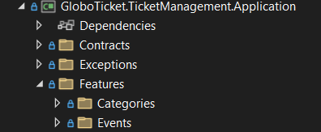
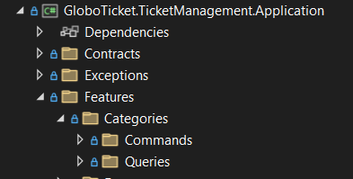
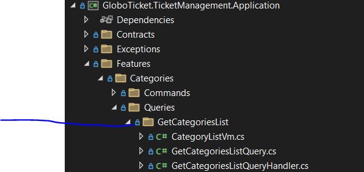
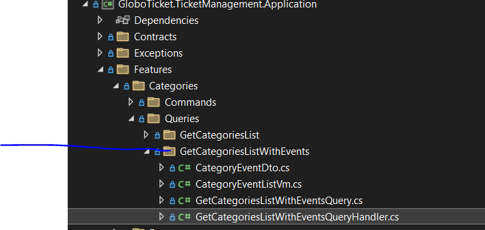

# Part 11：用 Features 组织代码（垂直切片）

> 用途: 调研参考（非开发依据）· 逐篇忠实对译，主题串读见 [05](05-application-layer-cqrs.md)，横向判读见 [09](09-critique-and-repo-mapping.md)

## 原文信息

| 项 | 值 |
| --- | --- |
| 原标题 | What is Clean Architecture: Part 11-Organizing the Code Using Features |
| 链接 | https://dev.to/moh_moh701/what-is-clean-architecture-part-11-organizing-the-code-using-features-3jcn |
| 作者 | mohamed Tayel（`moh_moh701`） |
| 发布时间 | 2024-09-05T12:28:16Z |
| 系列 | Clean Architecture（collection 28557）第 11 篇 |
| 平台标注阅读时长 | 未标注（`reading_time: null`） |
| 反应数 / 评论数 | 2 / 0 |
| 标签 | `architecture` `softwareengineering` `dotnet` |
| AI 披露状态 | `not_disclosed` |
| dev.to 文章 id | 1988023 |
| 本篇原图 | 4 张（已下载至 `imges/`） |

---

## 逐段对译（正文与代码**全量照录**）

### 开篇：为什么要按 Feature 组织

> As our applications grow and more functionality is added, organizing the codebase becomes increasingly important. Initially, it may be tempting to keep all commands and request handlers in a single folder, but this can quickly lead to clutter and inefficiency. In this article, I'll demonstrate how to adopt a feature-based organization to improve code maintainability and separation of concerns.

随着应用增长、功能增多，组织代码库变得越来越重要。起初人们容易把所有 command 和 request handler 塞进同一个文件夹，但这很快就会带来杂乱与低效。本文将演示如何采用 **feature-based（按特性）组织**来提升可维护性与关注点分离。

> 注记：本篇与 P10 存在**时序倒挂**——P10 已经在 `Features/Events/Queries` 下写好了代码，本篇却回过头来讲"为什么要建 Features 文件夹"。这是系列写作顺序与逻辑顺序不一致的痕迹（P10 发布 2024-09-03，本篇 2024-09-05），读者的合理疑问"P10 里不已经这么做了吗"原文没有回答。

### What is Feature-Based Organization?（什么是按特性组织）

> A **feature-based** organization is a vertical slice through the functionality of an application. Each feature represents a standalone unit of functionality. It aligns closely with the concept of a **bounded context** from Domain-Driven Design (DDD), where each feature encompasses everything required to implement that specific functionality, including commands, queries, view models, and even repositories.

**feature-based 组织是沿应用功能切开的一条垂直切片（vertical slice）**。每个 feature 是独立的功能单元，与 DDD 的**限界上下文（bounded context）**概念高度对齐——每个 feature 囊括实现该特定功能所需的一切，**包括 commands、queries、view models，甚至 repositories**。

> Instead of scattering related code across multiple folders (like separating models, controllers, or services), a feature-based organization groups everything related to a particular feature into a single location. This structure enhances modularity and ensures that changes within a feature won't affect other parts of the application.

与其把相关代码散落在多个文件夹（按 models / controllers / services 分层摆放），不如把与某个 feature 相关的一切收进同一位置；这增强模块化，并保证 feature 内的变更不会影响应用其他部分。

> **判读（本篇最有价值的一句话，也是最容易被误读的一句话）**：
> 1. 原作者在这里**亲自把"垂直切片"与"限界上下文"画了等号**——这在术语上是滑动的：Categories/Events/Orders 是**功能模块（module）**，不是 DDD 意义上的限界上下文（后者由统一语言与模型边界定义，而非由 CRUD 对象定义）。本仓的 `modules/<上下文>/` 目录名同样借用了这套词汇，但对齐的是上下文边界而非实体名（见 [09 §4](09-critique-and-repo-mapping.md)）。
> 2. "每个 feature 甚至包含自己的 repositories"在原文语境里只是**文件夹归置**（接口仍放 `Contracts/Persistence`，实现放 Infrastructure 层），并非真的把仓储实现搬进 Application——P16 会证实实现仍在 Infrastructure。原文表述夸张、实作未跟上。

### Setting Up Feature Folders（建立 Feature 文件夹）

> In our example application, we'll be working with **Events**, **Categories**, and **Orders**. To implement feature-based organization, we'll introduce a `Features` folder, and under this, create a folder for each feature.

示例应用将围绕 **Events / Categories / Orders** 三个 feature 工作：引入 `Features` 文件夹，其下每个 feature 一个文件夹。



> Each feature folder will then contain subfolders for commands and queries, representing the business logic.
>
> - **Commands**: Responsible for actions like creating, updating, or deleting entities.（负责创建/更新/删除实体等动作）
> - **Queries**: Focus on retrieving data or views of the data.（专注取数据或数据视图）

每个 feature 文件夹下再含 `Commands` 与 `Queries` 两个子文件夹。例如 `Categories` feature 内：



### Example: Working with Categories（示例：处理 Categories）

> Let's walk through an example of how to organize the logic for handling **Categories**. In the `Categories` folder, we will add two queries:
>
> 1. **GetCategoriesListQuery**: This retrieves a list of all categories.
> 2. **GetCategoriesWithEventsQuery**: This query fetches categories, along with associated events.

在 `Categories` 文件夹里加两个查询：`GetCategoriesListQuery`（取全部分类列表）与 `GetCategoriesWithEventsQuery`（取分类连同其关联活动）。





#### Step 1: Creating View Models（创建视图模型，原文逐字）

```csharp
public class CategoriesListVm
{
    public int CategoryId { get; set; }
    public string Name { get; set; }
}
```

> For the second query that includes events:

```csharp
public class CategoryEventListVm
{
    public int CategoryId { get; set; }
    public string Name { get; set; }
    public List<CategoryEventDto> Events { get; set; }
}

public class CategoryEventDto
{
    public int EventId { get; set; }
    public string EventName { get; set; }
    public DateTime EventDate { get; set; }
}
```

> **判读（本篇最重的硬伤——主键类型分裂）**：
> 1. **`int CategoryId` / `int EventId` 与 P7 领域实体的 `Guid CategoryId` / `Guid Id` 直接矛盾**；P10 的 `CategoryDto`/`EventDetailVm` 也全用 `Guid`。同一个系列里，Categories 的 Vm 用 `int`、Events 的 Vm 用 `Guid`——**两套主键类型并存**。AutoMapper 遇到 `Guid → int` 不会静默失败而是**抛映射异常**（找不到类型转换），意味着这两个 Handler 一旦真跑就会在运行时炸。这与 P10 的"命名空间错位"同属**从未编译/运行验证过的原稿证据链**（全系列零测试、零运行截图，见 [09 §2](09-critique-and-repo-mapping.md)）。
> 2. Vm 无 `namespace`、无 `using`（全系列贴码通病，P10/P11 一致）。
> 3. `CategoryEventDto` 的字段名 `EventName/EventDate` 与 `Event` 实体的 `Name/Date` 不同名——AutoMapper 约定式映射**不会自动对上**，而 Step 4 的 Profile 里也没有任何 `.ForMember` 显式配置。这条映射按原文配置**必然映射出空的 Name/Date**（默认值）。又一个"照抄即坏"的点。

#### Step 2: Writing the Queries（编写查询，原文逐字）

```csharp
public class GetCategoriesListQuery : IRequest<List<CategoriesListVm>> { }

public class GetCategoriesWithEventsQuery : IRequest<List<CategoryEventListVm>>
{
    public bool IncludeHistory { get; set; }
}
```

> 注记：`IncludeHistory` 是本系列第一个**真正带业务语义的查询参数**（是否包含已过期的历史活动），呼应 P4 的活动列表界面需求。但它的过滤逻辑被**推给了仓储方法**（见 Step 3），Application 层只透传布尔值——"历史"的定义（`Date < now`？）将在 P16 的 Infrastructure 里才出现。业务规则下沉到基础设施，这是仓储模式被滥用的典型形态（对照 P8 作者自己的论证）。

#### Step 3: Implementing Handlers（实现 Handler，原文逐字）

> Each query will need a corresponding handler. For the `GetCategoriesListQueryHandler`, we fetch and map the list of categories:

```csharp
public class GetCategoriesListQueryHandler : IRequestHandler<GetCategoriesListQuery, List<CategoriesListVm>>
{
    private readonly ICategoryRepository _categoryRepository;
    private readonly IMapper _mapper;

    public GetCategoriesListQueryHandler(ICategoryRepository categoryRepository, IMapper mapper)
    {
        _categoryRepository = categoryRepository;
        _mapper = mapper;
    }

    public async Task<List<CategoriesListVm>> Handle(GetCategoriesListQuery request, CancellationToken cancellationToken)
    {
        var categories = await _categoryRepository.GetAllCategoriesAsync();
        return _mapper.Map<List<CategoriesListVm>>(categories);
    }
}
```

> Similarly, for fetching categories with events:

```csharp
public class GetCategoriesWithEventsQueryHandler : IRequestHandler<GetCategoriesWithEventsQuery, List<CategoryEventListVm>>
{
    private readonly ICategoryRepository _categoryRepository;
    private readonly IMapper _mapper;

    public GetCategoriesWithEventsQueryHandler(ICategoryRepository categoryRepository, IMapper mapper)
    {
        _categoryRepository = categoryRepository;
        _mapper = mapper;
    }

    public async Task<List<CategoryEventListVm>> Handle(GetCategoriesWithEventsQuery request, CancellationToken cancellationToken)
    {
        var categories = await _categoryRepository.GetCategoriesWithEventsAsync(request.IncludeHistory);
        return _mapper.Map<List<CategoryEventListVm>>(categories);
    }
}
```

> **判读（原稿级断链——调用了不存在的方法）**：
> 1. 两个 Handler 都注入 **`ICategoryRepository`（专用仓储）**——这是全系列**第一次**在代码里使用专用接口（P10 注入的是泛型 `IAsyncRepository<T>`），P8/P9 关于"为什么需要专用仓储"的论证至此才落到代码。
> 2. 但 Handler 调用的 `GetAllCategoriesAsync()` 与 `GetCategoriesWithEventsAsync(bool IncludeHistory)` **在 P9 建立的 `ICategoryRepository` 里从未定义**——P9 里它是空接口 + 注释占位，而本篇也没有回头补接口代码。照抄到 P9 状态的工程里，这两行是**编译错误（接口上不存在该成员）**。接口补码直到 P16 才出现，且 P16 是否恰好补了这两个签名需对照 [07](07-infrastructure-and-persistence.md) 串读（P16 实际用的是 EF Include 链，`GetCategoriesWithEventsAsync` 在后续篇目中也未再出现——疑似作者中途改道，**推断/未验证**，因 GitHub 仓库本仓未逐 commit 核对）。
> 3. 与 P10 对照可看出作者手感的摇摆：Events 读侧用泛型仓储 + 应用层手工 join（P10），Categories 读侧用专用仓储 + 数据库侧聚合（本篇）。同一系列两种风格并存，无切换理由说明。

#### Step 4: Using AutoMapper for Mapping（配置映射，原文逐字）

> Finally, we need to ensure AutoMapper is aware of how to map between `Category` and our view models. This is done by configuring the mappings in our `MappingProfile`:

```csharp
public class MappingProfile : Profile
{
    public MappingProfile()
    {
        CreateMap<Category, CategoriesListVm>();
        CreateMap<Category, CategoryEventListVm>();
        CreateMap<Event, CategoryEventDto>();
    }
}
```

> With these steps completed, the functionality for working with **Categories** is now neatly encapsulated within the `Categories` folder.

这些步骤完成后，Categories 功能就被干净地封装进 `Categories` 文件夹了。

> **判读**：原文把这份代码直接叫 `MappingProfile`——但 P10 已经交付过一个同名类（含 3 个 `CreateMap(...).ReverseMap()`）。本篇版本**只列 Categories 三条映射、无 ReverseMap**，等于把 P10 的映射全部覆盖丢失。两个版本同名同文件路径，系列里没有任何"往既有 Profile 里追加"的说明。这暴露了教程级双 Profile 的共同病灶：**没有单一事实源**（对照本仓：`libs/contracts` 是跨端契约唯一出处，任何"第二份定义"会被 CI 对拍打死）。

### Benefits of Feature-Based Organization（收益清单，原文逐字）

> - **Modularity**: Each feature is self-contained, making it easier to manage and maintain.（模块化：每个 feature 自包含，易管理易维护）
> - **Scalability**: As the application grows, we can easily add new features without cluttering the codebase.（可扩展：应用增长时可轻松加新 feature 而不杂乱）
> - **Encapsulation**: Changes to one feature are less likely to impact others, reducing the risk of bugs and regressions.（封装：一个 feature 的变更不太可能波及其他，降低 bug 与回归风险）

> 注记：第三条"changes to one feature are less likely to impact others"在本例中**并不成立**：所有 feature 共享同一个 `MappingProfile`、同一套 P7 实体、同一个 DbContext——Categories 改实体字段照样波及 Events。垂直切片要真正兑现隔离承诺，需要切片间**不共享可变内部**（本仓做法：跨上下文只经领域事件/契约交互，见 AGENTS.md §5 与 [09 §4](09-critique-and-repo-mapping.md)）；只挪文件夹不切依赖，得到的只是"按功能上色的分层单体"。

### Conclusion（结论，原文逐字）

> In this article, we explored how to organize our application by features. By following this approach, we can keep our codebase clean, modular, and scalable, making it easier to maintain as new functionality is added. Whether you're working with events, categories, orders, or other features, this method will help you stay organized and focused on each vertical slice of functionality.

本文探讨了按 feature 组织应用；照此可让代码库保持干净、模块化、可扩展。无论你处理的是 events、categories、orders 还是其他 feature，这个方法都能让你保持有序、专注于每条功能垂直切片。

> 注记：本篇**没有"下篇预告"**，也没有像 P9/P10 那样给出 GitHub 链接收尾——19 篇中结尾物料不一致是常态（详见各篇注记）。

---

## 整理注记（本篇结构性小结）

| 维度 | 事实 |
| --- | --- |
| CA 得分点 | 垂直切片方向正确；首次落地专用仓储注入；`IncludeHistory` 让查询有了业务语义 |
| CA 失分点 | "feature = bounded context" 术语滑动；切片间仍共享实体/Profile/DbContext，封装承诺未兑现 |
| 可编译性 | 至少 3 处原稿级问题：`int` vs `Guid` 主键分裂（运行期映射炸）、调用 `ICategoryRepository` 上未定义的方法（编译错）、`EventName/EventDate` 无 `.ForMember` 却与实体不同名（静默映出空值） |
| 系列内部一致性 | P10 泛型仓储 vs P11 专用仓储；P10 Profile（ReverseMap）vs P11 Profile（同名覆盖）——两处与前篇冲突且未回填修订 |
| 社区检验 | 2 反应 / **0 评论**——本篇所有代码从未经受社区检视（P4 起流量塌陷，见 [part-04](part-04-business-need-globoticket.md) 取证表） |

## 与本仓对照（本篇）

| 本篇做法 | 本仓实态 |
| --- | --- |
| `Features/{Events,Categories,Orders}/Commands\|Queries` | `apps/api/src/modules/<上下文>/{domain,application,infrastructure,api}`，application 内按 use-case 分组——目录语义相同，但本仓切片自带 infrastructure，切片间物理隔离更彻底 |
| "feature 对齐 bounded context"（口头） | 上下文边界由统一语言 + 事件契约定义；跨上下文**只经领域事件**通信（AGENTS.md §5 / [docs/plans/global-domain-context-refactor.md](../../plans/global-domain-context-refactor.md)） |
| Vm 用 `int`、实体用 `Guid`（分裂） | zod 契约单源 `libs/contracts`，请求/响应 schema 与实体类型同源派生，不存在两套主键型 |
| 两个同名 `MappingProfile` 各写各的 | 无 AutoMapper 对应物；映射为显式手写 assembler 或契约派生型，CI 类型门禁兜底 |
| `IncludeHistory` 布尔透传给仓储 | 过滤语义属领域/应用层职责，仓储 port 按用例定义（不接受"把 where 条件当参数下推"的瘦契约） |

## 评论区实录

**本篇评论数为 0**（dev.to API `comments_count: 0`，`/api/comments?a_id=1988023` 返回空数组）。2 个反应。无任何社区反馈参与本篇内容的修订——本篇代码的三个硬伤（int/Guid、幽灵方法、失效映射名）从发布至今原样保留。

---

## 附：原文英文全稿（逐字保留）

> 来源：dev.to 官方 API `body_markdown` 字段（作者原始稿），抓取于 2026-10-21；除把图片链接改为本地 `./imges/` 副本（原始 URL 保留在链接 title 中）外，未作任何增删改。
>
> 呈现口径：以下英文全稿**不做代码块包裹、直接按 Markdown 渲染**（保留作者原始标题层级、粗体、列表、代码块与图片）；逐字性以上述 body_markdown 抓取为准，本区未增删改任何文字。

As our applications grow and more functionality is added, organizing the codebase becomes increasingly important. Initially, it may be tempting to keep all commands and request handlers in a single folder, but this can quickly lead to clutter and inefficiency. In this article, I’ll demonstrate how to adopt a feature-based organization to improve code maintainability and separation of concerns.

#### What is Feature-Based Organization?

A **feature-based** organization is a vertical slice through the functionality of an application. Each feature represents a standalone unit of functionality. It aligns closely with the concept of a **bounded context** from Domain-Driven Design (DDD), where each feature encompasses everything required to implement that specific functionality, including commands, queries, view models, and even repositories.

Instead of scattering related code across multiple folders (like separating models, controllers, or services), a feature-based organization groups everything related to a particular feature into a single location. This structure enhances modularity and ensures that changes within a feature won’t affect other parts of the application.

#### Setting Up Feature Folders

In our example application, we’ll be working with **Events**, **Categories**, and **Orders**. To implement feature-based organization, we’ll introduce a `Features` folder, and under this, create a folder for each feature.


Each feature folder will then contain subfolders for commands and queries, representing the business logic.

- **Commands**: Responsible for actions like creating, updating, or deleting entities.
- **Queries**: Focus on retrieving data or views of the data.

For example, within the `Categories` feature folder, we can have:


#### Example: Working with Categories

Let's walk through an example of how to organize the logic for handling **Categories**. In the `Categories` folder, we will add two queries:

1. **GetCategoriesListQuery**: This retrieves a list of all categories.


2. **GetCategoriesWithEventsQuery**: This query fetches categories, along with associated events.


##### Step 1: Creating View Models

Each query will return a view model. Here’s an example for the `GetCategoriesListQuery`:

```csharp
public class CategoriesListVm
{
    public int CategoryId { get; set; }
    public string Name { get; set; }
}
```

For the second query that includes events:

```csharp
public class CategoryEventListVm
{
    public int CategoryId { get; set; }
    public string Name { get; set; }
    public List<CategoryEventDto> Events { get; set; }
}

public class CategoryEventDto
{
    public int EventId { get; set; }
    public string EventName { get; set; }
    public DateTime EventDate { get; set; }
}
```

##### Step 2: Writing the Queries

The queries encapsulate the logic to fetch the data:

```csharp
public class GetCategoriesListQuery : IRequest<List<CategoriesListVm>> { }

public class GetCategoriesWithEventsQuery : IRequest<List<CategoryEventListVm>>
{
    public bool IncludeHistory { get; set; }
}
```

##### Step 3: Implementing Handlers

Each query will need a corresponding handler. For the `GetCategoriesListQueryHandler`, we fetch and map the list of categories:

```csharp
public class GetCategoriesListQueryHandler : IRequestHandler<GetCategoriesListQuery, List<CategoriesListVm>>
{
    private readonly ICategoryRepository _categoryRepository;
    private readonly IMapper _mapper;

    public GetCategoriesListQueryHandler(ICategoryRepository categoryRepository, IMapper mapper)
    {
        _categoryRepository = categoryRepository;
        _mapper = mapper;
    }

    public async Task<List<CategoriesListVm>> Handle(GetCategoriesListQuery request, CancellationToken cancellationToken)
    {
        var categories = await _categoryRepository.GetAllCategoriesAsync();
        return _mapper.Map<List<CategoriesListVm>>(categories);
    }
}
```

Similarly, for fetching categories with events:

```csharp
public class GetCategoriesWithEventsQueryHandler : IRequestHandler<GetCategoriesWithEventsQuery, List<CategoryEventListVm>>
{
    private readonly ICategoryRepository _categoryRepository;
    private readonly IMapper _mapper;

    public GetCategoriesWithEventsQueryHandler(ICategoryRepository categoryRepository, IMapper mapper)
    {
        _categoryRepository = categoryRepository;
        _mapper = mapper;
    }

    public async Task<List<CategoryEventListVm>> Handle(GetCategoriesWithEventsQuery request, CancellationToken cancellationToken)
    {
        var categories = await _categoryRepository.GetCategoriesWithEventsAsync(request.IncludeHistory);
        return _mapper.Map<List<CategoryEventListVm>>(categories);
    }
}
```

#### Step 4: Using AutoMapper for Mapping

Finally, we need to ensure AutoMapper is aware of how to map between `Category` and our view models. This is done by configuring the mappings in our `MappingProfile`:

```csharp
public class MappingProfile : Profile
{
    public MappingProfile()
    {
        CreateMap<Category, CategoriesListVm>();
        CreateMap<Category, CategoryEventListVm>();
        CreateMap<Event, CategoryEventDto>();
    }
}
```

With these steps completed, the functionality for working with **Categories** is now neatly encapsulated within the `Categories` folder.

#### Benefits of Feature-Based Organization

By organizing our application based on features, we gain several benefits:

- **Modularity**: Each feature is self-contained, making it easier to manage and maintain.
- **Scalability**: As the application grows, we can easily add new features without cluttering the codebase.
- **Encapsulation**: Changes to one feature are less likely to impact others, reducing the risk of bugs and regressions.

#### Conclusion

In this article, we explored how to organize our application by features. By following this approach, we can keep our codebase clean, modular, and scalable, making it easier to maintain as new functionality is added. Whether you’re working with events, categories, orders, or other features, this method will help you stay organized and focused on each vertical slice of functionality.
