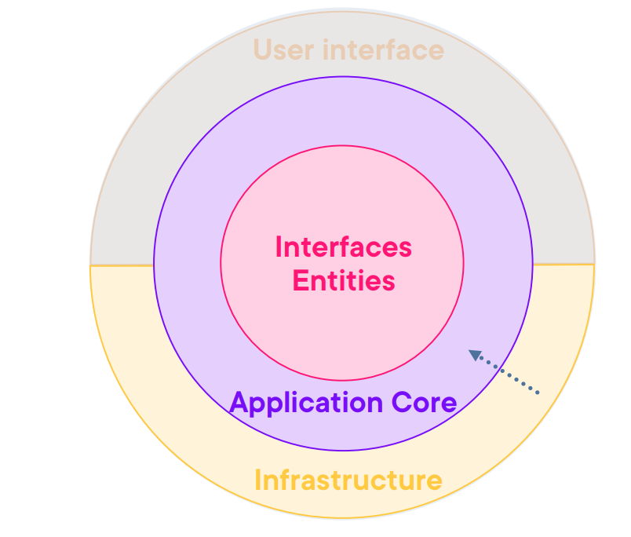
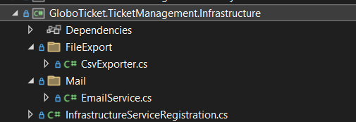
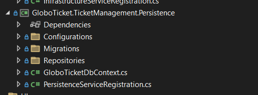

# Part 15：理解 Infrastructure 层与 Persistence 层（纯讲解篇）

> 用途: 调研参考（非开发依据）· 逐篇忠实对译，主题串读见 [07](07-infrastructure-and-persistence.md)，横向判读见 [09](09-critique-and-repo-mapping.md)

## 原文信息

| 项 | 值 |
| --- | --- |
| 原标题 | What is Clean Architecture: Part 15-Understanding the Infrastructure and Persistence Layers |
| 链接 | https://dev.to/moh_moh701/what-is-clean-architecture-understanding-the-infrastructure-and-persistence-layers-2pca |
| 作者 | mohamed Tayel（`moh_moh701`） |
| 发布时间 | 2024-09-09T21:41:59Z |
| 系列 | Clean Architecture（collection 28557）第 15 篇 |
| 平台标注阅读时长 | 未标注（`reading_time: null`） |
| 反应数 / 评论数 | 7 / 2（P4 之后全系列最高，次高点为 P1 的 415——仍差两个数量级） |
| 标签 | `cleancoding` `architecture` `softwareengineering` `softwaredevelopment` |
| AI 披露状态 | `not_disclosed` |
| dev.to 文章 id | 1994271 |
| 本篇原图 | 3 张（已下载至 `imges/`；本篇**零代码**，是全系列唯一一篇纯"看图说话"的讲解文） |

---

## 逐段对译（正文**全量照录**；本篇无代码块）

### 开篇

> When designing applications with Clean Architecture principles, it's essential to distinguish between the **Infrastructure Layer** and the **Persistence Layer**. Both layers play a crucial role in handling the external concerns of your system while keeping the core business logic clean and abstracted.
>
> Let's break down the roles of each layer and how they interact with the overall architecture, **with reference to the folder structure from your images**.

用 CA 原则设计应用时，区分 **Infrastructure 层**与 **Persistence 层**很重要；两者共同处理系统的外部关注点，让核心业务逻辑保持干净与抽象。下面逐一分解每个层的角色及其与整体架构的交互方式——"**参照你的图片里的文件夹结构**（with reference to the folder structure from your images）"。

> **判读（全系列最重要的一条文本内证，置于头条）**：
> "with reference to the folder structure from **your** images" 这句人称错位（作者谈**自己的**项目却说"**你的**图片"），加上通篇的猜测语态——"The `CsvExporter` class **might** implement…"、"This file is **likely** used to…"、"This folder **likely contains**…"（逐字见下文，共 5 处）——是**"有视觉能力的对话模型根据用户Uploaded截图作答"的典型文本形态**：撰稿人看不见代码仓库，只能对着截图猜。再叠加两项事实：① 全系列 19 篇 `ai_disclosure_level` 均为 `not_disclosed`（dev.to 平台字段，API 实测）；② P1 评论区 z2lai 质疑"AI 辅助创作应披露"的评论**被作者隐藏**（取证见 [part-01](part-01-what-is-clean-architecture.md) 评论实录）。
> **结论口径**：本篇文本形态构成"未披露的 AI 辅助写作"的**强嫌疑物证**；但是否确为 AI 生成仍属**推断/未验证**（无法复原作者的编辑过程，作者本人未承认，P15 也可能是"作者口述+模型润色"）。本仓纪律：嫌疑记为嫌疑，不当定罪事实。此判断同时为全系列文风突变提供解释——P15 之前篇篇有 IDE 截图与贴码，P15 突然变成零代码的截图解读。

### The Infrastructure Layer

> The **Infrastructure Layer** is responsible for providing implementations for various external services and mechanisms that your application relies on. These services may include file handling, email sending, logging, and third-party API interactions. In Clean Architecture, the **core project** only defines abstractions (such as interfaces), while the actual implementation details are placed in the infrastructure layer.

Infrastructure 层负责为应用依赖的各种外部服务与机制提供**实现**：文件处理、发邮件、日志、第三方 API 交互。CA 中**core 工程只定义抽象（接口）**，真正的实现细节放在基础设施层。

#### Key Components of the Infrastructure Layer

> 1. **FileExport (CsvExporter.cs)**: This folder and file handle the logic for exporting data into a CSV file format. This is part of the infrastructure because exporting files is an external operation. Example: The `CsvExporter` class **might** implement an interface like `IFileExporter` defined in the core layer. The core stays unaware of the file format or specifics of the export.
>
>    文件导出（CsvExporter.cs）：处理 CSV 导出数据逻辑，属基础设施（导出文件是外部操作）。示例："`CsvExporter` **可能**实现 core 层定义的 `IFileExporter` 之类接口，core 不知道文件格式与导出细节。"
>
> 2. **Mail (EmailService.cs)**: The `EmailService` is responsible for handling email-related operations, such as sending notifications. Again, the core layer would define an interface like `IEmailService`, and the infrastructure layer implements the actual logic for sending emails (whether using SMTP or an external service like SendGrid). Example: The `EmailService` implements the interface defined in the core to keep the email-sending logic external to the core business logic.
>
>    邮件（EmailService.cs）：处理发邮件/通知；core 定义 `IEmailService` 接口，基础设施实现真正的发送逻辑（SMTP 或 SendGrid 等外部服务）。
>
> 3. **InfrastructureServiceRegistration.cs**: This file is **likely** used to register all the services from the infrastructure layer into the Dependency Injection (DI) container. It ensures that implementations like `CsvExporter` and `EmailService` can be injected wherever required throughout the application.
>
>    "`InfrastructureServiceRegistration.cs` **大概**是把基础设施层全部服务注册进 DI 容器的文件，保证 `CsvExporter`、`EmailService` 可被注入到应用各处。"

> The infrastructure layer ensures that the core logic remains flexible and decoupled from the actual implementations of these external systems. If you need to change how emails are sent or switch to a different file export format, you can do so within the infrastructure layer without affecting the core.

基础设施层保证核心逻辑对外部系统实现保持灵活解耦；换邮件发送方式或导出格式只需改基础设施层，不影响 core。

> **判读**：
> 1. 对**自己项目的文件**用 `might / would / likely` 猜测语态共 5 处（上方逐字），教程作者对自己上一秒还在贴码的工程（P14）如此行文，几乎只有一种解释（见开篇判读）。
> 2. 事实核对：`IFileExporter`/`IEmailService` 两个接口名在本篇是**口头虚构**——P17 真正落地时接口就叫 `IEmailService`（对上了）、但 CSV 导出走的接口是 `ICsvExporter`（与本篇"might implement an interface like IFileExporter"不一致）。用猜测句当接口命名预告，后文又不自查。
> 3. "日志"被列进基础设施职责清单，但**全系列没有写过任何日志设施**（P1 的 testability 卖点之一也未兑现）。

### The Persistence Layer

> The **Persistence Layer** is a specialized part of the infrastructure that deals with database access. It is responsible for implementing the database interactions such as querying, saving, and retrieving data. Typically, in a Clean Architecture approach, the core project defines repository interfaces, and the persistence layer provides the concrete implementations using tools like Entity Framework Core.

**Persistence 层是基础设施中专司数据库访问的部分**：查询、保存、取回。CA 做法通常是 core 工程定义仓储接口、persistence 层用 EF Core 之类工具给出具体实现。

##### Key Components of the Persistence Layer (from the images)

> 1. **Configurations**: This folder **likely** contains Entity Framework Core configurations for database entities. These configurations ensure that the database schema aligns with your domain models and handle things like table mappings, relationships, and constraints. Example: Each entity configuration (e.g., `EventConfiguration`) would be implemented here using the Fluent API to define entity properties and relationships.
>
>    配置（Configurations）：该文件夹**大概**放着 EF Core 实体配置（表映射、关系、约束），例如 `EventConfiguration` 用 Fluent API 定义实体属性与关系。
>
> 2. **Migrations**: The migrations folder stores EF Core migrations that track changes to your database schema over time. These migrations are used to keep your database schema in sync with your domain models. Example: When adding a new feature, you might generate a migration to update the database schema, and it would be stored in this folder.
>
>    迁移（Migrations）：存放跟踪数据库 schema 变更的 EF Core 迁移，保持 schema 与领域模型同步；加新 feature 时生成迁移放进此文件夹。
>
> 3. **Repositories**: The `Repositories` folder contains the actual repository implementations. These repositories implement the data access logic defined by repository interfaces in the core layer, such as `IAsyncRepository`. The persistence layer is where you use Entity Framework Core to interact with the database.
>
>    仓储（Repositories）：放着真正的仓储实现类，实现 core 层定义的如 `IAsyncRepository` 的数据访问接口；与数据库的 EF Core 交互就在这一层。

> The persistence layer keeps the database concerns separated from the core logic and allows you to swap or upgrade your data access strategy without touching the core business logic. By using Dependency Injection, these repository implementations can be injected wherever needed in the application.

Persistence 层把数据库关注点与核心逻辑隔离，允许**替换/升级数据访问策略而不动核心业务逻辑**；借助 DI，仓储实现可注入到需要处。

> **判读**：
> 1. "swap your data access strategy without touching the core"是本系列反复出现的**仓储模式核心卖点**（P8/P9/P15 三次），但它从未被演示——19 篇没有任何"换 ORM"的场景或讨论；P16 的实现与 EF Core 深度绑定（`DbContext` 追踪、`FindAsync`），换存储时 `IAsyncRepository` 五方法契约（无分页/无可空/无并发令牌）会立刻成为障碍。**卖点始终停留在口号**。
> 2. 层名再度漂移：P6 建立的是一个 `Infrastructure` **工程**（内含 Persistence 目录），本篇却把 Infrastructure/Persistence 并称为两个 **Layer**——"distinguish between" 的其实是**同一工程内的两组文件夹**。读者若按"两个物理层"去搭工程会与 P16 实操不符。
> 3. Migrations 被描述为常驻组件，但全系列**没有一张迁移文件截图、没有一条 `migration:add` 命令**；直到文末也没有演示如何生成/运行迁移（P16 只用 `EnsureCreated` 之类 dev 手段或干脆略过，见 part-16 判读）。

### How It All Works Together

> - **Core Layer**: Defines the interfaces and abstractions for business logic and external interactions.
> - **Infrastructure Layer**: Implements services that deal with external systems like files, emails, logging, etc.
> - **Persistence Layer**: Implements data access logic using tools like Entity Framework Core to interact with the database.
>
> At runtime, dependency injection ensures that the concrete implementations from the infrastructure and persistence layers are provided to the core layer's abstractions. This separation of concerns makes the application easier to maintain, test, and extend.

协作总览：**Core 层**定义接口与抽象；**Infrastructure 层**实现文件/邮件/日志等外部服务；**Persistence 层**用 EF Core 实现数据访问。运行时由 DI 把外层的具象实现喂给 core 的抽象——关注点分离让应用更易维护、测试、扩展。

> 注记：这段"三层"总结与 P1-P3 反复图示的"四层"（Domain/Application/Infrastructure/Presentation）又不同——同一系列里第三套层清单。另外"easier to test"的口头测试第四次出现（P1 卖点、P10 承诺、P13 无、本篇又有），**依然没有一行测试**。

### Conclusion

> By splitting responsibilities into an infrastructure layer and a persistence layer, we ensure that the core business logic remains clean, decoupled, and adaptable. The **Infrastructure Layer** handles external services, while the **Persistence Layer** manages data storage and retrieval. Both layers work together through dependency injection to provide the necessary implementations, keeping the architecture scalable and maintainable.

把职责拆成 Infrastructure 与 Persistence 两层，保证核心业务逻辑干净、解耦、可适配：前者管外部服务，后者管存取数据，两层经 DI 向核心提供实现，架构保持可扩展可维护。

> 注记：结尾**无 GitHub 链接、无下篇预告**（P14 两个都有）——收尾物料第三次不一致。

---

## 整理注记（本篇结构性小结）

| 维度 | 事实 |
| --- | --- |
| CA 得分点 | "core 定义抽象、外层给实现、DI 装配"的方向陈述正确，适合初学者建立心智图 |
| CA 失分点 | Infrastructure/Persistence 并称两"层"与 P6/P16 的单工程实况不符；"可替换数据访问策略"卖点从未演示且被 P16 实现证伪 |
| 文本内证 | "from **your** images" 人称错位 + 5 处 might/likely 猜测语态——未披露 AI 辅助写作的强嫌疑（推断/未验证，见开篇判读取证口径） |
| 系列一致性 | 第三套层清单；预告的 `IFileExporter` 与 P17 实作的 `ICsvExporter` 不一致；日志话题列了清单却全系列未写 |
| 社区检验 | 7 反应 / 2 条互动（1 根评论 + 作者回复）——P4 塌陷后唯一"有对话"的一篇 |

## 与本仓对照（本篇）

| 本篇做法 | 本仓实态 |
| --- | --- |
| 对着 IDE 截图"猜测式"讲解文件夹职责 | 调研文档判读全部带取证（代码实存 / 实跑输出），猜测处显式标注"推断/未验证"——本文档自身即为示范 |
| Infrastructure 与 Persistence 口头两"层" | 本仓垂直切片：`modules/<上下文>/infrastructure` 物理归属明确，无跨切面大"基础设施层"工程 |
| CsvExporter/EmailService 仅作文件夹描述 | 本仓 `platform/mailer`、`storage` 上下文有实现与配置契约（`verify-config-contract` 对拍） |
| DI 口头保证"运行时装配" | NestJS 模块图编译期可审计；装饰器值导入 + `@Inject` 显式声明（AGENTS.md §2 ESM 约束） |

## 评论区实录

**1 根评论 + 1 作者回复（`comments_count: 2` 即此两条；API 与 JSON-LD 对拍无隐藏条目）**：

| # | 谁 | 时间 | 内容（逐字要点） | 点赞 |
| --- | --- | --- | --- | --- |
| 1 | Muhammad Ovais（`ovaismemon`） | 2024-09-16 | "A great point often overlooked in Clean Architecture discussions is the importance of managing cross-cutting concerns, such as logging, caching, or error handling. These aspects can be easily scattered across different layers… Implementing these through middleware or aspect-oriented programming (AOP) can ensure they remain centralized…" ——CA 讨论常被忽略的一点是**横切关注点**（日志/缓存/错误处理）的管理，易散落到各层造成重复缠绕；用 middleware 或 AOP 集中之，能进一步兑现关注点分离 | 2 |
| 1.1 | **作者回复** mohamed Tayel | 2024-09-16 | "Thank you for pointing that out! I completely agree… **I'll make sure to cover those topics as I continue this series**, along with adding details on implementing logging, error handling, an API layer, and Identity management. Stay tuned for the upcoming articles!" ——承诺续篇覆盖：日志、错误处理、API 层、**Identity 管理** | — |

> **承诺兑现对拍（截至 P19 全系列完结）**：API 层 ✅（P18/P19）；日志 ❌（全系列未写）；错误处理 ❌（只有各 handler 即兴 throw 与未定义的 `NotFoundException`）；Identity 管理 ❌（本系列完全没有认证授权——一个票务示例的"用户下单"只能用预置的硬编码用户解决：P16 seed 数据中直接 `UserId = Guid.Parse("{…}")` 写死 7 处，grep 实测）。**四项承诺兑现一项**，且 P16-P19 再无任何一篇提及 logging/error handling/identity。评论区这条最有价值的读者建议被礼貌回复后放置至系列完结。

---

## 附：原文英文全稿（逐字保留）

> 来源：dev.to 官方 API `body_markdown` 字段（作者原始稿），抓取于 2026-10-21；除把图片链接改为本地 `./imges/` 副本（原始 URL 保留在链接 title 中）外，未作任何增删改。
>
> 呈现口径：以下英文全稿**不做代码块包裹、直接按 Markdown 渲染**（保留作者原始标题层级、粗体、列表、代码块与图片）；逐字性以上述 body_markdown 抓取为准，本区未增删改任何文字。

When designing applications with Clean Architecture principles, it’s essential to distinguish between the **Infrastructure Layer** and the **Persistence Layer**. Both layers play a crucial role in handling the external concerns of your system while keeping the core business logic clean and abstracted.

Let's break down the roles of each layer and how they interact with the overall architecture, with reference to the folder structure from your images.

#### The Infrastructure Layer

The **Infrastructure Layer** is responsible for providing implementations for various external services and mechanisms that your application relies on. These services may include file handling, email sending, logging, and third-party API interactions. In Clean Architecture, the **core project** only defines abstractions (such as interfaces), while the actual implementation details are placed in the infrastructure layer.

##### Key Components of the Infrastructure Layer :

1. **FileExport (CsvExporter.cs)**:
   - This folder and file handle the logic for exporting data into a CSV file format. This is part of the infrastructure because exporting files is an external operation.
   
   Example:
   - The `CsvExporter` class might implement an interface like `IFileExporter` defined in the core layer. The core stays unaware of the file format or specifics of the export.

2. **Mail (EmailService.cs)**:
   - The `EmailService` is responsible for handling email-related operations, such as sending notifications. Again, the core layer would define an interface like `IEmailService`, and the infrastructure layer implements the actual logic for sending emails (whether using SMTP or an external service like SendGrid).
   
   Example:
   - The `EmailService` implements the interface defined in the core to keep the email-sending logic external to the core business logic.

3. **InfrastructureServiceRegistration.cs**:
   - This file is likely used to register all the services from the infrastructure layer into the Dependency Injection (DI) container. It ensures that implementations like `CsvExporter` and `EmailService` can be injected wherever required throughout the application.

   

The infrastructure layer ensures that the core logic remains flexible and decoupled from the actual implementations of these external systems. If you need to change how emails are sent or switch to a different file export format, you can do so within the infrastructure layer without affecting the core.

#### The Persistence Layer

The **Persistence Layer** is a specialized part of the infrastructure that deals with database access. It is responsible for implementing the database interactions such as querying, saving, and retrieving data. Typically, in a Clean Architecture approach, the core project defines repository interfaces, and the persistence layer provides the concrete implementations using tools like Entity Framework Core.

##### Key Components of the Persistence Layer (from the images):

1. **Configurations**:
   - This folder likely contains Entity Framework Core configurations for database entities. These configurations ensure that the database schema aligns with your domain models and handle things like table mappings, relationships, and constraints.
   
   Example:
   - Each entity configuration (e.g., `EventConfiguration`) would be implemented here using the Fluent API to define entity properties and relationships.

2. **Migrations**:
   - The migrations folder stores EF Core migrations that track changes to your database schema over time. These migrations are used to keep your database schema in sync with your domain models.
   
   Example:
   - When adding a new feature, you might generate a migration to update the database schema, and it would be stored in this folder.

3. **Repositories**:
   - The `Repositories` folder contains the actual repository implementations. These repositories implement the data access logic defined by repository interfaces in the core layer, such as `IAsyncRepository`. The persistence layer is where you use Entity Framework Core to interact with the database.
   
   

The persistence layer keeps the database concerns separated from the core logic and allows you to swap or upgrade your data access strategy without touching the core business logic. By using Dependency Injection, these repository implementations can be injected wherever needed in the application.

### How It All Works Together

- **Core Layer**: Defines the interfaces and abstractions for business logic and external interactions.
- **Infrastructure Layer**: Implements services that deal with external systems like files, emails, logging, etc.
- **Persistence Layer**: Implements data access logic using tools like Entity Framework Core to interact with the database.

At runtime, dependency injection ensures that the concrete implementations from the infrastructure and persistence layers are provided to the core layer's abstractions. This separation of concerns makes the application easier to maintain, test, and extend.

### Conclusion

By splitting responsibilities into an infrastructure layer and a persistence layer, we ensure that the core business logic remains clean, decoupled, and adaptable. The **Infrastructure Layer** handles external services, while the **Persistence Layer** manages data storage and retrieval. Both layers work together through dependency injection to provide the necessary implementations, keeping the architecture scalable and maintainable.
