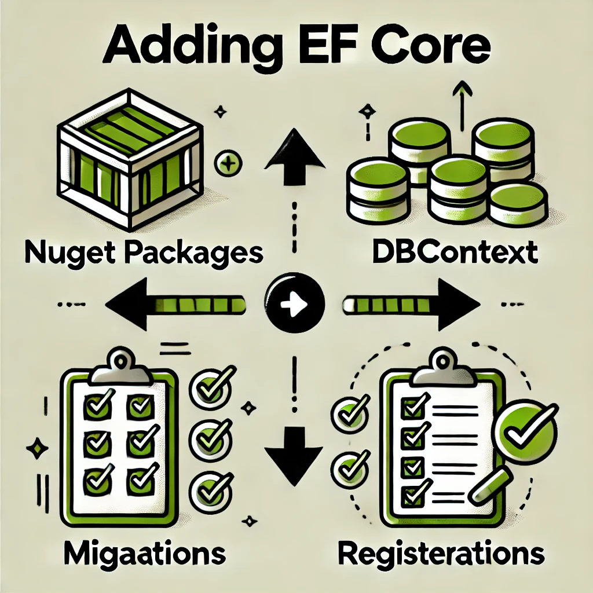

# Part 16：用 Entity Framework Core 加数据持久化（DbContext + 仓储实现）

> 用途: 调研参考（非开发依据）· 逐篇忠实对译，主题串读见 [07](07-infrastructure-and-persistence.md)，横向判读见 [09](09-critique-and-repo-mapping.md)

## 原文信息

| 项 | 值 |
| --- | --- |
| 原标题 | What is Clean Architecture: Part 16 - Adding Data Persistence with Entity Framework Core |
| 链接 | https://dev.to/moh_moh701/what-is-clean-architecture-part-16-adding-data-persistence-with-entity-framework-core-1kih |
| 作者 | mohamed Tayel（`moh_moh701`） |
| 发布时间 | 2024-09-11T20:41:48Z |
| 系列 | Clean Architecture（collection 28557）第 16 篇 |
| 平台标注阅读时长 | 未标注（`reading_time: null`） |
| 反应数 / 评论数 | 2 / 0 |
| 标签 | `architecture` `softwareengineering` `dotnetcore` |
| AI 披露状态 | `not_disclosed` |
| dev.to 文章 id | 1997309 |
| 本篇原图 | 2 张（已下载至 `imges/`；正文 449 行原稿中代码占绝对多数，是全系列代码量之最） |

---

## 逐段对译（正文与代码**全量照录**，seed 数据一条不落）

### 开篇

> In this part of our series, we'll introduce data persistence in the **Persistence Layer** using **Entity Framework Core** (EF Core). By the end of this article, you'll have a fully functional persistence layer that will interact with your application's core logic, making use of repositories to query and store data in a relational database.

本篇用 **EF Core** 在 Persistence 层引入数据持久化；读完你将拥有一个"功能完备的持久化层"，借仓储在关系库中查存数据。

### 1. Introduction: Setting Up Data Persistence

> We need to follow a few steps, but they're not any different from what we normally need to do to enable the use of EF Core:
> - **Step 1**: We'll bring in some **NuGet packages** first.
> - **Step 2**: Then we'll create a **DbContext**. In the context, we will define `DbSets` for all the entities we want EF Core to manage.
> - **Step 3**: Next, we'll create a **migration** to reflect the database schema.
> - **Step 4**: Finally, we'll register **EF Core** in the **Services Collection** to use it across the application.

四步走：加包 → 建 DbContext（含 DbSets）→ **建迁移**反映 schema → 把 EF Core 注册进 Services Collection。



> **判读（Step 3 是全系列最大的"计划-兑现"断点之一）**：清单里明列"我们将创建迁移"，但**通篇到结尾没有任何一条 `dotnet ef migrations add` / `Database.Migrate` / `EnsureCreated` 命令、没有迁移文件截图**——grep 全系列 19 篇 `body_markdown`，`migrations add`、`database update`、`EnsureCreated` **零命中**。教程承诺"fully functional"，但读者照 16 篇做完**库里根本不会有表**。下面 §3 的 seed 注释 "seed data, added through migrations" 描述的是一条从未在教程里走通的链路。（P16 之后篇目同样不补，属事实而非推断。）

### 2. Adding the Persistence Project

> The first step is to create a new class library project named **Persistence**. This project will contain the data access logic using EF Core.
>
> 1. Right-click on your solution and add a new **Class Library** project named `GloboTicket.TicketManagement.Persistence`.
> 2. In the **Persistence** project, add references to the **Application** project to access repository contracts and domain entities.

```xml
<ItemGroup>
  <ProjectReference Include="..\GloboTicket.TicketManagement.Application\GloboTicket.TicketManagement.Application.csproj" />
</ItemGroup>
```

> 3. Add the following **NuGet Packages** to the **Persistence** project:

```xml
<ItemGroup>
  <PackageReference Include="Microsoft.EntityFrameworkCore.SqlServer" Version="8.0.0" />
  <PackageReference Include="Microsoft.Extensions.Options.ConfigurationExtensions" Version="8.0.0" />
</ItemGroup>
```


新建 `GloboTicket.TicketManagement.Persistence` 类库工程；加对 **Application** 工程的项目引用（以访问仓储契约与领域实体）；加 EF Core SqlServer 8.0.0 与 Options.ConfigurationExtensions 两个包。

> **判读**：
> 1. **又一层名/工程名漂移**：P15 刚把 Persistence 讲成"Infrastructure 的专门部分"，P6 的 src 目录图里也只有 API/Core/Infrastructure 三夹——本篇却直接新建**平级的独立工程** `...Persistence`，且没有交代它与 Infrastructure 工程的摆放/从属关系（放 src 下哪个 solution folder、Infrastructure 工程此后还剩什么职责——要到 P17 才见分晓）。三篇三种说法。
> 2. 引用方向 Persistence → Application →（传递）Domain：契约在 Application、实体在 Domain，持久化实现引 Application 顺带拿到 Domain——方向合法（外层依赖内层），但**没有直接引用 Domain 的说明**，靠传递引用吃实体，工程卫生欠奉。
> 3. 连接字符串配置（`appsettings.json`）本篇未展示，只出现在 §8 的 `GetConnectionString(...)` 里——**配置文件与代码的对应关系全靠读者脑补**。

### 3. Setting Up the DbContext（原文逐字全量）

```csharp
using GloboTicket.TicketManagement.Domain.Common;
using GloboTicket.TicketManagement.Domain.Entities;
using Microsoft.EntityFrameworkCore;
using System;
using System.Collections.Generic;
using System.Linq;
using System.Text;
using System.Threading.Tasks;

namespace GloboTicket.TicketManagement.Persistence
{
    public class GloboTicketDbContext : DbContext
    {

        public GloboTicketDbContext(DbContextOptions<GloboTicketDbContext> options)
           : base(options)
        {
        }

        public DbSet<Event> Events { get; set; }
        public DbSet<Category> Categories { get; set; }
        public DbSet<Order> Orders { get; set; }

        protected override void OnModelCreating(ModelBuilder modelBuilder)
        {
            modelBuilder.ApplyConfigurationsFromAssembly(typeof(GloboTicketDbContext).Assembly);

            //seed data, added through migrations
            var concertGuid = Guid.Parse("{B0788D2F-8003-43C1-92A4-EDC76A7C5DDE}");
            var musicalGuid = Guid.Parse("{6313179F-7837-473A-A4D5-A5571B43E6A6}");
            var playGuid = Guid.Parse("{BF3F3002-7E53-441E-8B76-F6280BE284AA}");
            var conferenceGuid = Guid.Parse("{FE98F549-E790-4E9F-AA16-18C2292A2EE9}");

            modelBuilder.Entity<Category>().HasData(new Category
            {
                CategoryId = concertGuid,
                Name = "Concerts"
            });
            modelBuilder.Entity<Category>().HasData(new Category
            {
                CategoryId = musicalGuid,
                Name = "Musicals"
            });
            modelBuilder.Entity<Category>().HasData(new Category
            {
                CategoryId = playGuid,
                Name = "Plays"
            });
            modelBuilder.Entity<Category>().HasData(new Category
            {
                CategoryId = conferenceGuid,
                Name = "Conferences"
            });

            modelBuilder.Entity<Event>().HasData(new Event
            {
                EventId = Guid.Parse("{EE272F8B-6096-4CB6-8625-BB4BB2D89E8B}"),
                Name = "John Egbert Live",
                Price = 65,
                Artist = "John Egbert",
                Date = DateTime.Now.AddMonths(6),
                Description = "Join John for his farwell tour across 15 continents. John really needs no introduction since he has already mesmerized the world with his banjo.",
                ImageUrl = "https://gillcleerenpluralsight.blob.core.windows.net/files/GloboTicket/banjo.jpg",
                CategoryId = concertGuid
            });

            modelBuilder.Entity<Event>().HasData(new Event
            {
                EventId = Guid.Parse("{3448D5A4-0F72-4DD7-BF15-C14A46B26C00}"),
                Name = "The State of Affairs: Michael Live!",
                Price = 85,
                Artist = "Michael Johnson",
                Date = DateTime.Now.AddMonths(9),
                Description = "Michael Johnson doesn't need an introduction. His 25 concert across the globe last year were seen by thousands. Can we add you to the list?",
                ImageUrl = "https://gillcleerenpluralsight.blob.core.windows.net/files/GloboTicket/michael.jpg",
                CategoryId = concertGuid
            });

            modelBuilder.Entity<Event>().HasData(new Event
            {
                EventId = Guid.Parse("{B419A7CA-3321-4F38-BE8E-4D7B6A529319}"),
                Name = "Clash of the DJs",
                Price = 85,
                Artist = "DJ 'The Mike'",
                Date = DateTime.Now.AddMonths(4),
                Description = "DJs from all over the world will compete in this epic battle for eternal fame.",
                ImageUrl = "https://gillcleerenpluralsight.blob.core.windows.net/files/GloboTicket/dj.jpg",
                CategoryId = concertGuid
            });

            modelBuilder.Entity<Event>().HasData(new Event
            {
                EventId = Guid.Parse("{62787623-4C52-43FE-B0C9-B7044FB5929B}"),
                Name = "Spanish guitar hits with Manuel",
                Price = 25,
                Artist = "Manuel Santinonisi",
                Date = DateTime.Now.AddMonths(4),
                Description = "Get on the hype of Spanish Guitar concerts with Manuel.",
                ImageUrl = "https://gillcleerenpluralsight.blob.core.windows.net/files/GloboTicket/guitar.jpg",
                CategoryId = concertGuid
            });

            modelBuilder.Entity<Event>().HasData(new Event
            {
                EventId = Guid.Parse("{1BABD057-E980-4CB3-9CD2-7FDD9E525668}"),
                Name = "Techorama Belgium",
                Price = 400,
                Artist = "Many",
                Date = DateTime.Now.AddMonths(10),
                Description = "The best tech conference in the world",
                ImageUrl = "https://gillcleerenpluralsight.blob.core.windows.net/files/GloboTicket/conf.jpg",
                CategoryId = conferenceGuid
            });

            modelBuilder.Entity<Event>().HasData(new Event
            {
                EventId = Guid.Parse("{ADC42C09-08C1-4D2C-9F96-2D15BB1AF299}"),
                Name = "To the Moon and Back",
                Price = 135,
                Artist = "Nick Sailor",
                Date = DateTime.Now.AddMonths(8),
                Description = "The critics are over the moon and so will you after you've watched this sing and dance extravaganza written by Nick Sailor, the man from 'My dad and sister'.",
                ImageUrl = "https://gillcleerenpluralsight.blob.core.windows.net/files/GloboTicket/musical.jpg",
                CategoryId = musicalGuid
            });

            modelBuilder.Entity<Order>().HasData(new Order
            {
                Id = Guid.Parse("{7E94BC5B-71A5-4C8C-BC3B-71BB7976237E}"),
                OrderTotal = 400,
                OrderPaid = true,
                OrderPlaced = DateTime.Now,
                UserId = Guid.Parse("{A441EB40-9636-4EE6-BE49-A66C5EC1330B}")
            });

            modelBuilder.Entity<Order>().HasData(new Order
            {
                Id = Guid.Parse("{86D3A045-B42D-4854-8150-D6A374948B6E}"),
                OrderTotal = 135,
                OrderPaid = true,
                OrderPlaced = DateTime.Now,
                UserId = Guid.Parse("{AC3CFAF5-34FD-4E4D-BC04-AD1083DDC340}")
            });

            modelBuilder.Entity<Order>().HasData(new Order
            {
                Id = Guid.Parse("{771CCA4B-066C-4AC7-B3DF-4D12837FE7E0}"),
                OrderTotal = 85,
                OrderPaid = true,
                OrderPlaced = DateTime.Now,
                UserId = Guid.Parse("{D97A15FC-0D32-41C6-9DDF-62F0735C4C1C}")
            });

            modelBuilder.Entity<Order>().HasData(new Order
            {
                Id = Guid.Parse("{3DCB3EA0-80B1-4781-B5C0-4D85C41E55A6}"),
                OrderTotal = 245,
                OrderPaid = true,
                OrderPlaced = DateTime.Now,
                UserId = Guid.Parse("{4AD901BE-F447-46DD-BCF7-DBE401AFA203}")
            });

            modelBuilder.Entity<Order>().HasData(new Order
            {
                Id = Guid.Parse("{E6A2679C-79A3-4EF1-A478-6F4C91B405B6}"),
                OrderTotal = 142,
                OrderPaid = true,
                OrderPlaced = DateTime.Now,
                UserId = Guid.Parse("{7AEB2C01-FE8E-4B84-A5BA-330BDF950F5C}")
            });

            modelBuilder.Entity<Order>().HasData(new Order
            {
                Id = Guid.Parse("{F5A6A3A0-4227-4973-ABB5-A63FBE725923}"),
                OrderTotal = 40,
                OrderPaid = true,
                OrderPlaced = DateTime.Now,
                UserId = Guid.Parse("{F5A6A3A0-4227-4973-ABB5-A63FBE725923}")
            });

            modelBuilder.Entity<Order>().HasData(new Order
            {
                Id = Guid.Parse("{BA0EB0EF-B69B-46FD-B8E2-41B4178AE7CB}"),
                OrderTotal = 116,
                OrderPaid = true,
                OrderPlaced = DateTime.Now,
                UserId = Guid.Parse("{7AEB2C01-FE8E-4B84-A5BA-330BDF950F5C}")
            });
        }
        

    }
}
```

> **判读**：
> 1. **seed 里的 `DateTime.Now.AddMonths(6)` 会被"冻结"**：`HasData` 的匿名值在**生成迁移那一刻**求值成常量写进迁移文件——不同时间生成迁移，数据不同；每次 `migrate` 部署，"6 个月后"都是**生成日**的 6 个月后，很快就变成"过去的活动"。EF 社区对 relative-date seed 的标准警告，教程一无所提。更讽刺：P13 校验器刚规定"活动日期必须是未来"，seed 数据却随时间自然违反这条规则（**推断**：依赖迁移生成时点，未在实机复现——但机制本身是 EF 文档级事实）。
> 2. **seed 数据坐实 P7 的 Order 残缺**：7 条订单只有 `OrderTotal/OrderPaid/OrderPlaced/UserId`——**没有任何明细行**（P7 的 `Order` 就没建 `OrderLine`）。一个"票务系统"的订单不关联任何活动/票种，P17 的"按月导出售票明细"查询将无从查起（见 part-17 判读）；`OrderTotal=400` 恰好等于 Techorama 票价，纯属装饰。第 6 条订单还出现 `Id == UserId` 同值 GUID（`{F5A6A3A0-…}`），大概率复制粘贴漏改。
> 3. **硬编码 UserId 是 Identity 缺位的直接证据**：7 个 `Guid.Parse` 用户常量为 P15 评论区"Identity 管理"承诺的缺席提供了实物注脚。
> 4. 顺带可见：这些 seed 文本、图片 URL、活动名（John Egbert / Michael Johnson / DJ 'The Mike' / Manuel / Nick Sailor）与 Gill Cleeren 的 Pluralsight 课程 **GloboTicket 示例一字不差**（`gillcleerenpluralsight.blob…` 存储地址原样保留，grep 实测 6 处）——本系列的示例血缘所在（原文全篇未提该出处；与 [part-06](part-06-solution-skeleton.md) 注记互证，**推断**：素材源自该公开课程，非作者原创业务背景）。

### 4. Configuration for Entities（实体配置，原文逐字）

> In **Clean Architecture**, domain entities should remain free from infrastructure-specific concerns like database mappings. We achieve this by using configuration classes to define how each entity maps to the database schema. These configurations are applied during model creation.

CA 中领域实体应当不带数据库映射这类基础设施痕迹；用配置类定义实体到 schema 的映射，模型创建时应用。

```csharp
public class EventConfiguration : IEntityTypeConfiguration<Event>
{
    public void Configure(EntityTypeBuilder<Event> builder)
    {
        builder.Property(e => e.Name)
            .IsRequired()
            .HasMaxLength(50);

        builder.Property(e => e.Date)
            .IsRequired();
    }
}
```

> The `ApplyConfigurationsFromAssembly` method in `OnModelCreating` automatically picks up all configurations in the project.

`OnModelCreating` 里的 `ApplyConfigurationsFromAssembly` 会自动拾取工程内全部配置。

> **判读**：`EventConfiguration` 只有 `Name/Date` 两条约束；**`Category`/`Order` 的配置类没有**（全系列没出现）；P13 反复强调的 (Name, Date) 唯一性**没有对应的 `builder.HasIndex(e => new { e.Name, e.Date }).IsUnique()`**——TOCTOU 竞态的最后一条数据库兜底之路，在教程的 schema 配置里也断了（grep 全系列 `IsUnique` 零命中）。

### 5. SaveChangesAsync Override（审计字段，原文逐字）

> Since we want to keep track of entity creation and modification dates, we use an `AuditableEntity` base class with common properties. We override `SaveChangesAsync` in our `DbContext` to automatically update these audit fields.

```csharp
public override Task<int> SaveChangesAsync(CancellationToken cancellationToken = new CancellationToken())
        {
            foreach (var entry in ChangeTracker.Entries<AuditableEntity>())
            {
                switch (entry.State)
                {
                    case EntityState.Added:
                        entry.Entity.CreatedDate = DateTime.Now;
                        break;
                    case EntityState.Modified:
                        entry.Entity.LastModifiedDate = DateTime.Now;
                        break;
                }
            }
            return base.SaveChangesAsync(cancellationToken);
        }
```

> This ensures that any entity changes are tracked properly for auditing purposes.

这保证任何实体变更都被妥善审计跟踪。

> **判读**：
> 1. P7 的 `AuditableEntity` 有四个字段：`CreatedBy / CreatedDate / LastModifiedBy / LastModifiedDate`——本 override **只填两个 Date、永远不填两个 By**（"谁改的"从机制上就没人负责，因为也没有 Identity）。"审计"只审了一半。
> 2. `DateTime.Now`（本地时区）而非 UTC——跨时区部署时审计时间语义漂移；与 P13 判读第 4 条同根。
> 3. **只 override 了异步版**；同步 `SaveChanges()` 通路不经过审计（EF 完全允许有人这么调用）。以方法覆盖实现横切关注点，本身就印证了 P15 评论区 Ovais 提的 middleware/AOP 议题在"仓储+DbContext"组合里同样只能靠缝补。
> 4. 隐含前提：实体必须**真的继承 `AuditableEntity`**——而 P7 原稿给了 Category/Event/Order 的**两个版本**（裸 POCO 版与继承版，见 [part-07](part-07-domain-project.md) 判读）；若读者按 P7 前半段落地，这里的 `Entries<AuditableEntity>()` 恒为空集，**审计静默全灭**（无编译错、无运行错、无测试——完美的三重掩护）。

### 6. Implementing the Repository Pattern（基仓储，原文逐字）

> As we've already defined the `IAsyncRepository` interface, it's time to implement the repository logic. The **base repository** will handle common CRUD operations, while **specific repositories** will deal with entity-specific operations.

```csharp
public class BaseRepository<T> : IAsyncRepository<T> where T : class
{
    protected readonly GloboTicketDbContext _dbContext;

    public BaseRepository(GloboTicketDbContext dbContext)
    {
        _dbContext = dbContext;
    }

    public async Task<T> GetByIdAsync(Guid id)
    {
        return await _dbContext.Set<T>().FindAsync(id);
    }

    public async Task<IReadOnlyList<T>> ListAllAsync()
    {
        return await _dbContext.Set<T>().ToListAsync();
    }

    public async Task<T> AddAsync(T entity)
    {
        await _dbContext.Set<T>().AddAsync(entity);
        await _dbContext.SaveChangesAsync();
        return entity;
    }

    public async Task UpdateAsync(T entity)
    {
        _dbContext.Entry(entity).State = EntityState.Modified;
        await _dbContext.SaveChangesAsync();
    }

    public async Task DeleteAsync(T entity)
    {
        _dbContext.Set<T>().Remove(entity);
        await _dbContext.SaveChangesAsync();
    }
}
```

> **判读（本篇的中枢，五条）**：
> 1. **P8"不手写 UoW"的结局在此定案**：`AddAsync/UpdateAsync/DeleteAsync` **各自 `SaveChangesAsync()`**——每个仓储方法就是一个独立事务。任何跨两个仓储方法的原子性（P13 的"校验+插入"、P17 的"下单+存单"）都没有事务保护；P8 声明"EF 的 DbContext 本身就是 UoW"，但这里的用法把 DbContext 的 UoW 能力**主动废掉了**（每次调用即提交）。声明→契约→实现三步连环，正是 [part-08](part-08-application-design-rationale.md) 预告的矛盾闭环。
> 2. **`UpdateAsync` 的 `Entry(entity).State = Modified` 是"全字段覆盖更新"的执行端**：P12 判读预告的危害在此坐实——被 AutoMapper 覆盖过的实体连同**未加载的导航属性**一并被标记修改；对带集合导航的实体（Category.Events），EF 会按"集合未加载"处理，可能**删除既有关系**。教程没有任何警示。
> 3. `GetByIdAsync` 用 `FindAsync`：**不加载导航属性**（与 P10 `GetEventDetailQueryHandler` 二次查 Category 的做法勉强自洽），但 `FindAsync` 先查变更跟踪器再查库，返回**可空**——P9 契约 `Task<T>` 的可空性悬案在实现层坐实（.NET 8 下 `FindAsync` 返回 `ValueTuple<object?,object>` 解包或直接 `T?`，与契约 `Task<T>` 的 nullability 不匹配只产警告不产错误）。
> 4. 无 `CancellationToken`：P9 契约签名就没带，实现自然也没有——P12 判读第 3 条的"取消信号被丢弃"根因在契约。
> 5. `ListAllAsync` 全表 `ToListAsync()`：P4"长列表"需求的最终形态落地——无分页、无投影，整表进内存再整表 AutoMapper（P10 判读第 3 条的实装）。

### 7. Specific Repositories for Entities（专用仓储，原文逐字）

#### CategoryRepository

```csharp
using GloboTicket.TicketManagement.Application.Contracts.Persistence;
using GloboTicket.TicketManagement.Domain.Entities;
using Microsoft.EntityFrameworkCore;
using System;
using System.Collections.Generic;
using System.Linq;
using System.Threading.Tasks;

namespace GloboTicket.TicketManagement.Persistence.Repositories
{
    public class CategoryRepository : BaseRepository<Category>, ICategoryRepository
    {
        public CategoryRepository(GloboTicketDbContext dbContext) : base(dbContext)
        {
        }

        public async Task<List<Category>> GetCategoriesWithEvents(bool includePassedEvents)
        {
            var allCategories = await _dbContext.Categories.Include(x => x.Events).ToListAsync();
            if (!includePassedEvents)
            {
                allCategories.ForEach(p => p.Events.ToList().RemoveAll(c => c.Date < DateTime.Today));
            }
            return allCategories;
        }
    }
}
```

#### EventRepository

```csharp
using GloboTicket.TicketManagement.Application.Contracts.Persistence;
using GloboTicket.TicketManagement.Domain.Entities;
using System;
using System.Linq;
using System.Threading.Tasks;

namespace GloboTicket.TicketManagement.Persistence.Repositories
{
    public class EventRepository : BaseRepository<Event>, IEventRepository
    {
        public EventRepository(GloboTicketDbContext dbContext) : base(dbContext)
        {
        }

        public Task<bool> IsEventNameAndDateUnique(string name, DateTime eventDate)
        {
            var matches = _dbContext.Events.Any(e => e.Name.Equals(name) && e.Date.Date.Equals(eventDate.Date));
            return Task.FromResult(!matches); // Return true if no match is found (i.e., the name and date are unique)
        }
    }
}
```

### Explanation:

> - **CategoryRepository**: The method `GetCategoriesWithEvents` retrieves all categories, including their associated events. If `includePassedEvents` is `false`, it removes past events (i.e., events with a date earlier than today).
> - **EventRepository**: The method `IsEventNameAndDateUnique` checks if an event with the same name and date already exists in the database.

> **判读（本篇三处最硬的实存问题）**：
> 1. **`GetCategoriesWithEvents` 的过滤是彻底的空操作（no-op bug）**：`p.Events.ToList()` **复制**出新 List，`RemoveAll` 删的是副本，副本随即被丢弃——原 `Events` 集合毫发无损。即 `includePassedEvents=false` **永远过滤不掉任何过期活动**，返回值始终包含全部历史活动。这是"复制-修改-丢弃"型静默 bug 的标本（一行代码同时踩中 `ToList()` 复制语义与 `RemoveAll` 就地语义两个坑）。正确写法要么 `p.Events = p.Events.Where(...).ToList()`（还要通知 EF 关系变更），要么干脆在查询端 `Where(e => includePassedEvents || e.Date >= DateTime.Today)` 投影。而且该实现 `Include` 全库两表进内存再过滤——P15 宣传的"数据库访问策略"在这一行同时输给正确性与性能。
> 2. **与 P11 的签名对不上，断链至完结**：P11 handler 调用的是 `GetCategoriesWithEventsAsync(bool)` 与 `GetAllCategoriesAsync()`；本篇方法名叫 `GetCategoriesWithEvents`（无 Async 后缀），`GetAllCategoriesAsync` **全系列从未定义**（grep `body_markdown`：仅 p11 出现一次）；且本篇从未展示**更新后的 `ICategoryRepository` 接口代码**——`CategoryRepository ... implements ICategoryRepository` 的前提（接口加方法）在纸面上没有发生。P11 的两处幽灵调用到这里仍未收口，**照系列文本操作无法编译**。
> 3. **`IsEventNameAndDateUnique` 与 P13 组合成取反 bug**：本实现名实相符（无匹配→true=唯一）；P13 validator 却又 `!await` 一次——双重否定=校验逻辑整体反转（唯一被拒、重复放行），详见 [part-13](part-13-fluent-validation.md) Step 3 判读 2。细节另两处：同步 `Any()` 打库（应为 `AnyAsync`）却包在返回 `Task` 的方法里——**同步阻塞伪装异步**；`e.Name.Equals(name)` 在 SQL 翻译下受数据库排序规则影响，大小写敏感性与应用层预期未必一致。
> 4. **`OrderRepository` 注册了但全系列不存在**：§8 的 `services.AddScoped<IOrderRepository, OrderRepository>();` 引用了从未定义过的类（grep 全系列：`OrderRepository` 仅 p09 的空接口与 p16 这一行注册）——幽灵类第三例、编译必炸。P9 预告的 `GetTicketTypesSold` 到 P17 要用了才临时现身（见 part-17），P16 只留下半个 `Order` 世界。

### 8. Registering EF Core in the Services Collection（原文逐字）

> Now that we've created the persistence logic, we need to register the **DbContext** and repositories in the application's **Services Collection**. This is done in the `Startup.cs` or `Program.cs` file.

```csharp
public static class PersistenceServiceRegistration
{
    public static IServiceCollection AddPersistenceServices(this IServiceCollection services, IConfiguration configuration)
    {
        services.AddDbContext<GloboTicketDbContext>(options =>
            options.UseSqlServer(configuration.GetConnectionString("GloboTicketTicketManagementConnectionString")));

        services.AddScoped(typeof(IAsyncRepository<>), typeof(BaseRepository<>));

        services.AddScoped<ICategoryRepository, CategoryRepository>();
        services.AddScoped<IEventRepository, EventRepository>();
        services.AddScoped<IOrderRepository, OrderRepository>();

        return services;
    }
}
```

> By doing this, EF Core is set up in our project and ready to be used for data persistence.

> **判读**：`AddDbContext` 默认 **Scoped**，仓储也 Scoped——每请求一个 DbContext，边界一致（本篇少数干净点）。但注意双重人格注册：泛型 `IAsyncRepository<>→BaseRepository<>` 与三个专用接口并存，导致 P10（注入泛型）与 P12/P13（注入专用）**拿到的其实是不同 wrapper 包着的同一个 DbContext**——行为一致纯属侥幸。"This is done in the Startup.cs or Program.cs"又回到 P14 同款含糊，实际调用点仍要等 P18。

### 9. Conclusion and Next Steps（原文逐字）

> We've successfully integrated **Entity Framework Core** into our **Persistence Layer**. We now have:
> - A `DbContext` that manages the database and provides DbSets for our entities.
> - A base repository for common CRUD operations.
> - Specific repositories for custom logic.
> - Registration of EF Core in the application's services.
>
> For the complete source code, you can visit the GitHub repository: https://github.com/mohamedtayel1980/clean-architecture

小结四件套：DbContext、基仓储、专用仓储、DI 注册。完整源码见 GitHub。

> 注记：**开头 Step 3 承诺的迁移、结尾也没有出现**；无下篇预告。"fully functional persistence layer"的宣称与本节判读形成对照：过滤 no-op、双重否定、幽灵类/幽灵方法、无迁移——四个"functional"前提都不成立。

---

## 整理注记（本篇结构性小结）

| 维度 | 事实 |
| --- | --- |
| CA 得分点 | 实体零 EF 特性、映射外置 `IEntityTypeConfiguration`（方向正确）；专用仓储实现终于让 P9 的接口不再是空壳；seed 让 Demo 数据有了着落（虽然冻结在迁移日） |
| CA 失分点 | Persistence 层名三篇三义；事务边界碎裂在每个仓储方法内（P8 矛盾闭环）；同步 `Any` 伪装 `Task` |
| 实存 bug（读码即证） | ① `ToList().RemoveAll` 过滤 no-op；② P13 `!` + P16 `!matches` 双重否定取反唯一性校验；③ seed Order 无明细行（P7 Order 残缺的下游受害者，P17 导出查询无从谈起）；④ 某订单 `Id==UserId` 同 GUID 的复制粘贴痕 |
| 可编译性 | 幽灵类 `OrderRepository`（注册引用未定义）、`GetAllCategoriesAsync` 全系列无定义、接口补码从未展示——断链延续 |
| 承诺兑现 | Step 3"建迁移"全系列零命令零截图；`IsUnique` 索引兜底缺失（TOCTOU 无解） |
| 社区检验 | 2 反应 / 0 评论——上述 ①② 两个行为级 bug 均无读者指出，保留至今 |

## 与本仓对照（本篇）

| 本篇做法 | 本仓实态 |
| --- | --- |
| seed 用 `DateTime.Now.AddMonths(6)` 冻结进迁移 | dev 种子走 `scripts/mikro-migrate.ts` + 显式固定值/工厂，迁移产物确定性可重跑 |
| `SaveChangesAsync` 缝审计、只填 Date 不填 By | MikroORM hooks/订阅者集中处理审计四字段（含操作人，Identity 体系实存），UTC 存储 |
| 每仓储方法各自提交（事务碎裂） | 用例边界持事务：`em.transactional()` 在应用层命令 handler 收口，多仓储写原子提交 |
| `UpdateAsync` 全实体 `State=Modified` 覆盖 | 乐观并发 `@Property({version:true})` + UnitOfWork 变更集，未加载关系不被误删 |
| 读侧过滤 bug 靠运气（无测试） | `pnpm run ci:db` Testcontainers 真库 e2e + gated 清单登记（漏跑即 fail-loud） |
| 无分页全表 Include | 分页/投影在读侧契约化（`libs/contracts` envelope 带分页元数据） |

## 评论区实录

**本篇评论数为 0**（API `comments_count: 0`，`/api/comments?a_id=1997309` 空数组）。P16 的两个行为级 bug（§7 判读 ①②）截至本文档整理时仍无人指出、原文未修订。

---

## 附：原文英文全稿（逐字保留）

> 来源：dev.to 官方 API `body_markdown` 字段（作者原始稿），抓取于 2026-10-21；除把图片链接改为本地 `./imges/` 副本（原始 URL 保留在链接 title 中）外，未作任何增删改。
>
> 呈现口径：以下英文全稿**不做代码块包裹、直接按 Markdown 渲染**（保留作者原始标题层级、粗体、列表、代码块与图片）；逐字性以上述 body_markdown 抓取为准，本区未增删改任何文字。

In this part of our series, we’ll introduce data persistence in the **Persistence Layer** using **Entity Framework Core** (EF Core). By the end of this article, you’ll have a fully functional persistence layer that will interact with your application’s core logic, making use of repositories to query and store data in a relational database.

### 1. **Introduction: Setting Up Data Persistence**
The **Persistence Layer** is responsible for interacting with the database to store and retrieve data. In this article, we'll add **Entity Framework Core** to manage data persistence for our domain models, following the **Clean Architecture** principles to ensure the persistence logic remains separated from business logic.

We need to follow a few steps, but they’re not any different from what we normally need to do to enable the use of EF Core:
- **Step 1**: We’ll bring in some **NuGet packages** first.
- **Step 2**: Then we’ll create a **DbContext**. In the context, we will define `DbSets` for all the entities we want EF Core to manage.
- **Step 3**: Next, we’ll create a **migration** to reflect the database schema.
- **Step 4**: Finally, we’ll register **EF Core** in the **Services Collection** to use it across the application.

This step-by-step process will allow us to persist data efficiently while keeping the business logic clean and independent of infrastructure concerns.


### 2. **Adding the Persistence Project**
The first step is to create a new class library project named **Persistence**. This project will contain the data access logic using EF Core.

#### Steps:
1. Right-click on your solution and add a new **Class Library** project named `GloboTicket.TicketManagement.Persistence`.


2. In the **Persistence** project, add references to the **Application** project to access repository contracts and domain entities. Use the following `<ProjectReference>` tag in the `.csproj` file:
   ```xml
   <ItemGroup>
     <ProjectReference Include="..\GloboTicket.TicketManagement.Application\GloboTicket.TicketManagement.Application.csproj" />
   </ItemGroup>
   ```
3. Add the following **NuGet Packages** to the **Persistence** project:
   - `Microsoft.EntityFrameworkCore.SqlServer`
   - `Microsoft.Extensions.Options.ConfigurationExtensions`

   Use the following `<PackageReference>` tags:
   ```xml
   <ItemGroup>
     <PackageReference Include="Microsoft.EntityFrameworkCore.SqlServer" Version="8.0.0" />
     <PackageReference Include="Microsoft.Extensions.Options.ConfigurationExtensions" Version="8.0.0" />
   </ItemGroup>
   ```

Once the packages and project references are added, you can proceed to set up the persistence logic.

### 3. **Setting Up the DbContext**
The **DbContext** is central to EF Core, as it provides the necessary APIs to interact with the database. In the **Persistence** project, create a class named `GloboTicketDbContext` that will manage the database interaction for our domain entities.

#### Example:
```csharp
using GloboTicket.TicketManagement.Domain.Common;
using GloboTicket.TicketManagement.Domain.Entities;
using Microsoft.EntityFrameworkCore;
using System;
using System.Collections.Generic;
using System.Linq;
using System.Text;
using System.Threading.Tasks;

namespace GloboTicket.TicketManagement.Persistence
{
    public class GloboTicketDbContext : DbContext
    {

        public GloboTicketDbContext(DbContextOptions<GloboTicketDbContext> options)
           : base(options)
        {
        }

        public DbSet<Event> Events { get; set; }
        public DbSet<Category> Categories { get; set; }
        public DbSet<Order> Orders { get; set; }

        protected override void OnModelCreating(ModelBuilder modelBuilder)
        {
            modelBuilder.ApplyConfigurationsFromAssembly(typeof(GloboTicketDbContext).Assembly);

            //seed data, added through migrations
            var concertGuid = Guid.Parse("{B0788D2F-8003-43C1-92A4-EDC76A7C5DDE}");
            var musicalGuid = Guid.Parse("{6313179F-7837-473A-A4D5-A5571B43E6A6}");
            var playGuid = Guid.Parse("{BF3F3002-7E53-441E-8B76-F6280BE284AA}");
            var conferenceGuid = Guid.Parse("{FE98F549-E790-4E9F-AA16-18C2292A2EE9}");

            modelBuilder.Entity<Category>().HasData(new Category
            {
                CategoryId = concertGuid,
                Name = "Concerts"
            });
            modelBuilder.Entity<Category>().HasData(new Category
            {
                CategoryId = musicalGuid,
                Name = "Musicals"
            });
            modelBuilder.Entity<Category>().HasData(new Category
            {
                CategoryId = playGuid,
                Name = "Plays"
            });
            modelBuilder.Entity<Category>().HasData(new Category
            {
                CategoryId = conferenceGuid,
                Name = "Conferences"
            });

            modelBuilder.Entity<Event>().HasData(new Event
            {
                EventId = Guid.Parse("{EE272F8B-6096-4CB6-8625-BB4BB2D89E8B}"),
                Name = "John Egbert Live",
                Price = 65,
                Artist = "John Egbert",
                Date = DateTime.Now.AddMonths(6),
                Description = "Join John for his farwell tour across 15 continents. John really needs no introduction since he has already mesmerized the world with his banjo.",
                ImageUrl = "https://gillcleerenpluralsight.blob.core.windows.net/files/GloboTicket/banjo.jpg",
                CategoryId = concertGuid
            });

            modelBuilder.Entity<Event>().HasData(new Event
            {
                EventId = Guid.Parse("{3448D5A4-0F72-4DD7-BF15-C14A46B26C00}"),
                Name = "The State of Affairs: Michael Live!",
                Price = 85,
                Artist = "Michael Johnson",
                Date = DateTime.Now.AddMonths(9),
                Description = "Michael Johnson doesn't need an introduction. His 25 concert across the globe last year were seen by thousands. Can we add you to the list?",
                ImageUrl = "https://gillcleerenpluralsight.blob.core.windows.net/files/GloboTicket/michael.jpg",
                CategoryId = concertGuid
            });

            modelBuilder.Entity<Event>().HasData(new Event
            {
                EventId = Guid.Parse("{B419A7CA-3321-4F38-BE8E-4D7B6A529319}"),
                Name = "Clash of the DJs",
                Price = 85,
                Artist = "DJ 'The Mike'",
                Date = DateTime.Now.AddMonths(4),
                Description = "DJs from all over the world will compete in this epic battle for eternal fame.",
                ImageUrl = "https://gillcleerenpluralsight.blob.core.windows.net/files/GloboTicket/dj.jpg",
                CategoryId = concertGuid
            });

            modelBuilder.Entity<Event>().HasData(new Event
            {
                EventId = Guid.Parse("{62787623-4C52-43FE-B0C9-B7044FB5929B}"),
                Name = "Spanish guitar hits with Manuel",
                Price = 25,
                Artist = "Manuel Santinonisi",
                Date = DateTime.Now.AddMonths(4),
                Description = "Get on the hype of Spanish Guitar concerts with Manuel.",
                ImageUrl = "https://gillcleerenpluralsight.blob.core.windows.net/files/GloboTicket/guitar.jpg",
                CategoryId = concertGuid
            });

            modelBuilder.Entity<Event>().HasData(new Event
            {
                EventId = Guid.Parse("{1BABD057-E980-4CB3-9CD2-7FDD9E525668}"),
                Name = "Techorama Belgium",
                Price = 400,
                Artist = "Many",
                Date = DateTime.Now.AddMonths(10),
                Description = "The best tech conference in the world",
                ImageUrl = "https://gillcleerenpluralsight.blob.core.windows.net/files/GloboTicket/conf.jpg",
                CategoryId = conferenceGuid
            });

            modelBuilder.Entity<Event>().HasData(new Event
            {
                EventId = Guid.Parse("{ADC42C09-08C1-4D2C-9F96-2D15BB1AF299}"),
                Name = "To the Moon and Back",
                Price = 135,
                Artist = "Nick Sailor",
                Date = DateTime.Now.AddMonths(8),
                Description = "The critics are over the moon and so will you after you've watched this sing and dance extravaganza written by Nick Sailor, the man from 'My dad and sister'.",
                ImageUrl = "https://gillcleerenpluralsight.blob.core.windows.net/files/GloboTicket/musical.jpg",
                CategoryId = musicalGuid
            });

            modelBuilder.Entity<Order>().HasData(new Order
            {
                Id = Guid.Parse("{7E94BC5B-71A5-4C8C-BC3B-71BB7976237E}"),
                OrderTotal = 400,
                OrderPaid = true,
                OrderPlaced = DateTime.Now,
                UserId = Guid.Parse("{A441EB40-9636-4EE6-BE49-A66C5EC1330B}")
            });

            modelBuilder.Entity<Order>().HasData(new Order
            {
                Id = Guid.Parse("{86D3A045-B42D-4854-8150-D6A374948B6E}"),
                OrderTotal = 135,
                OrderPaid = true,
                OrderPlaced = DateTime.Now,
                UserId = Guid.Parse("{AC3CFAF5-34FD-4E4D-BC04-AD1083DDC340}")
            });

            modelBuilder.Entity<Order>().HasData(new Order
            {
                Id = Guid.Parse("{771CCA4B-066C-4AC7-B3DF-4D12837FE7E0}"),
                OrderTotal = 85,
                OrderPaid = true,
                OrderPlaced = DateTime.Now,
                UserId = Guid.Parse("{D97A15FC-0D32-41C6-9DDF-62F0735C4C1C}")
            });

            modelBuilder.Entity<Order>().HasData(new Order
            {
                Id = Guid.Parse("{3DCB3EA0-80B1-4781-B5C0-4D85C41E55A6}"),
                OrderTotal = 245,
                OrderPaid = true,
                OrderPlaced = DateTime.Now,
                UserId = Guid.Parse("{4AD901BE-F447-46DD-BCF7-DBE401AFA203}")
            });

            modelBuilder.Entity<Order>().HasData(new Order
            {
                Id = Guid.Parse("{E6A2679C-79A3-4EF1-A478-6F4C91B405B6}"),
                OrderTotal = 142,
                OrderPaid = true,
                OrderPlaced = DateTime.Now,
                UserId = Guid.Parse("{7AEB2C01-FE8E-4B84-A5BA-330BDF950F5C}")
            });

            modelBuilder.Entity<Order>().HasData(new Order
            {
                Id = Guid.Parse("{F5A6A3A0-4227-4973-ABB5-A63FBE725923}"),
                OrderTotal = 40,
                OrderPaid = true,
                OrderPlaced = DateTime.Now,
                UserId = Guid.Parse("{F5A6A3A0-4227-4973-ABB5-A63FBE725923}")
            });

            modelBuilder.Entity<Order>().HasData(new Order
            {
                Id = Guid.Parse("{BA0EB0EF-B69B-46FD-B8E2-41B4178AE7CB}"),
                OrderTotal = 116,
                OrderPaid = true,
                OrderPlaced = DateTime.Now,
                UserId = Guid.Parse("{7AEB2C01-FE8E-4B84-A5BA-330BDF950F5C}")
            });
        }
        

    }
}

```

### 4. **Configuration for Entities**
In **Clean Architecture**, domain entities should remain free from infrastructure-specific concerns like database mappings. We achieve this by using configuration classes to define how each entity maps to the database schema. These configurations are applied during model creation.

#### Example: `EventConfiguration` for the `Event` entity
Create a folder named `Configurations` inside the **Persistence** project and add the following configuration for the `Event` entity:

```csharp
public class EventConfiguration : IEntityTypeConfiguration<Event>
{
    public void Configure(EntityTypeBuilder<Event> builder)
    {
        builder.Property(e => e.Name)
            .IsRequired()
            .HasMaxLength(50);

        builder.Property(e => e.Date)
            .IsRequired();
    }
}
```

The `ApplyConfigurationsFromAssembly` method in `OnModelCreating` automatically picks up all configurations in the project.

### 5. ** SaveChangesAsync Override**
Since we want to keep track of entity creation and modification dates, we use an `AuditableEntity` base class with common properties. We override `SaveChangesAsync` in our `DbContext` to automatically update these audit fields.

#### Example:
```csharp
public override Task<int> SaveChangesAsync(CancellationToken cancellationToken = new CancellationToken())
        {
            foreach (var entry in ChangeTracker.Entries<AuditableEntity>())
            {
                switch (entry.State)
                {
                    case EntityState.Added:
                        entry.Entity.CreatedDate = DateTime.Now;
                        break;
                    case EntityState.Modified:
                        entry.Entity.LastModifiedDate = DateTime.Now;
                        break;
                }
            }
            return base.SaveChangesAsync(cancellationToken);
        }
```

This ensures that any entity changes are tracked properly for auditing purposes.

### 6. **Implementing the Repository Pattern**
As we’ve already defined the `IAsyncRepository` interface, it’s time to implement the repository logic. The **base repository** will handle common CRUD operations, while **specific repositories** will deal with entity-specific operations.

#### Base Repository Example:
```csharp
public class BaseRepository<T> : IAsyncRepository<T> where T : class
{
    protected readonly GloboTicketDbContext _dbContext;

    public BaseRepository(GloboTicketDbContext dbContext)
    {
        _dbContext = dbContext;
    }

    public async Task<T> GetByIdAsync(Guid id)
    {
        return await _dbContext.Set<T>().FindAsync(id);
    }

    public async Task<IReadOnlyList<T>> ListAllAsync()
    {
        return await _dbContext.Set<T>().ToListAsync();
    }

    public async Task<T> AddAsync(T entity)
    {
        await _dbContext.Set<T>().AddAsync(entity);
        await _dbContext.SaveChangesAsync();
        return entity;
    }

    public async Task UpdateAsync(T entity)
    {
        _dbContext.Entry(entity).State = EntityState.Modified;
        await _dbContext.SaveChangesAsync();
    }

    public async Task DeleteAsync(T entity)
    {
        _dbContext.Set<T>().Remove(entity);
        await _dbContext.SaveChangesAsync();
    }
}
```
### 7. **Specific Repositories for Entities**
In the **Persistence Layer**, we define specific repositories to handle custom logic for our entities. These repositories extend the base repository and implement their respective interfaces to provide additional methods tailored for each entity.

#### **CategoryRepository:**

The `CategoryRepository` will add specific logic for the `Category` entity. It extends the `BaseRepository` and implements the `ICategoryRepository` contract.

```csharp
using GloboTicket.TicketManagement.Application.Contracts.Persistence;
using GloboTicket.TicketManagement.Domain.Entities;
using Microsoft.EntityFrameworkCore;
using System;
using System.Collections.Generic;
using System.Linq;
using System.Threading.Tasks;

namespace GloboTicket.TicketManagement.Persistence.Repositories
{
    public class CategoryRepository : BaseRepository<Category>, ICategoryRepository
    {
        public CategoryRepository(GloboTicketDbContext dbContext) : base(dbContext)
        {
        }

        public async Task<List<Category>> GetCategoriesWithEvents(bool includePassedEvents)
        {
            var allCategories = await _dbContext.Categories.Include(x => x.Events).ToListAsync();
            if (!includePassedEvents)
            {
                allCategories.ForEach(p => p.Events.ToList().RemoveAll(c => c.Date < DateTime.Today));
            }
            return allCategories;
        }
    }
}
```

#### **EventRepository:**

The `EventRepository` handles logic specific to the `Event` entity, including checking if an event's name and date combination is unique. It extends the `BaseRepository` and implements the `IEventRepository` contract.

```csharp
using GloboTicket.TicketManagement.Application.Contracts.Persistence;
using GloboTicket.TicketManagement.Domain.Entities;
using System;
using System.Linq;
using System.Threading.Tasks;

namespace GloboTicket.TicketManagement.Persistence.Repositories
{
    public class EventRepository : BaseRepository<Event>, IEventRepository
    {
        public EventRepository(GloboTicketDbContext dbContext) : base(dbContext)
        {
        }

        public Task<bool> IsEventNameAndDateUnique(string name, DateTime eventDate)
        {
            var matches = _dbContext.Events.Any(e => e.Name.Equals(name) && e.Date.Date.Equals(eventDate.Date));
            return Task.FromResult(!matches); // Return true if no match is found (i.e., the name and date are unique)
        }
    }
}
```

### Explanation:
- **CategoryRepository**: The method `GetCategoriesWithEvents` retrieves all categories, including their associated events. If `includePassedEvents` is `false`, it removes past events (i.e., events with a date earlier than today).
- **EventRepository**: The method `IsEventNameAndDateUnique` checks if an event with the same name and date already exists in the database.

### 8. **Registering EF Core in the Services Collection**
Now that we’ve created the persistence logic, we need to register the **DbContext** and repositories in the application’s **Services Collection**. This is done in the `Startup.cs` or `Program.cs` file.

#### Example:
```csharp
public static class PersistenceServiceRegistration
{
    public static IServiceCollection AddPersistenceServices(this IServiceCollection services, IConfiguration configuration)
    {
        services.AddDbContext<GloboTicketDbContext>(options =>
            options.UseSqlServer(configuration.GetConnectionString("GloboTicketTicketManagementConnectionString")));

        services.AddScoped(typeof(IAsyncRepository<>), typeof(BaseRepository<>));

        services.AddScoped<ICategoryRepository, CategoryRepository>();
        services.AddScoped<IEventRepository, EventRepository>();
        services.AddScoped<IOrderRepository, OrderRepository>();

        return services;
    }
}
```

By doing this, EF Core is set up in our project and ready to be used for data persistence.

### 9. **Conclusion and Next Steps**
We’ve successfully integrated **Entity Framework Core** into our **Persistence Layer**. We now have:
- A `DbContext` that manages the database and provides DbSets for our entities.
- A base repository for common CRUD operations.
- Specific repositories for custom logic.
- Registration of EF Core in the application’s services.

For the complete source code, you can visit the GitHub repository: https://github.com/mohamedtayel1980/clean-architecture

---
