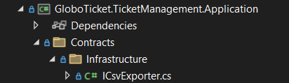
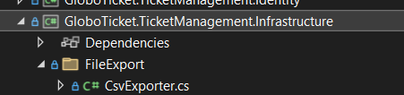
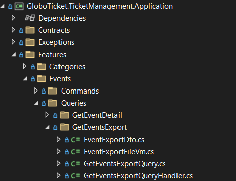
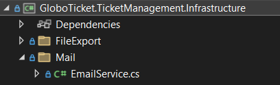
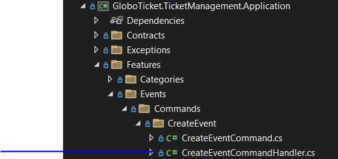
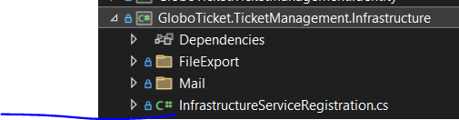

# Part 17：实现 Infrastructure 层（CSV 导出 + SendGrid 邮件）

> 用途: 调研参考（非开发依据）· 逐篇忠实对译，主题串读见 [07](07-infrastructure-and-persistence.md)，横向判读见 [09](09-critique-and-repo-mapping.md)

## 原文信息

| 项 | 值 |
| --- | --- |
| 原标题 | What is Clean Architecture: Part 17 - Implementing the Infrastructure Layer with CSV Export and Email Service |
| 链接 | https://dev.to/moh_moh701/what-is-clean-architecture-part-17-implementing-the-infrastructure-layer-with-csv-export-and-email-service-f8e |
| 作者 | mohamed Tayel（`moh_moh701`） |
| 发布时间 | 2024-09-12T23:40:55Z |
| 系列 | Clean Architecture（collection 28557）第 17 篇 |
| 平台标注阅读时长 | 未标注（`reading_time: null`） |
| 反应数 / 评论数 | 3 / 0 |
| 标签 | `architecture` `dotnetcore` `api` |
| AI 披露状态 | `not_disclosed` |
| dev.to 文章 id | 1998691 |
| 本篇原图 | 7 张（已下载至 `imges/`，全为 Visual Studio 操作截图） |

---

## 逐段对译（正文与代码**全量照录**，含原稿自身的断行破碎）

### Introduction

> In this article, we will build the **Infrastructure Layer** in a .NET project, focusing on two key functionalities:
> 1. Exporting event data to a CSV file using the `CsvHelper` library.
> 2. Sending email notifications when new events are created using the **SendGrid** service.
>
> By following **Clean Architecture** principles, we'll ensure that the application remains decoupled from the actual infrastructure implementations.

本篇构建 Infrastructure 层，聚焦两个功能：用 **CsvHelper** 导出活动数据为 CSV；新活动创建时用 **SendGrid** 发通知邮件。遵循 CA 原则，让应用与基础设施实现解耦。

> **判读（需求溯源断链）**：这两个功能里，"导出活动 CSV"**不在 P4 需求清单内**（grep P4 原稿：无 csv/export/download 字样）；而 P4 真正写明的"按月审查全部活动销售、界面需承载很长订单列表"的功能，到本篇依然没有对应实现——**规划内的没做、没规划的做了**。"新活动建后给管理员发邮件"同样不在 P4 需求里。功能清单与需求文档的失联，在系列后段成为常态。

### 1. Setting Up the Infrastructure Layer

> The **Infrastructure Layer** handles external system interactions such as: Sending emails via an external email service (e.g., SendGrid). Exporting data to CSV files for reporting or analytics. To keep the system maintainable, we separate the contracts (interfaces) into the **Application Layer** and place the actual implementations into the **Infrastructure Layer**.
>
> 1. In your solution, right-click on the solution name and select **Add > New Project**.
> 2. Choose **Class Library** as the project type and name it `GloboTicket.TicketManagement.Infrastructure`.

Infrastructure 层处理外部系统交互（邮件、CSV 导出）；**契约（接口）放 Application 层、实现放 Infrastructure 层**。在解决方案上新建 Class Library 工程 `GloboTicket.TicketManagement.Infrastructure`。


> 注记：P6 建解决方案文件夹时就画了 Infrastructure 夹、P15 又把 Infrastructure 讲了整整一节，**工程却到 P17 才真正创建**——中间 P16 的邮件短信里都没提到它去哪了。另外本篇自始至终**没有安装 `CsvHelper` 与 `SendGrid` 两个 NuGet 包的任何步骤**（grep 全系列 `PackageReference Include="CsvHelper"` / `"SendGrid"` 零命中）——两个核心功能的直接依赖只存在于 import 语句里，安装动作整个缺席（对照 P10/P13/P16 都规规矩矩给了包引用——唯独本篇没有，属步骤级断链）。

### 2. Implementing CSV Export Functionality

#### Step 2.1: Define the CSV Export Contract in the Application Layer（原文逐字）

```csharp
namespace GloboTicket.TicketManagement.Application.Contracts.Infrastructure
{
    public interface ICsvExporter
    {
        byte[] ExportEventsToCsv(List<EventExportDto> eventExportDtos);
    }
}
```



> 注记：接口住 `Contracts/Infrastructure`——P9 判读过的"契约名带实现层词汇"问题（`Contracts/Persistence`）在这里被**复制成了第二个**：把"导出文件"这一能力按"基础设施"归类命名。换成 `Contracts/Exporting` 或动词能力名，替换实现时就不必连文件夹语义一起搬家。另：`byte[]` 同步返回（无 `async`）——CSV 写内存流本可异步，契约层放弃了 `Task<byte[]>`。顺带收账：P15 猜的是 "`might` implement an interface like **IFileExporter**"，实名 `ICsvExporter`（[part-15](part-15-infrastructure-persistence-layers.md) 判读 2 的预言在此对账）。

#### Step 2.2: Implement the `CsvExporter` in the Infrastructure Layer（原文逐字）

```csharp
using CsvHelper;
using System.IO;
using System.Text;
using GloboTicket.TicketManagement.Application.Contracts.Infrastructure;
using GloboTicket.TicketManagement.Application.Features.Events.Queries.GetEventsExport;

namespace GloboTicket.TicketManagement.Infrastructure.FileExport
{
    public class CsvExporter : ICsvExporter
    {
        public byte[] ExportEventsToCsv(List<EventExportDto> eventExportDtos)
        {
            using var memoryStream = new MemoryStream();
            using (var streamWriter = new StreamWriter(memoryStream, Encoding.UTF8))
            {
                using var csvWriter = new CsvWriter(streamWriter);
                csvWriter.WriteRecords(eventExportDtos);  // Write event records to CSV
            }

            return memoryStream.ToArray();  // Return CSV as byte array
        }
    }
}
```



> - **Purpose**: This class converts a list of `EventExportDto` objects to a CSV format and returns the data as a byte array.

小疵注记：`StreamWriter(memoryStream, Encoding.UTF8)` 默认带 **BOM** 头——导出件首字节是 `EF BB BF`，Excel 无感、程序化消费方常踩；`new CsvWriter(streamWriter)` 在 CsvHelper 较新版本要求传 `CsvConfiguration`（区域设置），裸构造已被 deprecate 过一轮（**推断/未验证版本线**，本篇没给包版本正是没得对拍的根源）。

#### Step 2.3: Create the CSV Export Feature in the Application Layer（四个文件逐字）

```csharp
namespace GloboTicket.TicketManagement.Application.Features.Events.Queries.GetEventsExport
{
    public class EventExportDto
    {
        public Guid EventId { get; set; }
        public string Name { get; set; } = string.Empty;
        public DateTime Date { get; set; }
    }
}
```

```csharp
namespace GloboTicket.TicketManagement.Application.Features.Events.Queries.GetEventsExport
{
    public class EventExportFileVm
    {
        public string EventExportFileName { get; set; } = string.Empty;
        public string ContentType { get; set; } = string.Empty;
        public byte[]? Data { get; set; }
    }
}
```

```csharp
using MediatR;

namespace GloboTicket.TicketManagement.Application.Features.Events.Queries.GetEventsExport
{
    public class GetEventsExportQuery : IRequest<EventExportFileVm>
    {
    }
}
```

```csharp
using MediatR;
using AutoMapper;
using GloboTicket.TicketManagement.Application.Contracts.Infrastructure;
using GloboTicket.TicketManagement.Domain.Entities;

namespace GloboTicket.TicketManagement.Application.Features.Events.Queries.GetEventsExport
{
    public class GetEventsExportQueryHandler : IRequestHandler<GetEventsExportQuery, EventExportFileVm>
    {
        private readonly IAsyncRepository<Event> _eventRepository;
        private readonly IMapper _mapper;
        private readonly ICsvExporter _csvExporter;

        public GetEventsExportQueryHandler(IMapper mapper, IAsyncRepository<Event> eventRepository, ICsvExporter csvExporter)
        {
            _mapper = mapper;
            _eventRepository = eventRepository;
            _csvExporter = csvExporter;
        }

        public async Task<EventExportFileVm> Handle(GetEventsExportQuery request, CancellationToken cancellationToken)
        {
            var allEvents = _mapper.Map<List<EventExportDto>>((await _eventRepository.ListAllAsync()).OrderBy(x => x.Date));
            var fileData = _csvExporter.ExportEventsToCsv(allEvents);

            return new EventExportFileVm
            {
                ContentType = "text/csv",
                Data = fileData,
                EventExportFileName = $"{Guid.NewGuid()}.csv"
            };
        }
    }
}
```



> **判读（四处）**：
> 1. **又见泛型仓储**：注入 `IAsyncRepository<Event>`（与 P10 同款，绕开 `IEventRepository`）——P8/P9 的"专用仓储"论证在读侧**从头到尾没被使用过**（全系列读侧仅 P11 用过一次 `ICategoryRepository`）。
> 2. **`CreateMap<Event, EventExportDto>` 全系列从未配置**：本篇没贴 MappingProfile 更新，前面 P10/P11/P12 的三个版本里也没有这一条。AutoMapper 对未配置映射抛 "Missing type map configuration"——**照文本落地，导出功能一按就炸**（幽灵映射，与 `CreateEventDto` 同案）。
> 3. 全表读 + 内存 `OrderBy` + 整表映射：P9 契约四缺陷（无分页）在此第二次收割；P4 关心的"很长列表"在导出路径上依旧裸奔。
> 4. **`EventExportFileName = $"{Guid.NewGuid()}.csv"`**：用户下载到的文件叫 `3f2a…d1.csv`。管理员审查报表的合理期待（日期命名）让位给了一行省事代码——P4 的"高效管理分析销售数据"目标连文件名这一格都没接住。

### 3. Implementing Email Functionality Using SendGrid

#### Step 3.1: Define the Email Service Contract（原文逐字）

```csharp
namespace GloboTicket.TicketManagement.Application.Contracts.Infrastructure
{
    public interface IEmailService
    {
        Task<bool> SendEmail(Email email);
    }
}
```

> **判读**：`Email` 类型**全系列从未定义**（grep `class Email` 零命中；本篇 import 了 `Application.Models.Mail` 但没贴 `Email.cs` / `EmailSettings.cs` 任何一个文件）——幽灵类型第四、第五例。P15 猜对了这个名字（"would define an interface like `IEmailService`"），纯属猜测语态撞对了概率最高的命名。返回 `Task<bool>` 把成功压缩成一位、错误细节全丢（同 P13 `BaseResponse.Success` 口味）。

#### Step 3.2: Implement the Email Service in the Infrastructure Layer（原文逐字）

```csharp
using GloboTicket.TicketManagement.Application.Contracts.Infrastructure;
using GloboTicket.TicketManagement.Application.Models.Mail;
using Microsoft.Extensions.Options;
using SendGrid;
using SendGrid.Helpers.Mail;
using Microsoft.Extensions.Logging;

namespace GloboTicket.TicketManagement.Infrastructure.Mail
{
    public class EmailService : IEmailService
    {
        private readonly EmailSettings _emailSettings;
        private readonly ILogger<EmailService> _logger;

        public EmailService(IOptions<EmailSettings> mailSettings, ILogger<EmailService> logger)
        {
            _emailSettings = mailSettings.Value;
            _logger = logger;
        }

        public async Task<bool> SendEmail(Email email)
        {
            var client = new SendGridClient(_emailSettings.ApiKey);
            var sendGridMessage = MailHelper.CreateSingleEmail(
                new EmailAddress(_emailSettings.FromAddress, _emailSettings.FromName),
                new EmailAddress(email.To),
                email.Subject,
                email.Body,
                email.Body);

            var response = await client.SendEmailAsync(sendGridMessage);

            _logger.LogInformation("Email sent");

            return response.StatusCode == System.Net.HttpStatusCode.Accepted || response.StatusCode == System.Net.HttpStatusCode.OK;
        }
    }
}
```



> **判读**：
> 1. **`_logger.LogInformation("Email sent")` 打在状态检查之前**——429/403/500 也会先日志"已发送"。本篇全系列**唯一一处真实使用日志**的代码，用起来就是假账。（P15 判读"日志从未写过"的唯一例外：一行误导性 LogInformation。）
> 2. `CreateSingleEmail(..., email.Body, email.Body)` 把**纯文本体同时当 HTML 体**发——正文里的 `<`、换行、链接渲染全凭收件人客户端运气。
> 3. `new SendGridClient(...)` 每次调用新建（含 HttpClient 语义），官方文档明言复用；配合 §4 的 `AddTransient` 注册，是"每次发消息重建连接"的组合。
> 4. `ILogger<EmailService>` 注入了，但**没有任何一处日志配置/Provider 注册**（P18 也不会配）——API 工程里默认 Console 输出聊胜于无。
> 5. 面向中国大陆用户的视角补一刀：SendGrid 属需自备国际链路/合规评估的外部服务（对照本仓 global-cn-adaptation 思路与 `docs/mailer-en.md` 的国内邮件通道）。

#### Step 3.3: Send Email from the Application Layer（原文逐字，含断行破碎）

```csharp
using AutoMapper;
using GloboTicket.TicketManagement.Application.Contracts.Infrastructure;
using GloboTicket.TicketManagement.Application.Contracts.Persistence;
using GloboTicket.TicketManagement.Application.Models.Mail;
using GloboTicket.TicketManagement.Domain.Entities;
using MediatR;

namespace GloboTicket.TicketManagement.Application.Features.Events.Commands.CreateEvent
{
    public class CreateEventCommandHandler : IRequestHandler<CreateEventCommand, Guid>
    {
        private readonly IEventRepository _eventRepository;
        private readonly IMapper _mapper;
        private readonly IEmailService _emailService;

        public CreateEventCommandHandler(IMapper mapper, IEventRepository eventRepository, IEmailService emailService)
        {
            _mapper = mapper;
            _eventRepository = eventRepository;
            _emailService = emailService;
        }

        public async Task<Guid> Handle(CreateEventCommand request, CancellationToken cancellationToken)
        {
            var @event = _mapper.Map<Event>(request);

            var validator = new CreateEventCommandValidator(_eventRepository);
            var validationResult = await validator.ValidateAsync(request);

            if (validationResult.Errors.Count > 0)
                throw new Exceptions.ValidationException(validationResult);

            @event = await _eventRepository.AddAsync(@event);

            // Sending email notification to admin
            var email = new Email
            {
                To = "admin@example.com",
                Subject = "A new event was created",
                Body = $"A new event was created: {request}"
            };

            try
            {
                await _email

Service.SendEmail(email);
            }
            catch (Exception ex)
            {
                // Log the error and continue
            }

            return @event.EventId;
        }
    }
}
```



> **判读（本篇信息密度最高的一段，六条）**：
> 1. **handler 版本第四次漂移、且"吃掉"了 P13**：本篇 `IRequestHandler<CreateEventCommand, Guid>` 回到 P12 的 `IRequest<Guid>`——**P13 整篇的 `CreateEventCommandResponse`/`BaseResponse` 工程被无声废弃**（grep 全系列：`CreateEventCommandResponse` 仅 p13 出现）。同一 handler 在 P12/P13/P17 有三个互不兼容的返回契约、P17 的校验失败通路（throw）与 P13 的（200+Success=false）也是两条互斥路线。系列没有"回退 P13"的只言片语——四份 `MappingProfile`、三个 handler、两套错误通路，**"以最后版本为准"需要读者自行考古**。
> 2. **`Exceptions.ValidationException` 又是幽灵类型**（grep：全系列仅本篇出现；无定义、无 using 全名，`Exceptions` 相对命名空间指向哪也没讲）。P12 的 `NotFoundException`、P13 的 `CreateEventDto`、P16 的 `OrderRepository` 之后第四个——本篇一篇就贡献两个。
> 3. **`await _email⏎⏎Service.SendEmail(email);` 标识符被断行劈成两半**——逐字照录自 `body_markdown`（对拍 `/tmp/ca/src/p17.md` 同形）。作者排版事故之外更值得注意的是：**若真在 IDE 里跑过这段代码，不存在编译通过的 `_email Service`**——再次实证未运行。
> 4. **`catch (Exception ex) { // Log the error and continue }` 空吞**：注释承诺"log the error"，代码一行没做（`ex` 未用，CS0168 警告）；发件失败在 2024 年的教程形态是"成功的创建 + 无告知的静默"。而"给管理员同步发一封建活动通知"本身是**把外部副作用内联进命令**的写法——CA/ES 视角下这正是领域事件要解耦的东西（作者 P3 批评过事件驱动复杂、本系列也从未用任何事件；对照本仓"事件发而不存"的 ES 钩子阶段）。
> 5. `To = "admin@example.com"` 硬编码收件人（无配置、无多收件人、无环境区分——`.example.com` 连占位域名规约都遵守了，仅此一处好习惯）。`Body` 用 `{request}` 插值——**兑现了 P12 `ToString()` 重写埋的伏笔**（摘要不含 ImageUrl/CategoryId 的设计在此闭环，这也是全系列罕见的"前后呼应"案例）。
> 6. 邮件在 `AddAsync`（已提交事务，P16 每方法各自 SaveChanges）**之后**同步发送：创建成功但邮件超时→用户等一次外网 RTT；校验不通过（P13 双重否定 bug）也根本走不到这里——三个后果都源自"副作用内联 + 无事件"。

### 4. Registering Services in the DI Container（原文逐字）

```csharp
public static class InfrastructureServiceRegistration
{
    public static IServiceCollection AddInfrastructureServices(this IServiceCollection services, IConfiguration configuration)
    {
        services.Configure<EmailSettings>(configuration.GetSection("EmailSettings"));
        services.AddTransient<IEmailService, EmailService>();
        services.AddTransient<ICsvExporter, CsvExporter>();

        return services;
    }
}
```

> Make sure to call this method in `Program.cs` of your API project:

```csharp
builder.Services.AddInfrastructureServices(builder.Configuration);
```



> **判读**：`EmailSettings` 靠 `configuration.GetSection("EmailSettings")` 绑定，但 **appsettings.json 的对应节全系列从未展示**（ApiKey/FromAddress/FromName 三键只存在于想象）——"配置即幽灵"延续 P16 连接字符串的旧习。`AddTransient` 对无状态导出器合理、对每次 new client 的邮件服务则是雪上加霜（与 §3.2 判读 3 同案）。好消息：P14 悬置的"到底在哪调用"至此给出了 Program.cs 的 `builder.Services...` 一行（Minimal Hosting 形态终于与 P5 选型合拍）。

### Conclusion

> In this article, we successfully created the **Infrastructure Layer** with support for: **CSV export** using the `CsvHelper` library. **Email sending** using the **SendGrid** service. By adhering to Clean Architecture principles, we ensured that both the **Application Layer** and **Infrastructure Layer** remain decoupled, making the system maintainable and extendable. For the complete source code, you can visit the GitHub repository: https://github.com/mohamedtayel1980/clean-architecture

本篇建成 Infrastructure 层（CsvHelper 导出 + SendGrid 发邮件），Application 与 Infrastructure 保持解耦。完整源码见 GitHub。

> 注记：结尾无下篇预告（P18 实际就是 API 层，读者无从预知编排顺序）；"remain decoupled" 的实况：应用层直接 `new SendEmail` 内联副作用、契约名带 Infrastructure 字样——解耦只到"接口/实现分文件夹"为止。

---

## 整理注记（本篇结构性小结）

| 维度 | 事实 |
| --- | --- |
| CA 得分点 | 外部服务"契约在内层、实现在外层"的落地样本（两个完整实现类首次全部现身）；`Program.cs` 调用点补齐；P12 ToString 伏笔在此兑现 |
| CA 失分点 | 邮件副作用内联命令 handler（无事件/无 outbox）；契约目录再次按实现层命名（Contracts/Infrastructure） |
| 需求失联 | CSV 导出与管理员邮件都不在 P4 需求清单；P4 的"按月销售审查"至完结无实现 |
| 可编译性 | 五个原稿级断点：CsvHelper/SendGrid 包从未安装、`Email`/`EmailSettings`/`ValidationException` 三幽灵类型、`Event↔EventExportDto` 映射从未配置、`_email Service` 断行 |
| 版本漂移 | 同一 `CreateEventCommandHandler` 三种返回契约（P12 Guid → P13 Response → P17 Guid），P13 成果无声废弃 |
| 社区检验 | 3 反应 / 0 评论 |

## 与本仓对照（本篇）

| 本篇做法 | 本仓实态 |
| --- | --- |
| 导出/邮件功能无需求来源、规划内功能落空 | 需求→方案→实现有 `docs/plans` 留痕链审计门（AGENTS.md §2 无已审方案不写码） |
| `Email`/`EmailSettings` 幽灵类型、appsettings 节不展示 | zod 契约单源 + `verify-config-contract` 对拍配置与实存；`mailer` 上下文有 MJML 模板与运行参数文档（docs/mailer-en.md） |
| 邮件同步内联在命令里、失败静默 | 跨上下文/外部副作用走领域事件钩子（发而不存阶段）+ 失败可观测（Pino 日志 + 全局过滤器） |
| 同一 handler 三版本互不兼容、后篇覆盖前篇 | 单一代码库单一真相；变更走迁移与 PR 评审，不存在"教程篇章各自贴码"的漂移空间 |
| 文件名 = 随机 GUID | 导出命名走日期/业务语义（推断处已标注：本仓尚未实作导出，此行为规划口径） |

## 评论区实录

**本篇评论数为 0**（API `comments_count: 0`，`/api/comments?a_id=1998691` 空数组）。

---

## 附：原文英文全稿（逐字保留）

> 来源：dev.to 官方 API `body_markdown` 字段（作者原始稿），抓取于 2026-10-21；除把图片链接改为本地 `./imges/` 副本（原始 URL 保留在链接 title 中）外，未作任何增删改。
>
> 呈现口径：以下英文全稿**不做代码块包裹、直接按 Markdown 渲染**（保留作者原始标题层级、粗体、列表、代码块与图片）；逐字性以上述 body_markdown 抓取为准，本区未增删改任何文字。

**Introduction:**
In this article, we will build the **Infrastructure Layer** in a .NET project, focusing on two key functionalities:
1. Exporting event data to a CSV file using the `CsvHelper` library.
2. Sending email notifications when new events are created using the **SendGrid** service.

By following **Clean Architecture** principles, we'll ensure that the application remains decoupled from the actual infrastructure implementations. Let’s begin by setting up the project structure and building the infrastructure layer step by step.

---

### **1. Setting Up the Infrastructure Layer**

The **Infrastructure Layer** handles external system interactions such as:
- Sending emails via an external email service (e.g., SendGrid).
- Exporting data to CSV files for reporting or analytics.

To keep the system maintainable, we separate the contracts (interfaces) into the **Application Layer** and place the actual implementations into the **Infrastructure Layer**.

#### **Step 1: Add the Infrastructure Layer to the Solution**

1. In your solution, right-click on the solution name and select **Add > New Project**.
2. Choose **Class Library** as the project type and name it `GloboTicket.TicketManagement.Infrastructure`.


---

### **2. Implementing CSV Export Functionality**

Let’s first implement the CSV export functionality using the `CsvHelper` library.

#### **Step 2.1: Define the CSV Export Contract in the Application Layer**

1. In your **Application Layer**, navigate to `Contracts/Infrastructure`.
2. Add a new interface `ICsvExporter.cs`:


```csharp
namespace GloboTicket.TicketManagement.Application.Contracts.Infrastructure
{
    public interface ICsvExporter
    {
        byte[] ExportEventsToCsv(List<EventExportDto> eventExportDtos);
    }
}
```

#### **Step 2.2: Implement the `CsvExporter` in the Infrastructure Layer**

Now, let’s implement the actual export logic in the **Infrastructure Layer**.

1. In your **Infrastructure** project, create a folder named `FileExport`.
2. Add a class named `CsvExporter.cs`:


```csharp
using CsvHelper;
using System.IO;
using System.Text;
using GloboTicket.TicketManagement.Application.Contracts.Infrastructure;
using GloboTicket.TicketManagement.Application.Features.Events.Queries.GetEventsExport;

namespace GloboTicket.TicketManagement.Infrastructure.FileExport
{
    public class CsvExporter : ICsvExporter
    {
        public byte[] ExportEventsToCsv(List<EventExportDto> eventExportDtos)
        {
            using var memoryStream = new MemoryStream();
            using (var streamWriter = new StreamWriter(memoryStream, Encoding.UTF8))
            {
                using var csvWriter = new CsvWriter(streamWriter);
                csvWriter.WriteRecords(eventExportDtos);  // Write event records to CSV
            }

            return memoryStream.ToArray();  // Return CSV as byte array
        }
    }
}
```

- **Purpose**: This class converts a list of `EventExportDto` objects to a CSV format and returns the data as a byte array.

#### **Step 2.3: Create the CSV Export Feature in the Application Layer**

Next, we’ll create the handler that will be responsible for exporting events.

1. In the **Application Layer**, navigate to `Features/Events/Queries/GetEventsExport`.


2. Add the following files step by step:

**`EventExportDto.cs`:**

```csharp
namespace GloboTicket.TicketManagement.Application.Features.Events.Queries.GetEventsExport
{
    public class EventExportDto
    {
        public Guid EventId { get; set; }
        public string Name { get; set; } = string.Empty;
        public DateTime Date { get; set; }
    }
}
```

**`EventExportFileVm.cs`:**

```csharp
namespace GloboTicket.TicketManagement.Application.Features.Events.Queries.GetEventsExport
{
    public class EventExportFileVm
    {
        public string EventExportFileName { get; set; } = string.Empty;
        public string ContentType { get; set; } = string.Empty;
        public byte[]? Data { get; set; }
    }
}
```

**`GetEventsExportQuery.cs`:**

```csharp
using MediatR;

namespace GloboTicket.TicketManagement.Application.Features.Events.Queries.GetEventsExport
{
    public class GetEventsExportQuery : IRequest<EventExportFileVm>
    {
    }
}
```

**`GetEventsExportQueryHandler.cs`:**

```csharp
using MediatR;
using AutoMapper;
using GloboTicket.TicketManagement.Application.Contracts.Infrastructure;
using GloboTicket.TicketManagement.Domain.Entities;

namespace GloboTicket.TicketManagement.Application.Features.Events.Queries.GetEventsExport
{
    public class GetEventsExportQueryHandler : IRequestHandler<GetEventsExportQuery, EventExportFileVm>
    {
        private readonly IAsyncRepository<Event> _eventRepository;
        private readonly IMapper _mapper;
        private readonly ICsvExporter _csvExporter;

        public GetEventsExportQueryHandler(IMapper mapper, IAsyncRepository<Event> eventRepository, ICsvExporter csvExporter)
        {
            _mapper = mapper;
            _eventRepository = eventRepository;
            _csvExporter = csvExporter;
        }

        public async Task<EventExportFileVm> Handle(GetEventsExportQuery request, CancellationToken cancellationToken)
        {
            var allEvents = _mapper.Map<List<EventExportDto>>((await _eventRepository.ListAllAsync()).OrderBy(x => x.Date));
            var fileData = _csvExporter.ExportEventsToCsv(allEvents);

            return new EventExportFileVm
            {
                ContentType = "text/csv",
                Data = fileData,
                EventExportFileName = $"{Guid.NewGuid()}.csv"
            };
        }
    }
}
```

---

### **3. Implementing Email Functionality Using SendGrid**

Next, let’s add email functionality using **SendGrid**.

#### **Step 3.1: Define the Email Service Contract**

1. In the **Application Layer**, navigate to `Contracts/Infrastructure`.
2. Add a new interface `IEmailService.cs`:

```csharp
namespace GloboTicket.TicketManagement.Application.Contracts.Infrastructure
{
    public interface IEmailService
    {
        Task<bool> SendEmail(Email email);
    }
}
```

#### **Step 3.2: Implement the Email Service in the Infrastructure Layer**

1. In the **Infrastructure** project, create a folder called `Mail`.
2. Add a new class named `EmailService.cs`:


```csharp
using GloboTicket.TicketManagement.Application.Contracts.Infrastructure;
using GloboTicket.TicketManagement.Application.Models.Mail;
using Microsoft.Extensions.Options;
using SendGrid;
using SendGrid.Helpers.Mail;
using Microsoft.Extensions.Logging;

namespace GloboTicket.TicketManagement.Infrastructure.Mail
{
    public class EmailService : IEmailService
    {
        private readonly EmailSettings _emailSettings;
        private readonly ILogger<EmailService> _logger;

        public EmailService(IOptions<EmailSettings> mailSettings, ILogger<EmailService> logger)
        {
            _emailSettings = mailSettings.Value;
            _logger = logger;
        }

        public async Task<bool> SendEmail(Email email)
        {
            var client = new SendGridClient(_emailSettings.ApiKey);
            var sendGridMessage = MailHelper.CreateSingleEmail(
                new EmailAddress(_emailSettings.FromAddress, _emailSettings.FromName),
                new EmailAddress(email.To),
                email.Subject,
                email.Body,
                email.Body);

            var response = await client.SendEmailAsync(sendGridMessage);

            _logger.LogInformation("Email sent");

            return response.StatusCode == System.Net.HttpStatusCode.Accepted || response.StatusCode == System.Net.HttpStatusCode.OK;
        }
    }
}
```

#### **Step 3.3: Send Email from the Application Layer**

Now let’s use the `IEmailService` in the `CreateEventCommandHandler` to send an email when an event is created.

1. Navigate to `Features/Events/Commands/CreateEvent`.
2. Open `CreateEventCommandHandler.cs` and modify the code as follows:


```csharp
using AutoMapper;
using GloboTicket.TicketManagement.Application.Contracts.Infrastructure;
using GloboTicket.TicketManagement.Application.Contracts.Persistence;
using GloboTicket.TicketManagement.Application.Models.Mail;
using GloboTicket.TicketManagement.Domain.Entities;
using MediatR;

namespace GloboTicket.TicketManagement.Application.Features.Events.Commands.CreateEvent
{
    public class CreateEventCommandHandler : IRequestHandler<CreateEventCommand, Guid>
    {
        private readonly IEventRepository _eventRepository;
        private readonly IMapper _mapper;
        private readonly IEmailService _emailService;

        public CreateEventCommandHandler(IMapper mapper, IEventRepository eventRepository, IEmailService emailService)
        {
            _mapper = mapper;
            _eventRepository = eventRepository;
            _emailService = emailService;
        }

        public async Task<Guid> Handle(CreateEventCommand request, CancellationToken cancellationToken)
        {
            var @event = _mapper.Map<Event>(request);

            var validator = new CreateEventCommandValidator(_eventRepository);
            var validationResult = await validator.ValidateAsync(request);

            if (validationResult.Errors.Count > 0)
                throw new Exceptions.ValidationException(validationResult);

            @event = await _eventRepository.AddAsync(@event);

            // Sending email notification to admin
            var email = new Email
            {
                To = "admin@example.com",
                Subject = "A new event was created",
                Body = $"A new event was created: {request}"
            };

            try
            {
                await _email

Service.SendEmail(email);
            }
            catch (Exception ex)
            {
                // Log the error and continue
            }

            return @event.EventId;
        }
    }
}
```

---

### **4. Registering Services in the DI Container**

To complete the setup, you need to register the `EmailService` and `CsvExporter` in the DI container.

1. In the **Infrastructure** project, navigate to `InfrastructureServiceRegistration.cs`:


```csharp
public static class InfrastructureServiceRegistration
{
    public static IServiceCollection AddInfrastructureServices(this IServiceCollection services, IConfiguration configuration)
    {
        services.Configure<EmailSettings>(configuration.GetSection("EmailSettings"));
        services.AddTransient<IEmailService, EmailService>();
        services.AddTransient<ICsvExporter, CsvExporter>();

        return services;
    }
}
```

2. Make sure to call this method in `Program.cs` of your API project:

```csharp
builder.Services.AddInfrastructureServices(builder.Configuration);
```

---

### **Conclusion:**

In this article, we successfully created the **Infrastructure Layer** with support for:
- **CSV export** using the `CsvHelper` library.
- **Email sending** using the **SendGrid** service.

By adhering to Clean Architecture principles, we ensured that both the **Application Layer** and **Infrastructure Layer** remain decoupled, making the system maintainable and extendable. 
For the complete source code, you can visit the GitHub repository: https://github.com/mohamedtayel1980/clean-architecture
