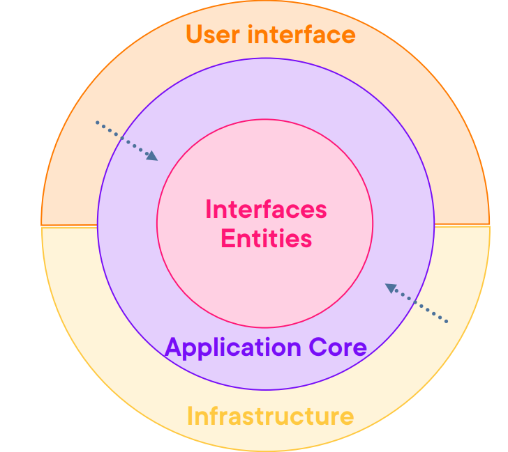

# Part 18：加 API 层（ASP.NET Core 8 组合根与 CORS）

> 用途: 调研参考（非开发依据）· 逐篇忠实对译，主题串读见 [08](08-api-layer.md)，横向判读见 [09](09-critique-and-repo-mapping.md)

## 原文信息

| 项 | 值 |
| --- | --- |
| 原标题 | What is Clean Architecture: Part 18 - Adding API |
| 链接 | https://dev.to/moh_moh701/what-is-clean-architecture-part-18-adding-api-23l2 |
| 作者 | mohamed Tayel（`moh_moh701`） |
| 发布时间 | 2024-09-17T20:31:03Z |
| 系列 | Clean Architecture（collection 28557）第 18 篇 |
| 平台标注阅读时长 | 未标注（`reading_time: null`） |
| 反应数 / 评论数 | 2 / 0 |
| 标签 | `architecture` `softwareengineering` `api` `dotnetcore` |
| AI 披露状态 | `not_disclosed` |
| dev.to 文章 id | 2004455 |
| 本篇原图 | 1 张（已下载至 `imges/`） |

---

## 逐段对译（正文与代码**全量照录**）

### 开篇（含全系列最响的一票"免责声明"）

> Throughout the previous articles, we have done a lot of groundwork building the essential layers of our application, focusing on clean, maintainable architecture. However, **while our code base builds successfully**, we haven't yet exposed any working functionality for consumers to interact with. That's about to change. In this module, we will focus on creating the **API** layer, using **ASP.NET Core 8**, which will act as the gateway to the core functionality of our application.

前面几篇打好了各层地基；**"虽然我们的代码库能构建成功"**（while our code base builds successfully），但还没有任何可供消费者交互的功能——本篇用 ASP.NET Core 8 创建 **API 层**，作为通往核心功能的门户。

> **判读（"builds successfully" 是全系列最可证伪的一句话）**：按 P10-P17 交付的文件集合，工程**不可能编译通过**——本项目自己就埋着：P12/P13/P17 引用的 `NotFoundException`、`CreateEventDto`、`ValidationException`、`OrderRepository` 四个类型从未定义（grep 全系列实测），P11 调用接口上不存在的方法，P17 的 `_email Service` 断行。作者 either 从未以教程文本为准构建过（与 P16 判读一致），either 其真实仓库里有这些文件但**没有把它们交付进教程**（对读者而言等价于断链）。无论哪种解释，"builds successfully" 都是**无证据的自我认证**；这也是"部署声明必须真跑对拍"纪律（本仓 AGENTS.md §2）在反面教材上的最佳注脚。另：正文自称 "In this **module**"（本篇是系列不是 module，词汇漂移再添一例）。

### Getting Started with the API

> The creation of the API project is relatively straightforward, but there are key decisions to consider regarding how to structure the API itself. We will look at several aspects, including how **MediatR** integrates with the API, which code belongs in the API controllers, and how to structure the responses to ensure proper data handling. Finally, we'll set up **Swagger** to document the API.

API 工程创建本身简单，关键在结构决策：MediatR 如何与 API 集成、哪些代码属于控制器、响应如何组织以保证数据处理正确。**最后我们会配好 Swagger** 文档。

> 注记：**Swagger 的"承诺-兑现"追踪**：本篇正文说要配 Swagger，代码里却只有被注释掉的一行 `// builder.Services.AddSwaggerGen();`——要到 P19 才真正启用（且 P19 附带的"reminder 版"StartupExtensions 与本篇存在 4 处差异——对拍 `edited_at` 后查明：本篇在 P19 发布前 3 分钟被回改过，差异属"回改后两篇文本不同步"，见下方注记与 [part-19](part-19-controllers.md) 头条判读）。

### Creating the API Project

> We have already constructed the **Core** and **Infrastructure** layers, and now we'll be adding the final piece of the architecture—the **API**.

"我们已经建好了 **Core** 和 **Infrastructure** 层"，现在加上架构最后一块——API。



> The **API** opens up the backend services, allowing various clients (e.g., web apps, mobile apps) to interact with the core business logic and data. Unlike traditional UIs like **ASP.NET Core MVC** or **Razor Pages**, this API will be the primary interface for communication.

API 打开后端服务，让 web/移动端等各种客户端与核心业务和数据交互；不同于 MVC/Razor Pages 这类传统 UI，API 是主通信界面，也支持系统间集成。

> 注记：**edited_at 对拍新证据**——P18 发布于 2024-09-17，其 `edited_at = 2024-10-15T19:03:24Z` 恰在 P19 发布（同日 19:06:23）**前 3 分钟**：作者在发终篇前 3 分钟回改了本篇（**推断**：dev.to API 只给 edited_at 时间戳、不给 diff，“改动即 CORS 数组化那行”是由 P19 reminder 版反推的最佳解释，未验证）。这说明 P19 那段并非"未声明的第四版"，而是**回改后两边不同步**——但"发布前 3 分钟才回改、正文说明文字（specified clients）未随之修订、危险行照抄进两篇"仍是同一治理病灶。原注记方向保留、口径修正。
>
> 注记：创建 API 工程**没有任何步骤**——P6-P9 连"右键 Add > New Project"都截图演示，本篇一句带过（无 `dotnet new webapi`、无模板选择、无工程名 `GloboTicket.TicketManagement.Api` 的建立演示，只在 csproj 路径里反推存在）。教程详略节奏后段完全失控。"Core 层已建好"的说法也是层名漂移：解决方案里从来只有 Domain/Application/Persistence/Infrastructure 四个类库，没有叫 Core 的工程。

### Project Setup（引用三个工程，原文逐字）

> Before we begin coding, let's add references to the **Core**, **Infrastructure**, and **Persistence** layers within the API project:

```xml
<ItemGroup>
  <ProjectReference Include="..\GloboTicket.TicketManagement.Application\GloboTicket.TicketManagement.Application.csproj" />
  <ProjectReference Include="..\GloboTicket.TicketManagement.Infrastructure\GloboTicket.TicketManagement.Infrastructure.csproj" />
  <ProjectReference Include="..\GloboTicket.TicketManagement.Persistence\GloboTicket.TicketManagement.Persistence.csproj" />
</ItemGroup>
```

> These references allow the API project to utilize the business logic from **Core** and the services provided by **Infrastructure** and **Persistence**.

三段引用让 API 用上 Core 的业务逻辑与 Infrastructure/Persistence 的服务。

> **判读**：正文说引 "Core、Infrastructure、Persistence"，XML 实际引的是 **Application**、Infrastructure、Persistence——"Core" 一词在正文两句里分别指代不存在的工程与应用工程本身。更重要的是依赖图定型：**API 同时引用三个外层工程**（composition root 全知全能，方向正确——外层互不引用、由 API 组装），这是全系列第一次也是唯一一次把可验证的完整依赖图摆到桌面上（P9 只给了 Application→Domain，P16 给了 Persistence→Application）。可惜作者没有点破"这就是依赖规则落点"。

### Configuring the API in ASP.NET Core 8（`StartupExtensions.cs`，原文逐字）

```csharp
using GloboTicket.TicketManagement.Application;
using GloboTicket.TicketManagement.Infrastructure;
using GloboTicket.TicketManagement.Persistence;

namespace GloboTicket.TicketManagement.Api
{
    public static class StartupExtensions
    {
        public static WebApplication ConfigureServices(
           this WebApplicationBuilder builder)
        {
            builder.Services.AddApplicationServices();
            builder.Services.AddInfrastructureServices(builder.Configuration);
            builder.Services.AddPersistenceServices(builder.Configuration);
            builder.Services.AddControllers();

            builder.Services.AddCors(options => options.AddPolicy(
                "open",
                policy => policy.WithOrigins(
                    builder.Configuration["ApiUrl"] ?? "https://localhost:7020")
                .AllowAnyMethod()
                .AllowAnyHeader()
                .AllowCredentials()
                .SetIsOriginAllowed(origin => true)
            ));

            // Optional: Enable Swagger for API documentation
            // builder.Services.AddSwaggerGen();

            return builder.Build();
        }

        public static WebApplication ConfigurePipeline(this WebApplication app)
        {
            app.UseCors("open");

            app.UseHttpsRedirection();
            app.MapControllers();

            return app;
        }
    }
}
```

> **判读（CORS 段是本篇最危险的四行）**：
> 1. **`SetIsOriginAllowed(origin => true)` + `AllowCredentials()` = 任意源带凭证跨域**：任何网站都能带着用户 cookie 调这个 API 并读取响应（CSRF 的读侧孪生）。ASP.NET Core 文档明言二者组合仅适用于"完全公开"场景，而这里同时 `AllowCredentials`——三者并存是教科书级错误配置。**与 `WithOrigins(...)` 同时写更是自我矛盾**：`SetIsOriginAllowed` 会覆盖 `WithOrigins`，前面按 `ApiUrl` 配置白名单的心意被最后一行整个作废。这段"open"策略会被不明就里的读者原样搬进生产——教程把它当作正面示例给出，没有任何警告。
> 2. `builder.Configuration["ApiUrl"]`——`ApiUrl` 配置键**全系列从未在 appsettings 出现过**（与 P16 连接字符串、P17 EmailSettings 同病：代码引用的配置项从不展示落盘形态）。
> 3. `AddSwaggerGen()` 注释掉的行旁还缺 `UseSwagger()/UseSwaggerUI()`——就算取消注释也起不来（Swashbuckle 包本身亦无安装步骤）。
> 4. 管道里没有**任何异常处理中间件**：P12 的 `NotFoundException`（幽灵）、P17 的 `ValidationException`（幽灵）抛出后直达框架默认 500——P15 评论区承诺的 error handling 在组合根处再次缺席（对账：四项承诺里"错误处理"的第二个 ❌）。

### `Program.cs`（原文逐字）

```csharp
using GloboTicket.TicketManagement.Api;

var builder = WebApplication.CreateBuilder(args);

var app = builder
       .ConfigureServices()
       .ConfigurePipeline();

app.Run();
```

> This setup ensures that all the services and middleware are registered properly without cluttering the main entry point of the API.

服务与中间件登记干净、入口不 cluttered。

> 注记：P14 悬了两篇的"到底在哪调用 `AddApplicationServices`"至此闭合，Minimal Hosting 链式扩展的写法本身是 .NET 8 社区通行做法（此处不苛责）。`AddPersistenceServices` 的方法名与 P16 §8 一致（本篇少数前后吻合点）。

### What's Inside the Extensions?

> 1. **ConfigureServices**: Registers the application, infrastructure, and persistence services. Adds support for controllers… Configures **CORS** to allow the API to be accessed by specified front-end clients, such as the one hosted at `ApiUrl` **or `BlazorUrl`**. Optionally sets up **Swagger** for API documentation.
> 2. **ConfigurePipeline**: Applies the **CORS** policy. Redirects all HTTP traffic to HTTPS for security. Maps the controllers to the routes.

逐条复述两个扩展做了什么；CORS 描述里冒出 **`BlazorUrl`**。

> **判读**：正文说"specified front-end clients"（受控白名单），代码实况却是 `SetIsOriginAllowed(origin => true)`（全放行）——**说明文字与代码矛盾**的又一例。`BlazorUrl` 则是**血缘泄漏**：本系列从未出现 Blazor（P4/P5 定的前端是"web app"，Pluralsight 原课程 Gill Cleeren 的配套前端才是 Blazor）——这句是从源课程文本迁移时的残留物证，与 [part-16](part-16-ef-core-persistence.md) 判读 4 的 seed 数据同源证据互相咬合（**推断**：素材源自该公开课程，非作者原创）。

### Bringing it All Together

> We've now set up the **API** to interface with the **Core** and **Infrastructure** layers, following **Clean Architecture** principles… In the next module, we'll explore how to structure the API controllers and implement specific use cases, including the use of **MediatR** to handle commands and queries, ensuring our controllers remain lean and focused on their primary role—handling HTTP requests and responses. Stay tuned for more as we continue building out the API functionality!
> For the complete source code, you can visit the GitHub repository: https://github.com/mohamedtayel1980/clean-architecture

API 已接好各层；**下一篇将讲控制器结构与 MediatR 用例接线，让控制器保持精瘦、只管 HTTP 收发**。完整源码见 GitHub。

> 注记：下篇预告兑现（P19 即控制器篇）——全系列 19 篇里"预告→兑现"链条这次终于对齐；P19 也是唯一带 "part-19" 完结气质的篇目。

---

## 整理注记（本篇结构性小结）

| 维度 | 事实 |
| --- | --- |
| CA 得分点 | 完整依赖图首次落地（API→App/Infra/Persistence 单向、外层由组合根装配）；扩展方法拆分 Program 的模式成熟 |
| 安全硬伤 | CORS "open" 策略任意源+凭证（危险配置当正面示例）；无异常中间件；无认证授权（Identity 承诺第三次跳过） |
| 承诺-兑现 | Swagger 本篇只留注释行（P18 于 P19 发布前 3 分钟被回改，`AddSwaggerGen` 才启用——本篇交付文本与回改版存在 4 处差异，见上方 edited_at 注记）；`ApiUrl` 幽灵配置；`BlazorUrl` 血缘残留 |
| 自相矛盾 | 开篇 "code base builds successfully" 与 4 个幽灵类型/断行代码直接冲突（无证据自我认证）；正文 "specified clients" vs 代码全放行 |
| 教程卫生 | 建工程步骤零演示（与前 9 篇截图级颗粒度判若两人）；"Core/Infrastructure 已建好"层名漂移 |
| 社区检验 | 2 反应 / 0 评论——危险 CORS 无人指出 |

## 与本仓对照（本篇）

| 本篇做法 | 本仓实态 |
| --- | --- |
| `SetIsOriginAllowed(origin=>true)+AllowCredentials` | Fastify CORS 显式白名单（配置走 Joi/zod 校验的多层配置系统），无"全开+凭证"组合空间 |
| 异常裸 500、无中间件 | 全局 `HttpExceptionFilter` + 统一错误 envelope（本仓错误处理体系，对照 [09 §5](09-critique-and-repo-mapping.md)） |
| "builds successfully" 口头声明 | AGENTS.md §2 铁律"部署声明必须真跑对拍"：`pnpm run ci`（check→build→test）与 `verify:prod-boot` 实跑链才算数 |
| 幽灵配置键 `ApiUrl` | `verify-config-contract.ts` 对拍配置契约与 env 实存，缺键直接 fail-loud |
| Swagger 注释一行算"已配" | OpenAPI 产物真实存在（`openapi/openapi.yaml`）且有 `deploy-swagger.yml` CI 发布链 |

## 评论区实录

**本篇评论数为 0**（API `comments_count: 0`，`/api/comments?a_id=2004455` 空数组）。

---

## 附：原文英文全稿（逐字保留）

> 来源：dev.to 官方 API `body_markdown` 字段（作者原始稿），抓取于 2026-10-21；除把图片链接改为本地 `./imges/` 副本（原始 URL 保留在链接 title 中）外，未作任何增删改。
>
> 呈现口径：以下英文全稿**不做代码块包裹、直接按 Markdown 渲染**（保留作者原始标题层级、粗体、列表、代码块与图片）；逐字性以上述 body_markdown 抓取为准，本区未增删改任何文字。

Throughout the previous articles, we have done a lot of groundwork building the essential layers of our application, focusing on clean, maintainable architecture. However, while our code base builds successfully, we haven’t yet exposed any working functionality for consumers to interact with. That’s about to change. In this module, we will focus on creating the **API** layer, using **ASP.NET Core 8**, which will act as the gateway to the core functionality of our application.

### Getting Started with the API

The creation of the API project is relatively straightforward, but there are key decisions to consider regarding how to structure the API itself. We will look at several aspects, including how **MediatR** integrates with the API, which code belongs in the API controllers, and how to structure the responses to ensure proper data handling. Finally, we'll set up **Swagger** to document the API, ensuring consumers have a clear understanding of its functionality.

### Creating the API Project

Let’s begin by creating the API project. This task is simple, but it will act as the interface between the outside world and our application’s core logic. We have already constructed the **Core** and **Infrastructure** layers, and now we’ll be adding the final piece of the architecture—the **API**.

Here’s a quick look at how this new layer fits into our overall **Clean Architecture**:


The **API** opens up the backend services, allowing various clients (e.g., web apps, mobile apps) to interact with the core business logic and data. Unlike traditional UIs like **ASP.NET Core MVC** or **Razor Pages**, this API will be the primary interface for communication. This approach allows for greater flexibility, supporting multiple client types and even system-to-system integrations.

### Project Setup

Before we begin coding, let’s add references to the **Core**, **Infrastructure**, and **Persistence** layers within the API project to ensure proper interaction with the existing architecture. Update the `csproj` file to include these references:

```xml
<ItemGroup>
  <ProjectReference Include="..\GloboTicket.TicketManagement.Application\GloboTicket.TicketManagement.Application.csproj" />
  <ProjectReference Include="..\GloboTicket.TicketManagement.Infrastructure\GloboTicket.TicketManagement.Infrastructure.csproj" />
  <ProjectReference Include="..\GloboTicket.TicketManagement.Persistence\GloboTicket.TicketManagement.Persistence.csproj" />
</ItemGroup>
```

These references allow the API project to utilize the business logic from **Core** and the services provided by **Infrastructure** and **Persistence**.

### Configuring the API in ASP.NET Core 8

Next, we will configure the **Program.cs** file. Instead of cluttering it with multiple lines of service and pipeline configuration, we will leverage extension methods to keep things clean and modular.

#### `StartupExtensions.cs`

We’ll define two extension methods: one to configure services and the other to set up the middleware pipeline.

```csharp
using GloboTicket.TicketManagement.Application;
using GloboTicket.TicketManagement.Infrastructure;
using GloboTicket.TicketManagement.Persistence;

namespace GloboTicket.TicketManagement.Api
{
    public static class StartupExtensions
    {
        public static WebApplication ConfigureServices(
           this WebApplicationBuilder builder)
        {
            builder.Services.AddApplicationServices();
            builder.Services.AddInfrastructureServices(builder.Configuration);
            builder.Services.AddPersistenceServices(builder.Configuration);
            builder.Services.AddControllers();

            builder.Services.AddCors(options => options.AddPolicy(
                "open",
                policy => policy.WithOrigins(
                    builder.Configuration["ApiUrl"] ?? "https://localhost:7020")
                .AllowAnyMethod()
                .AllowAnyHeader()
                .AllowCredentials()
                .SetIsOriginAllowed(origin => true)
            ));

            // Optional: Enable Swagger for API documentation
            // builder.Services.AddSwaggerGen();

            return builder.Build();
        }

        public static WebApplication ConfigurePipeline(this WebApplication app)
        {
            app.UseCors("open");

            app.UseHttpsRedirection();
            app.MapControllers();

            return app;
        }
    }
}
```

### `Program.cs`

Once the extension methods are defined, we can use them to set up the API in a very concise and clean way:

```csharp
using GloboTicket.TicketManagement.Api;

var builder = WebApplication.CreateBuilder(args);

var app = builder
       .ConfigureServices()
       .ConfigurePipeline();

app.Run();
```

This setup ensures that all the services and middleware are registered properly without cluttering the main entry point of the API.

### What’s Inside the Extensions?

1. **ConfigureServices**:
   - Registers the application, infrastructure, and persistence services.
   - Adds support for controllers to handle incoming API requests.
   - Configures **CORS** (Cross-Origin Resource Sharing) to allow the API to be accessed by specified front-end clients, such as the one hosted at `ApiUrl` or `BlazorUrl`.
   - Optionally sets up **Swagger** for API documentation.

2. **ConfigurePipeline**:
   - Applies the **CORS** policy.
   - Redirects all HTTP traffic to HTTPS for security.
   - Maps the controllers to the routes, enabling the API to respond to HTTP requests.

### Bringing it All Together

We’ve now set up the **API** to interface with the **Core** and **Infrastructure** layers, following **Clean Architecture** principles. The **API** will expose functionality for client applications to consume, while maintaining a clear separation of concerns.

By leveraging the **ASP.NET Core 8** framework, we are taking advantage of the latest optimizations, ensuring that our API is both efficient and scalable. With the modular setup we’ve implemented, maintaining and extending the API will be straightforward as the project grows.

In the next module, we’ll explore how to structure the API controllers and implement specific use cases, including the use of **MediatR** to handle commands and queries, ensuring our controllers remain lean and focused on their primary role—handling HTTP requests and responses.

Stay tuned for more as we continue building out the API functionality!
For the complete source code, you can visit the GitHub repository: https://github.com/mohamedtayel1980/clean-architecture
